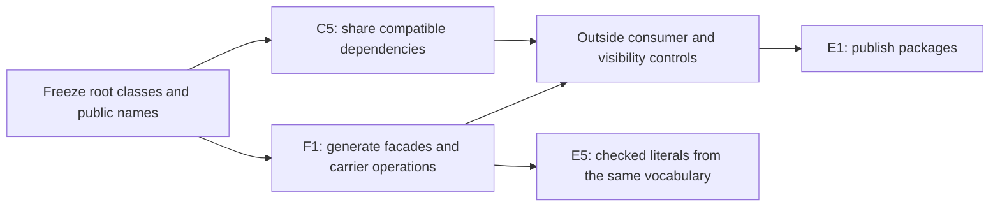

# API review at `4a81cc034`

Keep the proposed cuts, but fix their compatibility contracts before dispatching them.
The largest gains come from precise refusals, a truthful tool table, and stable generated names.
The plan currently promises more uniformity than the implementations support.

This report reviews repository `lean4-effect4` at `4a81cc03479f4af874d4ee198777cdef1decc206`.
Every source citation below refers to that commit.
The isolated worktree is `/Users/pooks/.codex/worktrees/api-semantics-review/lean4-effect4`.
No tracked source changes, commits, pushes, or merges belong to this review.

## Evidence and terms

The dictionary is `docs/core/controlled-english.md`, especially its seven judgments and exact embedding entry.
An observation below means the explicitly named result being compared.
A compatibility projection removes newly added diagnostic detail before comparing an old result.
A method descriptor means generated metadata about an existing request constructor.
A context means the ancestors, siblings, typing signature, and binders surrounding one program address.
It excludes the program occupying that address.

**Checked source** means inspected definitions at the pinned commit.
**Finite probe** means the retained Lean file evaluates the named examples.
**Proposed** means an interface or law still needs its implementation and placement in the semantics registry.
The proposals' Lean blocks specify interfaces and obligations, not compiled replacements.
Identifiers introduced in those blocks belong to the proposed modules.

The review reruns the plan's read-only measurement script.

[baseline.txt](probes/baseline.txt) reproduces the supplied baseline.
[inventory.json](probes/inventory.json) records replacement spans, search commands, counts, and every matching path.
[source-extracts.txt](probes/source-extracts.txt) retains the measured declaration bodies.
Counts measure gross replacement spans, not net savings.
Several proposals reach the same files, so their counts must not be added.

The narrow dependency build passes: 449 jobs, recorded in [build.log](probes/build.log).
[Controls.lean](probes/Controls.lean) and [IndexedReplay.lean](probes/IndexedReplay.lean) pass with warnings treated as errors.
The latter proves the generic indexed append equation.
Its two numerical controls show why a suffix must retain its starting index.
The former checks the actual APIs, including JSON ambiguity, policy distinctions, omission, revert, and counted holes.
No whole-tree build, behaviour gate, native execution, or axiom gate runs in this review.
The supplied probes' earlier native results remain historical evidence.

One literature premise needs correction.
Hazelnut's action relation is partial: its implementation disables actions that cannot be performed and raises `InvalidAction` internally.
Its sensibility theorem assumes an action transition exists.
It does not assert that every action succeeds at every cursor.
See Omar, Voysey, Hilton, Aldrich, and Hammer, *Hazelnut: A Bidirectionally Typed Structure Editor Calculus*, POPL 2017.
[Paper](https://arxiv.org/pdf/1607.04180).
The checked implementation is `hazelgrove/HZ`, `src/hz_semantics.ml`, commit `2ec8a4ce37a3c1f6f6cacb2fc3a2421ae3126090`.
Its `performEMove` rejects moving to a child of a literal.

Zhao, Maroof, Dukkipati, Blinn, Pan, and Omar instead give a total marking procedure over arbitrary expressions.
Their marked calculus recovers typing information through explicit error marks.
This does not make the original unmarked expression pass its original checker.
See *Total Type Error Localization and Recovery with Holes*, POPL 2024.
[Paper](https://hazel.org/papers/marking-popl24.pdf).
Here, marks must remain diagnostic data beside `Eff`, under decisions row 288.

## Ranked proposals

### 1. R1.1 — retain the judgment's reason and its address

| Field | Finding |
| --- | --- |
| ID | R1.1 |
| Kind | consolidation |
| Pattern | located refusal |
| Plan | Amend A1. Share the wrapper and retain separate judgment alphabets. |
| Size | M |

**Now.** These signatures are from `src/Effect4/Program/Typing/Blame.lean`, `SourceSession.lean`, `FillSet.lean`, and `src/Effect4/Program/Admission.lean`.

```lean
structure TypeRefusal where
  path : List Nat
  reason : TypeReason
-- Constructor signatures, copied verbatim:
| term (t : Term)
| notKept (focus : TyEnv × EffTy) (verdict : Except TypeRefusal EffTy)
| notCertified
| illTyped
```

`FillSetInternal.addEntry` discards the feed refusal.
`Suggest.suggestOne`, in `src/Effect4/Program/Typing/Suggest.lean`, adds `path ++ why.path` itself.
Other clients receive that same part refusal without relocation.
`Api.explain_none_iff`, in `src/Effect4/Api.lean`, relates refusal absence to typing, not to all admission checks.

**Proposed.** Share a product, not one untyped global reason enum.
Parameterize locations because a program node, signature field, and missing JSON field have different addresses.

```lean
structure Located (Site Reason : Type) where
  site : Site
  reason : Reason

def Located.mapSite {P Q R : Type} (f : P → Q)
    (r : Located P R) : Located Q R := ⟨f r.site, r.reason⟩

structure Judgment (X : Type) (Y P R : X → Type) (J : X → Prop) where
  decide : (x : X) → Except (Located (P x) (R x)) (Y x)
  explains : (x : X) → Located (P x) (R x) → Prop
  accepts : ∀ x y, decide x = .ok y → J x
  admits : ∀ x, J x → ∃ y, decide x = .ok y
  located : ∀ x r, decide x = .error r → explains x r

-- Generated aliases retain each judgment's alphabet.
abbrev ProgramRefusal := Located (List Nat) TypeReason
-- Changed constructors:
| notCertified (why : FeedRefusal)
| illTyped (why : TypeRefusal)
```

Define `Judgment.explain` by projecting the error of `decide`.
Its completeness law generalizes `Api.explain_none_iff`:

```lean
theorem Judgment.explain_none_iff (d : Judgment X Y P R J) (x : X) :
    d.explain x = none ↔ J x

theorem Located.mapSite_comp (f : P → Q) (g : Q → S) (r : Located P R) :
    Located.mapSite g (Located.mapSite f r) = Located.mapSite (g ∘ f) r

theorem feed_refines (o : Oracle) (p : FeedPolicy) (s : SourceSession) (e : Edit) :
    eraseFeed e (feedLocated o p s e).value = (SourceSession.feed o p s e).value ∧
    eraseCheckTrace (feedLocated o p s e).trace = (SourceSession.feed o p s e).trace
```

`eraseFeed` removes new detail and reverses the relocation associated with that edit.
`eraseCheckTrace` removes enriched reasons from dependency answers while retaining their keys, order, and multiplicity.
Analogous erasure equations connect fill submission and program admission before their old constructors disappear.
The completeness proof uses `accepts` and `admits`.
The location field alone establishes neither direction of the judgment's acceptance law nor correctness of a reason.

For nested program checks, use prefix composition once at the call boundary.
A part-relative address `q` at source address `p` becomes `p ++ q`.
Represent source and expanded-copy addresses separately when references require both.
Do not append a source prefix to a JSON-field address.
Use a typed location map for that crossing.

Split `.term` using the existing term checker and atom catalogue.
Distinguish unbound variable, unknown atom, refused argument types, and literal outside the alphabet.
Keep any existing record, tuple, and fold reasons more specific than those fallback cases.
Give `rootRefused` a document-root location and the draft remedy.

**Observation.** Accepted values, refusal precedence, atomic document updates, and checker traces remain equal after diagnostic erasure.
Detailed refusals intentionally change.
R1.2 controls their wire and digest migration.

**Deletes.** Replace the five-line `TypeRefusal` declaration with the shared alias.
Replace the 42-line manual `TypeReason.head` with a signature-generated constructor-name projection.
Generate that projection beside the alphabet, avoiding an import cycle through derived codecs.
Remove the discarded `.error _` information in `FillSetInternal.addEntry`.
Remove the manual relocation in `Suggest.suggestOne` after the feed owns relocation.

**Reach.** `rg -l -e 'TypeRefusal|TypeReason|notCertified|illTyped|notKept' src Test ocaml tools` finds **76 files**.
They include `SourceFeedControls`, `SourceDocumentControls`, `FillSetControls`, admission laws, and generated refusal codecs.
The retained inventory gives exact paths.

**Red control.** Fill `[1]` with `.succeed (.var 1)` where only one variable exists.
Both edit and pending-fill routes must report the same absolute program address and unbound-variable reason.
A second prefix would be a failure.
Signature admission must still refuse before program typing when both fail.

**Placement.** `Judgment.explain_none_iff` generalizes the located-refusal property in `initial-algebras-folds`.
Propose claim `judgment-explanation`, role compatibility, serving R8 and R14.
Its reach is each separately supplied judgment and its two judgment premises.
It establishes no relation between different judgments or runtime behaviour.
`mapSite_comp` is its helper, consumed by nested refusal adapters.
`feed_refines` and its two adapters serve `source-feed-keep-exact`, `pending-fill-construction`, and `built-admission-exact`.
Their observation includes old success and refusal selection, after erasure.
They establish no equality of runtime observations or host progress.

### 2. R4.1 — replace the JSON twins with a located, exact reader

| Field | Finding |
| --- | --- |
| ID | R4.1 |
| Kind | consolidation |
| Pattern | exact embedding |
| Plan | Amend A2 and C6. Keep the current accepted domain and name its normalizer. |
| Size | M |

**Now.** From `src/Effect4/Store/Domain/ShapeRead.lean` and `src/Effect4/Tool/CodecProfile.lean`:

```lean
def ShapeDoc.read (doc : ShapeDoc) (j : Json) : Option Val
def Canonical.ofJsonAnyOrder {α : Type} [Canonical α] (j : Json) : Option α
def read {α : Type} [Canonical α] (json : Effect4.Json) : Except Refusal α
```

`ShapeDoc.read_exact`, in `src/Effect4/Laws/Store/ShapeRead.lean`, proves `doc.print v = j` on every successful read.
It uses the identity normalizer.
`Canonical.ofJsonAnyOrder_exact` instead proves:

```lean
theorem Canonical.ofJsonAnyOrder_exact {α : Type} [Canonical α] {j : Json} {a : α}
    (h : Canonical.ofJsonAnyOrder j = some a) :
    Canonical.print a = (Canonical.shape α).order j
```

`ShapeDoc.order` orders fields and converts recognized list-family arrays to canonical `nil`/`cons` objects.
It does not erase arbitrary extra keys or normalize arbitrary numeric text.
The input is already an `Effect4.Json` value.

The pair is not an exact embedding over all `Val` values fitting a shape.
The probe checks `option unit`: `some unit` and `none` print identically, and reading selects `none`.
Exact successful acceptance already holds, so calling this reader merely a widening would also misdescribe it.
The missing obligation is unrestricted retraction.
Use the successful-writer domain, not a universal round-trip claim.

**Proposed.** A JSON location points either to a present value or to a named absence at a present parent.
Profile refusals point to the shape, not a fabricated input subtree.

```lean
inductive JsonStep where
  | key (name : String)
  | index (n : Nat)
inductive JsonSite where
  | value (path : List JsonStep)
  | missing (parent : List JsonStep) (field : String)
  | schema (path : List JsonStep)
inductive JsonReason where
  | expected (shape : Shape)
  | unknownField (name : String)
  | duplicateField (name : String)
  | unknownCase (name : String)
  | naturalOutsideProfile (limit : Nat)
  | carrierValue
  | unsupportedProfile
  | budget

def ShapeDoc.readLocated (doc : ShapeDoc) (j : Json) :
    Except (Located JsonSite JsonReason) Val
def CodecProfile.readLocated {α : Type} [Canonical α] (j : Json) :
    Except (Located JsonSite JsonReason) α
```

The reader tracks original JSON addresses during normalization.
An error in an array item must retain its array index, not expose a synthetic `cons.tail` path.
Carrier admission through `Canonical.ofVal` remains a separate check after shape reading.
Represent its refusal explicitly, including the root when no finer witness exists.

```lean
theorem readLocated_erases (doc : ShapeDoc) (j : Json) :
    (doc.readLocated j).toOption = doc.read j
theorem profileLocated_erases [Canonical α] (j : Json) :
    (CodecProfile.readLocated (α := α) j).toOption =
      (CodecProfile.read (α := α) j).toOption
theorem profileLocated_exact [Canonical α] {j : Json} {a : α}
    (h : CodecProfile.readLocated j = .ok a) :
    Canonical.print a = (Canonical.shape α).order j
theorem readLocated_site {doc : ShapeDoc} {j : Json} {r : Located JsonSite JsonReason}
    (h : doc.readLocated j = .error r) : ValidSite doc j r.site
```

`ValidSite` checks present parents for `.missing` and shape paths for `.schema`.
The plan's requirement that every refusal path exists in the input is false for a missing field.
The probe's object `{}` under a required `x` field is the smallest example.
Budget failure must not be presented as proof that no value fits the shape.

Retraction uses the existing guarded writer domain:

```lean
theorem write_readLocated [Canonical α] {a : α} {j : Json}
    (h : CodecProfile.write a = .ok j) : CodecProfile.readLocated j = .ok a
```

The proof route transports the existing profile writer law through `profileLocated_erases`.
The located reader's structural erasure proof supplies exactness through `Canonical.ofJsonAnyOrder_exact`.
Hard structural proofs belong in Rocq over generated definitions if the short Lean route does not suffice.
No proof is assigned to LCNF lowering.

**Observation.** Keep success/refusal and decoded canonical values equal for every existing JSON input under the selected profile.
Keep printed JSON equal on accepted values, including list spelling, key order, and numeric limits.
For text, state parser acceptance and rendering separately.
Compare both successful inputs and malformed inputs at C6 cutover.
The 408 print cases alone do not test duplicate keys, missing fields, unsupported options, or overflow.

**Deletes.** Replace 49 lines across `readIn`, `readList`, `readFields`, and `CodecProfile.read` with the located implementation.
Keep their old Option signatures as projections until callers move.
Then remove `ocaml/engine/kit/kit_json.ml` (**426 lines**) and `ocaml/eff/eff_json_text.ml` (**67 lines**).
Remove generated `ocaml/eff/eff_json.ml` (**373 lines**) after its consumers move.
Remove its output arm from `src/OCaml5/Tools/EffGen.lean`, not the entire EffGen producer.
EffGen still owns other generated outputs.

**Reach.** `rg -l -e 'ShapeDoc\.read|ofJsonAnyOrder|CodecProfile|Kit_json|Eff_json' src Test ocaml tools` finds **49 files**.
The reach includes ShapeRead laws, Tool codec controls, Kit JSON callers, and Eff printer tests.
Shared Eff JSON consumers invalidate the plan's blanket assertion that no slice can reach TypeScript checks.
Determine the reached existing behaviour target from the actual changed producer and consumer set.

**Red control.** Reject duplicate `x` without `y`, excess fields, a misspelled case, and a natural above `natLimit`.
Refuse `Option Unit` as unsupported in the current profile.
Keep reordered valid objects and both recognized list spellings accepted.
Textual duplicate-key handling must remain observable before a host parser discards duplicates.

**Placement.** `readLocated_erases`, `profileLocated_erases`, `profileLocated_exact`, and `write_readLocated` serve `exact-codecs`, property `json-read-exact`.
Propose claim `json-read-located`, role compatibility, with `profileLocated_exact` as the pointer and the erasure equations as helpers.
Their reach is the existing budgeted reader and explicit JSON profile.
They establish neither arbitrary shape retraction nor textual JSON identity.
`readLocated_site` serves the same claim's diagnostic property, with the amended location relation.
These laws serve R8, R12, and R14.

### 3. R5.1 — generate one method descriptor with the actual result schema

| Field | Finding |
| --- | --- |
| ID | R5.1 |
| Kind | consolidation |
| Pattern | fold |
| Plan | Amend C2 and A3 together. Include the extra describe tool and the wire envelope. |
| Size | S |

**Now.** From `src/Effect4/Tool/Protocol.lean` and `Methods.lean`:

```lean
inductive Request where
  | act (a : Action)
  | ask (q : Query)
def Request.method : Request → String
def supportedMethods : List (String × List Nat)
def descriptions : List (String × String × String)
structure Entry where
  name : String
  description : String
  kind : String
  field : String
  caseName : String
  schema : String
```

`Request` itself has two constructors, not nineteen method constructors.
The method constructors are in its nested `Action` and `Query` sums.
`Methods.groups` already walks those shapes.
`Methods.entries` silently substitutes an empty description when its lookup fails.

The probe counts nineteen protocol methods.
MCP's twentieth tool, `describe`, is outside `Request`.
`ocaml/engine/kit/kit_mcp.ml` returns an entire `Wire.Envelope Reply` as ordinary `structuredContent`.
Therefore `shape Reply` is the wrong output schema for the current response.
The `describe` result is a JSON Schema document, also not a `Reply`.

**Proposed.** Generate a finite method key from the nested constructor signature.
Attach the exceptional spelling `open_` → `open` to its owning constructor once.
Descriptions are exhaustive functions over the generated key, not fallible string lookups.

```lean
inductive MethodKind where | query | action
structure MethodDescriptor where
  name : String
  kind : MethodKind
  versions : List Nat
  arguments : ShapeDoc
  result : ShapeDoc
  description : String
  readOnly : Bool

def Request.methodKey : Request → MethodKey
def methodDescriptor : MethodKey → MethodDescriptor
def protocolMethods : List MethodDescriptor
def tools : List ToolDescriptor
```

`MethodKey` is generated from `Action` and `Query`.
`ToolDescriptor` adds the single `describe` descriptor with its own argument and result schemas.
Generate method names, supported versions, MCP table entries, and dispatch adapters from this owner.
Keep transport extensions outside the semantic request sum until an actual query consumer needs them.

```lean
theorem method_name_agrees (r : Request) :
    (methodDescriptor r.methodKey).name = r.method
theorem query_hint (q : Query) :
    (methodDescriptor (Request.ask q).methodKey).readOnly = true
theorem hinted_readOnly (o : Oracle) (s : State) (r : Request)
    (h : (methodDescriptor r.methodKey).readOnly = true) :
    (serve o s r).value.1 = s
```

The first equation is the connector before old names disappear.
The third uses the generated classification and `serve_query`.
The proof concerns Tool state, not arbitrary future host IO.
Treat idempotence, destructive effects, and world access as separate hints.
Do not infer them from `serve_query` alone.

For current ordinary responses, generate a closed schema for `Wire.Envelope Reply`.
Resolve its definitions within the output schema.
The input table's descriptions omit definitions and are not exact standalone schemas.
Use a separate schema for `describe` and retain JSON-RPC errors outside `structuredContent`.
Changing structured content to a bare `Reply` would instead require an explicit protocol version change.

**Observation.** Existing method names, selected versions, input decoding, replies, and state transitions remain equal.
The tool listing gains accurate metadata.
JSON-RPC error versus tool-result classification remains observable.

**Deletes.** Replace the 29 lines of `Request.method`, `supportedMethods`, and `method_supported` with generated projections and a construction invariant.
Remove the independent names from `Methods.descriptions`, retaining its prose as constructor metadata.
Remove the missing-description fallback.
Replace both handwritten MCP table assemblers with one generated descriptor renderer.

**Reach.** `rg -l -e 'Request\.method|supportedMethods|Methods\.|tool_native_methods|describe_tool' src Test ocaml tools` finds **13 files**.
They include `ToolMethodsControls`, wire version selection, Native method exports, and MCP assembly.

**Red control.** Adding a method without documentation must fail generation by constructor name.
Validate an actual enveloped response against the emitted schema.
A bare-Reply schema must fail that test.
Check `describe` independently.
A duplicate wire name must refuse generation rather than shadow another entry.

**Placement.** `method_name_agrees` serves `exact-codecs`, request codec compatibility, R8/R12.
Propose claim `tool-method-descriptor`, role compatibility.
`query_hint` is its classification helper.
`hinted_readOnly` serves existing `tool-serve-query` under `host-session-protocol`, R6/R13.
Its reach is model state for all oracles, states, and classified requests.
It establishes no rollback of external effects or native transport property.
Schema validation remains finite host evidence until a separate schema acceptance relation is proved.

### 4. R3.1 — share edit payloads without merging their acceptance judgments

| Field | Finding |
| --- | --- |
| ID | R3.1 |
| Kind | consolidation |
| Pattern | typed editing |
| Plan | Amend A1's hole hygiene. Keep L1's checking-route distinction. |
| Size | M |

**Now.** From `src/Effect4/Program/Edit.lean` and `src/Effect4/Program/Typing/SourceDocument.lean`:

```lean
inductive Edit where
  | fill (path : List Nat) (program : NativeEff)
  | omitAt (path : List Nat) (row : Row)
inductive Change where
  | fill (q : NativeEff)
  | omitHole (name : String)
def Place.resolve (app : SigApp) (s : Sketch) : Place → Except PlaceRefusal (List Nat × NativeEff)
def editOf (s : SourceSession) (path : List Nat) : Change → Except FeedRefusal Edit
```

From `src/Effect4/Program/Typing/SourceSession.lean`:

```lean
inductive FeedPolicy where
  | draft
  | keepExact
  | recheck
def feed (o : Oracle) (policy : FeedPolicy) (s : SourceSession) (edit : Edit) :
    Checked (Except FeedRefusal (SourceSession × Edit.Step))
```

These policies have different acceptance, not merely different checking costs.
The probe confirms that draft accepts an ill-typed replacement, recheck accepts a changed root type, and keepExact refuses both.
Draft also accepts an invalid address as an unchanged step.

**Proposed.** The minimal edit operations replace a program or declare and insert a hole row.
Batching and revert remain document operations.
Place selection remains separate from the edit payload.

```lean
inductive HoleSpec where
  | explicit (row : Row)
  | fromFocus (name : String)
inductive EditOp where
  | fill (program : NativeEff)
  | omit (hole : HoleSpec)
structure LocatedEdit where
  path : List Nat
  op : EditOp
inductive CheckedPolicy where
  | typed
  | keepExact

structure ResolvedEdit where
  path : List Nat
  replacement : NativeEff ⊕ Row
def resolveEdit (s : SourceSession) (e : LocatedEdit) : Except FeedRefusal ResolvedEdit
def draftResolved (o : Oracle) (s : SourceSession) (e : ResolvedEdit) :
    Checked (SourceSession × Edit.Step)
def commitResolved (o : Oracle) (policy : CheckedPolicy)
    (s : SourceSession) (e : ResolvedEdit) :
    Checked (Except FeedRefusal (SourceSession × Edit.Step))
```

Use `draftResolved` and `commitResolved` as the public primitives.
`resolveEdit` refuses a missing focus when `HoleSpec.fromFocus` needs it.
The old draft adapter already has explicit rows, so its totality remains unchanged.
Commit items become `Place × EditOp`, eliminating `Change` as a second payload owner.

```lean
theorem draft_adapter (o : Oracle) (s : SourceSession) (e : Edit) :
    (draftResolved o s (ofEdit e)).map Except.ok = SourceSession.feed o .draft s e
theorem commit_adapter (o : Oracle) (s : SourceSession) (e : Edit) (p : CheckedPolicy) :
    commitResolved o p s (ofEdit e) = SourceSession.feed o (oldPolicy p) s e
theorem resolve_change (s : SourceSession) (path : List Nat) (c : Change) :
    (resolveEdit s ⟨path, ofChange c⟩).map toEdit = DocInternal.editOf s path c
```

These equalities include checking traces and edit receipts.
Move existing branches into the new primitives before deleting the old owners.
Do not collapse `canSplice` into an assumption about matching types.
It also checks whole-expansion agreement and reference faults.

A hole remains `Sketch.hole app k`, with the application-row offset owned there.
The view should return its exact generated program and every unused declared hole.
Suggestions should remove the target hole and enclosing programs that merely reproduce it.
No new constructor enters `Eff`, `Term`, or `Ty`.

**Observation.** Old adapters keep the entire checked result equal, including invalid-address draft behaviour.
The typing judgment for a checked edit stays distinct from unrestricted draft editing.
`keepExact` adds the existing exact root/local observation condition to checked editing.

**Deletes.** Replace `Change` and `DocInternal.editOf`, **12 measured lines**, with the shared payload and resolver.
Move the old Edit payload constructors into that owner before replacing `Edit` by its address-bearing adapter.
This is removal of duplicate ownership, not a claim of fewer total lines.

**Reach.** `rg -l -e 'FeedPolicy|FeedRefusal|Change\.|omitHole|editOf|Place\.resolve|Sketch\.hole' src Test ocaml tools` finds **37 files**.
Source-feed, document, fill-set, and generated Tool codecs are direct consumers.

**Red control.** An invalid-address draft remains an unchanged success.
The corresponding checked edit remains refused.
Omission from an untyped focus refuses before deriving a row.
With one application row, `external 0` must not silently stand for hole zero.

**Placement.** The three adapter equations serve `initial-algebras-folds`, properties `source-feed-draft`, `source-feed-root`, and `source-document-replay`.
They are compatibility helpers for the existing claim pointers, not new behavioural claims.
Their reach is old Edit and Change inputs under the exact original policy.
They establish no runtime meaning equality or totality for unresolved hole descriptions.
They serve R14 and retain the premises of `SourceSession.feed_keepExact`.

### 5. R3.2 — share focus lookup, then add expected context beside it

| Field | Finding |
| --- | --- |
| ID | R3.2 |
| Kind | consolidation |
| Pattern | typed editing |
| Plan | Amend A5, L2, and L3. Keep expected context partial where the context lacks information. |
| Size | L |

**Now.** The first signature is from `src/Effect4/Program/Sketch.lean`.
The others are from `src/Effect4/Program/Typing/SourceSession.lean` and `Suggest.lean`.

```lean
def focusAt (s : Sketch) (app : SigApp) (path : List Nat) : Option (Focus NativeOp)
def focusAt (s : SourceSession) (path : List Nat) : Option (Focus NativeOp)
def page (o : Oracle) (d : Doc) (path : List Nat) (supplied : List NativeEff) (cursor limit : Nat) :
    Checked (Except FeedRefusal (List Suggestion × Option Nat))
```

`focusAt` needs the current subtree to have a successful table entry.
`Suggest.page` refuses before inspecting candidates when that entry is absent.
The expected type cannot be recovered by querying that same successful-focus requirement again.

**Proposed.** Consolidate the typed-focus observation into one table reader.
Keep each caller's table: the ordinary sketch table and source table have different reference behaviour.

```lean
def focusFrom (program : NativeEff) (table : List Table.Entry) (path : List Nat) :
    Option (Focus NativeOp)
theorem source_focus_from (s : SourceSession) (p : List Nat) :
    focusFrom s.sketch.program s.table p = s.focusAt p
theorem sketch_focus_from (s : Sketch) (app : SigApp) (p : List Nat) :
    focusFrom s.program (s.table app) p = s.focusAt app p
```

The source connector follows by definition.
The sketch connector uses `Table.typedAt_table`, its converse, and the root case in `src/Effect4/Laws/Program/Edit.lean`.
Move `Table.typedAt` beside its table carrier before sharing this view; do not introduce an import cycle through `Edit`.
These connectors retain the old APIs as generated projections before their independent implementations disappear.
They do not identify source and expanded tables.

Expected context is a separate extension, not a simplification of successful focus.
An explicit root expectation and surrounding context determine a sufficient local expectation on a named fragment.
An unannotated first bind expression need not have a unique expected type.
A failed first expression may also leave the continuation's exact environment unknown.

```lean
structure Expected where
  signature : SigData
  env : TyEnv
  ty : EffTy
  binders : List (List Nat)
inductive ContextRefusal where
  | noProgram (path : List Nat)
  | noExpectedType (path : List Nat)
  | blockedBy (path : List Nat)
  | reference (path : List Nat)

def expectAt (app : SigApp) (s : Sketch) (path : List Nat) (root : EffTy) :
    Except ContextRefusal Expected
def mark (app : SigApp) (s : Sketch) : List MarkedEntry
```

`MarkedEntry` holds the source address, available context, known type, and localized failures.
Unknown context is explicit data, not `.unknown` inserted into the admission checker.
The table is a diagnostic view over `Eff` and does not become a second program representation.

Define `SameContext s t p` by equal hole tables, ancestor constructors, sibling subtrees, and declarations outside `p`.
The program at `p` is omitted from that relation.
Define `ExactContext app s p root e` by the checker rules that fix the child's exact contribution.
This relation is not defined as the theorem below's conclusion.
Its initial rules cover annotated positions and contexts whose unchanged siblings determine the remaining contributions.
At joins, an upper bound alone is insufficient to retain the exact synthesized root type.

```lean
theorem expect_context {app : SigApp} {s t : Sketch} {p : List Nat} {root : EffTy}
    (h : SameContext s t p) : expectAt app s p root = expectAt app t p root
theorem expect_rule {app : SigApp} {s : Sketch} {p : List Nat} {root : EffTy} {e : Expected}
    (h : expectAt app s p root = .ok e) : ExactContext app s p root e
theorem expect_replace {app : SigApp} {s t : Sketch} {p : List Nat}
    {root : EffTy} {e : Expected} {q qx : NativeEff}
    (he : ExactContext app s p root e)
    (hq : (Check.run (.part e.signature e.env qx)).result = .ok e.ty)
    (hf : s.fillAt p q = some t)
    (hloc : s.expand.fillAt p qx = some t.expand)
    (href : t.program.firstRefFault = none) : t.sourceCheck app = .ok root
theorem marking_agrees {app : SigApp} {s : Sketch} {ty : EffTy}
    (h : s.sourceCheck app = .ok ty) : eraseMarks (mark app s) = s.sourceTable app
```

Add address coverage for marking without asserting that every address has a known exact environment.
The generalized guarantee proposed in the earlier probe requires an actual recovery typing judgment.
Until that judgment exists, report `blockedBy` rather than inventing its result.
The exact context proof belongs in Rocq if it requires substantial induction over typing rules.
Its Lean declaration must retain the fragment and reference-expansion premises.
Here `qx` is the replacement in the expansion; `hloc` excludes edits that also change another reference use.

Suggestions use the old focus when available and `expectAt` otherwise.
In the new mode, label evidence as fitting the expected context.
Do not call it an accepted keepExact fill against a refused root.
The actual repair uses checked editing or draft, according to its policy.
Expose `Check.explain` through the same query and close its existing `explain_replays` goal before claiming dependency-local explanations.

**Observation.** On already typed contexts, retain existing candidate checks and exact-fit evidence.
At refused addresses, the new query adds information and candidate results.
No program admission result changes merely because marking assigns a diagnostic entry.

**Deletes.** Replace both independent `focusAt` bodies with projections of `focusFrom`.
Their measured spans total **8 lines**.
Replace the **11-line** focus-only `Suggest.page` dispatcher.
Remove its unconditional noFocus stop once the new context route is available.
Keep `focusAt` for consumers that require an existing checked subtree.
Do not delete the ordinary checker or its source table.

**Reach.** `rg -l -e 'focusAt|Suggest\.page|typedAt|Check\.explain|explain_replays' src Test ocaml tools` finds **48 files**.
They include suggestion controls, source-table laws, and the explanation goal.

**Red control.** Replacing a broken subtree must not change `expectAt` when its surroundings remain identical.
An untyped first bind child must not yield a fabricated continuation environment.
A candidate merely below a join bound must not claim exact root equality without `ExactContext` evidence.

**Placement.** The two focus connectors serve `initial-algebras-folds`, existing focus and table agreement, and R14.
They are compatibility helpers for `source-feed-coherent`, consumed by the shared focus view and suggestion dispatcher.
Their reach includes every old focus input with its original table.
They establish no equality between source and expanded tables or computation costs.
The four expected-context laws serve `initial-algebras-folds`, `typed-replacement`, and R14's expected-type and marking open parts.
Propose `expected-context`, role substitution, pointer `expect_replace`.
`expect_context` and `expect_rule` are its helpers, consumed by suggestions.
`marking_agrees` points to proposed `marking-agrees`, role compatibility.
Their reach is the declared exact-context fragment and successful old checks, respectively.
They establish no principal type, admission from marking, runtime equality, or host progress.
An eleventh typed-editing concept requires an owner ruling before moving these claims.

### 6. R1.2 — freeze diagnostic encodings separately from their growing alphabets

| Field | Finding |
| --- | --- |
| ID | R1.2 |
| Kind | stabilization |
| Pattern | exact embedding |
| Plan | Amend A1, A2, A4, and F1 with one versioned compatibility contract. |
| Size | M |

**Now.** From `src/Effect4/Store/Domain/Canonical.lean`:

```lean
def encode (a : α) : Bytes := Val.encode (toVal a)
def digest (a : α) : Digest := sha256 (encode a)
def print (a : α) : Effect4.Json := (shape α).print (toVal a)
```

`specOf` and `address`, in `src/Effect4/Store/Domain/Node.lean`, hash additional schema and node information.
They are not aliases for `Canonical.digest`.
`ShapeDoc.printIn`, in `src/Effect4/Store/Domain/Shape.lean`, chooses bare strings when all cases are nullary.
`Methods.schemaIn` repeats that choice in `src/Effect4/Tool/Methods.lean`.

The probe keeps an old constructor's tag at zero and appends one payload-bearing constructor.
The old value's JSON changes from `"old"` to `{"_tag":"old"}`.
Appending constructors alone therefore does not freeze old wire observations.

**Proposed.** Pin each public codec version's tag numbers, field positions, JSON case mode, and profile.
Generate this descriptor from attributes on its Lean owner.
Require explicit fresh tags for extensions and reject collisions.
Do not infer public case mode from the entire current alphabet.

```lean
structure CodecVersion (α : Type) where
  number : Nat
  shape : ShapeDoc
  toVal : α → Val
  readVal : Val → Option α
  json : α → Json
  readJson : Json → Option α
  normalize : Json → Json
  valRetract : ∀ a, readVal (toVal a) = some a
  valExact : ∀ v a, readVal v = some a → v = toVal a
  jsonRetract : ∀ a, readJson (json a) = some a
  jsonExact : ∀ j a, readJson j = some a → normalize j = normalize (json a)

structure ExtendsCodec (old : CodecVersion A) (new : CodecVersion B) where
  inject : A → B
  values : ∀ a, new.toVal (inject a) = old.toVal a
  prints : ∀ a, new.json (inject a) = old.json a
  readOld : ∀ j a, old.readJson j = some a → new.readJson j = some (inject a)
```

Here `α` ranges over the codec's admitted writer domain, not every raw carrier value.
Generate the descriptor from its versioned Canonical owner rather than supplying another handwritten implementation.
`readOld` expresses conservative acceptance on old accepted inputs.
The descriptor is codec metadata, not another program representation.
One declaration owns it and every generated face consumes it.

The three stabilization laws are:

```lean
theorem diagnostic_extension (e : ExtendsCodec old new) (a : A) :
    new.json (e.inject a) = old.json a
theorem diagnostic_digest (e : ExtendsCodec old new) (a : A) :
    sha256 (Val.encode (new.toVal (e.inject a))) =
      sha256 (Val.encode (old.toVal a))
theorem diagnostic_name (h : ManifestExtends oldNames newNames) (n : Lean.Name)
    (old : oldNames.lookup n = some path) : newNames.lookup n = some path
```

The first is conservative extension of old serialized observations.
The second follows by congruence from equal value trees.
The third uses R6.2's append-only public-name manifest.
Existing acceptance and meaning observations require their own injection equations, not merely equal hashes.

| Change | Canonical payload bytes and digest | Schema and stored-node address | JSON |
| --- | --- | --- | --- |
| Add a reason with a fresh tag and retain old payload layout | Old bytes and digests stay equal | The schema changes; its hash and dependent addresses can change | Equal only with a frozen old case mode |
| Rename a displayed reason without changing tags or payload | Old payload digest stays equal | Schema spelling changes its encoded document | Changes unless the old public spelling stays |
| Add a stored field to an old constructor | Bytes change; equal digests are no longer guaranteed | Node and schema encodings change | Changes |
| Add a diagnostic presentation field outside the stored carrier | Stored bytes stay equal | Equal if the schema and node inputs stay equal | Only the versioned presentation changes |
| Rename an OCaml wrapper only | Unchanged | Unchanged | Unchanged; source clients can break |

Hash changes are not guaranteed merely by unequal bytes.
No collision-freedom theorem is assumed by these equality laws.
Schema changes can move `Store.address` even when `Canonical.digest` stays equal.
Consequently old stored entries need their old schema reader retained, or an explicit migration.

Splitting old `.term t` into richer payloads is a versioned refinement, not a byte-preserving injection of that old value.
Retain the old case for reading its version, or store new detail outside its frozen representation.
A1 cannot both change that payload and promise identical diagnostic bytes.

**Observation.** Freeze old accepted values, their encoded bytes, and method-specific wire observations within a supported version.
Version schema changes, added mandatory fields, diagnostic refinements, and changed default response content explicitly.
Do not use digest equality as proof that two values are equal.

**Deletes.** Replace the **36-line** `Methods.schemaIn` declaration with the schema projection of the public codec descriptor.
Its mutually defined field and case helpers move with that projection.
Remove its independent all-nullary and list-family decisions.
The generic internal Shape printer may remain, but public codec mode no longer depends on it implicitly.

**Reach.** `rg -l -e 'allNullary|Canonical\.digest|Canonical\.encode|shapeDigest|codecVersion' src Test ocaml tools` finds **53 files**.
Stored node construction, session codec versions, and shape controls are material consumers.

**Red control.** Append a unary reason to an all-nullary alphabet.
Old-version bytes and old JSON must stay equal.
Reusing a tag or changing an old field position must refuse generation without a version migration.
Changing a schema must not be reported as retaining every stored address.

**Placement.** The first two laws serve `exact-codecs`, stored carrier exactness, R8/R13.
Propose `diagnostic-codec-extension`, role compatibility, pointer `diagnostic_extension`.
`diagnostic_digest` is its equality helper.
Their reach is an explicit extension witness, not every constructor edit.
They establish no collision resistance or acceptance of every old input under every future codec.
`diagnostic_name` serves the export contract in R6.2 under `translation-simulation`, R12.
It establishes naming stability only, with no claim about LCNF correctness.

### 7. R2.1 — share the indexed replay fold, retain each journal's extra checks

| Field | Finding |
| --- | --- |
| ID | R2.1 |
| Kind | consolidation |
| Pattern | partial action |
| Plan | Amend A7 and narrow its deletion claim. Amend L4's transport premises. |
| Size | M |

**Now.** From `src/Effect4/Program/Typing/SourceDocument.lean`, `src/Effect4/Tool/Replay.lean`, and `Exchange.lean`:

```lean
def replayDoc (origin : DocOrigin) (history : List DocAction) : Except (Nat × DocRefusal) SourceSession
def replayAccepted (initial : Internal.Raw) (actions : List Action) :
    Except (Nat × Refusal) Internal.Raw
def replayCursor (initial : Raw) (actions : List Action) :
    Except (Nat × Refusal) (Nat × Raw)
def replay (o : Oracle) : Nat → State → Steps → Checked (Except LoadRefusal State)
```

`Run.journal_replays`, in `src/Effect4/Laws/Run.lean`, requires `Reached s`.
Run records every command and its phase, including refusals.
Document and Tool histories record accepted actions only.
Exchange also checks every stored `after` reference.
Its chain reader separately validates parent order, codec versions, stored objects, and publication.

**Proposed.** Use a partial action in the Kleisli sense for a pure step into `Except`.
With refusal indices, carry the accepted offset through composition.
The list monoid acts totally on an error-or-indexed-state carrier, with errors absorbing.

```lean
def advance (step : S → A → Except E S)
    (current : Except (Nat × E) (Nat × S)) (a : A) : Except (Nat × E) (Nat × S)
def replay (step : S → A → Except E S)
    (current : Except (Nat × E) (Nat × S)) (xs : List A) : Except (Nat × E) (Nat × S)

structure Replayed (step : S → A → Except E S) (initial : S) where
  private mk ::
  actions : List A
  state : S
  replayed : replay step (.ok (0, initial)) actions = .ok (actions.length, state)
```

Only the initial data and action list persist.
The step function is an implementation parameter, never stored syntax.

```lean
theorem replay_nil (step : S → A → Except E S) (c : Except (Nat × E) (Nat × S)) :
    replay step c [] = c
theorem replay_append (step : S → A → Except E S)
    (c : Except (Nat × E) (Nat × S)) (xs ys : List A) :
    replay step c (xs ++ ys) = replay step (replay step c xs) ys
theorem replay_error (step : S → A → Except E S) (e : Nat × E) (xs : List A) :
    replay step (.error e) xs = .error e
```

[IndexedReplay.lean](probes/IndexedReplay.lean) implements this fold and proves `replay_append` by `List.foldl_append`.
Its control produces refusal index one for `[good, bad]`.
Restarting the suffix at zero instead produces index zero.
An unshifted `Except (Nat × E)` bind is therefore not the append law for state-only replay.

Define `Replayed.push` to append only when `step` accepts.
Its refusal returns the original wrapper alongside the reason, or no replacement wrapper.
That wrapper policy establishes refusal atomicity.
The fold alone does not undo partial work performed by a caller or host.

| Instance | Step and retained state | One-line append proof after its connector |
| --- | --- | --- |
| Document | `DocInternal.apply` followed by ledger append; retain session and entries | `exact replay_append docStep cursor xs ys` |
| Tool | `Internal.action Oracle.uncached`, projecting accepted raw state | `exact replay_append toolStep cursor xs ys` |
| Exchange replay | Action plus expected `after`; refuse either failed action or unequal `after` | `exact replay_append exchangeStep cursor xs ys` |
| Run | `.ok (Run.step s c)` with an empty error type; retain phases and journal | `exact replay_append runStep cursor xs ys` |

Each row first needs an equal-observation connector to the current definition.
For Run, apply it only to `Reached` values or retain that premise in the wrapper constructor.
For Document and Exchange, `.value` equality does not establish equality of `Checked.trace`.
Retain `Checked.fold_value` and prove the writer-trace connector separately before deleting a checked traversal.

`Exchange.load_own` is not a one-line instance of this fold.
Its proof also uses store read retention, transaction publication, parent chains, and head movement.
Keep that theorem and those obligations.
The requested one-liners apply to the append fragment, not all four existing end-to-end theorems.

Undo also needs more than an action law.
The actual `Doc.revert_program` statement restores program syntax and retains appended hole rows.
It assumes both the original step and immediate revert succeed.
The probe confirms that the resulting revision is two and the omitted hole row remains.
This is not an inverse on the full document state, so a groupoid of those states would claim too much.
Use the existing undo ledger and a partial compensation operation with its explicit observation.

Rebase transports a checked edit to a different base.
It requires unchanged target content, signature, binder environment, hole identities, and referenced dependencies.
Incomparable source addresses alone do not imply those conditions.
The scout's `rebase_source`, in `docs/research/2026-10-17-proof-scout/probes/R.lean`, proves a typed replacement under expansion equality.
It neither constructs that transport nor proves concurrent publications commute.

```lean
def rebase (old next : Doc) (items : List (Place × Change)) :
    Except RebaseRefusal (List (Place × Change))
theorem rebase_keeps {old next : Doc} {items carried : List (Place × Change)}
    (h : rebase old next items = .ok carried) :
    SameTargets old next items carried ∧ SameCheckingContexts old next items carried
```

`SameCheckingContexts` includes whole-expansion and reference validity, not only equal `TyEnv × EffTy`.
Use this witness to invoke the existing kept-edit laws at the new base.
Keep ordinary stale requests refused.
Rebase must be a requested operation, and publication must still compare the expected head.

**Observation.** Keep full replay results equal, first refusal and absolute action index, accepted state, and separately checked traces.
Retain Run's refused phases and Exchange's `after` validation.
Do not promise equal histories after opposite publication orders.

**Deletes.** Replace **43 lines** across Tool replay step/cursor/append and the Document and Exchange append proofs.
The inventory identifies all five declaration spans.
Do not count `load_own`, `journal_replays`, chain validation, or undo ledger removal as savings.

**Reach.** `rg -l -e 'replayDoc|replayState|replayCursor|replayAccepted|Exchange\.replay|journal_replays|load_own' src Test ocaml tools` finds **20 files**.
They include document replay controls, Tool transcript controls, Exchange controls, and Run laws.

**Red control.** A suffix failure after one accepted action reports index one.
A mismatched stored `after` refuses even when the action succeeds.
A refused Run command remains in its journal.
Rebase refuses changed binder context or a changed reference dependency despite incomparable edit addresses.

**Placement.** The three fold laws serve `initial-algebras-folds`, journal composition, role compatibility, R6/R13/R14.
Propose claim `indexed-replay-append`, pointer `replay_append`.
Its adapters serve existing `source-document-replay`, `tool-transcript-replays`, and `session-load-own` without replacing their stronger conclusions.
Their reach is pure step functions and the listed instance connectors.
They establish no undo, transaction atomicity, host rollback, or progress.
`rebase_keeps` serves proposed `kept-edit-rebases`, role compatibility, under `typed-replacement`, R14.
It establishes context transport only.
`Doc.revert_program` remains its existing planned goal and retains its exact statement.

### 8. R5.2 — give check, evaluation, exploration, and comparison separate queries

| Field | Finding |
| --- | --- |
| ID | R5.2 |
| Kind | consolidation |
| Pattern | fold |
| Plan | Amend A6. Retain machine fallback and distinguish checking from full program admission. |
| Size | M |

**Now.** From `src/Effect4/Run/Kit.lean`:

```lean
def check (app : SigApp) (program : NativeEff) : Except TypeRefusal EffTy
def admit (app : SigApp) (program : NativeEff) : Option AdmitRefusal
def explore (app : SigApp) (k width : Nat) (program : NativeEff) : List Tree.Path
```

`Run.Kit.admit` omits raw formation and is not `admitProgram`.
It can also answer `none` when typing fails, because the caller checks typing separately.
The meaning of `none` must remain scoped to that composition.

`Kit.run`, in `ocaml/engine/kit/kit.ml`, uses the call tree where available and the machine otherwise.
Its default also compares a settled tree run against the machine.
`Query.preview`, in `src/Effect4/Tool/Protocol.lean`, has different scope.
Mapping every CLI run to preview would remove behaviour.
The existing `Query.run` already means inspection of a recorded run by id.
Keep that name and meaning.

**Proposed.** Add request cases with explicit application and program data.
The CLI should not simulate them by opening a document and mutating the user's Tool state.

```lean
inductive CheckReport where
  | typed (ty : EffTy)
  | typingRefused (why : TypeRefusal)
  | admissionRefused (why : AdmitRefusal)
structure EvalInput where
  app : SigApp
  program : NativeEff
  tape : List Machine.ExitV
  limit : Nat
  frames : Bool

-- New Query constructor signatures:
| checkProgram (app : SigApp) (program : NativeEff)
| evaluateProgram (input : EvalInput)
| exploreProgram (app : SigApp) (program : NativeEff) (budget width : Nat)
| compareProgram (input : EvalInput)

def checkProgram : SigApp → NativeEff → CheckReport
def evaluateProgram : EvalInput → EvaluationReport
def exploreProgram : SigApp → NativeEff → Nat → Nat → Except (List Nat) (List Run.Tree.Path)
def compareProgram : EvalInput → ComparisonReport
```

`EvaluationReport` retains selected route, budget, trace, stop reason, unread tape, and frames.
Its Lean owner defines the former Kit selection policy once.
`ComparisonReport` distinguishes agreement, disagreement, and unavailable comparison.
A bounded cut is never a divergence or an agreement result.
Keep all host behaviour restricted to the supplied tape or silent host.

| Kit command | Tool query | Required observation |
| --- | --- | --- |
| `check` | `checkProgram` | Typing result plus the currently advertised admission checks |
| `run --fast` | `evaluateProgram` | Tree route or machine fallback, trace, stop, budget, frames |
| default `run` | `evaluateProgram` and `compareProgram` | The same evaluation plus the separately labelled comparison |
| `explore --fast` | `exploreProgram` | Ordered sampled paths or the outside-fragment address |
| default `explore` | `exploreProgram` plus comparison of eligible traces | Same paths, with comparison unavailable on cut traces |

If `checkProgram` upgrades to full program admission, version and announce that acceptance change.
Do not silently relabel the current limited checks as full program admission.

```lean
theorem check_query (o : Oracle) (s : State) (app : SigApp) (p : NativeEff) :
    queryAnswer ((serveNew o s (.ask (.checkProgram app p))).value.2) = checkProgram app p
theorem evaluation_selection (input : EvalInput) :
    evaluateProgram input =
      if Run.Tree.outsideAt input.program = none then evaluateTree input else evaluateMachine input
theorem queries_unchanged (o : Oracle) (s : State) (q : QueryV2) :
    (serveNew o s (.ask q)).value.1 = s
```

The first and third equations follow from the query branches.
The second states the selection contract in Lean before generating its OCaml face.
`queryAnswer` is the typed projection for that case, with refusal represented explicitly.
The connector to existing hand OCaml is a finite comparison at the existing behaviour gate.
No compiler theorem or general tree-machine agreement is promised.

**Observation.** Keep old CLI observations equal on its declared tape/silent fragment through a generated compatibility adapter.
New query responses use typed results, without changing the model state.
Counterexamples distinguish failed typing, failed program admission, live waiting, bounded cuts, and unsupported tree nodes.

**Deletes.** Replace `Kit_serve.answer`, **33 measured lines**, with a generated query adapter and compatibility renderer.
The containing `ocaml/engine/kit/kit_serve.ml` has **114 lines**.
Keep filesystem reading, CLI parsing, JSON framing, and stream IO.
The gross file size is an upper bound, not 114 deleted lines.
Move Kit's selection and comparison policy to Lean, then generate its former public adapters.

**Reach.** `rg -l -e 'Kit_serve|Kit\.run|Kit\.explore|Kit\.replays|PreviewQuery|Query\.preview|Suggestion' src Test ocaml tools` finds **25 files**.
The Kit transcript tests, Tool query controls, and generated roots must move together.

**Red control.** A machine-supported program outside the call-tree fragment still runs through the machine route.
An exhausted budget answers a cut, not divergence.
Calling the old `run` inspection method still requires a run id.
A formation-invalid program must not receive a claim of full program admission from the limited checker.

**Placement.** `check_query` and `queries_unchanged` serve `host-session-protocol`, `tool-serve-query`, R6/R13.
They are compatibility helpers consumed by the generated method descriptor.
`evaluation_selection` serves `initial-algebras-folds`, the existing Run/Tree consumers, R12.
Propose `kit-query-selection`, role compatibility.
Its reach is finite tape/silent evaluation with the stated budgets and route selection.
It establishes no unbounded tree-machine simulation, host progress, or native correctness theorem.

### 9. R6.1 — one lowered dependency graph, with explicit export classes

| Field | Finding |
| --- | --- |
| ID | R6.1 |
| Kind | consolidation |
| Pattern | export class |
| Plan | Amend C5. Stabilize its public interface before E1 publishes it. |
| Size | M |

**Now.** The recipe is `ocaml/gen/roots.json`, format `effect4-lcnf-roots-v2`.
At this commit its concrete keys include `roots`, `coverage`, `nominal`, and `abstract`.
The four-class model in estate-plan D-11 is not yet an explicit four-way row on every root.
The recipe's `coverage` entries contribute implementation code without public interface entries.

The native generator entry points, from `src/OCaml5/Tools/LcnfGen.lean`, are:

```lean
def readRecipe (path : System.FilePath) : IO Json
def main (argv : List String) : IO Unit
```

The public root's current face, in `ocaml/gen/api_gen.mli`, is:

```ocaml
val run_kit_check :
  sig_app ->
  Eff_types.NativeOp.t Eff_types.Eff.t ->
  (Eff_types.EffTy.t, type_refusal) result
```

The test face in `ocaml/engine/test/todo/todo_gen.mli` includes:

```ocaml
val test_dogfood_scenario_todo_typed_host_reactor :
  'a host ->
  Eff_types.Row.t ->
  Eff_types.Val.t ->
  'a ->
  ((Eff_types.Val.t, Eff_types.Err.t, Eff_types.Defect.t, int, unit)
   Eff_types.Completion.t * 'a)
  option
```

The repeated definitions are measured by name, not by verified equality of bodies.
`todo_gen.ml` repeats **1,429** names from `api_gen.ml`.
`modeled_gen.ml` repeats **25**, and `ctors_gen.ml` repeats **one**.
Thus the plan's total of 1,454 excludes the constructor lane's repeated name.
Count collisions only identify candidates for consolidation.

**Proposed.** Use one typed root recipe and one union of compatible lowered dependencies.
Classify before erasure.
Specialization, target profile, type owner, and builtin catalogue remain part of a node's identity.
Do not merge two same-named definitions compiled under different carrier implementations.

```lean
inductive ExportClass where
  | public | linkage | coverage | internal
structure ExportRoot where
  source : Lean.Name
  class : ExportClass
  consumers : List String
structure ExportPlan where
  roots : List ExportRoot

def rootsFor (p : ExportPlan) (consumer : String) : List Lean.Name
def publicRoots (p : ExportPlan) : List Lean.Name
def facade (p : ExportPlan) (consumer : String) : List (Lean.Name × Lean.Name)
```

Each facade row maps a client name to its canonical Lean declaration.
It does not duplicate that declaration's meaning.
The typed root set owns which consumers may see coverage and linkage entries.

```lean
theorem facade_resolves (p : ExportPlan) (consumer : String) (n : Lean.Name)
    (h : n ∈ rootsFor p consumer) : (facade p consumer).lookup n = some n
theorem public_excludes_coverage (p : ExportPlan) (n : Lean.Name)
    (h : OnlyCoverage p n) : n ∉ publicRoots p
```

`OnlyCoverage` requires that no public classification exists for the same canonical root.
The plan checker rejects contradictory classifications rather than resolving them by order.
These are finite export-table properties, not new lowering proof obligations.

The generated OCaml surface has the following shape:

```ocaml
(* Generated public facade. Internal implementation paths are not public promises. *)
module Program : sig
  module Eff : sig type 'op t = 'op Eff_types.Eff.t end
end
(* Generated test facade, unavailable from the installed public facade. *)
module Todo_gen : sig
  val scenario :
    'a host -> Eff_types.Row.t -> Eff_types.Val.t -> 'a ->
    ((Eff_types.Val.t, Eff_types.Err.t, Eff_types.Defect.t, int, unit)
     Eff_types.Completion.t * 'a) option
end
```

The actual public names are those frozen in R6.2, not every root in the union.
Keep whole checked packages abstract through every alias.
The program types retain the existing `eff_types.ml` declaration owner.

There is a packaging constraint the current plan leaves unstated.
A public facade in another compilation unit needs access to its implementation interface.
A private shared implementation must not make coverage roots available to an outside installed client.
Land an outside-consumer compile check before claiming this arrangement works.
If one compiled unit cannot meet both access requirements, use one generated dependency graph with separate public and test emission scopes.
Do not duplicate the root recipe or expose coverage names to force one physical unit.
No recommendation here depends on rebuild cost.

Cut C5 into three steps:

1. Type the existing recipe and freeze current public and linkage roots.
2. Form one dependency graph, checking specialization and type-owner identity before sharing a node.
3. Generate scoped facades and migrate each lane, checking its observations before deleting its old closure.

**Observation.** Existing exported Lean roots keep their meanings and OCaml types.
Internal names and unit partitioning may change.
Finite native comparison checks old lane outputs, refusal results, and sealed-package boundaries.
There is no new LCNF correctness theorem.

**Deletes.** Replace the **28,199-line** `todo_gen.ml` closure and **933-line** modeled closure with generated facades over shared dependencies.
Their lane-specific definitions remain in the union.
The duplicate-name counts are candidates, not proved deletion counts.
Do not delete `api_engine_ref.ml` or merge Fast and Ref specialization identities as part of C5.
Those belong to C4's separate evidence decision.

**Reach.** `rg -l -e 'Todo_gen|Modeled_gen|Api_gen|roots\.json' src Test ocaml tools` finds **48 files**.
It covers the native kit, all four generated test lanes, and the recipe consumers.

**Red control.** An installed consumer cannot name a coverage root through `Api_gen` or another installed alias.
A test consumer can call its authorized root.
An external client cannot reconstruct `Built`, `Prepared`, `State`, or `Checked` through a facade.
Two same-named specialized definitions with different carrier owners must not be deduplicated.

**Placement.** These finite export laws serve `translation-simulation`, generated interface scope, R12.
They are local recipe receipts, not a new proof graph for LCNF.
Their consumer is the facade generator and installed-consumer control.
Their reach is a validated root recipe and exact type-owner mapping.
They establish no equal native execution observations or whole-program compiler theorem.
The semantic connector remains the shared Lean declaration at each facade row.

### 10. R6.2 — publish names and operations from the Lean carrier owner

| Field | Finding |
| --- | --- |
| ID | R6.2 |
| Kind | stabilization |
| Pattern | export class |
| Plan | Amend F1 and E1. Freeze the facade before publishing packages. |
| Size | L |

**Now.** From `src/OCaml5/Lcnf/Naming.lean`:

```lean
def globalName (n : Name) : String
def declTypeNameIn (tn : TypeNames) (n : Name) : String
def declCtorNameIn (tn : TypeNames) (typeConst : Name) (ctor : String) : String
```

`globalName` handles compiler-generated reductions, specializations, and lifted names.
Those spellings are unsuitable as source-client promises.
The same file explicitly records that `snake` is not injective.
`aB` and `a_b` collide.

`Kit_author` and `Native_todo.REPO` manually restate source owners.
The latter includes its adapter in `ocaml/engine/test/todo/native_todo.ml`.
The estate plan already chooses one type per module, named `t`.
Retain that ruling and the one declaration owner for mutually recursive types.

Current signatures from `ocaml/engine/kit/kit_author.mli` include:

```ocaml
type term
val nat : int -> term
val atom : string -> term list -> term
type t
val succeed : term -> t
val ( let* ) : t -> (term -> t) -> t
val perform : string -> term -> t
```

**Proposed.** Generate a public-name manifest from Lean declarations before LCNF transforms their names.
Freeze full module paths, constructor spelling, labels, arity, type sharing, and abstractness per package API version.
Compiler-generated names remain implementation details.

```lean
structure PublicName where
  source : Lean.Name
  modules : List String
  localName : String
inductive NameRefusal where
  | unsupported (source : Lean.Name)
  | collision (first second : Lean.Name)
def publicName (source : Lean.Name) : Except NameRefusal PublicName
def carrierFace (source : Lean.Name) : Except FaceRefusal CarrierFace
```

The rule retains namespace components, escapes OCaml keywords deterministically, and places type `t` under its owning type module.
Constructor names capitalize the Lean constructor's local component at that owner.
Value names use a pinned spelling rule or explicit owner annotation.
A collision refuses generation by both Lean names.
It never renumbers an existing public name because another name arrived.

Freeze these selected paths before E1 publishes them:

```ocaml
Effect4.Program.Eff.t
Effect4.Program.Eff.Succeed
Effect4.Program.Authoring.loop_with
Effect4.Run.Tree.of_program
Effect4.Store.Val.t
Effect4.Tool.Native.Session.t
```

Freeze the full generated public manifest, not only these examples.
Keep existing installed names as generated compatibility aliases until a declared breaking version removes them.
Moving an internal Lean definition retains its public declaration alias if the public path must remain stable.

For first-order public carriers with exact canonical bytes, generate:

```ocaml
type t
val equal : t -> t -> bool
val compare : t -> t -> int
val hash : t -> int
val to_bytes : t -> string
val of_bytes : string -> t option
```

The output retains concrete variants for unsealed carriers and abstract types for checked packages.
`equal` and `compare` must have one Lean owner, either existing lawful instances or generated structural operations.
Require `compare a b = 0` exactly when `equal a b`.
Require equal values to have equal hashes.
Do not generate equality for function-valued authoring closures or host callbacks by comparing addresses.
Those are outside the first-order carrier fragment.
Distinguish a stable content digest from an OCaml hash-table hash.

Generate the host module type from its typed Lean host declaration.
Return the host state on success and typed failure.
Keep raised exceptions separate from typed answers under decisions row 408.
Generate builder adapters and refusal rendering from their Lean definitions.

The three stabilization laws are:

```lean
theorem face_extension (h : FaceExtends old new) (x : OldCarrier) :
    observeOld (new.observe (h.inject x)) = old.observe x
theorem face_digest (h : FaceExtends old new) (x : OldCarrier) :
    Canonical.digest (h.inject x) = Canonical.digest x
theorem public_name_stable (h : ManifestExtends oldNames newNames) (n : Lean.Name)
    (hn : oldNames.lookup n = some path) : newNames.lookup n = some path
```

`FaceExtends` includes the canonical-byte equality premise needed by `face_digest`.
It does not follow merely from adding a constructor.
`observeOld` projects newly added optional operations, without forgetting any frozen observation.
For concrete OCaml variants, adding a constructor can break exhaustive client matches.
Such a change is a source API break even if old serialized values keep their meanings.
Changing function arity, labels, constructor spelling, type ownership, or package paths also breaks clients.

Cut F1 into a stable naming slice, carrier operations, then generated adapters.
E1 may prepare installation metadata earlier, but its public release follows the naming slice.
Generate package names once in the recipe and retain them through the remaining slices.
The installed-consumer fixture must use those final paths.



**Observation.** Freeze public source signatures, old serialized observations, and names under the declared extension premises.
Version breaking source changes separately from codec migrations.
Adding a helper or changing LCNF specialization names must not move a public path.

**Deletes.** Replace handwritten `kit_author.ml` (**89 lines**) and `kit_author.mli` (**137 lines**) with generated files.
Delete the hand host module type and adapter, **12 lines** measured by the supplied baseline script.
Do not delete the real host implementation.
The interface files remain generated artifacts, rather than disappearing as API boundaries.

**Reach.** `rg -l -e 'Kit_author|module type REPO|program_authoring_|globalName|declCtorNameIn' src Test ocaml tools` finds **22 files**.
They include generator naming, authoring consumers, typed host tests, and package-facing wrappers.

**Red control.** Add colliding Lean names `aB` and `a_b`.
Generation must name the collision and retain every previous mapping.
An external client cannot construct a sealed checked package.
A missing host method fails OCaml compilation.
A typed failure still returns the updated host state.

**Placement.** The three laws serve `translation-simulation`, stable generated interfaces, R12.
Propose `public-face-extension`, role compatibility, with `face_extension` as the pointer.
`face_digest` and `public_name_stable` are its helpers, consumed by version migration and facade generation.
Their reach is the first-order carrier fragment and explicit extension witnesses.
They establish no LCNF correctness, callback equality, hash injectivity, or host progress.
Passive name-table checks need local receipts only.

## Verification receipt

The base and worktree head both remain `4a81cc03479f4af874d4ee198777cdef1decc206`.
The worktree has no tracked or untracked source changes.
Its dependency cache is initialized copy-on-write from the main checkout's packages.
Only the isolated dependency build writes build artifacts.
All report files and probes are in this folder.

The commands below run from the isolated worktree.
`REPORT` means `/Users/pooks/Dev/lean4-effect4/docs/research/2026-10-18-slices/codex-review`.

| Command | Result and evidence scope |
| --- | --- |
| `python3 /private/tmp/seams-lean-one.py lake build Effect4.Tool.Methods Effect4.Laws.Program.SourceDocument Effect4.Laws.Tool.Exchange Effect4.Laws.Store.ShapeRead` | Exit 0, 449 jobs. Dependency compilation only. |
| `python3 /private/tmp/seams-lean-one.py lake env lean -DwarningAsError=true $REPORT/probes/IndexedReplay.lean` | Exit 0. Generic append identity and finite offset controls. |
| `python3 /private/tmp/seams-lean-one.py lake env lean -DwarningAsError=true $REPORT/probes/Controls.lean` | Exit 0. Finite controls over pinned APIs, including kernel-checked `rfl` equations. |
| `python3 /Users/pooks/Dev/lean4-effect4/docs/research/2026-10-18-slices/measure.py` | Exit 0. Retained baseline. |
| `python3 $REPORT/probes/inventory.py` | Exit 0. Declaration spans, file sizes, and caller lists. |
| `python3 scripts/check-language.py --strict $REPORT/README.md` | Exit 0. No finding in this report; existing findings elsewhere remain outside scope. |
| `python3 $REPORT/probes/verify_report.py` | Exit 0. Proposal fields, slice coverage, evidence links, source paths, baseline bytes, and clean pinned checkout. |

The final report checks are retained in [language.log](probes/language.log) and [verification.log](probes/verification.log).
These checks establish document consistency, not the correctness of proposed implementations.

The source inspection also reads the supplied session transcripts and their refusal summary.
Their reported thirteen refusals motivate the priorities but are not a new native test result.
The literature comparison checks both primary papers and the pinned Hazelnut implementation.
The source manifest is `/Users/pooks/Dev/refs/ocaml-tooling/MANIFEST.txt`.
No later MCP revision is exercised or approved by this review.

The report proposes all new semantics registry placements.
It changes no authority document, generated file, frozen contract, or planned goal.
`Doc.revert_program` and `Check.explain_replays` remain open at this commit.
No module `#axiom_audit` output exists because that check does not run here.
The narrow build does not certify the whole tree or the native lowering.

## Slice verdicts

| Slice | Verdict | Required change or acceptance boundary |
| --- | --- | --- |
| C1 | agree | One fixture owner is appropriate. Keep bytes equal and retain both consumers. |
| C2 | amend | Derive nested Action/Query method keys, exhaustive documentation, and version selection together. Include describe explicitly in the tool catalogue. |
| C3 | absent | The supplied plan defines no C3 slice. No substitute is inferred. |
| C4 | amend | Freeze the mutant campaign and compare named detections. Equal detection on that campaign is bounded evidence, not universal independence of the remaining oracle. |
| C5 | amend | Share compatible dependencies by identity, then generate scoped facades. Retain type ownership, sealed packages, and installed-client visibility. |
| C6 | amend | Keep read acceptance, canonical values, printed forms, parser distinctions, and numeric limits equal. Delete only EffGen's JSON output family. |
| F1 | amend | Freeze public paths first. Generate comparisons only on their lawful first-order domain. Generate host and authoring adapters from their Lean owners. |
| A1 | amend | Retain judgment-specific reasons, compose address frames once, and version richer diagnostic encodings. No hole syntax change. |
| A2 | amend | Use present-parent locations for missing fields and schema locations for profile failures. Retain the old accepted domain and exactness modulo order. |
| A3 | amend | Match the actual structured result: Envelope Reply for ordinary tools, schema document for describe. readOnlyHint follows the query classification. |
| A4 | amend | Compress views through explicit projections. A digest does not replace the checked value or prove equality. Keep a full replay export. |
| A5 | amend | Separate existing focus from expected context. Include binder addresses and NativeAtom.spec data. Expose explanation only with its retained proof boundary. |
| A6 | amend | Add explicit-input queries. Retain machine fallback, default comparison policy, and the limited scope of current Kit program admission checks. |
| A7 | amend | Share indexed append. Retain Run refusal phases, checked traces, Exchange after checks, chain validation, and the undo ledger. |
| E1 | amend | Installation work may begin early. Publish only after public names, export classes, package names, and outside-consumer controls stabilize. |
| E2 | agree | Keep the supplied bounded concurrent model tests and their red controls. Report host-only evidence separately from Lean results. |
| E3 | agree | Generate carrier interfaces under F1. Add hand interfaces only for remaining boundary modules. Check examples and odoc in the existing lane. |
| E4 | amend | Separate core from machine initialization and enforce exact numeric refusal at every wire conversion. A browser bundle passing the corpus is bounded evidence. |
| E5 | amend | Generate quotation vocabulary from F1. Locate errors within quotations and return a sealed checked value. State the checker's actual admission scope. |
| L1 | agree | Retain the precise successful splice-route premises. A one-key checker trace does not bound expansion, table traversal, or wall-clock cost. |
| L2 | amend | Require an explicit root expectation and a sufficient context rule. Prove independence from the replaced subtree on that fragment. |
| L3 | amend | Keep marking beside Eff. Unknown context remains explicit until a recovery typing judgment justifies more. Marking never grants program admission. |
| L4 | amend | Transport target identity, checking context, reference dependencies, and hole identities. Recheck the publication head after transport. |
| X1 | agree | The dependency order after the query and codec changes is appropriate. Store publication and native fault handling remain separate review obligations. |
| X2 | amend | Negotiate transport revisions independently of semantic and codec versions. This report checks no implementation of the later revision. |

A4 has two specific restrictions.
Removing origin tables from a short reply is safe only when a full origin remains retrievable at the frozen snapshot.
Removing a bind command's row table requires deterministic reconstruction of that exact historical table before replay.
Do not substitute the current application's rows for historical rows.
Replacing suggestion keys with digests must not let a supplied digest bypass recomputation or checked lookup.

The plan's statement that A1 changes no proved statement also needs narrowing.
Adding payloads changes constructor equality statements and generated exact-codec statements.
Keep old observations through explicit compatibility adapters, rather than relying on a claim that their types remain identical.

## Decisions only the owner can make

| Decision | Recommendation | Needed before |
| --- | --- | --- |
| Compatibility horizon for diagnostic codecs and stored schemas | Keep old readers for an explicitly named supported version. Version enriched payloads and mandatory fields. | A1/A2/A4 |
| Public OCaml paths, package names, and breaking-version policy | Freeze the generated manifest before publishing. Retain generated aliases for already published names. | F1 naming slice and E1 release |
| Whether Kit's check promises full program admission | Keep the current limited result labelled accurately, or authorize a versioned upgrade including formation. | A6/E5 |
| Authoring properties' semantic owner | Add typed editing only by a recorded ruling. Until then, use the existing initial-algebras-folds and host-session-protocol placements. | L2/L3/L4 |
| Total marking's first fragment | Start with explicit unknown contexts and exact-context rules. Do not promise an exact environment after every error without a recovery calculus. | L3 |
| Scope of the replay consolidation | Approve the indexed fold and four adapters. Retain store, undo, and transport obligations. | A7 |
| Removal of the hand Ref carriers | Decide after the frozen C4 campaign. Retain its smallest distinguishing mutant if one escapes. | C4 deletion |
| Package publication and checked quotation support | Approve publication and the checking ppx separately. The review authorizes neither release. | E1 release and E5 |

The remaining choices are implementation work under those contracts.
They need no additional semantic layer, new program syntax, compiler proofs, or retired gate lane.
