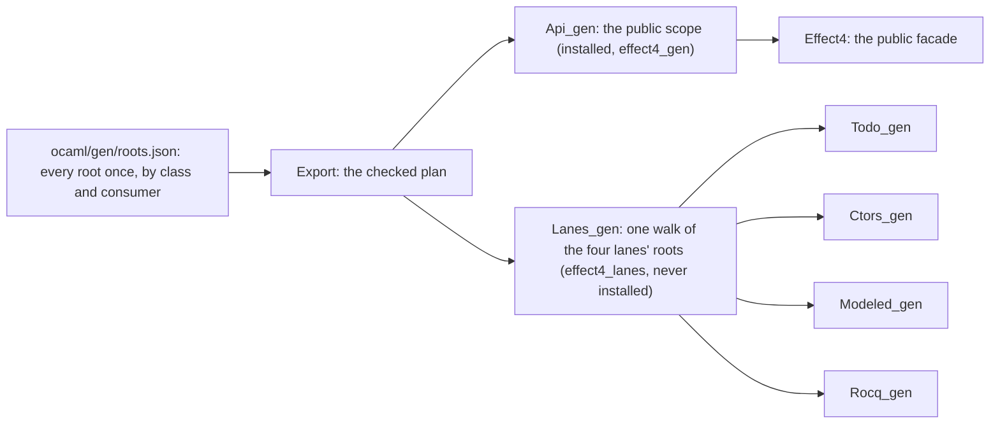

# 2026-10-18 seat 3 receipt (wave 2): one generated closure (C5)

Status: receipt (history, not authority). Seat 3 of wave 2, from `wave2.md` §4.1 and §6, with
Codex's R6.1 steps 2 and 3 (`codex-review/README.md` §9).

**The one thing to know before merging:** the lanes and `Api_gen` still both compile 1,330
declarations, since two scopes need two units today. One package-private closure serves both once
`ocaml/gen` and `ocaml/engine` are one dune project, a decision outside this seat's files (D1
below).

What landed is R6.1's fallback, which the brief names. The recipe lists every root once. The four
test lanes are consumers of one test closure, each through a generated facade. The public outputs
did not change: `api_gen.ml`, `api_gen.mli`, `api_engine.ml`, `eff_types.ml`, the facade
`effect4.ml` and `public-names.tsv` are byte for byte the base's.

## Base and head

- Branch `seat/w2-closure`, worktree `/Users/pooks/Dev/wt-w2-closure`, base `b83188cb2`.
- Step 1, the generator: `b96d45b6e`.
- Step 3, one lane at a time: `82b882d6a` (to-do), `1cd4d09bf` (constructor), `4370cfcaa`
  (Modeled), `ab67844df` (Rocq).
- The documents: `d02334bae`. Three comments in the dictionary's spelling: `ba9ccb246`.
- Head: the commit that adds this receipt and `closure-probes/`; its parent is `ba9ccb246`.

## The design, in one figure

Each lane facade is `include Lanes_gen`. Its inferred interface keeps that lane's roots and the
types they name. Each scope is one walk of its roots, and both walks read one Lean build's mono
declarations. A node's identity therefore does not depend on the walk that met it, and the identity
check below relates the two scopes node by node. Under D1 the two walks become one.

## Changed files, by commit

### `b96d45b6e`: one walk per artifact for all its consumers, facades, node identity (step 1)

| File | Change |
| --- | --- |
| `src/OCaml5/Lcnf/Export.lean` | a recipe artifact's `consumers` list: each a facade file and the `linkage` roots it re-exports; `addConsumer`, `ownRootsOf`, `consumerRoots`; refusals for a consumer key other than `out` and `linkage`, and for a unit name used twice; seven new controls |
| `src/OCaml5/Lcnf/Translate.lean` | `collectClosure` walks later root groups (`phases`) after the first, in one walk with one set of translated declarations |
| `src/OCaml5/Lcnf/Gen.lean` | `--consumer <out> <roots>`; the walk's phases are the consumers; `reachedBy` fills the manifest's `consumers` column; each consumer's facade is built, checked by `Ml.checkModule` and written; the manifest opens with the identity line; two new controls |
| `src/OCaml5/Lcnf/Identity.lean` | new: a node's identity (declaration, code, profile, owner, catalogue), `NodeKey.mismatch?`, the identity line, `parseManifest`, `compareUnits`, eight controls |
| `src/OCaml5/Tools/LcnfGen.lean` | `--identity <manifest> …` prints the comparison of every pair |
| `src/OCaml5/Ml/Syntax.lean`, `Render.lean`, `Check.lean`, `Fold.lean` | `Decl.includeD`, its rendering and its scope check; the fold regenerated by `make gen-derived` |
| `src/OCaml5.lean` | imports `OCaml5.Lcnf.Identity` |
| `ocaml/gen/interface/lcnf_interface.ml`, `.mli`, `main.ml` | `types:Reachable`: a facade keeps only the types its exported values name (I6) |
| `ocaml/gen/interface/test_interface.ml`, `fixture_facade.ml`, `dune` | I6's control over a facade of the fixture |
| `scripts/lib/lcnf_interfaces.py` | compiles each consumer's facade after its artifact and infers its interface with `reachable` (L6) |
| `ocaml/gen/closure-{api_gen,api_engine,todo_gen,ctors_gen,modeled_gen,rocq_gen}.tsv` | regenerated: an identity line and a `consumers` column |

The recipe is unchanged in this commit. `make gen-lcnf` rewrote every `.ml` and `.mli` byte for
byte. Each manifest equals the base's once the identity line and the last column are dropped
(reproduced, by the command in "Commands and results").

### `82b882d6a`: the to-do lane (step 3, first lane)

| File | Change |
| --- | --- |
| `ocaml/gen/roots.json` | the to-do artifact becomes the first consumer of `ocaml/engine/test/lanes/lanes_gen.ml` |
| `ocaml/engine/test/lanes/dune` | new: the test library `effect4_lanes`, unwrapped, never installed |
| `ocaml/engine/test/lanes/lanes_gen.ml`, `.mli` | generated: the old to-do closure, byte for byte below its header |
| `ocaml/engine/test/todo/todo_gen.ml`, `.mli` | generated: the facade, 5 lines; its interface 87 lines, was 1,356 |
| `ocaml/engine/test/todo/dune` | `todo_lane` links `effect4_lanes` |
| `ocaml/gen/closure-todo_gen.tsv` → `closure-lanes_gen.tsv` | renamed by the generator |
| `Makefile` | `LCNF_OUT` names the new outputs |
| `ocaml/.ocamlformat-ignore` | `lanes_gen.ml` and `.mli` |
| `ocaml/engine/test/install/consumer/red_lane_facade/`, `red_lane_root_api_gen/`, `red_lanes_library/` | three new red controls |
| `ocaml/engine/test/install/check_install.sh` | its header counts the three |

### `1cd4d09bf`: the constructor lane, and a fix to the pruned interfaces

| File | Change |
| --- | --- |
| `ocaml/gen/roots.json`, `ocaml/engine/test/ctors/dune`, `Makefile` | the constructor lane is the second consumer; `closure-ctors_gen.tsv` deleted |
| `ocaml/engine/test/ctors/ctors_gen.ml`, `.mli`; `lanes_gen.ml`, `.mli`; `todo_gen.ml`; `closure-lanes_gen.tsv` | regenerated |
| `ocaml/gen/interface/lcnf_interface.ml`, `fixture.ml`, `test_interface.ml` | `keep_items`: a recursive group whose first member is pruned opens at its first kept member |

The first regeneration of this step failed in `ocamlopt`: `ctors_gen.mli` began a group with
`and shade = …`. The fixture now holds that case. In a scratch copy with the old filter, the
control fails at its `type kept_after` assertion, and with `keep_items` it passes (tested).

### `4370cfcaa`: the Modeled lane

The Modeled lane is the third consumer. Two Lean types now share the short name `todo`:
`Test.Dogfood.Scenario.Todo.Typed.Todo` is met first and keeps it. `Test.Codegen.ModeledLane.Todo`
is spelled `test_codegen_modeled_lane_todo`, by the generator's collision rule. No hand file
names it, and `test_modeled.ml` builds the record by its labels.

### `ab67844df`: the Rocq lane

The Rocq lane is the fourth consumer, and its import `Effect4.Laws.Run.Tree` joins the closure's.
`rocq_gen.mli` is byte for byte the base's. Its dune file links `effect4_lanes`.

### `d02334bae`: the documents

`docs/GENERATED.md`'s lcnf row and its LCNF section, `ocaml/README.md`'s rows and its LCNF
section, and the recipe's `claim`. No generated file changes.

### `ba9ccb246`: three comments

`Translate.collectClosure`'s and `Identity`'s docstrings and the lanes' dune header write
"artifact", as their modules do. The header names the four facades. No output changes.

### The receipt commit

This file, and `closure-probes/`: `measure-closure.py`, `trace-cpu.py`, `packaging.sh` and
`packaging.log`.

## Duplicates and generated lines, before and after

Each number below comes from `python3 closure-probes/measure-closure.py REPO REV`. REV is
`b83188cb2` for the base and `WORKTREE` for the head. The head's 39 is the generator's report
line, `consumers: 4 facades over Lanes_gen; 39 of 1534 declarations are reached by two consumers
or more`.

| Measure | Base `b83188cb2` | Head |
| --- | --- | --- |
| Lane units' top-level definitions also in `api_gen.ml` (`measure.py`'s rule) | to-do 1,430; Modeled 25; constructor 1; Rocq 0 | `lanes_gen.ml` 1,430; each facade 0 |
| Lean declarations of the lane closures | 1,573 rows in four manifests; 1,534 distinct | 1,534 rows in one manifest |
| Declarations two lanes lower twice | 39 (38 to-do with Modeled, 1 to-do with constructor) | 0: 39 rows name two consumers |
| Lane declarations also in `closure-api_gen.tsv` | 1,330 | 1,330 |
| Generated lane `.ml` lines | 29,997 | 29,511 |
| Generated lane `.mli` lines | 1,450 | 1,613 |
| Lane closure manifests | 4 | 1 |

The `.mli` lines grew: `lanes_gen.mli` keeps every type and the 66 roots, and each facade keeps
its own. The to-do lane's interface fell from 1,356 lines to 87.

## Cold build CPU, before and after

One cold build each, of a scratch copy of the tree's `ocaml/` (`git archive`), with
`dune build --cache=disabled --trace-file`. `closure-probes/trace-cpu.py` sums each compiler
run's user and system CPU from the trace. Host-only: one run each, on a machine shared with
other seats.

| Unit | Base | Head |
| --- | --- | --- |
| The lanes' generated units | 10.57 s (`todo_gen` 10.05, the other three 0.51) | 10.27 s (`lanes_gen` 9.68, four facades 0.60) |
| `api_gen` (the same bytes at both) | 22.87 s | 20.28 s |
| The whole build | 125.3 s | 115.0 s |

The lanes' saving, 0.3 s, is smaller than the noise: `api_gen` compiled 2.6 s apart with equal
bytes. The 6.3 s that `wave2.md` expects needs D1, since the to-do closure is the cost.

## Lane answers

After each lane moved, each lane's test executable ran from its folder. Its output equals the
base's byte for byte (tested). The base's output comes from a scratch copy of `b83188cb2`.

| Lane | Output | After to-do | After constructor | After Modeled | After Rocq |
| --- | --- | --- | --- | --- | --- |
| to-do | 200 lines, 199 checks | equal | equal | equal | equal |
| constructor | 59 lines | equal | equal | equal | equal |
| Modeled | 14 lines | equal | equal | equal | equal |
| Rocq | 13 lines, 13 checks | equal | equal | equal | equal |

## The identity checks, and the nodes not shared

`lake exe lcnfgen --identity` reads the manifests. It compares two rows with one declaration by
R6.1's five parts: declaration, code (`declHash`), target profile, type owner and builtin
catalogue (`OCaml5.Lcnf.Identity`).

Before, over the six manifests of step 1's regeneration:

| Pair | In both | One node | Differ first in |
| --- | --- | --- | --- |
| `Api_gen`, `Api_engine` | 816 | 0 | profile, 816 |
| `Api_gen`, `Todo_gen` | 1,330 | 0 | type owner, 1,330 |
| `Api_gen`, `Modeled_gen` | 25 | 0 | type owner, 25 |
| `Api_gen`, `Ctors_gen` | 1 | 0 | type owner, 1 |
| `Todo_gen`, `Modeled_gen` | 38 | 0 | type owner, 38 |
| `Todo_gen`, `Ctors_gen` | 1 | 0 | type owner, 1 |
| `Api_engine`, `Todo_gen` | 754 | 0 | profile, 754 |
| `Api_engine`, `Modeled_gen` | 25 | 0 | profile, 25 |

After, over the three manifests:

| Pair | In both | One node | Differ first in |
| --- | --- | --- | --- |
| `Api_gen`, `Api_engine` | 816 | 0 | profile, 816 |
| `Api_gen`, `Lanes_gen` | 1,330 | 0 | type owner, 1,330 |
| `Api_engine`, `Lanes_gen` | 754 | 0 | profile, 754 |

No pair differs in code, and every identity line names one catalogue: one Lean build made every
unit through the LCNF route. The lanes' 39 shared declarations are now one node each, in one unit.

The nodes not shared, and why:

- **`Api_engine`'s 816 and 754.** Its profile is the engine's extern table and prelude, a different
  carrier implementation. R6.1 forbids merging them, and `NodeKey.mismatch?`'s control refuses
  that case (tested).
- **`Api_gen`'s 1,330 with the lanes.** The type owner differs, and it must. The installed
  `api_gen.mli` seals `Effect4.Api.Built`, and `todo_fixture.ml` builds that record from Lean's
  fixture. So the to-do lane needs a unit where `built` is concrete. That unit cannot be the
  installed `Api_gen`, and it cannot reach `Api_gen`'s hidden nodes (D1 below).

## Scopes: why two units, and what one unit needs (D1)

`closure-probes/packaging.sh` answers the question with three small dune workspaces. It passed
with nine answers (`packaging.log`; tested, host-only: dune 3.24.2, OCaml 5.1.1).

- **P1.** A dune private module is unbound from a test in another dune project of one workspace:
  `Unbound module Pg__Closure`.
- **P2.** A package-private library (`(package pg)`, no public name) is not found from another
  project, by either name. After `dune install`, an outside client cannot name it either.
- **P3.** In one project, a package-private library serves both scopes. A test of the project
  names its hidden value and builds its sealed record. An installed outside client sees only the
  restricted public module. There, the hidden value and the library are unbound, and the sealed
  record cannot be built.

So a test in `ocaml/engine` sees an installed `ocaml/gen` library as an outside client does
(P1, P2). One compiled unit cannot then serve the public scope and the lanes without exposing
coverage names, which the brief forbids. Once the two dune projects are one, P3's arrangement
holds the one closure.

**D1, the coordinator's decision: merge `ocaml/gen` and `ocaml/engine` into the root dune
project.** The change and its follow-up:

1. Delete `ocaml/gen/dune-project` and `ocaml/engine/dune-project`. Move their packages and their
   opam fields into `ocaml/dune-project`. The five opam files then generate at `ocaml/`.
2. Generate one closure unit in a package-private library of `effect4_gen`. Make `Api_gen` a
   facade over it, whose interface keeps the public and linkage roots and seals the packages.
3. Emit each node once. A node that a public root reaches lives in the installed closure. A node
   only a lane reaches lives in a test unit, which opens the closure.
4. Keep the install lane's red controls. `installed.expected` gains the package-private library's
   line.

The recommendation is yes. It removes the 1,330 duplicates and most of the lanes' 9.7 s of cold
build CPU. It changes no public path, and the facade machinery of this branch carries over.

## Recipe edits, for the merge with seat 1

The recipe stays format v3, and its reader accepts one new entry key, `consumers`. This branch
made two structural edits to `ocaml/gen/roots.json`:

1. The four lane entries became one entry, `ocaml/engine/test/lanes/lanes_gen.ml`. Its `import`
   is the four lanes' imports, its `cap` is 2,000, and its `consumers` hold the lanes' roots
   unchanged, in the lanes' former order.
2. The `claim` gained three sentences on consumers.

The `eff_types`, `api_gen` and `api_engine` entries are untouched. A root that seat 1 appends to
`api_gen`'s lists merges without a conflict. Regenerate after the merge (`make gen-lcnf`).

No hand file changed: every lane keeps its module names, since each facade keeps its file and its
module. `Test.Audit.LcnfMappedRecursion` builds unchanged, so the specialisation names it pins did
not move.

## Commands and results

Each Lean command ran as `python3 /private/tmp/seams-lean-one.py <command>` from the worktree root.
Each dune command ran as `opam exec --switch=effect4 -- dune …` from `ocaml/`.

| Command | Result |
| --- | --- |
| `python3 scripts/generate.py --only derived` | `PASS generate`; only `src/OCaml5/Ml/Fold.lean` changed (17 lines) |
| `lake build OCaml5 lcnfgen Conform.Effect4.LcnfMl Conform.Effect4.Normalization Test.Audit.ClockLowering Test.Audit.ConstructorOwners Test.Audit.LetReturn Test.Audit.LcnfMappedRecursion Test.Store.GallinaHeadPrinter` | 329 jobs, success |
| `make batteries-touched BASE=b83188cb2` | `batteries-touched: 2 batteries` (`Test.Audit.ClockLowering`, `Test.Audit.LetReturn`); 161 jobs, success |
| `make gen-lcnf`, step 1 (recipe unchanged) | `PASS generate`; no `.ml` or `.mli` changed; six manifests changed by their identity line and last column alone |
| `make gen-lcnf`, after each lane | `PASS generate`; the step's outputs as listed above. The constructor step's first run failed in `ocamlopt` (`and shade`), before the fix |
| `make gen-lcnf`, the to-do step again from the committed generator | the five outputs equal the first run's byte for byte (reproduced) |
| `dune build` | success; only the base's warning 69 lines in `api_engine.ml` |
| `dune test engine/test/todo engine/test/ctors engine/test/modeled engine/test/rocq --force` | `199 checks, 0 failures`; `test_rocq: 13 checks, 0 failures`; the constructor and Modeled lines all `PASS` |
| each lane's `test_<lane>.exe`, run from its folder, against the base's | equal bytes, four lanes, four steps |
| `dune test engine/test/install --force` | I1 to I4 `PASS`: 1 executable, 8 packages, 9 libraries; 12 red controls, three of them new |
| `dune runtest gen/interface --force` | `Interface roots, sealing, final ascriptions, refusals and facade types pass.` |
| `python3 scripts/check-lcnf-interfaces.py` | `PASS: stale interface replacement and whole-family retention after native refusal` |
| `dune build @fmt` | exit 0 |
| `lake exe lcnfgen --identity …` | the two identity tables above |
| `python3 closure-probes/measure-closure.py /Users/pooks/Dev/wt-w2-closure b83188cb2`, then `WORKTREE` | the duplicate and line tables above |
| `bash closure-probes/packaging.sh <scratch>` | `PASS packaging: 9 answers as recorded` |
| `python3 scripts/check-language.py --strict docs/GENERATED.md ocaml/README.md` | the base's 24 findings, none new |
| `make check-ocaml`, at `ab67844df` plus the documents | exit 0: `PASS native`, `PASS compiler`, `PASS ocaml: recorded 555426c796d7 (90.010s)`, `gen-check: PASS`; 6:50 |
| `make check-ocaml`, at `ba9ccb246` | exit 0: `PASS native: shared result 4ee0aea8abe7`, `PASS compiler: recorded 6506142a2564`, `PASS ocaml: recorded e81b8e98da2e (35.593s)`, `gen-check: PASS`; 3:29; the tree clean after its `make gen-lcnf` (reproduced) |
| `lake exe lcnfgen --stage S --recipe ocaml/gen/roots.json --one 3`, under `/usr/bin/time -l` | the lanes' closure: 4.75 s, peak 1.83 GB; the base's four lane runs: 7.13 s together, the largest peak 1.73 GB |

## Axiom output

`#axiom_audit` (`tools/ProofGraph/AxiomAudit.lean`) ran over each touched module through
`lake env lean`. The base column ran over the base's sources, put back for the run and restored.

| Modules | Head | Base |
| --- | --- | --- |
| `OCaml5.Ml.Syntax`, `OCaml5.Ml.Fold` | 1,500 declarations within `[propext, Quot.sound]` | 1,489 |
| `OCaml5.Ml.Render`, `OCaml5.Ml.Check` | 30 of 212 reach `Classical.choice` | 30 of 212, the same set |
| `OCaml5.Lcnf.Translate` | 75 of 345 | 75 of 345, the same set |
| `OCaml5.Lcnf.Export` | 18 of 240 | 12 of 227 |
| `OCaml5.Lcnf.Identity` | 4 of 167 | new |
| `OCaml5.Lcnf.Gen`, `OCaml5.Tools.LcnfGen` | 27 of 168 | 22 of 149 |

Every path to `Classical.choice` enters through a toolchain constant, as in wave 1's receipt.
The constants are `Lean.Json`, `Lean.Json.parse`, `String.instOrd`, `String.toNat!`,
`String.Slice.toString`, `Lean.Name.instToString`, `System.FilePath.fileStem`, and `String`'s
search under `globalName`.
The new offenders are the JSON readers and matches (`consumersOf`, `argvOf`, `run`), the controls'
JSON fixtures, `reachedBy` (through `globalName`) and `identityReport`. The plan and identity
functions reach no axiom outside `[propext, Quot.sound]`: `addConsumer`, `ownRootsOf`,
`consumerRoots`, `NodeKey.mismatch?`, `compareUnits` and `Args.phases`. `OCaml5` is no module of
the axiom gate.

## Evidence

- One recipe and one walk per artifact: reading (`Gen.argvOf`, `Translate.collectClosure`), and
  tested by the controls of `Export.lean` and `Gen.lean`.
- The generator change alone changes no generated `.ml` or `.mli`: reproduced (step 1).
- Each lane answers as at the base: tested, four lanes after each of four steps, host-only.
- A lane's root, a lane's facade and the lanes' library are unbound from an installed client:
  tested by the install lane, host-only.
- The identity tables: tested, a finite reading of the committed manifests.
- The packaging answers P1 to P3: tested, host-only, on scratch workspaces.
- The CPU figures: one run each, host-only, on a shared machine.
- No theorem landed. The export and identity checks are finite checks of the plan and of the
  manifests (decisions row 391), not theorems about the LCNF lowering.

## Landed theorems and their placement

None. The finite checks serve `translation-simulation`, the generated interface's scope, and
requirement R8, as wave 1's did. They establish no equal behaviour of a facade and its Lean
declaration.

## Open obligations

1. D1, the dune project merge and the one-unit closure above. It is the coordinator's packaging
   decision, and it may touch E1's install layout.
2. `measure.py` (this folder, untracked) lists the four lane files, now facades. Add
   `ocaml/engine/test/lanes/lanes_gen.ml` to its list, or read `closure-probes/measure-closure.py`.
3. `Api_gen` keeps its test-only linkage roots, which the Rocq lane calls, as the brief asks. D1
   can move them to the test unit, which drops them from `api_gen.mli`.
4. The headers of `test_todo.ml`, `test_ctors.ml` and `test_modeled.ml`, and the docstrings of
   `Test.Dogfood.Scenario.Todo.HostRun`, `Test.Codegen.ConstructorLane` and
   `Test.Codegen.ModeledLane`, say the route lowers into the lane file. It now lowers into
   `lanes_gen.ml`, read through that file. The paths still resolve; their owners may reword them.
5. `Export.lean`'s prose and the recipe's `claim` write "artefact", as the recipe's key
   `artefacts` does. This branch's additions there follow them, and so does its first commit's
   subject. The dictionary writes artifact, and one mechanical edit renames all of them.
6. The cold build and generator figures rest on one run each.

## Proposed decisions rows (proposals only)

1. **C5 (Codex's R6.1, steps 2 and 3), seat 3 of wave 2.** A recipe artifact may list consumers,
   each a facade and its `linkage` roots. The artifact is one walk of all its consumers' roots.
   Each facade includes it and keeps its consumer's roots and the types they name. The four test
   lanes are the consumers of `ocaml/engine/test/lanes/lanes_gen.ml`, which nothing installs. Each
   closure manifest opens with its unit's identity and names each declaration's consumers.
2. **D1.** The two dune projects become the root project, and one closure serves the public scope
   and the lanes (the four steps above).

## Scratch outputs

This seat's scratch files sit in `w2c/` of the session scratchpad: the logs, the lanes' outputs
and the audit files. The base and head copies of `ocaml/` and the probe workspaces were deleted
after their runs. The dune traces were deleted too, since a trace records its run's environment.
The worktree's `ocaml/_build` stays, so a rerun of the lanes' tests takes seconds.
