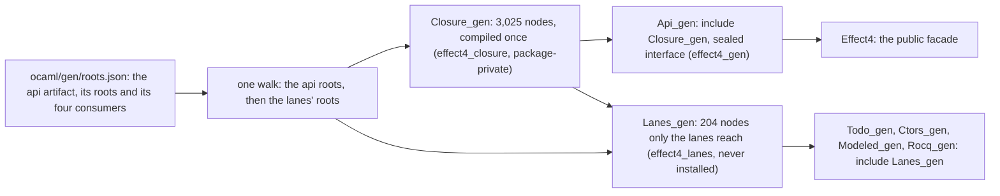

# 2026-10-18 seat receipt (wave 2): one dune project and one compiled closure (D1, C5)

Status: receipt (history, not authority). The seat `seat/w2-project` finishes C5 under decision
D1, which the owner approved on 2026-10-18. The brief came from the coordinator. The design came
from `receipt-w2-closure.md`, "Scopes: why two units, and what one unit needs (D1)".

**The one thing to know before merging:** the recipe changed shape, so regenerate after the
merge. The lanes are now consumers of the api artifact, and the recipe key is `artifacts`. A
parallel branch that edits `ocaml/gen/roots.json` must re-apply its edit to that shape. Then run
`make gen-lcnf`, and keep `api_gen.mli`, `effect4.ml`, `effect4.mli` and `public-names.tsv` as
this branch leaves them: byte for byte the base's.

## Base and head

- Branch `seat/w2-project`, worktree `/Users/pooks/Dev/wt-w2-project`, base `af360f720`.
- Step 1, one dune project: `b69236847`.
- Step 2, one compiled closure: `5d8bfb58f`.
- Step 6 of the brief, the spelling `artifacts`: `62f354976`.
- Head: the commit that adds this receipt and `closure-probes/measure-scopes.py`. Its parent is
  `62f354976`.

## The layout, in one figure

`Lanes_gen` includes `Closure_gen`, so each lane shares every node with `Api_gen` and with the
other lanes. `Api_engine` stays its own unit: it lowers the same declarations over the engine's
carriers, and the identity check below says the profile differs.

## Changed files, by commit

### `b69236847`: one dune project with eight packages (step 1)

| File | Change |
| --- | --- |
| `ocaml/dune-project` | the one project: the eight packages and their opam fields, `generate_opam_files`, the unstable synopses and the dependencies |
| `ocaml/{gen,engine,eff,clock,lcnf}/dune-project` | deleted |
| `ocaml/effect4_*.opam` (eight) | moved from `gen/`, `engine/`, `eff/`, `clock/` and `lcnf/` to `ocaml/`; dune writes each byte for byte the old file |
| `ocaml/eff/test/dune` | `%{project_root}/goldens/*` becomes `../goldens/*`, since the project root is now `ocaml/`; one comment |
| `ocaml/dune`, `ocaml/gen/dune`, `ocaml/engine/bytes/dune`, `ocaml/engine/cas/dune`, `ocaml/engine/kit/bin/dune` | comments that named the old projects or a `--root .` build |
| `ocaml/eff/README.md`, `ocaml/eff/test/test_lean_wire.ml`, `ocaml/engine/test/test_host.ml` | the same, in prose and comments |
| `ocaml/README.md` | one dune project; the opam files' row |

All three of `ocaml/eff`, `ocaml/clock` and `ocaml/lcnf` folded. None needed its own project. A
`--root .` build inside `ocaml/eff` already failed at the base (reproduced below).

### `5d8bfb58f`: one compiled closure (step 2)

| File | Change |
| --- | --- |
| `src/OCaml5/Lcnf/Translate.lean` | `Translated.realTypes` and `Translated.mentioned`; `Closure.phaseStarts`, `Closure.ownCount`, `typesOfDecls` |
| `src/OCaml5/Lcnf/Gen.lean` | `--closure` and `--tests`; the two scopes' types, emission, modules, interface data and checks; the manifest's `unit` column; `Args.allRoots`; three controls |
| `src/OCaml5/Lcnf/Export.lean` | the entry keys `closure` and `tests`; `ExportPlan.tests`; `addConsumer`'s scope; a scope-aware `CheckedPlan.ownRootsOf`; five controls |
| `src/OCaml5/Lcnf/Identity.lean`, `src/OCaml5/Tools/LcnfGen.lean` | docstrings |
| `scripts/lib/lcnf_interfaces.py` | L7: the closure is staged first, the facade's interface is read off the closure's typed tree (`from`), then the tests unit |
| `ocaml/gen/roots.json` | the lanes' entry folds into the api entry: `closure`, `tests`, the lanes' imports and `consumers`; the claim |
| `ocaml/gen/dune` | the package-private library `effect4_closure`; `effect4_gen` links it |
| `ocaml/gen/closure_gen.ml`, `.mli` | generated, new: the closure; its `.ml` below the header is the base's `api_gen.ml` byte for byte |
| `ocaml/gen/api_gen.ml` | generated: the facade, `include Closure_gen`, 5 lines; `api_gen.mli` unchanged |
| `ocaml/engine/test/lanes/lanes_gen.ml`, `.mli`, `dune` | generated: the lanes' own nodes over the closure; the library links `effect4_closure` |
| `ocaml/engine/test/{todo,ctors,modeled,rocq}/*_gen.ml` | generated: the header's command |
| `ocaml/engine/test/todo/todo_gen.mli` | generated: reordered; `call` is now `tools_run_checks_call` |
| `ocaml/engine/test/todo/test_todo.ml`, `bench_todo.ml` | `Todo_gen.call` becomes `Todo_gen.tools_run_checks_call`, three uses |
| `ocaml/engine/test/{todo,ctors,modeled,rocq}/dune` | header comments |
| `ocaml/gen/closure-api_gen.tsv`, `closure-api_engine.tsv` | generated: the whole walk in one manifest; the `unit` column |
| `ocaml/gen/closure-lanes_gen.tsv` | deleted |
| `ocaml/engine/test/install/installed.expected` | one line: `library effect4_gen.__private__.effect4_closure` |
| `ocaml/engine/test/install/consumer/red_closure_module/`, `red_closure_library/` | two red controls |
| `ocaml/engine/test/install/check_install.sh` | the header's I1 and I4 |
| `scripts/check-export-classes.py` | three cases: the closure's scope, and a lane value refused by `Api_gen` |
| `Makefile`, `ocaml/.ocamlformat-ignore` | the LCNF outputs |
| `docs/GENERATED.md`, `ocaml/README.md` | the lcnf row, the LCNF sections, the map rows |
| `docs/research/2026-10-18-slices/measure.py` | section 3 reads the closure unit; section 4 counts dune projects and package-private libraries, and reads only `public_name` stanza lines |

### `62f354976`: the spelling `artifacts`

The recipe key `artefacts` becomes `artifacts`, and an `open`'s `artefact` becomes `artifact`. No
reader keeps the old key, and the format stays `effect4-lcnf-roots-v3`. A recipe that spells the
old key is refused as malformed. The readers moved: `OCaml5.Lcnf.Export`, `OCaml5.Lcnf.Gen`,
`scripts/lib/lcnf_interfaces.py`, `scripts/gate-cache.py` and the fixture of
`scripts/check-lcnf-interfaces.py`. The prose of `Export.lean`, `Gen.lean`, `Render.lean`, the
recipe's claim, the Makefile's LCNF comment and `check-export-classes.py` follow.

### Files outside the brief's list

Each change below follows from the fold or the rename, and touches no behaviour:
- `ocaml/eff/test/dune`: the goldens' path, which `%{project_root}` no longer reaches.
- `ocaml/dune`, `ocaml/eff/README.md`, `ocaml/eff/test/test_lean_wire.ml`, `ocaml/engine/bytes/dune`,
  `ocaml/engine/cas/dune`, `ocaml/engine/kit/bin/dune`, `ocaml/engine/test/test_host.ml`: comments
  and prose that named the old projects.
- `ocaml/engine/test/todo/test_todo.ml`, `bench_todo.ml`: the renamed lane type, three uses.
- `scripts/gate-cache.py`, `scripts/check-lcnf-interfaces.py`: readers of the renamed key.

## How the closure is split

One walk translates the api roots first, then each lane's roots as a later phase
(`collectClosure`, `src/OCaml5/Lcnf/Translate.lean`). The walk closes over the api roots before
any lane root enters. So the first phase is exactly the set of nodes the api roots reach.

| Scope | Unit | Holds | Interface |
| --- | --- | --- | --- |
| closure | `Closure_gen` (`effect4_closure`, package-private) | the 3,025 nodes of the first phase, and their types under the base's names | every type, none sealed; the 144 values its two scopes call |
| facade | `Api_gen` (`effect4_gen`) | `include Closure_gen` | read off the closure's typed tree: the public and linkage roots, the sealed packages |
| tests | `Lanes_gen` (`effect4_lanes`) | `include Closure_gen`, then the 204 later-phase nodes and their types | every type; the 66 lanes' roots |
| lane facades | `Todo_gen` and the three others | `include Lanes_gen` | the lane's roots and the types they name |

The closure's types are named as the api artifact alone names them, so `api_gen.mli` keeps its
text. The tests unit's types come after, with every closure type provided. A lane type that
takes a closure type's name is a collision, renamed to its full path. One did:
`Tools.RunChecks.Call`, now `tools_run_checks_call`.

The brief said the tests unit opens the closure. It includes it instead. With `include`, each
lane facade keeps the closure's types as its own, so `Todo_gen.built` still names the record.
With `open`, a facade's values would name `Closure_gen.built`, which its reachable interface drops.

## Measurements, before and after

Each command below runs from the worktree root. `measure-scopes.py` is
`docs/research/2026-10-18-slices/closure-probes/measure-scopes.py`, new with this receipt.
1. `python3 docs/research/2026-10-18-slices/measure.py`
2. `python3 measure-scopes.py lines . af360f720`, then `5d8bfb58f`
3. the cold build of `measure-scopes.py`'s header, then `python3 measure-scopes.py cpu C`
4. `/usr/bin/time -l python3 /private/tmp/seams-lean-one.py lake exe lcnfgen --stage S --recipe R --one N`

Base `af360f720` against head `5d8bfb58f` (step 3 changes no generated file):

| Measure | Base | Head |
| --- | --- | --- |
| lanes' definitions also in the closure unit (measure.py, section 3) | 1,430 of 1,644 in `api_gen.ml` | 0 of 213 in `closure_gen.ml` |
| declarations compiled twice (manifests) | 1,330 (3,025 + 1,534 rows, two manifests) | 0 (3,229 rows: 3,025 in `Closure_gen`, 204 in `Lanes_gen`) |
| the family's `.ml` lines (closure, facade, lanes, four lane facades, public facade) | 99,085 | 72,254 |
| the family's `.mli` lines | 4,882 | 8,656 |
| the family in all | 103,967 | 80,910 |
| `lanes_gen.ml` lines | 29,491 | 2,655 |
| generated OCaml lines (measure.py, section 1) | 129,111 | 106,054 |
| hand OCaml lines (measure.py, section 1) | 56,101 | 56,108 |
| dune-project files under `ocaml/`, the outside consumer not counted | 6 | 1 |
| opam files; `public_name` stanzas; package-private libraries | 8; 10; 0 | 8; 10; 1 |

The `.mli` lines grow by 3,774. `closure_gen.mli` (2,620 lines) repeats `api_gen.mli`'s types,
unsealed. `lanes_gen.mli` (2,590 lines, was 1,436) repeats the closure's types as re-exports.

Cold build CPU, one cold `dune build --cache=disabled` of a `git archive` copy of `ocaml/`, run
twice per revision, interleaved (base, head, base, head):

| Units | Base, run 1 | Base, run 2 | Head, run 1 | Head, run 2 |
| --- | --- | --- | --- | --- |
| `ocaml/gen`'s generated units (`closure_gen`, `api_gen`, `effect4`; at the base `api_gen`, `effect4`) | 11.18 s | 12.90 s | 11.86 s | 12.90 s |
| the lanes' generated units (`lanes_gen` and four facades) | 5.22 s | 6.13 s | 1.02 s | 1.20 s |
| together | 16.40 s | 19.04 s | 12.89 s | 14.10 s |
| `lanes_gen` alone | 4.88 s | 5.77 s | 0.61 s | 0.70 s |
| the whole build | 63.2 s | 69.9 s | 60.9 s | 64.5 s |

Generation, each artifact staged in its own process (`--one N`), run twice per revision:

| Run | Base `api_gen` | Base lanes | Head api artifact |
| --- | --- | --- | --- |
| wall, run 1 | 10.24 s | 3.33 s | 10.15 s |
| wall, run 2 | 7.96 s | 2.88 s | 8.88 s |
| the walk (`closure` in the report's `time (ms)`), runs 1 and 2 | 5,678 and 5,767 ms | 798 and 647 ms | 6,500 and 6,203 ms |
| peak resident memory | 2.50 GB | 1.83 GB | 2.68 GB |

One process now does what two did, and its walk costs about what the two walks cost together.
The peak grows by 0.18 GB: 2.68 GB against the base's largest, 2.50 GB. `make gen-lcnf` took
39.2 s at the base and 35.9 s at the head. The base run also built the interface tool cold.

## Commands and results

Each Lean command ran as `python3 /private/tmp/seams-lean-one.py <command>` from the worktree
root. Each dune command ran as `opam exec --switch=effect4 -- dune …` from `ocaml/`.

| Command | Result |
| --- | --- |
| step 1: `dune build` | exit 0 |
| step 1: `opam lint` on each of the eight opam files | `Passed.` eight times |
| step 1: `cmp` of each new opam file with the old one | equal, eight files |
| step 1: `dune test eff gen clock lcnf tools --force`, at base and head | exit 0; the sorted outputs equal |
| step 1: `dune test engine --force`, at base and head | the same lines but timings, paths, random model-test traces, and `harness/truth/corpus.json`, absent from the base's `ocaml/`-only copy |
| step 1: `dune test engine/test/install --force` | the base's 16 lines |
| step 1: `dune build @fmt` | exit 0 |
| step 1: `make check-ocaml` | exit 0: `PASS native: shared result 4ee0aea8abe7`, `PASS compiler: shared result 6506142a2564`, `PASS ocaml: recorded 7089c5a38c2e`, `gen-check: PASS` |
| base: `dune build --root . @runtest` in a copy of `ocaml/eff` | `Error: Library "effect4_gen" not found.` |
| step 2: `lake build OCaml5 lcnfgen Conform.Effect4.LcnfMl Conform.Effect4.Normalization Conform.Effect4.CompilerControls Test.Audit.ClockLowering Test.Audit.ConstructorOwners Test.Audit.LetReturn Test.Audit.LcnfMappedRecursion Test.Store.GallinaHeadPrinter` | 331 jobs, success |
| step 2: `make batteries-touched BASE=af360f720` | `batteries-touched: 1 batteries` (`Test.Audit.LcnfMappedRecursion`), success |
| step 2: `lake exe lcnfgen --stage S --recipe ocaml/gen/roots.json --one 1` | `scopes: 3025 declarations compiled in Closure_gen, 204 in Lanes_gen; Closure_gen's interface exports 144 values, 30 of them for the nodes of Lanes_gen; Ml.checkModule: PASS` |
| step 2: `diff` of `closure_gen.ml` below its header with the base's `api_gen.ml` below its header | equal |
| step 2: `make gen-lcnf`, twice | `PASS generate`; the second run's outputs equal the first's (`shasum` of the family) |
| step 2: each lane's `test_<lane>.exe`, from its folder, against the base's | equal bytes: to-do 200 lines, constructor 59, Modeled 14, Rocq 13 |
| step 2: `dune test engine/test/install --force` | I1 to I4 `PASS`: 1 executable, 8 packages, 10 libraries; 14 red controls, two new |
| step 2: `python3 scripts/check-export-classes.py` | `PASS: 4 exported roots compile; 6 hidden roots are unbound` |
| step 2: `python3 scripts/check-lcnf-sealing.py` | `PASS: 2 lawful aliases and 12 hostile sealed-package clients` |
| step 2: `python3 scripts/check-lcnf-interfaces.py` | `PASS: stale interface replacement and whole-family retention after native refusal` |
| step 2: `dune runtest gen --force` | `== ALL PASS: 0 failure(s) ==` |
| step 2: `lake exe lcnfgen --identity ocaml/gen/closure-api_gen.tsv ocaml/gen/closure-api_engine.tsv` | `Closure_gen and Api_engine: 816 in both, 0 of them one node; 816 differ in profile` |
| step 2: `python3 scripts/check-language.py --strict docs/GENERATED.md ocaml/README.md` | the base's 23 findings, none new |
| step 2: `make check-ocaml` | exit 0: `PASS native: recorded 51b972f37bc3`, `PASS compiler: recorded 58148751a13e`, `PASS ocaml: recorded f6b735eccf0a`, `gen-check: PASS` |
| mutant, in a scratch copy: `effect4_closure` given `public_name effect4_gen.closure` | `FAIL I4 red control red_closure_module: the outside project builds, and it must not` |
| step 3: the narrow build above | 331 jobs, success |
| step 3: `make gen-lcnf` | `PASS generate`; no generated file changes |
| step 3: `make batteries-touched BASE=af360f720` | `batteries-touched: 3 batteries` (`ClockLowering`, `LcnfMappedRecursion`, `LetReturn`), success |
| step 3: `check-lcnf-interfaces.py`, `check-export-classes.py` | `PASS`, as in step 2 |
| head: `make check-ocaml` | exit 0: `PASS native: recorded e5ee959144cf`, `PASS compiler: recorded 0d468e984a76`, `PASS ocaml: recorded 87e4edf30263`, `gen-check: PASS`; the tree clean after |
| head: `dune test engine/test/install --force` and the four lanes' executables | as in step 2 |

`Test.Audit.LcnfMappedRecursion` built unchanged at every step, so the specialization names it
pins did not move.

## Axiom output

`#axiom_audit` (`tools/ProofGraph/AxiomAudit.lean`) ran over each touched module through `lake
env lean`. The base column ran over the base's sources, put back for the run and restored.

| Module | Head | Base |
| --- | --- | --- |
| `OCaml5.Lcnf.Translate` | 75 of 354 reach `Classical.choice` | 75 of 345, the same set |
| `OCaml5.Lcnf.Export` | 20 of 247 | 18 of 240 |
| `OCaml5.Lcnf.Gen` | 23 of 165 | 22 of 152 |
| `OCaml5.Lcnf.Identity` | 4 of 167 | 4 of 167, the same set |
| `OCaml5.Tools.LcnfGen` | 5 of 16 | 5 of 16, the same set |
| `OCaml5.Ml.Render` | 12 of 43 | not run: step 3 changes two docstring words |

Every offender reaches `Classical.choice` alone. Each cause the audit prints enters through a
toolchain constant: `Lean.Json`, `String.toList`, `Lean.getStructureInfo?`,
`Lean.Compiler.LCNF.toLCNFType` and their kin. The new
offenders are the controls' JSON fixtures, `scopedEntry` and `scopedLanes` (Export) and
`scopedRecipe` (Gen). Three compiler-made matchers took new numbers (`entryRoots.match_5`,
`run.match_51` and `run.match_53`). The plan and scope functions stay within `[propext,
Quot.sound]`: `addConsumer`, `CheckedPlan.ownRootsOf`, `Args.exported`, `Args.allRoots`,
`Closure.ownCount` and `typesOfDecls`. `OCaml5` is no module of the axiom gate.

## The install lane

`check_install.sh` installs every package into a scratch prefix and builds a copy of `consumer/`
outside `ocaml/` against it. At the head it prints 18 `PASS` lines (tested, host-only):
- I1: the prefix holds 1 executable, 8 packages and 10 libraries, one more than at the base:
  `effect4_gen.__private__.effect4_closure`.
- I2: `ok` and `ok_facade` build and print their expected lines.
- I3: the installed `eff` answers `check` and `run` as `ok` does.
- I4: 14 red controls fail with their expected lines. The 12 of the base are unchanged.

The two new red controls name `Closure_gen.store_image_equiv`. The closure exports that value to
the lanes, and `Api_gen` does not (`check-export-classes.py`'s `closure-lane-value` and
`api-gen-lane-value`):
- `red_closure_module` links the public facade. It fails with `Unbound module Closure_gen`.
- `red_closure_library` links the closure by its installed name. It fails the same way: dune
  resolves that name, and the compiler still finds no `Closure_gen`.

The mutant above made the closure public, and `red_closure_module` then built, so the control is
live (tested).

## What moved

- The packaging: one `ocaml/dune-project` instead of six. The eight opam files sit beside it,
  each byte for byte the old one. One package-private library, `effect4_closure`, installs under
  `effect4_gen`.
- The generated family: `ocaml/gen/closure_gen.ml` and `.mli` are new; `api_gen.ml` is a facade;
  `closure-lanes_gen.tsv` is gone; the manifests gain a `unit` column.
- The lanes' names: `Todo_gen.call` is `Todo_gen.tools_run_checks_call`. Every other name of the
  four lane facades stays.
- The recipe: the lanes' entry is part of the api entry, and the keys are `artifacts` and
  `open.artifact`.
- Nothing public: `public-names.tsv`, `api_gen.mli`, `facade/effect4.ml` and `.mli` are byte for
  byte the base's.
- No other path named an old opam file. `ocaml/README.md`'s generated table did, and it moved.

## Evidence

- Each node is compiled once: tested by the manifest's `unit` column and measure.py's section 3,
  finite counts of the committed files. It holds by construction in `OCaml5.Lcnf.Gen.run`, which
  refuses a name both scopes bind.
- The closure's code is the base's `api_gen.ml`: reproduced, a byte comparison below the header.
- The public face did not move: reproduced, `make gen-lcnf` leaves the four files as at the base.
- The lanes answer as at the base: tested, four executables, byte for byte, host-only.
- The scopes hold outside `ocaml/`: tested by the install lane, host-only; the new red control's
  live-ness tested by one mutant.
- The CPU and generation figures: host-only, two runs each, on a machine shared with other seats.
- The packaging probe that motivated D1 (`closure-probes/packaging.log`, P3) holds in the estate:
  tested by the install lane.
- No theorem landed. The export plan's checks and the scope checks are finite checks (decisions
  row 391). They check the plan and the generated units, and prove nothing about the LCNF lowering.

## Landed theorems and their placement

None. The finite checks serve `translation-simulation`, the generated interface's scope and
requirement R8, as the wave 1 and wave 2 closure receipts' checks do. They establish no equal
behaviour of a facade and its Lean declaration.

## Open obligations

1. The coordinator's merge: regenerate after merging the sources (`make gen-lcnf`). A merged
   branch may add a closure type that takes a lane type's name. Then the lane type is renamed,
   and the to-do lane's hand code needs its new name, as `tools_run_checks_call` did.
2. `Api_gen` still exports the Rocq lane's test-only linkage roots, since the brief froze
   `api_gen.mli`'s names. The closure's interface could serve them alone. That drops them from
   `api_gen.mli`, which is the owner's call.
3. The `.mli` growth of 3,774 lines. A reachable `lanes_gen.mli` would shrink it, but a hidden lane
   type could then fail the build on an unused-type warning. The seat kept every type.
4. Prose outside this seat's files still names the old arrangement. `Test.Dogfood.Scenario.Todo.HostRun`,
   `Test.Codegen.ConstructorLane` and `Test.Codegen.ModeledLane` say the route lowers into the lane
   file. `Effect4.Run.Kit` (`src/Effect4/Run/Kit.lean`) and `Effect4.Tool.Native`
   (`src/Effect4/Tool/Native.lean`) write "artefact `api_gen`". `scripts/generate.py`'s comments
   write "artefact" too.
5. The recipe's format id stays `effect4-lcnf-roots-v3` after the key's rename. A coordinator who
   wants the id to name the key can bump it in one edit.

## Proposed decisions rows (proposals only)

1. **D1 landed, wave 2.** The OCaml estate is one dune project, `ocaml/dune-project`, with eight
   packages. The api artifact compiles its walk in two scopes: `ocaml/gen/closure_gen.ml`, the
   package-private library `effect4_closure`, and `ocaml/engine/test/lanes/lanes_gen.ml`, which
   includes it. `Api_gen` is a facade whose interface is read off the closure. Each declaration is
   lowered and compiled once.
2. **The recipe key is `artifacts`**, the dictionary's spelling, with no reader for the old key.

## Scratch outputs

This seat's scratch files sit in `w2p/` of the session scratchpad: the logs, the lanes' outputs,
the staged generator runs and the `#axiom_audit` files. The cold-build copies and their traces were
deleted after their runs, since a trace records its run's environment.
