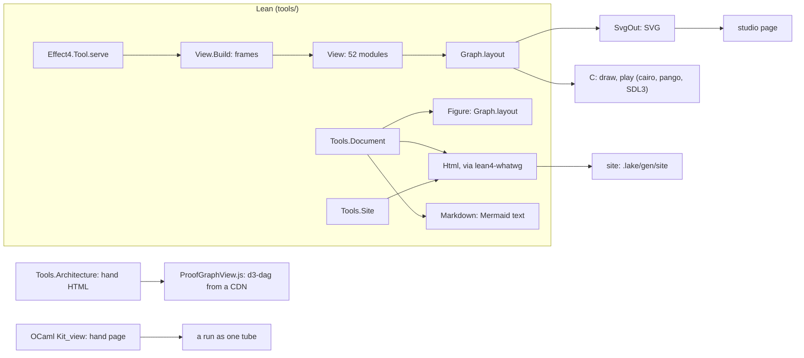

# The view platform and the docs: where they stand, and the backlog (2026-10-18)

Status: research note (history, not authority). Base `refactor/phase1-phase3` at `4a81cc034`. It
reads the trail from 2026-10-06 to 2026-10-14 and the code at HEAD. It changes no source.

## 1. The one thing to know

The view still builds and already reads the agent's tool. But four things draw graphs, and the
rulings of 2026-10-11 to 2026-10-14 are mostly unlanded.
- **Builds:** the view, site and docs drivers build at HEAD (672 jobs, 19 s). No gate builds them.
- **Reads the tool:** the build frames run through `Effect4.Tool.serve`.
- **Four drawers:** Lean's layered layout; a d3-dag page loaded from a CDN; a hand OCaml page; and
  Mermaid source.
- **Unlanded:** the design-language authority, the fork and join marks, the score, the names, the
  machine's page and CSS motion.

The work is to unify on the one drawing owner, then draw the language's own objects with it.

## 2. What is there, measured

| Part | Size | Evidence |
| --- | --- | --- |
| `tools/Tools/View/` | 52 modules, 13,759 lines | `find tools/Tools/View -name '*.lean' \| xargs cat \| wc -l` |
| The C painter and player | 1,634 lines (`draw.c`, `play.c`, `paint.h`, `replay.h`, `scene.h`) | `wc -l` |
| Graph probes in `tools/view/` | 19 Lean files; 18 named by nothing and built by nothing | a search of `v`, `README.md`, `Makefile`, `lakefile.toml` and the scripts |
| The documents | `Tools.Document`, `Html`, `Figure`, `Json`; `Tools.Site` | 2,989 lines with the architecture map |
| The architecture map's proof graph | `ProofGraphView.js` 653 lines and `.css` 143 lines; d3 7.9.0 and d3-dag 1.1.0 from jsdelivr | the file's imports |
| The kit's run page | `ocaml/engine/kit/kit_view.ml`, 231 lines, its own value printer | the file's header |
| Build at HEAD | `lake build Drivers.View Drivers.Site Drivers.GlyphSheet Drivers.Live Drivers.DocSpecimen`: 672 jobs, 16 rebuilt, 19 s, exit 0 | this note's run |

Two seams are already right:
- `View.Build` runs its requests through `Effect4.Tool.serve`, so a frame shows what an agent sees.
- `Document.Figure` draws through `Graph.layout`, the C player's layout (decisions row 365).

## 3. What the trail ruled, and what landed

| Ruling | What it asks | At HEAD |
| --- | --- | --- |
| Row 336, the visual pipeline | frames as data in Lean; C replays | landed |
| Row 354 (1), D1 | one design-language authority in `docs/core/`, mapped in `AGENTS.md` | **not landed**: it is still `docs/design/design-language.md` (2026-09-08), absent from the authority map |
| Row 354 (2), D2 | one token source for pages; status by shape | landed (`23f6dbd6a`: the token files are the one source) |
| Row 354 (4) and (5), D3 | a motion value with two folds: sampled frames and CSS keyframes | **partial**: `Track` in `Glyph.lean`; no CSS keyframes anywhere in `tools/Tools` |
| Row 354 (7), D4 | an automaton figure from transition data, `HostProtocol` first | **not landed** |
| Row 354 (8), D5 | a Mermaid subset read in Lean, drawn by the view's layout | **not landed**: the HTML fold shows the source in a `details` |
| Row 354, D6 | the architecture map as a document | **not landed**: hand HTML (27 uses of `esc`) and the d3-dag page |
| Row 362, the studio | DS-1 to DS-3; DS-4 keyed diff | landed (`Retained.diff`, `apply_diff`) |
| Rows 363 to 365, the site | `make site`; typed shell; figures | landed and deployed |
| Rows 369, 370, 374, the tube language and pegs | the tube as the one body | **removed** on 2026-10-14 (`595c0cb1d`, tag `archive/tube-language`); no row records the removal |
| Row 380 (1) | vendor HarfBuzz, FreeType, ThorVG | pinned (`vendor/`), but no build uses them: `draw.c` uses cairo and pango |
| Row 380 (2), row marks | a family mark beside the operation's text | landed (`Program.rowMark`) |
| Row 380 (3), fork and join | distinct marks; `FlowMark.bar` no longer serves both | **not landed**: `FlowMark.bar` still draws both (`tools/Tools/View/Graph.lean`) |
| Row 380 (5), LV-8 | a code line keyed by its address | partial (`Page.lean`) |
| Row 380 (8), the view from the language's objects | V1 the score, V2 names, V3 the join, V4 the rows page; G1 a recorded call's address from the machine | **none landed** |

The graph service assessment (2026-10-13) listed six gaps: occurrence identity, moving bars,
painted bounds, relation snapshots, contact metadata and cache lifetimes. Its later receipts
landed parts of the first, the fifth and the third. No note since closes the list.

## 4. What later work left stale or doubled

- **Four drawers of a graph.** Row 363 (1) says Lean computes every page, picture and layout.
  - The d3-dag page lays out the proof graph in the browser. It loads from a CDN, which the
    site's own rules forbid.
  - `Kit_view` draws a run as "one growing tube", the metaphor removed on 2026-10-14. It prints
    values with its own `value_text`.
  - Only Lean's layout is the owner. Mermaid is the Markdown fold's spelling, by row 365.
- **Two pages for one agent.** The studio shows the view's frames, and the OCaml probe plans a
  browser core with Lean's checker in a Worker (its slice 5). Both draw the tool's state.
- **Unbuilt probe files.** 18 of the 19 graph probes in `tools/view/` are named by nothing.
- **Drifted documents.**
  - `docs/STATE.md` is dated 2026-10-13.
  - The system map's layer 10 calls MCP authoring the next expansion.
  - `AGENTS.md` lists retired check-ts lanes, awaiting the one-page draft.
  - Six `src` docstrings cite deleted batteries.
  - Rows 369, 370 and 374 read as live.
- **Language findings in the authorities**, from `python3 scripts/check-language.py`:
  - `docs/DESIGN-BASIS.md` 309;
  - `docs/core/semantics.md` 93;
  - `docs/design/design-language.md` 88;
  - `docs/core/system-map.md` 35.
- **No gate builds the view.** A refactor can break it unseen. Today it builds.

## 5. The backlog, ranked

Each item names the owner it removes or the ruling it lands.

| # | Item | Lane | Size | Removes or lands |
| --- | --- | --- | --- | --- |
| 1 | The design-language authority in `docs/core/`, from `docs/design/` and rows 308, 336, 337, 354, 362 to 365 and 380; rows 369, 370 and 374 marked superseded | docs | S | lands D1 |
| 2 | One drawing owner: the proof graph as a `Document` figure through `Graph.layout`, with pan and zoom as a thin script; the d3-dag page goes | graph | M | removes the second layout engine and the CDN |
| 3 | The kit's run page from Lean's view through the tool; `Kit_view` goes | graph | S to M | removes the OCaml drawer and its value printer |
| 4 | Fork and join marks (row 380 (3)) | graph | S | lands a ruling |
| 5 | V1, the score: the journal projected into `Graph`, fibers as lanes, decisions as bar lines | graph | M | lands row 380 (8) |
| 6 | G1 and V2: a recorded call's address from the machine; names as numerals with allocation-to-use edges | graph | M | lands row 380 (8) |
| 7 | D4: the automaton figure, `HostProtocol` first | docs and graph | S | lands row 354 (7) |
| 8 | D6: the architecture map as a document | docs | M | removes 27 hand escapes |
| 9 | The site's machine page: fibers, frames, scopes and the uninterruptible masks, drawn by the view | docs | M | the understanding note's top gap |
| 10 | D3's second fold: motion as CSS keyframes, checked against `Track.at` | graph | M | lands row 354 (4) |
| 11 | D5: the Mermaid subset reader, so a page draws its diagrams | docs | M | lands row 354 (8) |
| 12 | Documents' drift: STATE, the system map, the six docstrings | docs | S | one owner per fact |
| 13 | The 19 probes: a probe that holds a control becomes a battery line; the rest go, citing the tag | graph | XS | removes unbuilt files |
| 14 | The graph service list's remaining gaps | graph | M | by its own table |

## 6. The questions for the owner

These are put as a grill; the answers go in §7.

1. **One drawing owner (representation).** Lean's layout as the only layout, with the proof graph
   as a figure and a thin pan-and-zoom script; or keep d3-dag for the proof graph.
2. **One page for the agent (domain).** The studio and the planned browser core become one page
   that draws the tool's replies with the view's folds; or two pages.
3. **The design-language authority (representation).** Write it now into `docs/core/`, marking the
   tube rows superseded; or leave it in `docs/design/`.
4. **What the graph work draws first (domain).** Unify the drawers first, then the score and the
   names; or the score first.

## 7. The rulings

The owner, 2026-10-18, in one grill:
1. **One drawing owner:** Lean only. The proof graph becomes a figure with a thin pan-and-zoom
   script, and `Kit_view` goes. Mermaid stays only as the Markdown fold's spelling.
2. **One page:** the studio grows into the agent's authoring page. It draws the tool's replies
   with the view's folds. The browser core later runs the tool behind the same page.
3. **The authority:** "just wipe all of that". Read as two things. `docs/design/` goes: the
   2026-09-08 design language, its studies and its notes. Rows 369, 370 and 374 are superseded by
   the removal of 2026-10-14. No new authority document is written. The rulings that stand are the
   rows (354, 362 to 365, 380) and the look's token files.
4. **The order:** unify the drawers and land the fork and join marks first. Then the score, the
   names and a recorded call's address.

The seat's brief is [seat-brief.md](seat-brief.md).

Later the same day the owner narrowed the direction. Start from one basic graph view and layout,
and pare back. Show the run's basic data as tables. The seat was cut to V0, V1 (the proof graph
only) and V2. The graph's interface is proposed in [graph-api.md](graph-api.md), and it replaces
§5's items 4 to 11 and 14.

## 8. The seat's result (merged, `7aef43873`)

- V0 and V2 landed: `docs/design/`, the 19 probes, the 10 studies, `Kit_view` and `eff view` are
  gone. Six controls that were the only ones of their laws moved to
  `Test/Audit/GraphControls.lean`. The seat's `make check-ocaml` passed at this head.
- V1 stopped at its measurement. `Graph.layout` cannot draw the full proof graph: 1,557 nodes,
  3,940 edges and 13,161 items had not finished after 598 s of CPU. `Place.conflicts` takes almost
  all of the time. From four to six requirements it grows about as items to the 3.8th power. The
  d3-dag page stays until the graph proposal decides (the seat's [receipt](receipt.md)).
- Open:
  - `check-docs` fails on four links in `docs/core/decisions.md` to the deleted
    `docs/design/design-language.md`;
  - the header comment of `ocaml/engine/kit/dune` still names `Kit_view`;
  - `docs/STATE.md` lists slice D1 as upcoming.
