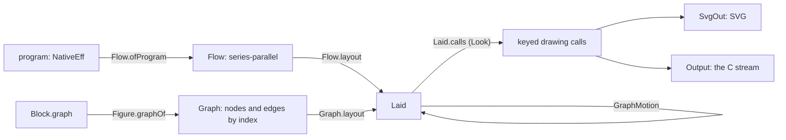

# One graph: the proposed API of the view, and what it pares away (2026-10-18)

Status: proposal, for the owner. Base `refactor/phase1-phase3` at `4a81cc034`. It follows the
owner's steer of 2026-10-18 and the backlog note ([README](README.md)).

## 1. The one thing to know

The view keeps three things:
- one graph, drawn by one module, for programs, docs figures and the proof graph;
- tables for the run's basic data: the journal, the host's calls, the fibers;
- docs pages.

The graph is the companion of editing, because an edit is a graph operation. A node's key is a
program address, which is the tool's `Place`. Selecting a node names the place to edit. An edit's
reply names the changed addresses, which light their nodes.

The core that does this exists: 3,237 lines in 17 modules. Programs add 3,639 lines. The other
6,883 lines of `tools/Tools/View` (50%) serve looks, motion, live replay and studies that this
direction does not keep, or defers.

## 2. What the graph needs to do

The owner's steer, transcribed from voice:
- "start from a basic graph view, graph layout";
- "unify everything into graph layout";
- "we want docs view... a rendered graph view of programs";
- "standard views for tables": a journal run and a host run, "the basic data";
- "editing is essentially graph operations";
- "deep modules with simple" interfaces.

So the graph's consumers are four:

| Consumer | Its graph | Size |
| --- | --- | --- |
| The program beside the editor | the program's flow, keyed by address | tens to hundreds of nodes |
| A docs figure (`Block.graph`, row 365) | nodes and edges by key | tens of nodes |
| The proof graph of the architecture map | claims and theorems | about 1,342 nodes; the open part is 37 |
| The fibers of a run, if not a table | fibers and their joins | a few nodes |

## 3. The pipeline today



Two layout algorithms produce one drawn type, `Laid`:
- `Graph.layout` (`tools/Tools/View/Graph.lean`) is layered: back edges by the nodes' order,
  ranks, barycentre order, Brandes and Köpf places (`Place.lean`), and routes.
- `Flow.layout` (`tools/Tools/View/Flow.lean`) is a fold over a series-parallel flow. An
  unchanged part keeps its own layout and moves rigidly. `FlowLaws.lean` proves its boxes apart
  and its edges descending (`lay_good`, `place_apart`).

The split is right for editing. A layered layout is global: one inserted node can reorder a whole
rank. The fold is local: an edit changes its part and moves the rest rigidly. A docs figure or a
proof graph has no series-parallel shape, so it takes the layered layout.

## 4. The proposed interface

One module family, `Tools.View.Graph`, with four entries. Every other module is internal or goes.
This is revised after the first read with the owner. Two layouts share one drawn type and one
drawing. The hit test and the generic groups are dropped, as below.

```lean
/-- A graph as data: nodes in their order, edges by node key. -/
structure Graph where
  nodes : List Node    -- key, two lines of text, a state (plain, lit, refused)
  edges : List Edge    -- key, source key, target key

/-- Admission: unique keys, edges between declared nodes (today's `GraphCheck`). -/
def Graph.check : Graph → Except Graph.Refusal Graph.Checked

/-- Two layouts, one drawn type: layers for any graph; the fold for a program's flow. -/
def Graph.layout : Graph.Checked → Laid
def Flow.layout  : Flow → Laid

/-- The one drawing: keyed calls, under a look. -/
def Laid.draw : Look → Laid → Picture
```

- **Why two layouts.** One `layout` over both would need `Graph` to carry the program's
  series-parallel tree, and that tree is `Flow` by another name.
- **No hit test.** `SvgOut.hitNode` already writes a keyed hit area per box, so the browser knows
  the key under the pointer. Only the C painter would need one.
- **No generic groups.** A program's groups (a scope, a fiber, an uninterruptible span, a layer)
  come from the fold as `Region`. Groups in a layered graph are a compound layout, the work that
  `GraphRegions` started and that §5 cuts.

The producers are folds into `Graph`:
- `Flow.ofProgram : NativeEff → Flow`, keyed by address, as today;
- `Graph.ofFigure : List GraphNode → List (String × String) → Graph` is today's
  `Figure.graphOf`;
- `Graph.ofProofGraph`: the seat's slice V1.

The outputs are two:
- `Picture.svg`, today's `SvgOut`, for the docs, the studio and the authoring page;
- `Picture.stream`, today's `Output`, for the C painter. This is decision 3.

### 4.1 Editing as graph operations

The graph view and the authoring tool share one key, the program address:

| The tool | The graph |
| --- | --- |
| `Place.at_ path` | the node keyed `path` |
| `doc`'s view of a place: its type and environment | the node's second line and its state |
| an edit's reply: the changed addresses | those nodes lit; the rest unchanged, moved rigidly by the fold |
| a refusal located at a path | that node in the refused state |
| a hole | a node in the plain state, named by its row |

So the view needs no edit operations of its own. It draws `Tool.serve`'s replies, as
`View.Build` already does (`tools/Tools/View/Build.lean`).

### 4.2 Tables for the run's basic data

A table is `Tools.Document`'s existing block, `table headers rows`, which both document folds
already render. Each producer is one fold:

| Table | Rows from | Columns |
| --- | --- | --- |
| The journal | `Run.journal` (`src/Effect4/Run/Basic.lean`) | index; command (`bind`, `submit`, `apply`, `control`); fiber; call id; operation; request, reply or decision |
| The host's calls | the session's calls and phases (`Api.HostSession`) | call id; operation; request; reply; phase (`bound` to `refused`) |
| The fibers | the machine's fibers | fiber; parent; state; exit |

No table is a graph, and no table needs a layout.

## 5. What goes, and what stays

| Group | Lines | Modules | Fate |
| --- | --- | --- | --- |
| Core: data, check, layered layout, draw | 3,237 | 17 | **stays**, re-cut to §4's five entries |
| Programs: the series-parallel fold, lines, page, frames through the tool | 3,639 | 8 | **stays**; its specimens become finite controls |
| Motion between two layouts | 887 | 4 | deferred (decision 2) |
| Live view and retained scene | 1,933 | 4 | deferred with motion; `Retained.diff` is the candidate change type |
| Runs drawn as a fiber graph | 191 | 2 | **goes**: the fibers become a table |
| Organic strokes and connectors | 846 | 3 | **goes**: the plain cubic route stays |
| The vocabulary of marks, value pictures, measures | 1,185 | 5 | **goes**, with `view-pages` and `v -V` |
| Regions, packing, contact, content | 826 | 5 | **goes**: no driver reaches them |
| Precedence and reach laws | 1,015 | 4 | **goes**: no consumer; `FlowLaws`' layout laws stay |

Line counts: each module's `wc -l`, grouped (this note's commands, §8). Outside `tools/Tools/View`:
- the d3-dag page and `Kit_view` go (the seat's V1 and V2);
- `Document.Figure` calls `Graph.layout` and stays.

## 6. The slices

| # | Slice | Removes | Size |
| --- | --- | --- | --- |
| G0 | The seat's cleanup: `docs/design/`, the probes, the d3-dag page, `Kit_view` | about 6,400 lines of code and text, and the CDN | running |
| G1 | Cut the groups that go (§5): fiber graph, organic strokes, marks and value pictures, regions and packing, the precedence laws | 4,063 lines, 19 modules, `view-pages` | S |
| G2 | The interface of §4: `Node` and `Edge` by key, `check`, the two layouts, `draw`; producers become `Graph.of…` | the index-based `GEdge`; the caller's `findIdx` wiring | M |
| G3 | Tables: the journal, the host's calls, the fibers, as `Tools.Document` tables | — | S |
| G4 | The authoring page: the tool's replies drawn through §4.1, the tables beside | — | M |
| G5 | Motion, if decision 2 says so: one keyed transition on `Laid` | the second change type | M |

## 7. The owner's decisions

| # | Decision | Recommendation |
| --- | --- | --- |
| 1 | Two layouts with one drawn type and one drawing: the fold for programs, layers for the rest | yes: only the fold moves an edited program rigidly |
| 2 | Motion: still frames with the changed nodes lit first; one keyed transition later | still frames first |
| 3 | The C painter (`draw.c`, `play.c`, SDL3, cairo, pango; 1,634 lines) | keep it as is with no new features; SVG in the browser is the one surface that grows |
| 4 | The program view: its lines beside its graph (`Page`), or the graph alone | lines beside the graph, keyed by one address |

## 8. Evidence and limits

- Module reach: the import closure of each driver, computed from the `import` lines of
  `tools/**/*.lean`. `Document.Figure` reaches 14 view modules (3,247 lines). `Drivers.View`
  reaches 33 (7,182), `Drivers.Live` 29 (8,009), and `Drivers.GlyphSheet` 20 (4,916).
- The modules that go are reached by no driver, or only by the drivers that go.
- The proof graph's layout time by `Graph.layout` is the seat's V1 measurement, not yet taken.
- §4's entries are proposed declarations. None is written, and no law about them is stated.
