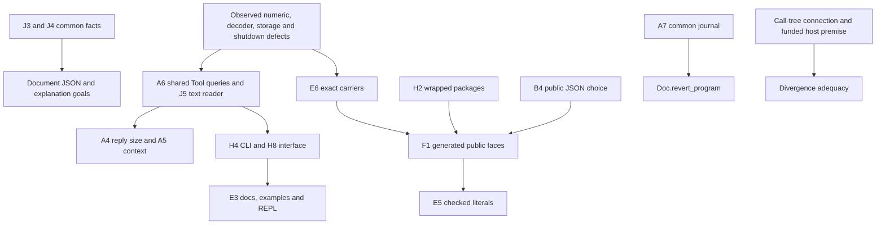

# Quality review at 3471cbe35

The public kit can return the wrong integer after accepting a reply that the machine's numeric checks would refuse.
The review also reproduces failures in pack decoding, storage verification, failed-write recovery and shutdown acceptance.
Fix these before widening the public interface.

The reviewed commit is `3471cbe35e3f91949170e2147dbe46f75cb795fd` on `refactor/phase1-phase3`.
The isolated worktree is `/Users/pooks/.codex/worktrees/quality-review-3471/lean4-effect4`.
A1 completed first. Its retained checkpoint and probes supplied the numeric direction before the remaining review began.
The work changes no tracked source, commits, pushes or merges.
Every review output is under this folder's `README.md` or `probes/`.

Finishing criteria: cover all ten A angles, every B group, fifteen branches, 49 dated folders, and every named follow-up.
Each ranked finding needs evidence, a fix, a deletion scope and a regression control.
Finite probes, source inspection, historical receipts and open choices remain distinct.
The review meets those criteria. It does not claim exhaustive input coverage or physical power-loss certification.

## The ten findings that matter most

| Rank | ID | Severity | Finding | First action |
| ---: | --- | --- | --- | --- |
| 1 | A1.1 | high | An admitted kit reply produces the wrong integer. | Apply shared ingress checks, then finish E6 with exact carriers. |
| 2 | A3.2 | high | A failed journal write loses pending rows; a later commit acknowledges a gap. | Retain pending state or poison the writer until recovery. |
| 3 | A4.1 | high | A send reports success after shutdown has joined its workers. | Count in-flight admissions before sealing and draining. |
| 4 | A3.1 | high | CAS verification reports success after corruption before the published boundary. | Require the scan to reach that boundary. |
| 5 | A3.3 | high | Directory sync errors are acknowledged as success. | Propagate synchronization failure through one durable-file helper. |
| 6 | A2.1 | high | A short pack file with a huge claimed length raises an exception. | Check remaining lengths before addition or allocation. |
| 7 | B5.1 | medium | The lanes interface exports 2,454 removable lines. | Use the checked reachable-type selector. |
| 8 | A5.1 | medium | Failed journal opening leaks its writer claim. | Bracket opening and transfer ownership only after success. |
| 9 | A5.2 | medium | A negative CLI budget reaches a generated-array exception. | Validate numeric options before evaluation. |
| 10 | A3.4 | medium | Journal recovery retains part of a batch despite its stated all-or-none promise. | Add batch framing, or obtain an explicit contract ruling. |

## Part A: ranked findings

### A1.1 — An outside reply reaches arithmetic beyond its declared domain

| Field | Finding |
| --- | --- |
| Severity | high |
| Kind | defect |
| Where | `ocaml/engine/kit/kit.ml`, `admitted` and `run`; `src/Effect4/Machine/Integers.lean`, `intNeg`, `intAdd`, `intSub`; their generated closure functions. |
| Evidence | `probes/a1.ml` passes a wire-decoded program and reply through the public kit. `probes/A1Lean.lean` evaluates the same subtraction in Lean. |
| Why | The kit's call-tree path checks reply typing without the engine's numeric admission. A raw Nat addition wraps before a subtraction branch avoids checked growth. This violates the builtin's declared domain and decision 394's host-ingress rule. |
| Fix | Apply the same program-literal and reply checks before either run route. Return a profile refusal before accepting the host's new state. Then finish E6 with exact Nat/Int and an exact UInt64 carrier. |
| Deletes | No immediate deletion. E6 replaces the bounded numeric representation; its measured scope follows below. |
| Test | Retain the negative reply, native-host route, tape route, wire round trip and Lean result. Keep ordinary addition's refusal as a control. |
| Plan | E6 and owner decision 12; immediate ingress repair. |
| Size | M for E6; S for shared ingress repair. |

The input reply is `Val.negInt 4611686018427387903`, representing negative 2^62.
The program computes negative one minus that reply.
Lean returns natural `4611686018427387903`.
The kit returns `NegInt 0`, representing negative one.
The default cross-check records `agrees=false` but retains that wrong finished result.
Both the tape and native callback paths reproduce it.

The operation first computes `Nat.add max_int 1` inside `intNeg`.
The following subtraction branch never calls `Profile.grow`.
Ordinary additions at the profile bound and at `max_int` refuse in the controls.
This finding therefore concerns the demonstrated path, not every arithmetic row.

### A2.1 — Pack-length arithmetic wraps before allocation

| Field | Finding |
| --- | --- |
| Severity | high |
| Kind | defect |
| Where | `ocaml/engine/cas/e4_pack.ml`, `read_full`, `step_at`, and `reader_source.read`. |
| Evidence | `probes/a2/pack_boundary.ml` changes only a valid record's length field to `max_int - 4`. A small file then raises `Invalid_argument("Bytes.create")`. |
| Why | The length fits the be64 host domain, but adding the header and offset wraps. The reader's second addition also wraps, so an impossible allocation reaches the runtime. |
| Fix | Validate offsets against file size, then compare lengths against the remaining size using subtraction. Check allocation limits before allocation. Use the same checked range helper in direct reads and scanning. |
| Deletes | Replace the three unchecked range calculations. No net line saving is claimed. |
| Test | Keep the valid file, changed lengths `max_int`, `max_int-4`, `max_int-16`, `max_int-64`, and `max_int-100`, then restore the valid file. Every malformed case must refuse without exception or a negative cursor. |
| Plan | New. |
| Size | S |

`probes/a2/pack-boundary.log` records valid and restored reads as `Ok`, with scans ending at `Eof`.
The three middle lengths raise during direct reading.
Scanning also constructs negative offsets before stopping.
The test changes untrusted bytes; it does not request a large allocation through a programmer-only API.
The header mutation invalidates the record checksum, which the reader never reaches before this failure.


The A3–A8 finding logs and scripts resolve under `probes/standards/`.

### A3.2 — A failed WAL flush destroys its retry state

Severity: high. Kind: defect.

Where: `ocaml/engine/cas/e4_wal.ml`, `flush_buf`, `commit`, and the writer state.

Evidence: `python3 fault_injection.py` embeds the exact pinned source and replaces only the Unix I/O boundary.
It stages rows zero and one, injects `EIO` before writing, then permits I/O and stages row two.
The retained output in `injected.log` is:

```text
WAL commit failure: Unix.Unix_error(Unix.EIO, "write", "injected")
WAL after failed write: staged=0 next=2 durable=0
WAL later successful commit: durable=3 replayed=0 stop=gap: index 0 is missing; the next stored row is 2
```

Why: `flush_buf` clears its buffer before the write and sync succeed. It leaves the writer usable after failure.
A later commit advances the durable count beyond the missing rows. This violates the WAL acknowledgement property and STANDARDS rule 6.

Fix: retain pending state until success. Treat uncertain partial writes and sync failures as a poisoned writer requiring recovery.
Do not blindly retry a buffer after an unknown partial write. Return a typed I/O refusal from the public commit boundary.

Deletes: replace the ten-line `flush_buf` body; `function-spans.json` records that measured span. Net deletion is not claimed.
Test: retain this pre-write `EIO` test and add partial-write and sync-error controls. No later commit may acknowledge an unreadable prefix.
Plan: new. Size: M.

### A4.1 — A successful send can arrive after shutdown finishes

Severity: high. Kind: defect.

Where: `ocaml/engine/e4_sched.ml`, `lookup`, `send`, `enqueue`, `wake`, and `shutdown`.

Evidence: `python3 shutdown_model.py` builds a scheduled qcheck-stm test around the exact scheduler source.
The wrapper pauses immediately before the original `E4_mailbox.push_with`. It changes scheduling only.
The source digest is retained in `scheduler-source-sha256.txt`.

```mermaid
sequenceDiagram
    participant S as Sender
    participant R as Router
    participant D as Shutdown
    S->>R: lookup succeeds under router lock
    R-->>S: machine returned; router lock released
    Note over S: pause before mailbox push
    D->>R: seal router
    D->>D: pending is zero; stop and join workers
    S->>S: enqueue; pending becomes one
    S->>R: wake reaches closed inbox
    R-->>S: wake refused, result ignored
    S-->>S: send returns Ok
```

The sequential control applies one accepted send and leaves pending zero. Sending after shutdown returns `Stopped`.
The concurrent history reports `Send: ok`, `Shutdown: applied=0`, and pending one.
Neither sequential ordering permits this history. qcheck-stm reports `Results incompatible with linearized model`; the expected test exit is one.
See `shutdown-model.log` and `shutdown_model_tail.ml`.

Why: lookup acceptance and mailbox insertion do not share ownership through shutdown's seal.
Quiescence cannot count a send that passed lookup but has not entered its mailbox.
The ignored inbox refusal leaves accepted work without a worker. This breaks the scheduler's accepted-work drain behavior.

Fix: retain send ownership through enqueue, or register in-flight admissions before releasing the router lock.
Shutdown must wait for those admissions before checking quiescence. Handle the closed-inbox result consistently.

Deletes: zero declarations are proposed for deletion. Net line saving is not claimed.
Test: extend the scheduler model with `Shutdown`; retain both serial controls and the forced overlapping history.
Plan: new; extend the existing scheduler model. Size: M.

Limit: an additional unmodified-library stress test finds no mismatch in 2,000 unscheduled races.
That result is retained in `shutdown-stress.log`. It does not invalidate the scheduled counterexample or measure its production frequency.

### A3.1 — CAS verification ignores a failed scan

Severity: high. Kind: defect.

Where: `ocaml/engine/cas/e4_cas.ml`, `walk_records`, `rebuild_index`, `verify`, and `open_rw_exn`.

Evidence: run `storage_probe.ml` using the command below. The probe commits one valid schema node, closes it, and preserves its control boundary `(0,121)`.
It changes the first record tag to `X`, at `E4_pack.head_length`. It leaves the control file unchanged.
The positive control reports `verify=Ok count=1`. The changed bytes report `verify=Ok count=0`; opening with `verify_on_open=true` also succeeds.
The retained bytes live under `storage-run-2/cas/`. The output is `storage.log`.

Why: `verify` discards the scan's stop result. It verifies the collected prefix, which can be empty before the published boundary.
The corruption therefore disappears from the verifier's candidate set. The same completion assumption affects the rebuilt index.
This breaks the declared independent verification property and STANDARDS rule 6.

Boundary control: `E4_disk.open_` refuses this same image. This finding does not claim that the checked Disk boundary accepts corruption.

Fix: retain and classify the scan stop in `E4_cas`. Require the scan to reach the published boundary before returning success.
Return a structural verification error and avoid marking a partial index finished.

Deletes: zero declarations are proposed for deletion. This is a behavior repair, with no asserted net line saving.
Test: keep the positive schema image and the one-byte corruption. Verification and verified opening must refuse the changed image.
Plan: new. Size: S.

### A3.3 — Failed directory syncs are treated as success

Severity: high. Kind: defect.

Where: `ocaml/engine/cas/e4_control.ml`, `commit`; `e4_pack.ml`, `e4_wal.ml`, and `e4_index.ml`, `fsync_dir`.

Evidence: `python3 fault_injection.py` keeps real file writes and file syncs, but injects `EIO` for directory sync.
The exact pinned `E4_control.commit` returns success after rename:

```text
control commit: returned success after 1 injected directory EIO; readable=true
```

Why: the commit path catches the error and acknowledges the update. Readability in the live process does not establish persistence after power loss.
The pack and WAL directory helpers use the same error-swallowing pattern.
POSIX permits partial or reordered persistence without the required synchronization. A failed sync supplies no successful durability evidence.
See the POSIX references below.

Fix: provide one durable-file helper with an explicit supported-filesystem contract. Propagate directory open and sync failures.
Synchronize the parent after creating a directory whose existence forms part of the acknowledged state.
If weaker durability remains intentional, the owner must change the public guarantee explicitly.

Deletes: replace three eight-line `fsync_dir` copies, measured as 24 lines in `function-spans.json`.
The new helper's size is not measured, so no net saving is claimed.
Test: the injected directory error must produce a refusal. A normal commit remains readable and verifiable.
Plan: new; shared helper is also a B2 consolidation candidate. Size: M.

Scope: `E4_index.save` also ignores its file-sync error. That index is reconstructable, so its loss alone loses a cache.
The control and segment-directory cases protect durable publication. No physical power-loss outcome is asserted from this injection.

### A5.1 — A failed WAL open leaves its writer claim held

Severity: medium. Kind: defect.

Where: `ocaml/engine/cas/e4_wal.ml`, `open_`; `ocaml/engine/cas/e4_lock.ml`, `acquire` and `release`.

Evidence: `storage_probe.ml` creates and closes a valid log. It temporarily replaces its segment pathname with a directory.
Opening acquires the writer claim, then raises `Sys_error("Is a directory")`.
The probe restores the original segment and retries. The retry raises `E4_wal.Locked`, although no writer was returned.
The retained log contains both failures and the restored segment bytes.

Why: cleanup covers selected scan verdicts, but not exceptions from filesystem operations after acquisition.
The failed call makes a repaired store unavailable for the rest of that process.
Malformed stored headers also escape as `Failure`, contrary to the newer STANDARDS rule 6 boundary.
The older WAL interface documents that exception; documentation does not repair the leaked resource.

Fix: bracket lock and descriptor ownership throughout opening. Transfer ownership to the writer only after every opening step succeeds.
Return a typed open refusal for bad stored input and I/O failure.

Deletes: rewrite the 57-line `open_` span measured in `function-spans.json`. No net line reduction is claimed.
Test: the restored segment must open successfully after the first failure. Add failures at segment creation, truncation, sync, and final opening.
Plan: new. Size: S.

### A3.4 — The WAL batch property promises more than recovery implements

Severity: medium. Kind: defect.

Where: `ocaml/engine/cas/e4_wal.mli`, property LG3; `e4_wal.ml`, `flush_buf`, `walk_segment`, and `open_`.

Evidence: `storage_probe.ml` constructs a pre-sync crash image containing one complete row and three bytes of the second row.
Both rows belong to one buffered commit. Recovery retains the first row and removes the partial tail:

```text
WAL torn batch: recovered=1 next=1 durable=1 stop=eof: every stored row was delivered
```

Why: LG3 says rows in one commit are all durable or all absent. Independent row frames contain no complete-batch marker.
A partial write can leave a valid proper prefix. Recovery cannot reconstruct the stronger batch property from these bytes.
This is a constructed interrupted-write image, not evidence that a successfully synced commit lost data.

Fix: if LG3 remains the contract, add a batch envelope or commit marker.
Recover only groups with a validated end marker.
Alternatively, obtain an owner ruling for row-prefix recovery and revise LG3. Do not silently weaken the stated property.

Deletes: zero declarations are proposed for deletion. A format change needs versioning; no size saving is claimed.
Test: enumerate truncations of a two-row batch. The chosen contract must distinguish batches with an end marker from partial groups.
Plan: new owner decision. Size: M.

### A5.2 — Negative CLI budgets escape as implementation exceptions

Severity: medium. Kind: defect.

Where: `ocaml/engine/kit/bin/eff.ml`, CLI integer parsing and top-level exception handling.

Evidence: `program.json` is a generated JSON spelling of a program returning natural one.
The normal `check` exits zero with structured success. `explore program.json --budget -1` exits two with empty stdout:

```text
Fatal error: exception Invalid_argument("Lcnf_array.get_exn: -1 outside [0,128)")
```

`run program.json --limit -1` instead exits zero with a finished result. Full arguments and channel bytes are retained in `cli.json`.

Why: signed CLI integers enter generated natural-number consumers without a nonnegative input check.
An ordinary user option reaches a documented internal precondition failure. STANDARDS rule 6 requires an ordinary refusal at this boundary.

Fix: validate nonnegative option domains before invoking generated code. Use the planned Cmdliner interface for typed option errors.
Keep structured command errors. Do not hide arbitrary programmer exceptions with a blanket catch.

Deletes: zero declarations are proposed for deletion by this focused fix. H4 can replace the manual parser separately.
Test: retain negative, malformed, overflowed, zero, and positive values for every numeric option.
Plan: H4. Size: S.

### A7.1 — Kit_serve has no explicit installed interface

Severity: low. Kind: smell.

Where: `ocaml/engine/kit/kit_serve.ml`, module interface.

Evidence: `ocamlc -i` succeeds and exposes twelve value declarations, plus types and module aliases.
The exact command is `interface-commands.json`; its output is `kit_serve.inferred.mli`.
The source has no companion `.mli`, although it is an installed library module changed by wave 2.

Why: STANDARDS rule 5 requires a small explicit interface. Readers cannot distinguish supported calls from serialization helpers without reading the implementation.

Fix: add `kit_serve.mli` exposing the supported request, answer, and serving boundary. Document ordinary refusals and exceptional preconditions.
Hide private helpers and retain the one generated owner of schema meaning.

Deletes: zero implementation lines need deletion. Restrict the public declarations after checking callers; do not assume all twelve are private.
Test: build current consumers through the explicit interface. A separate negative fixture must fail when it calls a deliberately hidden helper.
Plan: H8. Size: S.

### A7.2 — Documentation warnings still obscure interface contracts

Severity: low. Kind: cleanup.

Where: OCaml interface documentation named by `doc.log`, including interval syntax, exception references, and scheduler type links.

Evidence: `dune build @doc` exits zero with 37 `Warning:` lines and zero `Error:` lines.
The old lead of 39 warnings or errors is stale. The command and retained log appear below.

Why: malformed markup and unresolved references make the generated API harder to read correctly.
Examples include interval brackets parsed as markup, unresolvable exception identifiers, and unresolved `Delay` links.

Fix: repair the cited markup and qualify references. Keep the actual contracts and exception names.

Deletes: zero code declarations. No line saving is claimed.
Test: rerun the same documentation target and require these warnings to disappear without suppressing them.
Plan: H6. Size: S.

The A9 evidence files resolve under `probes/behavior/`.

### A9.1 — Remove two literal census checks

| Field | Finding |
| --- | --- |
| ID | A9.1 |
| Severity | low |
| Kind | cleanup |
| Where | The C2 tool-list checks in `ocaml/engine/test/kit/test_mcp.ml`. The kind census in `ocaml/engine/cas/test/test_shared_facts.ml`. |
| Evidence | `python3 analyze_tests.py` writes `test-analysis.json`. C2 requires 20 names, then compares those names with generated supported methods plus `describe`. `test_shared_facts` requires 23 generated kinds. An additive method preserves the table equality but fails the literal count. |
| Why | The literal counts add manual edits when the generated tables grow. The MCP table equality already checks the entire expected list and order. |
| Fix | Delete C2's literal count check. Replace the standalone kind count with a comparison against the generated manifest if independent generation coverage is required. Retain behavioural controls. |
| Deletes | The two literal checks occupy 4 lines, measured by `analyze_tests.py`: 3 MCP lines and 1 kind-census line. |
| Test | The additive-table control in `test-analysis.json` changes 20 to 21 entries. Table equality stays true; the literal check becomes false. This is a finite check of the assertions, not a modified MCP run. |
| Plan | Existing H5 test hygiene; new follow-up. |
| Size | XS |

The fixed ordinal checks in `test_log.ml` deserve a different verdict.
They protect the append-only wire table's existing positions.
Keep those checks when the table grows; replace the exact total with a documented lower bound.
The malformed ordinal controls in `test_eff.ml` also test the decoder's boundary.
They are not redundant generated-output comparisons.

The `test_engine.ml` counter counts reached exception messages containing `extern table incomplete`.
It does not count occurrences of `failwith` in generated source.
Its description still names two rows, but the behavioural check rejects any reached hole.
Treat that wording as stale prose, not a missing exception check.


## A1: reachability, word carriers and E6 size

Evidence status: finite native probes, finite Lean evaluations, and a source census.
The exact commands and outputs are under `probes/a1*` and `probes/A1*`.

| Outside input | Checked path and result |
| --- | --- |
| Wire bytes | The program and large negative reply both decode before the wrong kit result. |
| Tape answer | The public in-memory tape reproduces A1.1. |
| Native host reply | The callback route reproduces A1.1. |
| JSON request | The large magnitude becomes a numeral. Carrier reading refuses it; this path does not reproduce the arithmetic failure. |
| Stored node | The node reader accepts valid full float payload bytes. It retains bytes without constructing the generated OCaml float carrier. No stored-node float corruption is established. |

`UInt64` remains OCaml `int` in the generated carrier.
An explicit probe conversion with `Int64.to_int` makes positive and negative 0.5 identical as lowered float values and encoded digests.
That conversion demonstrates the representation gap. It is not a production conversion discovered in the tree.
The wire value decoder refuses float frames, and the engine's native float-answer boundary refuses unrepresentable patterns.
Ordinary negative binary64 values still need an exact 64-bit carrier in E6.
Zarith naturals alone do not supply that carrier.

| Measured E6 surface | Result | Measurement |
| --- | ---: | --- |
| Builtin rows | 128 | Multiline row parser in `a1_size.py` |
| `exact` / `domain` / `approximate` / `unsound` rows | 75 / 45 / 6 / 2 | Same parser; the brief's 43 misses two multiline domain rows |
| Direct Nat, Int, UInt64 and USize rows | 39 | Explicit row-name list in `a1-size.json` |
| Constructor fields containing Nat in the program-type recipe | 19 | Lean type reduction in `A1Fields.lean`; includes one `List Nat` field |
| Hand consumer candidate files | 53 | Paths retained in `a1-size.json`; candidates are not a promised edit count |
| `eff_types.ml` int tokens / integer tokens | 25 / 7 | Source token census |
| `closure_gen.ml` int tokens / integer tokens | 3,227 / 6,546 | Source token census |
| `api_engine.ml` int tokens / integer tokens | 1,543 / 1,322 | Source token census |
| `lanes_gen.ml` int tokens / integer tokens | 292 / 200 | Source token census |

The 39 direct rows exclude numeric crossings in arrays, string positions and profile arithmetic.
`Native.ctorValue` builds numeric constructors outside the builtin table.
`Translate.letValueExpr` saturates large Nat literals and refuses unrepresentable UInt64 literals.
Those translator paths belong in the migration too.

The current `bench_todo` baseline allocates 23,824 words per host call for the lowered reference repository.
Its typed lowered model allocates 23,378 words per call.
`probes/a1-bench-before.log` retains every stage.
No finished Zarith switch exists in this pinned tree, and this review edits no tracked source.
There is no after measurement and no measured overhead claim.

Decision 12: retain exact naturals and integers everywhere as the target direction, with an exact word carrier too.
The interim input checks are necessary because the current crossings do not bound every computation that the kit accepts.

## A2: decoder coverage and limits

`python3 probes/a2/run.py` rebuilds the local harness and creates fresh transient fixtures.
It tests every seed prefix, three bit flips per byte, 1,000 random mutations and 1,000 random byte strings per family.
The fixed seed is `[3471; 20261019]`. Each byte-campaign subprocess has a fifteen-second timeout.
`probes/a2/deep_run.py` gives each depth probe twenty seconds.

| Decoder | Cases in final byte campaign | Exceptions |
| --- | ---: | ---: |
| `frame` | 2330 | 0 |
| `wire` | 2500 | 0 |
| `shape` | 2266 | 0 |
| `node` | 2402 | 0 |
| `control` | 2288 | 0 |
| `index` | 3242 | 0 |
| `pack` | 2326 | 0 |
| `wal` | 2222 | 0 |
| `json` | 2276 | 0 |
| `nat_json` | 2276 | 0 |
| `mcp` | 2276 | 0 |


The targeted near-limit pack case then exposes A2.1.
The frame near-limit controls return without exception.
The positive controls in `a2/controls.log` confirm accepted program, node, shape, control and JSON fixtures.
`a2/deep_run.py` confirms accepted JSON arrays and wire option types through depth 2,000,000.
MCP returns a structured non-object refusal for those arrays; the executable stdio route also returns normally through depth 300,000.
No tested case hangs or overflows the stack.
These bounds do not prove safety at every depth or classify every corrupted return independently.

The initial worker harness overwrote a read-only index fixture and restarted from a damaged pack.
Those initial errors are harness failures, retained under `probes/behavior/`.
The final harness replaces the index file, recreates its fixtures, and starts pack scans at the first record.
Use `probes/a2/results.json` and `pack-boundary.log` for the final results.


The A3–A8 evidence filenames below resolve under `probes/standards/`.

## A3: persistence and lock audit

`rg -n 'Unix\.fsync|Unix\.rename|Sys\.rename' ocaml --glob '*.ml'` confirms fifteen sync call sites.
It also finds one `Unix.rename` and one `Sys.rename`; the latter publishes the index snapshot.
The normal CAS publication order writes and syncs pack bytes before publishing the control boundary.
`E4_control.commit` writes a temporary file, syncs it, renames it, then attempts directory sync.
The order is appropriate; the missing error propagation produces A3.3.
Segment creation syncs the new file and attempts its containing directory sync.
Recursive directory creation does not establish persistence of every newly created ancestor.
WAL recovery truncates a torn active tail. A sealed damaged segment receives a refusal in the relevant scan path.
These are source observations. The finite probes above establish only their stated cases.

| Ignored-error site | Effect | Assessment |
| --- | --- | --- |
| `E4_cas.cid_map`, durable decoded nodes | Omits a node from the derived by-CID map and advances coverage | Hides a corrupt member in the cache; deletes no pack bytes |
| `E4_cas.cid_map`, staged nodes | Skips a decode failure | Normal admitted staging should exclude this case; no reachable counterexample claimed |
| `E4_cas.result_map` | Omits undecodable results and advances derived coverage | Hides a corrupt member; deletes no source bytes |
| `E4_cas.open_rw_exn`, failed `E4_index.load` | Rebuilds the index from pack bytes | Intended cache recovery, subject to A3.1's scan-completion requirement |
| `E4_index.Deps.rebuild` | Skips invalid node decoding | Incomplete dependency cache; scan completion alone does not prove node validity |

The current tree has additional `Error` branches beyond the old five-site description.
The verifier's by-query table also skips invalid envelopes, but its subsequent per-node check normally rejects them.
A3.1 identifies the earlier structural stop that defeats that complete-record assumption.
No listed skip directly deletes stored bytes. WAL recovery's intentional truncation is a separate operation.

`rg -n '"LOCK"|lockf' ocaml --glob '*.ml'` finds no second production opener of the lock pathname outside `E4_lock`.
The host probe demonstrates the relevant process semantics:

```text
another process while claimed: can_lock=false
after extra LOCK fd closes: can_lock=true
after parent release, child raw=true inherited_registry=refused
```

The extra descriptor is a test control, not an identified production caller.
Closing any descriptor for the same file can release that process's record locks.
After fork, the child has a copied in-memory held-writer table but does not inherit the record lock.
Using an inherited writer therefore has no supported exclusion guarantee; reacquisition also needs a PID-aware held-writer table or an explicit prohibition.
The implementation currently relies on a local, cooperative, process-owned writer discipline.

NFS is not tested here. NFSv4 locks have lease and server-state semantics, including state loss after partitions.
A supported NFS profile must address those failures explicitly; POSIX-looking `lockf` calls alone do not establish it.
The owner should state the supported filesystem and fork profile before widening the durability claim.

## A4: concurrency coverage and rejected leads

| Structure | Ownership and existing evidence | Review result |
| --- | --- | --- |
| Mailbox | Locked bounded queue; exercised by scheduler model suites | A4.1 concerns router-to-mailbox acceptance, not an isolated queue-order failure |
| Ring | Append, read, and written count share its mutex; append checks writer ownership | No new counterexample; absence of a standalone model proves no defect |
| Log | Persistent `Lcnf_array` state | Sharing immutable values differs from sharing a mutable append cursor |
| Cache | Mutable cache without its own lock | STANDARDS rule 8 requires one owner; no supported multiwriter use is established |
| Kit session | Abstract mutable session; P1 gives independent owners | P2 deliberately shares one session as a negative control |
| Scheduler | Existing scheduler model lacks a shutdown command | The new scheduled history exposes A4.1 |

`stm_tool` supplies `~retries:2` to its deliberately failing P2 control, with `~neg:true`.
That argument does not suppress a failure in the positive session model. The lead is refuted in its stated form.
`Stm_support` has its own general retry policy; A9 owns load and reliability review.
`E4_quiescence` documents the 0.2 ms polling timeout and the missing timed condition wait in this stdlib profile.
No measured latency defect follows from the constant alone.

## A5: exception inventory and CLI channels

`python3 inventory.py` retains the lexical inventory and classification in `inventory.json` and `inventory-summary.json`.
It finds 221 hand source/interface files. These are matching-line counts, not counts of reachable runtime exceptions.
The lexical `library` bucket includes a few generator-interface fixtures. It is not an authoritative production-library census.
Comments can also match. The source checks below qualify the raw counts.

| Pattern | Library bucket | Test/bench | Interface | Tool/template | Total |
| --- | ---: | ---: | ---: | ---: | ---: |
| `failwith` | 1 | 82 | 1 | 2 | 86 |
| `invalid_arg` | 80 | 9 | 0 | 0 | 89 |
| `Option.get` | 2 | 5 | 0 | 0 | 7 |
| `List.hd` | 0 | 22 | 0 | 0 | 22 |
| Whole-token `List.nth` | 0 | 88 | 0 | 0 | 88 |

The old `List.nth` count also includes substring matches such as `List.nth_opt`.
Most library `invalid_arg` calls guard programmer capacities, bounds, ownership, closed writers, or one-use resources.
`exception-contracts.txt` preserves the corresponding interface excerpts. This is not a claim that every guard documents every possible exception.
The two library `Option.get` sites follow local synchronization or retained-slot invariants in `E4_reply` and `E4_ring`.
The concrete external-input failures are A5.1 and A5.2.

| CLI input | Exit | stdout | stderr |
| --- | ---: | --- | --- |
| Valid program, `check` | 0 | Structured success | Empty |
| Missing program | 2 | Structured error | Empty |
| Negative explore budget | 2 | Empty | Fatal exception |
| `--help` | 2 | Empty | Usage |
| Malformed request, `serve` | 0 | Structured error | Empty |
| Malformed request, `mcp` | 0 | JSON-RPC parse error | Empty |

Serving processes remain available after per-request refusal; exit zero is appropriate for that loop.
H4 should give explicit help success and consistent command-error behavior. A5.2 is the demonstrated defect, not a general stdout prohibition.

## A6: constants and configuration

Format owners already name magic and version bytes: control version 2, pack version 1, index version 1, and WAL version 1.
`Eff_frame` owns framing tags. `E4_shape` repeats six of those tags; the parent receives this B2 consolidation candidate.
SHA-256 constants belong to the standard and do not require arbitrary renaming.

Scheduler defaults have one named owner in `E4_sched`: domains, mailbox bound, ring capacity, batch, spin, checkpoint spacing, and minor heap.
Finalizer fuel belongs to `E4_abandon`. Their interface describes their purpose, but not every numerical choice has measured justification.
No performance finding is claimed without a benchmark.

The public `config_of_env` contract explicitly documents fallback on malformed integers. The finite result is retained in `config.log`:

```text
E4_BATCH="8" => batch=8
E4_BATCH="eight" => batch=8
E4_BATCH="-1" => batch=-1
E4_BATCH="9999999999999999999999999" => batch=8
```

That behavior can conceal an operator typo, but it is not an undocumented regression.
A future explicit configuration loader should distinguish absent, malformed, and out-of-domain values.
It should return the effective configuration and its provenance. This remains an optional boundary improvement rather than a ranked defect here.

The recipe caps of 4,000 and 2,000 are traversal limits, not silent output truncation.
`Gen.emit` reports headroom and refuses an unresolved frontier. Current manifests contain 3,253 API rows and 822 engine rows.
Thus the measured headroom is 747 and 1,178. `inventory.py` measures those manifest rows.
The round limits lack a numerical rationale, but the explicit refusal prevents silently omitting required declarations.
Test counts and mutation value belong to A9; this seat does not invent a reason for them.

## A7: interfaces, comparisons, ignored results, and warnings

No exposed mutable record field appears in the hand `.mli` files inspected here.
Twelve lexical interface matches for `mutable` are prose. Actual mutable implementations remain behind abstract types.
This does not establish safe use of an abstract value across domains; its ownership contract still matters.

The typed comparison checker passes across 75 built library `.cmt` files, with exit zero.
The complete argv is retained in `interface-commands.json`; `typed-lint.log` retains the result.
No finding duplicates the enforced comparison rule. A lexical `compare` count cannot identify unsafe abstract-value comparison.

Of 220 `ignore (` matches, thirteen fall in the library bucket and 207 in tests or benches.
Scheduler inbox results participate in A4.1. Other inspected cases discard unit or an intentionally unused value.
The count alone establishes no additional lost-error defect.

The named missing-interface leads have different owners:

| Module | Verdict |
| --- | --- |
| `Kit_serve` | A7.1: installed library boundary needs its `.mli` |
| `Api_engine_inst` | Explicit functor-only exception in STANDARDS rule 5 |
| `api_engine_prelude.ml` | Generator input fragment, not an installed module boundary |
| `join_escape.ml` | Intentional negative compiler control |

The kit warning string now enables the ordinary warning set. Its lack of `@55` is not a demonstrated missed local-join check.
Generated local joins belong to the API, closure, and lanes stanzas, which enable fatal warning 55.
The test-local `-w -33` suppresses unused-open warnings in `api_gen_inst.ml`; it does not disable the library's type checks.
Seven flag spellings remain a consolidation question for B2, not seven independent defects.

## A8: source comparisons and pedigree

Repository rules control this review. The references supply concrete techniques and boundary examples, not a style vote.

| Question | Primary source and compared declaration | Effect4 conclusion |
| --- | --- | --- |
| Results and exceptions | Jane Street, *Base* v0.16.5, `base/or_error.mli`, `try_with` and `of_exn`; *Core* v0.16.2, `core/result.mli` | Typed refusal values fit ordinary domain errors. This does not require replacing programmer-precondition exceptions. |
| Cleanup | Jane Street, *Base* v0.16.5, `base/exn.mli`, `protect` and `protectx`; *Stdio* v0.16.0, `stdio/in_channel.mli`, `with_file` | Bracket resource ownership in A5.1. Merely replacing `Printf` adds no safety. |
| Compiler idiom | Xavier Leroy, INRIA, *OCaml compiler Misc interface*, copyright 1996, distributed with OCaml 5.1.1; `compiler-libs/misc.mli`, `try_finally` | The compiler's cleanup API runs cleanup on success and failure and preserves exception information. |
| Compiler error boundary | Fabrice Le Fessant, INRIA, *Cmt_format*, copyright 2012, OCaml 5.1.1; `compiler-libs/cmt_format.mli`, `Error`, `read_cmt` | Compiler-libs also uses exceptions. It does not justify claiming that all OCaml pedigree uses results everywhere. |
| File replacement | Irmin contributors, *Irmin filesystem backend*, pinned commit `7a09a06fff67bc4981faca36a332c51fc16e819e`, `irmin_fs_unix.ml`, `with_write_file` | `Lwt.finalize` brackets descriptor ownership before rename. This illustrates cleanup, not a power-loss guarantee. |
| Derived host data | Jane Street, *ppx_sexp_conv* v0.16.0 and *ppx_expect* v0.16.0 | Use only for hand host types or suitable golden tests, with a measured maintenance benefit. Lean-owned carriers still need generated faces. |

The installed reference roots are `/Users/pooks/.opam/effect4/lib/base`, `/Users/pooks/.opam/effect4/lib/core`, and `/Users/pooks/.opam/effect4/lib/stdio`.
Compiler reference files are under `/Users/pooks/.opam/effect4/lib/ocaml/compiler-libs`.
The Irmin source is `/Users/pooks/Dev/refs/irmin/src/irmin-fs/unix/irmin_fs_unix.ml`.
Its pin comes from `/Users/pooks/Dev/refs/ocaml-tooling/MANIFEST.txt`.
The installed package versions come from `opam list --switch=effect4 --installed --columns=name,version base core stdio ppx_expect ppx_sexp_conv`.
The compiler version is OCaml 5.1.1.

`Printf.sprintf` primarily constructs diagnostic strings. The scheduler writes worker failures and optionally writes its effective configuration to stderr.
Those explicit effects do not justify a blanket prohibition on Printf within libraries.
Binary framing already uses Buffer in the relevant paths. A10 owns measured concatenation costs.
No measured hand derivation warrants a new deriver finding from this seat.

The `probe/sexp-face` comparison uses Git objects only: commits `6c1485863` and `d7b02d1a9`, dated 2026-10-18.
Its seven-file diff adds 707 lines and removes six. It adds a Lean Sexp carrier, laws, and generated LCNF faces.
It does not authorize handwritten OCaml derivations for Lean-owned carriers.
H5 can migrate appropriate golden tests to ppx_expect when touched. No extra test framework is justified solely by appearance.

The smell checklist remains a heuristic. Duplication matters where sync handling or constants have two owners.
Resource-lifetime message chains matter in A5.1 because an error leaks ownership.
No independent finding survives for feature envy, refused bequest, or speculative generality after applying actual ownership and behavior requirements.
Tooling-enforced layout and comparison preferences are excluded.

### Published primary references

- IEEE and The Open Group, *The Open Group Base Specifications, Issue 8*, POSIX.1-2024, General Concepts §4. Persistence can be partial or reordered without synchronization. [Filesystem crash semantics](https://pubs.opengroup.org/onlinepubs/9799919799/basedefs/V1_chap04.html).
- IEEE and The Open Group, *fsync*, Base Specifications Issue 6, IEEE Std 1003.1-2004. A failed call does not guarantee completion of queued I/O. [fsync contract](https://pubs.opengroup.org/onlinepubs/009695399/functions/fsync.html).
- OCaml team, *OCaml 5.1 Reference Manual*, 2023, Unix library. [Unix interface](https://ocaml.org/manual/5.1/api/Unix.html).
- OpenBSD Project, *fcntl(2)*, operating-system manual, accessed 2026-10-19. Record locks are process-associated and are not inherited by fork. [Record-lock contract](https://man.openbsd.net/fcntl.2).
- T. Haynes and D. Noveck, editors, *Network File System (NFS) Version 4 Protocol*, IETF RFC 7530, 2015, §§9.5–9.6.3. Lease expiry can invalidate lock state. [NFS failure recovery](https://www.rfc-editor.org/rfc/rfc7530.html#section-9.6.3).
- Yaron Minsky and Anil Madhavapeddy, *Real World OCaml*, second edition, Cambridge University Press, 2022, Error Handling. The chapter explains protected cleanup and file brackets. [Error handling](https://dev.realworldocaml.org/error-handling.html).


The A9–A10 evidence filenames below resolve under `probes/behavior/`.

## A9: measured test cost

Run the A9 and A10 commands from `probes/behavior/`:

```sh
python3 time_tests.py
python3 recheck_tests.py
python3 analyze_tests.py
```

`time_tests.py` finds built binaries named `test_*`, `prop_*`, or `stm_*`.
It runs each serially with a 30-second timeout.
It sets `TMPDIR` inside this report and reads the main checkout's existing Lean corpus.
The Lean corpus is an input, not regenerated evidence.

Four first-run failures come from this harness's invocation.
Two environment overrides name directories where the tests expect marker files.
`test_lean_wire` needs its explicit golden directory outside dune's usual build layout.
`test_interface` needs three fixture arguments.
`recheck_tests.py` supplies those paths and arguments. All four then pass.
The first-run logs remain available. They are not product defects.

`test-analysis.json` combines the passing first runs with the corrected runs.
It reports 64 passing binaries and 36.110 seconds of combined process time.
This is not the entire dune test alias: installation scripts, formatting, and typed-lint rules are outside this measurement.

| Slowest selected binary | Seconds | Result |
| --- | ---: | --- |
| `engine/test/stm/stm_disk.exe` | 4.551 | pass |
| `engine/cas/test/test_checkpoint.exe` | 2.772 | pass |
| `engine/test/stm/stm_mailbox.exe` | 2.318 | pass |
| `engine/test/stm/stm_inbox.exe` | 2.142 | pass |
| `engine/test/test_diff.exe` | 1.863 | pass |
| `engine/test/stm/stm_tool.exe` | 1.409 | pass |
| `engine/test/test_buckets.exe` | 1.189 | pass |
| `engine/test/test_sched.exe` | 1.075 | pass |

Each timing includes process startup. One run establishes cost on this host, not a regression distribution.
The tests with the highest costs exercise disk behaviour and concurrency.
Their costs alone justify no deletion.

## A9: C4 mutation coverage

`analyze_tests.py` reads the retained `results-B.tsv` without modifying any source.
Its full per-test mutant list appears in `test-analysis.json`.
The table covers 56 mutants of seven engine carriers.
Thirty-one selected engine binaries have no attributed failure in that campaign.

| Binaries with no attributed C4 failure | What they chiefly exercise | Verdict |
| --- | --- | --- |
| `test_math` | Byte arithmetic | keep |
| CAS `test_bytes`, `test_cache`, `test_cas`, `test_control`, `test_crash`, `test_disk`, `test_disk_boundary`, `test_disk_damage`, `test_disk_kill`, `test_disk_stm`, `test_index`, `test_pack`, `test_shared_facts`, `test_wal` | Store, bytes, durability, cache, and disk boundaries | keep |
| `test_check`, `test_ctors`, `test_modeled`, `test_rocq` | Test support and generated comparison lanes | keep |
| `test_mcp`, `test_shapes`, `test_tool` | Protocol and JSON admission | keep |
| `stm_admit`, `stm_disk`, `stm_inbox`, `stm_mailbox`, `stm_tool` | Concurrent host structures and sessions | keep |
| `test_host`, `test_log`, `test_query`, `test_sched` | Host protocols, log parsing, queries, and scheduling | keep |

These results show the campaign's reach. They do not show that these tests are redundant.
The historical `stm_admit` failures are excluded because the seven mutated carriers do not reach that toy engine.

The old campaign misses P07, T12, and Y04 after unrelated scheduler failures are excluded.
`receipt-w2-engine.md` records their repair in `d01646fa6`.
The pinned sources contain the repaired PP3/PP7, T9, and MM6a checks.
The current binaries pass those checks.
This review does not rerun mutations in source. Their reported red outcomes remain historical evidence from that receipt.

C4 already removes the `Ref`-only checks and the six list twins.
No additional whole test earns deletion from the retained campaign evidence.

## A9: load and retries

```sh
python3 load_tests.py
```

The wrapper runs the existing `stm_load.py` with 12 copies and 5 rounds.
It limits the process group to 90 seconds.
`load-tests.json` records 60 runs, zero nonzero exits, and zero P1 failures in 40.978 seconds.
The 60 raw outputs remain under `stm-load/`.
The fixed generator seed is 20261018. Scheduling remains nondeterministic.

The historical failure interleaves the pending counter and the send stamp.
The pinned `E4_sched.enqueue` calls `E4_quiescence.enter_with` to perform both under one lock.
This source change and the current finite load run support treating the historical lead as repaired.
They do not prove absence of every race.

The `~retries:2` lead is refuted.
It belongs to `stm_tool` P2, the expected-failure shared-session control.
`Stm_support.par_test` passes it to QCheck's shrinking machinery.
The installed `QCheck2.Test.run_law` repeats candidates while shrinking.
The initial property evaluation calls `run_law ~retries:1`.
A failing green test does not become green through this parameter.

## A10: measured paths

```sh
python3 ../run_ml.py hot_paths.ml
./hot_paths.exe > hot-paths.log
```

The second command runs after the load campaign ends.
`hot-paths-loaded.log` preserves the overlapping run.
`hot-paths-initial.log` contains preliminary per-domain allocation counters; use the final global allocation measurements instead.

`hot_paths.ml` times 20,000 reads at each environment size.
It reports the best and median of five runs.
The table below gives the best milliseconds from the final run.

| Bindings | Outer binding, current carrier | Latest binding, current carrier | Outer binding, existing persistent vector |
| ---: | ---: | ---: | ---: |
| 100 | 2.148 | 0.054 | 1.959 |
| 1,000 | 18.384 | 0.042 | 0.090 |
| 10,000 | 210.682 | 0.045 | 0.264 |

`E4_env.get` in `ocaml/engine/e4_env.ml` walks the reversed list for an early binding.
Its cost grows with environment length. Its `.mli` already describes this tradeoff.
The persistent vector demonstrates a possible faster read carrier for large environments.
This experiment measures reads only. It does not measure snapshot retention, prefix truncation, or whole-program execution.
It therefore does not establish that replacing the carrier improves the product.
No new defect finding rests on this microbenchmark.

The scheduler experiment uses one worker, a toy engine, batch 64, and no trace rows.
Every accepted send reaches `step`; the probe checks the applied count and quiescence.
It measures total allocated words using `Gc.stat` around the complete run, including scheduler startup and shutdown.

| Sends | Applied | Milliseconds | Allocated words | Words per send |
| ---: | ---: | ---: | ---: | ---: |
| 1,000 | 1,000 | 0.668 | 73,708 | 73.71 |
| 10,000 | 10,000 | 2.980 | 724,281 | 72.43 |
| 100,000 | 100,000 | 25.909 | 7,266,356 | 72.66 |

Allocation remains approximately constant per send across this measurement.
This does not profile every allocation site or set a production throughput target.
It gives no evidence of allocation growing with the queue length.

Other inspected candidates do not justify a finding:

- `E4_logindex.arg_int` indexes short event-argument lists. This review establishes no growing-loop cost there.
- `E4_logindex.decision_keys` appends once to its completed result. It does not repeatedly append during recursion.
- The kit builds small fixed JSON field lists. Their concatenations are not an observed scaling failure.
- Store hash tables use fixed-length address strings. The cache reads seven selected bytes; scheduler triggers hash three integers.
- Memo keys use an explicit ordered-map comparison. They do not use structural hashing.

No whole-application sampling profile runs in this slice. No performance defect is asserted without one or a representative end-to-end timing.


## Part B: the remaining second owners

These six findings are ranked by the work they remove or unblock within each severity.
Counts describe current source or a checked scratch result. They are not estimates of net patch size.

### B5.1 — Stop exporting unreachable lane types

| Field | Finding |
| --- | --- |
| Severity | medium |
| Kind | consolidation |
| Where | `ocaml/gen/interface/main.ml`, its reachable selector; the lanes recipe and `ocaml/engine/test/lanes/lanes_gen.mli`. |
| Evidence | `python3 probes/b5_interfaces.py` changes the inferred interface from 2,618 lines to 164. All eleven inference and compilation steps pass. |
| Why | The public OCaml interface repeats implementation types that no exported lane entry needs. Those names make the next generated change harder to inspect. |
| Fix | Select reachable types when inferring the lanes interface. Keep the implementation and the private closure owner. Apply the same reachability test to other OCaml interfaces individually. |
| Deletes | 2,454 generated interface lines. The scratch implementation is byte-for-byte the pinned implementation. |
| Test | Compile the smaller interface, unchanged implementation, and all four current facades: `todo`, `ctors`, `modeled` and `rocq`. `probes/b5/compile.json` retains commands and results. |
| Plan | C5 follow-up; before F1. |
| Size | S |

This is an OCaml compilation check, not a fresh run of every behavior gate.
The 69,991-line closure has 3,267 top-level definitions.
The lanes implementation has 213 definitions; none repeats a closure definition.
The five-line facades already avoid repeating implementation bodies.
Those measurements do not justify deleting another compiled closure or exposing private packages through a blanket include.
`scripts/lib/lcnf_interfaces.py`, `generate`, derives the public `api_gen.mli` from the closure's typed tree.
Its L7 contract retains public type declarations while sealing the recipe's abstract packages.
Thus `closure_gen.mli` and `api_gen.mli` share a generated source but serve different visibility boundaries.
Their repeated types are not another hand owner. This review establishes no further deletion from those two interfaces.

### B1.1 — Generate the authoring and host faces from their owners

| Field | Finding |
| --- | --- |
| Severity | medium |
| Kind | consolidation |
| Where | `ocaml/engine/kit/kit_author.ml`, its interface, and `ocaml/engine/test/todo/native_todo.ml`, `REPO` and `host`. |
| Evidence | The pinned `measure.py` reports 113 authoring implementation lines, 162 interface lines, and 13 host-interface/adapter lines. `probes/measure.log` retains the run. |
| Why | A change to Lean authoring or the typed host asks for another hand declaration. Lean owns these carriers and operations. |
| Fix | F1 generates wrappers and their interfaces from `Effect4.Program.Authoring` and the lowered `Typed.Host`. Preserve native implementations and exception policy. |
| Deletes | 288 hand lines become generated lines. This does not promise a smaller generated artifact. |
| Test | Compile an outside consumer against the generated face. Retain the missing-host-method rejection and existing native-to-Lean comparisons. |
| Plan | F1, after the numeric and JSON choices. |
| Size | M |

Every group in the brief's 567-line measurement has a disposition:

| Group | Lines | Lean owner | Disposition |
| --- | ---: | --- | --- |
| `kit_json.ml` | 0 | `Store.ShapeDoc` and `Tool.CodecProfile` | Already deleted. Do not recreate it. |
| `eff_json_text.ml` | 0 | `NatJson.render` | Already deleted. |
| `kit_author.ml` and `.mli` | 275 | `Program.Authoring` | Generate through F1. |
| `native_todo.ml`, measured block | 13 | `Test/Dogfood/Scenario/Todo/Typed.lean`, `Typed.Host` | Generate `REPO` and the record adapter. Keep the hand host implementations. |
| `kit_serve.ml` | 204 | `Tool.Queries`, with `Run.Kit` supplying run observations | A6 moves semantic dispatch into queries. Keep parsing, framing and input/output. Not all 204 lines are deletable. |
| `test/reference/e4_memo_list.ml` | 75 | `MemoWorld` operations in `Machine/Stores.lean` | Keep as the remaining independent list reference until a replacement detects the same memo defects. |
| Total | 567 | — | No second runtime or new program representation is required. |

The measurement script detects `GENERATED` within the first 2,000 bytes.
Its hand total is 56,112 lines, unlike the brief's anywhere-in-file classification.
Those totals use different methods; their difference is not growth measured by this review.

### B4.1 — Settle the public JSON spelling before generating more faces

| Field | Finding |
| --- | --- |
| Severity | medium |
| Kind | consolidation |
| Where | `src/OCaml5/Eff/Goldens.lean`, `effV` and `V.json`; `ts/eff/json.gen.ts`; `Store.Canonical.print`. |
| Evidence | `probes/B4Json.lean` prints the same program both ways. `probes/b4-json.log` retains the two different strings. |
| Why | Face 7's arrays and the tool's tagged objects have no connecting theorem. A generated public API must name which contract it accepts. |
| Fix | Make the canonical tagged spelling the public interchange contract. Migrate the TypeScript face in its own slice. Keep V as an internal fixture format during migration. |
| Deletes | Zero justified immediately. The shared corpus and existing TypeScript consumer prevent deleting V now. |
| Test | Feed the same corpus through both readers during migration. Compare the recovered canonical program bytes, including refused cases and numeral boundaries. |
| Plan | Owner choice before F1; decisions row 416 does not make the two spellings identical. |
| Size | M |

The checked example is `succeed (lit (nat 1))`:

```json
["succeed",["lit",["nat",1]]]
```

```json
{"_tag":"succeed","value":{"_tag":"lit","value":{"_tag":"nat","value":1}}}
```

If both public spellings must remain, give each a version and a named consumer.
Then place their equal-program observation before proving a connector.
No lowering proof is requested; decision 391 remains in force.

### B3.1 — Share the two `Except` facts

| Field | Finding |
| --- | --- |
| Severity | low |
| Kind | consolidation |
| Where | `except_bind_ok` in `Store/Domain/Word.lean`, `Store/Domain/JsonText.lean`, and `Laws/Store/ShapeRead.lean`; the latter two also define `except_map_ok`. |
| Evidence | `probes/consolidation_counts.py` counts three five-line bind declarations and two seven-line map declarations. Their statements express the same two facts. |
| Why | Five owners repeat two elementary steps used by codec readers and termination arguments. |
| Fix | Put the two facts in a core data module. Migrate the five uses of the declarations without changing the codec claims. |
| Deletes | Seventeen duplicate declaration lines, before import and alias changes. Keep one five-line bind fact and one seven-line map fact. |
| Test | Narrow-build the three consumers and audit their changed modules. Their existing reader controls remain the behavioral tests. |
| Plan | J3. |
| Size | S |

### B3.2 — Share the finite table measure

| Field | Finding |
| --- | --- |
| Severity | low |
| Kind | consolidation |
| Where | `Store/Domain/ShapeRead.lean`, `unseenDefs`; `Program/TyExpand.lean`, `TyDecls.unseen`. |
| Evidence | Both definitions filter a named table by unseen keys and take its length. Each main decrease proof occupies 23 lines. |
| Why | Shape unfolding and type unfolding prove the same finite-key decrease separately. |
| Fix | Generalize the keyed-list measure over its payload. Retain each domain's alias and lookup-specific corollary. |
| Deletes | One two-line definition and one 23-line duplicated proof are replacement targets. Alias changes determine the final net count. |
| Test | Build both consumers and the located JSON reader. Keep repeated-name and recursive-name refusal controls. |
| Plan | J4, beside J3. |
| Size | S |

### B2.1 — Use the framing module's tag constants

| Field | Finding |
| --- | --- |
| Severity | low |
| Kind | consolidation |
| Where | `ocaml/engine/cas/e4_shape.ml`, its six `tag_*` bindings; `ocaml/eff/eff_frame.ml`. |
| Evidence | `E4_shape` repeats byte values for bytes, list, pair, some, constructor and reference. `Eff_frame` already exports all six. |
| Why | A frame tag has two OCaml owners despite one wire grammar. |
| Fix | Use the exported constants. Keep shape-specific tags and format versions with their own formats. |
| Deletes | Six literal definitions become references or disappear. No byte-layout change is needed. |
| Test | Existing frame and store-byte controls keep their bytes. The full decoder corpus remains unchanged. |
| Plan | B2 and A6 constant ownership. |
| Size | XS |

The other B2 leads do not justify indiscriminate consolidation:

| Lead | Checked disposition |
| --- | --- |
| UTF-8 | `Eff_frame.utf8_valid` already delegates to `String.is_valid_utf_8`. The finite check covers 1,277,857 strings with zero mismatches. |
| Hex and big-endian bytes | `E4_hex` owns hex conversion. `E4_be` already uses the framing kernel. Keep those host-byte adapters. |
| MCP JSON helpers | `Kit_mcp.raw` preserves number text for JSON-RPC IDs. Its inverse serves tool arguments. They are transport conversions, not another carrier reader. |
| Schema JSON parsing | Yojson reads internally generated schema text. Deleting it is not the same change as J5's external request reader. |
| Test helpers | C4/H5 already introduce `E4_check`. Retain process and native-resource fixture helpers where the shared checker does not replace them. |
| Warning strings | Generated join points need their warning contract. The kit's old broad suppression is gone. Share defaults while retaining documented generated-code exceptions. |

The H11–H14 counts are cleanup leads, not runtime failures.
`probes/lean-hygiene.json` records the census and every contributing file.
It finds 168 `]!` tokens, eleven `head!` tokens, and five `get!` tokens.
Outside `Laws`, these are in compiler, generator or elaborator modules.
They do not establish a reachable machine panic.
The same census finds 43 files above 1,500 lines, 45 without a module docstring, and thirteen named linter suppressions.
Split a file at a real ownership boundary when its consumer changes.
A size threshold alone does not establish a defect.

## Part C: backlog dispositions

### C1 — Fifteen branches

`probes/backlog.py` saves each requested log and three-dot diff before classification.
`probes/backlog_content.py` also compares changed file contents with the reviewed commit.
The pinned hashes, complete path lists and patch-equivalence results remain in `probes/backlog/`.
No branch is merged or removed.

| Branch and pinned head | Commits | Verdict | Reason and retained work |
| --- | ---: | --- | --- |
| `codex/vessel-dogfood` — `6c3140237` | 14 | Cherry-pick a part | Keep the checked domain, genuine FMI/OCCT adapters and their rejection controls. Port the app onto current generated names and the one dune workspace. Its bounded replay receipt does not establish full Live lowering. |
| `codex/abstraction-probes` — `70f627fe8` | 8 | Cherry-pick a part | Take the proof-only Pull/Channel dispatch reuse and Canonical Image reuse, `23b575342` and `b41012313`, with their receipts. Rebuild at the current base. Keep the remaining experiments as research. |
| `codex/vessel-model` — `95e8a7679` | 7 | Drop separate integration | Dogfood contains identical contents for 52 of its 53 changed paths. Only its replay log differs. Retain the model through the integrated app branch. |
| `codex/vessel-fmi` — `afb8e5e2a` | 4 | Drop separate integration | Dogfood contains 40 identical paths. Its changed test and receipt add the changed-study-duty rejection. Retain that stronger version. |
| `codex/vessel-step` — `b2819854d` | 2 | Drop separate integration | Dogfood contains 43 identical paths. Its three adapter files add a worker deadline and a timeout control. Retain those additions. |
| `codex/probe-canonical-image` — `86555e50d` | 2 | Drop duplicate branch | All 73 changed paths match `abstraction-probes`. Preserve its evidence there. |
| `probe/sexp-face` — `6c1485863` | 2 | Drop from landing queue; archive | The lawful face remains a useful experiment. No current consumer requires another public transport. Its old codec refusal shape also needs migration. Reopen only for a named F1 consumer. |
| `claude/laughing-northcutt-cd0311` — `f51812cee` | 2 | Cherry-pick a part | The two ingest changes already match HEAD. Retain only useful showcase programs with a current consumer and current test registration. Archive the rest. |
| `claude/math-d3` — `34d18cc5d` | 2 | Drop implementation; archive research | CallChain and CallMap match HEAD. The 851-line FitsIn prototype is superseded by table-aware `Membership.Fits`. Outcome's four old `b.table` premises would undo `b.app`. |
| `claude/sad-williamson-6d3b65` — `abf5259ad` | 2 | Drop redundant branch | Both patches are already applied. All twelve changed paths match HEAD. |
| `seat/schema-interop` — `683b5973f` | 2 | Drop redundant branch | Both patches are already applied. All 42 changed paths match HEAD. |
| `claude/codec-arm-lemmas` — `436e7288f` | 1 | Drop superseded branch | Its patch is already applied. Later generator naming repairs explain the remaining file differences. Do not restore the old `tyText` naming. |
| `claude/gracious-shamir-5b34bd` — `8c4ec461a` | 1 | Drop superseded branch | Its query-consolidation patch is already applied. `Tools.Query` is gone; later tool and reader changes explain the differences. |
| `codex/probe-pull-dispatch` — `a359b2dd2` | 1 | Drop duplicate branch | All nineteen changed paths match `abstraction-probes`. Use the integrated proof-reuse slice. |
| `codex/probe-source-resolution` — `7effd2ad3` | 1 | Drop duplicate branch | All seven changed paths match `abstraction-probes`. Preserve the refusal-order and emitted-source questions in that research packet. |

These are review dispositions, not fresh branch-build receipts.
The abstraction branch's narrow builds and audits remain historical evidence at its recorded base.
The current review independently reads the proof-only diffs; it does not certify their merge against this commit.
The thirteen already-integrated worktrees remain the coordinator's cleanup task.

### C2 — Research folders dated October 15–18

`probes/research_inventory.py` records 49 folders and 697 tracked files in them at the reviewed commit.
It records the primary notes and their references from the searched authorities.
Local untracked evidence also exists. An archive must retain it before removing a folder.
An archive recommendation never means deleting a cited receipt or the only retained counterexample.

The following table covers every folder in that inventory.
“Archive evidence” means retain cited notes, or replace their references with stable Git citations first.
“Retain open” means its named result still has a consumer or an unresolved owner choice.

| Folder under `docs/research/` | Checked result or remaining result | Disposition |
| --- | --- | --- |
| `2026-10-15-a1-wip` | Document JSON reader and reuse landed. `ofJson_image` remains a planned goal. | Archive draft and closed logs; retain receipt and goal pointer. |
| `2026-10-15-codegen-review` | Landings and open CR slices are mapped by decisions 392 and 395. | Archive closed evidence; retain the remaining-slice map. |
| `2026-10-15-codex-integration` | Saved uncommitted work and integration comparisons; no top-level new design result. | Archive the saved patches and tarballs intact. |
| `2026-10-15-gate-consolidation` | Current Makefile carries the consolidated lanes. Its broad-ingest exceptions are historical evidence. | Archive closed logs; retain cited receipt. Do not restore retired gates. |
| `2026-10-15-interop-plan` | Native interfaces as hosts are ruled by decision 393. | Retain the host plan; archive completed probes. |
| `2026-10-15-lowering-state` | One program carrier and later closure consolidation supersede its duplication leads. Exact numbers remain E6. | Archive evidence; retain references from decisions 394 and the interop plan. |
| `2026-10-15-modeled-lowering` | Staging the generic image is implemented by the Modeled deriver. | Archive the precursor probe. |
| `2026-10-15-ocaml-interop-explore` | Fpath/HTTP/browser experiments inform decision 393. They are not shipped adapter libraries. | Archive the experiments; retain the cited plan and assumptions. |
| `2026-10-15-ocaml-seam-probes` | Native interface and derivation proposals feed decision 393. Generated faces remain F1. | Retain the native-interface proposal until F1; archive duplicated trial outputs. |
| `2026-10-15-orphan-check` | Its scoped-law generator change no longer leaves `simp_all` in `Authoring.lean`. The old ratchet is retired. | Archive the check and obsolete ratchet patch. |
| `2026-10-15-recursive-types` | Named types, Modeled staging and table-aware typing now have production owners. | Archive finite probes; retain the cited representation note. |
| `2026-10-15-remaining-work` | Decision 394 records the funded-prefix and finalizer routes. Some obligations remain in C3. | Retain open proof routes; archive closed experiments. |
| `2026-10-15-seat-cleanup-wind-down` | Cleanup control inputs and S3 logs, with no new top-level proposal. | Archive evidence intact. |
| `2026-10-15-type-roundtrip-audit` | Later type and schema work supersedes much of the old missing-face list. Decisions retain the remaining cuts. | Archive the old census; retain its cited note. |
| `2026-10-15-workstreams` | Its gate-first and integration ordering has run. | Archive after preserving its cited history. |
| `2026-10-16-c-interop` | A finite C wire prototype; the compiled C-host face remains the ruled interop work. | Retain prototype and contract until that consumer exists. |
| `2026-10-16-itrees` | Rocq files and generated syntax exist. The mock-host result's disabled universe check is not an accepted Lean guarantee. | Archive timing logs; retain the explicit trust boundary and source references. |
| `2026-10-16-math-d3` | The FitsIn precursor is superseded by `Membership.Fits` and D3. | Archive; do not merge the old foundation again. |
| `2026-10-16-math-graphs` | CallChain and CallMap are in HEAD. Divergence adequacy remains open. | Archive closed probes; retain the open adequacy route. |
| `2026-10-16-modeled-universe` | The staged image is the current deriver's construction. | Archive evidence; retain the cited design explanation. |
| `2026-10-16-native-kit` | Native checker and kit exist. Its old numeric and interface description predates later changes. | Archive historical evidence; update current product docs instead. |
| `2026-10-16-ocaml-constructors` | `nativeOwner?`, constructor dispatch and compiled controls are in the tree. | Archive probe evidence; retain the cited receipt. |
| `2026-10-16-ocaml-interop` | Native hosts and typed adapters exist. The remaining hand interface is B1/F1. | Archive closed runs; carry that one adapter-generation item into F1. |
| `2026-10-16-schema-interop` | Its branch is patch-equivalent and all changed paths match HEAD. | Archive the experiment; no separate merge. |
| `2026-10-16-soundness-audit` | Table-aware typing supersedes its D3 gap. Current theorem fragments remain explicit. | Archive the old status census; retain the cited audit. |
| `2026-10-16-tooling-design` | The protocol and native shell now exist. UI and native-exchange work remain in later plans. | Archive the superseded design after preserving its open consumer map. |
| `2026-10-16-ts-types` | The named-type experiment is already integrated with the schema branch. | Archive the probe; retain its compiler-specific cases where a live test consumes them. |
| `2026-10-16-usability-scope` | Modeled data, named types and typed host work supply the stated direction. F1 still removes hand faces. | Retain cited scope; archive completed probes. |
| `2026-10-17-authoring-and-store` | Its ownership gaps feed the later seams and exchange plans. | Archive the superseded layout; keep its open disk-exchange link. |
| `2026-10-17-authoring-gemini` | Its repaired authoring declarations are in the tree; old Tools modules are superseded. | Archive receipt evidence. |
| `2026-10-17-authoring-model-review` | Counterexamples inform the repaired authoring boundary and later plan. | Preserve original controls and review bytes in an archive. |
| `2026-10-17-d3` | `Membership.Fits`, `Typed.Tied` and table-aware denotation implement the result. | Archive receipt evidence. |
| `2026-10-17-ocaml-estate-review` | Its numeric, carrier and interface proposals feed decisions 414–416 and the slices plan. | Retain E6 and current contracts; archive superseded measurements. |
| `2026-10-17-ocaml-refactor-assessment` | Host refusal repair landed. Exact generated numbers remain E6; broader storage replacement remains unselected. | Preserve the untracked evidence; archive after recording those dispositions. |
| `2026-10-17-proof-scout` | The emit guard and several local laws landed. Cost, expected-type and marking work remain in the slices plan. | Retain open consumer links; archive closed probes. |
| `2026-10-17-seams` | Later interfaces and receipts supersede its README proposal. Native disk exchange remains open. | Retain version 2 interfaces, counterexamples and receipts; archive superseded drafts and logs. |
| `2026-10-17-seat-rocq-cas` | `rocq/StoreCode.v` and store laws hold the result over named parameters. | Archive prototype notes; retain the current Rocq map and assumptions. |
| `2026-10-17-session-composition` | Later SourceDocument and Tool modules implement much of the proposal. Generic journals remain A7. | Retain A7's consumer; archive superseded designs. |
| `2026-10-18-authoring-probe` | Located refusals landed. Expected-type and marking work remains A5 and lane L. | Retain the open language-feature evidence; archive completed transcripts. |
| `2026-10-18-cleanup` | Only a local saved worktree tarball appears at the inspected depth. | Preserve the tarball in an archive before removing this folder. |
| `2026-10-18-codex-abstractions` | Sealed native interpreter and exchange operations exist. Disk integration and resident-cache obligations remain open. | Retain open contracts; archive completed build evidence. |
| `2026-10-18-incremental` | The owner narrows the earlier view-only proposal and asks for a concrete use case. No implementation result exists. | Retain as deferred research, or archive with that explicit disposition. Do not dispatch the old design. |
| `2026-10-18-mcp-schema-size` | Generated method listings and `describe` exist in the current server. | Archive measurement evidence. |
| `2026-10-18-native-exchange` | Its three-operation proposal is superseded by the later exchange contract. Native disk composition remains X1. | Replace the open plan's pointer with the current contract, then archive the obsolete proposal. |
| `2026-10-18-ocaml-ppx` | Sexp remains on an unlanded branch. Its speed comparison predates removal of the hand JSON twin. | Archive the experiment. Record a named consumer before reopening it. |
| `2026-10-18-ocaml-tooling-probe` | Packaging, shared JSON and concurrency controls landed. F1, E3 and E5 remain planned. | Retain their acceptance evidence; archive completed probes. |
| `2026-10-18-refinements` | The sealed native tool and shared wire changes are in HEAD. | Archive the receipt after preserving current authority links. |
| `2026-10-18-slices` | Current plan, receipts and explicit open items; this review updates their evidence. | Keep active. Archive closed raw evidence only after stable references exist. |
| `2026-10-18-view-backlog` | Drawing-owner and view-language work is explicitly recorded in its cited backlog. | Keep until that separate workstream is dispatched or declined. |

No old probe should silently become a new requirement.
The unselected results needing an explicit disposition are the sexp public face, the revised Incremental direction, and optional native adapters without a consumer.
The abstraction and vessel results missing from HEAD are held on the branches classified in C1.
The mathematical D3 precursor is superseded; it is not lost work.

### C3 — One execution order

This order repairs observed behavior before widening the public face.
Independent rows at the same stage can proceed together with separate file ownership.
No new ratchet or retired gate is proposed.



| Order | Items | Concrete disposition and what they unblock |
| ---: | --- | --- |
| 1 | A1.1, A2.1, A3.1–A3.4, A4.1, A5.1–A5.2 | Repair reproduced behavior. Add each retained red case to the existing owning test. Do not add another gate lane. |
| 2 | E6; H11 | Switch Nat/Int and UInt64 with explicit boundary conversions. Audit reached numeric compiler paths first. Classify elaborator panics separately from runtime input. |
| 3 | B5; J3; J4 | Prune the checked interface and consolidate the two common facts and finite measure. These do not depend on a new product feature. |
| 4 | H2; B4; F1 | Wrap the four packages mechanically, settle the public JSON contract, then generate authoring and host faces. Reuse the one program carrier. |
| 5 | A6; J5; H4; H8 remaining; stale prose | Move check/run/explore dispatch to Tool queries. Migrate the remaining Live/View text readers. Validate CLI numbers and expose only the serving interface. |
| 6 | A7 | Make existing journals instances of the common replay construction. Keep their observations and refusal behavior. This precedes any repair of the revert proof. |
| 7 | A4; A5 | Reduce reply payloads and expose the hole table after query ownership settles. Reuse checker explanations; do not invent a second type checker. |
| 8 | E3; H6; E5 | Fix 37 documentation warnings and check examples. Finish the REPL recipe. Checked literals follow F1's generated vocabulary. |
| 9 | H13 docstrings; H14; H17 | Add the missing module summaries, remove each linter suppression with its cause, and mark generated files for review tools. |
| 10 | H15 | The installed Lake source confirms that `leanOptions` reaches both server and build; `moreLeanArgs` is compile-only. Move the warning option and check both diagnostics. |
| 11 | H18; H19; H20; H21 | Configure Python and TypeScript formatting in existing tool lanes. Add release files and editor defaults. Document public Make targets; keep internal targets private. |
| 12 | H10; H12; remaining H13 splits | Profile elaboration and guards before moving them. Split large modules when a real dependency boundary is touched. Drop the proposed count-only ratchet. |
| 13 | H16 | Apply C1/C2 dispositions. Retain untracked evidence and cited notes before archive moves. The owner chooses what leaves the active tree. |
| Defer | J1 | The converse JSON text law has no current consumer. Keep `parse_render`; place a new claim only when a consumer requires the converse. |
| Defer | J2 | The profile refuses the relevant nested-null option shapes. Keep the existing option-layer argument; do not fund a disconnected theorem. |

The stale prose belongs to the owning change, not a separate documentation workstream:

| Prose | Owner and repair |
| --- | --- |
| Generated lane docstrings | B5/F1 changes the generator's comment source. State the shared closure and the remaining lane-only definitions. |
| `src/Effect4/Run/Kit.lean` | A1/A6 removes the deleted `Kit_json` owner and states the current numeric checks and run observations. |
| `src/Effect4/Tool/Native.lean` | A6/J5 retains the sealed session. Replace “JSON parsing stays in the shell” with Lean-owned parsing invoked by the shell. |
| `scripts/generate.py` comments | Change the stale `Tools.TsGen` comment to `Drivers.TsGen`. Keep the existing correct recipe and single-process description. |
| `generated/semantics.md` | The coordinator regenerates it through the existing producer after proof slices. Its retained goal status is stale against the six source goals. |

The six source goals remain separate from compiler trust and host tests:

| Order within proof work | Goal and source | Placement and consumer | Required boundary |
| ---: | --- | --- | --- |
| 1 | `explain_replays`, `Laws/Program/CheckAgreement.lean` | Initial algebras/folds, R14; replayable checker explanations. | Prove the existing located dependency result. This supplies A5's explanation contract. |
| 2 | `Doc.revert_program`, `Laws/Program/SourceDocument.lean` | Initial algebras/folds, R14; immediate revert restores the program. | Follow A7 only if its implementation changes. Retain appended hole rows; do not strengthen this to arbitrary history reversal. |
| 3 | `ofJson_image`, `Laws/Schema/DocumentJson.lean` | Exact codecs, R3; `ofJson_complete`. | Some sufficient bound and the named JSON normal form. J3/J4 may simplify the proof; they are not new assumptions. |
| 4 | `ofProgram_eq_denoteRowsB`, `Laws/Run/Tree.lean` | Translation simulation, R6; the tree agrees with the row denotation on `Plain`. | Keep its fixed table, budget and fragment. It proves no native compiler correctness. |
| 5 | `once_placed_outside_census`, `Laws/Program/FinalizerRun.lean` | Scope lifetime/finalization, R11; `once_placed_pushes_once`. | Extend source ownership beyond the census. At-most-once registration proves neither progress nor log provenance. |
| 6 | `rows_divergence_adequate`, `Laws/Run/Outcome.lean` | Host session protocol, R12; compatible finite prefixes witness divergence. | The funded-session premise and converse connection remain required. Keep the loop fragment and exit-only reactor assumptions. |

No proof is started or restated by this review.
The source goals keep their existing statements, placements and consumers.

## Decisions only the owner can make

| Decision | Recommendation and boundary |
| --- | --- |
| Decision 12, exact generated numbers | Confirm E6 now, including UInt64. The wrong admitted integer result is reproduced. No performance penalty has been measured for the unbuilt switch. |
| WAL batch guarantee | Keep LG3 and add batch completion framing. If row-prefix recovery is intended instead, record the contract amendment explicitly. |
| Supported persistence profile | State the supported local-filesystem and fork discipline. Propagate sync failures under that profile. NFS support needs its own failure contract and tests. |
| Public JSON before F1 | Use canonical tagged JSON. Retain V only for internal fixtures during migration; require a named consumer before keeping two public spellings. |
| Research and probe cleanup | Apply C1/C2 dispositions after retaining unique and untracked evidence. Keep only active notes and stable references in the working tree. |
| Optional features | Defer the sexp public face, Incremental abstraction and unused adapters until each has a concrete consumer. |

No approval is needed to read this review or rerun its retained probes.
These choices govern future implementation. This task performs no implementation landing.

## Verification and reproduction

The pinned OCaml workspace builds successfully with output redirected into this report.
The documentation build succeeds with 37 warnings. All 64 selected test binaries pass after correcting four harness invocations.
Sixty loaded concurrency runs pass. The newly scheduled shutdown history fails its model as expected.
The generated interface reduction passes all eleven retained compilation steps.
The finite Lean integer and JSON-spelling probes pass against matching source definitions in the built main checkout.
No new theorem, declaration audit, full-tree battery, TypeScript compiler run, or physical crash test is claimed.

Use these paths for the principal reproductions:

```sh
R=/Users/pooks/Dev/lean4-effect4/docs/research/2026-10-19-quality-review/codex-review
W=/Users/pooks/.codex/worktrees/quality-review-3471/lean4-effect4
cd "$W/ocaml"
opam exec --switch=effect4 -- dune build --build-dir "$R/probes/_build"
python3 "$R/probes/run_ml.py" "$R/probes/a1.ml"
python3 "$R/probes/a2/run.py"
python3 "$R/probes/a2/deep_run.py"
python3 "$R/probes/run_ml.py" "$R/probes/a2/pack_boundary.ml"
python3 "$R/probes/standards/fault_injection.py"
python3 "$R/probes/standards/shutdown_model.py"
python3 "$R/probes/b5_interfaces.py"
```

The shutdown model's exit one is the expected counterexample, not a passing product test.
For storage, lock, CLI and interface commands, use [the retained detailed receipt](probes/standards/report.md#reproduction-and-retained-evidence).
For test timings, load and hot-path measurements, use [the behavior receipt](probes/behavior/report.md).

Run the Lean evaluations from the built main checkout:

```sh
cd /Users/pooks/Dev/lean4-effect4
python3 /private/tmp/seams-lean-one.py lake env lean "$R/probes/A1Lean.lean"
python3 /private/tmp/seams-lean-one.py lake env lean "$R/probes/A1Fields.lean"
python3 /private/tmp/seams-lean-one.py lake env lean "$R/probes/B4Json.lean"
```

`probes/final-verification.json` records source cleanliness, retained evidence checks and report coverage.
The owner's untracked `tools/view/make_videos.py` remains untouched.
