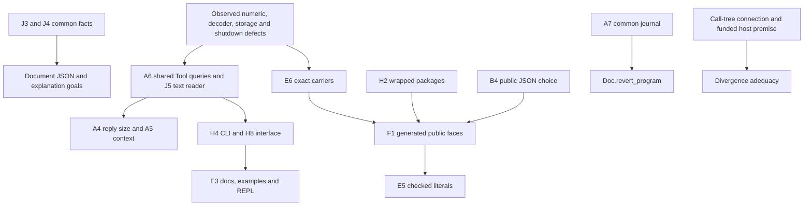

## Part C: backlog dispositions

### C1 — Fifteen branches

`probes/backlog.py` saves each requested log and three-dot diff before classification.
`probes/backlog_content.py` also compares changed file contents with the reviewed commit.
The pinned hashes, complete path lists and patch-equivalence results remain in `probes/backlog/`.
No branch is merged or removed.

| Branch and pinned head | Commits | Verdict | Reason and retained work |
| --- | ---: | --- | --- |
| `codex/vessel-dogfood` — `6c3140237` | 14 | Cherry-pick a part | Keep the checked domain, genuine FMI/OCCT adapters and their rejection controls. Port the app onto current generated names and the one dune workspace. Its bounded replay receipt does not establish full Live lowering. |
| `codex/abstraction-probes` — `70f627fe8` | 8 | Cherry-pick a part | Take the proof-only Pull/Channel dispatch reuse and Canonical Image reuse, `23b575342` and `b41012313`, with their receipts. Rebuild at the current base. Keep the remaining experiments as research. |
| `codex/vessel-model` — `95e8a7679` | 7 | Drop separate integration | Dogfood contains identical contents for 52 of its 53 changed paths. Only its replay log differs. Retain the model through the integrated app branch. |
| `codex/vessel-fmi` — `afb8e5e2a` | 4 | Drop separate integration | Dogfood contains 40 identical paths. Its changed test and receipt add the changed-study-duty rejection. Retain that stronger version. |
| `codex/vessel-step` — `b2819854d` | 2 | Drop separate integration | Dogfood contains 43 identical paths. Its three adapter files add a worker deadline and a timeout control. Retain those additions. |
| `codex/probe-canonical-image` — `86555e50d` | 2 | Drop duplicate branch | All 73 changed paths match `abstraction-probes`. Preserve its evidence there. |
| `probe/sexp-face` — `6c1485863` | 2 | Drop from landing queue; archive | The lawful face remains a useful experiment. No current consumer requires another public transport. Its old codec refusal shape also needs migration. Reopen only for a named F1 consumer. |
| `claude/laughing-northcutt-cd0311` — `f51812cee` | 2 | Cherry-pick a part | The two ingest changes already match HEAD. Retain only useful showcase programs with a current consumer and current test registration. Archive the rest. |
| `claude/math-d3` — `34d18cc5d` | 2 | Drop implementation; archive research | CallChain and CallMap match HEAD. The 851-line FitsIn prototype is superseded by table-aware `Membership.Fits`. Outcome's four old `b.table` premises would undo `b.app`. |
| `claude/sad-williamson-6d3b65` — `abf5259ad` | 2 | Drop redundant branch | Both patches are already applied. All twelve changed paths match HEAD. |
| `seat/schema-interop` — `683b5973f` | 2 | Drop redundant branch | Both patches are already applied. All 42 changed paths match HEAD. |
| `claude/codec-arm-lemmas` — `436e7288f` | 1 | Drop superseded branch | Its patch is already applied. Later generator naming repairs explain the remaining file differences. Do not restore the old `tyText` naming. |
| `claude/gracious-shamir-5b34bd` — `8c4ec461a` | 1 | Drop superseded branch | Its query-consolidation patch is already applied. `Tools.Query` is gone; later tool and reader changes explain the differences. |
| `codex/probe-pull-dispatch` — `a359b2dd2` | 1 | Drop duplicate branch | All nineteen changed paths match `abstraction-probes`. Use the integrated proof-reuse slice. |
| `codex/probe-source-resolution` — `7effd2ad3` | 1 | Drop duplicate branch | All seven changed paths match `abstraction-probes`. Preserve the refusal-order and emitted-source questions in that research packet. |

These are review dispositions, not fresh branch-build receipts.
The abstraction branch's narrow builds and audits remain historical evidence at its recorded base.
The current review independently reads the proof-only diffs; it does not certify their merge against this commit.
The thirteen already-integrated worktrees remain the coordinator's cleanup task.

### C2 — Research folders dated October 15–18

`probes/research_inventory.py` records 49 folders and 697 tracked files in them at the reviewed commit.
It records the primary notes and their references from the searched authorities.
Local untracked evidence also exists. An archive must preserve it before removing a folder.
An archive recommendation never means deleting a cited receipt or the only retained counterexample.

The following table covers every folder in that inventory.
“Archive evidence” means retain cited notes, or replace their references with stable Git citations first.
“Retain open” means its named result still has a consumer or an unresolved owner choice.

| Folder under `docs/research/` | Checked result or remaining result | Disposition |
| --- | --- | --- |
| `2026-10-15-a1-wip` | Document JSON reader and reuse landed. `ofJson_image` remains a planned goal. | Archive draft and closed logs; retain receipt and goal pointer. |
| `2026-10-15-codegen-review` | Landings and open CR slices are mapped by decisions 392 and 395. | Archive closed evidence; retain the remaining-slice map. |
| `2026-10-15-codex-integration` | Saved uncommitted work and integration comparisons; no top-level new design result. | Archive the saved patches and tarballs intact. |
| `2026-10-15-gate-consolidation` | Current Makefile carries the consolidated lanes. Its broad-ingest exceptions are historical evidence. | Archive closed logs; retain cited receipt. Do not restore retired gates. |
| `2026-10-15-interop-plan` | Native interfaces as hosts are ruled by decision 393. | Retain the host plan; archive completed probes. |
| `2026-10-15-lowering-state` | One program carrier and later closure consolidation supersede its duplication leads. Exact numbers remain E6. | Archive evidence; retain references from decisions 394 and the interop plan. |
| `2026-10-15-modeled-lowering` | Staging the generic image is implemented by the Modeled deriver. | Archive the precursor probe. |
| `2026-10-15-ocaml-interop-explore` | Fpath/HTTP/browser experiments inform decision 393. They are not shipped adapter libraries. | Archive the experiments; retain the cited plan and assumptions. |
| `2026-10-15-ocaml-seam-probes` | Native interface and derivation proposals feed decision 393. Generated faces remain F1. | Retain the native-interface proposal until F1; archive duplicated trial outputs. |
| `2026-10-15-orphan-check` | Its scoped-law generator change no longer leaves `simp_all` in `Authoring.lean`. The old ratchet is retired. | Archive the check and obsolete ratchet patch. |
| `2026-10-15-recursive-types` | Named types, Modeled staging and table-aware typing now have production owners. | Archive finite probes; retain the cited representation note. |
| `2026-10-15-remaining-work` | Decision 394 records the funded-prefix and finalizer routes. Some obligations remain in C3. | Retain open proof routes; archive closed experiments. |
| `2026-10-15-seat-cleanup-wind-down` | Cleanup control inputs and S3 logs, with no new top-level proposal. | Archive evidence intact. |
| `2026-10-15-type-roundtrip-audit` | Later type and schema work supersedes much of the old missing-face list. Decisions retain the remaining cuts. | Archive the old census; retain its cited note. |
| `2026-10-15-workstreams` | Its gate-first and integration ordering has run. | Archive after preserving its cited history. |
| `2026-10-16-c-interop` | A finite C wire prototype; the compiled C-host face remains the ruled interop work. | Retain prototype and contract until that consumer exists. |
| `2026-10-16-itrees` | Rocq files and generated syntax exist. The mock-host result's disabled universe check is not an accepted Lean guarantee. | Archive timing logs; retain the explicit trust boundary and source references. |
| `2026-10-16-math-d3` | The FitsIn precursor is superseded by `Membership.Fits` and D3. | Archive; do not merge the old foundation again. |
| `2026-10-16-math-graphs` | CallChain and CallMap are in HEAD. Divergence adequacy remains open. | Archive closed probes; retain the open adequacy route. |
| `2026-10-16-modeled-universe` | The staged image is the current deriver's construction. | Archive evidence; retain the cited design explanation. |
| `2026-10-16-native-kit` | Native checker and kit exist. Its old numeric and interface description predates later changes. | Archive historical evidence; update current product docs instead. |
| `2026-10-16-ocaml-constructors` | `nativeOwner?`, constructor dispatch and compiled controls are in the tree. | Archive probe evidence; retain the cited receipt. |
| `2026-10-16-ocaml-interop` | Native hosts and typed adapters exist. The remaining hand signature is B1/F1. | Archive closed runs; carry that one adapter-generation item into F1. |
| `2026-10-16-schema-interop` | Its branch is patch-equivalent and all changed paths match HEAD. | Archive the experiment; no separate merge. |
| `2026-10-16-soundness-audit` | Table-aware typing supersedes its D3 gap. Current theorem fragments remain explicit. | Archive the old status census; retain the cited audit. |
| `2026-10-16-tooling-design` | The protocol and native shell now exist. UI and native-exchange work remain in later plans. | Archive the superseded design after preserving its open consumer map. |
| `2026-10-16-ts-types` | The named-type experiment is already integrated with the schema branch. | Archive the probe; retain its compiler-specific cases where a live test consumes them. |
| `2026-10-16-usability-scope` | Modeled data, named types and typed host work supply the stated direction. F1 still removes hand faces. | Retain cited scope; archive completed probes. |
| `2026-10-17-authoring-and-store` | Its ownership gaps feed the later seams and exchange plans. | Archive the superseded layout; keep its open disk-exchange link. |
| `2026-10-17-authoring-gemini` | Its repaired authoring declarations are in the tree; old Tools modules are superseded. | Archive receipt evidence. |
| `2026-10-17-authoring-model-review` | Counterexamples inform the repaired authoring boundary and later plan. | Preserve original controls and review bytes in an archive. |
| `2026-10-17-d3` | `Membership.Fits`, `Typed.Tied` and table-aware denotation implement the result. | Archive receipt evidence. |
| `2026-10-17-ocaml-estate-review` | Its numeric, carrier and interface proposals feed decisions 414–416 and the slices plan. | Retain E6 and current contracts; archive superseded measurements. |
| `2026-10-17-ocaml-refactor-assessment` | Host refusal repair landed. Exact generated numbers remain E6; broader storage replacement remains unselected. | Preserve the untracked evidence; archive after recording those dispositions. |
| `2026-10-17-proof-scout` | The emit guard and several local laws landed. Cost, expected-type and marking work remain in the slices plan. | Retain open consumer links; archive closed probes. |
| `2026-10-17-seams` | Later interfaces and receipts supersede its README proposal. Native disk exchange remains open. | Retain latest interfaces, counterexamples and receipts; archive superseded drafts and logs. |
| `2026-10-17-seat-rocq-cas` | `rocq/StoreCode.v` and store laws hold the result over named parameters. | Archive prototype notes; retain the current Rocq map and assumptions. |
| `2026-10-17-session-composition` | Later SourceDocument and Tool modules implement much of the proposal. Generic journals remain A7. | Retain A7's consumer; archive superseded designs. |
| `2026-10-18-authoring-probe` | Located refusals landed. Expected-type and marking work remains A5 and lane L. | Retain the open language-feature evidence; archive completed transcripts. |
| `2026-10-18-cleanup` | Only a local saved worktree tarball appears at the inspected depth. | Preserve the tarball in an archive before removing this folder. |
| `2026-10-18-codex-abstractions` | Sealed native interpreter and exchange operations exist. Disk integration and resident-cache obligations remain open. | Retain open contracts; archive completed build evidence. |
| `2026-10-18-incremental` | The owner narrows the earlier view-only proposal and asks for a concrete use case. No implementation result exists. | Retain as deferred research, or archive with that explicit disposition. Do not dispatch the old design. |
| `2026-10-18-mcp-schema-size` | Generated method listings and `describe` exist in the current server. | Archive measurement evidence. |
| `2026-10-18-native-exchange` | Its three-operation proposal is superseded by the later exchange contract. Native disk composition remains X1. | Replace the open plan's pointer with the current contract, then archive the obsolete proposal. |
| `2026-10-18-ocaml-ppx` | Sexp remains on an unlanded branch. Its speed comparison predates removal of the hand JSON twin. | Archive the experiment. Record a named consumer before reopening it. |
| `2026-10-18-ocaml-tooling-probe` | Packaging, shared JSON and concurrency controls landed. F1, E3 and E5 remain planned. | Retain their acceptance evidence; archive completed probes. |
| `2026-10-18-refinements` | The sealed native tool and shared wire changes are in HEAD. | Archive the receipt after preserving current authority links. |
| `2026-10-18-slices` | Current plan, receipts and explicit open items; this review updates their evidence. | Keep active. Archive closed raw evidence only after stable references exist. |
| `2026-10-18-view-backlog` | Drawing-owner and view-language work is explicitly recorded in its cited backlog. | Keep until that separate workstream is dispatched or declined. |

No old probe should silently become a new requirement.
The unselected results needing an explicit disposition are the sexp public face, the revised Incremental direction, and optional native adapters without a consumer.
The abstraction and vessel results missing from HEAD are held on the branches classified in C1.
The mathematical D3 precursor is superseded; it is not lost work.

### C3 — One execution order

This order repairs observed behavior before widening the public face.
Independent rows at the same stage can proceed together with separate file ownership.
No new ratchet or retired gate is proposed.

| Order | Items | Concrete disposition and what they unblock |
| ---: | --- | --- |
| 1 | A1.1, A2.1, A3.1–A3.4, A4.1, A5.1–A5.2 | Repair reproduced behavior. Add each retained red case to the existing owning test. Do not add another gate lane. |
| 2 | E6; H11 | Switch Nat/Int and UInt64 with explicit boundary conversions. Audit reached numeric compiler paths first. Classify elaborator panics separately from runtime input. |
| 3 | B5; J3; J4 | Prune the checked interface and consolidate the two common facts and finite measure. These do not depend on a new product feature. |
| 4 | H2; B4; F1 | Wrap the four packages mechanically, settle the public JSON contract, then generate authoring and host faces. Reuse the one program carrier. |
| 5 | A6; J5; H4; H8 remaining; stale prose | Move check/run/explore dispatch to Tool queries. Migrate the remaining Live/View text readers. Admit CLI numbers and expose only the serving interface. |
| 6 | A7 | Make existing journals instances of the common replay construction. Keep their observations and refusal behavior. This precedes any repair of the revert proof. |
| 7 | A4; A5 | Reduce reply payloads and expose hole context after query ownership settles. Reuse checker explanations; do not invent a second type checker. |
| 8 | E3; H6; E5 | Fix 37 documentation warnings and check examples. Finish the REPL recipe. Checked literals follow F1's generated vocabulary. |
| 9 | H13 docstrings; H14; H17 | Add the missing module summaries, remove each linter suppression with its cause, and mark generated files for review tools. |
| 10 | H15 | The installed Lake source confirms that `leanOptions` reaches both server and build; `moreLeanArgs` is compile-only. Move the warning option and check both diagnostics. |
| 11 | H18; H19; H20; H21 | Configure Python and TypeScript formatting in existing tool lanes. Add release files and editor defaults. Document public Make targets; keep internal targets private. |
| 12 | H10; H12; remaining H13 splits | Profile elaboration and guards before moving them. Split large modules when a real dependency boundary is touched. Drop the proposed count-only ratchet. |
| 13 | H16 | Apply C1/C2 dispositions. Preserve untracked evidence and cited notes before archive moves. The owner chooses what leaves the active tree. |
| Defer | J1 | The converse JSON text law has no current consumer. Keep `parse_render`; place a new claim only when a consumer requires the converse. |
| Defer | J2 | The profile refuses the relevant nested-null option shapes. Keep the existing option-layer argument; do not fund a disconnected theorem. |

The stale prose belongs to the owning change, not a separate documentation workstream:

| Prose | Owner and repair |
| --- | --- |
| Generated lane docstrings | B5/F1 changes the generator's comment source. State the shared closure and the remaining lane-only definitions. |
| `src/Effect4/Run/Kit.lean` | A1/A6 removes the deleted `Kit_json` owner and states the current numeric checks and run observations. |
| `src/Effect4/Tool/Native.lean` | A6/J5 retains the sealed session. Replace “JSON parsing stays in the shell” with Lean-owned parsing invoked by the shell. |
| `scripts/generate.py` comments | Change the stale `Tools.TsGen` comment to `Drivers.TsGen`. Keep the existing correct recipe and single-process description. |
| `generated/semantics.md` | The coordinator regenerates it through the existing producer after proof slices. Its retained goal status is stale against the six source goals. |

The six source goals remain separate from compiler trust and host tests:

| Order within proof work | Goal and source | Placement and consumer | Required boundary |
| ---: | --- | --- | --- |
| 1 | `explain_replays`, `Laws/Program/CheckAgreement.lean` | Initial algebras/folds, R14; replayable checker explanations. | Prove the existing located dependency result. This supplies A5's explanation contract. |
| 2 | `Doc.revert_program`, `Laws/Program/SourceDocument.lean` | Initial algebras/folds, R14; immediate revert restores the program. | Follow A7 only if its implementation changes. Retain appended hole rows; do not strengthen this to arbitrary history reversal. |
| 3 | `ofJson_image`, `Laws/Schema/DocumentJson.lean` | Exact codecs, R3; `ofJson_complete`. | Some sufficient bound and the named JSON normal form. J3/J4 may simplify the proof; they are not new assumptions. |
| 4 | `ofProgram_eq_denoteRowsB`, `Laws/Run/Tree.lean` | Translation simulation, R6; the tree agrees with the row denotation on `Plain`. | Keep its fixed table, budget and fragment. It proves no native compiler correctness. |
| 5 | `once_placed_outside_census`, `Laws/Program/FinalizerRun.lean` | Scope lifetime/finalization, R11; `once_placed_pushes_once`. | Extend source ownership beyond the census. At-most-once registration proves neither progress nor log provenance. |
| 6 | `rows_divergence_adequate`, `Laws/Run/Outcome.lean` | Host session protocol, R12; compatible finite prefixes witness divergence. | The funded-session premise and converse connection remain required. Keep the loop fragment and exit-only reactor assumptions. |

No proof is started or restated by this review.
The source goals keep their existing statements, placements and consumers.
