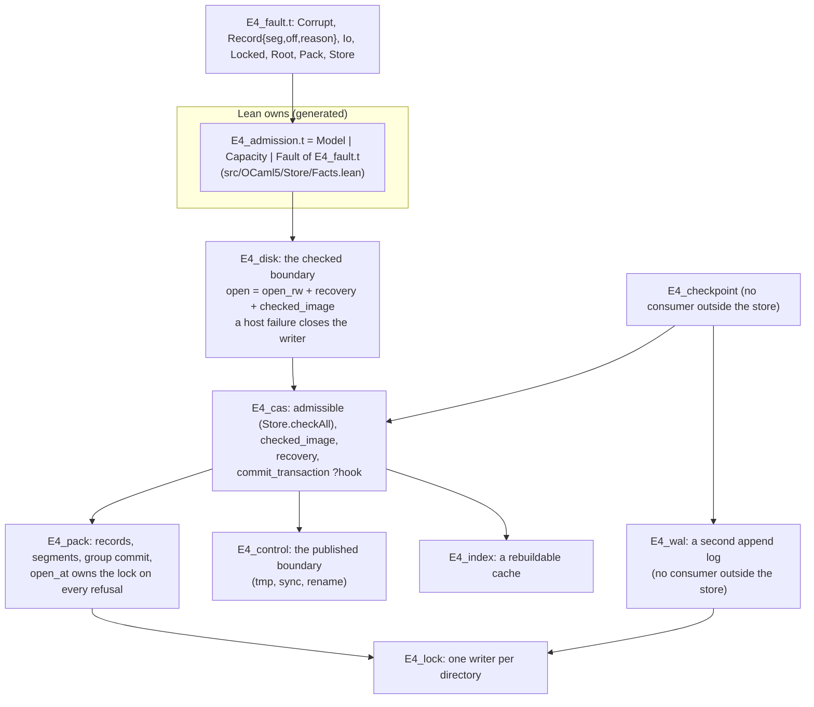

# Coherence of the repair wave: what each fix extends

Coordinator: the main session, 2026-10-19, at `fb3a1daa0`. The owner asked that each wave 3 fix
build on and improve an existing abstraction. No fix adds a one-off helper or a parallel type, or
drifts. The owner also asked to see the abstractions and the code. This note models the store first, because
seat R1 is running there. Sections 6 and 7 cover R2, R3 and E6 in less detail; each gets a probe
before its seat starts.

## 1. The one thing to know

The store already has every abstraction its fixes need. Three of R1's six fixes are deletions or
merges, not additions. One fact also changes a ruling's premise. The write-ahead log, which three
of the fixes target, has no consumer outside the store's own checkpoints and tests. Its
all-or-none promise (LG3) is what the pack already gives every commit, through the control file's
published boundary. Section 5 puts that choice to the owner, and R1 holds the log's three fixes
until the owner answers.

## 2. The model: who owns what in `ocaml/engine/cas/`



Four facts in this picture decide the fixes:
- **One refusal type.** `E4_admission.t` is generated from Lean, and its `Fault` arm is `E4_fault.t`.
  A new error type in the store is drift.
- **One checked open.** `E4_disk.open_` runs `E4_cas.checked_image`. It admits every record through
  `admissible`, which transcribes Lean's `Store.checkAll`, and it refuses a scan that stops short
  of the published boundary.
- **One failure rule.** `E4_disk.commit` closes the writer after any host failure, and reopening runs
  checked recovery. A poisoned writer is this rule, not a new state.
- **One injection seam.** `E4_cas.commit_transaction ?hook:(commit_point -> unit)` already stops a
  commit at named points for the kill and crash tests.

## 3. R1's fixes, each against its existing owner

### A3.1, the verifier: delete the second copy

`E4_cas.verify` is an older hand copy of `checked_image`. It has its own error type,
`verify_error`, whose arms copy `E4_admission`'s, and it drops the scan's stop:

```ocaml
(* e4_cas.ml, today *)
let verify view =
  ...
  if pos_lt start view.v_end
  then
    ignore
      (walk_records view ~from:start ~upto:view.v_end ~f:(fun (seg, off) r -> ...));
```

`checked_image`, the production owner, already does the right thing:

```ocaml
(* e4_cas.ml, checked_image, today *)
    if not (E4_pack.equal_position !ending view.v_end)
    then
      refuse
        (record_fault !ending ("durable boundary: " ^ E4_pack.scan_stop_to_string stop));
```

`verify_node` likewise copies `admissible` (`check_pure`, `check_edges`, `check_result`) by hand.
The `verify_on_open` flag is set only by one test, and `E4_disk.open_` always checks.

**Target.** Delete `verify`, `verify_error`, `verify_error_word` and the `verify_on_open` flag:
about 200 lines across the `.ml` and the `.mli`. Keep one per-node check on the shared steps:

```ocaml
val verify_node : ro -> E4_addr.Addr.t -> (unit, admission) result
(* resident bytes, digest, E4_node.decode, then [admissible]: the steps checked_image takes
   for each record *)
```

The tests that read `verify_error_word` read the admission's word instead. Test X2(b1) becomes a
refused `E4_disk.open_`. The red control is Codex's one-byte tag corruption, refused by
`E4_disk.open_`, which it already is, and by `verify_node` on the damaged address.

### A2.1, pack lengths: one header parse instead of two

`E4_pack.read_full` and `E4_pack.step_at` each parse a record's header and check its length by
addition, which wraps near `max_int`:

```ocaml
(* read_full, today; step_at repeats the same steps with its own stop names *)
          match E4_be.read_be64 h 1 with
          | None -> Error (Over_host_limit { seg; off })
          | Some len ->
            if off + record_overhead + len > size
            then Error (Truncated { seg; off })
```

**Target.** One function owns the header: it reads the tag and the length, and it checks the length
by subtraction, which cannot wrap once `0 <= off <= size`.

```ocaml
type header_fault = Short | Bad_tag of int | Over_limit

(* PK-R: a record at [off] spans [record_overhead + len] bytes, and fits when
   [len <= size - off - record_overhead]. *)
val record_span : src -> seg:int -> off:int -> size:int -> (int (* len *), header_fault) result
```

`read_full` maps a fault to its `read_error`, and `step_at` maps one to its `scan_stop`, one line
each. Each keeps its own vocabulary. `reader_source.read` checks its range the same way. The red
control is Codex's five lengths, each refused with no exception and no negative cursor.

### A3.3, durability: one file step, and errors flow to the boundary that maps them

Today four places sync a directory, and every one swallows the error. Three are copies of one
helper: `E4_pack.fsync_dir`, `E4_wal.fsync_dir` and `E4_index.fsync_dir`. The fourth is inline in
`E4_control.commit`. Two places replace a file atomically, each in its own way:
`E4_control.commit` uses a descriptor, and `E4_index.save` uses a channel and `chmod 0o444`.

**Target.** One small module replaces the four sync sites and the two replace sites. It swallows
nothing:

```ocaml
(* E4_file — the store's durable file steps on a local file system (decisions row 417 (3)).
   F1 A failed step raises Unix.Unix_error; nothing here catches one.
   F2 [replace] writes a temporary file, syncs it, renames it over [path] and syncs the
      parent directory: once it returns, a crash leaves the new bytes. *)
val sync_dir : string -> unit
val replace : path:string -> perm:int -> (Unix.file_descr -> unit) -> unit
```

No new error type is needed. The exception reaches `E4_disk`, which already turns it into
`E4_fault.Io` and closes the uncertain writer. `E4_disk` maps exceptions three times today, in
`image`, `read` and `commit`. That becomes one `fault_of_exn` in `E4_disk`. The index stays best
effort as a cache: its one caller in `E4_cas.close` keeps its catch, and the `.mli` says why.

The red control needs no seam. A store whose directory cannot be opened makes `E4_disk.commit`
refuse with `E4_fault.Io` and close the writer, where today it succeeds. A sync failure takes the
same path, because nothing catches it.

### B2.1, frame tags: use the owner's constants

`E4_shape`'s six `tag_*` bindings repeat `Eff_frame`'s exported tags. Use them. No byte moves.

## 4. What R1 adds, in total

| Fix | New code | Deleted or merged |
| --- | --- | --- |
| A3.1 | `verify_node`, rewritten over `admissible` | `verify`, `verify_error`, `verify_error_word`, `verify_on_open` |
| A2.1 | `record_span` | the two header parses |
| A3.3 | `E4_file`, two functions; `E4_disk.fault_of_exn` | four sync copies, two replace bodies, three exception maps |
| B2.1 | none | six tag literals |

R1 adds no error type, no state field and no test seam. The one new module replaces six sites.

## 5. The log: harden a second log, or keep one

`E4_wal` has 670 lines, a 295-line interface, and 771 lines of tests and bench. Its only user
outside its tests is `E4_checkpoint.ephemeral`, and nothing outside the store uses
`E4_checkpoint`. It keeps its own segments, checksummed frames, seal rows, rotation and group
commit, beside the pack's. The difference that matters is the commit. A pack commit becomes
durable when the control file's boundary moves by one rename, so its records are all present or
all absent. The log has no such boundary, which is why LG3 fails on a torn batch (A3.4).

Two shapes:
- **(a) Harden the log, as row 417 (2) rules today.** It gets a batch frame, a format version, a
  failure rule like `E4_disk`'s, and an open bracket like `E4_pack.open_at`'s. That repairs A3.2,
  A3.4 and A5.1, but it keeps two append logs that make one promise, with no consumer to judge
  between them.
- **(b) One log.** Retire `E4_wal` and `E4_checkpoint.ephemeral`. When a run needs a durable
  journal, its rows are committed as nodes in one `E4_disk` transaction. The pack's published
  boundary makes that commit all or none, `checked_image` checks it at open, and Lean's codec owns
  the rows' bytes. A3.2, A3.4 and A5.1 close by deletion.

Recommendation: (b). It deletes about 1,700 lines and leaves one append log, whose commit already
meets LG3 by construction. It also gives the journal's bytes to Lean, the owner of the run's
journal (`docs/core/machine-state.md`, "Journal and diagnostics"). Row 417 (2) was ruled before
anyone knew that the log has no consumer, so the owner rules again.

## 6. R2, the engine and the kit: owners found, probe before start

- **A1.1.** The kit is missing the engine's checks, so the fix is a call to them, not new checks.
  `E4_engine.compile` checks a program's literals (EN8), and `E4_engine.check_answer` checks every
  natural, negative integer and string of a reply (EN9). Both name their crossing. The kit's
  run routes call neither.
- **A4.1.** `E4_quiescence.enter_with` (Q4) already makes the pending count and the stamp one
  critical section. The probe asks whether the router's `stopped` check can join that same section,
  so that one step serves both the race of Q4 and shutdown.
- **A5.2.** The CLI's numbers belong to the one argument parser of H4, not to checks at each call.

## 7. R3 and E6: owners found, probe before start

- **B5.1.** The interface tool already has the selector. `ocaml/gen/interface/main.ml` takes a
  `reachable` argument (`Lcnf_interface.Reachable`), which keeps only the types the exported
  values name. `scripts/lib/lcnf_interfaces.py` passes it for a consumer. The lanes interface
  passes the same argument, with no second selector.
- **J3 and J4.** Each finds its one owner in a core data module, and the domain modules keep their
  aliases.
- **E6.** `effect4_clock` already holds the exact naturals over Zarith, the crossings and the
  refusal (`E4_clock`). The estate plan's slice 2.3 moves `crossing` and `refusal` to
  `ocaml/lcnf`. E6 should make that move first, so the builtin rows and the clock share one
  numeric module rather than two.
