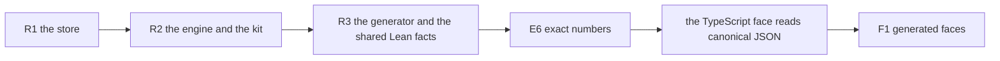

# Wave 3: the repair seats

Coordinator: the main session, 2026-10-19. Base: `refactor/phase1-phase3` at the commit that adds
this note. The review is [codex-review/README.md](codex-review/README.md), and its probes are in
`codex-review/probes/`. The rulings are decisions row 417.

## 1. The one thing to know

Codex's review reproduced defects that must close before the public face widens. A wrong integer
comes back, a pack read raises, and a verifier misses corruption. A log acknowledges a gap, a sync
failure counts as success, and a send is accepted after shutdown. Each repair seat turns a reproduced case into
a test, fixes it, and keeps the test. The owner's word (row 417 (5)): one seat at a time, as a
subagent in the main checkout, with no worktree.

## 2. The order

R1 goes first: five of the review's ten top findings are in `ocaml/engine/cas/`, and a lost or
misreported commit is the worst of them. E6 touches every hand consumer of a natural, so it follows
the repairs that edit those files.

## 3. Rules for every seat

- Work in `/Users/pooks/Dev/lean4-effect4`, on `refactor/phase1-phase3`. The coordinator neither
  builds nor edits while you run.
- Edit only the files your section owns. When a changed type signature reaches another file, edit
  that caller minimally and name it in the receipt.
- Commit each fix by explicit paths after its checks. Never push, merge, stash, reset or check out
  a path. Never run `git add -A`. End each commit message with
  `Co-Authored-By: Claude Opus 5.5 <noreply@anthropic.com>`. Leave `tools/view/make_videos.py`
  alone.
- Run dune only as `opam exec --switch=effect4 -- dune …`, from `ocaml/`. Run Lean only as
  `python3 /private/tmp/seams-lean-one.py lake …`. Never pass a thread count.
- Never run `lake build Test`, `make build`, `make check-full` or `make gen-semantics`.
- Each fix starts red: put the reproduced case into the owning test file, see it fail, then fix.
  Add no gate lane: a test joins the folder's existing `dune test`.
- A landing owes:
  - `opam exec --switch=effect4 -- dune build` and the touched folder's `dune test`;
  - `opam exec --switch=effect4 -- dune fmt` before each commit;
  - `make check-ocaml` once, at the seat's end;
  - for a Lean change: the narrow build, `make batteries-touched BASE=<base>` and `#axiom_audit`
    over each touched `src` or `Test` module.
- Refusals are values (`ocaml/STANDARDS.md`). A programmer error may stay an exception only where
  the `.mli` documents it. Keep each component's property list true: change a property's text
  when its behaviour changes, and say so in the receipt.
- Greenfield until release (row 414 (1)): move a format's version when the bytes change, and
  write no reader of the old bytes.
- Do not edit `docs/core/decisions.md`, `AGENTS.md` or `lakefile.toml`; propose in the receipt.
  Start no subagent.
- Write the receipt as `receipt-<seat>.md` in this folder and force-add it with the last commit.
  It opens with the one thing the coordinator must know. Then it gives:
  - the base and head commits;
  - each fix's commit and files;
  - each command and its result;
  - what moved on disk or on the wire;
  - what is open.

## 4. Seat R1: the store (`ocaml/engine/cas/`)

Files you own: `ocaml/engine/cas/**` (sources, interfaces, `dune`, `test/`), and
`ocaml/engine/test/stm/stm_disk.ml` where the disk model needs a change.

1. **A2.1, pack lengths.** `E4_pack.read_full`, `step_at` and `reader_source.read` add a stored
   length to an offset before any check, so a length near `max_int` wraps. Give the pack one
   checked range helper. It checks an offset against the file's size, compares a length with the
   remaining bytes by subtraction, and refuses before it allocates. Red control:
   `codex-review/probes/a2/pack_boundary.ml`'s lengths are `max_int` and `max_int` minus 4, 16, 64
   and 100. Each refuses, with no exception and no negative cursor. The restored file reads `Ok`.
2. **A3.1, verification.** `E4_cas.verify` ignores `walk_records`' stop, so a corrupt record
   before the published end verifies as an empty prefix. Keep and classify the stop. Answer
   success only when the scan reaches `v_end`. `rebuild_index` must not mark a partial index
   finished, and a verified open must refuse. Red control: the probe's one-byte record-tag
   corruption (`codex-review/probes/standards/storage_probe.ml`).
3. **A3.3, one durable-file helper** (row 417 (3)). One helper owns write, file sync, rename and
   parent-directory sync. `E4_control.commit`, the pack, the log and the index use it, and the
   three `fsync_dir` copies go. A failed open or sync of a directory is a refusal under the
   local-file-system profile. `E4_index.save` may stay best effort, since the index is
   rebuildable; its `.mli` says so. Red control: an injected directory `EIO` is refused.
4. **A3.2 and A5.1, the log's failures.**
   - `flush_buf` clears its buffer before the write and sync succeed, so a later commit
     acknowledges a gap. Keep pending rows until both succeed.
   - A failed or partial write, or a failed sync, poisons the writer: it refuses every commit
     until it is reopened.
   - `commit` answers a typed I/O refusal.
   - `open_` holds the lock and descriptors under one bracket, and gives them to the writer only
     after every step succeeds. A bad stored header is a typed refusal, not `Failure`.

   Red controls: Codex's injected `EIO` before the write
   (`codex-review/probes/standards/fault_injection.py`), then a partial write and a sync failure.
   Also the segment path made a directory: the first open is refused, and after the segment is
   restored the retry opens.
5. **A3.4, LG3 kept** (row 417 (2)). Frame each commit as one batch with a valid end, and recover
   only whole batches. Move the log's format version. Red control: every truncation of a two-row
   batch recovers zero or two rows, never one.
6. **B2.1, frame tags.** `E4_shape`'s six `tag_*` bindings use `Eff_frame`'s exported constants.
   No byte moves.

Fault injection needs a seam. If a test must inject `EIO`, give the module an internal I/O record
or a functor, which the `.mli` does not export to clients. Say which you chose. Keep the existing
crash, damage and kill tests green. Measure `bench_wal` and `bench_commit` before and after, and
report the change.

## 5. Seat R2: the engine and the kit (after R1)

The coordinator sharpens this brief when R1 has merged.
- **A1.1.** The kit applies the engine's numeric admission to program literals and to replies
  before either run route. Outside the profile it refuses before it takes the host's new state.
  Red control: `codex-review/probes/a1.ml`, on the tape route and the native callback route.
- **A4.1.** A send that passed `lookup` counts as in flight before the router lock drops, and
  shutdown waits for it. Handle a closed inbox's answer. Red control: the scheduled history of
  `codex-review/probes/standards/shutdown_model.py`, added to the scheduler model.
- **A5.2.** `eff` refuses a negative or malformed numeric option before any generated code runs.
- **A7.1.** `kit_serve.mli`: the serving boundary only.
- **A9.1.** Delete the two literal count checks.

## 6. Seat R3: the generator and the shared Lean facts (after R2)

- **B5.1.** Infer `lanes_gen.mli` from the types its exported entries reach: 2,618 lines become
  164 in Codex's check (`codex-review/probes/b5_interfaces.py`).
- **J3.** One owner of `except_bind_ok` and `except_map_ok`.
- **J4.** One keyed-list measure for `unseenDefs` and `TyDecls.unseen`.

## 7. After the repairs

- **E6** (row 417 (1)): `Nat` and `Int` as `Z.t`, and an exact 64-bit carrier for `UInt64`, in one
  commit. Codex's census sizes it: 39 direct rows, 19 natural fields, 53 candidate hand files, and
  the translator's literals (`Translate.letValueExpr`, `Native.ctorValue`).
- **The TypeScript face** reads and writes canonical tagged JSON (row 417 (4)), with `V` kept as a
  fixture format until the migration ends.
- **F1**, then the rest of Codex's order (its §C3).
