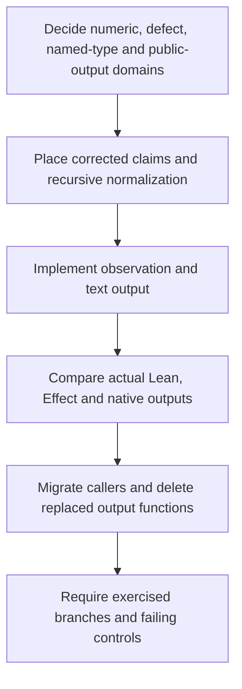

# Review of Schema as the carrier

The proposal needs rework before implementation. P1 is false, and the proposed changes to defects and annotations need explicit domain decisions.

Review date: 2026-10-19, in the owner's timezone.
Reviewed HEAD: `b0b962ff88a1c17ef7c6cc76f4a481b7fcf0ce52`.
Proposal base: `639d78ed2`.
The codec implementation and its laws have no changes between these commits.

The [proposal](/Users/pooks/Dev/lean4-effect4/docs/research/2026-10-19-schema-as-the-carrier.md) remains unchanged.
Three Sol 6.1 agents reviewed the proof claims, runtime comparisons, and scope independently.
The parent checked their findings against source and retained outputs.

Evidence status: checked source and finite probes.
Scope: the proposed observation, its codec, its callers, and its acceptance checks.
No theorem, implementation change, native comparison, or whole-tree acceptance results from this review.

## Findings

### 1. [blocker] A supported type does not guarantee an encodable result

Proposal §5 P1 and move D assert more than the cited laws establish.
Two admitted programs finish with supported result types, but their observations refuse encoding.

| Program expression | Result | Encoding |
| --- | --- | --- |
| `succeed (Atom.add (nat (2^53-1)) (nat 2))` | Natural `9007199254740993` | Refused |
| `succeed (Atom.plus (nat (2^53-1)) (nat 1))` | Integer `9007199254740992` | Refused |

Both programs also pass module emission. Their input literals fit the target's numeric bound.
Thus restricting input literals does not restrict arithmetic results enough.

`decode_encode` requires `Ty.isCodecValue`, separately from membership.
See `decode_encode` and `encode_of_hasTy` in [the codec laws](/Users/pooks/Dev/lean4-effect4/src/Effect4/Laws/Schema/Codec.lean).
`fits_of_hasTy_shapeDecides` establishes membership, not codec admission.
`fits_hasTy` additionally requires an empty declaration table.
See [Membership.lean](/Users/pooks/Dev/lean4-effect4/src/Effect4/Laws/Program/Typed/Membership.lean).

The theory already records another obstacle: overlapping union encodings can prevent exact recovery.
See `E4-SCHEMA-CE-059` in [semantics, concept 5](/Users/pooks/Dev/lean4-effect4/docs/core/semantics.md).
The retained value probe confirms a supported union member whose encoding refuses.
That control concerns a value, not an additional source-program execution.

Required correction: allow a located observation refusal, or define and establish a restricted execution domain.
Retain value codec admission in any conditional totality claim.
Place the corrected obligation before proving it. P1 cannot enter as the proposed composition of existing facts.

### 2. [blocker] Lean can encode a result that its generated Effect Schema rejects

Proposal §5 D2/P3 and §12 R1 claim agreement beyond the shared numeric domain.

`succeed (Atom.add (nat (2^53-1)) (nat 1))` produces natural `9007199254740992`.
The program builds, emits, and encodes in Lean. The generated natural Schema rejects that observation in rc.112.
The adjacent value `9007199254740991` decodes in the same host control.

`wireAlgebra.ty_nat` admits exactly recoverable binary64 naturals in [Codec.lean](/Users/pooks/Dev/lean4-effect4/src/Effect4/Schema/Codec.lean).
`schemaAlg.ty_nat` uses `isIntCheck` in [Bridge.lean](/Users/pooks/Dev/lean4-effect4/src/Effect4/Schema/Bridge.lean).
rc.112's `isInt` uses `Number.isSafeInteger` in [the pinned Schema source](/Users/pooks/Dev/lean4-effect4/vendor/effect-4.0.0-rc.112/src/Schema.ts).

Required correction: choose one shared numeric domain and enforce it at the observation boundary.
Add arithmetic-result controls on both sides of the bound.
This existing mismatch survives moves C, G, and H.

### 3. [blocker] Annotation removal must reach nested values without silently replacing the existing law

Proposal §8.2 and move H use `Faces.bare` as the demonstrated annotation normalizer.
It changes an outer failure and leaves every outer success unchanged.

The retained program forks a sleeping child, interrupts it, and returns `exit (join f)`.
Its supported result contains an interrupted exit inside a successful exit.
The inner annotations remain, so encoding still refuses after `Faces.bare`.

See `bare` in [Faces.lean](/Users/pooks/Dev/lean4-effect4/docs/research/2026-10-19-schema-as-the-carrier/probe/Faces.lean).
See `Prepared.encode`, `encodeReason`, and `decodeReason` in [Codec.lean](/Users/pooks/Dev/lean4-effect4/src/Effect4/Schema/Codec.lean).

Required correction: define normalization through nested exits, causes, and their containing values.
Give it an explicit domain and observation.
Keep the current exact codec over normalized values where possible.
Changing `Prepared.encode` itself changes the promise of `decode_of_encode` and `encode_injective` in [the codec laws](/Users/pooks/Dev/lean4-effect4/src/Effect4/Laws/Schema/Codec.lean).
Such a change requires an explicit amendment, not an inherited P2 status.

### 4. [blocker] Raw defect output loses distinctions that today's exact codec retains

Move G maps both `Defect.user 7` and `Defect.error (.tag 7)` to JSON `7`.
Both values currently encode at `Exit<unit, never>`.
One decoder cannot recover both originals from that JSON.

`Defect.ofError` canonicalizes ordinary numeric promotions, but the current codec admits the larger alphabet.
See `Defect`, `Defect.ofError`, and `Defect.image` in [Alphabets.lean](/Users/pooks/Dev/lean4-effect4/src/Effect4/Machine/Alphabets.lean).

Effect's own defect decoder also loses information.
The host probe encodes `{message: "boom", name: "Error", extra: 7}`, decodes it, then encodes it again.
The second encoding drops `extra`.
See `defectFromJson` in [SchemaTransformation.ts](/Users/pooks/Dev/lean4-effect4/vendor/effect-4.0.0-rc.112/src/SchemaTransformation.ts).

There is a separate information gap for machine defects.
`serviceLookupK` stores `missingService` without the missing key in [Compile.lean](/Users/pooks/Dev/lean4-effect4/src/Effect4/Program/Compile.lean).
A later output function cannot reconstruct every Effect missing-service message.

Required correction: specify the codec-admitted defect domain, reverse mapping, collisions, and normalization.
Decide whether machine defects retain more data or expose a deliberately restricted observation.
Move G needs more than an output change under the current exactness contract.

### 5. [major] Named types and generic calls require more information

D2 promises interpretation from `b.ty` alone.
Named types also depend on the declarations in `b.app.types`.
The codec's `ty_app` arm refuses, and `SchemaCode.ofTy` accepts no declaration environment.
The proposal acknowledges reachable named types but assigns no move to handle them.

See `Api.Built` in [Built.lean](/Users/pooks/Dev/lean4-effect4/src/Effect4/Api/Built.lean).
See `Ty.expand` in [TyExpand.lean](/Users/pooks/Dev/lean4-effect4/src/Effect4/Program/TyExpand.lean).
See `SchemaCode.ofTy` in [SchemaCode.lean](/Users/pooks/Dev/lean4-effect4/src/Effect4/Codegen/SchemaCode.lean).

Move E also specifies the row's columns for trace output.
A generic row can retain type variables after a particular call has concrete request, answer, and error types.
Those concrete types belong to `CallInstance` in [Call.lean](/Users/pooks/Dev/lean4-effect4/src/Effect4/Program/Typing/Call.lean).
`Run.callView` already retains the checked instance in [View.lean](/Users/pooks/Dev/lean4-effect4/src/Effect4/Run/View.lean).
The distinction also appears in [the host contract](/Users/pooks/Dev/lean4-effect4/docs/core/host-boundary.md), §2.

Required correction: carry the application's declaration environment and checked call instance where needed.
Alternatively, explicitly limit this landing to declaration-free terminal output and defer trace output.
Test named records, recursive declarations, and a generic call with concrete data.

### 6. [major] Five reported agreements are skipped cases

The refreshed host run executes 30 programs.
Twenty-five outputs match literally, one matches after fiber renaming, and four defect outputs differ.
Five further lines report `refused` without executing the generated program.

`run.ts` tests the generated `refused` list before importing or running a case.
These lines show a refusal by Lean's Schema code generator, not an independently observed host refusal.
See [run.ts](/Users/pooks/Dev/lean4-effect4/docs/research/2026-10-19-schema-as-the-carrier/probe/run.ts).
Thus §12's “31 of the 35” agreement combines execution evidence with skipped labels.

The original scripts contain no comparison command, reciprocal decoding, or failing mismatch assertion.
Their exception handler writes a refusal and still permits a successful process exit.
The note's historical fiber-number comparison procedure is not retained beside the probe.
The review comparator checks consistent injective renaming for the observed pair, Lean `0` to Effect `31`.
One pair does not test a general renaming algorithm.

Required correction: report executed agreements, differences, and generation refusals separately.
Make the future gate compare outputs, check expected refusal classes, and fail on unexpected results.
Add reciprocal decoding and several distinguishable fiber identities.

### 7. [major] The constructor census does not measure exercised codec branches

`Faces.main` counts every type constructor appearing in a case's result type.
It does so even when the result takes another branch or encoding refuses.
It also counts the raw exit before encoding.
The failure check detects missing support representatives, not missing execution witnesses.

See `main`, `tyHeadsAlgebra`, `exitHits`, and `representatives` in [Faces.lean](/Users/pooks/Dev/lean4-effect4/docs/research/2026-10-19-schema-as-the-carrier/probe/Faces.lean).
One map representative with string keys also cannot classify maps with other key types.
The retained finite guards confirm that distinction.

Required correction: separate structural inventory, successful encoding witnesses, and expected refusals.
Exercise value branches and nested support conditions.
Give each unreachable form an explicit justification or a direct value fixture.
Deliberately break an encoder branch and verify that the proposed gate fails.
The current “46 of 49” reading cannot serve that acceptance condition.

### 8. [major] OCaml agreement remains an obligation

Proposal §6 attributes agreement to an LCNF lowering simulation.
The current authority describes rule coverage and finite comparisons, with a proved stage law still planned.
See “What the lowering claims” in [lcnf-route.md](/Users/pooks/Dev/lean4-effect4/docs/core/lcnf-route.md).
Proposal §11 correctly says that the native run has not produced D1 output.

Required correction: describe shared lowered definitions as the implementation plan.
Require fresh comparisons of the actual native encoder, decoder, and text renderer.
Do not transfer Lean's codec laws across the lowering as an established theorem.

### 9. [major] The public result and text boundary need explicit contracts

D1 describes terminal exits. Existing observations also describe live runs, pending calls, received replies, and child fibers.
See `Run.Observation` in [Basic.lean](/Users/pooks/Dev/lean4-effect4/src/Effect4/Run/Basic.lean) and `Live.View` in [View.lean](/Users/pooks/Dev/lean4-effect4/src/Effect4/Run/View.lean).
Move A does not specify the resulting public shape when encoding refuses or the run remains live.
R4 leaves the handle policy open.

Move C also needs a distinction between JSON data and JSON text.
Binary64 negative zero survives a JSON datum but becomes positive zero through ordinary `JSON.stringify`.
The existing codec checks already record this difference in [check.ts](/Users/pooks/Dev/lean4-effect4/harness/truth/schema-codec/check.ts).
The fresh host probe confirms it.

Required correction: define supported terminal output, observation refusal, and live state separately.
Keep observation refusal outside the program's failure result.
Choose a text numeric profile or normalization, including negative zero.
If this proposal covers only terminal output, narrow its title and universal claims accordingly.

## What stands

The existing type-directed codec is a sensible owner for admitted terminal data.
The proposal correctly identifies duplicated exit output functions and the current defect and annotation differences.
Its eleven-request example remains useful finite evidence for that application.
`decode_iff` establishes its stated successful-conversion exactness modulo key order.
The review finds no reason to replace that law with unrestricted totality.

The remembered `Option Unit` ambiguity belongs to the tool's carrier JSON.
The finite probe confirms that `Ty.option` distinguishes its two forms.
It is not a counterexample to this codec.

## Changes needed before dispatch

| Moves | Required decision or check |
| --- | --- |
| D | Replace P1 with the exact codec-admitted domain, observation, hypotheses, and consumer. Retain concept 5 and R3 placement. |
| G | Decide defect normalization and reverse decoding before changing the representation. |
| H | Define recursive observation normalization and explicitly retain or amend the existing exactness laws. |
| A, C | Define terminal output, refusal, live state, numeric text, and actual native acceptance. |
| B | Inventory the replaced callers and retain their independent comparison behavior. Keep deferred host-protocol work scoped. |
| E | Use checked call instances and admitted declarations. Test a generic host call. |
| F | Generate the method exit codec only for the decided domain, with a specified unsupported-type result. |
| I | Require execution witnesses, reciprocal decoding, explicit comparison, and deliberately failing controls. |

The dependency order follows the unresolved contracts.

Each landing still owes its narrow build, module axiom gate through `#axiom_audit`, and reached behavior gates under `AGENTS.md`.
The changed codec and faces reach `check-ts` and `check-ocaml`.
Semantics generation remains paused under decisions rows 418 and 420.
Propose the corrected registry placement without moving claims or running that generator.

## Verification and retained evidence

The [evidence directory](/Users/pooks/Dev/lean4-effect4/docs/research/2026-10-19-schema-as-the-carrier-review/evidence) retains probe sources, outputs, commands, and classifications.
The [receipt](/Users/pooks/Dev/lean4-effect4/docs/research/2026-10-19-schema-as-the-carrier-review/evidence/receipt.txt) records command results and evidence freshness beside them.
The fresh Lean corpus reproduces all 35 saved case lines byte for byte.
The fresh Bun run yields 26 agreements after fiber renaming, four differences, and five generation skips.
The Lean controls use `LEAN_NUM_THREADS=3` and one Lake process at a time.
The host controls use Bun `1.4.2` and Effect `4.0.0-rc.112`.
The generated probe modules pass tsgo `7.0.0-dev.20260629.1`.

The checked scope excludes a whole-tree build, the whole-tree axiom gate, and native execution.
No new theorem requires a module axiom gate in this review.
No tracked source changes, commits, pushes, or merges result from it.

Verdict: rework. Correct P1, settle the observation domains, and strengthen the acceptance evidence before dispatch.
