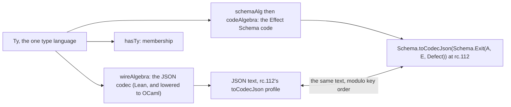

# Schema as the type language: the carrier of every value that leaves a program

Status: design note, 2026-10-19, after the to-do dogfood (`2026-10-19-todo-as-a-user/`). The
library is at `639d78ed2`, the project `effect4-todo` at `822ac23`. The owner's question is the
early principle: one universal type language, Schema. Every value a program outputs is then
parsable from the outside, with Effect's type semantics. That seemed lost. This note says where
it stands, what its semantics are, how the tree models it, and what one probe showed.

## 1. The one thing to know

The principle stands in the tree, in pieces. `Ty` is the one type language, and `Ty.exitOf`
types an effect's outcome. The type-directed codec writes a value of any `Ty` as rc.112's own
`toCodecJson` JSON and reads it back exactly. The Schema code generator prints the same `Ty` as
the Effect Schema a consumer parses with. What was lost is one wire: nothing on the run path
calls the codec. A run's exit leaves as the machine's positional image, so the dogfood needed a
hand decoder to compare with Effect. Today's probe closed that gap in the project. With the exit
encoded at the certificate's type, Lean and Effect print the same eleven lines, with no decoder.

## 2. The principle, as the early notes state it

- Decisions row 13, the schema/program rule. Schema is a data language. Every effectful slot
  is a hole filled by an `Eff` program with a typing certificate.
- `docs/research/2026-09-04-eff-language-directions.md` §2, item 2: values are schema values,
  "one value language, and the schema is the type".
- `docs/research/2026-09-04-substrate-thesis-and-production-model.md` §3: Schema is the data
  plane, canonical through persisted JSON.
- `docs/research/2026-09-04-production-standards-spike.md` §1: "Schema is the lingua franca";
  every platform package that carries data across a boundary types that data as a codec.
- `docs/research/2026-09-10-program-as-schema.md`: the program as one schema document, with
  `Schema.Exit` at each node.
- The owner, 2026-10-19: every value output from a program is in a schema parsable from the
  outside, in some form, using Effect's type semantics.

## 3. What the tree holds

| Piece | Where | Its law or status |
| --- | --- | --- |
| The type language `Ty`: `unit`, `nat`, `string`, `record`, `map`, `tuple`, `union`, `lit`, `option`, `list`, `except`, `exitOf`, `causeOf`, the handles | `src/Effect4/Program/TyCore.lean` | the hub of every type carrier (`docs/research/2026-10-11-type-interface/README.md`) |
| Membership: does a value fit a type | `Val.memberIn` (`src/Effect4/Program/TyDecls.lean`); `Fits`, `fits_hasTy` (`src/Effect4/Laws/Program/Typed/Membership.lean`) | concept 1 |
| The certificate: a built program's answer, error and requirement | `Api.Built`, `Built.ty` (`src/Effect4/Api/Built.lean`, `src/Effect4/Api/Author.lean`) | admission |
| Every exit fits the certificate | `run_typed` (`src/Effect4/Laws/Program/MeaningSound.lean`) on `Straight`; `typedState_reachable` (`src/Effect4/Laws/Program/Typed/Commands/Clauses/All.lean`) on the reference machine | M7, proved 2026-10-13 |
| The type-directed codec: a fold of `Ty`, exact modulo key order | `wireAlgebra`, `encode`, `decode`, `isValue` (`src/Effect4/Schema/Codec.lean`); `decode_iff` (`src/Effect4/Laws/Schema/Codec.lean`) | concept 5, row 128; codec admission is one of the seven judgments |
| The codec's profile is Effect's own | the docstring of `src/Effect4/Schema/Codec.lean`: rc.112 `Schema.toCodecJson`, `Option`, `Result`, `Cause`, `Exit`, `Defect` by line | pinned |
| The Schema bridge: `Ty` as a Schema representation, `exitOf` as `Exit(value, error, Defect)` | `Bridge.schemaAlg` (`src/Effect4/Schema/Bridge.lean`); `ofSchema_exact` | exact modulo `normS`, row 128 |
| The Schema code: the Effect expression an Effect user writes | `SchemaCode.ofTy` (`src/Effect4/Codegen/SchemaCode.lean`) | checked at rc.112 by `make check-schema-codec` |
| The surface: each method's Schemas and decoding at entry | `ModuleEmission.surface` (`src/Effect4/Codegen/Surface.lean`) | CR-4, row 373 (11) |
| Reply admission: host data enters by membership at the row | `admitAnswer` (`src/Effect4/Program/Admit.lean`), Route A | concept 9 |

Three folds leave the one carrier, one for each face.



## 4. Where it was lost

**Nothing on the run path calls the codec.** A search of `src/Effect4` for `Codec.encode`,
`Codec.decode` and `isCodecValue` finds three kinds of caller. They are the law graph, the codec
lane (`harness/truth/schema-codec/Emit.lean`) and the batteries. No run, no tool method and no
kit entry calls it.

**An exit leaves four ways.**

1. `Run.Observation.exit` is the raw `ExitV`. The kit prints it under the carrier's own shape,
   `Kit.Json.exit_json` at `exitShape`, and a value under `valShape`: the positional image, with
   `_ctor` keys. The tool's `CodecProfile` prints carriers the same way, by `Canonical.print`.
2. The truth harness writes exits by hand: `exitJson` and `exitJsonAt`
   (`harness/truth/Truth.lean`), with the fiber renumbering.
3. The session fixtures write a failure as `{"fail": {"payload": hex}}`
   (`harness/truth/session/Session.lean`).
4. `Ty.encode` at `Ty.exitOf`, the proved one, which no run uses.

That is the coherence audit's cause D, one fact spelled per face, at the exit. The dogfood met
it as finding 3.5: the exit printed as `Val.ctor 1 […]`, and the comparison with Effect needed
`ts/lean-lines.ts`, 53 lines of decoding.

The inbound direction did not lose it. A host's reply is admitted by membership at the row
(Route A), and a typed host's images are typed by `Modeled.ty`, a `Ty`. So replies cross typed,
and exits cross untyped.

## 5. The semantics

Two definitions, in the tree's own words.

- **D1, the observation of a run.** For a built program `b` and a run that ends with the exit
  `e`, the observation is `Ty.encode (Ty.exitOf b.ty.answer b.ty.error) (exitImage.toVal e)`.
- **D2, parsable from the outside.** A consumer holding `b.ty` alone reads the observation: in
  Lean and in the lowered OCaml by `Ty.decode` at the same type; in TypeScript by
  `Schema.toCodecJson(Schema.Exit(ofTy answer, ofTy error, Schema.Defect()))`.

Four properties. Each is placed before it is worked (AGENTS.md, Trust).

- **P1, every observation is defined.** Let `b.ty.answer` and `b.ty.error` be codec-supported:
  `Codec.isSupported`, no handle, fiber, ref, deferred, variable or `unknown`. Then every exit
  of every run of `b` encodes at `Ty.exitOf`. Its parts stand. The exit fits the certificate:
  `run_typed` on `Straight`, M7 on the reference machine. Membership erases to the shape check,
  `fits_hasTy`. The codec admits a shape-decided value: `fits_of_hasTy_shapeDecides` and
  `decode_encode`. The composed statement is in no registry claim. Concept 5, serving R3; its
  consumer is move A below. It inherits its parts' fragments.
- **P2, exact.** `decode_iff`: what decodes at `t` is what `encode` wrote at `t`, modulo
  `normJ`, the key-order normaliser. Landed, row 128.
- **P3, the two faces agree.** Lean's `encode` at `t` and rc.112's `toCodecJson` of
  `SchemaCode.ofTy t` write the same text modulo `normJ`, and each reads what the other wrote.
  Host evidence, never a theorem: the codec lane holds it for values, and today's probe holds it
  for exits on eleven requests. A lane for exits is owed.
- **P4, one printer.** The kit, the tool, the truth lane and the session print an exit by D1. A
  consolidation move, not a theorem.

What the semantics do not cover. A handle has no JSON, so a program whose answer is a `Ref` or
a `Fiber` has no outside observation by D1. A defect carries Lean's closed payload
(`encodeDefect`), where rc.112's slot is `unknown`. An interrupt carries fiber ids, which the
truth lane renumbers before it prints. The cause's annotations are dropped on both faces.

## 6. The model: the common carrier and its algebra

The carrier of types is `Ty`, a free object: its algebra is `TyAlgebra`, and its fold is
`cata_ty`. The carrier of values is `Val`, the one value tree, and membership relates the two.
Every face is a fold of `Ty`, and never a second definition. The JSON codec is `wireAlgebra`.
The Effect Schema is `schemaAlg` into the representation, then `codeAlgebra` into code. The
OCaml face is the same `wireAlgebra`, lowered by the LCNF route, so no second codec exists.
Agreement is never a pairwise theorem. The TypeScript face agrees by the lane that runs rc.112,
and the OCaml face by the lowering's simulation of the same fold.

"Effect's type semantics" is then exact, because the encodings are rc.112's own. An Effect user
reads a Lean program's answer with Effect's Schema. A Lean program reads an Effect program's
answer with the codec. The exit type closes the type language under outcomes: `Exit<A, E>` is a schema
in Effect, and `Ty.exitOf` is a type in Lean. An observation is a value of the language, not a
side alphabet.

## 7. The probe

In the project, `lake exe todo --typed` prints each exit by D1, and `bun ts/run.ts --typed`
prints the Effect exit under `Schema.toCodecJson(Schema.Exit(answer, error, Schema.Defect()))`,
with the Schemas of the printed surface (`ts/todo.surface.gen.ts`). The comparison is a diff:

```
lake exe todo --typed | diff - <(bun ts/run.ts --typed) && echo SAME
SAME
```

Two lines of it:

```
add("") {"_tag":"Failure","cause":[{"_tag":"Fail","error":["EmptyTitle","a title is required"]}]}
complete(7) {"_tag":"Failure","cause":[{"_tag":"Fail","error":{"_tag":"NotFound","id":7}}]}
```

Two things the probe found on the way. The codec's `Json` has no text renderer. `jsonSource`
writes a number as a JavaScript bit literal, and the path to text is `NatJson.ofBinary64` then
`NatJson.render`, which answers bytes. And `Schema.Exit` alone encodes to an `Exit` object;
only `Schema.toCodecJson` of it writes the JSON the codec writes.

## 8. The faces, dogfooded: the number from the algebra

The observation D1 is a fold. It dispatches on the constructors of seven sorts. `Ty` enters
through the codec's `wireAlgebra`. `Exit`, `Reason`, `Defect` and `Err` enter through
`encodeCause`, `encodeReason`, `encodeDefect` and `encodeErr`. The interruptor's `Option` and
the `Val` inside each type's wire enter through their arms. A fold's witness set is whole when
every constructor of every sort it dispatches on has a witness. So the universe of forms is a
sum, not a list: the constructor counts of those seven sorts, read from the loaded environment.

| Sort | Constructors | Witnessed | Missing |
| --- | --- | --- | --- |
| `Ty` | 29 | 20 | `except`, `var`, `unknown`, `app`, `null`, `undefined`, `number`, `bytes`, `contextOf` |
| `Exit` | 2 | 2 | none |
| `Reason` | 3 | 3 | none |
| `Defect` | 6 | 4 | `notImplemented`, `badName` |
| `Err` | 5 | 4 | `boom` |
| `Option` | 2 | 2 | none |
| `Val` | 14 | 11 | `bytes`, `ref`, `float` |
| all | 61 | 46 | 15 |

The codec supports 18 of the 29 type constructors and refuses 11; the probe witnesses four of
the refusals: `fiberOf`, `refOf`, `deferredOf` and `handle`. Of the 15 missing constructors, 3
are reachable from an admitted program and not taken here. They are `unknown`, a release's exit
parameter; `app`, a module's named type; and `contextOf`, a service's context entry. The other
12 are reachable from no program written on the authoring surface. No construct answers a
`Result`, so `except` is out. No literal or term makes a `number`, `bytes`, `null`, `undefined`
or `var`. `notImplemented`, `badName` and `boom` are the machine's own markers, which admission
keeps out. `Val.bytes`, `Val.ref` and `Val.float` could come only from a host reply. So the
reachable universe is 49, and the probe witnesses 46 of it. The arms that branch on a value add
four more witnesses, not taken. They are a union's second member, the empty list, the empty map
and the empty tuple.

`probe/Faces.lean` beside this note is that census. It reads each sort's constructors from the
environment. It walks each case's exit type with the generated `TyAlgebra`, where a constructor
without a field does not compile. It walks each exit's value and cause with one arm a
constructor. It refuses when a type constructor has no representative for the support
judgment. It builds 35
programs, runs each on the Lean machine, and prints its exit by D1. It writes each program as
Effect TypeScript, and `probe/run.ts` runs the printed program under Bun on rc.112. The runner
encodes the exit with the case's own codec, `Schema.toCodecJson(Schema.Exit(answer, error,
Schema.Defect()))`, from the same types. The lines are diffed with fiber ids masked. The
commands, from the library's root:

```
lake env lean --run docs/research/2026-10-19-schema-as-the-carrier/probe/Faces.lean docs/research/2026-10-19-schema-as-the-carrier/probe/out ../../../../../harness/truth/prelude.ts
bun docs/research/2026-10-19-schema-as-the-carrier/probe/run.ts
```

The outputs are `probe/out/lean.txt`, `probe/out/bun.txt` and `probe/out/census.txt`; the
certificate types are `probe/out/types.tsv`. tsgo 7 accepts every printed module.

| Form | Cases | Result |
| --- | --- | --- |
| Success: unit, nat, a negative and a non-negative int, bool, string with escapes and non-ASCII, option some and none, list, pair, tuple, record with and without its optional field, map, union | 15 | equal |
| Success: an exit as the value (`Effect.exit` of a failure and of a success), a cause as the value (`catchCause` answering it) | 3 | equal |
| Failure, `Fail`: a string, a number, a tagged pair, a tagged record | 4 | equal |
| Failure, `Interrupt`: no interruptor; as a value under `exit` | 2 | equal |
| Failure, `Interrupt`: a forked child interrupted and joined | 1 | equal modulo the fiber id (Lean `0`, rc.112 `29`), and only after the annotations are dropped (finding 8.2) |
| Failure from a forked child: its typed failure joined | 1 | equal |
| Failure, `Die`, a user defect: a number, a string, a forked child's number | 3 | differ: the defect carrier (finding 8.1) |
| Failure, `Die`, a machine defect: `runSync` of a parked sleep (`asyncFiber`) | 1 | differ: the defect carrier (finding 8.1) |
| A handle as the answer: a fiber, a ref, a deferred, a scope; and a scoped fork with no scope, which answers a fiber and dies | 5 | refused on both faces: Lean's codec has no wire for the type, and the Schema code generator has no declaration for it |

Six things the probe established.

### 8.1 The defect carrier is not Effect's

Lean's `Defect` is a closed alphabet: `user n`, `error e`, and four machine defects. The codec
writes `user 7` as `{"user":7}`. It writes `error (text "boom")` as `{"error":"boom"}`. It
writes a machine defect as its name, `"asyncFiber"`. All three are `encodeDefect`
(`src/Effect4/Schema/Codec.lean`). rc.112's `Schema.Defect()` is `Json` decoded to `Unknown`
(`vendor/effect-4.0.0-rc.112/src/Schema.ts`, `Defect`). So a defect encodes as the raw JSON of
the thrown value, `7` and `"boom"`, and an `Error` as its name and message. The truth harness
bridges the user defects by a hand projection in TypeScript, `defectWire`
(`harness/truth/run-truth.ts`), which turns a safe natural into `{ user: n }`. That projection is
the fourth spelling of a defect, and the probe sees through it:

```
dieNat     Lean {"_tag":"Die","defect":{"user":7}}      rc.112 {"_tag":"Die","defect":7}
dieString  Lean {"_tag":"Die","defect":{"error":"boom"}}  rc.112 {"_tag":"Die","defect":"boom"}
asyncSleep Lean {"_tag":"Die","defect":"asyncFiber"}
           rc.112 {"_tag":"Die","defect":{"message":"An asynchronous Effect was executed with Effect.runSync","name":"AsyncFiberError"}}
```

A machine defect has a name on both faces, and rc.112 adds its message. The scoped fork with no
scope dies on rc.112 with `{"name":"Error","message":"Service not found: effect/Scope"}`, which
is Lean's `missingService`.

### 8.2 The exact codec refuses an annotated cause

An interrupted fiber's reason carries stack annotations, as the raw image shows:
`ctor 2 [some (ctor 0 [nat 0]), ctor 0 [list [pair "stack1" unit, pair "stack0" unit]]]`. The
codec's membership check passes it, and its raw encoder writes it, dropping the annotations as
`encodeReason` does. Then `Prepared.encode` decodes the JSON, reads the reason back without its
annotations, finds another value, and refuses: the exactness guard `decode j = some v`. So the
exact codec admits no cause with annotations, while rc.112's `toCodecJson` drops them by design.
The probe's observation strips every reason's annotations first (`Faces.bare`), and then the
case agrees. That strip is the named normaliser the exit codec's exactness law needs, as
`normJ` is for key order.

### 8.3 Fiber ids are compared modulo a renaming

An interruptor's id is the run's own numbering on each face. The typed observation carries it as
Effect does, `{"_tag":"Interrupt","fiberId":n}`, and the comparison renames, as the truth lane's
`fiber : Nat → Nat` does today.

### 8.4 A handle has no outside observation, on both faces

`fork (succeed unit)` answers `Fiber.Fiber<void, never>`, and `Ref.make`, `Deferred.make` and
`Scope.make` answer their handles. Lean's codec refuses each type, and the Schema code generator
refuses each declaration. The refusal is the same fact in two places, which is what R4 asks for.

### 8.5 The tool's JSON profile holds naturals only

`NatJson`, the profile's tree, holds a number as a natural, and `NatJson.ofBinary64` turns any
other number into a numeral with no text. The codec writes a negative integer as a binary64
datum with the sign bit (`negJson`). So the text path through the profile printed
`successIntNegative` as `"value":` with nothing after it, where rc.112 prints `-1`. The codec's
`Json` needs its own text renderer; the probe's `jsonText` is one. The tool's wire cannot carry
an `int` answer below zero today.

### 8.6 Encoding ignores type support

`Ty.encode` at `Exit<Fiber<void, never>, never>` wrote a failure, since the failure arm reads
no answer value. Yet the type is unsupported, `Codec.isSupported` is false, and rc.112 has no
Schema for it at all. D1 gates on `isSupported` first, as the probe now does, so both faces
refuse together.

One more thing the probe met: `NatJson.render` answers bytes, and `String.ofList` over them
splits a non-ASCII character. The text form is `String.fromUTF8!` over the bytes.

## 9. The moves

| Move | What it does | Owner |
| --- | --- | --- |
| A | `Run.observe` answers D1 beside the raw exit: one function in Lean, lowered into the kit, so `Kit.Json.exit_json` and the tool's run replies print by type | §9.1 item 5, M8 one observation |
| B | The truth lane's `exitJson`, `exitJsonAt`, its `defectWire`, and the session's `fail/payload` fold into `Ty.encode`; the fiber renumbering stays a function on the exit before it encodes | item 5; §9.2 item 1 for the protocol |
| C | One text renderer of the codec's `Json`, over its own binary64 numbers (finding 8.5), after `normJ`, as UTF-8 text; the profile's `NatJson` is not its path | item 10, small |
| D | The composed claim P1 in the registry under concept 5, with its planned goal; move A is its consumer | new; semantics generation is paused, so a receipt proposes the row |
| E | The kit's trace prints each call's request and reply by the row's columns, not by `valShape` | item 5 |
| F | The surface carries `exit: Schema.toCodecJson(Schema.Exit(answer, error, Schema.Defect()))` per method, so a consumer composes nothing by hand | new, small |
| G | The defect carrier follows Effect: `user n` encodes as the number `n`, `error e` as its error payload, and a machine defect as rc.112's error name and message, pinned by line; the harness's `defectWire` goes | new, small; concept 5 |
| H | The exit codec's exactness law gains the annotation normaliser: `Prepared.encode` compares against the value with its annotations dropped, and D1 encodes that value; D1 gates on `isSupported` (finding 8.6) | new, small; concept 5, row 128 |
| I | The faces as a generated census: `probe/Faces.lean`'s walk and universe become a lane, one witness a constructor, the universe read from the environment, a constructor without a witness a refusal; it runs where the codec lane runs | new, M; the drift rule of `binders.json` |

Not a move: `exitShape` and `valShape` stay the tool's wire for carriers that are no program
value, such as programs, types and refusals.

The order for the consolidation push. H and G come first, since they change what the codec
admits and writes. Then A with C, which makes the observation one function on every face. Then
B, which deletes the hand spellings. Then I, which holds the number. Then E and F. D rides with
A.

## 10. What the owner decides

| Id | Question | Recommended |
| --- | --- | --- |
| R1 | Is D1 the observation of a run, and does §9.1 item 5 say so? | yes |
| R2 | Does P1 enter the registry now, as a claim with a planned goal, while generation is paused? | yes, by a proposed row |
| R3 | Does the surface carry the exit codec per method (move F)? | yes |
| R4 | A program whose answer is a handle: no outside observation, with the tool's carrier wire for it, or a refusal at the public face? | the carrier wire, marked internal |
| R5 | Does the defect carrier follow Effect's raw JSON (move G), or does the TypeScript face keep projecting into Lean's alphabet? | Effect's, by the principle |
| R6 | Is an exit observed without its annotations (move H), as Effect's codec does? | yes; the annotations stay in the tool's carrier wire |

## 11. What this does not establish

- No theorem landed. The to-do probe is eleven requests, and the faces probe is 35 programs,
  each on one machine under one host.
- The census counts constructors. The arms that branch on a value are counted by hand in §8.
  The 12 unreachable constructors are classified by reading, not by a tool.
- P1 is stated here and in no claim. Its parts are proved on their fragments.
- The faces probe runs no host row, no clock advance and no parallel failure. rc.112's `all`
  with unbounded concurrency fails with its first reason. So a cause with several reasons came
  from no program here, and the codec lane holds it at the value level.
- The OCaml face printed nothing by D1: the native run still prints the value tree, and move A
  is what lowers D1 into the kit.

## 12. The rulings packet

Each ruling, with its evidence in the tree and in the probes, and the recommendation.

| Id | Question | Evidence | Recommended |
| --- | --- | --- | --- |
| R1 | Is D1 the observation of a run? | `Ty.exitOf` is a type (`src/Effect4/Program/TyCore.lean`); `wireAlgebra`'s `ty_exitOf` arm writes rc.112's `Exit` encoding; `decode_iff` is exact modulo `normJ`; the to-do's eleven exits and 31 of the 35 faces print the same text on both runtimes (`probe/out/lean.txt`, `probe/out/bun.txt`) | yes; §9.1 item 5 says so |
| R2 | Does P1 enter the registry now? | its parts are theorems: `run_typed` on `Straight`, `typedState_reachable` on the reference machine, `fits_hasTy`, `fits_of_hasTy_shapeDecides`, `decode_encode`; the composition is in no claim | yes, a claim with a planned goal, by a proposed row |
| R3 | Does the surface carry the exit codec per method? | the to-do runner composed `Schema.toCodecJson(Schema.Exit(…))` by hand from `TodoAppSchemas`; the probe wrote the same per case (`probe/out/cases.gen.ts`) | yes, move F |
| R4 | A handle as the answer | `Codec.isSupported` refuses `fiberOf`, `refOf`, `deferredOf` and `handle`; `SchemaCode.ofTy` refuses the `Fiber` declaration; the five handle cases print `refused` on both faces | the tool's carrier wire, marked internal |
| R5 | The defect carrier | `encodeDefect` writes `{"user":n}`, `{"error":…}` and a machine defect's name; rc.112's `Defect()` is `Json` decoded to `Unknown`, so it writes `7`, `"boom"`, and `{name, message}`; `defectWire` in `harness/truth/run-truth.ts` projects by hand; four faces differ | Effect's raw JSON, move G |
| R6 | Annotations on a reason | `causeImage.ofVal` reads the annotated reason, `encodeRaw` writes it without annotations, `Prepared.encode`'s exactness guard refuses it; rc.112's `toCodecJson` drops annotations; with `Faces.bare` the case agrees | observe without annotations, move H |

