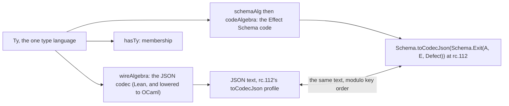

# Schema as the type language: the carrier of every value that leaves a program

Status: design note, 2026-10-19, after the to-do dogfood (`2026-10-19-todo-as-a-user/`);
reworked the same day after Codex's review (`2026-10-19-schema-as-the-carrier-review/README.md`;
the response is `response-claude.md` beside it). The library is at `639d78ed2`, the project
`effect4-todo` at `822ac23`. Nothing here is dispatched. The owner's question is the
early principle: one universal type language, Schema. Every value a program outputs is then
parsable from the outside, with Effect's type semantics. That seemed lost. This note says where
it stands, what its semantics are, how the tree models it, and what one probe showed.

## 1. The one thing to know

The principle stands in the tree, in pieces. `Ty` is the one type language, and `Ty.exitOf`
types an effect's outcome. The type-directed codec writes a value of any `Ty` as rc.112's own
`toCodecJson` JSON and reads it back exactly. The Schema code generator prints the same `Ty` as
the Effect Schema a consumer parses with. What was lost is one wire: nothing on the run path
calls the codec. A run's exit leaves as the machine's positional image, so the dogfood needed a
hand decoder to compare with Effect. Today's probe closed that gap in the project. With the exit
encoded at the certificate's type, Lean and Effect print the same eleven lines, with no decoder.
The review then showed the limits. The observation is total by refusal, not total: an admitted
program can compute a natural past the host's safe bound, which no codec writes. Across all
outcome forms the two faces agree on 26 executed cases. They differ on two things, the defect
carrier and the numeric bound. Both are domain decisions, not encoding details.

**After moves J and G (2026-10-20).** The two faces agree on 30 executed cases and differ on
none. The nine refusals are the five handle answers, the two oversize sums, the sum at the
bound, and the nested interrupt, which move H reaches. The landings are §11.

## 2. The principle, as the early notes state it

- Decisions row 13, the schema/program rule. Schema is a data language. Every effectful slot
  is a hole filled by an `Eff` program with a typing certificate.
- `docs/research/2026-09-04-eff-language-directions.md` §2, item 2: values are schema values,
  "one value language, and the schema is the type".
- `docs/research/2026-09-04-substrate-thesis-and-production-model.md` §3: Schema is the data
  plane, canonical through persisted JSON.
- `docs/research/2026-09-04-production-standards-spike.md` §1: "Schema is the lingua franca";
  every platform package that carries data across a boundary types that data as a codec.
- `docs/research/2026-09-10-program-as-schema.md`: the program as one schema document, with
  `Schema.Exit` at each node.
- The owner, 2026-10-19: every value output from a program is in a schema parsable from the
  outside, in some form, using Effect's type semantics.

## 3. What the tree holds

| Piece | Where | Its law or status |
| --- | --- | --- |
| The type language `Ty`: `unit`, `nat`, `string`, `record`, `map`, `tuple`, `union`, `lit`, `option`, `list`, `except`, `exitOf`, `causeOf`, the handles | `src/Effect4/Program/TyCore.lean` | the hub of every type carrier (`docs/research/2026-10-11-type-interface/README.md`) |
| Membership: does a value fit a type | `Val.memberIn` (`src/Effect4/Program/TyDecls.lean`); `Fits`, `fits_hasTy` (`src/Effect4/Laws/Program/Typed/Membership.lean`) | concept 1 |
| The certificate: a built program's answer, error and requirement | `Api.Built`, `Built.ty` (`src/Effect4/Api/Built.lean`, `src/Effect4/Api/Author.lean`) | admission |
| Every exit fits the certificate | `run_typed` (`src/Effect4/Laws/Program/MeaningSound.lean`) on `Straight`; `typedState_reachable` (`src/Effect4/Laws/Program/Typed/Commands/Clauses/All.lean`) on the reference machine | M7, proved 2026-10-13 |
| The type-directed codec: a fold of `Ty`, exact modulo key order | `wireAlgebra`, `encode`, `decode`, `isValue` (`src/Effect4/Schema/Codec.lean`); `decode_iff` (`src/Effect4/Laws/Schema/Codec.lean`) | concept 5, row 128; codec admission is one of the seven judgments |
| The codec's profile is Effect's own | the docstring of `src/Effect4/Schema/Codec.lean`: rc.112 `Schema.toCodecJson`, `Option`, `Result`, `Cause`, `Exit`, `Defect` by line | pinned |
| The Schema bridge: `Ty` as a Schema representation, `exitOf` as `Exit(value, error, Defect)` | `Bridge.schemaAlg` (`src/Effect4/Schema/Bridge.lean`); `ofSchema_exact` | exact modulo `normS`, row 128 |
| The Schema code: the Effect expression an Effect user writes | `SchemaCode.ofTy` (`src/Effect4/Codegen/SchemaCode.lean`) | checked at rc.112 by `make check-schema-codec` |
| The surface: each method's Schemas and decoding at entry | `ModuleEmission.surface` (`src/Effect4/Codegen/Surface.lean`) | CR-4, row 373 (11) |
| Reply admission: host data enters by membership at the row | `admitAnswer` (`src/Effect4/Program/Admit.lean`), Route A | concept 9 |

Three folds leave the one carrier, one for each face.



## 4. Where it was lost

**Nothing on the run path calls the codec.** A search of `src/Effect4` for `Codec.encode`,
`Codec.decode` and `isCodecValue` finds three kinds of caller. They are the law graph, the codec
lane (`harness/truth/schema-codec/Emit.lean`) and the batteries. No run, no tool method and no
kit entry calls it.

**An exit leaves four ways.**

1. `Run.Observation.exit` is the raw `ExitV`. The kit prints it under the carrier's own shape,
   `Kit.Json.exit_json` at `exitShape`, and a value under `valShape`: the positional image, with
   `_ctor` keys. The tool's `CodecProfile` prints carriers the same way, by `Canonical.print`.
2. The truth harness writes exits by hand: `exitJson` and `exitJsonAt`
   (`harness/truth/Truth.lean`), with the fiber renumbering.
3. The session fixtures write a failure as `{"fail": {"payload": hex}}`
   (`harness/truth/session/Session.lean`).
4. `Ty.encode` at `Ty.exitOf`, the proved one, which no run uses.

That is the coherence audit's cause D, one fact spelled per face, at the exit. The dogfood met
it as finding 3.5: the exit printed as `Val.ctor 1 […]`, and the comparison with Effect needed
`ts/lean-lines.ts`, 53 lines of decoding.

The inbound direction did not lose it. A host's reply is admitted by membership at the row
(Route A), and a typed host's images are typed by `Modeled.ty`, a `Ty`. So replies cross typed,
and exits cross untyped.

## 5. The semantics

Three definitions, in the tree's words. They replace the first draft's two after the review.

- **D1, the observation of a run.** For a built program `b` and a run, the observation is one
  of three things. The first is `terminal j`. The run ended with the exit `e`, and `j` is
  `Ty.encode t (normA t (exitImage.toVal e))`. Here `t` is the exit type `Ty.exitOf
  b.ty.answer b.ty.error`, with every named type expanded under `b.app.types`. The second is
  `refused site reason`. The run ended, and the codec admits no observation. Either the type
  is unsupported, `Codec.isSupported t = false`, or the value is outside the codec's domain. A
  natural past the bound and an ambiguous union member are two such values. The third is `live view`. The
  run has no exit, and the view is `Run.Observation`'s, with its awaited calls, pending replies
  and fibers. A refusal is a located refusal, never a failure of the program.
- **D2, the normaliser.** `normA : Ty → Val → Val` is a fold over the type. At `exitOf` and
  `causeOf` it drops every reason's annotations and recurses into the success value and the
  error value. At `option`, `list`, `prod`, `except`, `record`, `map`, `tuple` and `union` it
  recurses. Elsewhere it is the identity. It is idempotent. It reaches an interrupted exit
  inside a success value, which the first draft's outer strip did not.
- **D3, parsable from the outside.** A consumer holding `b.ty` and `b.app.types` reads a
  terminal observation. In Lean and in the lowered OCaml it uses `Ty.decode` at the same
  expanded type. In TypeScript it uses `Schema.toCodecJson(Schema.Exit(ofTy answer, ofTy
  error, Schema.Defect()))`, with `ofTy` given the same declarations.

Four properties. Each is placed before it is worked (AGENTS.md, Trust).

- **P1, total by refusal, and complete against codec admission.** Take any built `b` and any
  exit `e`. Then `observe b e = terminal j` for some `j` exactly when `Ty.isCodecValue t (normA
  t (exitImage.toVal e))` holds. And then `Ty.decode t j = some (normA t (exitImage.toVal e))`. The
  second half is `decode_encode` and `encode_of_hasTy` (`src/Effect4/Laws/Schema/Codec.lean`).
  The first half has the shape of a located refusal (`explain = none ↔ wellTyped`, AGENTS.md).
  It is not a totality claim. `run_typed` gives membership, and membership is not codec
  admission. The review's two programs, `succeed (Atom.add (nat (2^53-1)) (nat 2))` and
  `succeed (Atom.plus (nat (2^53-1)) (nat 1))`, are admitted, finish, and refuse. Concept 5,
  serving R3; its consumer is move A.
- **P2, exact.** `decode_iff`: what decodes at `t` is what `encode` wrote at `t`, modulo
  `normJ`, the key-order normaliser. Landed, row 128. The codec's laws are not amended by this
  note. `normA` is applied before `encode`, so `decode_of_encode` and `encode_injective` keep
  their statements, on normalised values.
- **P3, the two faces agree on the shared domain.** Lean's `encode` at `t` and rc.112's
  `toCodecJson` of `SchemaCode.ofTy t` write the same text, modulo three normalisers. They are
  `normJ`, one injective renaming of fiber ids, and Effect's own defect normaliser. That last
  one keeps an error's name and message and drops its other fields (`defectFromJson`,
  `vendor/effect-4.0.0-rc.112/src/SchemaTransformation.ts`). Host evidence, never a theorem.
  The shared domain has one numeric bound, `safeBound`, on both faces (finding 8.7). Today the
  nat wire has none.
- **P4, one printer.** The kit, the tool, the truth lane and the session print a terminal
  observation by D1. A consolidation move, not a theorem.

What the semantics do not cover. A handle has no JSON, so a program whose answer is a `Ref` or
a `Fiber` is `refused`, and the tool's carrier wire keeps it. A natural or an integer past
`safeBound` is `refused` on the Lean face. On the Effect face the prelude's arithmetic already
dies past the bound (`harness/truth/prelude-atoms.gen.ts`, "outside the integer profile"). So
the two faces refuse the same programs for different reasons, and one profile judgment (§9.1
item 2) is what makes them one. A defect's carrier is decided by R5 before move G. An
interrupt's fiber id is compared modulo renaming. A live run is `live`, never a terminal text.


## 6. The model: the common carrier and its algebra

The carrier of types is `Ty`, a free object: its algebra is `TyAlgebra`, and its fold is
`cata_ty`. The carrier of values is `Val`, the one value tree, and membership relates the two.
Every face is a fold of `Ty`, and never a second definition. The JSON codec is `wireAlgebra`.
The Effect Schema is `schemaAlg` into the representation, then `codeAlgebra` into code. The
OCaml face is the same `wireAlgebra`, lowered by the LCNF route, so no second codec is written.
Agreement is never a pairwise theorem. The TypeScript face agrees by the lane that runs rc.112.
The OCaml face owes a fresh comparison of the lowered encoder, decoder and text renderer. The
lowering carries rule coverage and gated differentials, and its stage law is still planned
(`docs/core/lcnf-route.md`, "What the lowering claims"). So no law crosses it as a theorem.

"Effect's type semantics" is then exact, because the encodings are rc.112's own. An Effect user
reads a Lean program's answer with Effect's Schema. A Lean program reads an Effect program's
answer with the codec. The exit type closes the type language under outcomes: `Exit<A, E>` is a schema
in Effect, and `Ty.exitOf` is a type in Lean. An observation is a value of the language, not a
side alphabet.

## 7. The probe

In the project, `lake exe todo --typed` prints each exit by D1, and `bun ts/run.ts --typed`
prints the Effect exit under `Schema.toCodecJson(Schema.Exit(answer, error, Schema.Defect()))`,
with the Schemas of the printed surface (`ts/todo.surface.gen.ts`). The comparison is a diff:

```
lake exe todo --typed | diff - <(bun ts/run.ts --typed) && echo SAME
SAME
```

Two lines of it:

```
add("") {"_tag":"Failure","cause":[{"_tag":"Fail","error":["EmptyTitle","a title is required"]}]}
complete(7) {"_tag":"Failure","cause":[{"_tag":"Fail","error":{"_tag":"NotFound","id":7}}]}
```

Two things the probe found on the way. The codec's `Json` has no text renderer. `jsonSource`
writes a number as a JavaScript bit literal, and the path to text is `NatJson.ofBinary64` then
`NatJson.render`, which answers bytes. And `Schema.Exit` alone encodes to an `Exit` object;
only `Schema.toCodecJson` of it writes the JSON the codec writes.

## 8. The faces, dogfooded: the number from the algebra

The observation D1 is a fold. It dispatches on the constructors of seven sorts. `Ty` enters
through the codec's `wireAlgebra`. `Exit`, `Reason`, `Defect` and `Err` enter through
`encodeCause`, `encodeReason`, `encodeDefect` and `encodeErr`. The interruptor's `Option` and
the `Val` inside each type's wire enter through their arms. A fold's witness set is whole when
every constructor of every sort it dispatches on has a witness. So the universe of forms is a
sum, not a list: the constructor counts of those seven sorts, read from the loaded environment.

| Sort | Constructors | Witnessed | Missing |
| --- | --- | --- | --- |
| `Ty` | 29 | 20 | `except`, `var`, `unknown`, `app`, `null`, `undefined`, `number`, `bytes`, `contextOf` |
| `Exit` | 2 | 2 | none |
| `Reason` | 3 | 3 | none |
| `Defect` | 6 | 4 | `notImplemented`, `badName` |
| `Err` | 5 | 4 | `boom` |
| `Option` | 2 | 2 | none |
| `Val` | 14 | 11 | `bytes`, `ref`, `float` |
| all | 61 | 46 | 15 |

The codec supports 18 of the 29 type constructors and refuses 11; the probe witnesses four of
the refusals: `fiberOf`, `refOf`, `deferredOf` and `handle`. Of the 15 missing constructors, 3
are reachable from an admitted program and not taken here. They are `unknown`, a release's exit
parameter; `app`, a module's named type; and `contextOf`, a service's context entry. The other
12 are reachable from no program written on the authoring surface. No construct answers a
`Result`, so `except` is out. No literal or term makes a `number`, `bytes`, `null`, `undefined`
or `var`. `notImplemented`, `badName` and `boom` are the machine's own markers, which admission
keeps out. `Val.bytes`, `Val.ref` and `Val.float` could come only from a host reply. So the
reachable universe is 49, and the probe witnesses 46 of it. The arms that branch on a value add
four more witnesses, not taken. They are a union's second member, the empty list, the empty map
and the empty tuple.

`probe/Faces.lean` beside this note is that census, and the census is a structural inventory.
It counts the constructors in a case's exit type and exit value, whether or not the encoder
took that branch. The execution witnesses are counted separately below, by `probe/compare.ts`.
It reads each sort's constructors from the environment. It walks each case's exit type with the generated `TyAlgebra`, where a constructor
without a field does not compile. It walks each exit's value and cause with one arm a
constructor. It refuses when a type constructor has no representative for the support
judgment. It builds 40
programs, the review's five controls included, runs each on the Lean machine, and prints its
exit by D1. It writes each program as
Effect TypeScript, and `probe/run.ts` runs the printed program under Bun on rc.112. The runner
encodes the exit with the case's own codec, `Schema.toCodecJson(Schema.Exit(answer, error,
Schema.Defect()))`, from the same types. `probe/compare.ts` then classifies each case against
`probe/expected.tsv`. It decodes every agreeing Effect line back through its codec and encodes
it again. It exits 1 on any unexpected class or failed round trip, and one altered line fails
it. The commands, from the library's root:

```
lake env lean --run docs/research/2026-10-19-schema-as-the-carrier/probe/Faces.lean docs/research/2026-10-19-schema-as-the-carrier/probe/out ../../../../../harness/truth/prelude.ts
bun docs/research/2026-10-19-schema-as-the-carrier/probe/run.ts > docs/research/2026-10-19-schema-as-the-carrier/probe/out/bun.txt
bun docs/research/2026-10-19-schema-as-the-carrier/probe/compare.ts
```

The outputs are `probe/out/lean.txt`, `probe/out/bun.txt` and `probe/out/census.txt`; the
certificate types are `probe/out/types.tsv`. tsgo 7 accepts every printed module. The
comparator's classes over the 40 cases:

| Class | Cases | Meaning |
| --- | --- | --- |
| `equal` | 26 | both executed, the same text |
| `renamed` | 1 | the same text after one injective fiber renaming, `0` to `31`; one pair, so no general renaming is tested |
| `differ` | 4 | both executed, different text: the defect carrier. After move G all four are `equal` (§8.1) |
| `refusedBoth` | 7 | five handle answers, where neither face has a codec; two sums past the bound, refused by Lean's codec and by the prelude's arithmetic |
| `refusedEffect` | 1 | the sum 2^53: Lean's nat wire admits it, the prelude refuses it. After move J it is `refusedBoth` (§8.7) |
| `refusedLean` | 1 | an interrupted exit inside a success value: the outer strip does not reach it |

So 31 cases executed on both faces, 27 of them equal and 4 different, and 9 were refused on at
least one face. The first draft's "31 of 35" counted refusals as agreement; this table does
not.


| Form | Cases | Result |
| --- | --- | --- |
| Success: unit, nat, a negative and a non-negative int, bool, string with escapes and non-ASCII, option some and none, list, pair, tuple, record with and without its optional field, map, union | 15 | equal |
| Success: an exit as the value (`Effect.exit` of a failure and of a success), a cause as the value (`catchCause` answering it) | 3 | equal |
| Failure, `Fail`: a string, a number, a tagged pair, a tagged record | 4 | equal |
| Failure, `Interrupt`: no interruptor; as a value under `exit` | 2 | equal |
| Failure, `Interrupt`: a forked child interrupted and joined | 1 | equal modulo the fiber id (Lean `0`, rc.112 `29`), and only after the annotations are dropped (finding 8.2) |
| Failure from a forked child: its typed failure joined | 1 | equal |
| Failure, `Die`, a user defect: a number, a string, a forked child's number | 3 | differ: the defect carrier (finding 8.1) |
| Failure, `Die`, a machine defect: `runSync` of a parked sleep (`asyncFiber`) | 1 | differ: the defect carrier (finding 8.1) |
| A handle as the answer: a fiber, a ref, a deferred, a scope; and a scoped fork with no scope, which answers a fiber and dies | 5 | refused on both faces: Lean's codec has no wire for the type, and the Schema code generator has no declaration for it |
| The review's controls: a sum at the bound, at 2^53, past 2^53 as a natural and as an integer, and an interrupted exit inside a success | 5 | one equal, two refused on both faces, one refused by Effect alone, one refused by Lean alone (findings 8.7, 8.8) |

Nine things the probe established.

### 8.1 The defect carrier is not Effect's

Lean's `Defect` is a closed alphabet: `user n`, `error e`, and four machine defects. The codec
writes `user 7` as `{"user":7}`. It writes `error (text "boom")` as `{"error":"boom"}`. It
writes a machine defect as its name, `"asyncFiber"`. All three are `encodeDefect`
(`src/Effect4/Schema/Codec.lean`). rc.112's `Schema.Defect()` is `Json` decoded to `Unknown`
(`vendor/effect-4.0.0-rc.112/src/Schema.ts`, `Defect`). So a defect encodes as the raw JSON of
the thrown value, `7` and `"boom"`, and an `Error` as its name and message. The truth harness
bridges the user defects by a hand projection in TypeScript, `defectWire`
(`harness/truth/run-truth.ts`), which turns a safe natural into `{ user: n }`. That projection is
the fourth spelling of a defect, and the probe sees through it:

```
dieNat     Lean {"_tag":"Die","defect":{"user":7}}      rc.112 {"_tag":"Die","defect":7}
dieString  Lean {"_tag":"Die","defect":{"error":"boom"}}  rc.112 {"_tag":"Die","defect":"boom"}
asyncSleep Lean {"_tag":"Die","defect":"asyncFiber"}
           rc.112 {"_tag":"Die","defect":{"message":"An asynchronous Effect was executed with Effect.runSync","name":"AsyncFiberError"}}
```

A machine defect has a name on both faces, and rc.112 adds its message. The scoped fork with no
scope dies on rc.112 with `{"name":"Error","message":"Service not found: effect/Scope"}`, which
is Lean's `missingService`.

**Landed, move G (2026-10-20, `3197fde57`; `receipt-G.md`).** The codec writes a defect as
rc.112's `Schema.Defect()` does. A user defect is its number inside `safeBound`, a represented
error is its raw JSON, and a machine defect is an `Error`'s name and message. `defectWire` is gone
from the truth harness, which now writes the host's defect by rc.112's own encoder. The four
cases above are `equal`, and the comparator reads 30 equal, 1 renamed, 8 refused on both faces,
1 refused by Lean.

### 8.2 The exact codec refuses an annotated cause

An interrupted fiber's reason carries stack annotations, as the raw image shows:
`ctor 2 [some (ctor 0 [nat 0]), ctor 0 [list [pair "stack1" unit, pair "stack0" unit]]]`. The
codec's membership check passes it, and its raw encoder writes it, dropping the annotations as
`encodeReason` does. Then `Prepared.encode` decodes the JSON, reads the reason back without its
annotations, finds another value, and refuses: the exactness guard `decode j = some v`. So the
exact codec admits no cause with annotations, while rc.112's `toCodecJson` drops them by design.
The probe's observation strips every reason's annotations first (`Faces.bare`), and then the
case agrees. That strip is the named normaliser the exit codec's exactness law needs, as
`normJ` is for key order.

### 8.3 Fiber ids are compared modulo a renaming

An interruptor's id is the run's own numbering on each face. The typed observation carries it as
Effect does, `{"_tag":"Interrupt","fiberId":n}`, and the comparison renames, as the truth lane's
`fiber : Nat → Nat` does today.

### 8.4 A handle has no outside observation, on both faces

`fork (succeed unit)` answers `Fiber.Fiber<void, never>`, and `Ref.make`, `Deferred.make` and
`Scope.make` answer their handles. Lean's codec refuses each type, and the Schema code generator
refuses each declaration. The refusal is the same fact in two places, which is what R4 asks for.

### 8.5 The tool's JSON profile holds naturals only

`NatJson`, the profile's tree, holds a number as a natural, and `NatJson.ofBinary64` turns any
other number into a numeral with no text. The codec writes a negative integer as a binary64
datum with the sign bit (`negJson`). So the text path through the profile printed
`successIntNegative` as `"value":` with nothing after it, where rc.112 prints `-1`. The codec's
`Json` needs its own text renderer; the probe's `jsonText` is one. The tool's wire cannot carry
an `int` answer below zero today.

### 8.6 Encoding ignores type support

`Ty.encode` at `Exit<Fiber<void, never>, never>` wrote a failure, since the failure arm reads
no answer value. Yet the type is unsupported, `Codec.isSupported` is false, and rc.112 has no
Schema for it at all. D1 gates on `isSupported` first, as the probe now does, so both faces
refuse together.

### 8.7 The numeric bound is three different things today

The int wire refuses past `safeBound`, 2^53 minus 1 (`intJson`). The nat wire has no bound. It
writes any natural that binary64 holds exactly, so it writes 2^53 (`ty_nat`). rc.112's natural
Schema is `isInt`, which is `Number.isSafeInteger`, so it rejects 2^53. And the prelude's
arithmetic dies past the bound at run time, "outside the integer profile"
(`harness/truth/prelude-atoms.gen.ts`), while Lean's machine computes the exact natural. The
review's programs show all three. `2^53-1 + 1` encodes in Lean and is refused by Effect.
`2^53-1 + 2` and the integer `2^53` are refused by both, for different reasons. One bound on
both wires, and one judgment at ingress and at the observation, is §9.1 item 2, M2. This note
inherits it.

**Landed, move J (2026-10-19, `04fa8d57c`; `receipt-J.md`).** The nat wire refuses past
`safeBound`, as the int wire does, and the codec's laws keep their statements. The comparator
reads `exactBound` as `refusedBoth`: 26 equal, 1 renamed, 4 differ, 8 refused on both faces, 1
refused by Lean. The codec lane reads both faces refusing 2^53 and writing 2^53 minus 1.

### 8.8 The annotation normaliser must be recursive

The first draft's `bare` stripped the outer cause. `exit (join f)` of an interrupted child
answers `Exit<Exit<void, never>, never>`. The interrupted exit sits inside the success value,
its annotations with it, and the codec refuses. D2 is the type-directed fold that reaches it.

### 8.9 A raw defect carrier collides

The first draft's move G mapped `Defect.user 7` and `Defect.error (Err.tag 7)` both to `7`.
Both encode today, as `{"user":7}` and `{"error":7}`. `Defect.ofError` already gives the normal
form, `tag n` to `user n` (`src/Effect4/Machine/Alphabets.lean`). So an injective raw encoding
exists on the canonical defects alone. Effect's own decoder keeps an error's name and message
and drops its other fields, so the cross-runtime law is modulo that. And `missingService` is
stored without the missing key (`serviceLookupK`, `src/Effect4/Program/Compile.lean`). So no
output function can write rc.112's "Service not found: effect/Scope" from it today.

**Landed, move G.** `Defect.missingService` stores its key, and the message spells it by the
module's key names (`keySpelling`, now in `Program/Native.lean`), `effect/Scope` for the scope.
The codec admits the canonical defects only, so `error (tag 7)` is refused and `user 7` is not.
A finite control reads injectivity over one defect of each form (`Test/Codegen/DataCodec.lean`).

One more thing the probe met: `NatJson.render` answers bytes, and `String.ofList` over them
splits a non-ASCII character. The text form is `String.fromUTF8!` over the bytes. The map
representative of the census is string-keyed. A map with another key type is unsupported, and
the inventory does not see it.

## 9. The moves

The review's dependency order stands. Decide the domains. Place the corrected claims and the
normaliser. Implement the observation and its text. Compare the three faces. Migrate the
callers. Then require exercised branches.

| Move | What it does | Owner |
| --- | --- | --- |
| J | One numeric domain: `ty_nat` gets `safeBound`, as `intJson` has it; the judgment runs at ingress and at the observation; arithmetic-result controls on both sides of the bound, on both faces | §9.1 item 2, M2 |
| G | The defect domain, after R5: a payload defect that carries rc.112's raw JSON, or the canonical closed alphabet (`Defect.ofError`'s normal form) with an injective encoding, raw for user defects and name-and-message for machine defects; `missingService` keeps its key; the harness's `defectWire` goes | new, M; concept 5 |
| H | `normA`, the recursive type-directed normaliser (D2), applied by D1 before `encode`; the codec's laws keep their statements; a lemma that `encode t (normA t v) = encode t v` where both are defined | new, S; concept 5 |
| D | P1 as stated in §5, a claim with a planned goal under concept 5; its consumer is move A | new; a proposed row, since generation is paused |
| A | `Run.observe` answers D1's three-way observation, named types expanded under `b.app.types`; lowered into the kit so `Kit.Json.exit_json` and the tool's run replies print by it; a fresh native comparison of the lowered encoder, decoder and renderer | §9.1 item 5, M8; `check-ocaml` |
| C | One text renderer of the codec's `Json` over its own binary64 numbers, after `normJ`, as UTF-8; the text profile is the integers within `safeBound`; `number` outside it is not in this landing, and negative zero is named as out of it | item 10, small |
| B | The truth lane's `exitJson`, `exitJsonAt` and `defectWire`, and the session's `fail/payload`, fold into D1; each caller is inventoried first, and its comparison kept where it is independent; the fiber renumbering stays a function before encoding | item 5; §9.2 item 1 for the protocol |
| E | The kit's trace prints each call's request and reply at the checked instance (`CallInstance`, `Run.callView`), not at the row's columns; a generic host call is tested | item 5, after A |
| F | The surface carries `exit: Schema.toCodecJson(Schema.Exit(answer, error, Schema.Defect()))` per method, with the declarations, for the decided domain; an unsupported type gets a stated result | new, small; after A |
| I | The faces as a lane: the census as inventory, `compare.ts`'s classes as execution witnesses, expected refusals by class, reciprocal decoding, a deliberately broken encoder as the failing control, value branches and map key types exercised | new, M |

Not a move: `exitShape` and `valShape` stay the tool's wire for carriers that are no program
value, such as programs, types and refusals.


## 10. What the owner decides

| Id | Question | Recommended |
| --- | --- | --- |
| R1 | Is D1, the three-way observation, the observation of a run, and does §9.1 item 5 say so? | yes |
| R2 | Does P1, total by refusal and complete against codec admission, enter the registry as a claim with a planned goal? | yes, by a proposed row |
| R3 | Does the surface carry the exit codec per method, with the declarations? | yes, move F, after A |
| R4 | A program whose answer is a handle | `refused`, with the tool's carrier wire for it, marked internal |
| R5 | The defect domain: a payload defect carrying rc.112's raw JSON, or the canonical closed alphabet with an injective encoding | **ruled 2026-10-19 (the owner): "the canonical defect alphabet with an injective encoding, raw for user defects and name-and-message for machine defects, with missingService's key stored"**; the payload defect later, if the machine's own markers must match rc.112's messages exactly. D-G1 (`receipt-G.md`), settled by the coordinator: the key names enter at each wire's encoder and decoder, as landed, so layout and support stay judgments of the type. D-G2: the coordinator regenerated `rocq/Eff_types.v` and compiled the Rocq tree |
| R6 | Is an exit observed without its annotations, at every depth? | yes, D2 |
| R7 | One numeric bound, `safeBound`, on both wires and at the observation; and does Lean's machine refuse arithmetic past it, as the prelude does? | **ruled 2026-10-19 (the owner): "one numeric bound, safeBound, on both wires and at the observation, under M2"**; the machine's own refusal past the bound stays M2's decision. D-J1 (`receipt-J.md`), settled by the coordinator under this ruling: a user defect's number is bounded by `safeBound` at the observation too, in move G; an interruptor's fiber id stays the run's numbering |
| R8 | The first landing's scope: terminal output with expanded declarations, traces deferred to E | yes |
| R9 | The public shape: `terminal`, `refused` and `live` as three cases, with the text profile of move C | yes |


## 11. The queue: J, then G

The owner, 2026-10-19: "Record both and queue moves J and G first, in the reworked order." The
two briefs follow. Each lands as AGENTS.md's Working section asks: a narrow build, `#axiom_audit`
over the touched modules, and the behaviour gate the change reaches. Semantics generation stays
paused, so each receipt proposes its registry text.

### 11.1 Move J: one numeric bound on both wires

- **Concept and property.** Concept 5, exact codecs: codec admission of a natural is the
  profile's bound, `safeBound`, on the nat wire as on the int wire. It serves R3 (data) and
  §9.1 item 2, M2.
- **The change.** `wireAlgebra.ty_nat` (`src/Effect4/Schema/Codec.lean`) encodes `.nat n` only
  when `n ≤ safeBound`, and its decode keeps `nat?` under the same bound, as `intJson` and `int?`
  do. `Val.hasTy` does not change: a natural past the bound stays a member and stops being a
  codec value, which is what P1 says.
- **The laws.** Every lemma of `src/Effect4/Laws/Schema/Codec.lean` with a nat arm is repaired
  under the new guard; `decode_iff`, `decode_encode` and `encode_injective` keep their
  statements. A new finite control reads `isCodecValue .nat (.nat (2^53-1)) = true` and
  `isCodecValue .nat (.nat (2^53)) = false`.
- **The controls.** `Test/Codegen/DataCodec.lean`: the two naturals above, on both sides of the
  bound, as finite evaluations. The codec lane: `harness/truth/schema-codec/Emit.lean` gains the
  bound pair under `encodingRefusals` and `check.ts` reads it against rc.112's `isInt`, so both
  faces refuse 2^53 together. The faces probe's `exactBound` moves from `refusedEffect` to
  `refusedBoth` in `probe/expected.tsv`.
- **What it does not do.** It does not make the Lean machine's `add` refuse past the bound; the
  prelude does, and that is M2's own decision. The ingress judgment, `natLiteralsInProfile`
  (`src/Effect4/Codegen/Checked.lean`), stays as it is.
- **The reach.** The codec is not in the lowered closure (`ocaml/gen/api_gen.mli` names no
  `schema_codec` root), so no OCaml regeneration. The gate is `check-ts`.
- **Size.** S.
- **Landed.** 2026-10-19, by one Opus seat in the main checkout from `briefs/J.md`: `04fa8d57c`
  (the code) and `fc9eb07c8` (`receipt-J.md`). `make check-ts` passed. The receipt proposes the
  registry claim `nat-codec-admission` with the planned goal `isCodecValue_nat_iff`, and names
  three texts that still say "above 2^53" and stay true. D-J1 is settled in §10.

### 11.2 Move G: the canonical defect alphabet, encoded as Effect writes a defect

- **Concept and property.** Concept 5: the defect's codec is injective on the canonical defects
  and writes rc.112's raw form. It serves R3 and §9.1 item 5.
- **The domain.** A defect is canonical when it is `Defect.ofError`'s normal form: `user n`,
  `error e` with `e` neither `tag _` nor `boom`, or a machine defect. `tag n` is `user n`, and
  `boom` is `badName`, as `ofError` already says (`src/Effect4/Machine/Alphabets.lean`). Codec
  admission requires the canonical form.
- **The encoding.** `user n` is the number `n`, under `safeBound` (D-J1, §10). `error (text s)` is the string `s`. `error
  (tagged t m)` is the array `[t, m]`. `error (payload p)` is `{"payload": hex}`. A machine
  defect is `{"name": N, "message": M}`. `asyncFiber` is rc.112's `AsyncFiberError` with its
  message, pinned by line. `missingService key` is `Error` with "Service not found: " and the
  key's spelling. That spelling is the service's declared name in the signature, and
  `effect/Scope` for the built-in scope. `notImplemented` and `badName` are Lean's own, with
  `Effect4` as the name.
  The decoder reads each form back by its JSON kind: number, string, two-string array, a
  `payload` object, a `name` and `message` object. Injective on the canonical domain by
  construction, which a finite control reads.
- **The representation.** `Defect.missingService` gains its key: `missingService (key :
  ServiceKey)`. `serviceLookupK` (`src/Effect4/Program/Compile.lean`) stores it. Every match on
  `Defect` follows the new-field checklist. The sites are `Defect.ofError`, `Defect.image`,
  `encodeDefect`, `decodeDefect` and `src/Effect4/Machine/Stores.lean`. The law modules that
  name `Defect.missingService` follow (`Laws/Machine/ContextValue.lean`, `Laws/Machine/Witnesses.lean`,
  `Laws/Program/DenoteR.lean`, `InterpR.lean`, `BlockMeaning.lean`, `Agreement.lean`,
  `Agreement/Blocks.lean`, `Typed/Commands/Clauses/Spawn.lean`, `Typed/Commands/Evaluate.lean`,
  `Laws/Schema/Codec.lean`), and the truth harness (`harness/truth/Truth.lean`).
- **The callers.** `defectWire` in `harness/truth/run-truth.ts` goes, with its two controls;
  the truth lane's defect JSON becomes `encodeDefect`'s. The faces probe's `dieNat`,
  `dieString`, `forkDieJoin` and `asyncSleep` move from `differ` to `equal` in
  `probe/expected.tsv`.
- **The reach.** `Effect4.Machine.Defect` is an opened type of the lowered closure
  (`ocaml/eff/eff_types.ml`), and a defect crosses the host wire inside a completion. So the
  change reaches `make gen-eff`, `make gen-lcnf`, the wire goldens and the session fixtures.
  The gates are `check-ts` and `check-ocaml`.
- **Open point for the slice.** The key's spelling in a message needs the signature's
  declarations at encode time, and the inverse at decode time. The slice settles whether the
  defect stores the key and the codec takes the declarations, or the defect stores the
  spelling. The brief recommends the key, with the spelling from the declarations, since the
  key is what the machine has.
- **Size.** M.
- **Landed.** 2026-10-20, by one Opus seat in the main checkout from `briefs/G.md`: `3197fde57`
  (the code) and `d54a9f211` (`receipt-G.md`). `make check-ocaml` and `make check-ts` passed.
  The coordinator ran `#closure_audit` over the codec's new closures (passed) and regenerated
  `rocq/Eff_types.v`. The receipt proposes the registry claim `defect-codec` with a planned
  goal. Still open after it: the frozen packet `Test/contracts/schema-codec.contract.md` states
  the codec without key names, and it is the owner's packet. The retired truth outputs keep
  the old spellings until `gen-truth`. The to-do project's typed comparison follows
  `briefs/todo-after-G.md`.

### 11.3 The proposed decisions row

For the coordinator, who owns the register. "Row 421. Schema as the carrier, the owner's
rulings of 2026-10-19 (`docs/research/2026-10-19-schema-as-the-carrier.md` §10, after Codex's
review). (1) The observation of a run is its exit encoded at the certificate's exit type, total
by refusal (D1, P1). (2) The defect alphabet is canonical. Its encoding is Effect's raw form for user
defects and name-and-message for machine defects, with `missingService`'s key stored (R5, move
G). (3) One numeric bound, `safeBound`, on both wires and at the observation, under
M2 (R7, move J). (4) The order: J, G, then H, D, A with C, the native comparison, B, E, F, I."

## 12. What this does not establish

- Before move J, no theorem landed. Move J landed two helper lemmas of the claim `decode-iff`
  and proposed one claim. Move G restated the defect codec's exactness lemmas under the key
  names and proposed the claim `defect-codec`. Which defects the codec admits has no proof. The to-do probe is eleven requests, and the faces probe is 40
  programs, each on one machine under one host.
- The fiber renaming is one observed pair, `0` to `31`; no general renaming is tested.
- No native run printed D1, and no native encoder, decoder or renderer was compared.
- The census counts constructors. The arms that branch on a value are counted by hand in §8.
  The 12 unreachable constructors are classified by reading, not by a tool.
- P1 is stated here and in no claim. Its parts are proved on their fragments.
- The faces probe runs no host row, no clock advance and no parallel failure. rc.112's `all`
  with unbounded concurrency fails with its first reason. So a cause with several reasons came
  from no program here, and the codec lane holds it at the value level.
- The OCaml face printed nothing by D1: the native run still prints the value tree, and move A
  is what lowers D1 into the kit.

## 13. The rulings packet

Each ruling, with its evidence in the tree and in the probes, and the recommendation.

| Id | Question | Evidence | Recommended |
| --- | --- | --- | --- |
| R1 | D1 as the observation | `Ty.exitOf` is a type; `ty_exitOf` writes rc.112's `Exit` encoding; `decode_iff`; 26 equal executed cases of 31 (`probe/compare.ts`) | yes |
| R2 | P1 in the registry | `decode_encode` and `encode_of_hasTy` give the admitted half; `run_typed` gives membership only; two admitted programs refuse (§8.7) | yes, as the refusal-complete claim, by a proposed row |
| R3 | The surface's exit codec | both probes composed it by hand; `SchemaCode.ofTy` takes no declarations | yes, after A |
| R4 | A handle as the answer | `isSupported` is false at four heads; the Schema printer refuses `Fiber`; five `refusedBoth` cases | the carrier wire, internal |
| R5 | The defect domain | `encodeDefect` tags; rc.112 writes raw values and name-and-message; the raw mapping collides on `user 7` and `error (tag 7)`; `Defect.ofError` gives the normal form; `missingService` lacks its key; four `differ` cases | the canonical alphabet, injective; the payload defect later |
| R6 | Annotations at every depth | the outer strip leaves `nestedInterrupt` refused (`refusedLean`); `causeImage.ofVal` reads the annotated reason, `encodeRaw` drops it, `Prepared.encode` refuses | yes, D2 |
| R7 | One numeric bound | `ty_nat` unbounded, `intJson` bounded, rc.112 `isSafeInteger`, the prelude's "outside the integer profile"; `exactBound` is `refusedEffect`, `overNat` and `overInt` are `refusedBoth` | one bound, M2 |
| R8 | The first landing's scope | `ty_app` refuses; `SchemaCode.ofTy` has no declaration environment; `CallInstance` holds a call's concrete types | terminal output first |
| R9 | The public shape and the text profile | `Run.Observation` has live fields; `JSON.stringify(-0)` is `0`; `NatJson` holds naturals only | three cases; integers within the bound |
