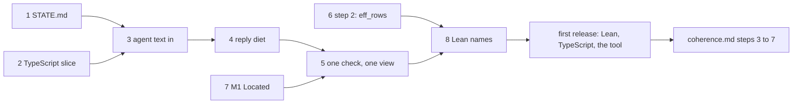

# A second read of the coherence documents, with the author in view

Status: research note (history, not authority). Base: `92c4baff8` on `refactor/phase1-phase3`.
Written 2026-10-19 by a second session, at the owner's request for another perspective. It
answers one question. With a first release near, what do the coherence documents get right, what
do they leave out, and what comes next. It changes no code and rules nothing.

## The one thing to know

The coherence documents are right about the estate and silent about the author. The model of
`coherence.md` (program, runtime, host, tape, journal, host session) matches the code after its
pressure test. Rule S is the right rule for every hand file. But every step of its plan after the
vocabulary is estate work: seams, the host protocol, carriers, the run layer, the store. The agent
face has been scheduled three times and landed once, in wave 1. The three schedules are the
ergonomics probe of 2026-10-13, lanes A and L of the slices plan, and decisions row 414. At HEAD,
lane A's A4 to A7, lane L's four slices and the one check query have no code (§4.2). The store and
the exchange, where the plan's largest steps sit, have no consumer that an author runs. So the next slices should come from the agent face and the documents. Steps 5 to
7 of the plan can follow a first release without loss.

## 1. What was read

| Item | How |
| --- | --- |
| `docs/research/2026-10-20-coherence-audit/`: `coherence.md`, `README.md`, `orientation.md`, `plan.md`, `lean-core.md`, `compiler-estate.md` | reading, at `92c4baff8` |
| `docs/STATE.md`, `README.md`, `docs/core/api-surface.md`, decisions rows 414 to 417, the dictionary's host rows | reading |
| the tool: `src/Effect4/Tool/` (16 files), `tools/Drivers/Workspace.lean`, `ocaml/engine/kit/kit_tool.ml`, `kit_mcp.ml`, `kit.mli`, `bin/eff.ml` | reading |
| the author's surface: `src/Effect4/Author.lean`, `src/Effect4/Api.lean`, `src/Effect4/Api/Author.lean`, `src/Effect4/Program/Authoring.lean`, `Authoring/Declare.lean`, `Authoring/Sugar.lean`; the to-do (`Test/Dogfood/Scenario/Todo.lean`, `Todo/Data.lean`, `Todo/Typed.lean`, `apps/todo/`) | reading |
| the probes: the ergonomics probe (2026-10-13), the usability scope (2026-10-16), the authoring and store layout (2026-10-17), the authoring probe and the slices plan (2026-10-18), the quality review and wave 3 (2026-10-19) | reading |
| the owner's messages since 2026-10-16: 131 of 1,320 distinct | `probes/orientation/owner_words.py` of the audit folder, a finite probe of the session transcripts |
| the counts of §4 | the commands given beside each |

## 2. Where the documents are right

1. **The model is the code's.** After F1 and F2 the roles and the two records are the ones the
   tree holds: `Eff`, the machine, `Run.Reactor`, `Decision`, `Run.journal` and
   `Api.HostSession.Session`. The dictionary now says the same (`c92fe3633`).
2. **Rule S is the rule.** One origin per file: generated, a seam's body, or build tooling. Each
   of its four seam kinds has an instance in the tree already. It adds no mechanism.
3. **The refutation pass held.** The synthesis rejected lc-9 and half of lc-3, amended eight
   departures, and listed the strengths no move may break (`README.md` §5). It merged no two
   constructs that serve different observations.
4. **Each move is an instance of an owner the tree has.** `Located`, a replay over `foldM`,
   `typeRows`, the one `View`, the attribute tables. No framework, no generic judgment record.
5. **The tool's core is already deep.** `Tool.serve` is one transition, and every request and
   reply is data. Its hand core is about 2,100 of the module's 11,708 lines
   (`wc -l src/Effect4/Tool/*.lean`); the rest is generated codecs. Keep it as it is.
6. **Folding three notes into one entry was right.** The owner's last steer of the day was that
   the documentation itself is the burden. `coherence.md` is one page with one plan.

## 3. Where I push back

### 3.1 The plan serves the estate first, and the goal is the author

Whom each step of `coherence.md` §8 serves:

| Step | What it does | Whom it serves |
| --- | --- | --- |
| 1 vocabulary | landed | the reader |
| 2 the host seam from `eff_rows` | one declaration per interface; the to-do's hand `Typed.lean` and `REPO` go | the Lean author: U2 and U3 of the usability scope |
| 3 the host protocol from the journal | one wire definition in Lean, lowered for OCaml by the LCNF route and printed as TypeScript syntax | the bridge between runtimes |
| 4 the cross-runtime test | one script, three runtimes | the estate's claim (row 381) |
| 5 carriers | E6, packages, the byte kernel, M2 to M4 | the OCaml engine |
| 6 the run layer lowered | M8, M10 | the OCaml engine |
| 7 the store | M5, M6, M11 | nothing an author runs today |

Only step 2 changes what an author writes. Steps 5 to 7 change code no author reaches. No file
outside `ocaml/engine/cas/` and its tests names `E4_cas`, `E4_disk` or `E4_pack` (`grep -rl` over
`ocaml/`). The exchange of `src/Effect4/Tool/Exchange.lean` has no native caller (`grep` over
`ocaml/engine/kit/` and `ocaml/gen/roots.json`). The three Lean moves the plan calls independent,
M1, M7 and M9, are the ones an agent meets.

### 3.2 The audit asked whether a construct is coherent, not whether a release needs it

The orientation's ten questions (§10) ask where a construct sits in the picture. None asks who
uses it. So the readings found second spellings and no dead surface. A release needs the second
question of every public name: taught, internal, or test-only. The OCaml estate has that answer,
the public-name manifest of row 414 (4), 385 rows at facade version 1
(`ocaml/gen/public-names.tsv`). The Lean library has none. `Effect4.Author` imports 38 modules
and re-exports them all. Among them are `Program.Edit`, whose `EditSession` the plan's M9 deletes,
and `Program.SketchWire`, whose one consumer was retired (`docs/STATE.md`, the sketches bullet).

### 3.3 The model has no place for the authoring objects

The model's roles are a run's. A sketch, a document, a fill set, a workspace and the checker's
memo are the objects an author holds. The audit's Lean-core departures lc-1, lc-2, lc-5 and lc-7
are theirs. Row 414 (5) ruled an eleventh concept, typed editing, to own them.
`docs/core/semantics.md` has no such section (`grep -n "typed editing"` finds nothing). Semantics
generation is paused, which stops claims from moving. It does not stop the concept's prose. One
section in `coherence.md`, or the concept's own section, would place the authoring half of the audit.

### 3.4 The owner's decisions, one line each

| Id | My view | Why |
| --- | --- | --- |
| D1 the log | defer past the first release | the store has no consumer an author runs; R1's repairs stand |
| D2 the public JSON's lists | arrays, now | the tools, the OCaml estate and `ts/eff/eff.gen.ts` print arrays; `Canonical.print` is the odd one |
| D3 the native profile after E6 | the profile as a datum, as recommended | row 108 already asks for the bound as data |
| D4 the drive after a refused reply | the OCaml rule written once in Lean, as recommended | it is rule A's second law |
| D5 abandon | defer past the first release | it binds the bridge (steps 3 and 6), which a Lean and TypeScript release does not need |
| S-1 the store's format is meaning | defer with D1 | the same reason |
| S-2 the generated host interface is public | yes | it is what step 2 makes an author write against |

## 4. The authoring experience today, measured

Three people meet the tree. Each finds a different surface.

### 4.1 The Lean author

- The README's first example declares a service as `⟨⟨10⟩, ⟨4⟩⟩` and explains that the code 4
  spells `number`. A hand key with a type code is the first thing a reader sees. The usability
  scope (2026-10-16, §3.1 item 4) named it. The plan's step 2 removes it.
- The to-do states four things twice (the usability scope, §3.1): the record, the failure, the
  interface and the key. `Test/Dogfood/Scenario/Todo/Typed.lean` is a hand copy of `eff_rows`,
  tied to it by `#guard`s (`coherence.md` F3).
- Running has many names. A search over `src/Effect4/Run/*.lean`, `src/Effect4/Api.lean` and
  `src/Effect4/Api/*.lean` for definitions named `run`, `replay`, `play`, `drive`, `feed`,
  `settle`, `frames` or `explore` finds 33. A search for `check`, `explain`, `author`, `admit`,
  `build`, `ofSketch`, `sourceCheck` and their kin finds 24. `docs/core/api-surface.md` §1 lists
  most of them as the surface. The README teaches three. M8 unifies the observation and the
  check, not the run entry.
- Two import stories: `import Effect4` "brings everything", and the five entry modules of row
  332. The README uses both.

### 4.2 The agent at the tool

The tool is one transition (`Tool.serve`, `src/Effect4/Tool/Serve.lean`), and every reply is data.
That part is right. What an agent pays is around it.

- **A program is written as JSON.** The one workspace fixture
  (`ocaml/engine/test/kit/tool-requests.jsonl`) opens a four-line program in 653 bytes (`python3`,
  the line's length). The grammar an agent fetches to write one is `describe Eff`, 22,867 bytes
  (the authoring probe, §3.2). The ergonomics probe of 2026-10-13 measured the same programs at a
  third of the bytes as Effect TypeScript. The model's own knowledge filled the gaps. It
  recommended the printed fragment as the text an agent writes. No ruling took it up.
- **The TypeScript reader still names binders by depth.** `ts/eff/read.ts` reads `a0`, `a1`, …
  (`Var.name`). The probe's rank 3, any name resolved by scope, is open.
- **`toJson` writes a form the tool refuses.** `ts/eff/json.gen.ts` writes face 7's `V` arrays;
  `open` reads the canonical tagged print. The package README warns. Row 417 (4) made the tagged
  print public, and the TypeScript slice that moves `ts/eff` to it is queued after E6
  (`wave3.md` §2).
- **Two ways to fill.** `edit` with a `draft` or a `commit` (`DocAction`,
  `src/Effect4/Program/Typing/SourceDocument.lean`), or `fill` then `publish` (`FillSet`). Two
  alphabets name one act: `Change.fill (q : NativeEff)` at a `Place`, and `Edit.fill` at a path
  with its program under `program`. Decision 9 of the slices plan, one wire field name per idea,
  is open.
- **Replies repeat what the agent holds.** `started` carries the origin's application and sketch
  (`Origin.snapshot`, `src/Effect4/Tool/Origin.lean`). Each `HoleView` carries its whole `Row`
  (`src/Effect4/Tool/Protocol.lean`). The authoring probe measured 30 to 70 % repetition (A4).
  The reply diet is open.
- **One workspace per process.** `eff mcp` holds one in-memory workspace. The chain over the store
  (`Tool.Workspace`, `Tool.Exchange`) has no native caller.
- **The agent-face slices at HEAD.** Of lane A, A1 to A3 landed (rows 415 and 416). These have no
  code in `src`:
  - A4, the reply diet;
  - A5, a hole's context and the atom catalogue over MCP;
  - A6, the kit's commands as queries;
  - A7, one journal;
  - L1 to L4;
  - the one `checkProgram` query of row 414 (3).

  Measured: `grep -rl` over `src/Effect4` outside `Laws` finds 0 files for `checkProgram`,
  `expectAt`, `Replayed`, `marking` and `rebase_source`, and 0 files under `src/Effect4/Tool` for
  `NativeAtom.spec`.

### 4.3 The reader of the tree

- `docs/STATE.md` is the entry point, and it is 461 lines. Its header reads 2026-10-13. It names
  no wave, no quality review, no row 417 and no coherence audit (`grep -c` of `wave`,
  `quality review`, `417`, `coherence`, `kit_mcp`: 0 each). It lists the MCP server as future
  work under its item 5 while `ocaml/engine/kit/kit_mcp.ml` serves it.
- `docs/research` holds 8,770 tracked files (`git ls-files docs/research | wc -l`). The hygiene
  lane's H16 proposed an archive branch. The owner, 2026-10-19: the documentation is "what's hard".
- `AGENTS.md` is 320 lines. The owner's verdict of 2026-10-18 called it bloated. The orientation
  (§9) names process in place of abstraction as a failure mode.
- The site (`docs/site/`) has guides for reading, the machine and the evidence. It has none for
  writing a program, driving the tool or consuming a generated service.
- The dictionary now has host, runtime, reactor, host session and workspace. The code still has
  `EditSession`, `SourceSession`, `HostSession`, `Live`, `Run`, `Runner`, `Doc`, `FillSet` and
  `Workspace` for a reader to tell apart. M9's stage 3 is the first move that deletes one.

## 5. What I would do next, in order

Each item names what it cuts. Sizes are estimates: XS under a day, S a day, M two to three days.

| # | Slice | Cuts or replaces | Size |
| --- | --- | --- | --- |
| 1 | **`docs/STATE.md` as one page, true at HEAD**: the three faces, how each is used, the plan as `coherence.md` plus the agent lane, the owner's open decisions. The dated "Next, in order" moves to a research note. | 400 lines of the entry point | XS |
| 2 | **The TypeScript slice, ahead of E6**: `ts/eff` reads and writes the canonical tagged print; `toJson` writes what `open` reads; binder names by scope in `read.ts` and `src/Effect4/Codegen/Read.lean` (the probe's rank 3). | `V.json` and `OCaml5.Eff.V`'s conversions (M7's slice); the `a0` rule | M |
| 3 | **Agent text in, not JSON**: `open` and `fill` take Effect TypeScript text through the reader, as a documented pipeline (`read.ts` then `eff tool`) or as one MCP tool that reads. The catalogue (`tools/Tools/Catalogue.lean`) is served by `describe`. | nothing; it adds the one face the probe asked for | S |
| 4 | **Reply diet and one field name per idea** (A4, decision 9): `started` without the origin's tables, a hole as a name and a type, one `fill` field. | the repeated bytes | S |
| 5 | **One check, one observation, one command face** (row 414 (3), M8, A6): `checkProgram` as a query; `Run.view` the one reading; `eff check`, `run` and `explore` as queries. | `Api.check`, `Api.explain`, `Run.Kit.check`, `Run.Kit.admit` and `Run.Preview.admit` as separate entries; `Run.observe`, `Run.work`, `machineViewOf`; `Kit_serve`'s execution | M |
| 6 | **`coherence.md` step 2**: `eff_rows` writes the typed interface, the host record and its reactor; keys by name. | `Todo/Typed.lean`, `REPO`, the README's hand keys | M |
| 7 | **M1, one located refusal.** | nine records and a prefix rule | S |
| 8 | **A public-name manifest for Lean** (names first, as row 414 (4) did for OCaml): each name of the five entry modules is taught, internal or test-only, and `Effect4.Author` re-exports the taught ones. | `Program.Edit` and `Program.SketchWire` from the entry; the run and check entries of §4.1, marked internal | S |

After these come the plan's own steps 3 and 4, then 5 to 7. Then M9, M10, M11, the exchange
natively (X1) and MCP 2026-07-28 (X2).

## 6. What to freeze before the release

So the surface stops moving under the author:

- **The store.** R1's repairs stand. No second log, no lowering and no format change until step
  7. D1 and S-1 wait.
- **The bridge.** No process-boundary host protocol in the first release; `apps/todo/server.ts`
  keeps its recorder. D4 and D5 are ruled when step 3 starts.
- **Semantics generation**, as the owner paused it. The eleventh concept's prose is written now.
  Its claims move when generation resumes.
- **`Run.Tree`, preview and explore** stay internal to the tool's `preview` query and
  `eff explore`. They are not taught.

## 7. Questions for the owner

1. **What text does an agent write?** The ergonomics probe answered Effect TypeScript in the
   printed fragment, read by `readTypeScript`, with JSON as the wire. I agree. A ruling settles
   slices 2 and 3.
2. **What is the first release?** Lean authoring, the TypeScript face and the tool over MCP, with
   the OCaml engine as the second release. The engine's own face then needs no freeze.

## 8. What this does not establish

- No build, gate, battery or probe ran, except the searches and the transcript extraction named
  above.
- The counts of §4.1 are searches over definition names, not a reading of each definition's use.
- The sizes of §5 are estimates.
- One reader read these documents once. The ergonomics probe's recommendation rests on one
  agent's session of 2026-10-13.
