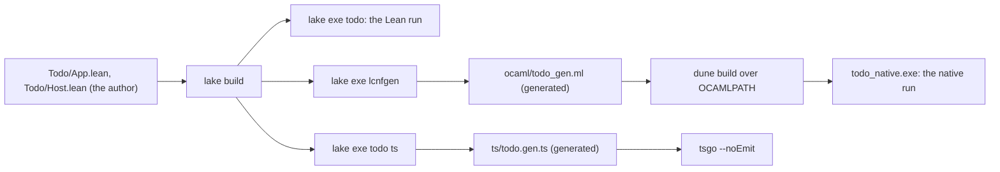

# The to-do as a user's project: findings

Status: findings, 2026-10-19. The project is `/Users/pooks/Dev/effect4-todo`, its own Git
repository at `1211bca`, written against the library at `afc14d86f` on `refactor/phase1-phase3`.
The plan is `plan.md` beside this note, and the receipt is `receipt.md`.

## 1. The one thing to know

The whole loop works from outside the library. The author wrote 336 lines of Lean. They became a
Lean run of eleven requests. They lowered to an OCaml file of 6,305 lines. It runs the same
script on the native kit with the same eleven answers byte for byte. They printed as 85 lines of
Effect TypeScript syntax that tsgo 7 accepts. Three frictions stand between a user and that loop.
The rows need a hand key before the module printed as TypeScript syntax binds them. The host is
four functions named by string spellings. The lowering command copies 37 type names from a
generated header, and lowered code cannot build text.

## 2. The file tour



Every file of the project, with who wrote it and what an author does with it.

| Path | Who wrote it | Lines | An author |
| --- | --- | --- | --- |
| `lakefile.toml` | the author | 19 | reads and edits it |
| `lean-toolchain` | the author, copied from the library | 1 | reads it |
| `lake-manifest.json` | Lake, at the first `lake build` | 73 | never opens it |
| `.gitignore` | the author | 3 | edits it |
| `README.md` | the author | 54 | reads and edits it |
| `Todo.lean` | the author | 3 | edits it |
| `Todo/App.lean` | the author | 77 | reads and edits it |
| `Todo/Host.lean` | the author | 202 | reads and edits it |
| `Todo/Print.lean` | the author | 39 | edits it |
| `Main.lean` | the author | 15 | edits it |
| `ocaml/dune-project` | the author | 3 | edits it |
| `ocaml/dune` | the author | 9 | edits it |
| `ocaml/todo_native.ml` | the author: a hand body over the kit | 30 | reads and edits it |
| `ocaml/todo_gen.ml` | `lcnfgen`, by the command on its second line | 6,305 | reads it at most, never edits it |
| `ocaml/closure-todo_gen.tsv` | `lcnfgen`, by the same command | 369 | never opens it |
| `ts/tsconfig.json` | the author, copied from the library's `ts/eff/tsconfig.json` | 15 | edits it |
| `ts/node_modules` | the author: a link to the library's `ts/eff/node_modules` | 0 | never opens it |
| `ts/todo.gen.ts` | the printer, by `lake exe todo ts` | 85 | reads it, never edits it |

The totals, from `wc -l` over the tree:

| Kind | Lines |
| --- | --- |
| Lean the author wrote | 336 |
| Generated | 6,832 |
| Hand lines outside Lean | 134 |
| All files | 7,302 |

The Lean is 4.6 percent of the project's lines. The generated OCaml is 86 percent.

### 2.1 The builds, measured

Each time is the wall clock of `/usr/bin/time -p` on this machine, with the library already
built in its own checkout.

| Step | Command | Time |
| --- | --- | --- |
| Seeding the packages | `cp -c -R <library>/.lake/packages .lake/packages` | 1.57 s for 552 MB |
| The first Lean build | `lake build` | 3.03 s; Lake wrote the manifest from scratch and rebuilt nothing of the library (216 of 219 jobs checked) |
| The first build that completed | `lake build` | 3.30 s |
| The executable | `lake build todo` | 3.75 s, 435 jobs, the objects restored |
| A clean rebuild of the project | `rm -rf .lake/build; lake build` | 0.48 s, the artifact cache restored 249 jobs |
| The Lean run | `lake exe todo` | 1.47 s through Lake; the binary alone 1.88 s wall, 0.02 s of CPU |
| The lowering | `lake exe lcnfgen …` | 2.07 s; the import of `Todo` 1,126 ms, the closure 237 ms |
| The dune build | `dune build ./todo_native.exe` | 1.23 s the first time, 1.03 s the second |
| The native run | `./_build/default/todo_native.exe` | 0.04 s |
| The TypeScript print | `lake exe todo ts …` | 0.42 s |
| The TypeScript check | `tsgo --noEmit -p tsconfig.json` | 0.16 s, exit 0 |

The first build failed on the author's own file (finding 7), so two numbers stand for it. Lake
rebuilt nothing in the library's checkout at any build.

### 2.2 Three excerpts

The authored Lean, `Todo/App.lean`: the four operations over the rows.

```lean
/-- `add(title)`: an empty title fails before the repository is asked. -/
def add (title : TermSrc) : Src NativeOp := eff do
  if Atom.eq title (str "") then
    EmptyTitle.raise (str "a title is required")
  else
    Repo.insert title

/-- `complete(id)`: the to-do marked done; a missing one fails with its id. -/
def complete (id : TermSrc) : Src NativeOp := eff do
  let updated ← Repo.setDone (Atom.pair id (bool true))
  selectOptionWith updated (NotFound.raise id) fun todo => succeed todo

/-- `remove(id)`: nothing on success; a missing to-do fails with its id. -/
def remove (id : TermSrc) : Src NativeOp := eff do
  let removed ← Repo.delete id
  if removed then succeed unit else NotFound.raise id
```

The lowered OCaml, `ocaml/todo_gen.ml`: the host's `insert` and the reactor that joins the four
methods. A Lean structure is an OCaml record, and `Reactor.first` is a list of closures.

```ocaml
let todo_host_insert (title : string) (s : store) : (item, sql_tag * string) result * store =
  match (s : store) with
    | { next = next; items = items; capacity = capacity } -> (let _x_1 = List.length items in
      let _x_2 = _x_1 < capacity in
      if _x_2 then (let _x_8 = false in
        let item = ({ id = next; title = title; done_ = _x_8 } : item) in
        let _x_9 = Ok item in
        let _x_10 = 1 in
        let _x_11 = next + _x_10 in
        let _x_12 = [] in
        let _x_13 = item :: _x_12 in
        let _x_14 = items @ _x_13 in
        let _x_15 = ({ next = _x_11; items = _x_14; capacity = capacity } : store) in
        _x_9, _x_15) else (let _x_3 = SqlTag_SqlError in
        let _x_4 = "disk full" in
        let _x_5 = _x_3, _x_4 in
        let _x_6 = Error _x_5 in
        _x_6, s))

let todo_host_repository (a_1 : Row.t) (a_2 : Val.t) (a_3 : store) : ((Val.t, Err.t, Defect.t, int, unit) Completion.t * store) option =
  let _x_4 = "Repo.insert" in
  let _x_5 = todo_host_insert in
  let _f_6 = todo_host_repository__lam_0 _x_4 _x_5 in
  …
  run_reactor_first _x_20 a_1 a_2 a_3
```

The printed TypeScript, `ts/todo.gen.ts`: the rows as one Effect service, and `add` as a method
of the application's service.

```ts
export const RepoKey = Context.Service<"Repo", { readonly insert: (a0: string) => Effect.Effect<{ readonly done: boolean; readonly id: number; readonly title: string }, readonly ["SqlError", string], never>; … }>(
  "Repo"
)

export const TodoApp_add = (a0: readonly [Context.Context<"Repo">, string]): Effect.Effect<{ readonly done: boolean; readonly id: number; readonly title: string }, readonly ["SqlError", string] | readonly ["EmptyTitle", "a title is required"], never> => Effect.suspend(
  () => Effect.provideContext(
    Effect.flatMap(
      Effect.succeed(snd(a0)),
      (a1) => ifCase(
        () => eq(a1, ""),
        () => Effect.fail(pair("EmptyTitle", "a title is required")),
        () => Repo.insert(a1)
      )
    ),
    fst(a0)
  )
)
```

## 3. The findings, ranked

Each finding gives what the author wrote or met, the evidence, and its owner in the
consolidation order (`docs/research/2026-10-20-coherence-audit/coherence.md` §9.1), or "new".

### 3.1 A project lowers its roots by copying a generated header, and re-lowers the library

What the author met. The lowering runs from the project: `lake exe lcnfgen` resolves the
library's executable, and `--import Todo` finds the project's modules. To share the program types
with the installed kit, the command needs `--open Eff_types --open-types …` with the 37 type names
the library's own artifact opens. No recipe states them for a project. The author copied them from
the second line of `ocaml/gen/closure_gen.ml`. The project's file then re-lowers every library
function its roots reach, because the kit's facade exports no function by name to a second
artifact.

The evidence. The command is the second line of `ocaml/todo_gen.ml`. The run printed:

```
imported #[Todo] in 1126 ms
closure: 367 of --cap 4000 (3633 of headroom); manifest ocaml/closure-todo_gen.tsv
Ml.checkModule: PASS (0 diagnostics)
```

The manifest's first column, counted by namespace: `List` 68, `Effect4.Program.Authoring` 53,
`Todo` 46, `Effect4.Store.Image` 46, `Effect4.Program.Ty` 31, `Effect4.Schema.Modeled` 21,
`Effect4.Machine.Value` 15. So 321 of the 367 nodes are the library's or Lean's. The machine and
the checker are not among them: the native main calls `Kit.check` and `Kit.run` of the installed
`effect4_kit`.

The owner: new. Item 3 (M3, one program codec, lowered) is the nearest. A project needs one recipe
datum, the facade's opened types, instead of a header to copy.

### 3.2 Lowered code builds no text

What the author met. The first lowering named `Todo.Host.line`, a function that renders a
request's result as a line of text with `s!` and `String.quote`. It failed.

The evidence:

```
uncaught exception: todos remaining in closure (fatal): #[String.Internal.isEmpty: extern,
String.Internal.foldl: extern, String.Internal.append: extern, String.push: extern,
UInt32.toNat: extern, UInt32.decEq: extern]
```

The route's builtins (`OCaml5.Lcnf.builtins`, `src/OCaml5/Lcnf/Builtins.lean`) have rows for
`String.append`, `String.decEq`, `String.length`, `String.toUTF8`, `String.ofList` and
`String.ofByteArray`. Lean 4.33 compiles `s!` and `String.quote` to `String.Internal.append`,
`String.Internal.foldl`, `String.push` and the `UInt32` operations, which have no rows. The
workaround is the library's own practice: a result is a value tree (`Todo.Host.resultVal`). Both
runs print it with the one JSON printer: `Store.ShapeDoc.printTree` at `Run.Kit.valShape`, then
`NatJson.render`; natively `Kit.Json.value_json` and `Kit.Json.render`. The eleven lines then
agree:

```
diff .work/run-lean.json .work/run-native.json && echo SAME
SAME
```

The owner: new. The builtins table trails the toolchain's internal names. Item 4 (M4, one type
spelling) touches the same table for `Nat`.

### 3.3 The rows need a hand key before the printed module binds them

What the author met. `eff_rows Repo error SqlError.ty …` without a key builds, runs and lowers.
Its printed TypeScript leaves `Repo` unbound.

The evidence. The first print, kept as `.work/todo.gen.nokey.ts` in the project, and tsgo:

```
todo.gen.ts(21,15): error TS2304: Cannot find name 'Repo'.
todo.gen.ts(29,31): error TS2304: Cannot find name 'Repo'.
todo.gen.ts(37,9): error TS2304: Cannot find name 'Repo'.
todo.gen.ts(38,28): error TS2345: Argument of type 'unknown' is not assignable to parameter of type 'Option<unknown>'.
todo.gen.ts(50,9): error TS2304: Cannot find name 'Repo'.
todo.gen.ts(51,30): error TS2322: Type 'unknown' is not assignable to type 'boolean'.
```

The fix is the library's own: `def repoKey : ServiceKey := ⟨⟨30⟩, ⟨6⟩⟩` and `key repoKey` in
the declaration. The name `30` must be free, and the code `6` is the built-in code whose carrier
is `unit`. A user learns both from `Test/Dogfood/Scenario/Todo/Data.lean`, not from the surface.
With the key the module declares `RepoKey` and `Repo` and tsgo exits 0.

The owner: item 9, the typed host interface from `eff_rows`, which names the README's hand keys.

### 3.4 The host is four functions named by string spellings

What the author met. A host over Lean types needs `import Effect4.Run.Method`, which
`Effect4.Run` does not re-export. The author then wrote `Item`, `SqlTag`, `SqlError`, four
functions and `Reactor.first [.fallible "Repo.insert" insert, …]`. The row spellings are strings
the compiler cannot check against `Repo.rows`; a misspelt one leaves the call waiting. The failure
type is a derived one-constructor enum paired with a string, which the author copied from the
library's test.

The evidence. `Todo/Host.lean`, its section "The store", 55 lines of which the four functions are
20. The spellings `"Repo.insert"`, `"Repo.all"`, `"Repo.setDone"`, `"Repo.delete"` appear in
`repository` and nowhere a tool reads.

The owner: item 9 (F3): the host record and its reactor, keys by name, from `eff_rows`.

### 3.5 A run's exit has no text

What the author met. `Exit` derives `DecidableEq` only. To print one, the author found
`Machine.exitImage` (`src/Effect4/Machine/Alphabets.lean`) and `Store.Val.render`
(`src/Effect4/Store/Carrier/Val.lean`). The text is positional:

```
add("") -> (Val.ctor 1 [(Val.ctor 0 [(Val.list [(Val.ctor 0 [(Val.ctor 2 [(Val.str "EmptyTitle"), (Val.str "a title is required")]), (Val.ctor 0 [(Val.list [])])])])])]) | next 2; 1 "milk"
```

The JSON form is the same tree with `_ctor` keys. `NatJson.render` answers `List Nat`, bytes, so
the author converts with `String.ofList` and `Char.ofNat`.

The owner: item 5 (M8, one observation and one check). What a run answers has one printer, and
no reading for a person.

### 3.6 Names an author finds only by reading the source

What the author met, each with its workaround:

- `Val` is not in scope under `open Effect4 Effect4.Program Effect4.Program.Authoring
  Effect4.Run`; it is `Effect4.Store.Val`, and `Machine.Val` is an abbreviation. The author added
  `open Effect4.Store (Val)`.
- The elaborated program without the checker is `Authoring.elaborateModule`
  (`src/Effect4/Program/Authoring.lean`), which `Api.Author.build` calls first. The author named
  it so that the lowered file holds no checker (finding 3.10).
- The application as one service is `Application.serviceModule`, under
  `Effect4.Program.Authoring.ApplicationService`, which `Effect4.Author` does not import.
- The module's text is `Tools.Code.moduleText` at `Tools.Code.Ts.width`, in the library's tools
  library (`tools/Tools/Code/Module.lean`), not in an entry module. The README names it.
- The value tree's JSON is `Store.ShapeDoc.printTree` at `Run.Kit.valShape`, under
  `Effect4.Run.Kit`, a module written for the lowering.

The evidence: the imports and opens of `Todo/Host.lean` and `Todo/Print.lean`.

The owner: item 10, the public-name manifest for Lean.

### 3.7 The declaration commands' surface

What the author met. A docstring before `eff_record` or `eff_failure` is refused, while
`eff_module` takes one. `eff_rows` demands `cite "…"`, and a user's own rows transcribe nothing.

The evidence, from the first build:

```
error: Todo/App.lean:18:57: unexpected token 'eff_record'; expected '#guard_msgs', 'abbrev', … 'eff_module', …
```

The syntax is `effRecordDecl`, `effFailureDecl` and `effRowsDecl` in
`src/Effect4/Program/Authoring/Declare.lean`. The author wrote line comments and the citation
`"the to-do's repository"`.

The owner: item 9 for `eff_rows`; the docstrings are new and small.

### 3.8 The TypeScript side is the library's harness, not a package

What the author met. The printed module imports the prelude by a relative path into the library,
`../../lean4-effect4/harness/truth/prelude.ts`. The host configuration is `ts/eff/tsconfig.json`,
copied by hand. The packages are a link to `ts/eff/node_modules`.

The evidence: the second import of `ts/todo.gen.ts`, and `ts/tsconfig.json` and `ts/node_modules`
in the tour.

The owner: new. A prelude package and a published host configuration have no item.

### 3.9 The OCaml packages come from the library's build directory

What the author met. The native side links `effect4_kit`. The author found the install layout in
`ocaml/engine/test/install/check_install.sh` and set
`OCAMLPATH=<library>/ocaml/_build/install/default/lib`. No workspace and no vendored link were
needed, and nothing was installed into the switch. The layout exists only after the library's own
`dune build`.

The evidence: the dune build of 1.23 s and the run, `README.md` of the project.

The owner: new. The install metadata plan (E1, `docs/research/2026-10-18-slices/README.md`) names
the packages; no item makes an outside project's path.

### 3.10 Lowering the build entry brings the checker

What the author met. `Api.Author.build` is the taught entry. Lowering it as a root lowers the
checker into the project's file.

The evidence, the measurement run into `.work/`:

```
closure: 1031 of --cap 4000 (2969 of headroom)
   17913 .work/todo_build_gen.ml
```

against 367 nodes and 6,305 lines without it. The project lowers the elaborated program instead
and checks natively with `Kit.check`.

The owner: item 5 (M8), the kit's commands as queries. The check is one function, and a project
should call the kit's, not carry a second.

## 4. What was clean

- The program. `eff_record`, `eff_failure`, `eff_rows` and `eff do` wrote the specification in
  77 lines, with `Application` holding the four entries with typed parameters. No `maxRecDepth`
  was needed, and no option at all.
- The build. `require effect4 from "../lean4-effect4"` and the seeded packages gave a first
  build of 3 seconds, and Lake rebuilt nothing of the library. A clean rebuild restored from the
  artifact cache in half a second.
- The run. `Api.Author.build` then `Run.runWith built repository store` ran each request, and
  every answer was the specification's on the first run.
- The lowering. One command from the project, 2 seconds, every check passing, and `lake exe`
  found the library's executable.
- The native side. The kit's face was enough: `Kit.app`, `Kit.check`, `Kit.run` and
  `Kit.Json`. The lowered reactor is a value of the kit's reactor type with no adapter. The
  eleven answers equalled Lean's on the first run.
- The print. One call wrote the service module, and tsgo accepted it once the key was there.

## 5. What this does not establish

- No OCaml-written repository ran: the native run's repository is the lowered Lean one. A host
  written to the lowered record is the library's lane, not this project's.
- The cost of requiring the library by Git at a pinned commit was not measured.
- The measurements are one run each on one machine with the library built; the lowering's
  import time is the first run's.
- Nothing here is a theorem. The agreement of the two runs is a finite probe of eleven requests.
