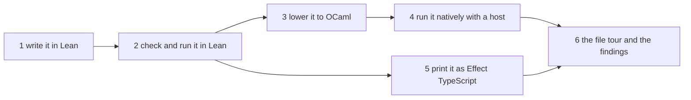

# The to-do as a user's project: plan

Status: plan, 2026-10-19, after decisions row 420. Base `2cef68e95`. The owner asked for three
things. Move the to-do out of the library. Import Effect4 and write the to-do as a user would, to
find the cleanest ways. Build its code lowered to OCaml through LCNF, to see what the resulting
project looks like.

## 1. The one thing to know

The to-do lives inside the library today, and so does its lowered code. No path exists yet for a
project outside the library to lower its own programs. Writing the to-do outside will find the
friction of the Lean surface, and the missing path to native code.

## 2. What exists

| Piece | Where | Size |
| --- | --- | --- |
| The Lean program: rows, failures, records, the four operations, the application | `Test/Dogfood/Scenario/Todo.lean` and `Test/Dogfood/Scenario/Todo/` | 1,362 lines in 11 files, most of it test scaffolding |
| The typed host, a hand copy of `eff_rows` (F3) | `Test/Dogfood/Scenario/Todo/Typed.lean` | 125 lines |
| The lowered to-do | `ocaml/engine/test/todo/todo_gen.ml`, a consumer of the library's one lowering run (`ocaml/gen/roots.json`) | 5 lines, over `Lanes_gen` |
| The native host, tests and bench | `ocaml/engine/test/todo/` | 1,152 lines |
| The TypeScript app on Bun over SQLite | `apps/todo/` | 510 lines |

The lowering is one whole-program run of `lake exe lcnfgen` (`src/OCaml5/Tools/LcnfGen.lean`). Its
recipe imports the to-do's `Test` modules beside the machine.

## 3. The project

- **Where:** `~/Dev/effect4-todo`, its own Git repository, outside this one.
- **Lean:** a Lake package that requires the library by path (`require effect4 from
  "../lean4-effect4"`). It imports only the taught entry, `Effect4.Author`, or `Effect4`. Requiring
  by Git at a pinned commit is measured once, as the cost an outside user pays.
- **The program:** written from scratch. The library's to-do is its specification only:
  - the repository's four rows;
  - the three failures;
  - the four operations;
  - the application.

  Nothing is copied from the test scaffolding.
- **OCaml:** a dune project in `effect4-todo/ocaml/`. It uses the library's OCaml packages through
  a dune workspace or a vendored link. It never installs or pins into the `effect4` opam switch,
  which the gates use.

## 4. The phases

1. **Write it in Lean,** as a user: `lake new`, the require, the import, `eff_rows`, `eff do`, the
   application.
2. **Check and run it in Lean** through `Effect4.Api`. Take the checker's verdict. Run it once
   with a host that answers the four rows.
3. **Lower it.** Give the project its own recipe naming its roots, and run the library's `lcnfgen`
   from the project. Record what comes out:
   - the whole machine again, or only the project's code over the library's packages;
   - its size in lines;
   - the OCaml support it needs.
4. **Run it natively.** Build one dune executable over an in-memory repository. Run a script of
   requests through it. Compare its answers with the Lean run of the same script.
5. **Print it as Effect TypeScript** with the library's printer (`Effect4.Emit`; the library's
   `apps/todo/EmitTodo.lean` shows one way). Check the module with tsgo 7.
6. **Tour the files, and write the findings.** The owner's aim is to see every file that one
   program written in Lean produces, to learn what the development experience is. The tour lists
   each file of the project:
   - who wrote it: the author, a generator (which one, by which command), or a seam's hand body;
   - its size in lines;
   - whether an author reads it, edits it, or never opens it.

   Then the findings: each friction, with its owner in the consolidation order
   (`docs/research/2026-10-20-coherence-audit/coherence.md` §9.1). Likely findings:
   - the hand keys and the typed host (item 9);
   - names that a user should not see (item 10);
   - error text that names an internal type, such as `Env` (item 9, since `eff_rows` makes the
     row functions);
   - the missing path to lower code outside the library (a new item).

## 5. What it does not do

- It does not delete the library's to-do. The gates read it: `check-ocaml`'s to-do lane and the
  host-lane fixture. Moving their reads to the outside project is a later ruling, made once the
  outside project covers them.
- It adds no authoring surface other than Lean (row 420).

## 6. Order

It runs now, before M1, and M1 was stopped before it edited anything (the owner, 2026-10-19). The
two are not related. M1 changes how a refusal is recorded, while the to-do's author meets Lean's
own errors and the checker's refusal, which already uses `Located`. The path require builds in this
checkout, so no other seat builds here while this one runs. Its findings may reorder
`coherence.md` §9.1.
