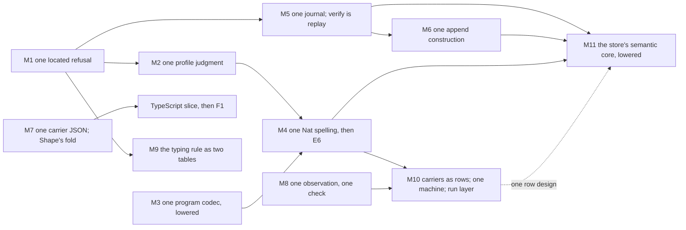

# The coherence audit: the synthesis

The synthesis of the three-agent audit that the owner asked for on 2026-10-19 (`plan.md` in this
folder). Head: `93090bfa0` on `refactor/phase1-phase3`.

- **Inputs.** `orientation.md`, `plan.md`, the two readings (`lean-core.md`, `compiler-estate.md`),
  the coherence principle (`docs/research/history/coherence-principle.md`), the system map §§4–6
  and §10, the repair wave's notes (`docs/research/2026-10-19-quality-review/`: `coherence.md`,
  `wave3.md`, `receipt-r1-store.md`, `codex-review/README.md`), and decisions rows 391 and 414 to 417.
- **Evidence.** This synthesis opened and read every declaration it names, at `93090bfa0`. It ran
  no build, no probe and no generator. Sizes come from `wc -l` and `grep` at the head, or from the
  readers' commands (`lean-core.md` §2, `compiler-estate.md` §6). The readers' traversal counts are
  a finite probe of the oleans built on 2026-10-17 and 2026-10-18.
- **Not covered.** The machine, the program proofs, `ts/`, `harness/`, `rocq/` and `tools/Conform`
  stay out, as `plan.md` §4 rules. `Program.Config` (`src/Effect4/Program/Config.lean`) was read at
  its header only: it models rc.112's provider as a host-side source, outside stored programs. It
  wants a reading before R13's load inputs land.

## 1. The one thing to know

Neither reading found a missing construction. Fifteen of the sixteen departures survive
refutation, eight of them amended. Each is a second spelling of a construction the tree already
owns. It was written at a join, where a later slice, a face or a target needed the owner and did
not reach it. Four misused patterns cover all fifteen:
- the monoid action, spelled again for each journal, each check and each log;
- a judgment, written again by each consumer that needs it;
- a carrier, chosen in OCaml instead of in Lean;
- a fact that several faces share, spelled once per face.

So the refactor adds no framework. Eleven moves each turn a spelling into an instance of its
owner, and the repair wave's open items land inside them. The owner rules five questions first
(§7). The log is the most urgent, because seat R1 holds three fixes for it.

## 2. The picture

How the core sits against the organizing principle today, across both readings. `lc-1` to `lc-9`
are `lean-core.md`'s departures `lean-core-1` to `lean-core-9`. `D1` to `D7` are
`compiler-estate.md`'s. The causes are §3's.

| Pattern | Holds today | Departs today | Cause |
| --- | --- | --- | --- |
| One free object per sort | `Eff` with `binders.json` and `LayerView`; `Ty`; `Store.Val` with one byte codec; `Representation`; `OCaml5.Ml.Syntax`; a sketch adds no sort | A carrier's JSON is printed and read over two trees, `Effect4.Json` and `Effect4.NatJson` (lc-4). A second value tree, `OCaml5.Eff.V`, makes the program goldens (D4) | D, C |
| K1 fold | The generated folds (`src/Effect4/Program/Fold.lean`, `src/Effect4/Schema/Fold.lean`, `src/Effect4/Store/Carrier/Fold.lean`, `src/OCaml5/Ml/Fold.lean`); the checker is one `Except` fold; `natLiterals` is a monoid fold | `Shape` has no fold group, so 23 hand traversals read it (lc-5). `Run.Tree.level` and `Run.Tree.statements` are absent from the census (lc-3). `Annotate.check` repeats the checker's arms (lc-2) | B |
| K2 exact embedding | `Canonical`'s three laws as fields; one re-encode guard (`src/Effect4/Data/Reencode.lean`); `ofSchema_exact`; `decode_iff`; `E4_node`'s ND1 and ND2 | Program bytes come from an emitted OCaml codec beside the lowered `Canonical.toVal` (D4). The store's codec is hand OCaml (D3) | C |
| K3 simulation | `run_eq_meaning`, `loopAgreement` and `run_eq_ref`, each on a named fragment; row 391 trusts the lowering and keeps the finite checks | One run is observed through four records (lc-8). `ofProgram_eq_denoteRowsB` is a pairwise goal (lc-3). The engine's differential compares hand renderings (D1) | D, B, C |
| K4, one located refusal per judgment | `TypeRefusal := Located (List Nat) TypeReason`; `JsonRefusal`; the generated `E4_admission`; the recipe refuses before it writes | Nine records re-spell `Located` (lc-7). `VerifyError` is a second alphabet for the node rule (lc-6). Profile support is decided by three Lean definitions and two OCaml walks, one refusing by an exception with no place (D6) | B, A |
| K5 monoid action | `Runner.step` is total and `replay_unique` holds; `Word.apply` is one replay for transfer, sync and closure; `E4_query` keeps INV-TAPE-1 | "A state reached by its journal" is written six times (lc-1). `Store.verify` is a walk beside `Word.apply` (lc-6). Two durable logs keep one all-or-none promise (D7) | A |
| The five constructions | 1: `Ty` with its shared rules. 2: the certificate ladder makes `Run.open` total. 3: the OCaml machine is `RunMachine` lowered. 4: row protocols and native providers are data. 5: the boundary's exact embeddings | The run layer is transcribed around the engine (D2). The boundary's byte codecs are built twice (D3, D4) | C |
| Tables as data; generation a fixed point | `tool_requests`; the row, atom and hole tables; `OCaml5.Lcnf.builtins` and `OCaml5.Lcnf.typeRows` with contracts; `ocaml/gen/roots.json` as a checked recipe | `ocaml/engine/externs.txt` is a second table, with no contract (D1). Three emitters spell `Nat` in OCaml (D5) | C, D |
| One owner per fact | One method key; one action interpreter, `Internal.action`; one text grammar, `NatJson.parse`; naming in `OCaml5.Lcnf.Naming`; carrier JSON (row 416 (4)) | The prelude transcribes 35 Lean definitions (D1). `E4_host` transcribes `Effect4.Run.driveFrom` (D2). `E4_cas` transcribes `Store.checkAll` and `Word.apply` (D3) | C |
| The host boundary | Hosts as data: tapes, rows, `hostProtocol`; `E4_sched`'s memory rule; a provider's exception is no answer (row 408 (1)) | Host code decides semantics: the numeric profile, the drive after a refused reply, and the stop past a stuck step (`E4_host` H11). `E4_abandon` fixes a policy that R11 leaves open (D2) | C, B |
| Deep modules | `Tool.serve`; a total `Run.open`; `Wire.serveEnvelope`; `E4_disk`'s one checked open; `Kit.run` as one call | A program is checked through several entries until row 414 (3)'s one query lands. The engine is assembled from four modules (D1). `E4_cas` holds semantics and host steps together (D3) | B, C |

The two readings meet at four joins. Each is one fact with a Lean spelling and an OCaml spelling:
- **The store's verification.** Lean's `Store.verify` checks each edge against the whole store, so
  it admits a forward reference. `E4_cas.checked_image` admits in write order and refuses it. R1
  proposes a row to record the difference (lc-6, D3).
- **Profile support.** `CodecProfile.carries`, `natLiteralsInProfile` and `ProfileData.admitsNat`
  in Lean, and `E4_engine.check_answer` and `E4_clock` in OCaml, decide one judgment. Its bound
  has three owners: `NatJson.limit`, `ProfileData.natBound` and OCaml's integer range (D6).
- **A program's JSON.** Three spellings: face 7's `V` arrays, `Canonical.print` with `cons` cells,
  and `ShapeDoc.printTree` with arrays. Row 417 (4) names `Canonical.print` (lc-4, D4).
- **The run layer.** Four Lean observation records, and in OCaml the answer alphabet,
  `Kit_machine.stop` and `E4_host`'s stops (lc-8, D2).

## 3. The root causes

### 3.1 The verdicts

Each departure was tested against the brief's five refutations. Does it argue from consumer
counts? Does it merge two constructs that serve different observations? Is its move a framework?
Does it contradict a ruling it does not name? Do its declarations exist and do what it says?

| Id | Verdict | The decisive reason |
| --- | --- | --- |
| lc-1 | kept | The six copies stand: `Tool.State.replayed`, `Doc.replayedState`, `Exchange.load`, the run (`Run.play`, `Runner.replay`, `Live.opened`), `CasOf.reached` and `FillSet.constructed`. Each has its own append law. Row 414 (6) approves the move as slice A7 |
| lc-2 | amended | `Node.childEnv` calls `effTy` for each extension; `Annotate` repeats seven checker functions. The move is staged, so the checker changes only where its proofs follow (§6) |
| lc-3 | amended | `level` and `statements` are hand traversals that the census does not name. The host's "four spellings" are three observations and one adapter: that half is rejected (§6) |
| lc-4 | amended | Two printers and two readers stand. Only the minimal step is kept; the list spelling goes to the owner (§6, §7) |
| lc-5 | kept | `tools/Effect4Gen/manifest.json` has no `Shape` group. Four hand mutual triples sit in `src/Effect4/Tool/Methods.lean`. `FieldType` restates the generated `shape Command` |
| lc-6 | kept | `VerifyError` repeats six of `Admission`'s arms. `Word.wf` already defines "children first, digests exact". The move ends the difference R1 found |
| lc-7 | kept | The nine records stand. `Located.under` is stated only at `List Nat` sites, which is why `DocumentRefusal.under` exists |
| lc-8 | kept | `Run.observe`, `Run.work`, `Run.view` and `machineViewOf` each read the machine on their own |
| lc-9 | rejected | Both derivation mechanisms meet the one obligation of generation, a fixed point. The move adds a syntax emitter and changes no observation (§6) |
| D1 | amended | The extern seam, the prelude and `module Fast = Make (Api_engine_inst)` stand. Row 416 (9) conditions the differential's deletion (§6) |
| D2 | amended | `E4_host`'s H11 names three places where it departs from `driveFrom`. The move splits, and two semantic questions go to the owner (§6, §7) |
| D3 | amended | The transcription stands. Lean's side moves first, the finite lowering checks stay (row 391 (1)), and a measurement gates the byte row (§6) |
| D4 | amended | The emitted codec stands beside lowered `programToVal`. `V` stays as face 7's fixture until the TypeScript slice (rows 416 (6), 417 (4)) |
| D5 | amended | Three spellings of `Nat` stand. `OTy` is also read by `tools/Drivers/TsGen.lean`, so it stays as a projection (§6) |
| D6 | kept, widened | The OCaml walks stand, and Lean has three definitions of its own. Row 108 asks for "the refusal written once in Lean with the bound as data" |
| D7 | kept; the owner rules | `E4_wal` has no user outside `ocaml/engine/cas`, which is not the argument. The move contradicts row 417 (2), named (§7) |

### 3.2 Cause A: the monoid action, spelled again

A state that its journal reaches is one construction, K5. Slices that needed it wrote it again: a
replay with its own proof field, a verification as its own walk, a log with its own commit.

**Design rule A.** A state that a journal reaches is the action of the one journal construction.
Its check is a replay of its journal, and its durable form is one commit through the one published
boundary. A second replay, walk or log is a new representation: it names the observation the
action cannot give, and that need is measured.

Covers lc-1, lc-6 and D7. It also places R1's O1 and O2: where a replay of the pack reaches the
published end is the boundary's own fact, so `E4_pack` owns it.

### 3.3 Cause B: a judgment, written again by each consumer

The checker is one fold, and `Located` is one refusal. But the annotation, the focus, the store's
restore, the profile check and each description reader re-spelled a rule instead of evaluating it.
A sort with no fold group forces this: every reader of `Shape` writes its own recursion.

**Design rule B.** A judgment is one algebra over its sort's generated fold, and it refuses as
`Located Site Reason`. A consumer at another place, time or face evaluates that algebra, or calls
it lowered. It never re-spells an arm. A sort gets its fold group before its second traversal.

Covers lc-2, lc-3 (its half on the budgeted meaning), lc-5, lc-7 and D6's judgment half.

### 3.4 Cause C: a carrier chosen in OCaml

The machine's stores needed persistent maps, and the store and the codec needed byte strings.
Each representation was chosen in OCaml, so every Lean definition over it was transcribed there.
Each copy then needed a test family in place of agreement. Two copies now decide cases that Lean
decides otherwise: the drive after a refused reply, and a forward reference in the store.

Here a row is a row of the compiler's tables: a type row (`OCaml5.Lcnf.typeRows`) or a builtin
row (`OCaml5.Lcnf.builtins`), each with a contract and a receipt.

**Design rule C.** A representation is chosen in Lean, as a type row: a Lean type whose OCaml
spelling and operations are rows with contracts. Lean defines each behaviour over it once, and
OCaml runs that definition lowered. Hand OCaml is host code or a row's implementation, nothing
else.

Covers D1, D2, D3 and D4. It restates rows 416 (1) and 391 (3) P9 (b) as a rule for building.
F1 (Codex's B1.1, the generated authoring and host faces) is the same rule.

### 3.5 Cause D: a shared fact, spelled once per face

A type's OCaml spelling, a carrier's JSON, a run's observation and a number's domain are each read
by several faces. Each face or emitter wrote its own copy, so the copies drifted apart: three
spellings of `Nat`, two JSON trees, four observation records, numbers handled type by type.

**Design rule D.** A fact that several faces read has one owner, a table row or one definition.
Each face reads it as a projection. An emitter writes target text only through the target's
syntax and its fold.

Covers lc-4, lc-8, D5 and D6's number half.

### 3.6 Small instances, not ranked

- A reply pairs with its request by casework (`Wire.actionPairs`, `Wire.queryPairs`,
  `src/Effect4/Tool/Wire.lean`), not by the method key: cause D.
- `Exchange.Port` (`src/Effect4/Tool/Exchange.lean`) is a class with one instance.
- `E4_be` forwards to `Eff_frame`. It goes with M3.
- `src/Effect4/Run/Kit.lean`'s docstring cites `Kit_json`, which row 416 (4) deleted. The first
  move that edits the file fixes it.
- `NatJson.limit` (read as `CodecProfile.natLimit`) and `rc112.natBound` name one bound twice.
  M2 gives it one owner.

## 4. The refactor

Eleven moves. Each says what collapses into what, which construction it instantiates, what it
deletes, what it keeps, and what it makes smaller. The diagram's edges are those "makes smaller"
links. Moves with no edge between them are independent; how many run at once is the
coordinator's choice, and row 417 (5) runs the repair wave one seat at a time. The repair wave's
own order stays: R2's and R3's host items land as briefed, and E6 follows them inside M4.

### M1. One located refusal (lc-7) — size S

- **Collapses.** Nine records into `Located Site Reason` (`src/Effect4/Data/Located.lean`):
  `Program.Authoring.Refusal` (`src/Effect4/Program/Authoring.lean`); `DocumentRefusal` with
  `DocumentRefusal.under` (`src/Effect4/Schema/Document.lean`); `FormationRefusal`
  (`src/Effect4/Program/Formation.lean`), whose type moves into its reason; the six record, tuple
  and fold refusals and the paths in `TermTypingRefusal`'s arms
  (`src/Effect4/Program/Typing/TermRefusal.lean`).
- **Instance of.** K4's one refusal construction, rows 414 (2) and 415 (1).
- **Deletes.** Nine structures and a second prefix rule. `Located.under` is stated once, for any
  list site. The codecs regenerate; wire shapes change freely until release (row 414 (1)).
- **Keeps.** Each judgment's reason alphabet, and its law that a refusal is absent exactly when
  the judgment holds. No generic judgment record (row 414 (2)).
- **Makes smaller.** M2, M5 and M9 refuse in `Located` from their start.

### M2. One profile-support judgment (D6, its judgment half) — size S to M

- **Collapses.** Five definitions into one Lean judgment. In Lean: `CodecProfile.carries`
  (`src/Effect4/Tool/CodecProfile.lean`) and `natLiteralsInProfile`
  (`src/Effect4/Codegen/Checked.lean`); `ProfileData.admitsNat` (`src/Effect4/Program/Profile.lean`)
  becomes its leaf. In OCaml: `E4_engine.check_answer` (`ocaml/engine/e4_engine.ml`), and
  `E4_engine.Make.compile`'s literal check through the emitted `Eff_ctors.lits_eff`.
- **The one judgment.** An algebra over `Store.Val` (`cata_val`) beside the literal fold
  `natLiterals`. Its bound comes from `ProfileData`, its one owner. It refuses `Located` at the
  value's path. It is lowered through `ocaml/gen/roots.json`, and the engine and the kit call it
  at ingress, as they call reply admission.
- **Instance of.** Profile support, one of the seven judgments, as a fold with a located refusal.
  Row 108: "the refusal written once in Lean with the bound as data".
- **Deletes.** `check_answer` (52 lines); the literal check's emitted walk; `E4_clock`'s exception
  at the reply and literal crossings; H11 (a), "the host numeric profile exists only in OCaml".
- **Keeps.** The bound as the ingress rule (DI-56, row 417 (1)). The arithmetic crossing in the
  builtin rows until M4. A refusal kept outside the program's result (row 108's side audit).
- **The wave.** Reshapes R2's A1.1: the kit calls the lowered judgment before either run route.
  The red control, `codex-review/probes/a1.ml` on the tape and native routes, is unchanged. If R2
  lands first through `check_answer`, M2 replaces that call.
- **Makes smaller.** M4, since no hand profile check is left for E6 to edit; M10, since H11 (a)
  is gone.

### M3. One program codec, lowered (D4, amended) — size M

- **Collapses.** `OCaml5.Eff.wireModule` (`src/OCaml5/Eff/Emit.lean`) and its output
  `ocaml/eff/eff_wire.ml` (1,267 generated lines) into the lowered `Effect4.Run.Kit.programToVal`
  and `programOfVal` (`src/Effect4/Run/Kit.lean`), composed with the one framing kernel,
  `Eff_frame` and `Eff_val`.
- **Instance of.** K2 lowered: "generated, never transcribed" (rows 411 (2), 416 (1)).
- **Deletes.** The emitter; `eff_wire.ml`; `OCaml5.Eff.V.bytes`; the 89 `.bin` goldens of
  `ocaml/eff/goldens` and their comparisons in `test_eff`, `test_lean_wire` and `prop_wire`;
  `E4_be` as a forwarding face.
- **Adds.** A call at each `Eff_wire` call site: the engine, the host, the kit, `E4_subterm` and
  their tests.
- **Keeps.** `V` and `V.json` as face 7's fixture format until the TypeScript slice (rows 416 (6),
  417 (4)). The 11 Lean-made goldens of `ocaml/goldens/eff`, as the lowering's finite check (row
  391 (1)). The `.ty` goldens, which are the checker's output. `Eff_subterm` while `E4_subterm`
  reads byte ranges.
- **Condition.** If a measurement shows the extra `Val` tree costs at engine load or store put,
  emit a fused encoder. It is emitted from the description that derives Lean's instance, never
  from a second reading of the environment.
- **Makes smaller.** M4, since one fewer emitter spells `Nat`; M11, since the byte kernel is
  already one.

### M4. One type spelling, then exact numbers (D5 amended; D6's number half; E6) — size M

- **First, one spelling.** `OCaml5.Lcnf.typeRows` owns every OCaml spelling. EffGen's `OTy.ml`
  (`src/OCaml5/Eff/Emit.lean`) and `OCaml5.Store.Facts`'s `nativeType` read
  `OCaml5.Lcnf.builtinTy?`. `OCaml5.Store.Facts` emits `Ml.Syntax`, so `Ml.checkModule` reads it.
  The rowed bodies of `Lcnf_nat` and `Lcnf_list` are rendered from `OCaml5.Lcnf.support`.
  `OCaml5.Lcnf.Gallina.refused` becomes a value that names the declaration and the constant.
- **Then E6** (row 417 (1)). One row flips `Nat` and `Int` to `Z.t`, and `UInt64` gets an exact
  carrier. The clock becomes an ordinary natural.
- **Instance of.** Tables as data, one owner per target (cause D).
- **Deletes.** `OCaml5.Lcnf.ClockFlow` (605 lines); `OCaml5.Lcnf.Clock` and the clock rows; the
  dual fidelity and receipt columns; the saturating `Lcnf_nat` bodies;
  `Test/Audit/ClockLowering.lean` (122 lines); the `(* REFUSED *)` scan.
- **Keeps.** `OTy` as the closed-world projection that `tools/Drivers/TsGen.lean` also reads.
  Gallina's own Rocq spelling. The index crossing while `USize` is the target's integer.
- **Measure.** By allocated words, since slice 2.2b part 1 found CPU time noisy.
- **The wave.** E6 becomes one row and deletions, after M2 and M3. Seat 2.2b's "cannot land in
  parts" ends, because one table spells `Nat`. The native profile's bound is owner decision 3.
- **Makes smaller.** M10 and M11: their rows carry no numeric domain column.

### M5. One journal construction, and the store as the replay of its word (lc-1, lc-6) — size M

- **Collapses.** Six spellings into `Replayed step init`: actions, state, and
  `replayed : foldM step init actions = .ok state`, with two laws. An accepted step appends; a
  refused step changes nothing (slice A7). The spellings are `Tool.State`
  (`src/Effect4/Tool/Replay.lean`); `Doc` (`src/Effect4/Program/Typing/SourceDocument.lean`);
  `Exchange.load` (`src/Effect4/Tool/Exchange.lean`); the run, `Run.play`, `Runner.replay` and
  `Live.opened` (`src/Effect4/Run/Basic.lean`, `src/Effect4/Api/Runner.lean`,
  `src/Effect4/Run/Live.lean`); and `CasOf.reached` and `FillSet.constructed`. The last three are
  reachability forms: the construction's image, with the journal hidden.
- **The store.** `Store.verify` (`src/Effect4/Store/Domain/Word.lean`) becomes `Word.wf`, then
  `Word.apply` from the empty store, then the roots. It refuses `Located Digest Admission`, and
  undecodable bytes map in through `Admission.ofRead`.
- **Instance of.** K5, the monoid action, and its two laws.
- **Deletes.** Six proof fields, the per-copy replay functions, and about eight append laws
  (`play_append`, three `replay_append`, `replayCursor_snoc`, and others). `VerifyError`,
  `verifyEdges`, `Store.verifyNode`, `verifyNodes`, `Store.verifyResult` and their laws: most of a
  208-line section, with one of J3's copies of `except_bind_ok`.
- **Keeps.** Two adapters: the tool's partial step and the runner's total step. Codex's amendment:
  the run's phases, the checked traces, the exchange's `after` checks, the chain's validation and
  the undo ledger. `HostSession.Session` stays outside. The journal stays `List Command` (row 326
  (4)). `verify_sound`, proved from `wf_apply`; `digestMismatch` and `rootUnresolved`.
- **Observation that changes.** Lean's restore refuses a forward reference as `dangling`, as
  `E4_cas.checked_image` already does. `OCaml5.Lcnf.Gallina.storeSpec` regenerates the Rocq.
- **The wave.** Subsumes R1's proposed row on the forward-reference difference: the row records
  instead that verification is the replay (§7, E-1). Subsumes O4's G7 item: both judgments then
  give one verdict. It precedes any repair of the planned goal `Doc.revert_program` (Codex §C3,
  order 6).
- **Makes smaller.** M6, since a durable journal is this construction's commit; M11, since one
  verification is lowered, and it already agrees with OCaml.

### M6. One append construction for durability (D7) — size M, a deletion

This move waits for owner decision 1. Under shape (b):
- **Collapses.** `E4_wal` (`ocaml/engine/cas/e4_wal.ml` and `.mli`, 965 lines) and
  `E4_checkpoint.ephemeral` into the pack. A durable journal's rows are nodes committed in one
  `E4_disk` transaction. The control file's published boundary makes the commit all or none,
  `checked_image` checks it at open, and Lean's codec owns the rows' bytes.
- **Instance of.** K5's durable form: one construction per promise.
- **Deletes.** About 1,700 lines with the log's tests and bench (771 lines).
- **Keeps.** LG3 as a promise, now kept by construction. A second log returns only under a
  measured journal rate, and it then takes its promise from a published boundary.
- **Adds.** One bench cell: a multi-node transaction in `bench_commit`, which R1 notes is untried.
- **The wave.** O3 and the held fixes A3.2, A3.4 and A5.1 close by deletion, with the two log
  defects R1 found (`E4_wal.fsync_dir`, `E4_wal.segment_files`). Under shape (a), they land as
  `wave3.md` §4 items 4 and 5 brief them.
- **Makes smaller.** M11: one fewer store module to split by role.

### M7. One carrier JSON, then a fold for `Shape` (lc-4 amended, lc-5) — size M

- **First, one tree.** `Canonical.print` becomes the binary64 reading of `ShapeDoc.printTree`, as
  `Canonical.printArrays` already is. This follows owner decision 2. The located reader's
  exactness is stated on `NatJson`, modulo `ShapeDoc.order`.
- **It deletes.** `printIn` and its list siblings (`src/Effect4/Store/Domain/Shape.lean`);
  `readIn` and its siblings, `ShapeDoc.read` and `natOfBinary64`
  (`src/Effect4/Store/Domain/ShapeRead.lean`); `Canonical.ofJson` and `Canonical.ofJsonAnyOrder`;
  `Agrees`, `AgreesList`, `AgreesEntries` and their part of
  `src/Effect4/Laws/Store/ShapeRead.lean` (1,448 lines); the `NatJson.ofBinary64` and
  `toBinary64` families; `Wire.serveJson`, which only a battery calls.
- **It rewrites once.** `orderIn` and `ShapeDoc.order`, from the binary64 tree to `NatJson`.
- **Then, a fold.** One fold group for `Shape` in `tools/Effect4Gen/manifest.json`, as
  `SchemaFold` is for `Representation`. The hand triples of `src/Effect4/Tool/Methods.lean`
  (`schemaIn`, `namesIn`, `under`, `nested`: 144 lines), `CodecProfile.supported`, `Shape.render`,
  `Shape.wellTagged` and `render` (`src/Effect4/Schema/OfShape.lean`) become algebras. The JSON
  readers recurse on their input, so they stay well-founded, and the census names them.
- **Then the TypeScript slice** (row 417 (4)). `ts/eff` reads and writes the canonical tagged
  spelling. `OCaml5.Eff.V`, its 30 conversions and `V.json` retire. `HostProtocol.records`, with
  `FieldType` and `RecordShape` (`src/Effect4/Api/HostProtocol.lean`), becomes the image of
  `shape Command`. F1 follows it.
- **Instance of.** One free object for a carrier's JSON; K2 stated once; K1 for the description
  sort.
- **Keeps.** `Effect4.Json` and `Float64` where rc.112 compares numbers by value (the Schema
  payloads, `numberJson` in `src/Effect4/Schema/Codec.lean`). The two normalisers, `normJ` and
  `ShapeDoc.order`, which serve two codecs. `codec-profile-retains-value`, restated on the
  profile's tree. `unseenDefs`, the reader's measure.
- **Not now.** One JSON tree whose number leaf is the numeral as written. It needs an exact
  binary64 printer in Lean, and no observation asks for it (E-5).
- **The wave.** Answers row 417 (4) through owner decision 2. J3 and J4 land as briefed, before
  this move: the two `except_*` copies in the law file serve the kept exactness proof, and
  `unseenDefs` stays.
- **Makes smaller.** The TypeScript slice and F1: one spelling to read and to generate.

### M8. One observation, one check, the kit's commands as queries (lc-8, lc-3 amended, D2's query half) — size M

- **One observation.** `Run.view` (`src/Effect4/Run/View.lean`) reads each machine field once.
  `Run.observe`, `Run.work` (`src/Effect4/Run/Basic.lean`) and `machineViewOf`
  (`src/Effect4/Run/Tape.lean`) become projections of `View`, or go where no law or wire reads
  them.
- **The budgeted meaning's traversals named.** `Run.Tree.level` and `Run.Tree.statements`
  (`src/Effect4/Run/Tree.lean`) gain their `fold_of` connectors and enter the census. The planned
  goal `ofProgram_eq_denoteRowsB` (`src/Effect4/Laws/Run/Tree.lean`) is then an agreement of
  algebras on `Plain`, through `ofRows`, not a pairwise induction.
- **One check.** One `checkProgram` query answers formation, typing and admission, each refusal
  located (row 414 (3)). The other entries, `Api.check`, `Api.explain`, `Run.Kit.check`,
  `Run.Kit.admit` and `Run.Preview.admit`, become projections of its answer, or the certificate
  it is computed from.
- **The kit's commands as queries** (slice A6). `check`, `run` and `explore` become Tool queries.
  `Kit_serve` keeps parsing, framing, input and output, and its `.mli` names only those.
- **Instance of.** K3's one named observation with projections; K1 connectors; a deep module.
- **Deletes.** Three machine readers and their repeated field expressions; `Kit_serve`'s request
  execution, part of its 204 lines; the second paths of the check entries.
- **Keeps.** `MachineView`, as the projection a raw replay can show. `Observation`'s generated
  codec where a wire reads it. `Run.Tree` stays structural, so the LCNF route and the Rocq lane
  take it unchanged (rows 182, 411). `HostSpec`, `Run.Reactor` and `Run.Tree.Host`, the reactor's
  image under `Host.ofReactor`.
- **The wave.** Reshapes R2's A7.1: the `.mli` lands with A6 and names the serving boundary only.
- **Makes smaller.** M10: the OCaml shell lowers one observation and one query face.

### M9. The typing rule as two tables (lc-2, staged) — size L

- **Stage 1.** `Node.childEnv` (`src/Effect4/Program/Typing/Focus.lean`) takes the earlier
  siblings' answers as an argument, instead of calling `effTy`. That is the inherited table. The
  focus reads it along a path. `Annotate.check` and its six siblings
  (`src/Effect4/Program/Typing/Annotate.lean`) become one evaluator of the inherited table and the
  checker's combinations.
- **Stage 2.** `Checker.check` (`src/Effect4/Program/Checker.lean`) reads the same table only
  where each arm's proofs follow by unfolding. Elsewhere one lemma per arm states that the
  checker's environment is the table's.
- **Stage 3.** The view tools (`tools/Tools/View/`) move to `SourceSession`. Then `EditSession`
  (`src/Effect4/Program/Edit.lean`) goes, and its splice law stays as a lemma of the table.
- **Instance of.** K1, one algebra per judgment, read as an attribute grammar. The tree already
  cites Reps, Teitelbaum and Demers (`Table.splice`, `src/Effect4/Program/Typing/Splice.lean`).
- **Deletes.** Most of `Annotate.lean` (499 lines) and of `annotate_eq_table`'s mutual induction
  (724 lines at `maxHeartbeats 400000`); `childEnv`'s recomputing calls; after stage 3,
  `EditSession` and its 564-line law file.
- **Keeps.** `table` and `refusals_nil_iff`, R14's specification; `table_splice`; row 373 (7)'s
  address map; the feed policies; the "not reached" marking, an observation distinct from the
  checker's short cut.
- **Observation that changes.** The view tools edit a program as written, as agents do (row 373).
- **Unlocks.** Total marking (row 414 (6)) as a third evaluator of the same tables, not a fourth
  spelling of the rule. It is independent of the estate's track.

### M10. Carriers as rows, one machine, then the run layer over it (D1, D2 amended) — size L

- **A design note first** (row 391 (3) P9 (b)). Each store of the machine is a Lean definition
  over P9 (b)'s six interfaces. An operation that must be native is a type row and operation rows
  with contracts, as `Array` to `Lcnf_array` is. The machine is one definition, lowered once.
- **Deletes.** `ocaml/engine/externs.txt` (51 rows) and most of `OCaml5.Lcnf.Externs` (576
  lines); `ocaml/engine/tools/api_engine_prelude.ml` (573 lines, 35 transcriptions);
  `ocaml/engine/api_engine.ml` (15,928 generated lines) as a second machine; `E4_instance`,
  `Api_engine_inst` and `Api_gen_inst`; `E4_engine.Make`'s 20 `show_` renderers and `E4_diff`;
  the `profile` part of `OCaml5.Lcnf.Identity`.
- **Condition.** The whole-machine differential goes only when the frozen carrier mutant campaign
  is caught by the rows' own controls (row 416 (9)).
- **Then the run layer** (row 391 (2)). `Effect4.Run` and the session are lowered over the one
  machine, and Lean's stop alphabets become the OCaml types. This deletes `E4_host`'s drive and
  stop alphabet (`ocaml/engine/e4_host.ml`, `.mli`), `E4_engine.Make`'s loop and `answer`
  alphabet, `Kit_machine`, and `Kit.run`'s hand choice "as `Run.atBudget` does".
- **Instance of.** Data refinement, as a row; construction 3 lowered once.
- **Keeps.** Lane G2's measured need: the Lean carriers get persistent-vector and persistent-map
  costs. Each carrier as its row's implementation, with its property test as the row's control.
  `E4_sched` as host code (P6 (a)). The provider adapters and row 408 (1)'s exception policy. The
  list machine as the proof model. `E4_abandon`, until owner decision 5.
- **Guard.** No machine re-parameterized over carriers, and no storage framework. P9 (b)'s six
  interfaces are the ceiling, each with only the law its consumer reads.
- **The wave.** None directly. After owner decision 4, H11 (b) and (c) are one rule, written in
  Lean and lowered.

### M11. The store's semantic core, lowered (D3 amended) — size L

- **After** M5, so Lean's verification agrees with the checked image, and M4, so naturals are
  exact.
- **Collapses.** The store's semantic core in `E4_cas` into lowered Lean: `Store.putNode`,
  `Store.checkAll`, `Word.apply`, `Store.verify`, `Node.encode` and `Node.decode`. `E4_cas` calls
  them as the kit calls the checker, and `E4_admission` comes from the same lowering.
- **The byte sort.** If a row is needed, a Lean byte type is spelled by OCaml `string` or `Bytes`,
  with its operations and `sha256` as rows. It enters at the lowered entry points with one
  round-trip theorem, not through every store law.
- **Measure first.** A one-node `E4_disk` commit costs 0.27 ms (R1, O3). If a list-based lowered
  `put` adds little to it, lower over lists, and the byte row is not needed.
- **Deletes.** `E4_cas`'s semantic sections, about 700 of 1,613 lines; `E4_node`'s codec (541
  lines with its interface); `E4_shape`'s transcribed table (974 lines); `OCaml5.Tools.CasGoldens`'
  11 tool-side images; `OCaml5.Store.Facts` as a third route from Lean to OCaml.
- **Keeps.** `E4_pack`, `E4_control`, `E4_lock`, `E4_file`, `E4_index`, `E4_chunk`, and
  `E4_disk`'s failure rule. O1 and O2's rule in `E4_pack`. A finite check of the lowering on the
  goldens (row 391 (1)).
- **Instance of.** Cause C's rule, and construction 5: the boundary is Lean's codec, lowered.

### 4.12 The repair wave, item by item

| Item | What it is | Move | Effect |
| --- | --- | --- | --- |
| R1 O1 | A partial index saved as covering the published end | none | Leaves: R1's option (a); `E4_pack` owns where a scan reaches the published end (E-2) |
| R1 O2 | An empty segment's head published as the end | none | Leaves: the same rule closes it |
| R1 O3 | The log's three fixes, held | M6 | Subsumes under shape (b); under (a) they land as briefed |
| R1 O4 (1) | `E4_cas.open_rw`'s own exception map | none | Leaves: `E4_cas` owns `fault_of_exn`, and `E4_disk` calls it |
| R1 O4 (2) | Three ignored `Sys.remove` failures in the pack | none | Leaves: host code |
| R1 O4 (3) | G7's two result rows assert only that both refuse | M5 | Subsumes: both judgments give `dangling` |
| R1 O4 (4) | `writer_source.read` allocates before its check | none | Leaves: every caller is bounded by `record_span` |
| R1, proposed row 2 | The checked image differs from `Store.verify` | M5 | Subsumes: the difference ends (E-1) |
| R2 A1.1 | The kit admits a reply outside the profile | M2 | Reshapes: the kit calls the lowered Lean judgment |
| R2 A4.1 | A send accepted after shutdown | none | Leaves: host code, `E4_quiescence` |
| R2 A5.2 | A negative CLI number | none | Leaves: `eff`'s one argument parser |
| R2 A7.1 | `kit_serve.mli` | M8 | Reshapes: it lands with A6, naming the serving boundary only |
| R2 A9.1 | Two literal count checks | none | Leaves |
| R3 B5.1 | The lanes interface's unreachable types | none | Leaves: packaging |
| R3 J3 | Five copies of two `Except` facts | M5 | Leaves; M5 deletes one copy with the old verification |
| R3 J4 | One keyed-list measure | none | Leaves; `unseenDefs` stays after M7 |
| E6 | `Nat` and `Int` as `Z.t` | M4 | Reshapes: after M2 and M3 it is one row and deletions |
| The log question | `coherence.md` §5 | M6 | Owner decision 1 |
| Row 417 (4) | The public JSON spelling | M7 | Owner decision 2 settles which list spelling the name means |

### 4.13 The plan against the orientation's §10

Every move removes more hand-written code, and more spellings, than it adds. M7's fold group adds
generated lines; the observation that justifies it is that a new `Shape` constructor becomes a
compile error in every reader. Where a move changes an observation, the row says which.

| Move | Sort; arrow kind | Owner after | Adds | Removes | Observation that changes | A designer names it |
| --- | --- | --- | --- | --- | --- | --- |
| M1 | refusals; K4 | `Located` | one site-generic `under` | nine structures, a prefix rule | none; codecs respell (greenfield) | positioned diagnostics |
| M2 | `Val`, `Eff`; K1 with K4 | one Lean judgment | one fold, one root | three Lean definitions, two OCaml walks, an exception path | the kit refuses A1.1's reply: a repair | admission at ingress |
| M3 | `Val`; K2 | `Canonical`, lowered | call sites | an emitter, 1,267 generated lines, 89 goldens | none | derive the codec once |
| M4 | types; a table | `typeRows` | none | a 605-line analysis, the clock rows, a column | numbers exact in OCaml | one type map per target |
| M5 | journals; K5 | `Replayed` | one structure, two laws | six fields, about eight laws, the old verification | restore refuses a forward reference | event sourcing |
| M6 | durable journal; K5 | the pack's boundary | a bench cell | about 1,700 lines | none; LG3 by construction | one atomic commit |
| M7 | JSON, `Shape`; K2, K1 | `printTree`, `readLocated`, a fold | one manifest row | two printers, two readers, `Agrees` | lists print as arrays | one tree; a generic fold |
| M8 | run; K3 | `View`, the queries | projections, one query | three readers, a hand executor | none | one view, many projections |
| M9 | typing; K1 | two tables | the inherited table | seven functions, most of an induction, an engine | view tools edit as written | attribute grammar |
| M10 | machine stores; rows | Lean, with rows | carrier types, rows with contracts | the seam, the prelude, a machine, the assembly, the drive | none | data refinement |
| M11 | bytes, store; rows, K2 | Lean, lowered | a byte row if measured | about 2,200 hand lines, 11 images, a mechanism | none | data refinement |

Each move sits in the picture. Each names its owner. None adds program syntax, a generic
judgment record, a framework or a gate.

## 5. What to preserve

No move may break these. Each is a pattern already in the picture.

**The Lean core** (`lean-core.md` §5):
1. The authoring surface is the binding-signature algebra on the scope reader. `Src` and its
   lifts come from `binders.json` (`src/Effect4/Program/Authoring.lean`,
   `src/Effect4/Program/Authoring/Lifts.lean`). Derived forms add no constructor, atom or wire tag.
2. A hole is a host row, so every fold, the checker and the printer read a sketch as a program
   (`src/Effect4/Program/Sketch.lean`).
3. `Canonical` holds its three laws as fields, and generation writes the instances. One re-encode
   guard serves the store and the Schema reader (`src/Effect4/Data/Reencode.lean`).
4. The tool is one transition over data. One interpreter, `Internal.action`
   (`src/Effect4/Tool/Actions.lean`), serves a request, a `dry` query and a replay. A refused
   request, fill item and run command stay three outcomes.
5. `tool_requests` declares the methods once and refuses a repeated wire name
   (`src/Effect4/Tool/RequestSyntax.lean`).
6. The checker is one `Except` fold, and `explain` is its refusal (`src/Effect4/Program/Checker.lean`).
   M9 keeps both.
7. The certificate ladder, `TypedProgram`, `AdmittedProgram` and `Api.Built`, makes `Run.open`
   total.
8. `Command` has four cases, `Runner.step` is total, a refusal is a verdict, and `replay_unique`
   holds (`src/Effect4/Api/Runner.lean`). M5 keeps all four.
9. The Schema plane is algebras of generated folds and exact embeddings modulo named normalisers.
10. `Oracle.eq_uncached` makes every oracle the uncached checker, so a memo changes cost, never an
    answer (`src/Effect4/Program/Check.lean`).
11. One owner each: `Row`, `canonBy`, `NatJson.parse`, `Digest`.
12. `Shape` and `Ty` classify `Val` for two observations, and `Canonical` and `Modeled` give one
    type two images on purpose (`src/Effect4/Store/Carrier/Image.lean`). M7 merges neither.

**The compiler and the estate** (`compiler-estate.md` §4). M10 and M11 need the first four whole,
since they are what make "a carrier is a row" possible:
13. One OCaml syntax, `OCaml5.Ml.Syntax`, with a generated fold. Its renderer and checker are
    algebras of it.
14. The primitive tables, `OCaml5.Lcnf.builtins` and `OCaml5.Lcnf.typeRows`, give every row a
    contract and a receipt, checked by `problemsOf`. Row 403 gives each native constructor one
    owner.
15. The recipe is data, and its checker refuses before any output (`OCaml5.Lcnf.Export`). A
    file's header is its command.
16. Interfaces come from OCaml's own typed tree (`Lcnf_interface`, `ocaml/gen/interface/`).
17. One compiled closure: each declaration is lowered and compiled once (row 416 (3)).
18. Join points are `let[@local always]`, warning 55 is fatal, and `ocaml/gen/join_escape.ml` is
    the red control.
19. An append-only name manifest and a facade, checked from outside by the install lane.
20. The agent's face is Lean, lowered. `Kit_tool` and `Kit_mcp` are shells over
    `Effect4.Tool.Native.serveTree`.
21. Rocq definitions are generated from base-phase LCNF, never transcribed (row 411 (2)).
22. The store's refusal alphabet is generated (`E4_admission`), and R1 added no error type.
23. Host code is honestly host. `E4_sched` keeps its memory rule. `E4_disk` has one checked open
    and one failure rule, and `E4_file` one durable step. M6 builds on them.
24. Every hand file has a property list, `ocaml/tools/typed_lint` checks rule 7, and
    `OCaml5.Lcnf.Naming` owns names.

## 6. The rejected and amended departures

**lc-9, rejected: one mechanism for derived declarations.** The reader proposed turning each
committed codec group into an elaboration-time command. Four reasons refute it.
- Both mechanisms meet the generation principle's one obligation, a fixed point. `check-gen`
  decides it for the committed groups; elaboration gives it by construction.
- The departure argues from size: 23,205 committed lines. Those lines are generated, not
  maintained by hand.
- The move adds a syntax-producing emitter and changes no observation.
- A committed group is greppable by an agent, and the LCNF route and its closure manifest name
  its declarations. Row 282 (2) welcomes commands "in place of a hand table", not in place of a
  generated one.
Revisit it only if a build or navigation measurement asks.

**lc-2, amended: staged.** The diagnosis stands. The move changes the checker, the centre of
construction 2, and `check_sound`, `check_complete` and `effTy_eq_hasTy` unfold it. So stage 1
leaves the checker alone. Stage 2 changes it only where proofs follow. Stage 3 waits until the
view tools move, since `SourceTable`'s laws (2,393 lines) stand on `EditSession`'s today.

**lc-3, amended: the host half rejected, the half on the budgeted meaning reduced.**
`Run.Tree.Host` is `Run.Reactor`'s image under `Host.ofReactor`: an adapter to what the tree
reads, not a second spelling. `HostSpec` is the relational specification, a distinct observation. `Effects.Comodel`
is the generic layer that row 338 (1) places in `lean4-effects`. On the budgeted meaning, rewriting
`Run.Tree` as a literal fold would break the lowering and the Rocq lane. The translator refuses a
type-family parameter (row 182), and Rocq transcribes this code (row 411). So `level` and
`statements` stay structural and gain `fold_of` connectors.

**lc-4, amended: the minimal step only.** The two printers and readers are one fact on two trees,
and row 416 (4) already makes `printTree` and `readLocated` the owner. The end state, one tree
with a numeral leaf, moves number equality into a reading. It needs an exact binary64 printer,
and no observation asks for it. It is not taken (E-5). The list spelling is the owner's (§7).

**D1, amended: a condition from row 416 (9).** The differential between the two machines is how
the carrier mutants are caught today. Row 416 (9) keeps a check while it catches what no other
check catches. So the differential goes only when the frozen campaign is caught by the rows' own
controls.

**D2, amended: split, and two semantic questions to the owner.** The query half (slice A6, row
414 (3)) does not need the fast machine, so it moves to M8, before M10. The drive half waits for M10, since a
session lowered over lists would lose lane G2's measured speed. H11's three departures are of two
kinds. (a) is a judgment, and M2 moves it to Lean. (b) and (c) are semantics: what the drive does
after a refused reply and past a stuck step (owner decision 4). `E4_abandon` runs ahead of R11's
open ruling (owner decision 5).

**D3, amended: Lean first, checks kept, measured.** Lean's `Store.verify` must agree with the
checked image before one is lowered for the other, so M5 comes first. Row 391 (1) keeps "the
finite checks and behaviour gates". So a golden that compares a hand copy with Lean goes, and a
golden that checks the lowering stays. A measurement decides whether a byte row is needed at all.

**D4, amended: `V` stays for now.** Row 416 (6) keeps face 7's `V` spelling with two
implementations, and row 417 (4) keeps it as a fixture format until the TypeScript slice. So M3
deletes only the emitted codec, `V.bytes` and the `.bin` goldens. `V` and `V.json` go in M7's
TypeScript slice.

**D5, amended: `OTy` stays as a projection.** `tools/Drivers/TsGen.lean` reads `OTy` for the
TypeScript face's types and JSON. So `OTy` is the closed-world projection that two emitters
share. Only its OCaml spelling, `OTy.ml`, moves to `typeRows`.

## 7. Decisions only the owner can make

**1. The log** (domain and representation; reopens row 417 (2)). Shape (a) hardens `E4_wal` with
a batch frame, as ruled. Shape (b) keeps one append construction: the pack's published boundary.
- R1's figures, on this Mac only: a one-node `E4_disk` commit costs 0.27 ms; a one-row log commit
  0.021 ms; a 512-row log batch 0.67 ms. Both sync once per commit.
- No run's journal rate is measured, and no multi-node pack transaction.
- **Recommendation: (b).** It deletes about 1,700 lines and closes three held fixes by deletion.
  Lean's codec then owns the journal's bytes. LG3 holds by the pack's construction. A second log
  returns only when a run's measured journal rate exceeds a measured multi-node transaction rate.

**2. The list spelling of the public JSON** (representation; row 417 (4)). The ruling names
`Canonical.print` as the public interchange. Today `Canonical.print` writes a list family as
`cons` cells. `ShapeDoc.printTree` writes it as an array, and the tools, the OCaml estate and
`ts/eff/eff.gen.ts` use that spelling. The located reader reads both.
- **Recommendation: arrays.** `Canonical.print` becomes the binary64 reading of `printTree`, as
  `Canonical.printArrays` already is. Row 377 (1) chose arrays for agents. The name
  `Canonical.print` stays, and no reader changes.

**3. The native face's numeric profile after E6** (supported domain; rows 108, 417 (1)). With
`Z.t`, OCaml no longer needs a bound on naturals. Row 417 (1) keeps the profile's bound as the
ingress rule, and row 108 compares each face under its own profile.
- **Recommendation:** the profile is a datum the build names (`ProfileData`). Every face refuses
  outside the profile the run was admitted at. The native profile itself has no natural bound. So
  a program built for rc.112 still refuses above 2^53 − 1 natively. A native-only program gets
  exact naturals.

**4. The drive after a refused reply, and past a stuck step** (meaning; `E4_host` H11 (b) and
(c)). `Effect4.Run.driveFrom` plays a refused reply's rows, keeps the reactor's next state, and
stops one round later. It also plays on past a stuck machine. `E4_host` stops at once, returns
the state before the call, and leaves the call outstanding. The two journals and host states then
differ.
- Slice 0.1 chose the OCaml rule, with a red control (R2-C-1). The estate plan's §6a
  (`docs/research/2026-10-17-ocaml-estate-review/plan.md`) asks for a row and a Lean slice that
  aligns `driveFrom`.
- **Recommendation: the OCaml rule, written once in Lean.** A refused step changes nothing, the
  host's state included: rule A's second law. The provider is called once, and the call waits for
  a corrected reply. `driveFrom` is aligned in Lean, and M10 lowers it, so `E4_host`'s copy goes.

**5. Abandon** (meaning; R11's open part, the model probe's D8). `E4_abandon` interrupts the root,
then closes scopes innermost-first under a finalizer fuel budget. It reports an overrun and never
discards one.
- **Recommendation:** rule D8 before M10 lowers the run layer. Adopt `E4_abandon`'s policy as the
  Lean semantics, with each step a decision on the tape, so an abandoned run replays. Until then,
  `E4_abandon` stays host code, marked as ahead of its ruling.

**Evident, decided here, proposed as decisions rows** (the coordinator records them):
- **E-1.** `Store.verify` is the replay of the store's word (M5). A forward reference is refused
  as `dangling`, as the checked image refuses it. This replaces R1's proposed row on the
  difference. The slice first checks that `Store.closure`, `Store.move`, `Layered` and
  `LocalFirst` keep children-first order.
- **E-2.** R1's O1 and O2 take option (a). `E4_pack` owns where a scan reaches the published end.
  `checked_image`, `rebuild_index`, `addresses` and the derived caches ask it.
- **E-3.** The committed codec groups stay; lc-9 is rejected (§6).
- **E-4.** M10's differential goes only under row 416 (9)'s condition (§6).
- **E-5.** The JSON tree keeps two readings of a number for now. The numeral-leaf tree waits for an
  observation that needs it.
