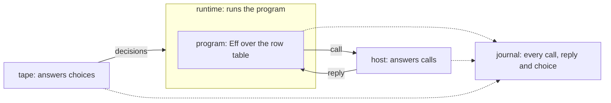

# Coherence: the model, the seams, and the plan

Status: research note, the one entry for the coherence work of 2026-10-19. Base: `08605d990` on
`refactor/phase1-phase3`. It folds in three earlier notes (`seams.md`, `one-service-many-backings.md`,
`vocabulary.md`), which it replaces, and it corrects them where a pressure test found them wrong.

## 1. The one thing to know

A run has a program, a runtime, a host and a tape. The host answers the program's questions. The
tape answers the runtime's choices. The journal records both, and replaying it rebuilds the run.
Every seam we need is one of these roles, declared once in Lean. Most of today's drift is one of
these roles written a second time by hand.

## 2. The model

| Role | What it is | Lean | Effect TypeScript |
| --- | --- | --- | --- |
| program | Eff over the row table: it asks, it never does | `Eff` | a printed `Effect` with its requirements |
| row table | the operations a program may ask for | `RowTable`, declared by `eff_rows` | a service tag, one method per row |
| host | code that answers calls, in any language, anywhere | `Run.Reactor` | a layer that provides the service |
| runtime | what runs the program | the Lean machine | Effect's runtime |
| tape | the runtime's choices: which fiber runs, which reply applies first, when the clock moves | `NativeDecision`; the clock is the tape (`src/Effect4/Api/TestClock.lean`) | none: Effect's runtime chooses and records nothing |
| journal | every command of a run, in order | `Run.journal : List Command` (`src/Effect4/Run/Basic.lean`) | none |
| host session | the machine and its ledger of calls: bound, pending, applied, retired | `Api.HostSession.Session` | none |

A run's journal has four commands (`Command`, `src/Effect4/Api/Runner.lean`): `bind` a call,
`submit` a reply, `apply` one key's reply, and a `control` decision. The first three come from the
host side. The last, and the choice of key in `apply`, come from the tape.

## 3. The algebra under it

Each role is a construction the tree already has. `docs/core/semantics.md` concept 9 holds the
literature.

- **The row table is the application's part of the language signature, Σ_app.** A program is
  the free object over the language signature (K1).
- **A host is a comodel.** It answers the signature's operations from outside, with its own state.
  A reactor is a deterministic one (Plotkin and Power; Uustalu; Ahman and Bauer).
- **The tape is the relational meaning's decisions.** Full meaning is relational over tapes
  (AGENTS.md, representation rules).
- **The journal is the monoid action (K5).** `replay_unique` makes a run a function of its journal.
- **The host protocol is the journal's host commands on the wire.** A call carries the operation
  and its request. A reply carries a completion at that row's answer or error type. Setzer and
  Hancock's dependent interface gives the shape: commands per state, responses per command.

The wire carries more than the algebra, and each extra field has one job (`Call`, `Reply`,
`Header`, `src/Effect4/Api/HostSession.lean`):
- correlation: `callId`, and `key`, the fiber and token of the waiting continuation;
- binding: `version`, `session`, `binding` and `table`, so a reply meets the run it belongs to.

One more thing follows from the algebra. A runtime that runs an application is a host for that
application's service. `TodoApp.add` is a call that the runtime answers, while `TodoRepo.insert` is
a call that the runtime makes. So one protocol serves every boundary, in either direction.

## 4. Where "effects as anything" stops

A host may implement any row, in any language. Four limits hold:
1. A reply carries data and fresh external handles only. An internal handle (a fiber, cell,
   deferred, scope or context) is refused at table admission (row 97).
2. A closure never crosses the host boundary (row 381 (3)).
3. A reply is applied at most once. Exactly-once external work is not promised (dictionary §3.7).
4. A retired call does no host cleanup (`RetiredCall`, `src/Effect4/Api/HostSession.lean`). The
   host is not told that its call was abandoned. The audit's owner decision 5 rules abandon.

## 5. Runtimes and their agreement

| Runtime | Takes a tape | Keeps a journal | How it agrees with Lean |
| --- | --- | --- | --- |
| the Lean machine | yes | yes | it is the reference |
| the OCaml engine | yes | a tape, but no host session (`E4_host`) | the lowering is trusted (row 391); finite lanes compare runs |
| Lean compiled to C | yes | yes | the same source, another compiler; nothing builds it yet |
| Effect's runtime | no | no | printed programs checked against rc.112; the host calls recorded by an outside layer (`apps/todo/server.ts`) |

So two checks exist, of two strengths:
- Between runtimes that take a tape, replay one journal on another and compare. That is exact.
- With Effect's runtime, compare only the record of host calls and replies. Compare it on a
  fragment whose host calls do not depend on the schedule (row 361). Effect's choices stay unseen.

## 6. Rule S, the seams

**Rule S.** In every target, a file has one of three origins. It is generated from Lean, or it
implements a seam that Lean declares as data, or it is build tooling. A seam's body implements a signature. It may call outside
libraries, keep its own state, and fail with the declared failure. It never decides an observation
that Lean defines. A body kept for speed has a Lean definition beside it and a control that runs
both.

The rule is per target. It holds for OCaml and for TypeScript alike.

| Seam | Lean declares | Hand code writes | Today |
| --- | --- | --- | --- |
| carrier | a type row and its operation rows, with contracts | a row's body, or nothing when a package has it | `OCaml5.Lcnf.typeRows` and `builtins` hold; the engine's carriers sit in `ocaml/engine/externs.txt`, outside Lean, with no contracts |
| host | the row table (`eff_rows`) | one host per row table | TypeScript's service is printed from the table; OCaml's record is lowered from a typed interface written by hand (F3) |
| platform | an alphabet of the runtime's resources: files, locks, domains | one interpreter | no Lean declaration yet; `E4_file`, `E4_lock` and `E4_sched` are its bodies |
| shell | the method table (`tool_requests`) and the queries | the transport | `Kit_tool` holds; `Kit_serve` executes requests by hand |

Measured at `761fd13db`: 23,485 lines of hand OCaml outside the tests. 15,631 of them restate
meaning: the store, the run layer, the kit's logic and the clock. That is the drift rule S removes.
The command and the classification of each file are in the history of this folder (`seams.md`, at
`db6720577`).

A transcription's tests go with it. A seam's controls stay: the type checker holds a body to its
signature, and a row's control compares a body with the lowered definition.

## 7. What the pressure test found

The first sketch of this model was too simple in eight places.

| Id | Finding | Evidence | Response |
| --- | --- | --- | --- |
| F1 | A run has two outside inputs, not one: the host's replies and the tape's choices | `Command`; `Api.TestClock` | §2 shows both |
| F2 | The journal belongs to the run, not to the host session | `Run`, `Session` | the dictionary's host session entry is corrected |
| F3 | The to-do's typed host is a hand copy of `eff_rows`, in Lean: `Todo`, `SqlTag`, `Host`, row names as strings | `Test/Dogfood/Scenario/Todo/Typed.lean`; tied only by `#guard`s | `eff_rows` generates the typed interface; both targets read it (§8 step 2) |
| F4 | The host session is spelled once per runtime: Lean's `HostSession`; none in OCaml, where `E4_host` restates `driveFrom`; hand TypeScript in `harness/truth/session` | `ocaml/engine/e4_host.ml`; `keyed-recorder.ts`, `keyed-protocol.ts` | one Lean definition, lowered or printed (§8 step 3) |
| F5 | Lowered code does no I/O, so a platform seam needs plans and readers | `E4_checkpoint`'s streaming closure (CP9) reads as it walks | a plan of operations for writes; a reader that asks for bytes; measure before S4 |
| F6 | The engine's carrier table is outside Lean, with no contracts | `ocaml/engine/externs.txt`, 52 rows | it becomes type rows (the audit's M10) |
| F7 | Effect's runtime makes its choices unseen | §5 | cross-runtime checks compare host calls, on a schedule-independent fragment |
| F8 | The protocol carries correlation and binding fields beyond the algebra | §3 | named, each with its one job |

## 8. The plan

One ordered list. It replaces the separate orders of the audit (M1 to M11), `seams.md` (S1 to S4)
and `one-service-many-backings.md` (B1 to B7). Each step deletes what it replaces.

1. **Vocabulary.** Landed: the dictionary (`5418973ea`) and the workspace rename (`a12b2bbd2`).
   Left: three deep-core comments and one `#guard`, with the next edit of their files.
2. **The host seam from one source.** `eff_rows` generates the typed interface: the Lean types, the
   host record and its reactor. OCaml's record and module type are lowered from it. TypeScript's
   service is printed from the same table. The to-do's hand `Typed.lean` and `REPO` go. Then a
   to-do host over SQLite in OCaml.
3. **The host protocol from the journal.** One Lean definition of the wire messages: the host
   commands of `Command`, in the canonical tagged JSON. It is lowered for OCaml and printed for
   TypeScript. `E4_host`'s copy and the hand keyed protocol in `harness/truth/session` go.
4. **The cross-runtime test.** The to-do service as one Effect layer per runtime, one script
   through each. Lean and OCaml compare journals. Effect's runtime compares host calls.
5. **Carriers.** Six parts:
   - E6, `Nat` and `Int` as `Z.t`;
   - packages for SHA-256, CRC and hex;
   - the byte kernel as a row with a control;
   - one profile judgment (M2), one program codec (M3) and one type spelling (M4).
6. **The run layer, lowered.** One observation and the kit's commands as queries (M8); the machine's
   carriers as rows and the drive lowered (M10). The audit's owner decisions 4 and 5 come first.
7. **The store over the platform seam.** One journal construction (M5), one commit (M6), the store's
   meaning lowered (M11). The audit's owner decision 1 and question S-1 below come first.

Three Lean-side moves are independent of this order:
- M1, one located refusal;
- M7, one JSON tree and a fold for `Shape`;
- M9, the typing rule as two tables.

## 9. What the owner decides

| Id | Question | Recommendation | Blocks |
| --- | --- | --- | --- |
| D1 | The log: harden it, or one commit construction | one construction (the audit's shape (b)) | step 7 |
| D2 | The public JSON's lists | arrays | steps 3 and 4 |
| D3 | The native profile after E6 | the profile is a datum the run is checked against at ingress | steps 4 and 5 |
| D4 | The drive after a refused reply | the OCaml rule, written once in Lean | steps 3 and 6 |
| D5 | Abandon, and whether a host is told | `E4_abandon`'s policy as Lean semantics; a retired call is reported to the host | steps 3 and 6 |
| S-1 | Is the store's on-disk format meaning? | yes: it is lowered in step 7 | step 7 |
| S-2 | Is the generated host interface public? | yes: it enters the public-name manifest | step 2 |

D1 to D5 are the audit's (`README.md` §7). D2 to D5 are also the host protocol's contract.

## 10. How we work while this churns

- **Semantics generation is paused** (the owner, 2026-10-19). `make gen-semantics` does not run, and
  no claim moves between concepts. The workspace's laws stay in concept 9 until it resumes.
- **One document.** This note is the entry. Its inputs stay as evidence: `orientation.md`,
  `plan.md`, `lean-core.md`, `compiler-estate.md` and the audit's synthesis, `README.md`.

## 11. What this does not establish

- The comodel reading is the literature's frame for a host, not a theorem in the tree.
- No process-boundary protocol runs yet, and no lowered store is measured.
- The classification of hand files is a reading of their headers. A step reads the code before it
  deletes.
