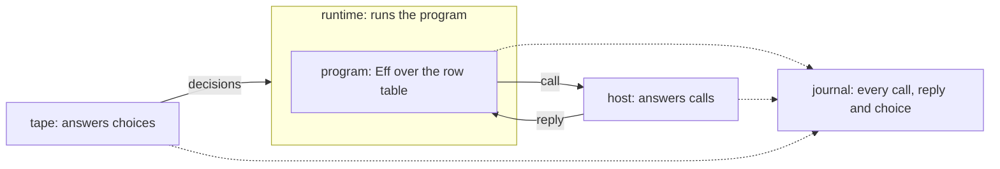
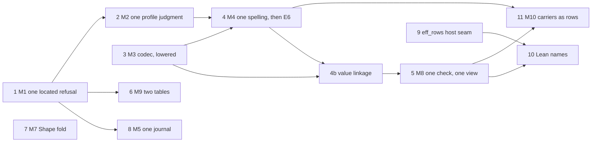

# Coherence: the model, the seams, and the plan

Status: research note, the one entry for the coherence work of 2026-10-19. Base: `29f55957e` on
`refactor/phase1-phase3`. It folds in three earlier notes (`seams.md`, `one-service-many-backings.md`,
`vocabulary.md`), which it replaces, and it corrects them where a pressure test found them wrong.
It takes one more input: a second read by another session
(`docs/research/2026-10-19-second-read-authoring-release.md`). The owner adopted its author-first
order on 2026-10-19, and replaced it the same day with the consolidation order (row 420).

## 1. The one thing to know

There are two halves, and they are one construction. An author holds a document and changes it
by actions. A run holds a machine and changes it by commands. Each is a state reached by its
journal (K5). In a run, the host answers the program's questions and the tape answers the
runtime's choices. Every seam is one of these roles, declared once in Lean. Most drift is a role
written a second time by hand. Programs are written in Lean, and the tools introspect and analyse
them (row 420).

## 2. The run's half

| Role | What it is | Lean | Effect TypeScript |
| --- | --- | --- | --- |
| program | Eff over the row table: it asks, it never does | `Eff` | a printed `Effect` with its requirements |
| row table | the operations a program may ask for | `RowTable`, declared by `eff_rows` | a service tag, one method per row |
| host | code that answers calls, in any language, anywhere | `Run.Reactor` | a layer that provides the service |
| runtime | what runs the program | the Lean machine | Effect's runtime |
| tape | the runtime's choices: which fiber runs, which reply applies first, when the clock moves | `NativeDecision`; the clock is the tape (`src/Effect4/Api/TestClock.lean`) | none: Effect's runtime chooses and records nothing |
| journal | every command of a run, in order | `Run.journal : List Command` (`src/Effect4/Run/Basic.lean`) | none |
| host session | the machine and its ledger of calls: bound, pending, applied, retired | `Api.HostSession.Session` | none |

A run's journal has four commands (`Command`, `src/Effect4/Api/Runner.lean`): `bind` a call,
`submit` a reply, `apply` one key's reply, and a `control` decision. The first three come from the
host side. The last, and the choice of key in `apply`, come from the tape.

## 3. The author's half

An author, a person or an agent, holds a few objects. The tree has each of them. The model above
left them out, and the second read named that gap.

| Object | What it is | Lean | Reached by its journal |
| --- | --- | --- | --- |
| sketch | a program with holes; a hole is a host row, so every fold reads a sketch as a program | `Sketch` (`src/Effect4/Program/Sketch.lean`) | — |
| document | a sketch with its source table, changed by actions | `Doc` (`src/Effect4/Program/Typing/SourceDocument.lean`) | its actions (`Doc.replayedState`) |
| fill set | the submissions that fill a sketch's holes | `FillSet` (`src/Effect4/Program/Typing/FillSet.lean`) | its submissions (`FillSet.constructed`) |
| workspace | the tool's state and the checker's memo | `Tool.Native.Workspace` (`src/Effect4/Tool/Native.lean`) | its accepted actions (`Tool.State.replayed`); stored as `WorkspaceEntry` chains |
| verdict | the checker, one `Except` fold, whose refusal is located | `Checker.check`, `Checker.explain` (`src/Effect4/Program/Checker.lean`) | — |

Three things follow:
- **One construction.** "A state reached by its journal" is written six times today (the audit's
  lc-1). A run and a workspace are two instances of it, over two alphabets: the run's commands
  and the tool's actions. The audit's M5 makes it one, `Replayed`.
- **One act, one spelling.** Filling a hole has two alphabets today: `DocAction` with a draft or a
  commit, and `FillSet`'s fill then publish. The slices plan's decision 9 asks for one field name
  per idea.
- **A concept to own it.** Row 414 (5) ruled typed editing the eleventh concept of
  `docs/core/semantics.md`. Its section is not written yet. Its prose is written now; its claims
  move when semantics generation resumes.

An author, a person or an agent, writes the program in Lean (row 420). The tools read, check, view
and explore it, and JSON is their wire.

## 4. The algebra under it

Each role is a construction the tree already has. `docs/core/semantics.md` concept 9 holds the
literature.

- **The row table is the application's part of the language signature, Σ_app.** A program is
  the free object over the language signature (K1).
- **A host is a comodel.** It answers the signature's operations from outside, with its own state.
  A reactor is a deterministic one (Plotkin and Power; Uustalu; Ahman and Bauer).
- **The tape is the relational meaning's decisions.** Full meaning is relational over tapes
  (AGENTS.md, representation rules).
- **The journal is the monoid action (K5).** `replay_unique` makes a run a function of its journal.
  The author's objects are instances of the same action.
- **The host protocol is the journal's host commands on the wire.** A call carries the operation
  and its request. A reply carries a completion at that row's answer or error type. Setzer and
  Hancock's dependent interface gives the shape: commands per state, responses per command.

The wire carries more than the algebra, and each extra field has one job (`Call`, `Reply`,
`Header`, `src/Effect4/Api/HostSession.lean`):
- correlation: `callId`, and `key`, the fiber and token of the waiting continuation;
- binding: `version`, `session`, `binding` and `table`, so a reply meets the run it belongs to.

One more thing follows from the algebra. A runtime that runs an application is a host for that
application's service. `TodoApp.add` is a call that the runtime answers, while `TodoRepo.insert` is
a call that the runtime makes. So one protocol serves every boundary, in either direction.

## 5. Where "effects as anything" stops

A host may implement any row, in any language. Four limits hold:
1. A reply carries data and fresh external handles only. An internal handle (a fiber, cell,
   deferred, scope or context) is refused at table admission (row 97).
2. A closure never crosses the host boundary (row 381 (3)).
3. A reply is applied at most once. Exactly-once external work is not promised (dictionary §3.7).
4. A retired call does no host cleanup (`RetiredCall`, `src/Effect4/Api/HostSession.lean`). The
   host is not told that its call was abandoned. Decision D5 rules abandon, with the deferred protocol.

## 6. Runtimes and their agreement

| Runtime | Takes a tape | Keeps a journal | How it agrees with Lean |
| --- | --- | --- | --- |
| the Lean machine | yes | yes | it is the reference |
| the OCaml engine | yes | a tape, but no host session (`E4_host`) | the lowering is trusted (row 391); finite lanes compare runs |
| Lean compiled to C | yes | yes | the same source, another compiler; nothing builds it yet |
| Effect's runtime | no | no | printed programs checked against rc.112; the host calls recorded by an outside layer (`apps/todo/server.ts`) |

So two checks exist, of two strengths:
- Between runtimes that take a tape, replay one journal on another and compare. That is exact.
- With Effect's runtime, compare only the record of host calls and replies. Compare it on a
  fragment whose host calls do not depend on the schedule (row 361). Effect's choices stay unseen.

## 7. Rule S, the seams

**Rule S.** In every target, a file has one of three origins. It is generated from Lean, or it
implements a seam that Lean declares as data, or it is build tooling. A seam's body implements a
signature. It may call outside libraries, keep its own state, and fail with the declared failure.
It never decides an observation that Lean defines. A body kept for speed has a Lean definition
beside it and a control that runs both.

The rule is per target. It holds for OCaml and for TypeScript alike.

| Seam | Lean declares | Hand code writes | Today |
| --- | --- | --- | --- |
| carrier | a type row and its operation rows, with contracts | a row's body, or nothing when a package has it | `OCaml5.Lcnf.typeRows` and `builtins` hold; the engine's carriers sit in `ocaml/engine/externs.txt`, outside Lean, with no contracts |
| host | the row table (`eff_rows`) | one host per row table | TypeScript's service is printed from the table; OCaml's record is lowered from a typed interface written by hand (F3) |
| platform | an alphabet of the runtime's resources: files, locks, domains | one interpreter | no Lean declaration yet; `E4_file`, `E4_lock` and `E4_sched` are its bodies |
| shell | the method table (`tool_requests`) and the queries | the transport | `Kit_tool` holds; `Kit_serve` executes requests by hand |

Measured at `761fd13db`: 23,485 lines of hand OCaml outside the tests. 15,631 of them restate
meaning: the store, the run layer, the kit's logic and the clock. That is the drift rule S removes.
The command and the classification of each file are in the history of this folder (`seams.md`, at
`db6720577`).

A transcription's tests go with it. A seam's controls stay: the type checker holds a body to its
signature, and a row's control compares a body with the lowered definition.

## 8. What the pressure test found

The first sketch of this model was too simple in nine places.

| Id | Finding | Evidence | Response |
| --- | --- | --- | --- |
| F1 | A run has two outside inputs, not one: the host's replies and the tape's choices | `Command`; `Api.TestClock` | §2 shows both |
| F2 | The journal belongs to the run, not to the host session | `Run`, `Session` | the dictionary's host session entry is corrected |
| F3 | The to-do's typed host is a hand copy of `eff_rows`, in Lean: `Todo`, `SqlTag`, `Host`, row names as strings | `Test/Dogfood/Scenario/Todo/Typed.lean`; tied only by `#guard`s | `eff_rows` generates the typed interface (§9.1 item 9) |
| F4 | The host session is spelled once per runtime: Lean's `HostSession`; none in OCaml, where `E4_host` restates `driveFrom`; hand TypeScript in `harness/truth/session` | `ocaml/engine/e4_host.ml`; `keyed-recorder.ts`, `keyed-protocol.ts` | one Lean definition, lowered or printed (estate track) |
| F5 | Lowered code does no I/O, so a platform seam needs plans and readers | `E4_checkpoint`'s streaming closure (CP9) reads as it walks | a plan of operations for writes; a reader that asks for bytes; measured before the store moves |
| F6 | The engine's carrier table is outside Lean, with no contracts | `ocaml/engine/externs.txt`, 52 rows | it becomes type rows (the audit's M10) |
| F7 | Effect's runtime makes its choices unseen | §6 | cross-runtime checks compare host calls, on a schedule-independent fragment |
| F8 | The protocol carries correlation and binding fields beyond the algebra | §4 | named, each with its one job |
| F9 | The model had no place for the author's objects | the second read, §3.3 | §3 |

## 9. The plan

The owner ruled on 2026-10-19 (row 420): programs are written in Lean, and the tools are for
introspection and analysis. The goal is a language that is rational, coherent, and compiled as its
semantics says. The plan is the audit's consolidation moves (`README.md` §4), in one order. It
replaces the author-first release track of row 418. That track had replaced four earlier orders:
the audit's M1 to M11, `seams.md`'s S1 to S4, `one-service-many-backings.md`'s B1 to B7, and this
list's first version. Each item deletes what it replaces.

Done: the vocabulary, in the dictionary (`5418973ea`, `c92fe3633`) and the workspace rename
(`a12b2bbd2`). Left: three deep-core comments and one `#guard`, with the next edit of their files.
Row 418's items 1 to 3 are done too. `docs/STATE.md` is one page, and `docs/core/semantics.md`
§2.11 holds the typed-editing concept, as prose.

The TypeScript slice landed in two parts. Seat 3a made the tagged print with arrays the one public
JSON (`e826c8ac1`, `a2cfa8de5`; `receipt-item3a.md`). Seat 3b made both readers take any binder
names (`c8b6d5ad6`, `f519aed3c`; `receipt-item3b.md`). The reader reads the printer's text as it
stands, and any other text after the renaming of its binders (`Rename.expr`). Law 11 keeps its
statement. Law 12 holds under that normaliser, as a disjunction. Left from it: the three
`lastIndexOf` resolvers of `read.ts`, `oxc.ts` and `ck.ts` as one helper, with the next edit of
`ck.ts`.

Stopped by row 420 (3): release item 4 (agent text in) and item 5 (the reply diet). Item 3b's
open item 2, the typed reader's order, closes with item 4. Only printed text reaches the typed
reader.

### 9.1 The consolidation order

First, before item 1: the to-do as a user's project, outside the library
(`docs/research/2026-10-19-todo-as-a-user/plan.md`). Its findings may reorder this list.

| # | Move | What it collapses or deletes | Size |
| --- | --- | --- | --- |
| 1 | **M1, one located refusal** (was release item 8) | `Authoring.Refusal`, `DocumentRefusal`, `FormationRefusal`, item 3b's `ReadFailure`, and the paths in `TermTypingRefusal`'s arms, into `Located Site Reason`; the second prefix rule | S |
| 2 | **M2, one profile judgment at ingress** (was item 9; with R2's A5.2) | `CodecProfile.carries`, `natLiteralsInProfile`, `E4_engine.check_answer` and the emitted literal walk; the A1.1 defect on `eff` | S to M |
| 3 | **M3, one program codec, lowered** | `OCaml5.Eff.wireModule`, `ocaml/eff/eff_wire.ml` (1,267 generated lines), the 89 `.bin` goldens | M |
| 4 | **M4, one type spelling, then E6**: `Nat` and `Int` exact in OCaml | `OCaml5.Lcnf.ClockFlow` (605 lines), the clock rows, the saturating `Lcnf_nat` bodies; the bound's five spellings into one owner, `Option Nat`, `none` for the native profile (owner, 2026-10-20) | M |
| 4b | **Value linkage between artifacts** (§9.3): an artifact imports another artifact's lowered roots instead of walking them, so a Lean declaration is lowered into one artifact | the copies: 894 of `api_engine.ml`'s 900 nodes and 107 of `eff_image.ml`'s 115 are `closure_gen.ml`'s | S to M |
| 4c | **The comparison lane over the generated `rocq/Skeleton.v`** (row 433): the lane extracts the development the declared facts cite, and the six hand Rocq files of the 2026-10-16 study retire | `rocq/{Denote,Run,Judgments,Budget,BudgetDefs,Api}.v` (2,794 hand lines), the exception in `rocq/README.md` | M |
| 5 | **M8, one observation, one check, the kit's commands as queries** (was item 6; row 414 (3); A6, with R2's A7.1; amended by §9.3 and row 428: the observation in two layers, the machine half a function of `Api.Machine`; the check is the certificate spine in the admission order on both faces, over the full `SigApp`; `explore` is the Tool's `preview` query; `run` lowers `Run.atBudget`; `Run.Tree.level` and `statements` are named as unfoldings) | `Api.check`, `Api.explain`, `Run.Kit.check`, `Run.Kit.admit` and `Run.Preview.admit` as separate entries; `Run.observe`, `Run.work`, `machineViewOf`; `Kit_serve`'s execution; `Kit.explore`'s missing refusal of an unsupported program (owner, 2026-10-20) | M |
| 6 | **M9, the typing rule as two tables**, in three stages (amended by §9.3: an answer at every sort; `afterRet` and the signature as inherited attributes; the layer references a named pre-pass; the root definition block the same evaluator; the lemma that a refusal's site resolves, at stage 3) | most of `Annotate.lean` and of `annotate_eq_table`'s induction; then `EditSession`; the checker's three term arms' address fields, into located arms (M1's proposal; owner, 2026-10-20) | L |
| 7 | **M7's rest: the old readers go, then a fold for `Shape`** (the first step landed 2026-10-19, `a2cfa8de5`; amended by §9.3: `NatJson` gains `DecidableEq`; `Tools.JsonBridge`, `WireText`, `Catalogue`, four batteries and two registry pointers move; the genesis digest stays byte-identical; the three other hand recursions on `Shape` fold too) | `readIn` and its siblings, `Agrees` and the binary64 families; the hand triples of `src/Effect4/Tool/Methods.lean` | M |
| 8 | **M5, one journal construction**, without the store's part (amended by §9.3 and row 428: two families; `Replayed` with `Located Nat ε` for the partial steps, the monoid action `Play` for the total ones; `Exchange.load` and `Live` as adapters; a duplicate node is a no-op) | eight spellings of a state reached by its journal, five proof fields; about eight append laws | M |
| 9 | **The typed host interface from `eff_rows`** (F3; was item 7): the host record and its reactor, keys by name. A row method given an extra argument should name its arity, not the internal type `Env` | `Todo/Typed.lean`, `REPO`, the README's hand keys | M |
| 10 | **A public-name manifest for Lean** (was item 10): each name of the entry modules taught, internal or test-only | `Program.Edit` and `Program.SketchWire` from the entry; the extra run and check entries, marked internal | S |
| 11 | **M10, carriers as rows, one machine, then the run layer over it** (amended by §9.3 and row 428: no hand machine exists; the functor lowering with its 35 hand store bodies goes; rows for a persistent map and a persistent sequence; each row's control a differential against `closure_gen.ml`; P9 (b)'s six interfaces are the rows' specifications) | `ocaml/engine/externs.txt` outside Lean; `api_engine_prelude.ml` (573 hand lines); `api_engine.ml` as a second lowering; the `INSTANCE` transcription and `E4_diff`'s renderings; the hand drive | L |

- **M1 landed** 2026-10-20 (`be13aee02`). Nine records are now `Located Site Reason`:
  `Authoring.Refusal`, `DocumentRefusal`, `FormationRefusal`, and the six record, tuple and fold
  refusals of `TermRefusal.lean`. The paths left `TermTypingRefusal`'s arms (`TermTypingReason`).
  A name that stays is an `abbrev` of a `Located`. The formation type and the tuple index moved
  into their reasons. Two more moved the same way: item 3b's `ReadFailure`, and the law graph's
  `TypingRefusal`. `Located.under` is stated for any list site; `DocumentRefusal.under` and
  `ReadFailure.under` are deleted. Regenerated: derived (the Refusals group with qualified names)
  and lcnf; ts reran with no change. The kit's format is version 4, with its two shape pins.
  `make batteries-touched`: 260 batteries, built. `#axiom_audit`: 3,605 declarations of the 13
  touched library modules and 534 of the 9 touched batteries, all within `[propext, Quot.sound]`
  and none modulo a planned goal. Gates: `check-ts` and `check-ocaml` pass. No claim's statement
  moved. Proposed: the checker's three term arms (`unboundVariable`, `unknownAtom`,
  `refusedArguments`) keep their address as a field. One `TermTypingRefusal` arm in their place
  changes the checker's alphabet, which the owner rules.
- **M2 landed** 2026-10-20 (`44083456f`). Profile support is one Lean judgment
  (`src/Effect4/Program/ProfileSupport.lean`): an algebra of `cata_val` over the value tree, and
  the literal fold beside it. Its bound is `ProfileData.natBound` and its leaf `admitsNat`. It
  refuses `Located` at a value's path, or at the address of a literal's node. Collapsed into it:
  `CodecProfile.carries`, `carriesList` and `natLimit`, `natLiteralsInProfile`,
  `E4_engine.check_answer` and the emitted `lits_*` walk. Deleted with them: `E4_clock`'s
  `Literal` and `Reply` crossings with `check_nat`, the same two of `OCaml5.Lcnf.Crossing`,
  `E4_engine.compile`, `load_bytes` and `answer_async_float`. H11 (a)'s claim is gone: ingress is
  Lean's judgment, lowered, and `driveFrom` does not ask it (D3). The engine asks it as `ingress`
  and `literal_refusal`, lowered through `roots.json`. `E4_host` and the kit call it where they
  call reply admission. The kit now refuses A1.1's reply on the tape and native routes; the
  unchanged probe prints `refused`, and `test_kit` T12 keeps the control. A native answer that is
  no Lean value, such as a natural below zero, is the carrier's refusal (`Eff_val.valid`), not the
  judgment's. A negative integer past magnitude 2^53 - 1 is now refused, the tool's JSON profile
  included, as the int wire refuses it. `CodecProfile.supports` stays: it judges a `Shape`, and
  M7's fold for `Shape` takes it. The new claim `profile-support-located` points at
  `valueRefusal_eq_none_iff`, with `literalRefusal_eq_none_iff` beside it. The six codegen
  premises are restated with the same value. R2's A5.2 landed with it: `eff`'s numeric options
  are naturals (`Kit_serve.natural`, T13). Regenerated: lcnf, where `Located` and
  `ProfileReason` join the program types, and eff. The derived, wire and ts families are
  unchanged. `make batteries-touched`: 7 batteries, built. `#axiom_audit`: 916 declarations of the
  12 touched library modules and 315 of the 7 batteries, all within `[propext, Quot.sound]` and
  none modulo a planned goal. `#closure_audit` passes. Gates: `check-ts` and `check-ocaml` pass.
  No claim's statement moved; one claim is new. Proposed: a decisions row for M2. The frozen faces
  contract still names `natLiteralsInProfile`, which the owner amends. `NatJson.limit`, the tool
  schema's maximum and `Within` still spell the bound; M4 gives them its owner.
- **M3 landed** 2026-10-20 (`8aebd25e1`). The OCaml estate reads and writes a program's bytes by
  Lean's own exact embedding, lowered. `Effect4.Run.Kit.programToVal` and `programOfVal` are
  lowered into a new artifact, `ocaml/eff/eff_image.ml`, through `ocaml/gen/roots.json`. The one
  framing kernel frames them: `Eff_codec`, over `Eff_val` and `Eff_frame`. Six node images and
  `effTyOfVal` join `Run.Kit`, for the subterm index and the to-do fixture. Collapsed into them:
  `OCaml5.Eff.wireModule` and its output, the 1,267 generated lines of `ocaml/eff/eff_wire.ml`.
  Deleted with them: `V.bytes`, `test_metadata`, and the `.bin` comparisons of `test_eff` and
  `test_lean_wire`. `E4_be` is deleted, and its whole-string face is `Eff_frame`'s. The engine,
  the host, the kit, `E4_subterm` and their tests call `Eff_codec`. Hand lines fell by 508, and
  generated lines grew by 3,134. The 89 `.bin` goldens stay, now cut by `Canonical.encode` and
  byte for byte unchanged. Nine readers take them as programs: the differential, the query and
  slice lanes, the byte sweep, two benches and the TypeScript printer test. Measured on this Mac,
  best of five: the lowered read costs 2.1 to 3.2 times the emitted one, and the write 1.3 to 2.6
  times. The 89 goldens (35 KB) read in 139 µs against 66 µs. A 1.4 MB program reads in 7.6 ms
  against 2.7 ms. An engine load is that read, since the load itself is lazy. A store put also
  hashes the bytes, and SHA-256 of the goldens costs 280 µs. No library path reads program bytes
  in a loop: the kit reads one `.eff` per command. So no fused encoder is emitted. Red controls:
  a reader that keeps trailing bytes fails `test_lean_wire` and `prop_wire`. A lowered encoder
  with a wrong tag for `bind` fails both and `test_eff`. `make batteries-touched`: 2 batteries,
  built. `#axiom_audit`: 75 declarations of `Effect4.Run.Kit` and 31 of the 2 batteries, all
  within `[propext, Quot.sound]` and none modulo a planned goal. The three touched `OCaml5` tool
  modules are outside the gate: 39 of their 364 declarations reach `Classical.choice` through
  string operations. `#closure_audit` passes. Gates: `check-ocaml` passes. `check-ts` did not
  run: the wire and ts groups regenerated with no difference, and no TypeScript input changed. No
  claim's statement moved. Proposed: a decisions row for M3. The owner rules whether the 89
  goldens go, with a corpus for their nine readers that reaches every constructor. The frozen
  faces contract names `eff_wire.ml` for face 6, which the owner amends. The docstring of
  `serviceKeyImage` (`src/Effect4/Machine/ContextMap.lean`) still cites `eff_wire.ml`; it waits
  for the next core rebuild.
- **M4 landed** 2026-10-20 (`edfcb5cb2`), its first half only: E6 stopped at the Rocq lane,
  where `Z.t` has no mapping. `OCaml5.Lcnf.typeRows` owns every OCaml spelling of a Lean type,
  and `natLiteral` beside it owns a natural's spelling. EffGen's `OTy.ml` and
  `OCaml5.Store.Facts`'s `nativeType` read `builtinTy?`. `OTy` names a Lean shape (`OTy.nat`) and
  spells no target, and `tools/Drivers/TsGen.lean` still reads it. Deleted: `OTy.render`,
  `OTy.renderArg` and `Family.tyRef`, the second spelling of each carrier. `OCaml5.Store.Facts`
  emits an `Ml.Module` and an `Ml.Signature` per unit, and `Ml.checkModule` and the new
  `checkSignature` read them. The result envelope's 32 bytes are read from hex, since an
  `Ml.Syntax` string literal holds UTF-8 bytes. The rowed bodies of `Lcnf_nat` and `Lcnf_list` are
  rendered from `OCaml5.Lcnf.support` by `lake exe lcnfgen --support`. `OCaml5.Lcnf.Gallina`'s
  refusal is a value, `Refusal`, that names the declaration and the construct. The
  `(* REFUSED *)` scan is deleted, and `Skeleton.v` and `StoreCode.v` are byte for byte unchanged.
  Hand lines grew by 295 and generated lines by 75 (`git diff --numstat`). Measured by allocated
  words: the engine differential allocates 962,415,522 words before and after, over 508 programs
  with no divergence. A store put of the 89 goldens allocates 30,282 words before and after.
  Regenerated: lcnf, eff and cas. Reruns of eff, cas, ts, lcnf and store-rocq into a scratch
  directory show no drift. `make batteries-touched`: 34 batteries, built, after one repair:
  `Test.Store.GallinaHeadPrinter` runs the printer from no refusal. `#axiom_audit`: the touched
  battery's 16 declarations are within `[propext, Quot.sound]`, and none is modulo a planned
  goal. The ten touched `OCaml5` modules are outside the gate. 202 of their 2,192 declarations
  reach `Classical.choice` through string operations, against 195 of 2,139 at the base.
  `#closure_audit` passes. Gates: `check-ocaml` and `check-ts` pass, each lane. No claim's
  statement moved, and no `Effect4` module changed. The comparison lane's runner,
  `ocaml/engine/test/rocq/rocq_run.ml`, is Rocq's extraction by a producer kept only in Git:
  `git:98a29895b800556365a2edc9924f3ed12787b820:docs/research/2026-10-16-itrees/rocq/LaneExtract.v`.
  It writes Rocq's `Z` as OCaml's `int`. Under E6 the runner fails at line 785: "This expression
  has type Z.t but an expression was expected of type service_type_code". `make gen-rocq` does
  map `Z.t`: one line of `rocq/tools/split_types.ml` prints it as `int`, which RocqOfOCaml
  defines as Rocq's `Z`. With that line, E6's `Eff_types.v` is byte for byte this half's. The E6
  work is kept, unmerged, at `c27054c2a` on the branch `m4-e6-stopped`, over this half. There
  every OCaml directory but the comparison lane builds, and the engine differential passes. Its
  differential allocates 954,883,486 words, 7,532,036 fewer, and its store put is unchanged.
  `ProfileReason.belowBound` keeps the stored predecessor `n`, as the coordinator ruled for a
  stopped E6. So the comparison `n < natBound` stands, since the lowered `Nat` wraps at 2^62
  until E6. In the kept E6 the reason names the magnitude `n + 1`, asked of `admitsNat`, since
  `Z.add` is exact. `ClockFlow`, `Clock` and its rows, the dual fidelity and receipt columns, the
  saturating bodies and `ClockLowering.lean` wait with E6. So do the bound's four other
  spellings: `NatJson.limit`, the tool schema's maximum, `Within` and `E4_clock.number_bound`.
  Proposed: the owner rules the comparison lane's producer, and then E6 lands from `c27054c2a`.
  The recommendation: move the producer into the tree, and extract Rocq's `Z` to Zarith's `Z.t`.
  The other choice retires the lane, the floor under the declared facts of
  `src/Effect4/Laws/Run/Tree.lean`. E6 also needs one edit of `tools/Compiler/Emit.lean`, the
  coordinator's file, which reads `natBound` as a natural. Proposed too: a decisions row for M4's
  first half and E6's stop. `rocq/Eff_types.v` lags M2's program types by `Located` and
  `ProfileReason`, and the next `make gen-rocq` adds them. `api_gen`'s copies of `programToVal`
  and `programOfVal` stay for M11, since they did not fall out of the type rows.
- **E6 landed** 2026-10-20 (`bb7862fa0`, the lane's producer `cd41008d1`): `Nat` and `Int` are
  Zarith's `Z.t` in OCaml, and the profile's bound has one owner. The comparison lane's producer
  is in the tree: `rocq/LaneExtract.v`, whose runner `make gen-rocq-lane` writes. Its extraction
  reaches six files of the study of 2026-10-16, so they moved to `rocq/` with it. They are
  `Denote.v`, `Run.v`, `Judgments.v`, `Budget.v`, `BudgetDefs.v` and `Api.v`: 2,794 lines of hand
  Rocq that no declared fact cites. Their map back to the OCaml owners is now
  `rocq/tools/split_types.ml --extract`, since the study's map read the retired flat layout. At the
  base the target writes the committed runner token for token, and the lane passes its 13 checks.
  Rocq's `Z` extracts to Zarith in E6's commit, not in the producer's: the runner spells a number
  as the program types do. At the base a Zarith runner fails at the first host row, where the
  program types' `int` meets Zarith's integer. The extraction is Rocq's `ExtrOcamlZBigInt`, with
  RocqOfOCaml's `int` as the same type and `Z.to_nat` and `Z.of_nat` by name. It names the type
  `Big_int_Z.big_int`, Zarith's own name for `Z.t`, because the extracted Rocq module `Z` shadows
  Zarith's. E6 itself came from `c27054c2a`, with one conflict, in `split_types.ml`'s header.
  `ProfileData.natBound : Option Nat` owns the bound: `some safeBound` for rc.112, `none` for a
  profile that holds every natural. `NatJson.limit`, the tool schema's maximum, `Within` and
  `E4_clock.number_bound` read it or are gone. `ProfileReason.belowBound` names the magnitude
  `n + 1`, asked of `admitsNat`, since `Z.add` is exact. The comparison `n < natBound` goes; it
  stood only while the lowered `Nat` wrapped. The bound is an ingress rule, so a run's own sum
  past it is exact. The kit's transcript re-pins one answer: a run of `2^53 - 1 + 1` now finishes
  with `2^53`, where it stopped outside the profile. Deleted: `OCaml5.Lcnf.ClockFlow` (605
  lines), `OCaml5.Lcnf.Clock` (22), the clock rows and crossing, and each row's second contract,
  `Receipt`. Deleted too: the saturating `Lcnf_nat` bodies, `Test/Audit/ClockLowering.lean`
  (122), `Test/Audit/ClockLiteralFixtures.lean` (127) and `ocaml/clock` with its opam file (343).
  E6 deletes 15,435 lines and adds 15,130: hand lines 3,956 against 3,483, generated 11,479
  against 11,647. The producer adds 3,082 lines and deletes 66; the moved study is 2,824 of them,
  with its provenance comments. The kept commit had run neither `check-ocaml` nor the batteries,
  and six repairs landed with it. `tools/Compiler/Emit.lean` writes the optional bound, and two
  batteries read `safeBound`. The normalization lane spells its checks' naturals through
  `OCaml5.Lcnf.natLiteral`. `test_engine.ml`'s odd square and its binary64 control had wrong
  numbers. The to-do lane's table keys its ids through `Z.equal` and `Z.hash` (rule 7). The
  install lane's facade client writes `Z.t`. After the merge, `rc112`'s docstring names
  `ts/prelude/sql.ts` (`02ebb2497`), and the sweep repaired one citation of `ocaml/clock` in
  `Test/Counterexamples/REGISTER.md`. Measured by allocated words, at the base `fb7804182`, the
  first half and E6: the engine differential allocates 962,419,172, 962,419,187 and 954,887,098
  words. E6's run allocates 7,532,089 fewer, 0.78 per cent, over 508 programs and 72,840 positions
  with no divergence. A store put of the 89 goldens allocates 30,282 words in all three. The
  largest golden, `pOps.bin`, takes 1,773 words to encode and 3,098 to put in all three.
  Regenerated: derived, lcnf, eff, cas and ts each wrote the kept commit's bytes, and
  `make gen-rocq` changed no file. `make batteries-touched BASE=afd92e8cb`: 405 batteries on
  the merged state, built. `#axiom_audit`: 2,635 declarations of the 14 touched `Effect4` modules
  are within `[propext, Quot.sound]`, none modulo a planned goal. So are 286 of the 10 edited
  batteries, and 16,334 of 392 other reached batteries, 11 of them modulo the fixtures' 15
  planned goals. Three more reached batteries hold 12 declarations that reach `Classical.choice`,
  each admitted by name or module in `Test/Audit/AxiomGate.lean`. Outside the gate, 166 of the
  1,298 declarations of the seven touched `OCaml5` modules reach `Classical.choice` through string
  operations. `#closure_audit` passes. The 14 Rocq files compile, and `Assumptions.v` prints only
  `Eval`'s 25 parameters. Gates, on the merge with `5bb8a3aee`: `check-ocaml`, each lane and the
  comparison lane among them, `check-ts` and `check-sweep` pass. Proposed: a decisions row for E6
  and the lane's producer. Proposed too: the lane runs the generated `rocq/Skeleton.v`, the
  development the declared fact cites, and the six hand files go. Left for the coordinator:
  `docs/ARCHITECTURE.md` still names `clock/`, and `src/Effect4/Laws/Run/Tree.lean` calls
  `BudgetDefs.v` history.

- **The order from here** (the owner, 2026-10-20): the entry point's first slice, then M3, then C1's
  moves under E4. Then M4 with E6, then `run`, then M8. Seats alternate between the chain and the
  entry point whenever one unblocks a deletion in the other.
- **Today's order** (the owner, 2026-10-20, evening: "the good solution to land", no shortcuts). M4
  and C2's second slice hand back and merge. Then value linkage (4b), then `run`, then M8 as
  amended. M9, M7, M5, items 9 and 10 and M10 follow in this table's order. Each brief is drawn
  from §4 of the audit and from §9.3 here, and lands no shape that §9.3 amends unamended.
- **After `run`** (the owner, 2026-10-20, evening; row 430): the user side first. That is the to-do end
  to end, a user's README and the rough edges the seats listed. The chain continues as one background
  seat at a time, 4b first. E6 landed the same night (`bb7862fa0`, merged `ef3c1c89b`), so M4 is
  complete; 4c follows 4b.

Items 1 to 4 come first, since E6 removes the one place where OCaml computes another answer than
Lean: a saturating `Nat`. Row 417 (5) set that order for the repair wave, and row 418 (3) had put
the TypeScript slice ahead of it.

### 9.2 Deferred (rows 418 (5) and 420 (5))

1. **The host protocol from the journal** (F4), and the cross-runtime test. D4 and D5 are ruled when
   it starts.
2. **The store over the platform seam**: M5's store part, M6 and M11. D1 and S-1 are ruled when it
   starts.
3. **Carrier packages** for SHA-256, CRC and hex, and the byte kernel as a row with a control, with
   M10.
4. **The exchange natively** (the slices plan's X1) and MCP 2026-07-28 (X2).

The rest of the repair wave follows the order: R2's A4.1 and A9.1, and R3.

### 9.3 The shapes, reviewed (2026-10-20)

Each shape of §9.1 was read against the code at `fb7804182` and against the peer that owns its
pattern. A verdict names what the shape is an instance of, the law that pins it, and what it
leaves open. Five read-only surveys gave the facts. They covered the journal spellings, the check entries
and observations, the typing rule, the engine's externs and the carrier JSON. Where the
audit's §4 text and the code differ, the code wins, and the brief of the move takes the amendment.

| Move | The shape | Instance of | Verdict |
| --- | --- | --- | --- |
| M1, landed | `Located Site Reason`, `mapSite`, one prefix rule | a product, with the free monoid of steps acting on list sites; complete against each judgment by its `_none_iff` law | solid. Open: no law says that a refusal's site resolves to a node (`focusAt`). Its consumer is M9's stage 3 |
| M2, landed | an algebra of `cata_val` into `Option ProfileRefusal`, the first refusing child under its index; the literal fold over the generated path fold | a monoid-valued fold, complete by `valueRefusal_eq_none_iff` and `literalRefusal_eq_none_iff` | solid. One wart: `belowBound` carries `n`, not the magnitude, until E6 |
| M3, landed | `encode_program = Eff_val.to_bytes ∘ programToVal`; `decode_program = programOfVal ∘ decode_exact`; Lean's definitions lowered | two exact embeddings composed; exactness by the reader's re-encoding (C2); the trust shape of Coq extraction | solid as a design. Two costs: the read is 2.1–3.2× (row 426), and the codec is compiled twice |
| M4, running | `OCaml5.Lcnf.typeRows`, 22 rows with spelling, fidelity, domain and receipt; E6 flips `Nat` and `Int` to `Z.t` | Coq's `Extract Constant` with a fidelity column; `ExtrOcamlZBigInt` is the sound mapping | solid. After E6, the rows left in `.domain` are `USize`, `Fin`, `BitVec` and `String`, each named |
| M8 | one machine observation, one check, the kit's commands as Tool queries | K3, one named observation with projections; one certificate spine | the model holds; the shape as written does not. Amended below |
| M9 | the typing rule as per-production tables, inherited and synthesized | an L-attributed attribute grammar, one left-to-right pass; the layer references as a reference attribute | the right model, and the largest proof-cost return. Three gaps and two outside parts, below |
| M7 | one carrier tree, `NatJson`; a generated fold for `Shape` | one free object per carrier; `Shape` is polynomial: five catamorphisms, three paramorphisms | right. The first step landed (`a2cfa8de5`); the deletion list conflicts with itself and misses consumers |
| M5 | `Replayed step init`: actions, state, `foldM step init actions = .ok state` | K5, the monoid action | fits one of two families; the store's part hides a ruling on duplicates |
| M10 | the stores as Lean definitions over primitive rows; one lowering; no functor | trusted extraction of data structures, as `Array` to `Lcnf_array` | the right direction. The rows do not exist yet, their control is finite points, and P9 (b) needs one reading |
| M11 | the store's core lowered, after M5 and M4 | M3's shape, for the store | solid once M5's ruling stands; measure first |
| item 9 | the host record and its reactor generated from `eff_rows` | an interface description compiled to stubs | solid; public (S-2) |
| item 10 | a public-name manifest for Lean | `ocaml/gen/public-names.tsv`, for Lean | solid, small |
| C2 | `Compiler.main app args` by static import; a manifest with the program's address, the pins and the checks | the compiler as a library over a value; content addressing | solid. `inputs` carries no module closure yet |

**What the surveys change in the briefs.**

- **M8, one observation.** `Run.view` reads the run, the session and the machine, and calls
  `Run.work` for `atRest`. `machineViewOf` reads a bare machine, with no run. So the one
  observation is two layers: a machine half, one function of `Api.Machine`, and a session half
  over it. `View`, `Observation`, `Work` and `MachineView` are projections of the pair. `pending`
  becomes a projection by definition, since no law states that the pending slots are the held
  replies of the awaited calls.
- **M8, one check.** Three entries are one judgment in three wrappers: `Api.explain`,
  `Api.check` and `Run.Kit.check`. `Run.Kit.admit` decides the signature and the columns only,
  and refuses no ill-typed program. `Run.Preview.admit` decides more than admission and records
  the extra checks in no certificate. Natively, `check_json` reports typing, then the signature,
  then the columns; `admitProgram` reports the signature, formation, typing, then the columns.
  So one program is refused differently on the two faces. The one check is the certificate spine
  that exists, `TypedProgram`, `AdmittedProgram`, `Built`, with one order, the admission order,
  on both faces. `Kit.app` sets `types = []`, so the native commands never see services or named
  types. The native check takes the full `SigApp`, or it is a different judgment. The claim of
  `Run/Kit.lean` that formation is not decided natively is stale: `api_built_of_sketch` is
  lowered.
- **M8, the queries.** The Tool's `preview` query already refuses fully, then explores. Lean's
  `Run.Kit.explore` has no refusal: a node outside the tree becomes a program exit with
  `Defect.notImplemented`, a refusal shown as a defect. The native `explore` becomes that query.
  `Kit.run` has no Lean counterpart, and `Run.atBudget` is not lowered: `run` lowers
  `Run.atBudget`, and the hand choice in `kit.ml` goes. The precedent is `kit_tool.ml`, which
  interprets no request.
- **M8, the named traversals.** `Run.Tree.level` and `statements` recurse through `unfold`, the
  loop and continuation thunks, not only on children. They are fuel-bounded unfoldings, not
  folds. The connector states the structural part, and the census names the unfolding. Both are
  printed into Rocq (`treeSpec`), so a definitional change regenerates `Skeleton.v`.
- **M9, the tables.** Every inherited read is of a left sibling or of the node's own terms, so one
  left-to-right pass evaluates the rule. Three gaps the brief states. The synthesized answer is
  stored only at `eff` nodes, and it exists at every sort (`StmtTy`, `GenTy`, `LayerTy`).
  `NodeEnv` lacks two inherited attributes that the checker threads: `afterRet`, and the
  signature at a definition block. `returnNotLast` is located at the return through `afterRet`. Two parts
  stay outside the grammar, named. The layer references are a pre-pass that expands them and
  maps the table back. The root definition block becomes the same evaluator once the signature
  is an inherited attribute. The cost today: `childEnv_replace_kept` runs at 1,600,000
  heartbeats over 56 arms, and `annotate_eq_table` is a 724-line hand induction at 400,000.
- **M7, the rest.** `Canonical.printArrays` no longer exists: `a2cfa8de5` made it
  `Canonical.print`, the binary64 reading of `printTree`. The trees differ only in the number leaf.
  `NatJson` keeps strictly more than the carrier writes, so no carrier value is lost. The losses
  are all on the binary64 side, and the move removes them. `Canonical.print` is not injective at
  2^53 + 1 today. Deleting `toBinary64` makes `Canonical.print` return `NatJson`, which has no
  `DecidableEq`: the guards need one. Consumers the audit does not list: `Tools.JsonBridge`,
  `Tools.WireText`, `Tools.Catalogue`, four batteries and two registry pointers
  (`json-read-exact`, `read_toBinary64`). `orderIn`'s list rule flips to arrays, so the normal
  form changes. `render` still writes list families as tagged unions into the genesis digest, and
  that output stays byte-identical. The fold: `under`, `nested` and `supported` use a child
  itself, so they are paramorphisms, which `fold_of` already pairs for `Val.WF`. Three more hand
  recursions on `Shape`: `Tools.Catalogue.inlineForms`, `Tools.JsonBridge.shapeText` and
  `OCaml5.Tools.EffWire.sumsIn`, a `partial def`.
- **M5, two families.** Eight spellings, not six, in two families. Partial steps with an
  index-located refusal: `Tool.State`, `Doc`, `CasOf`, `Word.apply`, `Store.restore`, and
  `Exchange.load` as an adapter on `Tool.State`. Total steps with an output: `Run` and `Runner`,
  whose phases are the observation (`replay_unique`, `behaviour`). `Live` is total too, and its
  event is zero or more commands chosen by reading the run. `Replayed` fits the first family, with
  `Located Nat ε` as its refusal. The second family is the monoid action the laws already state
  (`Play`, `replayPlay`); it stays, with `Live` as its adapter. "A refused step changes nothing"
  holds at `Runner`, and `Run` records the refused row with its phase: the law is stated at
  `Runner`. Four spellings nest inside `Tool.Raw` (`Doc`, `FillSet`, the `Live`s), so a step may
  itself be a `Replayed`. The audit counts six proof fields; there are five.
- **M5, the store.** `Store.verify` checks a finished store in any order; `Word.wf` then
  `Word.apply` is a replay. The change of observation on forward references is recorded (E-1).
  A second one is not: `Word.apply` and `putNode` accept a duplicate node as a no-op, and
  `Word.wf` refuses it. Proposed ruling: the store accepts a duplicate node as a no-op, since a content-addressed
  store is idempotent by definition. The word's refusal of a repeat is a canonical-form judgment,
  kept distinct. `E4_cas.checked_image` follows the same ruling in M11.
- **M10, what exists.** There is no hand machine. Every transition is the lowered
  `Prepared.step`. "The second machine" is a second lowering of the one Lean machine, as a
  functor over seven carrier module types. 28 `fn` rows splice 35 hand store bodies into it:
  `refStep`'s 13 arms, `spawn`, `Api.load`, the scope fork and the memo. Those bodies are the
  hand copies that row 416 (1) forbids, 573 lines of them. All 52 extern rows are store carriers:
  24 retype a list, 28 are those bodies. The functor makes the generated types generative per
  application, which is why `E4_diff` compares renderings and `INSTANCE` transcribes the
  machine's types by hand. Deleting the functor deletes both.
- **M10, the rows.** Only `Array` has a type row with operation rows today. The stores need a
  persistent-map row and a persistent-sequence row. A derived view is a Lean definition with an
  invariant over the keyed-table row, not a row. `FIBERS` takes `~exit_of` and `PPATH` takes
  `Node.child`: in Lean those are ordinary definitions over the primitive rows. The row's contract
  is prose with finite-point tests, no property test and no proof (`Lcnf_array`). Each row's
  control becomes a differential against the lowered list model, which `closure_gen.ml` already
  is. The whole-machine differential goes when the rows' controls catch the mutant campaign.
- **M10, the reading of P9 (b).** The collation's "families typed by the six interfaces" reads as
  parameterisation; M10's guard forbids a machine re-parameterised over carriers. One reading
  satisfies both. The six interfaces of `machine-state.md` §7 are the specifications of the rows,
  stated in Lean as laws over the list model. The machine stays over concrete Lean types, and the
  rows substitute at the lowering. The design note M10 starts with takes this reading.
- **The artifacts.** A `roots.json` artifact is one closed walk; artifacts share only the type
  owner. So 894 of `api_engine.ml`'s 900 nodes and 107 of `eff_image.ml`'s 115 are copies of
  `closure_gen.ml`'s. Wave 2's "declarations compiled twice: 0" (row 416 (1)) no longer holds.
  M10 adds value linkage: an artifact imports another artifact's lowered roots instead of walking
  them. Then "lowered once" is true of the artifacts too.

**Where a consolidation could paper over a design issue.** Named, so that no brief does.

1. **The trust base.** "One implementation" means one Lean definition and a compiler we trust.
   The compiler is the lowering (`src/OCaml5`, 14,352 lines), the byte kernels and `ocamlopt`,
   tied by finite goldens only (row 391). Every lowered move widens what rests on it. That is the trust shape of
   Coq extraction, and it is recorded; it is not a proof.
2. **Refusal sites.** A site is a `List Nat`, which lowers where a dependent address would not.
   No law states that a refusal's site resolves. One lemma per judgment, at its consumer.
3. **The number boundary.** Two trees for two observations is right: the Schema plane keeps
   every binary64 datum apart (`-0 ≠ 0`, NaN payloads); the carrier keeps exact naturals. Lean's
   `JsonNumber` parser and `NatJson.parse` disagree on `-0` and `1e2` today; one parser ends it.
4. **The native face.** The native check decides a different judgment in a different order from
   Lean's, with no services. M8 fixes both, or it is cosmetic.
5. **Hand semantics in the engine's stores**, until M10.
6. **The store's duplicate**, ruled before M5.
7. **A refusal as a defect exit** in `Run.Kit.explore`, until M8.

**Corrections to §4's numbers.** M5: five proof fields, not six. M10: 52 extern rows, not 51;
`api_engine.ml` is 17,420 lines, not 15,928; `api_gen.ml` is a 5-line facade over
`closure_gen.ml`. M7: the first step landed on 2026-10-19 (`a2cfa8de5`).

## 10. What the owner decides

| Id | Question | State | When |
| --- | --- | --- | --- |
| D2 | The public JSON's lists | decided 2026-10-19: arrays; `Canonical.print` becomes the array print (probe: `probes/d2/`) | done, the TypeScript slice |
| D3 | The native profile after E6 | settled 2026-10-20 by the coordinator under the owner's go of the chain: the profile is a datum the run is checked against at ingress | M2 lowers that one judgment |
| S-2 | Is the generated host interface public? | open; recommended: yes | before item 9 |
| D1 | The log: harden it, or one commit construction | deferred (the owner, 2026-10-19) | §9.2 item 2 |
| S-1 | Is the store's on-disk format meaning? | deferred with D1 | §9.2 item 2 |
| D4 | The drive after a refused reply | deferred with the protocol; recommended: the OCaml rule, written once in Lean | §9.2 item 1 |
| D5 | Abandon, and whether a host is told | deferred (the owner, 2026-10-19) | §9.2 item 1 |
| — | Law 12 after item 3b: the landed disjunction, or option B (one-sided, on a smaller readable domain) | decided 2026-10-19: the landed disjunction; option B's corner is an ill-typed program at the native signature (`receipt-item3b.md`); row 419 | done |
| — | What text an author writes | ruled 2026-10-19 (row 420): Lean. The tools are for introspection and analysis | done |
| — | What the first release is | set aside by row 420; the plan is the consolidation order | §9.1 |

D1 to D5 are the audit's (`README.md` §7).

## 11. How we work while this churns

- **Frozen while §9.2 is deferred.** The store: R1's repairs stand, with no second log, no
  lowering and no format change. The bridge: no process-boundary protocol, and
  `apps/todo/server.ts` keeps its recorder. `Run.Tree`, preview and explore stay internal to the
  tool's `preview` query and `eff explore`; they are not taught.
- **Semantics generation is paused** (the owner, 2026-10-19). `make gen-semantics` does not run, and
  no claim moves between concepts. The workspace's laws stay in concept 9 until it resumes.
- **One document.** This note is the entry. Its inputs stay as evidence: `orientation.md`,
  `plan.md`, `lean-core.md`, `compiler-estate.md`, the audit's synthesis `README.md`, and the
  second read.

## 12. What this does not establish

- The comodel reading is the literature's frame for a host, not a theorem in the tree.
- No process-boundary protocol runs yet, and no lowered store is measured.
- The classification of hand files is a reading of their headers. A step reads the code before it
  deletes.
- The sizes of §9.1 are the second read's estimates.
