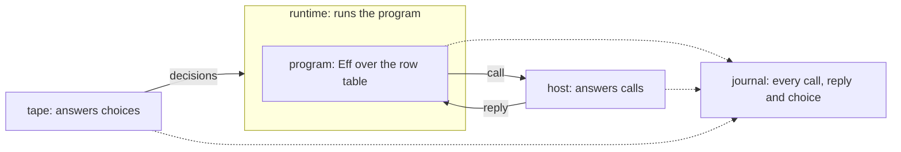
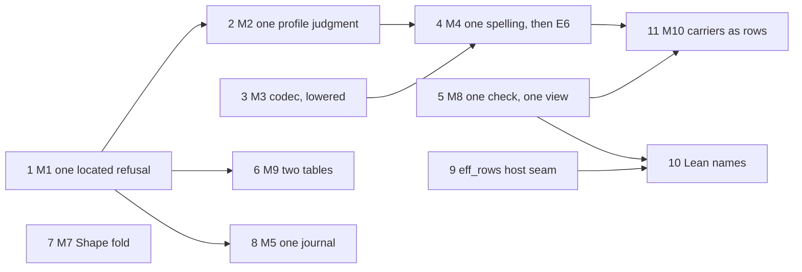

# Coherence: the model, the seams, and the plan

Status: research note, the one entry for the coherence work of 2026-10-19. Base: `29f55957e` on
`refactor/phase1-phase3`. It folds in three earlier notes (`seams.md`, `one-service-many-backings.md`,
`vocabulary.md`), which it replaces, and it corrects them where a pressure test found them wrong.
It takes one more input: a second read by another session
(`docs/research/2026-10-19-second-read-authoring-release.md`). The owner adopted its author-first
order on 2026-10-19, and replaced it the same day with the consolidation order (row 420).

## 1. The one thing to know

There are two halves, and they are one construction. An author holds a document and changes it
by actions. A run holds a machine and changes it by commands. Each is a state reached by its
journal (K5). In a run, the host answers the program's questions and the tape answers the
runtime's choices. Every seam is one of these roles, declared once in Lean. Most drift is a role
written a second time by hand. Programs are written in Lean, and the tools introspect and analyse
them (row 420).

## 2. The run's half

| Role | What it is | Lean | Effect TypeScript |
| --- | --- | --- | --- |
| program | Eff over the row table: it asks, it never does | `Eff` | a printed `Effect` with its requirements |
| row table | the operations a program may ask for | `RowTable`, declared by `eff_rows` | a service tag, one method per row |
| host | code that answers calls, in any language, anywhere | `Run.Reactor` | a layer that provides the service |
| runtime | what runs the program | the Lean machine | Effect's runtime |
| tape | the runtime's choices: which fiber runs, which reply applies first, when the clock moves | `NativeDecision`; the clock is the tape (`src/Effect4/Api/TestClock.lean`) | none: Effect's runtime chooses and records nothing |
| journal | every command of a run, in order | `Run.journal : List Command` (`src/Effect4/Run/Basic.lean`) | none |
| host session | the machine and its ledger of calls: bound, pending, applied, retired | `Api.HostSession.Session` | none |

A run's journal has four commands (`Command`, `src/Effect4/Api/Runner.lean`): `bind` a call,
`submit` a reply, `apply` one key's reply, and a `control` decision. The first three come from the
host side. The last, and the choice of key in `apply`, come from the tape.

## 3. The author's half

An author, a person or an agent, holds a few objects. The tree has each of them. The model above
left them out, and the second read named that gap.

| Object | What it is | Lean | Reached by its journal |
| --- | --- | --- | --- |
| sketch | a program with holes; a hole is a host row, so every fold reads a sketch as a program | `Sketch` (`src/Effect4/Program/Sketch.lean`) | — |
| document | a sketch with its source table, changed by actions | `Doc` (`src/Effect4/Program/Typing/SourceDocument.lean`) | its actions (`Doc.replayedState`) |
| fill set | the submissions that fill a sketch's holes | `FillSet` (`src/Effect4/Program/Typing/FillSet.lean`) | its submissions (`FillSet.constructed`) |
| workspace | the tool's state and the checker's memo | `Tool.Native.Workspace` (`src/Effect4/Tool/Native.lean`) | its accepted actions (`Tool.State.replayed`); stored as `WorkspaceEntry` chains |
| verdict | the checker, one `Except` fold, whose refusal is located | `Checker.check`, `Checker.explain` (`src/Effect4/Program/Checker.lean`) | — |

Three things follow:
- **One construction.** "A state reached by its journal" is written six times today (the audit's
  lc-1). A run and a workspace are two instances of it, over two alphabets: the run's commands
  and the tool's actions. The audit's M5 makes it one, `Replayed`.
- **One act, one spelling.** Filling a hole has two alphabets today: `DocAction` with a draft or a
  commit, and `FillSet`'s fill then publish. The slices plan's decision 9 asks for one field name
  per idea.
- **A concept to own it.** Row 414 (5) ruled typed editing the eleventh concept of
  `docs/core/semantics.md`. Its section is not written yet. Its prose is written now; its claims
  move when semantics generation resumes.

An author, a person or an agent, writes the program in Lean (row 420). The tools read, check, view
and explore it, and JSON is their wire.

## 4. The algebra under it

Each role is a construction the tree already has. `docs/core/semantics.md` concept 9 holds the
literature.

- **The row table is the application's part of the language signature, Σ_app.** A program is
  the free object over the language signature (K1).
- **A host is a comodel.** It answers the signature's operations from outside, with its own state.
  A reactor is a deterministic one (Plotkin and Power; Uustalu; Ahman and Bauer).
- **The tape is the relational meaning's decisions.** Full meaning is relational over tapes
  (AGENTS.md, representation rules).
- **The journal is the monoid action (K5).** `replay_unique` makes a run a function of its journal.
  The author's objects are instances of the same action.
- **The host protocol is the journal's host commands on the wire.** A call carries the operation
  and its request. A reply carries a completion at that row's answer or error type. Setzer and
  Hancock's dependent interface gives the shape: commands per state, responses per command.

The wire carries more than the algebra, and each extra field has one job (`Call`, `Reply`,
`Header`, `src/Effect4/Api/HostSession.lean`):
- correlation: `callId`, and `key`, the fiber and token of the waiting continuation;
- binding: `version`, `session`, `binding` and `table`, so a reply meets the run it belongs to.

One more thing follows from the algebra. A runtime that runs an application is a host for that
application's service. `TodoApp.add` is a call that the runtime answers, while `TodoRepo.insert` is
a call that the runtime makes. So one protocol serves every boundary, in either direction.

## 5. Where "effects as anything" stops

A host may implement any row, in any language. Four limits hold:
1. A reply carries data and fresh external handles only. An internal handle (a fiber, cell,
   deferred, scope or context) is refused at table admission (row 97).
2. A closure never crosses the host boundary (row 381 (3)).
3. A reply is applied at most once. Exactly-once external work is not promised (dictionary §3.7).
4. A retired call does no host cleanup (`RetiredCall`, `src/Effect4/Api/HostSession.lean`). The
   host is not told that its call was abandoned. Decision D5 rules abandon, with the deferred protocol.

## 6. Runtimes and their agreement

| Runtime | Takes a tape | Keeps a journal | How it agrees with Lean |
| --- | --- | --- | --- |
| the Lean machine | yes | yes | it is the reference |
| the OCaml engine | yes | a tape, but no host session (`E4_host`) | the lowering is trusted (row 391); finite lanes compare runs |
| Lean compiled to C | yes | yes | the same source, another compiler; nothing builds it yet |
| Effect's runtime | no | no | printed programs checked against rc.112; the host calls recorded by an outside layer (`apps/todo/server.ts`) |

So two checks exist, of two strengths:
- Between runtimes that take a tape, replay one journal on another and compare. That is exact.
- With Effect's runtime, compare only the record of host calls and replies. Compare it on a
  fragment whose host calls do not depend on the schedule (row 361). Effect's choices stay unseen.

## 7. Rule S, the seams

**Rule S.** In every target, a file has one of three origins. It is generated from Lean, or it
implements a seam that Lean declares as data, or it is build tooling. A seam's body implements a
signature. It may call outside libraries, keep its own state, and fail with the declared failure.
It never decides an observation that Lean defines. A body kept for speed has a Lean definition
beside it and a control that runs both.

The rule is per target. It holds for OCaml and for TypeScript alike.

| Seam | Lean declares | Hand code writes | Today |
| --- | --- | --- | --- |
| carrier | a type row and its operation rows, with contracts | a row's body, or nothing when a package has it | `OCaml5.Lcnf.typeRows` and `builtins` hold; the engine's carriers sit in `ocaml/engine/externs.txt`, outside Lean, with no contracts |
| host | the row table (`eff_rows`) | one host per row table | TypeScript's service is printed from the table; OCaml's record is lowered from a typed interface written by hand (F3) |
| platform | an alphabet of the runtime's resources: files, locks, domains | one interpreter | no Lean declaration yet; `E4_file`, `E4_lock` and `E4_sched` are its bodies |
| shell | the method table (`tool_requests`) and the queries | the transport | `Kit_tool` holds; `Kit_serve` executes requests by hand |

Measured at `761fd13db`: 23,485 lines of hand OCaml outside the tests. 15,631 of them restate
meaning: the store, the run layer, the kit's logic and the clock. That is the drift rule S removes.
The command and the classification of each file are in the history of this folder (`seams.md`, at
`db6720577`).

A transcription's tests go with it. A seam's controls stay: the type checker holds a body to its
signature, and a row's control compares a body with the lowered definition.

## 8. What the pressure test found

The first sketch of this model was too simple in nine places.

| Id | Finding | Evidence | Response |
| --- | --- | --- | --- |
| F1 | A run has two outside inputs, not one: the host's replies and the tape's choices | `Command`; `Api.TestClock` | §2 shows both |
| F2 | The journal belongs to the run, not to the host session | `Run`, `Session` | the dictionary's host session entry is corrected |
| F3 | The to-do's typed host is a hand copy of `eff_rows`, in Lean: `Todo`, `SqlTag`, `Host`, row names as strings | `Test/Dogfood/Scenario/Todo/Typed.lean`; tied only by `#guard`s | `eff_rows` generates the typed interface (§9.1 item 9) |
| F4 | The host session is spelled once per runtime: Lean's `HostSession`; none in OCaml, where `E4_host` restates `driveFrom`; hand TypeScript in `harness/truth/session` | `ocaml/engine/e4_host.ml`; `keyed-recorder.ts`, `keyed-protocol.ts` | one Lean definition, lowered or printed (estate track) |
| F5 | Lowered code does no I/O, so a platform seam needs plans and readers | `E4_checkpoint`'s streaming closure (CP9) reads as it walks | a plan of operations for writes; a reader that asks for bytes; measured before the store moves |
| F6 | The engine's carrier table is outside Lean, with no contracts | `ocaml/engine/externs.txt`, 52 rows | it becomes type rows (the audit's M10) |
| F7 | Effect's runtime makes its choices unseen | §6 | cross-runtime checks compare host calls, on a schedule-independent fragment |
| F8 | The protocol carries correlation and binding fields beyond the algebra | §4 | named, each with its one job |
| F9 | The model had no place for the author's objects | the second read, §3.3 | §3 |

## 9. The plan

The owner ruled on 2026-10-19 (row 420): programs are written in Lean, and the tools are for
introspection and analysis. The goal is a language that is rational, coherent, and compiled as its
semantics says. The plan is the audit's consolidation moves (`README.md` §4), in one order. It
replaces the author-first release track of row 418. That track had replaced four earlier orders:
the audit's M1 to M11, `seams.md`'s S1 to S4, `one-service-many-backings.md`'s B1 to B7, and this
list's first version. Each item deletes what it replaces.

Done: the vocabulary, in the dictionary (`5418973ea`, `c92fe3633`) and the workspace rename
(`a12b2bbd2`). Left: three deep-core comments and one `#guard`, with the next edit of their files.
Row 418's items 1 to 3 are done too. `docs/STATE.md` is one page, and `docs/core/semantics.md`
§2.11 holds the typed-editing concept, as prose.

The TypeScript slice landed in two parts. Seat 3a made the tagged print with arrays the one public
JSON (`e826c8ac1`, `a2cfa8de5`; `receipt-item3a.md`). Seat 3b made both readers take any binder
names (`c8b6d5ad6`, `f519aed3c`; `receipt-item3b.md`). The reader reads the printer's text as it
stands, and any other text after the renaming of its binders (`Rename.expr`). Law 11 keeps its
statement. Law 12 holds under that normaliser, as a disjunction. Left from it: the three
`lastIndexOf` resolvers of `read.ts`, `oxc.ts` and `ck.ts` as one helper, with the next edit of
`ck.ts`.

Stopped by row 420 (3): release item 4 (agent text in) and item 5 (the reply diet). Item 3b's
open item 2, the typed reader's order, closes with item 4. Only printed text reaches the typed
reader.

### 9.1 The consolidation order

First, before item 1: the to-do as a user's project, outside the library
(`docs/research/2026-10-19-todo-as-a-user/plan.md`). Its findings may reorder this list.

| # | Move | What it collapses or deletes | Size |
| --- | --- | --- | --- |
| 1 | **M1, one located refusal** (was release item 8) | `Authoring.Refusal`, `DocumentRefusal`, `FormationRefusal`, item 3b's `ReadFailure`, and the paths in `TermTypingRefusal`'s arms, into `Located Site Reason`; the second prefix rule | S |
| 2 | **M2, one profile judgment at ingress** (was item 9; with R2's A5.2) | `CodecProfile.carries`, `natLiteralsInProfile`, `E4_engine.check_answer` and the emitted literal walk; the A1.1 defect on `eff` | S to M |
| 3 | **M3, one program codec, lowered** | `OCaml5.Eff.wireModule`, `ocaml/eff/eff_wire.ml` (1,267 generated lines), the 89 `.bin` goldens | M |
| 4 | **M4, one type spelling, then E6**: `Nat` and `Int` exact in OCaml | `OCaml5.Lcnf.ClockFlow` (605 lines), the clock rows, the saturating `Lcnf_nat` bodies; the bound's five spellings into one owner, `Option Nat`, `none` for the native profile (owner, 2026-10-20) | M |
| 5 | **M8, one observation, one check, the kit's commands as queries** (was item 6; row 414 (3); A6, with R2's A7.1) | `Api.check`, `Api.explain`, `Run.Kit.check`, `Run.Kit.admit` and `Run.Preview.admit` as separate entries; `Run.observe`, `Run.work`, `machineViewOf`; `Kit_serve`'s execution; `Kit.explore`'s missing refusal of an unsupported program (owner, 2026-10-20) | M |
| 6 | **M9, the typing rule as two tables**, in three stages | most of `Annotate.lean` and of `annotate_eq_table`'s induction; then `EditSession`; the checker's three term arms' address fields, into located arms (M1's proposal; owner, 2026-10-20) | L |
| 7 | **M7's rest: the old readers go, then a fold for `Shape`** | `readIn` and its siblings, `Agrees` and the binary64 families; the hand triples of `src/Effect4/Tool/Methods.lean` | M |
| 8 | **M5, one journal construction**, without the store's part | six spellings of a state reached by its journal, into `Replayed`; about eight append laws | M |
| 9 | **The typed host interface from `eff_rows`** (F3; was item 7): the host record and its reactor, keys by name. A row method given an extra argument should name its arity, not the internal type `Env` | `Todo/Typed.lean`, `REPO`, the README's hand keys | M |
| 10 | **A public-name manifest for Lean** (was item 10): each name of the entry modules taught, internal or test-only | `Program.Edit` and `Program.SketchWire` from the entry; the extra run and check entries, marked internal | S |
| 11 | **M10, carriers as rows, one machine, then the run layer over it** | `ocaml/engine/externs.txt` outside Lean; the hand machine and its drive | L |

- **M1 landed** 2026-10-20 (`be13aee02`). Nine records are now `Located Site Reason`:
  `Authoring.Refusal`, `DocumentRefusal`, `FormationRefusal`, and the six record, tuple and fold
  refusals of `TermRefusal.lean`. The paths left `TermTypingRefusal`'s arms (`TermTypingReason`).
  A name that stays is an `abbrev` of a `Located`. The formation type and the tuple index moved
  into their reasons. Two more moved the same way: item 3b's `ReadFailure`, and the law graph's
  `TypingRefusal`. `Located.under` is stated for any list site; `DocumentRefusal.under` and
  `ReadFailure.under` are deleted. Regenerated: derived (the Refusals group with qualified names)
  and lcnf; ts reran with no change. The kit's format is version 4, with its two shape pins.
  `make batteries-touched`: 260 batteries, built. `#axiom_audit`: 3,605 declarations of the 13
  touched library modules and 534 of the 9 touched batteries, all within `[propext, Quot.sound]`
  and none modulo a planned goal. Gates: `check-ts` and `check-ocaml` pass. No claim's statement
  moved. Proposed: the checker's three term arms (`unboundVariable`, `unknownAtom`,
  `refusedArguments`) keep their address as a field. One `TermTypingRefusal` arm in their place
  changes the checker's alphabet, which the owner rules.
- **M2 landed** 2026-10-20 (`44083456f`). Profile support is one Lean judgment
  (`src/Effect4/Program/ProfileSupport.lean`): an algebra of `cata_val` over the value tree, and
  the literal fold beside it. Its bound is `ProfileData.natBound` and its leaf `admitsNat`. It
  refuses `Located` at a value's path, or at the address of a literal's node. Collapsed into it:
  `CodecProfile.carries`, `carriesList` and `natLimit`, `natLiteralsInProfile`,
  `E4_engine.check_answer` and the emitted `lits_*` walk. Deleted with them: `E4_clock`'s
  `Literal` and `Reply` crossings with `check_nat`, the same two of `OCaml5.Lcnf.Crossing`,
  `E4_engine.compile`, `load_bytes` and `answer_async_float`. H11 (a)'s claim is gone: ingress is
  Lean's judgment, lowered, and `driveFrom` does not ask it (D3). The engine asks it as `ingress`
  and `literal_refusal`, lowered through `roots.json`. `E4_host` and the kit call it where they
  call reply admission. The kit now refuses A1.1's reply on the tape and native routes; the
  unchanged probe prints `refused`, and `test_kit` T12 keeps the control. A native answer that is
  no Lean value, such as a natural below zero, is the carrier's refusal (`Eff_val.valid`), not the
  judgment's. A negative integer past magnitude 2^53 - 1 is now refused, the tool's JSON profile
  included, as the int wire refuses it. `CodecProfile.supports` stays: it judges a `Shape`, and
  M7's fold for `Shape` takes it. The new claim `profile-support-located` points at
  `valueRefusal_eq_none_iff`, with `literalRefusal_eq_none_iff` beside it. The six codegen
  premises are restated with the same value. R2's A5.2 landed with it: `eff`'s numeric options
  are naturals (`Kit_serve.natural`, T13). Regenerated: lcnf, where `Located` and
  `ProfileReason` join the program types, and eff. The derived, wire and ts families are
  unchanged. `make batteries-touched`: 7 batteries, built. `#axiom_audit`: 916 declarations of the
  12 touched library modules and 315 of the 7 batteries, all within `[propext, Quot.sound]` and
  none modulo a planned goal. `#closure_audit` passes. Gates: `check-ts` and `check-ocaml` pass.
  No claim's statement moved; one claim is new. Proposed: a decisions row for M2. The frozen faces
  contract still names `natLiteralsInProfile`, which the owner amends. `NatJson.limit`, the tool
  schema's maximum and `Within` still spell the bound; M4 gives them its owner.

- **The order from here** (the owner, 2026-10-20): the entry point's first slice, then M3, then C1's
  moves under E4, then M4 with E6, then `run`, then M8. Seats alternate between the chain and the
  entry point whenever one unblocks a deletion in the other.

Items 1 to 4 come first, since E6 removes the one place where OCaml computes another answer than
Lean: a saturating `Nat`. Row 417 (5) set that order for the repair wave, and row 418 (3) had put
the TypeScript slice ahead of it.

### 9.2 Deferred (rows 418 (5) and 420 (5))

1. **The host protocol from the journal** (F4), and the cross-runtime test. D4 and D5 are ruled when
   it starts.
2. **The store over the platform seam**: M5's store part, M6 and M11. D1 and S-1 are ruled when it
   starts.
3. **Carrier packages** for SHA-256, CRC and hex, and the byte kernel as a row with a control, with
   M10.
4. **The exchange natively** (the slices plan's X1) and MCP 2026-07-28 (X2).

The rest of the repair wave follows the order: R2's A4.1 and A9.1, and R3.

## 10. What the owner decides

| Id | Question | State | When |
| --- | --- | --- | --- |
| D2 | The public JSON's lists | decided 2026-10-19: arrays; `Canonical.print` becomes the array print (probe: `probes/d2/`) | done, the TypeScript slice |
| D3 | The native profile after E6 | settled 2026-10-20 by the coordinator under the owner's go of the chain: the profile is a datum the run is checked against at ingress | M2 lowers that one judgment |
| S-2 | Is the generated host interface public? | open; recommended: yes | before item 9 |
| D1 | The log: harden it, or one commit construction | deferred (the owner, 2026-10-19) | §9.2 item 2 |
| S-1 | Is the store's on-disk format meaning? | deferred with D1 | §9.2 item 2 |
| D4 | The drive after a refused reply | deferred with the protocol; recommended: the OCaml rule, written once in Lean | §9.2 item 1 |
| D5 | Abandon, and whether a host is told | deferred (the owner, 2026-10-19) | §9.2 item 1 |
| — | Law 12 after item 3b: the landed disjunction, or option B (one-sided, on a smaller readable domain) | decided 2026-10-19: the landed disjunction; option B's corner is an ill-typed program at the native signature (`receipt-item3b.md`); row 419 | done |
| — | What text an author writes | ruled 2026-10-19 (row 420): Lean. The tools are for introspection and analysis | done |
| — | What the first release is | set aside by row 420; the plan is the consolidation order | §9.1 |

D1 to D5 are the audit's (`README.md` §7).

## 11. How we work while this churns

- **Frozen while §9.2 is deferred.** The store: R1's repairs stand, with no second log, no
  lowering and no format change. The bridge: no process-boundary protocol, and
  `apps/todo/server.ts` keeps its recorder. `Run.Tree`, preview and explore stay internal to the
  tool's `preview` query and `eff explore`; they are not taught.
- **Semantics generation is paused** (the owner, 2026-10-19). `make gen-semantics` does not run, and
  no claim moves between concepts. The workspace's laws stay in concept 9 until it resumes.
- **One document.** This note is the entry. Its inputs stay as evidence: `orientation.md`,
  `plan.md`, `lean-core.md`, `compiler-estate.md`, the audit's synthesis `README.md`, and the
  second read.

## 12. What this does not establish

- The comodel reading is the literature's frame for a host, not a theorem in the tree.
- No process-boundary protocol runs yet, and no lowered store is measured.
- The classification of hand files is a reading of their headers. A step reads the code before it
  deletes.
- The sizes of §9.1 are the second read's estimates.
