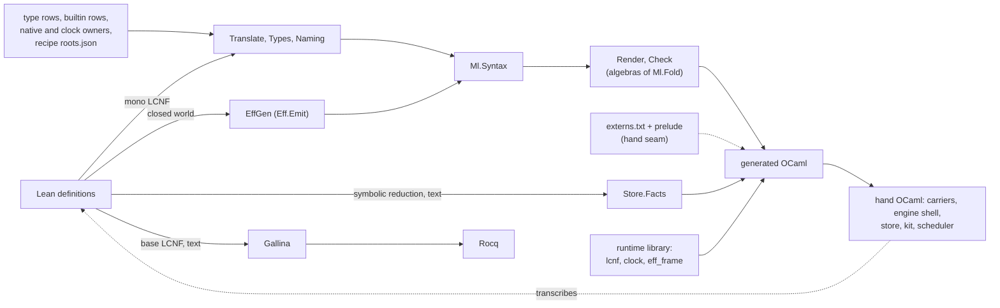
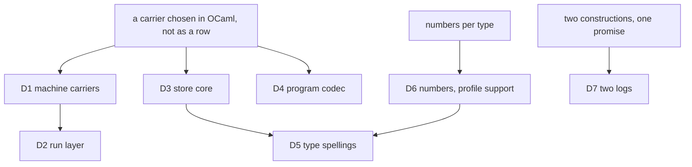

# The compiler and the OCaml estate: a coherence reading

Reader: the compiler-estate seat of the coherence audit, 2026-10-19, at `93090bfa0`. Read-only:
no build, no probe, no generator ran. Every number below has its command in §6.

Scope: `src/OCaml5`, `scripts/generate.py` and `scripts/lib`, and `ocaml/` in the large. The
frame is `orientation.md` in this folder.

## 1. The one thing to know

The compiler itself is coherent. LCNF goes to one OCaml syntax through two tables with contracts.
A typed recipe drives it, and interfaces are inferred from OCaml's own typed tree.

The departures sit where that compiler is bypassed. One modeling error recurs. An efficient
carrier was chosen in OCaml, not in Lean:
- a persistent map for the machine's stores;
- a byte string for the program codec and the store.

So every Lean function over that carrier was rewritten in OCaml around it:
- the prelude's 35 bindings;
- the store's `Store.checkAll`, transactions and verification;
- a second program codec;
- the drive and the run layer over the engine.

Each copy then needed a test family to stand in for agreement. Two copies already define behaviour
that Lean does not: the drive after a refused reply, and the store's verdict on a forged forward
reference.

The construction that removes the class exists in the tree. A carrier is a row: a type row and
operation rows with contracts. `Array` to `Lcnf_array` is the instance (`OCaml5.Lcnf.typeRows`,
`src/OCaml5/Lcnf/TypeRows.lean`). Lean's definition is then lowered once, through the LCNF
route. Decisions row 416 (1) already rules the outcome: "a hand OCaml copy of a Lean definition is a place no theorem reaches,
and it goes". Row 391 (3) P9 (b) rules the carriers' half.

## 2. The model: one compiler, one runtime, and who owns what

Dashed arrows are the departures. The table gives each layer's role.

| Layer | Modules | Sort carried | Arrow kind | Owner of the fact |
| --- | --- | --- | --- | --- |
| Source | `OCaml5.Lcnf.Dump`, `OCaml5.Lcnf.Index`, `OCaml5.Lcnf.Census` | LCNF `Decl .pure`, Lean's sort | a read, and a count per constructor | Lean's compiler |
| Tables | `OCaml5.Lcnf.typeRows`, `OCaml5.Lcnf.builtins`, `OCaml5.Lcnf.Native.rules`, `OCaml5.Lcnf.Clock`, `ocaml/gen/roots.json` | rows | stage-0 data | the tables |
| Translation | `OCaml5.Lcnf.translateClosureInferring`, `OCaml5.Lcnf.generate` | LCNF to `Ml.Syntax` | K3, trusted by row 391 (1); refuses by name | the generator |
| Target syntax | `OCaml5.Ml.Syntax`, `OCaml5.Ml.Fold` (generated), `OCaml5.Ml.Render`, `OCaml5.Ml.Check` | OCaml syntax, one free object | K1 algebras | the generator |
| Packaging | `OCaml5.Lcnf.Export`, `OCaml5.Lcnf.Public`, `OCaml5.Lcnf.Identity`, `OCaml5.Lcnf.Gen`, `scripts/lib/lcnf_interfaces.py`, `Lcnf_interface` (`ocaml/gen/interface/`) | recipe to units and interfaces | K4 plan checker; typed-tree inference | the recipe |
| Other emitters | `OCaml5.Eff.Emit`, `OCaml5.Store.Facts`, `OCaml5.Lcnf.Gallina` | Lean environment to OCaml or Rocq | emitted mirrors | each emitter (D4, D5) |
| Generated OCaml | `ocaml/gen/closure_gen.ml`, `ocaml/engine/api_engine.ml`, `ocaml/eff/eff_types.ml`, `ocaml/eff/eff_wire.ml`, `ocaml/engine/cas/e4_admission.ml` | machine, run layer, kit roots, codecs | lowered or emitted | Lean |
| Runtime library | `ocaml/lcnf` (`Lcnf_array`, `Lcnf_nat`, `Lcnf_string`, `Lcnf_list`), `ocaml/clock` (`E4_clock`), `Eff_frame` | target carriers | the rows' targets | the builtin rows |
| Carriers | `E4_table`, `E4_trace`, `E4_memo`, `E4_buckets`, `E4_ppath`, `E4_env`, `E4_fibers_view` | the machine's stores | data refinement by hand | hand (D1) |
| Engine shell | `E4_engine`, `E4_instance`, `E4_host`, `Kit_machine` | a run | drive and projections | hand (D2) |
| Host | `E4_sched` with its mailbox, inbox, ring, quiescence, trigger, admit, shutdown and abandon | domains and queues | host code | hand, ruled (row 391 (3) P6 (a)) |
| Store | `E4_disk`, `E4_cas`, `E4_pack`, `E4_control`, `E4_index`, `E4_node`, `E4_shape`, `E4_wal`, `E4_checkpoint`, `E4_chunk` | nodes and files | K2 codecs, host steps | mixed (D3, D7) |
| Kit | `Kit`, `Kit_author`, `Kit_tool`, `Kit_mcp`, `Kit_serve` | the agent's face | shells over lowered Lean | mixed (D2) |

Measured at HEAD: 56,221 hand and 106,898 generated lines of OCaml. The hand OCaml files that cite
Lean definitions most are the prelude, `E4_cas`, `E4_shape` and `E4_node` (§6, M1 and M2).

## 3. The pattern map

| Pattern | Where the area honours it | Where it departs |
| --- | --- | --- |
| One free object per sort | One OCaml syntax, `OCaml5.Ml.Syntax`, with a generated fold. The program types have one owner, `ocaml/eff/eff_types.ml`, made by the LCNF route from the Lean inductives. | A second value tree, `OCaml5.Eff.V` (`src/OCaml5/Eff/Goldens.lean`), beside `Store.Val` (D4). A second type alphabet, `OCaml5.Eff.OTy` (`src/OCaml5/Eff/World.lean`) (D5). |
| K1 fold | `OCaml5.Ml.renderExprAlg` and `OCaml5.Ml.patVarsAlg` are algebras of `cata_expr` and `cata_pat`. The builtin table's free-name and substitution walks are `OCaml5.Lcnf.usesAlg` and `OCaml5.Lcnf.substAlg`. | Hand traversals of Lean's free objects in the generator and the engine: `OCaml5.Eff.effV` and 24 more `V` conversions; `OCaml5.Eff.termO` and its siblings; `E4_engine.check_answer`; `E4_engine.Make`'s 20 `show_` renderers (D1, D4, D6). |
| K2 exact embedding | `E4_node` states retraction and exactness (ND1, ND2). `Eff_wire`'s decoders end in `_exact`. A carrier's JSON is Lean's `ShapeDoc.printTree` and `ShapeDoc.readLocated`, lowered (row 416 (4)). | Program bytes are emitted by `OCaml5.Eff.wireModule`, while Lean's `Canonical.toVal` is already lowered as `Effect4.Run.Kit.programToVal` (D4). |
| K3 simulation | Row 391 (1) trusts the lowering. The lanes compare lowered code with Lean's answers byte for byte: to-do, constructors, `Modeled`, Rocq. | The engine differential compares hand renderings, because the functor makes the machine's types generative (`E4_diff`, `ocaml/engine/test/reference/e4_diff.mli`) (D1). |
| K4 located refusal | `OCaml5.Lcnf.Export.readChecked` refuses a recipe by root and class. `OCaml5.Lcnf.Gen` writes nothing when a run refuses. `OCaml5.Lcnf.nativeOwner?` refuses by name. `E4_admission` is generated from `Admission.ofRead`. | Profile support refuses by an exception with a crossing and no place, `E4_clock.Profile_refusal` (D6). `OCaml5.Lcnf.Gallina` writes its refusals into the output as text and scans for them (D5). `Kit_serve` raises `Input` for a malformed request (D2). |
| K5 monoid action | The journal is Lean's `List Command`. `E4_query` keeps INV-TAPE-1: every query is a function of the saved machine, the log and the tape. | Two durable logs promise one all-or-none commit: the pack's published boundary and `E4_wal` (D7). |
| Five constructions | Construction 3: the machine in OCaml is `RunMachine` lowered. Construction 1: the program types come from the inductives. Construction 4: a native host is a provider adapted to a row (rows 393, 405). | Construction 5's boundary embeddings are built twice for bytes (D4) and by hand for the store (D3). The run layer is rewritten around the engine (D2). |
| Tables as data, generation as a fixed point | `typeRows` and `builtins` give every row a contract and a receipt, checked by `OCaml5.Lcnf.problemsOf` and `OCaml5.Lcnf.receiptProblems`. A file's header is its command (`OCaml5.Lcnf.Gen.commandOf`). | `externs.txt` is a second table of untranslated constants, in text, with no contract (D1). Three mechanisms turn Lean into OCaml, each with its own type spelling. `Lcnf_nat` copies the bodies of `OCaml5.Lcnf.support` by hand (D5). `scripts/generate.py` spells each OCaml family's route by hand, while the `derived` family runs a plan that Lean emits. |
| One located refusal per judgment | Store admission has one refusal type, generated (`E4_admission.t`). Kit refusals are Lean's located refusals, lowered. | Profile support, one of the seven judgments, is written in OCaml at ingress (`E4_engine.check_answer`, `E4_engine.Make.compile`) (D6). |
| One owner per fact | Naming has one owner, `OCaml5.Lcnf.Naming`; EffGen and `OCaml5.Lcnf.Public` read it. Division has one owner (row 404 (4)). Carrier JSON has one owner (row 416 (4)). | A Lean definition and its OCaml transcription: 35 prelude bindings (D1); `E4_host` for `Effect4.Run.driveFrom` (D2); `E4_cas` for `Store.checkAll`, `Word.apply` and `Store.verify` (D3); `eff_wire.ml` for the derived `Canonical` instance (D4). |
| Host boundary | `E4_sched` lets only strings and ints cross domains (its memory rule). `E4_host` treats a provider's exception as no answer (row 408 (1)). The install lane checks the packages from outside. | Host code decides semantics: the drive's stop after a refused reply (`E4_host` H11), and `E4_abandon`'s close order and finalizer fuel, where R11's abandon is still open (D2). |
| Deep modules | `Kit.run` is one call that picks the runner. `E4_disk` is one checked open with one failure rule. `OCaml5.Ml.Render` takes a module and gives bytes. | The engine and its oracle take four modules: `E4_engine.Make`, `E4_instance.Make`, `Api_engine_inst` and `Api_gen_inst`. The functor's interface has seven carrier signatures (`ocaml/engine/api_engine.mli`). `E4_cas` holds semantics and host steps in 2,081 lines. `E4_be` forwards to `Eff_frame`. |

## 4. Strengths to keep

1. **One OCaml syntax, folded.** `OCaml5.Ml.Syntax` is the estate's one OCaml syntax, with a
   generated fold (`src/OCaml5/Ml/Fold.lean`, group `MlFold`). The renderer and the checker are
   algebras of it, so a new form is a compile error in each.
2. **The primitive tables are ISLE-like.** `OCaml5.Lcnf.builtins` gives each row Lean's runtime
   column, an OCaml form, a class, a domain, its controls, a cost and a receipt. No field has a
   default, and `OCaml5.Lcnf.problemsOf` checks every row. `OCaml5.Lcnf.typeRows` does the same
   for types. Row 403 gives each constructor of a natively spelled type one owner, read by
   `OCaml5.Lcnf.nativeOwner?`, and `Test/Audit/ConstructorOwners.lean` pins every owner.
3. **The recipe is data, and its checker refuses.** `ocaml/gen/roots.json` is read by
   `OCaml5.Lcnf.Export` as a typed plan, with one class per root. A refused plan makes no artifact.
   A run's header is the command that makes it alone.
4. **Interfaces come from OCaml's own typed tree.** `Lcnf_interface` (compiler-libs) infers each
   `.mli` from a fresh typed tree, keeps the roots and seals checked packages as abstract types.
   This is the right use of compiler-libs: mono LCNF erases what a generator would need to spell
   the types.
5. **One compiled closure.** Every declaration is lowered and compiled once, and consumers share
   nodes through facades (row 416 (3)). Declarations compiled twice went from 1,330 to 0 (row 416 (1)).
6. **A target-level check of a translation property.** Each join point is `let[@local always]`,
   warning 55 is fatal, and `ocaml/gen/join_escape.ml` is the red control.
7. **The public face has Jane Street's pedigree.** `OCaml5.Lcnf.Public` writes an append-only name
   manifest and a facade, and the install lane builds a client outside `ocaml/`.
8. **The agent's face is Lean's, lowered.** The checker, program and reply admission, the call tree,
   authoring, carrier JSON and the tool protocol run as lowered Lean. `Kit_tool` and `Kit_mcp`
   are shells over `Effect4.Tool.Native.serveTree`. This is "protocol in Lean, OCaml shell".
9. **Rocq definitions are generated, never transcribed** (row 411 (2)). `OCaml5.Lcnf.Gallina`
   writes Rocq from base-phase LCNF, and refuses by name what it cannot write exactly.
10. **The store's refusal alphabet is generated.** `E4_admission`, `E4_kind`, `E4_root_policy` and
    `E4_result` come from `OCaml5.Store.Facts`. Seat R1 built on them and added no error type.
11. **Host code is honestly host.** `E4_sched` and its modules keep the memory rule. `E4_disk`
    turns every host failure into `E4_fault.Io` and closes the writer. The STM lanes test
    concurrency as host-only finite runs.
12. **The estate's discipline.** Each hand file has a property list. `ocaml/tools/typed_lint` checks
    rule 7 on each typed tree. Every refusal of the generator happens before any output is written.

A refactor must keep 1 to 4 intact: they are what makes "a carrier is a row" possible at all.

## 5. Departures

Four of the seven share one root, D1 to D4. A representation choice was made in OCaml, so the
definitions that depend on it followed it there. D5 and D6 share a second root: one fact spelled
once per emitter, or once per type. D7 is a construction question about the logs.

### D1. The machine's carriers: data refinement by transcription (L)

**Pattern.** One owner per fact; generation as a fixed point. `ocaml/STANDARDS.md` rule 3 says hand
OCaml under `ocaml/engine` is host code, or a carrier that LCNF-made code replaces.

**Modeling error.** The machine's stores needed persistent maps and shared spines, and lane G2
measured that need. The representation change was made at lowering time, by substituting OCaml
text for Lean constants. So the machine is lowered twice: flat in `closure_gen.ml`, and as a
functor over seven carriers in `api_engine.ml`. A hand prelude transcribes the Lean definitions
that touch a carrier, "arm for arm". The functor makes the machine's types generative, so the two
lowerings cannot be compared as values, and a differential compares hand renderings.

**Observation they serve.** One: the machine's observation of a replay. `E4_memo_list`'s MM2
states that the carrier is not observable.

**Evidence.**
- `ocaml/engine/externs.txt`: 51 rows (28 `fn`, 11 `field`, 11 `ops`, one `type`, one `elem`),
  parsed by `OCaml5.Lcnf.Externs` (`src/OCaml5/Lcnf/Externs.lean`, 576 lines). The rows carry
  no contract, unlike `OCaml5.Lcnf.builtins`.
- `ocaml/engine/tools/api_engine_prelude.ml`: 573 lines, 35 `sh_` bindings, spliced into the
  functor. `sh_ref_step` transcribes `Effect4.Machine.refStep`, and `sh_api_load` transcribes
  `Effect4.Api.load`.
- Two machines in installed libraries. `Effect4.Api.run` is a public root of `api_gen`, over
  lists. The kit runs `E4_engine.Fast`, over the carriers.
- The assembly: the seven carriers with `E4_instance` and `Api_engine_inst` (1,722 lines).
  `Api_gen_inst` (`ocaml/engine/test/api_gen_inst.ml`) is the list instance.
- `E4_engine.Make`'s 20 `show_` renderers, `E4_diff`, and the carrier tests and differential
  (4,162 lines). `OCaml5.Lcnf.Identity`'s `profile` part exists to tell the two lowerings apart.

**Move.** Data refinement becomes a Lean fact, and the seam becomes the builtin table. Each store
is a Lean definition over the interfaces of row 391 (3) P9 (b). An operation that must be native
becomes a type row and operation rows with contracts, as `Array` to `Lcnf_array` already is. The
machine is then one definition, lowered once. The extern seam collapses into `builtins`. This is
phase 3 of the estate plan.

**What goes.**
- `externs.txt`, and most of `OCaml5.Lcnf.Externs`;
- the prelude;
- `api_engine.ml` as a second machine;
- `E4_instance`, `Api_engine_inst` and `Api_gen_inst`;
- the renderers and the string differential;
- the `profile` part of node identity, and the list twins' tests.

**What stays.** The measured need: lane G2 found 98.5 % of the retained machine and 58 % of the time
in `Point.path` and `Point.env`. So the Lean carriers need the same costs, from a persistent
vector and a persistent map. `E4_sched` stays as host code (row 391 (3) P6 (a)). The list machine
stays as the proof model, since the machine's laws are over lists.

**Over-engineering risk.** The move goes wrong if it re-parameterizes the proved machine, or adds a
storage framework with a law per operation. Keep the six interfaces of P9 (b) as the ceiling. Give
each interface only the law its consumer reads. Row 391 (3) says the same: "each interface's laws
coming with its instance".

**Ruling.** None contradicted. The move applies row 391 (3) P9 (b) and row 416 (1).

### D2. The run layer rewritten around the engine (M)

**Pattern.** The host boundary, and one owner per fact. The orientation's §2: "protocol in Lean,
OCaml shell".

**Modeling error.** The fast machine is not the type the lowered run layer runs on (D1). So the
run layer was transcribed over the engine: the drive, the outcome alphabets, the runner's choice,
a request protocol. The copies then drifted into semantics. Lean's `Effect4.Run.driveFrom` keeps
the reactor's next state after a refused reply, and the OCaml drive stops at once
(`E4_host` H11). The estate plan's §6a records this, and the decisions row it calls for is unwritten.

**Observation they serve.** One per pair. A drive's run, commands and host state
(`E4_host.Make.serve` against `Effect4.Run.driveFrom`). How a replay ends (`E4_engine.answer`
against `Effect4.Api.Outcome` and `Effect4.Api.FrontierReason`). A request's answer (`Kit_serve`
against `Effect4.Tool.serve`).

**Evidence.**
- `E4_host` (`ocaml/engine/e4_host.mli`): "Lean's `Effect4.Run.driveFrom`", with its own stop
  alphabet `outcome`, `host_stop` and `stop`.
- `E4_engine.Make`'s drive loop and its five-letter `answer`, and `Kit_machine.stop`.
- `Kit.run` (`ocaml/engine/kit/kit.ml`) picks the call tree or the machine "as Lean's
  `Effect4.Run.atBudget` does", by a hand `if`.
- `Kit_serve`: a request type for check, run and explore beside `Effect4.Tool.Protocol`, which
  has `explore`, `settle`, `frames` and the check query of row 414 (3).
- `E4_abandon` fixes an abandon policy: interrupt, close scopes innermost-first, with a finalizer
  fuel budget. R11's "open scopes closed only by an explicit abandon" is an open part of the
  system map (§8), and its D8 waits on a ruling.

**Move.** Lower `Effect4.Run` and the session over the one machine (row 391 (2), LC-7; estate plan
§2.4). The OCaml shell keeps only the scheduler, the provider adapters (rows 393 (2), 405) and
input and output. Lean's stop alphabets become the OCaml types.

**What goes.** `E4_host`'s drive; `E4_engine.Make`'s loop and alphabet; `Kit_machine`; `Kit.run`'s
dispatch; `Kit_serve`'s request execution (estate plan slice 1.7); the abandon policy as host code.

**What stays.** The scheduler and its memory rule. The exception policy of a native provider (row
408 (1)) in the adapter. The target-capacity refusal at ingress (row 417 (1)). The command-line
parsing of `eff`.

**Over-engineering risk.** Wrapping the lowered run layer in a new OCaml facade with its own
alphabet would recreate the copy. The facade is `Effect4.Run`'s own operations (estate plan §2.4).
D2 also waits on D1; lowering the session over lists first would cost the measured speed.

**Ruling.** None contradicted. The abandon policy should not run ahead of R11's open ruling.

### D3. The store's semantic core transcribed by hand (L)

**Pattern.** One owner per fact (row 416 (1)). The fifth construction: boundaries are exact
embeddings of Lean's codecs.

**Modeling error.** The store was placed in "boundary code" by directory, not split by role. Its
admission, transactions, words, closure and verification are pure functions that Lean owns
(`Effect4.Store.Domain`). Only files, segments, syncs, locks, caches and chunking are host steps.
Lean's store functions already reach one target from Lean: `OCaml5.Lcnf.Gallina.storeSpec` writes
them as Rocq. The other target holds a hand copy.

Seat R1 found a copy of a copy, and deleted it. `E4_cas.verify` copied `E4_cas.checked_image`,
which runs `E4_cas.admissible`, a copy of `Store.checkAll` (`coherence.md` §3). The copy also differs from Lean: the checked open admits in
write order, so it refuses a forged forward reference that Lean's `Store.verify` reads otherwise.
R1's receipt proposes a decisions row to record that difference.

The cause under the copy is the carrier again. Lean's `Effect4.Store.Bytes` is `List UInt8`
(`src/Effect4/Store/Carrier/Digits.lean`), which has no fast OCaml spelling.

**Observation they serve.** One: the verdict of `Store.putNode` or `Word.apply`, and a node's bytes.
`OCaml5.Tools.CasGoldens` and `OCaml5.Store.DiskOracle` exist to compare the two.

**Evidence.**
- `E4_cas` (`ocaml/engine/cas/e4_cas.mli`) names its Lean sources: `Store.putNode`, `Store.find`,
  `Store.move`, `Store.closure`, `Word.wf`, `Word.apply`, `Store.verify`. Its sections on
  `Admission`, put, transactions, words and verification are 696 of its 1,613 lines.
- `E4_node` (541 lines) is "`Node.encode` / `Node.decode` as OCaml".
- `E4_shape` (974 lines) is a per-kind field table transcribed from payload shapes. It needs a
  `Shared` status because the kind byte is not injective on carriers.
- `OCaml5.Tools.CasGoldens` (673 lines) defines 11 tool-side `Val` images of store types that have
  no `Canonical` instance in Lean (`rootVal`, `wordVal`, `storeVal`, and others).
- `OCaml5.Store.Facts` reduces `Admission.ofRead` symbolically into OCaml text: a third way to turn
  a Lean function into OCaml.

**Move.** Give the byte sort one carrier row. A Lean byte type is spelled by OCaml's `string` or
`Bytes`, and its operations are builtin rows. Then lower the store's semantic functions through the
recipe, and let `E4_cas` call them, as the kit calls the checker. `E4_admission` then comes from
the same lowering.

**What goes.**
- `E4_cas`'s semantic sections, and `E4_node`'s codec;
- `E4_shape`'s table, replaced by Lean's shapes;
- `CasGoldens`' tool-side images;
- most of the G1 to G9 goldens, and the disk oracle's comparison;
- `OCaml5.Store.Facts` as a separate mechanism.

**What stays.** `E4_pack`, `E4_control`, `E4_lock`, `E4_file`, `E4_index` (a cache), `E4_chunk`,
`E4_disk`'s failure rule. R1's open rule (O1, O2) stays in the host: `E4_pack` owns where a scan
reaches the published end, as R1 recommends. A zero-allocation edge scan stays only if a measurement
asks for it.

**Over-engineering risk.** Changing `Effect4.Store.Bytes` throughout the store's laws would be a
large Lean change. Introduce the fast carrier at the lowered entry points only, with one round-trip
theorem. Measure first. A one-node `E4_disk` commit costs 0.27 ms (R1's receipt, O3). No measurement
says what a list-based lowering would add to it. If it adds little, the row is not needed.

**Ruling.** None contradicted. It applies row 416 (1). The estate plan (§2.1, history) placed "the
store" in boundary code; this reading splits it by role.

### D4. The program's canonical image built twice (M)

**Pattern.** One free object per sort: `Store.Val` is the value sort. K2 exact embedding.
Generation as a fixed point: a generator has no semantics of its own.

**Modeling error.** The codec rule is semantics. Its parts are constructor tag 10, the index as a
`Nat` frame, a structure as constructor 0, and `nil = 0`, `cons = 1`. It is written three times:
- Effect4Gen derives `Canonical (Eff NativeOp)` (`src/Effect4/Store/Domain/Derived/Program.lean`);
- `OCaml5.Eff.wireModule` emits an OCaml encoder and decoder per family;
- `OCaml5.Eff.V.bytes` encodes a second value tree for the goldens.

Meanwhile `Canonical.toVal` and `Canonical.ofVal` are already lowered, as
`Effect4.Run.Kit.programToVal` and `Effect4.Run.Kit.programOfVal`.

**Observation they serve.** One: a program's canonical bytes, which the goldens pin byte for byte.

**Evidence.**
- `OCaml5.Eff.V` (`src/OCaml5/Eff/Goldens.lean`): a value tree beside `Store.Val`, with `V.bytes`,
  `V.json` and 25 hand conversions (`effV`, `termV`, `layerV`, …). `OCaml5.Eff.Metadata` adds 5
  more, each "compared with `Canonical.encode` before writing".
- `ocaml/eff/eff_wire.ml`: 1,267 generated lines over the hand `Eff_frame`.
- Two golden sets: `ocaml/eff/goldens` (273 files, from `V`) and `ocaml/goldens/eff` (11 files,
  from Lean's `Wire`). Three tests compare them (`test_eff`, `test_lean_wire`, `prop_wire`; 1,067
  lines).
- `OCaml5.Eff.keyO`, `OCaml5.Eff.termO` and `OCaml5.Eff.opO` quote Lean values as OCaml literals,
  where a lowered root would carry the same data.

**Move.** One map from programs to values, `Canonical.toVal`, lowered (it is already). One framing,
`Val.encode` and `Val.decode`, as the one byte kernel: `Eff_frame` and `Eff_val`, or the carrier
row of D3. Goldens come from Lean's `Wire` only.

**What goes.** `V` and its 30 conversions; `V.bytes`; `OCaml5.Eff.wireModule` and `eff_wire.ml`; the
`.bin` goldens of `ocaml/eff/goldens`; the second comparison in `test_lean_wire`; `E4_be` as a
forwarding face.

**What stays.** The framing kernel; the `.ty` goldens, which are the checker's output; the
`Eff_subterm` table while `E4_subterm` reads byte ranges. `V.json` stays until `ts/eff`'s tests,
which read it, take Lean's JSON image instead (outside this reading).

**Over-engineering risk.** The two-step encoder allocates a value tree. If program bytes are hot
(engine load, store put), emit the fused encoder. Emit it from the same description that derives
Lean's `Canonical` instance, not from a second reading of the environment.

**Ruling.** None contradicted. It applies rows 416 (1) and 411 (2) ("generated, never transcribed").

### D5. Three ways from Lean to OCaml, and four type spellings (S)

**Pattern.** Tables as data, with one owner per fact. A target syntax is a sort, built by its
constructors and rendered by an algebra of its fold.

**Modeling error.** Each emitter grew its own small map from Lean types to target spellings, and
two emitters build target text by concatenation. Seat 2.2b's finding shows the cost: the switch of
`Nat` to `Z.t` "cannot land in parts" (estate plan §6a). Today three emitters spell `Nat`.

**Observation they serve.** One: the OCaml type of a Lean type at a unit's boundary. Generated units
must agree on it to link.

**Evidence.**
- `OCaml5.Lcnf.typeRows` spells `Nat` as `int`, until slice 2.2b.
- `OCaml5.Eff.projectShape` (`src/OCaml5/Eff/World.lean`) spells it `.int`, in its own alphabet
  `OTy`, with its own renderer `OTy.render`.
- `OCaml5.Store.Facts` (`src/OCaml5/Store/Facts.lean`) spells it `Z.t`, and writes OCaml as
  strings, not through `Ml.Syntax`, so `Ml.checkModule` never reads it.
- `OCaml5.Lcnf.Gallina` writes Rocq as strings. Its refusals are `(* REFUSED … *)` markers that
  `render` finds by `splitOn`.
- `OCaml5.Lcnf.support` holds the bodies of `Lcnf_nat.mul`, `pow`, `shift_left` and
  `Lcnf_list.contains`. `ocaml/lcnf/lcnf_nat.ml` and `lcnf_list.ml` copy them by hand ("the bodies
  … unchanged").

**Move.** `typeRows` owns every OCaml spelling: EffGen and `OCaml5.Store.Facts` read
`OCaml5.Lcnf.builtinTy?` and the type generator, and the facts module emits `Ml.Syntax`. D3 retires
it anyway. The runtime library's rowed functions are rendered from `support`, or deleted by D6.
Gallina's refusals become a value that names the declaration and the constant.

**What goes.** `OTy` and its renderer; `OCaml5.Store.Facts.nativeType`; the hand copies in
`ocaml/lcnf`; the marker scan.

**What stays.** Gallina's own Rocq spelling, since Rocq is another target. A Rocq syntax tree is not
needed for one 600-line emitter.

**Over-engineering risk.** A multi-target table, with an OCaml and a Rocq column per row, would be a
framework. Keep one table per target, each with one owner.

**Ruling.** None contradicted.

### D6. Numbers by casework, and profile support in host code (M)

**Pattern.** General over casework. One located refusal per judgment: profile support is one of the
seven judgments (`docs/core/controlled-english.md` §4).

**Modeling error.** The numeric domain was handled per type. `Nat` is `int` everywhere, except the
clock, which got its own exact carrier. Every crossing between the two then needed an analysis, a
named crossing and a second contract column. Profile support at ingress was written in OCaml, not
in Lean. Row 108's implementation asks for "the refusal written once in Lean with the bound as
data".

**Observation they serve.** The refusal of a value outside the profile, at a named place: one
judgment. `OCaml5.Lcnf.ClockFlow` serves no observation of its own. It keeps two spellings of one
type apart.

**Evidence.**
- `OCaml5.Lcnf.ClockFlow` (605 lines) analyses mono LCNF to find where a clock value meets a natural.
  `OCaml5.Lcnf.Clock` serves it too, and 45 lines of `Translate` and 31 of `Builtins` mention the
  clock.
- `E4_clock` makes `Effect4.ClockMillis` exact over Zarith, and `Profile_refusal` is an exception
  naming one of six crossings, with no place.
- `OCaml5.Lcnf.Fidelity.domain` on the `Nat` and `Int` rows, beside the `receipt` column: "the
  row's class once `Nat` and `Int` are spelled `Z.t`". The `Lcnf_nat` bodies saturate.
- `E4_engine.check_answer` (52 lines) walks `Val`, `Err`, `Defect` and `Reason` by hand.
  `E4_engine.Make.compile` checks the literals through the emitted `Eff_ctors.lits_eff`.

**Move.** E6, under row 417 (1). `Nat` and `Int` become `Z.t` by the one type row, and the clock
becomes an ordinary natural. Profile support becomes one Lean judgment: a fold over `Val` and a
program's literals. Its bound is data, and its refusal is `Located` (row 414 (2)). It is lowered,
and the engine and the kit call it at ingress, as they call reply admission.

**What goes.** `ClockFlow`, `OCaml5.Lcnf.Clock` and the clock rows; the dual contract columns; the
`Lcnf_nat` bodies; `check_answer`; `Test/Audit/ClockLowering.lean` and its fixtures.

**What stays.** The profile's bound as the ingress rule (DI-56, row 417 (1)). The arithmetic refusal
that escapes the program's own catch (row 108's side audit). The index crossing, while `USize` is
the target's `int`.

**Over-engineering risk.** A numeric-profile framework, with a profile type per face, adds more than
it removes. The judgment is one fold, and the bound is one datum. Measure `Z.t` by allocated words,
as 2.2b part 1 found CPU time noisy.

**Ruling.** None contradicted. It applies rows 417 (1) and 108.

### D7. Two durable logs for one promise (M)

**Pattern.** K5 monoid action, and one construction per promise.

**Modeling error.** A second append log was built beside the pack, with its own segments, frames,
seal rows and rotation. The pack's published boundary already makes a commit all or none. The log
has no such boundary, which is why LG3 fails on a torn batch (Codex's A3.4).

**Observation they serve.** One: the rows of one commit, durable together or absent together (LG3).

**Evidence.** `E4_wal` (965 lines with its interface) and its tests and bench (771 lines). Its
consumer is `E4_checkpoint`. `coherence.md` §5 holds the argument.

**Move.** `coherence.md` §5 (b): a durable journal is committed as nodes in one `E4_disk`
transaction.

**What goes.** `E4_wal` and `E4_checkpoint.ephemeral`, about 1,700 lines by `coherence.md` §5.

**What stays.** A second log is justified only by a measured rate. R1 measured one log row at
0.021 ms, a 512-row batch at 0.67 ms and one `E4_disk` commit at 0.27 ms (O3). No run's journal
rate is measured. If a log stays, it takes its all-or-none promise from a published boundary.

**Over-engineering risk.** Making the pack a general log engine, with batching modes for a consumer
that does not yet exist.

**Ruling.** It contradicts row 417 (2) ("LG3 stays … the log's format gains a batch frame"). The
owner rules again, as `coherence.md` §5 asks.

### What the departures share, and the order

D6 (E6) comes first: it fixes the spelling of `Nat` that D3, D4 and D5 all emit. D1 comes before
D2. D3 and D4 share the byte carrier row, so one design note serves both.

## 6. Measurements

Each command ran from the repository root at `93090bfa0`, read-only.

| Id | Command | Result |
| --- | --- | --- |
| M1 | `python3 docs/research/2026-10-18-slices/measure.py` | hand 56,221, generated 106,898 OCaml lines; its list of hand copies totals 567 lines and names none of D1's prelude, D3 or D4 |
| M2 | for each hand `.ml` and `.mli` outside tests, `grep -c 'src/Effect4/'` | most citations: `api_engine_prelude.ml` 33, `e4_cas.mli` 25, `e4_shape.ml` 24, `e4_node.mli` 18, `e4_node.ml` 17 |
| M3 | `grep -v '^#' ocaml/engine/externs.txt \| grep -v '^$' \| awk '{print $1}' \| sort \| uniq -c` | 28 `fn`, 11 `field`, 11 `ops`, 1 `type`, 1 `elem` |
| M4 | `grep -c '^let sh_' ocaml/engine/tools/api_engine_prelude.ml`; `wc -l` | 35 bindings, 573 lines |
| M5 | `cat ocaml/engine/e4_{table,trace,memo,buckets,ppath,env,fibers_view,instance}.ml* ocaml/engine/api_engine_inst.ml \| wc -l` | 1,722 |
| M6 | `wc -l` of `prop_table`, `prop_fibers_view`, `prop_point`, `prop_memo`, `prop_trace`, `test_buckets`, `bench_carriers`, `test_diff`, `api_gen_inst` and `reference/e4_diff*`, `reference/e4_memo_list*` | 4,162 |
| M7 | `grep -c '^  let \(rec \)\?show_' ocaml/engine/e4_engine.ml` | 20 |
| M8 | `wc -l ocaml/gen/closure_gen.ml ocaml/engine/api_engine.ml` | 69,991 and 15,928 |
| M9 | `sed -n '/= 4. admission/,/= queries that are not edges/p' ocaml/engine/cas/e4_cas.ml \| wc -l` | 696 of 1,613 lines |
| M10 | `wc -l` of `e4_node.ml*` and `e4_shape.ml*` | 541 and 974 |
| M11 | `grep -c -E '^(partial )?def [a-zA-Z]+V\b'` over `Eff/Goldens.lean` and `Eff/Metadata.lean`; `CasGoldens.lean` with `[a-z]+Val` | 25, 5 and 11 |
| M12 | `git ls-files ocaml/eff/goldens \| wc -l`; the same for `ocaml/goldens/eff` | 273 and 11 |
| M13 | `wc -l src/OCaml5/Lcnf/ClockFlow.lean`; `grep -c -i clock` over `Translate.lean`, `Builtins.lean` | 605; 45 and 31 |
| M14 | `sed -n '/^let check_answer/,/^;;/p' ocaml/engine/e4_engine.ml \| wc -l` | 52 |
| M15 | `wc -l` of `e4_wal.ml*`, and of `test_wal.ml` with `bench_wal.ml` | 965 and 771 |
| M16 | `python3 -c` over `ocaml/gen/roots.json`, the number of roots per class | api: 101 public, 17 linkage, 41 coverage; engine: 12 linkage, 2 internal, 6 coverage |

## 7. What this reading did not cover

- `tools/Conform` (8,010 lines): the source and target evaluators and the rungs. The builtin table's
  columns `runtime`, `targetLibrary` and `controls` serve them. Whether those columns still serve
  an observation after row 391 is that area's question.
- `ts/`, `harness/`, `rocq/`, and `tools/Effect4Gen` beyond its derived program codec. `V.json`'s
  readers in `ts/eff` were not read.
- The internals of `E4_sched` and its modules, `E4_index`, `E4_chunk`, `E4_checkpoint` and
  `E4_log`. Each was read at its header only.
- The test lanes' contents beyond their headers, the install lane, and `Kit_mcp`'s transport.
- The coverage class's members (M16): whether hand code calls them, as the estate plan's §6a
  says, was not checked.
- Line-level defects; Codex's quality review lists them.
- Performance. Every figure quoted is a recorded measurement from a receipt or a header, not rerun.
- The Makefile and the gates.
