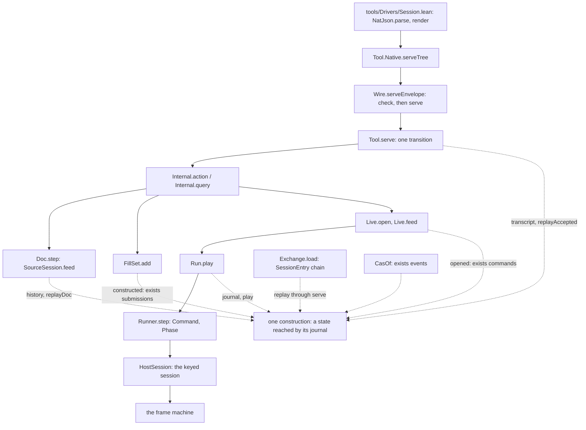

# The Lean core: the session face and the data plane, read against the organizing principle

Reader of the coherence audit (`plan.md` in this folder), 2026-10-19, at `93090bfa0`. Read-only.
The frame is `orientation.md`. The scope is `src/Effect4/Tool`, `src/Effect4/Api.lean` and
`src/Effect4/Api/`, `src/Effect4/Run`, `src/Effect4/Program`, `src/Effect4/Data`,
`src/Effect4/Store`, `src/Effect4/Schema`, and `tools/Drivers/Session.lean`.

## 1. The one thing to know

The area already lives by the algebra where it was designed by it: the program sort, the
authoring surface, the canonical codecs, the Schema plane and the tool's one transition. The
departures sit at the joins. Each one is a construction the tree already owns, spelled again by
hand where a later slice needed it. Three are large:

- the journal acting on a state is written six times (`Doc`, `Tool.State`, the session chain,
  `Run` and `Live`, `CasOf`, `FillSet`), each with its own replay and append laws;
- the typing rule's environments are written three times (`Checker.check`, `Node.childEnv`,
  `Annotate.check`), and two edit engines evaluate them;
- the budgeted meaning of a program is written twice (`Run.Tree` in the core, `denoteRowsB` in
  the law graph), with its host spelled four ways.

Each move below makes the second spelling an instance of the first. None adds program syntax, a
generic judgment record or a framework.

## 2. What I read, and how I measured

I read every module docstring in scope, the main declarations of each module, and the
matching law files only for the theorems a definition answers to. Sizes are from `git ls-files`
and `wc -l`. The traversal counts are a finite probe: `#traversal_census`
(`src/Effect4/Laws/Auto/Traversals.lean`) run through `python3 /private/tmp/seams-lean-one.py
lake env lean` on the probes in `probes/lean-core/` (`Census.lean`, `Census2.lean`,
`Census3.lean`). The probe read the oleans in `.lake` (built 2026-10-17 and 2026-10-18), and
it imports `Effect4` without `Effect4.Laws`. So a fold connector that lives in the law graph
does not show, and "structural" here means "not a fold in the core".

| Folder | Files | Lines |
| --- | --- | --- |
| `src/Effect4/Program` | 100 | 31,820 |
| `src/Effect4/Store` | 37 | 19,424 |
| `src/Effect4/Tool` | 16 | 11,708 |
| `src/Effect4/Api` and `src/Effect4/Api.lean` | 14 | 7,770 |
| `src/Effect4/Schema` | 18 | 6,823 |
| `src/Effect4/Data` | 14 | 3,991 |
| `src/Effect4/Run` and `src/Effect4/Run.lean` | 11 | 2,137 |
| `tools/Drivers/Session.lean` | 1 | 55 |

Of the 83,211 lines in the seven folders, 32,248 sit in files headed `GENERATED`. The committed
`Canonical` codec groups alone are 23,205 lines (`ToolDerived`, `CheckDerived`,
`RefusalsDerived`, `RunnerDerived`, `Api/Derived`, `Store/Domain/Derived/*`, `PinDerived`).

## 3. The model, in one picture

The session face is a stack of transitions. Each layer keeps a state together with the journal
that reaches it. The dashed edges are the places where that one construction is spelled again.

## 4. The pattern map

| Pattern (orientation §§3–4) | Where the area honours it | Where it departs |
| --- | --- | --- |
| One free object per sort | `Eff` (`src/Effect4/Program/Eff.lean`) with its signature as data (`binders.json`, `LayerView`); `Ty` (`src/Effect4/Program/TyCore.lean`); `Store.Val` (`src/Effect4/Store/Carrier/Val.lean`) with one byte codec; `Representation` (`src/Effect4/Schema/Representation.lean`); a sketch adds no sort (`src/Effect4/Program/Sketch.lean`) | JSON has three trees: `Effect4.Json` (`src/Effect4/Data/Json.lean`), `Effect4.NatJson` (`src/Effect4/Data/NatJson.lean`), and `Lean.Json` at the tools' edge (`tools/Tools/JsonBridge.lean`) (departure 4). The call tree `Run.Tree.Tree` (`src/Effect4/Run/Tree.lean`) is a second free monad beside the effects package's `Effects.Program` (departure 3) |
| K1 fold | The generated folds (`src/Effect4/Program/Fold.lean`, `src/Effect4/Schema/Fold.lean`, `src/Effect4/Store/Carrier/Fold.lean`); `fold_of` reads a structural definition as its algebra (`src/Effect4/Program/FoldOf.lean`); the checker is one `Except`-valued traversal read as a fold (`Checker.check`, `src/Effect4/Program/Checker.lean`) | `Shape` has no fold: 23 hand traversals (14 structural, 9 well-founded) in six modules (departure 5). `Run.Tree.level` and `Run.Tree.statements` are hand traversals of `Eff` beside the fold `denoteRowsB` (departure 3). `Annotate.check` repeats the checker's arms (departure 2) |
| K2 exact embedding | `Canonical` with its three laws as class fields (`src/Effect4/Store/Domain/Canonical.lean`); the re-encode guard as one construction for exactness (`src/Effect4/Data/Reencode.lean`); `Bridge.ofSchema_exact` (`src/Effect4/Schema/Bridge.lean`); `decode_iff` (`src/Effect4/Laws/Schema/Codec.lean`); `Sketch.decode_exact` | A carrier's JSON has two printer and reader pairs, one per JSON tree, tied by `Agrees` (`src/Effect4/Laws/Store/ShapeRead.lean`) (departure 4) |
| K3 simulation | The free-monad trees and comodel runs live in the law graph (`hostRun_eq_meaningUnder`, `src/Effect4/Laws/Program/HostRuns.lean`); `Run.Tree`'s budget facts are declared from Rocq (row 411) | One run is observed through four records read separately (`Run.Observation`, `Run.Work`, `View`, `MachineView`) (departure 8). `ofProgram_eq_denoteRowsB` is a planned agreement between two traversals, not an algebra agreement (departure 3) |
| K4 located refusal | `TypeRefusal := Located (List Nat) TypeReason` with `programRefusal_none_iff` (`src/Effect4/Program/CheckedTyping.lean`); `JsonRefusal` and `TextRefusal` share `Located`; the tool keeps the wire's refusal apart from its own (`src/Effect4/Tool/WireTypes.lean`) | Nine refusal records re-spell `Located` by hand, and `DocumentRefusal.under` repeats `Located.under` (departure 7). Store verification refuses in `VerifyError`, a second alphabet for the node rule (departure 6) |
| K5 monoid action | `Runner.step` is total, a refused row is a verdict, and `replay_unique` holds (`src/Effect4/Api/Runner.lean`); the store's `Word.apply` is one replay for transfer, sync and closure (`src/Effect4/Store/Domain/Word.lean`) | The construction "a state reached by its journal" is spelled six times, each with its own replay and append laws (departure 1) |
| The five constructions | Construction 1: `Ty` with its order and the shared rules (`src/Effect4/Program/Bounds.lean`, `src/Effect4/Program/UnionRule.lean`, `src/Effect4/Program/Polarity.lean`). Construction 2: `Eff` is first-order; `TypedProgram`, `AdmittedProgram` and `Built` form one ladder of certificates. Construction 4: a row's protocol is data (`src/Effect4/Program/RowProtocol.lean`). Construction 5: the boundary is the exact embeddings | `Run.Tree` is a meaning outside construction 2's fold (departure 3). `Program.Config` (`src/Effect4/Program/Config.lean`) models rc.112's provider with its own interpreter and stores a Lean function in `Provider`; I did not read it far enough to call it a departure (§7) |
| Tables as data; generation as a fixed point | `tool_requests` declares the methods once (`src/Effect4/Tool/RequestSyntax.lean`); the row tables, the atom table and the hole table are data; the authoring lifts, the child lenses and the folds are generated from `binders.json` and the declarations | Two mechanisms derive declarations from declarations: committed groups written by `Effect4Gen` from the Lean environment, and elaboration-time commands (`deriving Modeled`, `tool_requests`) (departure 9). `HostProtocol.records` re-describes the journal's records by hand in its own type language, `FieldType` (`src/Effect4/Api/HostProtocol.lean`) (departure 5) |
| One located refusal per judgment | Each judgment keeps its own reason alphabet (row 414 (2)): `TypeReason`, `AdmitRefusal`, `DocRefusal`, `FeedRefusal`, `JsonReason` | See K4 |
| One owner per fact | One method key owns a method's name, kind and version (`method_name_agrees`, `src/Effect4/Laws/Tool/Wire.lean`); one action interpreter serves `serve`, `dry` and replay (`Internal.action`, `src/Effect4/Tool/Actions.lean`); one text grammar (`NatJson.parse`, `src/Effect4/Store/Domain/JsonText.lean`) | The same machine fields are read in three or four record builders (departure 8). A reply pairs with its request by hand casework (`Wire.actionPairs`, `Wire.queryPairs`, `src/Effect4/Tool/Wire.lean`) rather than by the method key: a small instance, not ranked |
| The host boundary | Hosts as data: tapes, rows, the four-state automaton as a table (`hostProtocol`, `src/Effect4/Api/HostProtocol.lean`); a typed host is its methods (`src/Effect4/Run/Method.lean`); progress is the host's, never a refusal | The host is spelled four ways: `Run.Reactor`, `Run.Tree.Host`, `HostSpec` (`src/Effect4/Program/Profile.lean`) and the law graph's `Effects.Comodel` (departure 3) |
| Deep modules | `Tool.serve` hides the document, fills and runs behind one transition; `Api.Built` hides admission behind `Run.open`, which cannot refuse; `Wire.serveEnvelope` is the one wire core | Checking a program has several entries: `Api.check` and `Api.explain`, `Run.Kit.check` and `Run.Kit.admit`, `Run.Preview.admit`, and the tool's document view. Row 414 (3)'s one `checkProgram` query has not landed, and slice A6 of `docs/research/2026-10-18-slices/README.md` is its move. `Exchange.Port` is a class with one instance (`casPort`, `src/Effect4/Tool/Exchange.lean`): a small instance, not ranked |

## 5. Strengths a refactor must keep

1. **The authoring surface is the binding-signature algebra on the scope reader.** `Src` and its
   lifts are generated from `binders.json` (`src/Effect4/Program/Authoring.lean`,
   `src/Effect4/Program/Authoring/Lifts.lean`). Derived forms add no constructor, no atom and no
   wire tag (`src/Effect4/Program/Authoring/Mask.lean`, `src/Effect4/Program/Authoring/Ascribe.lean`).
2. **A hole is a host row.** The sketch adds no constructor, no typing rule and no wire tag, so
   every fold, the checker and the printer read a sketch as a program
   (`src/Effect4/Program/Sketch.lean`).
3. **`Canonical` holds its laws as fields, and generation writes the instances.** No unlawful
   carrier can land. The re-encode guard is one construction for exactness, used by the store
   (`guarded`) and by the Schema document reader (`src/Effect4/Data/Reencode.lean`,
   `src/Effect4/Schema/DocumentJson.lean`).
4. **The tool is one transition over first-order data.** Requests and replies are data
   (`src/Effect4/Tool/Protocol.lean`). One interpreter serves a request, a `dry` query and a
   replay (`src/Effect4/Tool/Actions.lean`). A refused request, a refused fill item and a refused
   run command stay three outcomes. The wire's refusal stays apart from the tool's.
5. **One declaration owns the methods.** `tool_requests` declares the request sums, the method
   keys and the wire names, and refuses a wire name written twice
   (`src/Effect4/Tool/RequestSyntax.lean`). The method table is an exhaustive function of the key
   (`src/Effect4/Tool/Methods.lean`).
6. **The checker is one `Except`-valued traversal, and `explain` is its refusal.** The hand blame
   walk is gone (`src/Effect4/Program/Checker.lean`, `src/Effect4/Program/Typing/Blame.lean`).
   `Located`, `mapSite` and `under` give one prefix rule (`src/Effect4/Data/Located.lean`).
7. **The certificate ladder.** `TypedProgram` (`src/Effect4/Program/CheckedTyping.lean`),
   `AdmittedProgram` (`src/Effect4/Program/Admission.lean`) and `Api.Built`
   (`src/Effect4/Api/Built.lean`) make `Run.open` a total function.
8. **The journal alphabet.** `Command` has four cases, `Runner.step` is total, a refusal is a
   verdict, and journals are the free monoid on rows (`src/Effect4/Api/Runner.lean`).
   `RunnerBytes` is the same action at the byte boundary, with `commandOf_exact`.
9. **The Schema plane is folds and exact embeddings.** `schemaAlg`, `wireAlgebra`, `writeAlg`,
   `Model.alg`, `substAlg` and `fillAlg` are algebras of generated folds
   (`src/Effect4/Schema/Bridge.lean`, `src/Effect4/Schema/Codec.lean`,
   `src/Effect4/Schema/DocumentJson.lean`, `src/Effect4/Schema/Modeled.lean`,
   `src/Effect4/Schema/Prepare.lean`, `src/Effect4/Schema/Template.lean`). Each boundary pair is
   exact modulo a named normaliser.
10. **The certified oracle changes cost, never an answer.** `Oracle.eq_uncached` makes every
    oracle the uncached checker, so the memo is transparent by construction
    (`src/Effect4/Program/Check.lean`).
11. **The data foundations are each one owner.** `Row` is the one finite set
    (`src/Effect4/Data/Row.lean`). `canonBy` is the one field order
    (`src/Effect4/Data/FieldOrder.lean`). `NatJson.parse` is the one text grammar. `Digest` holds
    the one hex codec.
12. **Two classifiers of `Val` serve two observations, and that is not a duplicate.** `Shape`
    describes a stored carrier: nominal sums with wire tags and content references. `Ty`
    describes a program value: structural records and unions. `Canonical` and `Modeled` give one
    Lean type two images on purpose (`src/Effect4/Store/Carrier/Image.lean`: "a carrier may have
    more than one image"). A refactor should not merge them.

## 6. Departures

### lean-core-1. The journal acting on a state is spelled six times

- **Pattern.** K5: a journal acts on a state by a homomorphism from the free monoid.
- **The misuse.** Each slice that needed "a state is what its accepted actions replay to" wrote
  the construction again. Each copy carries its own proof field, replay function, refusal by
  index and append law.
- **Evidence.**
  - `Tool.State` with `transcript`, `replayed`, `replayCursor` and `replayAccepted`
    (`src/Effect4/Tool/Replay.lean`); laws `serve_appends`, `transcript_replays`.
  - `Doc` with `replayedState`, and `replayDoc` (`src/Effect4/Program/Typing/SourceDocument.lean`).
  - `Exchange.load` replays a `SessionEntry` chain through `serve` (`src/Effect4/Tool/Exchange.lean`).
  - `Run` keeps `journal` and `phases`, `Run.play := rows.foldl step s`
    (`src/Effect4/Run/Basic.lean`); `Live.opened` says an open and commands reach the run
    (`src/Effect4/Run/Live.lean`); `Runner.replay` keeps phases again (`src/Effect4/Api/Runner.lean`).
  - `CasOf.reached : ∃ events, replay events = .ok store` (`src/Effect4/Store/Domain/Cas.lean`) and
    `FillSet.constructed : ∃ submissions, …` (`src/Effect4/Program/Typing/FillSet.lean`).
  - Append laws, one per copy: `play_append` (`src/Effect4/Laws/Run.lean`), `replay_append` three
    times (`src/Effect4/Laws/Api/Runner.lean`, `src/Effect4/Laws/Tool/Exchange.lean`,
    `src/Effect4/Store/Domain/Cas.lean`), `replayCursor_snoc`.
- **The move.** One structure, a state with the journal its step reaches it by, and two laws: an
  accepted step appends, and a refused step changes nothing. Each copy becomes an instance. The
  existential forms (`Live`, `CasOf`, `FillSet`) are the same structure with the journal hidden.
  This is slice A7 of `docs/research/2026-10-18-slices/README.md`, which row 414 (6) approves as
  "the indexed fold and its adapters".
- **What goes.** The six proof fields, the per-copy replay functions and about eight append and
  replay laws.
- **What stays.** Two step shapes are real and stay as two adapters. The tool's step is partial:
  a refused request never enters the transcript. The runner's step is total: a refused row stays
  in the journal with its verdict. Codex's amendment keeps the run's refusal phases, the checked
  traces, the exchange's `after` checks, the chain's validation and the undo ledger. Row 326 (4)
  keeps the journal as `List Command`.
- **Over-engineering risk.** A structure generic in its monad, its index and its output would be
  a framework. Keep the one structure and the two laws. Do not force the indexed
  `HostSession.Session` into it.

### lean-core-2. The typing rule's environments are written three times, and two engines evaluate them

- **Pattern.** K1: one algebra per judgment, and two traversals agree when their algebras do.
- **The misuse.** The checker's arms choose each child's environment inline. The focus needed the
  same choice at a path, so `Node.childEnv` wrote it as a separate 57-arm match that calls
  `effTy` on earlier siblings. The address table needed it at every node in one pass, so
  `Annotate.check` wrote the seven checker functions again with a record at each node. Then the
  agreement is a hand mutual induction, not an algebra agreement. Row 324 records this: "The
  table is not a fold, so the law is a mutual induction against `tableAt`." The construction is
  an attribute grammar, which the tree already names: `Table.splice` cites Reps, Teitelbaum and
  Demers (`src/Effect4/Program/Typing/Splice.lean`). Its inherited attribute is the environment,
  and its synthesized attribute is the checker's answer.
- **Evidence.**
  - `Checker.check` (`src/Effect4/Program/Checker.lean`): `bind` checks `rest` at `env ++
    [f.answer]`, `catchCause` at `env ++ [.causeOf b.error]`.
  - `Node.childEnv` (`src/Effect4/Program/Typing/Focus.lean`): the same extensions, each by a new
    `effTy` call on the earlier sibling.
  - `Annotate.check` and its six siblings (`src/Effect4/Program/Typing/Annotate.lean`, 499 lines),
    which repeat the arms, `catchIf`'s predicate test included; `annotate_eq_table`
    (`src/Effect4/Laws/Program/Typing/Annotate.lean`, 724 lines, at `maxHeartbeats 400000`).
  - Two edit engines: `EditSession` over the expansion (`src/Effect4/Program/Edit.lean`, laws
    `src/Effect4/Laws/Program/Edit.lean`, 564 lines) and `SourceSession` over the sketch as written
    (`src/Effect4/Program/Typing/SourceSession.lean`). The tool runs the second. The second's laws
    reach the first (`src/Effect4/Laws/Program/SourceTable.lean`, 2,393 lines), and the view tools
    under `tools/Tools/View/` run the first.
- **The move.** Split each checker arm into its two halves, once. The inherited half is one table:
  for each constructor and child, the child's environment as a function of the earlier siblings'
  answers. The synthesized half is the arm's combination of its children's answers. The checker
  evaluates the two with `Except`'s short cut. The focus reads the inherited table along a path.
  The annotation is the same two tables evaluated at every node: a child whose read siblings all
  answered gets its entry, and any other child is not reached. Then `annotate`'s answer at the
  root is the checker's by construction, and the edit session is one engine: `SourceSession`,
  with `EditSession`'s splice law kept as a lemma of the table.
- **What goes.** `Annotate`'s seven hand functions, `Node.childEnv`'s recomputing arms, most of
  `annotate_eq_table`'s mutual induction, and `EditSession` as a second engine.
- **What stays.** The table as the R14 specification (`table`, `refusals_nil_iff`), the splice law
  (`table_splice`), the address map from source to expansion (row 373 (7)), the feed policies, and
  the "not reached" marking past a refused sibling. Short cut and marking are two observations,
  so the annotation is not `Except`'s bind with a record.
- **Over-engineering risk.** A general attribute-grammar evaluator with dependency scheduling
  would add more than it removes. Keep two tables beside the checker, read by three evaluators.
  Do not make the checker generic in a monad: the annotation's failure rule differs.

### lean-core-3. The budgeted meaning is written twice, and the host four ways

- **Pattern.** One owner per fact, K1 (two folds agree when their algebras do), and the host
  boundary's "a host is a comodel" (`docs/core/semantics.md`, concept 9; row 338).
- **The misuse.** The core cannot import the law graph, and the native kit and Rocq needed an
  executable call tree. So the core spelled the meaning again: a free monad, a host and a run of
  their own. Its docstrings name the law graph's owners they copy (`Denote.thenOpt`,
  `Denote.seqRows`, `Denote.tapeHandler`, `Denote.storeHandler`).
- **Evidence.**
  - `Run.Tree.Tree`, `Run.Tree.Host`, `Run.Tree.runFrom`, and the hand traversals `Run.Tree.level`
    and `Run.Tree.statements` (`src/Effect4/Run/Tree.lean`); the census lists both as structural
    traversals of `Eff` in `Effect4.Run`, and `docs/core/traversal-census.md` names neither.
  - `denoteRowsB`, a fold (`denoteRowsB.eq_cata`, `src/Effect4/Laws/Program/Folds/DenoteRowsB.lean`).
  - The planned goal `ofProgram_eq_denoteRowsB` (`src/Effect4/Laws/Run/Tree.lean`): a pairwise
    agreement between the two.
  - The host as `Run.Reactor` (`src/Effect4/Run/Basic.lean`), as `Run.Tree.Host` with
    `Host.ofReactor`, as the relation `HostSpec` (`src/Effect4/Program/Profile.lean`), and as
    `Effects.Comodel` in the law graph (`tapeHost`, `src/Effect4/Laws/Program/HostRuns.lean`).
- **The move.** The core owns the budgeted meaning as one algebra over `Eff`, and `Run.Tree` is
  its fold at the tree carrier. The law graph's `denoteRowsB` becomes the image of that fold
  under one tree morphism (`ofRows`), so the planned goal becomes an algebra agreement on
  `Plain`. The deterministic host is one type: `Run.Reactor` serves `Run.drive` and `Run.Tree`
  alike. The law graph reads it as an `Effects.Comodel` through one connector.
- **What goes.** `Run.Tree.Host` as a type, the hand traversals `level` and `statements`, and the
  pairwise goal as stated.
- **What stays.** `Run.Tree` as the executable, lowered tree that Rocq transcribes (row 411), with
  its definition arms beyond `denoteRowsB`'s fragment. `HostSpec` stays as the relational,
  nondeterministic specification that a reactor refines: a distinct observation.
- **Over-engineering risk.** Making the meaning generic in every monad would add a framework.
  One algebra at one tree carrier, with one morphism to the law graph's tree, is enough.

### lean-core-4. JSON has two trees in the core, so a carrier's JSON has two printers and two readers

- **Pattern.** One free object per sort, and K2 with exactness stated once.
- **The misuse.** The Schema plane holds numbers as binary64 (`Effect4.Json`). The tool profile
  needs naturals that lower without floating point (`Effect4.NatJson`). The tool's printer and
  located reader were then written over the new tree. The old pair stayed as the statement of
  exactness, and an `Agrees` relation ties the two trees.
- **Evidence.**
  - `printIn` (`src/Effect4/Store/Domain/Shape.lean`) and `printTreeIn`
    (`src/Effect4/Store/Domain/ShapeJson.lean`): one printer twice, apart from the number leaf and
    the list families.
  - `readIn` and `orderIn` (`src/Effect4/Store/Domain/ShapeRead.lean`, 398 lines) beside `readAt`
    (`src/Effect4/Store/Domain/ShapeJson.lean`).
  - `Agrees`, `AgreesList`, `AgreesEntries` (`src/Effect4/Laws/Store/ShapeRead.lean`, 1,448 lines)
    and `NatJson.ofBinary64`, `NatJson.toBinary64`.
  - Two driver ends. `Wire.serveJson` runs `CodecProfile.read` and `CodecProfile.write` on
    `Effect4.Json`, and only batteries call it; the law `write_read` is stated there.
    `Native.serveTree` runs on `NatJson`: the Lean driver calls it, and the native shell lowers it
    (`ocaml/gen/roots.json`).
  - A third tree at the tools' edge: `Tools.JsonBridge` moves `Lean.Json` to `Effect4.Json`.
- **The move.** First, the minimal step: state the located reader's exactness on its own tree,
  modulo the shape's order written over `NatJson`. `Canonical.print` becomes `printTree` read as
  binary64, as `Canonical.printArrays` already is. Then the end state: one JSON tree whose
  number leaf is the numeral as written, which is how RFC 8259 defines a number. A natural and a
  binary64 are readings of a leaf.
- **What goes.** `printIn` and its list siblings, `readIn`, `orderIn` and their siblings,
  `Canonical.ofJson`, `Canonical.ofJsonAnyOrder`, the `Agrees` relations, `ofBinary64`,
  `toBinary64` and `Wire.serveJson`.
- **What stays.** `Float64` as the reading of a number where rc.112 compares by value (the Schema
  payloads, `numberJson` in `src/Effect4/Schema/Codec.lean`). The two normalisers stay, since they
  serve two codecs: `normJ` (key order) and `ShapeDoc.order` (the shape's order).
  `codec-profile-retains-value` is restated on the profile's tree.
- **Over-engineering risk.** The end state moves number equality into a reading, and printing a
  binary64 as text needs one exact printer in Lean. Take the minimal step first. Take the end
  state only if the Schema plane's numbers need no new printer.
- **Ruling.** Row 417 (4) names `Canonical.print` as the public interchange. The tools print list
  families as arrays (`printTree`), and `Canonical.print` writes them as `cons` cells. The owner
  says which spelling that name means.

### lean-core-5. `Shape` is a free object with no fold, and other description languages grow beside it

- **Pattern.** One free object per sort, with its signature as data and every traversal a fold.
- **The misuse.** `Shape` and `ShapeDoc` are the store's description language: a universe of
  descriptions in the sense the inspirations name (Benke, Dybjer and Jansson; levitation). The
  manifest folds `Eff`, `Ty`, `Val`, `Representation` and the target syntaxes, but not `Shape`. So
  each reader of a description writes its own mutual recursion over shapes, fields and cases. A
  description the generator would give for free was also written by hand once.
- **Evidence.**
  - The census probe: 34 definitions take a `Shape`; fold 0, structural 14, well-founded 9.
  - Four hand mutual triples in `src/Effect4/Tool/Methods.lean`, each over shapes, fields and
    cases: `schemaIn`, `namesIn`, `under` and `nested`. `inside` and `onDemand` read shapes by hand
    too.
  - `CodecProfile.supported` (`src/Effect4/Tool/CodecProfile.lean`), `Shape.render` and
    `Shape.wellTagged` (`src/Effect4/Store/Domain/Shape.lean`), and `render`
    (`src/Effect4/Schema/OfShape.lean`).
  - `HostProtocol.records` with `FieldType` and `RecordShape` (`src/Effect4/Api/HostProtocol.lean`):
    a hand type language for the harness tape's records, beside the generated
    `shape Command`.
- **The move.** Add one fold group for `Shape` to `tools/Effect4Gen/manifest.json`, as
  `SchemaFold` does for `Representation`. Each function that recurses on the description becomes
  an algebra. The value-directed functions (`acceptsAt`, the printers) become folds over `Val`
  (`cata_val`) with the shape as an inherited argument. The JSON readers recurse on their input,
  so they stay well-founded and the census names them.
- **What goes.** The hand recursion: the field and case siblings of each triple, in about 160
  lines of `Tool/Methods.lean` (`schemaIn` to `onDemand`), and in the other description readers.
  Each arm stays, as a field of an algebra.
- **What stays.** The readers' well-founded recursion on the input; `named` resolved through a
  table, as `TyDecls` resolves a `Ty`; and the harness tape format, until the TypeScript face
  moves (row 417 (4)'s slice before F1). Then the tape's records become the image of
  `shape Command`.
- **Over-engineering risk.** A description-generic programming layer would add a construction.
  Forcing the readers onto the fold would fight their recursion. The move is one manifest row
  and algebras.

### lean-core-6. Store verification is a second decider of the node rule, with its own refusal alphabet

- **Pattern.** One located refusal per judgment, and "a second implementation kept as history"
  (orientation §9).
- **The misuse.** `Store.verify` restores trust in a store read from bytes. It was written as its
  own walk instead of the replay of the store's own word. Its refusal type copies `Admission`'s
  arms. This is the Lean original of `E4_cas.verify` and `verify_error`, which the coherence
  note deletes on the OCaml side (`docs/research/2026-10-19-quality-review/coherence.md`, A3.1).
- **Evidence.**
  - `VerifyError` (`src/Effect4/Store/Domain/Word.lean`): six of its nine arms repeat
    `Admission`'s (`src/Effect4/Store/Domain/Store.lean`): `dangling`, `wrongKind`, `malformedRef`,
    `handleInContent`, `badEnvelope`, `poisoned`.
  - `verifyEdges`, a copy of `Store.checkAll` with a location.
  - `Store.verifyNode`, which repeats `Store.putNode`'s checks in the same order.
  - `Word.apply` and `wf_apply` already replay a word through `putNode` and prove it closed.
- **The move.** `Store.verify` replays the store's bindings from the empty store by `Word.apply`,
  after `Word.wf` checks every address, and then resolves the roots. Its refusal is `Admission`
  at the binding's digest, `Located Digest Admission`. Undecodable bytes already map in through
  `Admission.ofRead`.
- **What goes.** `VerifyError`, `verifyEdges`, `verifyNode`, `verifyNodes` and their laws in
  `src/Effect4/Store/Domain/Word.lean`.
- **What stays.** `verify_sound`'s statement, proved from `wf_apply`. `Word.wf` answers a Boolean,
  so the restore keeps `digestMismatch` as its located refusal. `rootUnresolved` stays for the
  roots. These are the two facts only a restore checks.
- **Over-engineering risk.** Low. Replay needs the nodes children first. A store built by
  `putNode` is in that order. Check the readers of `Layered` and `LocalFirst` keep it.

### lean-core-7. Nine refusal records re-spell `Located`

- **Pattern.** One located refusal per judgment: a shared `Located Site Reason` and one prefix
  rule (row 414 (2), row 415 (1)).
- **The misuse.** `Located` landed after these records. Each judgment kept its own pair of a
  path and a reason, and the document reader kept its own prefix rule.
- **Evidence.**
  - `Program.Authoring.Refusal` (`src/Effect4/Program/Authoring.lean`): `path` and `reason`.
  - `DocumentRefusal` and `DocumentRefusal.under` (`src/Effect4/Schema/Document.lean`), beside
    `Located.under` (`src/Effect4/Data/Located.lean`).
  - `FormationRefusal` (`src/Effect4/Program/Formation.lean`): a path, a type and a reason.
  - `RecordTermRefusal`, `RecordCauseRefusal`, `TupleTermRefusal`, `TupleCauseRefusal`,
    `FoldTermRefusal`, `FoldCauseRefusal`, and the path in each arm of `TermTypingRefusal`
    (`src/Effect4/Program/Typing/TermRefusal.lean`).
- **The move.** Each becomes `Located Site Reason` over its own site space: program paths,
  document paths or term addresses. `Located.under` is stated for any list site, so
  `DocumentRefusal.under` goes. `FormationRefusal`'s type moves into its reason.
- **What goes.** Nine structures, one prefix rule, and the path fields inside `TermTypingRefusal`'s
  arms. Their codecs regenerate.
- **What stays.** Each judgment's reason alphabet and its own law that a refusal is absent exactly
  when the judgment holds.
- **Over-engineering risk.** A generic judgment record, which row 414 (2) forbids. The move adds
  nothing beyond `Located`.

### lean-core-8. One run is observed through four records, each read from the machine on its own

- **Pattern.** K3's one named observation, with other views as its projections; one owner per
  fact.
- **The misuse.** Each new consumer of the run wrote its own record and its own reader. Row 326
  (1) rules that `Live.view` answers one first-order record, and the older records stayed.
- **Evidence.**
  - `Run.Observation` and `Run.observe`, `Run.Work` and `Run.work` (`src/Effect4/Run/Basic.lean`).
  - `View` and `Run.view` (`src/Effect4/Run/View.lean`).
  - `MachineView` and `machineViewOf` (`src/Effect4/Run/Tape.lean`).
  - The timer list is read by the same expression in `Run.view`, `Run.work` and `machineViewOf`.
    `retired`, `applied`, `outcome` and `reasons` are read in both `Run.view` and `Run.observe`.
- **The move.** `View` is the observation. `Observation`, `Work` and `MachineView` become
  projections of it, or go where no law or wire reads them. Each machine field is read once, in
  `Run.view`.
- **What goes.** Three readers of the machine and their repeated field expressions.
- **What stays.** `MachineView` as a projection, since it is a distinct observation: what a raw
  replay of the machine alone can show. `Observation`'s generated codec, if a wire reads it.
  `pending` is derived from the awaited calls' received completions, as `View` already does.
- **Over-engineering risk.** A lens layer over the view would add a construction. Plain
  projection functions suffice.

### lean-core-9. Declarations derived from declarations come from two mechanisms

- **Pattern.** Tables as data, with generation as a fixed point (orientation §3; the coherence
  principle §5).
- **The misuse.** The codec groups were cut as committed files by an executable that reads the
  Lean environment. Later derivations landed as elaboration-time commands. So one job has two
  mechanisms. The committed one holds 23,205 lines of per-carrier code and proofs in scope,
  checked by a byte diff.
- **Evidence.**
  - `src/Effect4/Tool/ToolDerived.lean` (8,754 lines), `src/Effect4/Api/RefusalsDerived.lean`
    (3,562), `src/Effect4/Store/Domain/Derived/Program.lean` (4,158), each headed "GENERATED by
    tools/Effect4Gen/Main.lean from the Lean environment".
  - `deriving Modeled` and `derive_modeled` (`src/Effect4/Schema/Modeled/Derive.lean`),
    `tool_requests` (`src/Effect4/Tool/RequestSyntax.lean`), and `#typed_state`
    (`docs/GENERATED.md`, "Declarations generated during elaboration").
- **The move.** Each committed group becomes one command line in the module where the file sits
  today: `derive_canonical` with the group's carriers, run by the same emitter at elaboration.
  The import direction stays as it is: carriers do not import the store's codecs.
- **What goes.** The committed group files, their manifest rows and their `check-gen` diffs.
- **What stays.** The emitter, `wire-tags.json` as the data that fixes each tag, the acceptance
  guards (run in place), and the declarations themselves, which the LCNF route lowers as before.
- **Over-engineering risk.** The emitter writes text today, and an elaboration-time command needs
  syntax. That rewrite is the cost. A committed file is also greppable by an agent. This is the
  departure I hold with the least confidence. The owner rules whether committed text or
  elaboration is the one mechanism.

## 7. What I did not cover

- The machine, `src/Effect4/Program/Compile.lean` (exempt by row 30), the law graph in depth,
  `src/Effect4/Codegen`, `src/Effect4/Library`, `src/Effect4/Step.lean`, the generator under
  `tools/Effect4Gen`, and the OCaml, TypeScript and Rocq estates.
- `src/Effect4/Program/Config.lean` (1,496 lines). It models rc.112's provider with its own
  interpreter, and `Provider.make` stores a Lean function. It is neither a library module over
  host rows nor a data language read by a row. It may be outside the five constructions. I did
  not read it far enough to say which, and R13's load inputs are its known consumer.
- `src/Effect4/Program/Profile.lean` and `src/Effect4/Program/HostBoundary.lean` beyond their
  host types.
- The native row and atom tables (`src/Effect4/Program/Native.lean`,
  `src/Effect4/Program/NativeAtom.lean`), the type order's modules (`Ty*`, `Bounds`, `UnionRule`,
  `Polarity`), and `TyDecls` and `TyExpand` in detail.
- The store's `Traits`, `Pin`, `Action` and `Cas` transaction interpreter in detail.
- The memo's extension hit rule (`Check.extension`) and its 901-line support module
  (`src/Effect4/Program/Typing/SignatureSupport.lean`). It exists because the hole table sits in
  every part key (`docs/research/2026-10-17-seams/self-review.md`, SR-12). I did not judge whether
  that cost is the model's or the cache's.
- Two small instances, not ranked: a reply pairs with its request by casework
  (`Wire.actionPairs`, `Wire.queryPairs`), and `Exchange.Port` is a class with one instance.
  The optics of `src/Effect4/Data/Optic.lean` are not reached by `FieldRef`, whose laws restate
  `Lens.Lawful` (`src/Effect4/Laws/Schema/FieldRef.lean`). Node paths do not fit
  `Optional`, because `Node.replaceAt` refuses a node of another sort.
- `src/Effect4/Run/Kit.lean`'s docstring still cites `Kit_json`, which row 416 (4) deleted.

## 8. Probes

- `probes/lean-core/Census.lean`: `#traversal_census Effect4.Program.Eff` under `Effect4.Run`,
  `Effect4.Tool` and `Effect4.Api`.
- `probes/lean-core/Census2.lean`: `Eff` and `Ty` under the program and data plane.
- `probes/lean-core/Census3.lean`: `Effect4.Store.Shape`, `Effect4.Json`, `Effect4.NatJson` and
  `Effect4.Representation` under `Effect4`.

Each runs as `python3 /private/tmp/seams-lean-one.py lake env lean <file>` from the repository
root. Each is a finite probe of the oleans present on 2026-10-19.
