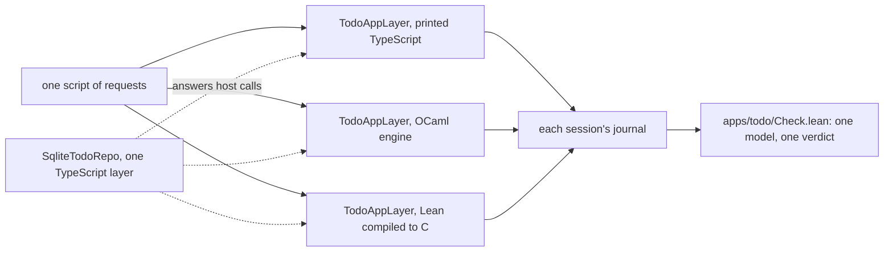

# One service, many backings: where we stand

Status: research note, an evaluation for the owner. Base: `db6720577` on `refactor/phase1-phase3`.
It extends `seams.md` in this folder from OCaml to every target.

## The one thing to know

The idea is already ruled. Decisions row 381 asks for "the same services runnable in Effect
TypeScript, under the OCaml driver and from lowered native code". The layer provided chooses.
The to-do application has the TypeScript half built and checked. What is missing is the bridge
that lets a native backing serve the same TypeScript layer, and the test that compares backings.

## The owner's idea, as stated on 2026-10-19

The owner dictated it in four parts:
- the to-do service as "a regular Effect TypeScript service interface";
- served by generated code "runnable on the TypeScript", or by an OCaml backing, or by lowered C;
- "each of those would present a layer, or we determine the best";
- then how it is packaged, and how the semantics stays coherent.

## How it fits the project's path

| The idea | The ruling or construction it rests on |
| --- | --- |
| One interface for every backing | one declaration in Lean, `eff_rows` and the application's entries; `seams.md`'s rule S, per target |
| The same program on every backing | Eff, a program as data, is the unit that ships (row 381 (6)) |
| The backings agree | implementations agree once, at the language level, never per entry (row 381 (1)) |
| A layer chooses the backing | services are records of closures; the layer provided decides (row 381 (3)) |
| What ships first | a TypeScript package with Effect's own APIs; native lowerings later, behind the same APIs (row 381 (4)) |
| Native and browser | the OCaml engine natively; WASM through the generated OCaml (row 381 (6), system map §3 item 6) |

## Where each part stands

| Part | TypeScript | OCaml | Lean compiled to C |
| --- | --- | --- | --- |
| The interface | built: `TodoApp` and `TodoAppLayer`, with Schemas (`apps/todo/EmitTodo.lean`, `src/Effect4/Codegen/Surface.lean`) | partial: the `host` record is generated; `REPO` is hand-written (`ocaml/engine/test/todo/native_todo.ml`) | none |
| The program | printed as Effect code (`Effect4.Codegen`) | the lowered machine runs the Eff data (`Kit.run`) | Lean's own compiler can build `Effect4.Api.run`; nothing does yet |
| The host, `TodoRepo` | `SqliteTodoRepo`, a layer over `bun:sqlite` (`apps/todo/repo.ts`) | in-memory hosts behind `REPO`; no SQLite | the Lean reference `repository`, in memory |
| The bridge to a TypeScript layer | not needed | none; `eff serve` speaks JSON lines for the kit's commands only (`Kit_serve`) | none |
| The check | `apps/todo/Check.lean` reads each session's record against the model | the lanes compare lowered runs with Lean's | none |
| Packaging | an app folder, not a package | eight unstable opam packages, a facade, a name manifest | none |

So the TypeScript backing is one layer today, and the OCaml backing runs the same programs but
cannot yet stand behind that layer.

## What keeps the semantics coherent

Five things cross between backings. Each needs one owner.

1. **The interface.** One declaration in Lean. Each target's signature is generated from it: the
   TypeScript service and Schemas, the OCaml module type, a C entry. No hand service type.
2. **The values.** One public spelling, the canonical tagged JSON (row 417 (4)). The audit's
   owner decision 2 settles its lists. A bridge writes and reads only that spelling.
3. **The host calls.** A program on a native backing may call a host that lives in TypeScript.
   Each call crosses as a request and returns as a completion. A failure crosses as the row's
   typed failure (row 405). An exception that is not mapped is no answer (row 408 (1)). The audit's
   owner decision 4 fixes what a refused reply does.
4. **The numbers.** A backing served to TypeScript refuses outside TypeScript's profile, at
   ingress. The audit's owner decision 3 makes the profile a datum the run is admitted at.
5. **Interruption.** When TypeScript interrupts a call, the native backing must close its scopes as
   Lean says. The audit's owner decision 5 rules abandon.

One observation decides agreement: the session's journal. For one script and the same host
answers, every backing must produce the same journal. That is the monoid action (K5), and Lean
already checks a TypeScript session's record this way.

So the audit's five open decisions are not five separate questions. Four of them are this
bridge's contract: the spelling, the refused reply, the profile and abandon.

## The test module the owner asked for

The to-do application is the right one. It has the rows, the four entries, the TypeScript service,
a SQLite host, Lean's model and Lean's session checker.

Each backing is a `Layer` of `TodoApp` that requires `TodoRepo`. The SQLite host stays one
TypeScript layer for all three. So the test exercises the host-call bridge, the hardest crossing.

## The infrastructure, in order

| Step | What it builds | Why this order |
| --- | --- | --- |
| B1 | The bridge protocol in Lean: open an application, call an entry, answer a host call, end with an exit. Lowered for OCaml, so `eff serve` speaks it | The protocol is where meaning can drift. `docs/core/host-boundary.md` §4 already proposes its contract |
| B2 | `TodoAppLayer.native`: a generated TypeScript layer over a child process speaking B1 | The cheapest bridge. It needs nothing but the protocol |
| B3 | The test module: one script through both layers; Lean compares the journals | It turns row 381 (1)'s claim into a check that runs |
| B4 | The C backing: the same Lean `serve`, compiled by Lean's compiler into an executable that speaks B1 | Nearly free after B1, since the source is the same. It is the reference machine run natively, so it is a third witness |
| B5 | Generated signatures on every target: OCaml's `REPO` (`seams.md` S1), a C entry | Removes the last hand interface |
| B6 | WASM through `wasm_of_ocaml`, as an in-process layer for Node and the browser | Row 381 (6)'s product path |
| B7 | Packaging: one npm package of the generated TypeScript, with the native and WASM backings as optional parts; the opam packages as they are | Last, because it only bundles what B1 to B6 make |

## My view

The idea is right, and it is the project's own path: semantics once, implementations once, the
layer chooses. Three judgments:

- **The bridge protocol is the real work, not the layers.** Every coherence question in this note
  is a question about it. Written in Lean and lowered, it is one more instance of rule S.
- **The C backing is worth having as a witness, not yet as a product.** It runs the reference
  machine over lists, which is slow (`ocaml/engine/e4_log.mli` measures Lean's trace at 141 ms
  for ten thousand rows). Because it compiles the same Lean source, it is a strong check that the
  OCaml lowering adds nothing.
- **"Determine the best" should start as an explicit choice.** A consumer names the layer. A
  chooser that measures comes after B3 gives numbers to compare.

## What this does not establish

- No bridge exists, so no cross-backing run has been measured or compared.
- This note did not run `apps/todo`. Whether its run is still a gate lane was not checked.
- The steps are a proposal. None is ruled.
