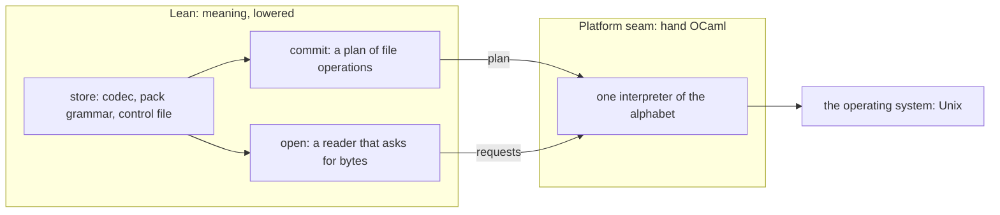
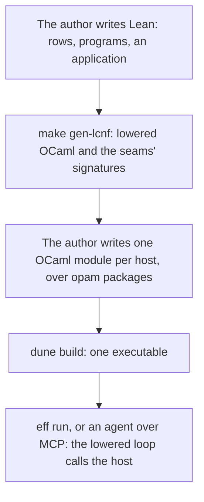
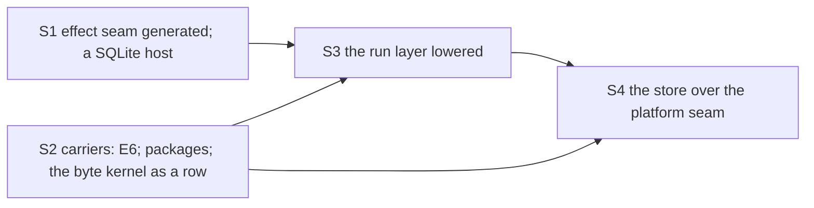

# The seam design: which OCaml is written by hand

Status: research note, a proposal for the owner. Base: `761fd13db` on `refactor/phase1-phase3`.
It extends the audit's synthesis (`README.md` in this folder), its cause C and its moves M2 to M11.

## The one thing to know

Two thirds of the hand OCaml restates meaning that Lean owns or should own. That is the drift.
Each copy has needed its own tests, and the defects of the last review sit in these copies.
The proposal is one rule with four kinds of seam. Lean declares each seam as data. The generator
emits its OCaml signature, a module type. Hand OCaml only implements a signature, or carries bytes in and out.

## The owner's steer

The owner, 2026-10-19, dictated (fillers removed):
- "really almost everything should be generated".
- "we want the OCaml to be a complement".
- "controlled seams, interfaces that allow us to access a huge portion of the OCaml ecosystem".
- "there's nothing wrong with handwriting OCaml per se, but it becomes an area of drift and it
  becomes an area that can open up errors".

So the question for each hand file is not "hand or generated". It is "does it implement a
contract that Lean declares, or does it restate a definition that Lean owns?"

## Words

- **Lowered**: made from a Lean definition by the LCNF route (`docs/core/lcnf-route.md`).
- **Seam**: a contract that Lean declares as data, with an OCaml signature that the generator
  emits from it. Hand OCaml implements the signature. The OCaml type checker holds the hand code
  to the signature.
- **Transcription**: hand OCaml that restates a Lean definition, or decides an observation that
  Lean decides otherwise. A transcription is drift.

## The rule

**Design rule S.** Every line of OCaml is lowered, generated from a table, or the hand
implementation of a seam. A seam is declared in Lean, as data, before its implementation is
written. Hand OCaml never restates a Lean definition. A hand implementation kept for speed is a
carrier row, with a control that runs it beside the lowered definition.

It restates the audit's design rule C as a rule for the whole estate. It adds no mechanism. Each
seam kind below already exists in the tree, at least as a prototype.

| Seam | Lean declares | The generator emits | Hand OCaml writes | Exists today as |
| --- | --- | --- | --- | --- |
| Carrier | a type row and its operation rows, each with a contract | the type's spelling and each call | nothing when an opam package implements it; else the row's body | `OCaml5.Lcnf.typeRows`, `OCaml5.Lcnf.builtins` (`src/OCaml5/Lcnf/`) |
| Effect | host rows (`eff_rows`) | the lowered `host` record, the codecs and a module type | one module per host, over any OCaml library | `Todo_gen.host`; the hand `REPO` in `ocaml/engine/test/todo/native_todo.ml` |
| Platform | a small alphabet of operations on the machine's resources | the alphabet's OCaml type | one interpreter of the alphabet | `E4_file`, `E4_lock` (`ocaml/engine/cas/`) |
| Shell | the method table and the queries | the dispatch | the transport: arguments, stdio, MCP framing | `Kit_tool` over the lowered `Effect4.Tool.Native.serveTree` |

Build tooling (`ocaml/gen/interface`, `ocaml/tools/typed_lint`) is outside the rule. It runs at
build time and ships nothing.

## Where the estate stands

The counts are from `git ls-files 'ocaml/*.ml' 'ocaml/*.mli'` at `761fd13db`. A file is
generated when its first 3,000 bytes hold `GENERATED`. Tests and benches are counted apart.

- Generated OCaml: 108,169 lines.
- Hand OCaml outside the tests: 23,485 lines.
- Hand test OCaml: 31,465 lines. 12,257 of them test the store.

The hand lines by role, as this note classifies each file:

| Role | Lines | Files, in short | Under rule S |
| --- | ---: | --- | --- |
| Restates meaning | 15,631 | the store (`E4_cas`, `E4_node`, `E4_shape`, `E4_pack`, `E4_index`, `E4_chunk`, `E4_control`, `E4_wal`, `E4_checkpoint`, `E4_cache`, …); the run layer (`E4_engine`, `E4_host`, `E4_abandon`, `E4_query`, `E4_instance`, the prelude); `Kit`, `Kit_machine`, `Kit_author`; `E4_clock` | lowered |
| Byte kernel, meaning kept for speed | 947 | `Eff_frame`, `Eff_val`, `E4_be` | a carrier row with a control |
| Library that a package provides | 538 | `E4_sha256`, `E4_crc`, `E4_hex` | a carrier row to an opam package |
| Carrier implementation | 2,390 | `E4_table`, `E4_trace`, `E4_log`, `E4_logindex`, `E4_memo`, `E4_buckets`, `E4_fibers_view`, `E4_env`, `E4_ppath`, `Lcnf_*` | seam: a row's body |
| Platform runtime | 2,460 | `E4_sched`, `E4_inbox`, `E4_mailbox`, `E4_ring`, `E4_trigger`, `E4_reply`, `E4_quiescence`, `E4_shutdown`, `E4_admit`, `E4_file`, `E4_lock`, `E4_fault` | seam: platform |
| Shell | 812 | `eff`, `Kit_mcp`, `Kit_tool`, `Kit_serve` | seam: shell |
| Build tooling | 707 | `ocaml/gen/interface`, `ocaml/tools/typed_lint` | outside the rule |

The first row is the drift. Its defects are on record:
- A1.1: the kit admits a reply that Lean's profile refuses.
- H11 (b) and (c): `E4_host` stops where `Effect4.Run.driveFrom` plays on.
- The forward reference: `E4_cas.checked_image` refuses what `Store.verify` admits.
- A3.2, A3.4 and A5.1: the log's own commit.

## The seams, with authoring

### Effect seam: an application reaches the OCaml ecosystem

This is the seam an application author writes against. The to-do application shows it today.

The author writes Lean: the rows, then the programs over them
(`Test/Dogfood/Scenario/Todo/Data.lean`).

```lean
eff_rows TodoRepo key todoRepoKey error SqlError.ty cite "the to-do scenario" where
  insert(.string) : Todo.ty,
  all(.unit) : .list Todo.ty,
  setDone(.prod .nat .bool) : .option Todo.ty,
  delete(.nat) : .bool

def add (title : TermSrc) : Src NativeOp := eff do
  if eq title (str "") then EmptyTitle.raise (str "a title is required")
  else TodoRepo.insert title
```

The generator already emits the host record (`ocaml/engine/test/todo/todo_gen.mli`):

```ocaml
type 's host = {
  insert : string -> 's -> (todo, sql_tag * string) result * 's;
  all : unit -> 's -> (todo list, sql_tag * string) result * 's;
  set_done : int * bool -> 's -> (todo option, sql_tag * string) result * 's;
  delete : int -> 's -> (bool, sql_tag * string) result * 's;
}
```

Today the module type `REPO` and the adapter `host` are hand-written in
`ocaml/engine/test/todo/native_todo.ml`. Its header says they are "the shape a generator would
emit". Under rule S the generator emits them, so the author writes only this:

```ocaml
(* target sketch: Todo_gen.REPO is emitted from eff_rows; sqlite3 is an opam package *)
module Sqlite_repo : Todo_gen.REPO with type t = Sqlite3.db = struct
  type t = Sqlite3.db
  let insert title db = (* an INSERT through Sqlite3 *) ...
  let all () db = ...
  let set_done (id, flag) db = ...
  let delete id db = ...
end
```

Everything else is lowered: checking, program admission, the run loop, the codecs and the typed failure.
An exception that the host does not map is no answer (row 408 (1)), so a host cannot forge one.
The owner named this application on 2026-10-07, a to-do list over SQL
(`Test/Dogfood/Scenario/Todo.lean`).

### Carrier seam: a Lean type spelled by an OCaml library

The carrier seam is how a data type reaches an OCaml library. A row says which OCaml function
computes a Lean operation, with its domain, its controls and its receipt.

Today `Nat` is OCaml's `int` on a domain (`OCaml5.Lcnf.typeRows`, `src/OCaml5/Lcnf/TypeRows.lean`):

```lean
typeRow ``Nat 0 int .domain "n < 2^62" "OCaml `int` is 63-bit, Lean `Nat` unbounded."
  (receipt := .exact),
```

Under E6 (row 417 (1)) the row spells `Nat` as Zarith's `Z.t`, and its operation rows name
`Z.add`, `Z.mul` and the rest. Zarith is installed in the switch. Then `Lcnf_nat`'s hand bodies,
`E4_clock` and `OCaml5.Lcnf.ClockFlow` go.

The same seam covers code that a package already provides:
- `E4_sha256` is a hand SHA-256. A row to `Digestif.SHA256` replaces it.
- `E4_crc` and `E4_hex` are hand codecs. Rows to `checkseum` and `ohex` replace them.

These packages are not installed yet. An install is routine (owner, 2026-10-15).

A hand kernel kept for speed is the same seam. `Eff_val` encodes a value faster than the
lowered `Val.encode` may. Under rule S, `Val.encode` stays the meaning. A row names `Eff_val` as
its implementation. A control runs both on the goldens and compares the bytes. The kernel stays
only while a measurement shows the lowered encoder costs more.

### Platform seam: the store over a small alphabet

The store is where the drift is largest: 11,590 hand lines and 12,257 test lines. Its formats,
its commit and its open are meaning. A crash's outcome is an observation, so Lean should own it.

The store uses few operations of the operating system. Its `.ml` files call only these:
`openfile`, `read`, `map_file`, `write`, `fsync`, `rename`, `mkdir`, `readdir`, `stat`,
`ftruncate`, `unlink`, `lockf`, `chmod`, `close` (from `cat ocaml/engine/cas/*.ml | grep -oE`).

Under rule S:
- Lean defines an alphabet of file operations, about ten constructors, as data.
- Lean defines the store over it: the node codec, the pack's grammar, the control file, the
  commit, the open and the verification.
- A commit is a plan: the list of operations that publishes one boundary. A run's journal is
  the same kind of thing, a list of commands.
- An open is a reader: Lean asks for bytes, and the interpreter answers. A run's host is the same
  kind of thing, a reactor that answers requests.
- OCaml interprets the alphabet. `E4_file` and `E4_lock` grow into that interpreter.
- A failed operation is a failed commit, answered as a refusal (row 417 (3)).



The audit's owner decision 1 falls out of this. A durable journal is the commit plan of its rows.
So the pack's published boundary is the one all-or-none construction, written once in Lean. A
second log is not an OCaml module with its own format. That is shape (b), and one step further:
the pack itself is lowered.

The audit kept `E4_pack`, `E4_control`, `E4_index` and `E4_chunk` as host code (its M11, "keeps").
This note proposes they are meaning. That is the owner's call (question 1 below).

### The run layer: the loop is lowered

Today `E4_host` restates `Effect4.Run.driveFrom`, and `E4_engine.Make` holds a second loop and a
second answer alphabet. Under rule S the drive is lowered from Lean. Its host is the effect seam,
the `provider` that `E4_host` already types as Lean's `Run.Reactor`.

The scheduler stays platform runtime: domains, run queues and wake-ups (P6 (a)). Lean's dispatcher
decides the order. `E4_sched` only runs it across domains.

This is the audit's M8 and M10. Owner decisions 4 and 5 become one question each: which rule Lean
states. Neither keeps an OCaml copy.

### Shells: transport only

A shell parses its input, calls one lowered entry, and writes the answer out. `Kit_tool` already has
this shape over `Effect4.Tool.Native.serveTree`. `Kit_serve` executes requests by hand today, so
slice A6 turns the kit's commands into Tool queries (the audit's M8).

## How it looks when used



An application author writes Lean and one OCaml module per host. An estate author adds a row
when a type or an operation needs a library. Nobody edits the machine, the loop or the store in
OCaml.

## The consolidation path

Build first: one vertical slice, then one slice per seam. Each slice deletes what it replaces.



| Slice | What it does | The audit's moves | What goes, roughly |
| --- | --- | --- | --- |
| S1 | Emit `REPO` and `host` from `eff_rows`. Write the to-do host over SQLite. Run it through `eff` | none; it proves the seam | the hand `REPO` and adapter |
| S2 | E6 as one row; rows to Zarith, `digestif`, `checkseum`, `ohex`; `Eff_val` as a row with a control; M2's profile judgment lowered | M2, M3, M4 | `E4_sha256`, `E4_crc`, `E4_hex`, `E4_clock`, `ClockFlow`, `check_answer`, `eff_wire.ml` |
| S3 | `driveFrom`, the kit's commands and one observation lowered; the machine's carriers as rows | M8, M10 | `E4_host`'s drive, `E4_engine.Make`'s loop, `Kit_machine`, the prelude, `externs.txt`, the second machine |
| S4 | The store in Lean over the platform seam; one verification; one commit | M5, M6, M11 | most of `ocaml/engine/cas` and its transcription tests; `E4_wal` |

The "what goes" column is the coordinator's estimate from the table above. A slice measures its
own deletions with `wc -l`.

S1 is small and shows the whole design in use. S4 is the largest, and it waits for S2's exact
naturals and S3's lowered loop.

## What does not change

- The free objects, the folds and the checker stay where they are. Rule S changes OCaml only.
- Row 391 stands: the lowering is trusted, and the finite checks stay.
- The platform runtime stays hand OCaml, because domains and file descriptors are the host's.
- No framework is added. Each seam kind already has a working instance in the tree.

## Questions for the owner

1. **Is the store's on-disk format meaning?** This note says yes, so S4 lowers the pack, the
   control file, the index and the chunks. The audit kept them as host code. The difference is 3,926 lines
   of hand OCaml in those four modules, with their tests.
2. **Does the effect seam's module type become the public face for hosts?** Then `REPO` is
   generated for every `eff_rows`, and its name enters the public-name manifest.
3. **Is S1 the next slice?** It is the smallest proof that the design works in use. The repair
   wave's R2 and R3 can follow it, or run before it.

## What this does not establish

- The classification is this note's reading of each file's header. A slice reads the code before
  it deletes.
- No lowered store has been measured. S4 measures the open and the commit against R1's figures.
- The target sizes are estimates, not counts.
