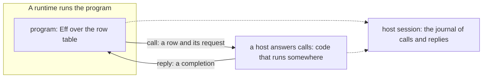

# Program, host, runtime, host session: one vocabulary

Status: research note, the coordinator's recommendations, with the owner's go-ahead of 2026-10-19
to rename and implement. Base: `efc7b689f` on `refactor/phase1-phase3`.

## The one thing to know

Six names in the tree mean "what answers a row", and "session" means three things. The algebra
already gives one picture with four roles: a program, a host, a runtime, and the host session that
records them. The host protocol is that record's message form, so it follows from the row table.

## The owner's words

The owner, 2026-10-19, dictated:
- "we need to make these renames";
- "a host runs code somewhere";
- "we're able to model effects as anything almost";
- the protocol "should come from the algebra itself", with "a simple unifying" form.

## The picture

| Role | What it is | In Lean | In OCaml | In Effect TypeScript |
| --- | --- | --- | --- | --- |
| program | Eff over the row table; it asks, it never does | `Eff` | lowered `Eff` data | a printed `Effect` with requirements |
| row table | the operations a program may ask for: the signature | `RowTable`, `eff_rows` | lowered rows | a service tag with one method per row |
| host | code that answers calls, written in any language, run anywhere | `Run.Reactor`, `Typed.Host` | `provider`, the `host` record | a layer that provides the service |
| runtime | what runs the program | the Lean machine | the engine | Effect's runtime |
| host session | one run's record of calls and replies | `Api.HostSession.Session` | `E4_host`'s rounds | `harness/truth/session` |

## The protocol, from the algebra

The row table is the signature. A program is the free object over it, read as a call chain. A host
answers the signature's operations from outside, with its own state: a comodel (Plotkin and Power),
a runner (Ahman and Bauer, 2020). A run pairs the program with the host.

The host session is that pairing laid out in time: the run's journal (K5). The host protocol is the
journal's message form:
- a **call** names one row of the table, its request, and its key;
- a **reply** carries one completion at that row's answer or error type, for that key;
- the session's automaton orders them (`Protocol`, `src/Effect4/Api/HostProtocol.lean`);
- reply admission checks each reply (`preflight`, `src/Effect4/Api/HostSession.lean`).

Nothing else is needed. Every message's type is generated from the row table. The protocol is the
same whichever runtime runs the program and whichever language the host is written in. So the
"bridge" of `one-service-many-backings.md` is the host protocol across a process boundary, spelled in
the canonical tagged JSON, one message per line. It needs no design of its own.

## The renames

| Today | After | Why |
| --- | --- | --- |
| dictionary: "the host is never Lean" | a host is outside the machine and may be written in any language, Lean included | the to-do's reference host is a Lean reactor (`repository`, `Test/Dogfood/Scenario/Todo/Data.lean`) |
| no word for what runs a program | **runtime** | row 381 (6): "an effect 4 runtime anywhere that can run eff" |
| `Run.Reactor`, OCaml's `provider` | **reactor**: a host's form over values | one name for one shape; the to-do lane's `Host.reactor` (`Test/Dogfood/Scenario/Todo/Typed.lean`) already converts a typed host to it |
| **handler**, "a function that answers a row's operations" | the meaning of a row's operations inside the denotation only | a host answers from outside; a handler interprets inside (`storeHandler`) |
| the authoring tool's session: `Tool.Native.Session`, `Tool.SessionEntry`, `tools/Drivers/Session.lean` | **workspace**: `Tool.Native.Workspace`, `Tool.WorkspaceEntry`, `tools/Drivers/Workspace.lean` | "session" is the host session; the dictionary gives each word one meaning |
| the to-do's "session file" | the host session's record | it is the journal written out |
| an Effect TypeScript `Layer` that provides a row service | a host, provided as a layer | the dictionary's **layer** is a `LayerTerm` in the program |

`SourceSession` and `EditSession` keep their names until the audit's M9 stage 3 removes
`EditSession`. Then `SourceSession` takes the dictionary's **edit session**.

## Other alignments

1. **One construction under two journals.** The host session and the workspace's history are both
   journals of accepted commands (K5). The audit's M5 makes both `Replayed`. They differ only in
   their signatures: the row table, and the tool's actions.
2. **One host signature per target, generated.** The TypeScript service tag is generated today
   (`Effect4.Codegen.RowServices`). OCaml's `REPO` is hand-written. `seams.md` S1 generates it.
3. **One host protocol endpoint per target, lowered.** TypeScript's protocol types are generated
   (`harness/truth/session/protocol.gen.ts`). OCaml's `E4_host` restates `Effect4.Run.driveFrom`.
   `seams.md` S3 lowers it.
4. **The relational host and the functional host.** `HostSpec` is a host's specification, a
   relation for proofs. A reactor is a deterministic host. Keep both names. The dictionary states the
   difference.

## The order

1. The dictionary entries (`docs/core/controlled-english.md` §3.6 and §3.7). Documents only.
2. The workspace rename in code: Lean, the generated OCaml, the kit, and the facade's version.
3. OCaml's `provider` becomes `reactor` when S3 lowers `E4_host`. It is not renamed by hand first.
4. `docs/site/concepts/host-session-protocol.md` gains the picture above.

## What landed, and what waits

The dictionary entries landed first (`5418973ea`). The workspace rename landed next, in Lean, the
generated OCaml, the kit and the install fixtures, with the facade's version raised to 1. The frame
was already in `docs/core/semantics.md` concept 9. It reads a host as a comodel, and the protocol
as Setzer and Hancock's dependent interface.

Four things wait, each for a reason:
- Three deep-core comments still name the old spelling: `src/Effect4/Store/Domain/Cas.lean`,
  `src/Effect4/Store/Domain/JsonText.lean` and `src/Effect4/Laws/Store/JsonText.lean`. Editing them
  rebuilds most of the tree, so they change with the next edit that touches those files.
- `OCaml5.Lcnf.Naming`'s `#guard` tests the mangling of the name `Effect4.Tool.Native.Session`. It
  is a name literal, so it stays correct, and it changes with the next edit of the file.
- The workspace's laws are placed in concept 9, `host-session-protocol`
  (`src/Effect4/Laws/Tool/Exchange.lean`). They belong with typed editing, the planned eleventh
  concept. Moving them changes `generated/semantics.md`, which `make gen-semantics` writes when
  the owner asks.
- The store's tests name journal roots `session/a` and `session/test` as labels. They test the
  store, not the workspace, so they stay.

## What this does not establish

- The comodel and runner reading is the literature's frame for the host, not a theorem in the tree.
- No process-boundary host protocol runs yet.
