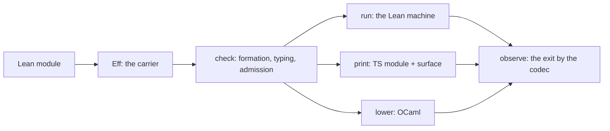

# The compiler's entry point: what a compile is here, and what other compilers teach

Status: review, 2026-10-20, before any slice. The owner asked for a step back. It covers the
basic operations and whether they accord with the algebra and the style. It asks what the
commands should be, and what metadata a compile should write. Not the to-do's entry point: the library's.

## 1. The one thing to know

A compile here is not "compile and run". It is one carrier, the program `Eff`, read through the
seven judgments. Then it is written to three faces: the Lean machine, Effect TypeScript syntax,
and OCaml by the LCNF route. Every step exists as a library function today (§3). What is missing is
one executable that takes a user's application by name and performs them, and one manifest that
names what it wrote. Other compilers settled both shapes long ago (§4). The proposal is in §5.

## 2. What a compile is, from the algebra

The authored module is Lean. Its `eff do` forms elaborate to `Eff`, the one program IR. From
there every operation is a judgment or a fold, each with a located refusal:

| Stage | Judgment or fold | In the tree |
| --- | --- | --- |
| elaborate | authoring forms to `Eff` | `Api.Author.build`, `Application.entry?` |
| form | formation: the table and the input | `Formation.checkInput`, `admitSig` |
| type | membership and inhabitance: the certificate | `Api.check`, `admitProgram` |
| admit | profile support, codec admission, reply admission | `natLiteralsInProfile`, `isCodecValue`, `admitAnswer` |
| run | the machine, as the reference interpreter | `Run.open`, `Run.runWith`, `Run.observe` |
| observe | the exit at its type, by the codec (D1) | `Ty.encode names (.exitOf a e)` |
| print | Effect TypeScript syntax, and the Schemas per method | `Api.emitModule`, `.file`, `.surface`, `Tools.Code.moduleText` |
| lower | OCaml by the LCNF route, from a recipe of roots | `lake exe lcnfgen`, `ocaml/gen/roots.json` |
| canonical form | the program's bytes and their address | `Wire.encodeProgram`, `Tools.Code.generate`'s sha256 |



The arrows are the folds. A command that is not one of them is not a command of this compiler.

## 3. What the tree offers today

- Nine executables, none of which takes a user's application by name to check, print or run it.
  `lcnfgen` and `effect4gen` load modules by name (`importModules`) and are the pattern.
- The native tool, `eff` (`ocaml/engine/kit/bin/eff.ml`): `check`, `run`, `explore` on a
  program file, and `serve`, `tool`, `mcp` as servers. It serves; it does not compile.
- The tool protocol (`src/Effect4/Tool/`): `open`, `edit`, `fill`, `publish`, `start`, `play`,
  `doc`, `preview`, `table`, `slots` and the rest, over JSON lines and MCP. Introspection and
  editing, as row 420 says.
- The to-do (`/Users/pooks/Dev/effect4-todo`) wrote by hand what the entry point should own.
  That is a `Main.lean`, a `Print.lean` with the five-call emission pipeline and hand headers,
  a JSON renderer, and a typed exit encoder. Its command for the lowering by the LCNF route is copied from a
  generated header. The same pipeline is written again in `apps/todo/EmitTodo.lean`.
- Headers differ by producer. `lcnfgen` writes its identity, its regenerate command and a
  `declHash` per closure row. `Tools.Code.generate` writes the program's sha256 address. The
  truth corpus, EmitTodo and the to-do write a GENERATED line with no hash.

## 4. What other compilers settled

| Project | The one carrier | Commands | Artifacts and metadata | The lesson for us |
| --- | --- | --- | --- | --- |
| rustc | MIR, then LLVM IR | one driver; `--emit=asm,llvm-ir,obj,metadata,dep-info,mir,link`, each with its own path; `--print` for compiler facts | the emissions are named; `metadata` is one of them | one invocation names its emissions; the manifest is an emission, not a side effect |
| CompCert `ccomp` | Clight, Cminor, RTL, LTL, Mach, asm | `-dparse -dclight -dcminor -drtl -dltl -dmach -dasm` dump each pass; `-interp` runs the reference interpreter | one dump per verified pass | a verified compiler ships its reference interpreter as a command. Our `run` on the Lean machine is `-interp` |
| PureScript `purs` | CoreFn, as JSON | `purs compile --codegen corefn` writes the IR beside the JavaScript | `corefn.json` per module; other backends read it and need no fork | the carrier, serialized once, is what every backend reads. Our canonical `Eff` bytes and their tagged JSON are that file |
| Idris2 | the checked form (TTC) | `--codegen chez\|racket\|node\|refc`, one flag over one checked form | one output per backend | `--target` selects a face; the check is shared |
| Unison | the definition's hash | `ucm`: add, update, run; no builds, a cache keyed by hash | names are metadata over hashes; a rename recompiles nothing | the program's address is its sha256; every artifact names it; names live in a manifest (item 10) |
| GHC, OCaml | Core; the typed tree | `--make`; `-fwrite-ide-info` writes `.hie`; `-bin-annot` writes `.cmt` | interface files (`.hi`, `.cmi`) for separate compilation; tooling trees (`.hie`, `.cmt`) for editors | the certificate and the surface are our interface files; the tool protocol is our tooling tree, computed from the same check |
| wasm component model | the component | `component embed`, `component new`, `component wit`, `validate` | the interface (WIT) is embedded in the binary and extracted back | embed the address and the surface's digest in the printed module's header; `inspect` extracts them; the reader's round trip is `validate` |
| dune | rules | `build`, `rules`, `describe`, `rpc` | the build is data; `rules` prints it | our `roots.json` and `manifest.json` are recipes already; `describe` prints the plan before it runs |

Two of these are on the reference shelf (`~/Dev/refs/ocaml-tooling`: CompCert's `driver/Driver.ml`
has the flags above; dune). The rest are cited in §8.

## 5. The operations, fit for purpose

One Lean executable, `effect4`, a `lean_exe` under `tools/` like `lcnfgen`, that loads the user's
module by name. Its commands are the folds of §2, and nothing else:

| Command | Does | Writes | Refuses |
| --- | --- | --- | --- |
| `effect4 check M [--json]` | elaborate, form, type, admit, as one query (M8's `checkProgram`) | the certificate as JSON, or nothing | one located refusal: site, reason |
| `effect4 emit M --target ts [--out DIR]` | print the module and the surface | `M.gen.ts`, `M.surface.gen.ts`, the manifest | the print refusal, located |
| `effect4 emit M --target ocaml [--out DIR]` | lower by the LCNF route from a recipe it derives | `m_gen.ml`, `closure-m_gen.tsv`, the manifest | lcnfgen's refusals, by name |
| `effect4 run M --host H [--script S] [--json]` | the Lean machine over a Lean host, the reference interpreter | one line per request: the exit by the codec (D1) | an unanswered row, a budget |
| `effect4 inspect M --what types\|rows\|surface\|graph\|manifest` | reads, through the tool protocol's queries | text or JSON | — |
| `effect4 conform M --against ts\|ocaml` | runs each face and compares the observations, after move A | a table: equal, renamed, refused | — |

Conventions, each one a deletion in the to-do:

- The application is the module's one `app` declaration; `M` names the module, and `M.app` is
  implied. `Main.lean` and `Print.lean` go.
- `--out` defaults to `.lake/effect4/<M>/<target>/`; a project copies or links what it ships.
- `emit` takes `--emit=module,surface,bytes,canonical,manifest` to select artifacts, as rustc
  does; the default is all of a target's.
- The lowering's recipe is derived: the roots are the host's declarations, the opened types are
  the closure's. The copied `sed` line goes.
- The host record is derived from the rows (item 9); until then the hand record stays.

The manifest, one JSON per emit, the metadata of §4 in one place:

```json
{ "program":     { "module": "Todo.App", "decl": "app", "address": "sha256:…" },
  "certificate": { "answer": …, "error": …, "requires": …, "rows": […], "services": [{ "key": [30, 6], "name": "Repo" }], "declarations": […] },
  "profile":     { "name": "rc112", "bound": 9007199254740991 },
  "target":      "ts",
  "artifacts":   [{ "path": "todo.gen.ts", "kind": "module", "sha256": "…" }, { "path": "todo.surface.gen.ts", "kind": "surface", "sha256": "…" }],
  "tools":       { "lean": "v4.33.1", "library": "<commit>", "effect": "4.0.0-rc.112", "tsgo": "7.0.0-dev.20260629.1" },
  "command":     "effect4 emit Todo.App --target ts" }
```

Every artifact's header names the address and the command, as `lcnfgen`'s does. A second run
writes the same bytes, as the to-do's lowering already does.

## 6. Where it accords with the algebra and the style

- Each command is one existing fold or judgment with its located refusal. No new judgment, no
  second program representation, no text as program (row 420).
- The carrier is `Eff`'s canonical form, addressed by its sha256. Names are metadata.
- The recipe and the manifest are data (tables as data; generated files marked and regenerable;
  every number behind a command).
- One owner per fact: the entry point writes the manifest and the headers; the to-do's and
  EmitTodo's hand pipelines go.
- The reference interpreter is a command, as CompCert's is. The observation is the codec's (D1).
- The native `eff` keeps serving. It is the lowered tool face, not the compiler, and the two
  names must not collide.

## 7. What the owner decides

1. The name: `effect4`, or another. `eff` is taken by the native tool.
2. Whether lowering is a target of `emit` (recommended: yes, with the recipe derived) or stays
   `lcnfgen` alone.
3. The manifest's fields beyond §5, and where outputs live.
4. The order. First `check` and `emit --target ts`, deleting the two hand pipelines (size S).
   Then `emit --target ocaml` (S), then `run` over a Lean host (M), then `inspect` through the
   tool protocol (S), and `conform` after move A.

## 9. The prior art, each against our semantics

The owner asked for care: what each project does, what of it accords with our semantics, where
we improve on it, and how it fits. The facts are from the primary sources of §8, read on
2026-10-20.

### 9.1 rustc: named emissions and printed facts

- **Does.** One driver. `--emit` takes a list of kinds: `asm`, `dep-info`, `link`, `llvm-bc`,
  `llvm-ir`, `metadata`, `mir` and `obj`. Each kind takes its own path (`KIND=PATH`, `-` for
  stdout), under `--out-dir`. `--print` takes kinds too (`crate-name`, `file-names`, `cfg`,
  `target-list`, `sysroot`, …), with the same `KIND=PATH` form. `dep-info` lists every loaded
  source in Makefile syntax. `metadata` writes a `.rmeta`, opaque to the user.
- **Accords.** An emission is a named output of one pipeline, and the caller names the set.
  That is our shape: each fold of §2 has one output, and a call names which it wants.
- **We improve.** rustc's kinds are stages of one target. Ours are three faces of one carrier,
  so the selector is a target and a set of kinds, not one list. rustc's `metadata` is opaque.
  Ours is the certificate, a Schema-typed JSON any outside reader parses (the carrier
  principle). `dep-info` becomes the manifest's inputs: the import closure and the pins.
- **Fits as.** `effect4 emit M --target T --emit=kind[=path],…`. rustc's `--print` becomes
  `effect4 inspect --what …`, since "print" is our word for the TypeScript printer.

### 9.2 CompCert: dumps per verified pass, and the reference interpreter as a command

- **Does.** `ccomp` dumps each intermediate language on request, in pass order. The flags are
  `-dparse`, `-dc` (CompCert C, before the verified part), `-dclight`, `-dcminor`, `-drtl`,
  `-dltl`, `-dmach`, `-dasm`, and `-sdump` as JSON. `ccomp -interp` runs the formal semantics
  on the elaborated program. It prints the observable events with their step. `-trace` names
  the rule applied at each step. `-random` picks one allowed evaluation order, and `-all`
  walks every order. It stops at undefined behaviour. The unverified source-to-source transformations
  sit before `-dc`, and `-fnone` disables them.
- **Accords.** This is our chain. The authoring forms elaborate to `Eff`, the one verified
  carrier; the compile to frames, the LCNF phases and the Gallina extraction are the passes.
  `-interp` is our `run` on the Lean machine. `-random` and `-all` are the decision tape: full
  meaning is relational over explicit decisions, and `explore` walks them (`Run.Tree.paths`,
  `Kit.explore`).
- **We improve.** CompCert's dumps are text with no address and no identity. Ours are data: the
  program's sha256 and the stage's identity line, as `lcnfgen` writes them. CompCert's trace is
  a text log; ours is the journal, a value a tool reads (`Run.observe`).
- **Fits as.** `--emit=eff` is the dump at the `-dc` boundary, where the sugar ends and the
  checked carrier begins. `effect4 run M --host H [--tape T | --explore] [--trace]` is
  `-interp` with its options. The reference interpreter ships as a command, as CompCert's does.

### 9.3 PureScript: the IR as a file other backends read

- **Does.** `purs compile` writes per module `index.js` (with `foreign.js` and `index.js.map`),
  `corefn.json` under `--codegen corefn`, `docs.json`, and always an externs file. The externs
  file's timestamp is the module's build time, and `cache-db.json` holds the sources' hashes
  for the recompilation check. Other backends (`purs-backend-es`, a Go backend) read
  `corefn.json` and need no fork of the compiler.
- **Accords.** The carrier, serialized once, is what every backend reads. Our canonical `Eff`
  bytes and their tagged JSON (D2) are that file; the native tool reads a `.json` or `.eff`
  program already (`eff check PROGRAM`).
- **We improve.** CoreFn's JSON has no law. Ours is an exact embedding (`Canonical`'s three
  laws, `decode_iff`). Externs are opaque CBOR; our certificate is Schema-typed JSON. The cache
  is timestamps and hashes in one file; ours is the manifest's artifact hashes and Lake's cache.
- **Fits as.** `--emit=canonical,bytes,certificate` writes `M.eff.json`, `M.eff` and
  `M.certificate.json` beside the target's output.

### 9.4 Idris2: a backend is a record over one checked form, at the phase it chooses

- **Does.** A backend is a `Codegen` record: `compileExpr`, `executeExpr`, and optional
  `incCompileFile` and `incExt`. It is registered as a `(name, Codegen)` pair with
  `mainWithCodegens` and selected with `--cg`. `getCompileData` walks the definitions
  reachable from the main term, drops erased ones, and computes the phase the backend asks for:
  `namedDefs`, `lambdaLifted`, `anf` or `vmcode`. Dump options raise the phase and write it.
  Incremental compilation places an object beside the module's TTC.
- **Accords.** A target is a fold over one checked carrier, at the phase it needs: the printer
  reads `Eff`, the lowering reads an LCNF phase. The reachable-definitions walk is `lcnfgen`'s
  closure from its roots, with its manifest.
- **We improve.** Idris's record holds effectful functions. Ours is a target table as data: the
  name, the phase, the emitter, the checker that reads the output back (`Ml.checkModule`, the
  TypeScript reader). The output is checked, not trusted.
- **Fits as.** `--target` dispatches on that table. `--emit=lcnf` is the raised phase. `run` is
  `executeExpr`.

### 9.5 Unison: definitions by hash, names as metadata

- **Does.** A definition is its SHA3-512 hash, taken after names become positional references
  and dependencies become their hashes. The codebase is a database of definitions by hash with
  cached parse and type results, dependency information and type-based search. Names map to
  hashes and are repointed without recompilation. A distributed run ships a hash and syncs
  what the receiver lacks. Any value persists without serialization code.
- **Accords.** Program as data. Our carrier already binds by index, so names are outside it.
  The store addresses nodes by sha256, and `Tools.Code.generate` writes the program's address.
  The workspace is a CAS chain, and `Canonical` persists any value exactly. The public-name manifest
  (item 10) is names as metadata.
- **We improve.** Unison makes the database the source. Row 420 keeps Lean files as what an
  author writes; the hashed form is the compiled artifact. So we take the address and the
  cache, not the medium.
- **Fits as.** The manifest's `address` is the sha256 of the canonical bytes, and every
  artifact's header names it. `conform` results cache by address, as Unison caches tests.

### 9.6 GHC and OCaml: interface files, and the typed tree for tools

- **Does.** GHC's `.hi` holds what importers need; per-declaration fingerprints decide
  "Compilation IS NOT required"; `--show-iface` prints it; `-odir`, `-hidir`, `-hiedir`,
  `-dumpdir` and `-outputdir` place the outputs. `-fwrite-ide-info` writes `.hie`, a
  simplified tree with positions and types for editors, with its own recompilation check.
  OCaml's `-bin-annot` writes `.cmt` and `.cmti`, the typed tree merlin reads; they are
  marshalled, large, and tied to one compiler version.
- **Accords.** The certificate and the surface are our interface files. The tool protocol's
  `doc`, `table`, `addresses` and `slots` are our typed tree, computed from the same check.
- **We improve.** `.cmt` is marshalled and version-bound. Ours are codec-typed values with a
  protocol and codec version in the workspace's origin. The fingerprint check becomes trivial
  with the manifest: a program recompiles when its address or a pin changes.
- **Fits as.** `--out DIR` with one fixed layout under it. `inspect --what certificate` is
  `--show-iface`. The editor views stay queries.

### 9.7 The wasm component model: the interface travels with the artifact

- **Does.** `component embed` puts the interface (WIT) into the core binary as a custom
  section. `component new` builds the component, and `component wit` extracts the interface
  back. `validate` checks it. `metadata show` and `metadata add` read and write the name and
  producer metadata, the toolchain that made it. `strip` removes sections.
- **Accords.** The printed module ships with its surface, and the reader's round trip
  (laws 11 and 12) is `validate`. The producers section is our manifest's `tools`.
- **We improve.** A custom section is bytes. Our surface is an importable TypeScript module
  that tsgo type-checks, and our header is text any reader sees.
- **Fits as.** Every artifact's header carries the address, the generator's identity and the
  command. `inspect --what header` is `metadata show`.

### 9.8 dune: the build as data, and promotion

- **Does.** The commands are `build`, `exec`, `test`, `rules` (dumps the rules), `describe`
  (aliases, env, targets, workspace), `rpc`, `clean`, `fmt`, `install` and `diagnostics`.
  `promotion diff` and `promote` copy generated files back into the source tree. Targets and
  `@aliases` name the work, under `_build/<context>/`.
- **Accords.** Our generated-and-committed files follow the promote discipline:
  `scripts/generate.py` writes them and `--verify` refuses a diff. `roots.json` and
  `manifest.json` are rules as data.
- **We improve.** Nothing to improve; the lesson is a boundary. dune is the build system and
  `ocamlopt` the compiler. `effect4` compiles one program; Lake and make orchestrate.
- **Fits as.** `effect4 describe M --target T` prints what `emit` would write, before it
  writes. Gates and regeneration stay outside the compiler.

## 10. What we take, and what we leave

Taken:

- named emissions with per-kind paths (rustc);
- the reference interpreter as a command, with its decision options (CompCert);
- the serialized carrier as the backends' file (PureScript);
- a target table at a chosen phase, with the closure from roots (Idris2);
- the program's address in every artifact, and names as metadata (Unison);
- the certificate as the interface, and the views as queries over one check (GHC, OCaml);
- the interface shipped with the artifact, and extractable (wasm);
- `describe` before `emit`, and promotion for committed outputs (dune).

Left:

- an IR without laws (PureScript);
- backends as effectful records (Idris2);
- the database as the author's medium (Unison);
- marshalled, version-bound artifacts (OCaml);
- the compiler as the build system (dune);
- text dumps without addresses (CompCert).

The command set of §5 stands, with three amendments: `--emit=eff` as the boundary dump,
`run --tape | --explore | --trace`, and `describe`.

## 11. The tree's organization

Measured on 2026-10-20 at `9c197bb67` (`git ls-files`; the Makefile column counts mentions of
the folder's path; `docs/research` excluded):

| Folder | Files | KB | Last commit | Makefile | Reading |
| --- | --- | --- | --- | --- | --- |
| `src/Effect4` | 1,201 | 23,172 | 2026-10-20 | — | the product; `Laws` is 875 of the files |
| `src/OCaml5` | 38 | 828 | 2026-10-20 | — | the LCNF backend and the Eff emitters |
| `ocaml/engine`, `eff`, `gen` | 801 | 17,128 | 2026-10-20 | 31 | the native estate; `clock`, `lcnf`, `tools` run under `dune test` |
| `ts/eff` | 150 | 1,544 | 2026-10-19 | 33 | the reader, the ingest and the TS gen outputs |
| `harness/truth` | 125 | 2,148 | 2026-10-20 | 17 | the prelude, the session protocol, the corpus, the codec lane |
| `harness/` eight probe folders | 38 | 200 | 2026-10-09 to 10-15 | 0 | reached by no gate: `authoring-branches`, `channel-transforms`, `codegen-bindings`, `module-catalogue`, `partitioned-bookkeeping`, `pull-protocol`, `ref-catalogue`, `schema-generation` |
| `harness/schema-host` | 2 | 28 | 2026-10-15 | 3 | the retired schema-ts lane's host |
| `tools/Tools`, `Drivers` | 105 | 1,592 | 2026-10-20 | 33 | drivers split by mechanism (exe or `--run`), not purpose |
| `tools/Effect4Gen`, `ProofGraph`, `Conform` | 91 | 1,484 | 2026-10-19 | 9 | generators and audits |
| `tools/view`, `ModuleSurvey`, `target` | 38 | 324 | 2026-10-08 to 10-20 | 10 | the view (its own exes), a survey from 10-08, the target lane |
| `Test/` | 539 | 6,316 | 2026-10-20 | 7 | `Program` 227 files; `contracts` 48; `Counterexamples` 40; `Dogfood` 66 |
| `apps/todo` | 7 | 40 | 2026-10-15 | 2 | the in-tree to-do, with the second hand emission pipeline |
| `vendor` | 1,006 | 42,864 | — | — | the Effect pin |
| `docs/research` | 8,840 | 46,604 | — | — | the sweep proposed on 2026-10-20 |

What the measurement says, and the moves it suggests:

1. **`harness/` is two things.** The prelude (`prelude.ts` and its four siblings) is imported
   by every printed program. It and the session protocol (`session/`) are product components
   in a folder named for a retired lane. The corpus (`Truth.lean`, `corpus.json`, `generated/`) is a
   test fixture. Eight probe folders are reached by nothing. Move: `ts/prelude/`,
   `ts/protocol/`, `Test/Corpus/`, the codec lane under `Test/`; delete the eight and
   `schema-host`; `harness/` goes.
2. **`tools/` is split by mechanism.** `Tools` holds `--run` drivers and the text writer;
   `Drivers` holds exes; `src/OCaml5/Tools` holds `lcnfgen`. Regroup by purpose: `tools/Compiler`
   (the `effect4` exe, `Effect4Gen`, `LcnfGen`, `Code.moduleText`), `tools/Audit` (`ProofGraph`,
   `Conform`, `TestSupport`), `tools/View`. `ModuleSurvey` goes unless a reader is found.
3. **`apps/todo` duplicates the dogfood.** Its `EmitTodo.lean` is the second hand pipeline. It
   goes with the entry point's first slice; the to-do repository is the example.
4. **`Test/` grows without a census.** The batteries sweep is cut, so a battery runs only when a
   change reaches it. A census of batteries by last run, and the frozen packets' consumers, is
   due before more are added. Not a move yet.
5. **`docs/research`** is the sweep of 2026-10-20, awaiting the owner's yes.
6. **The proof graph** is three quarters of `src`. That is the product's shape, not a disorder;
   it stays.

The moves are mechanical, each a `git mv` with its Makefile paths and `make check-sweep`. They
can run as one slice after the retirement's pass two and before the entry point lands. Then
the entry point is written into the new layout.

## 8. Sources

- rustc `--emit` and `--print`: [rustc(1)](https://www.mankier.com/1/rustc).
- PureScript's CoreFn for backends: [Asking for guides of making new backends](https://discourse.purescript.org/t/asking-for-guides-of-making-new-backends/1126);
  [purescript-backend-optimizer](https://github.com/aristanetworks/purescript-backend-optimizer/blob/main/README.md).
- Idris2 backends: [Idris2 backends](https://idris2.readthedocs.io/en/latest/_sources/backends/index.rst);
  [Chez Scheme code generator](https://idris2.readthedocs.io/en/latest/backends/chez.html).
- Unison's hashes and names: [The big idea](https://www.unison-lang.org/docs/the-big-idea/);
  [Unison README](https://github.com/unisonweb/unison).
- GHC's interface and HIE files: [GHC user guide](https://ghc.gitlab.haskell.org/ghc/doc/users_guide/ghc.html);
  [HIE files](https://www.haskell.org/ghc/blog/20190626-HIEFiles.html).
- OCaml's `.cmt` format: [merlin-lib Cmt_format](https://ocaml.org/p/merlin-lib/5.8.1-505/merlin-lib.ocaml_typing/Ocaml_typing/Cmt_format/index.html).
- wasm component tooling: [wasm-tools](https://github.com/bytecodealliance/wasm-tools).
- CompCert's driver flags: `~/Dev/refs/ocaml-tooling/compcert/driver/Driver.ml` (the shelf).
