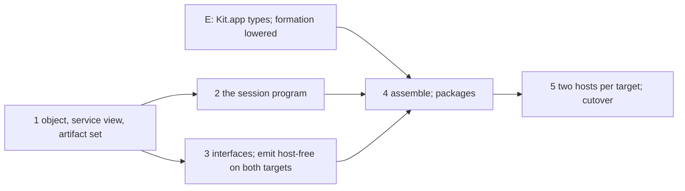

# Program, host, runtime: the compilation boundary as data

The current direction is §14: program data first. Decisions row 439 records the adopted design.
The [landing](2026-10-21-program-domain-landing/README.md) records its implementation and checks.
Sections 1–13 retain earlier proposals against `2de30da7e`; they do not describe the landed object.
Host lifetime, targets and assembly remain proposed work.

## 1. The change to make

Keep one program representation, `Eff`, with its application signature. Derive its public
methods and its host interface from that data. Emit program artifacts with no host
implementation in them. Assemble those artifacts with a host, a runtime and a driver. Execute
requests under one explicit application lifetime.

The one thing to know: every building block the API needs already has an owner in the tree with
its laws, and the robust form of each is the owner's own form. What is new is three things, each
a definition and not a framework: the object, the artifact set as a `Row`, and the session
program. The rest is composition.

## 2. The model

An **object** is a versioned first-order envelope: the program (the service block), its
`SigApp` (rows, service declarations, named types), the row spellings, and the one metadata the
program does not retain (argument names). A **running application** is one run of the object's
session program under a host. A **bundle** is an artifact set with its manifest. A **package**
adds a host implementation, a runtime and a driver.

```mermaid
flowchart LR
  S[Lean text: application, hosts] --> B[build: Author.build, seal]
  B --> O[Object]
  O --> V[open: Built.ofProgram]
  V --> E[emit, pure]
  T[target spec: profile, support bytes, pins] --> E
  E --> F[Bundle: ArtifactSet + manifest]
  F --> A[assemble: a checked plan]
  H[host: a file against the generated interface] --> A
  R[runtime: Lean | kit | Effect] --> A
  A --> X[Plan.run: the tools]
  X --> P[Package]
  P --> Run[one run of the session program]
  I[script: requests] --> Run
  V --> Ref[run: the Lean reference]
  I --> Ref
```

```lean
Object.open    : Object → Except Object.Refusal Built
Object.service : Object → Except PrintRefusal Service            -- derived, not stored
Object.session : Object → Except SessionRefusal (Program × RowTable)   -- the lifetime, §6
emit           : Target → Spec → Object → Except EmitRefusal Bundle
assemble       : Bundle → Host → Runtime → Driver → Except AssembleRefusal CheckedPlan
Plan.run       : CheckedPlan → IO Outcome
```

Every arrow but the last is a function of its arguments. The command line resolves files and
tool identities, calls these, and runs the plan. A library caller calls the same functions.

## 3. The six blocks, each from its owner

| Block | The owner in the tree | Its law | What the API adds |
| --- | --- | --- | --- |
| Checked value | `Canonical α` (laws as fields: nothing lands unlawful); `AdmittedProgram program app` (evidence indexed by the data); `Export.CheckedPlan` (a plan with its two finite checks as fields); `Live` (a run with its `opened` proof) | `ofVal_toVal`, `ofVal_exact`; `admitProgram` total by refusal | `Object` as the data of `Built`; `Built` stays the checked value |
| Pure pass | `Except`, `Located Site Reason` (M1, row 422), `Located.under` (the one prefix rule) | `mapSite_comp`; each judgment's `… = none ↔ …` | nothing: a joined refusal is a tagged sum built once by `mapError`, as `EmitRefusal` is |
| Derived view | `servicesOf`, `methodArgs`, `serviceFault` (`Codegen/Print.lean`): the service of a block from its `DefRole`s; `hostBindings`, `rowServiceDecls` (`Codegen/RowServices.lean`); `Reactor.fallible` (`Run/Method.lean`); `Model.Carrier` (`Schema/Modeled.lean`) | `hom_eq_cata_eff` for readings that are folds | `Object.service` is `servicesOf` checked by `serviceFault`: the printer's own reading, so the object and the printed module cannot disagree |
| Artifact set | `Effect4.Data.Row` (`Data/Row.lean`): ascending list, `union`, `union_assoc`, `union_comm`, `union_idem`, `union_empty_*`; the store's three outcomes fresh, duplicate, conflict (`Store.putNode`, row 428 (1)) | the four union laws, proved for any linear order | `ArtifactSet := Row Artifact` ordered by path bytes then digest; `merge` is `union` followed by one check, that no path occurs twice |
| Build plan | `Export.ExportPlan` → `CheckedPlan` (`OCaml5/Lcnf/Export.lean`); `recipeArgvs` (commands from the checked plan); the `uses` rule: a use of a later artifact refuses (row 434) | `facadeResolves`, `publicExcludesCoverage` as fields | `Plan := List Task`, each task's inputs naming supplied files or outputs of earlier tasks only; the DAG is the list order, by construction |
| Content identity | `Canonical.digest = sha256 ∘ encode` (one owner); `Digest`; the gate cache's `snapshot` and `query_key` | `digest_congr`, `encode_injective` under `WF` | a derivation record and a manifest are `Canonical` carriers; their identity is `digest`; no hand concatenation of digests (`Inputs.address` today) |

The pattern of the first row is the whole method: a checked value is a structure whose evidence
fields name its data fields, and its constructor stands behind its checker. `Built` already is
one. So the object is not a new checked value. It is `Built` with the proof erased, and `open`
is the checker.

### 3.1 The object, by construction

```lean
/-- A built program as first-order data: what `Built` holds, less its certificate. -/
structure Object where
  version  : Nat := Object.currentVersion
  app      : SigApp
  program  : Program
  rowNames : List (String × Nat)
  /-- the one thing the program does not retain: each method's argument names, for printing -/
  argNames : List (String × List String) := []
  deriving Canonical   -- the Tool group's generator, as `LiveRecord` has it

def Object.ofBuilt (b : Built) (argNames := []) : Object := ⟨currentVersion, b.app, b.program, b.rowNames, argNames⟩

def Object.open (o : Object) : Except Object.Refusal Built :=
  if o.version ≠ currentVersion then .error (.unsupportedVersion o.version) else
  (Built.ofProgram o.app o.program).map (fun b => { b with rowNames := o.rowNames }) |>.mapError .admission
```

The laws are the exact embedding of the dictionary (§3.5), and both are by construction:

- retraction: `(open (ofBuilt b)).map ofBuilt = .ok (ofBuilt b)` for every `b`. The certificate
  is recomputed by `admitProgram`, a function of `(program, app)`, so the data fields come back
  as they went in. The proof is the projections of `Built.ofProgram`;
- exactness: `open o = .ok b → ofBuilt b = o`, since `open` builds `b` from `o`'s fields.

Nothing is forgotten, which answers Codex's objection to the first draft: the version and the
metadata live in the object, and `open` hands back `Built` beside it. The entries are not
stored: `Object.service` derives them (§3.2). `LiveRecord` becomes `{ object, session, binding,
budget, journal }` and `restore` is `open` then `feedAll`; `restore_save` is restated once, with
its statement unchanged in content. That removes one of M5's eight spellings of "an application
beside its program".

The codec is the generator's. `decode_encode` needs `(toVal o).WF`, which is the frame-length
bound of `Val.WF` (`Store/Carrier/Val.lean`), the one hypothesis an object's bytes carry.

### 3.2 The service view, by the printer's reading

`servicesOf defs` reads the service of a block off its `DefRole`s: the initial program's index,
each method's name, index and arity. `methodArgs state d arity` reads the arguments' types off
the method's request. `serviceFault defs` is the one judgment that the block is a well-formed
service (a name once, every method of one service, no stray definition, each method's request
the state then its arguments).

```lean
def Object.service (o : Object) : Except PrintRefusal Service :=
  match serviceFault o.program.defsOf with
  | some why => .error why
  | none => match servicesOf o.program.defsOf with
    | [s] => .ok s
    | _ => .error (.service "the object holds no single service")
```

Three readers share it: `inspect`, the session program (§6) and the printed module. They cannot
disagree because there is one function. The arity is in the role, the types in the declaration,
and only the names come from `argNames`.

### 3.3 The artifact set as a `Row`

```lean
structure Artifact where path : String; kind : Kind; bytes : ByteArray
instance : LT Artifact := ⟨by path bytes, then by sha256 of bytes⟩     -- a linear order

abbrev ArtifactSet := Row Artifact
def ArtifactSet.conflict (s : ArtifactSet) : Option String := -- the first path with two members
def merge (r s : ArtifactSet) : Except String ArtifactSet :=
  let u := Row.union r s
  match u.conflict with | some p => .error p | none => .ok u
```

On conflict-free sets `merge` is `union`, so associativity, commutativity, idempotence and the
identity are `Row`'s theorems applied, with no new monoid proof. One lemma is new:
`conflict (union r s) = none ↔ conflict r = none ∧ conflict s = none ∧ r, s agree on shared paths`.
Two identical files coalesce by `union_idem` on their element. The semantics is the store's:
fresh, duplicate as a no-op, conflict refused and never overwritten. `emitGroup`'s hand
deduplication of prelude files (`Emit.lean`) becomes a fold of `merge`.

### 3.4 The build plan as a list

```lean
inductive InputRef | supplied (name : String) | produced (task : Nat) (output : String)
structure Task where
  op : Operation            -- a closed alphabet: lowerLeanHost, checkTypeScript, buildNative, copy
  inputs : List InputRef
  outputs : List String
structure Plan where supplied : List (String × Digest); tasks : List Task; selected : List InputRef
structure CheckedPlan where
  plan : Plan
  earlierOnly : plan.earlierOnly = true    -- every produced ref names a task before its own
  ownedOnce   : plan.ownedOnce = true      -- no two tasks own one output path
  resolves    : plan.resolves = true       -- every ref names a supplied file or a declared output
```

The shape is `Export.CheckedPlan`'s: a plan and its finite checks as fields, the checker the
only constructor. The order of execution is the list, so `dependencies`, `describe` and
`Plan.run` read one value and no sort. `recipeArgvs` and `projectArgvs` (`OCaml5/Lcnf/Gen.lean`)
are the commands of `lowerLeanHost`. A plan stores no function and no shell text; its
`Operation` alphabet is closed, so a task that the executor cannot run is refused by the checker,
not discovered at run time.

### 3.5 Identities as canonical carriers

A derivation record (`operation`, producer version, canonical options, each input's role and
digest, the tool contract) is a `Canonical` structure, so its identity is `Canonical.digest`.
The manifest is one too, so `manifest.json` is written by the one JSON printer
(`ShapeDoc.printTree`, row 416 (4)) and read back exactly by `Canonical.readLocated`. Today
`manifestFields` hand-builds `NatJson`, and `Inputs.address` hand-concatenates digests; both go.
`describe` prints a carrier, and `inspect --what manifest` reads one.

## 4. The semantics, probed

Seven findings. Each names the hole, the evidence and the fix by construction.

**A. The lifetime drops runtime state.** A per-request run opens a fresh machine, so a reference
in the service state (an imposed block's `Ref`) is lost between calls (`Tree.run` and `Run.open`
start from empty stores). Codex's revision found this; the first draft's "retained state is the
pair (service state, host state)" was wrong. Fix: the lifetime is one program, §6. Its run is
one `Run`, so the stores persist by construction, and `Live` streams it.

**B. The context is not provided.** The service block's initial program reads the rows' keys'
context (`contextDef`: `Action.context keys`), and the machine answers `missingService` where
no one provided them. Today's `run` never runs the block, so it never hits this. Fix: the
session program provides each row key whose carrier code is the unit code with
`provideService key unit` (`Authoring/Lifts.lean`) before `init`. A key with another carrier is
a located refusal of `Object.session` ("the application requires a service the session cannot
provide"), until a ruling on service provision.

**C. The TypeScript emitter chooses host implementations.** `Compiler.adapters` imports a package
row's namespace from `prelude/sql.ts` or `prelude/prelude.ts`, which implement the rows
(`hostImports`). So `emit` is host-free on the to-do only because the to-do has no package row.
Fix: the module imports every host namespace from `./host`; the bundle holds `host.d.ts`, the
interface from `hostBindings` (types only); assembly supplies `host.ts`, the prelude's adapter
or the user's file. `fileOf` becomes a constant, so the printed module cannot name an
implementation. tsgo checks the bundle against the interface alone.

**D. The native loader cannot recompute formation.** `Run.Kit.admit` decides the signature,
typing and the column scan, and not raw formation: `Formation.checkInput` does not lower, since
`ArgF.child`'s type depends on another field (the Kit's docstring). So a native `open` is not the
Lean `open`. Fix, by construction: lower formation, which means spelling `Eff.view`'s child
field without the dependency, a Lean change inside `Program/Formation.lean` or a formation
checker written as a fold over `Node`. Interim: the native `open` checks the object's digest
against the bundle manifest's and that the manifest records the formation check for that
digest. That is host evidence tied to the exact bytes, and the note says so where it is used.

**E. The kit's application has no named types.** `Kit.app` sets `types = []`; `Run.Kit.admit`
takes the full `SigApp`. Fix: `?types` on `Kit.app`, the narrow part of M8 this plan needs.

**F. A method call is not a typed replacement.** The block's type is its main's, so changing a
unit main into a method call changes the certificate; `NodeHasTy.replace` does not apply. Codex
is right. Fix: there is no per-call program. The session program (§6) is one program, admitted
once per object, and each call is a node of it.

**G. The old runner and the lifetime differ on stateful applications.** `Application.moduleOf`
omits the imposed wrappers that `methodDef` applies, and the external TypeScript driver provides
its layer inside each request. So no general equality with today's `serve` is true. Fix: the law
is conditional (§8, `session-eq-serve`): on an application with no imposed block and no
reference in its service state, the session program's replies are the per-request exits. The
to-do is such an application, which is the finite control.

## 5. The host

- **The interface** is `app.rows`, read by three generators: in Lean the typed record of methods
  and its reactor (`Reactor.fallible` per row over `Model.Carrier`, `Reactor.first` over them),
  from `eff_rows` (item 9, F3); in TypeScript `hostBindings` as `host.d.ts` (§4 C); in OCaml the
  module type by the staged images, which the hand `REPO` of `native_todo.ml` prototyped. Public
  (S-2), for the declared data profile first: a row outside `Model.refusal = none` refuses with
  its path and reason.
- **The implementation** is a file of the user's against that interface, resolved by assembly
  with its dependency closure and digests (`Host`, not a filename).
- **Compatibility** is `Reactor.Envelops r app ∧ Reactor.ExitsOnly r` (`Laws/Run.lean`,
  `Laws/Api/HostDrive.lean`); `drive_envelope` (O-7) and `runWith_denotes` are its consumers. The
  generated Lean host is compatible by construction on data rows once `typed-host-envelops` is
  proved (§8).

## 6. The lifetime is a program

The session program of an object is the service block with a main that initializes once, loops
over requests, and ends. The requests and the replies are host rows appended to the table, so
the driver is a reactor like any host, and the three runtimes run the same program.

```lean
/-- The session rows of an object: `Session.next` answers the next request as a tagged record,
or none at the end; `Session.reply_<m>` takes method `m`'s exit. -/
def Object.sessionRows (o : Object) (s : Service) : RowTable

/-- The session program: the block, with main =
  provideService k₁ unit … (                                   -- §4 B
    bind state ← perform (.call s.init) unit;                  -- init once
    loopWith state (while request ≠ none) (fun state =>
      bind request ← perform Session.next unit;
      selectTagWith request "add" (fun args => bind ex ← exit (perform (.call k_add) (pair state args)); perform Session.reply_add ex) …)
    (step := fun state _ => state) (result := fun _ => unit)) -/
def Object.session (o : Object) : Except SessionRefusal (Program × RowTable)
```

The pieces exist: `provideService`, `loopWith`, `selectTagWith`, `exit` (the body's `Exit` as a
value, at `Ty.exitOf answer error`), `perform (.call k)` with the state and the arguments packed
as `requestOf` packs them, and `Decision.recordTag` for the dispatch. The request type is the
union of one tagged record per method, from `methodArgs`; it is shape-decided, so a host answer
of it is admitted by `Val.hasTy` alone (`fits_of_hasTy_shapeDecides`, row 373 (3)).

What the design gives by construction:

- **retained state**: the service state is the loop's cursor, and the stores are the one run's
  (§4 A); nothing survives a call except through the run, and everything in the run survives;
- **initialization once, close once**: the init call is before the loop, and the run's end
  closes the root scope (`runState_complete` on the explicit close runner applies to the run
  that closes, which this one does);
- **failure retains state**: a method's failure is an `Exit` value (`exit`), replied and looped
  past; a failure of `init` fails the main, and the run closes with its journal;
- **streaming**: the run under `Live` waits at `Session.next` when the driver has no request
  (a frontier, `AGENTS.md`); `Live.feed` of the next reply resumes it. The persistent driver is
  `Live`, with `journal_replays` as its replay law and no new state relation;
- **conservativity**: the session rows are appended to the table, and `meaningUnder_append`
  (R2's C2 on `StraightRows`) says the application's own rows mean what they meant;
- **one program on three runtimes**: `run` is `runWith (session o) (Reactor.first [script, host])`;
  the native package runs the same bytes on `Kit.run`; the TypeScript package prints the session
  program and provides the script as a layer. The service module stays printed for library users.

The lines are read off the script reactor's state: each reply, encoded at its method's exit type
(`typedJson`, as today), beside the host's state view. The frontier cases of the state diagram in
§9 are the run's frontiers; no new state machine is defined.

What it does not establish: a host answers `Session.next` (host progress is external); the
meaning of a call (`method-meaning`, §8); any agreement with Effect beyond the lines compared.

## 7. Reuse keys

| Stage | Determining inputs | Key |
| --- | --- | --- |
| build | the module closure's sources, the toolchain, the build options | `Canonical.digest` of `Inputs` (today `Inputs.address`, hand-made) |
| emit | the object's bytes, the target, the kinds, the support bytes, the pins, the emitter's version | `digest` of the derivation record |
| assemble | the bundle manifest's digest, the host's closure digests, the runtime's versions, the driver | `digest` of the derivation record |
| run | not reusable | — |

A host change moves the assemble key only. A comment in the application's module moves the
build key only, since the object's digest is of its bytes. No cache is built; the keys are in
the manifests, and Lake, dune and the gate cache stay (Codex §9).

## 8. The proof obligations, placed

| Theorem | Concept | Claim, role, pointer | Reach | Not established | Unlocks |
| --- | --- | --- | --- | --- | --- |
| `Object.open_ofBuilt`, `Object.open_exact` | `exact-codecs` (5) | `object-exact`, exactness, `.witness`; by construction (projections of `Built.ofProgram`) | every `Built`; the certificate recomputed | nothing of a run | R13's open part: the service half of the signature as a recorded input (row 21) |
| `Object.service` complete against `serviceFault` | `residual-program-typing` (2) | `service-view`, decidability; by definition | every block | method meaning | `inspect`, the session program, the printer read one view |
| `merge_assoc`, `merge_comm`, `merge_idem` on conflict-free sets; `conflict_union` | `initial-algebras-folds` (7) | `artifact-union`, compatibility; `Row`'s theorems applied | validated paths | executable behaviour | `emitGroup`, the bundle |
| `CheckedPlan` fields | `initial-algebras-folds` (7) | `plan-wiring`, soundness; by construction (`Export.CheckedPlan`'s shape) | finite plans | tool behaviour, termination | `assemble`, the package manifest |
| `Object.session_admitted` : the session program admits at `app ++ sessionRows` when `o` opens and every required key has the unit carrier | `residual-program-typing` (2) | `session-admitted`, soundness; a planned goal first; consumer `run` | the generator; data rows | the run | `run` over objects with no per-request check |
| `meaningUnder_append` | `translation-simulation` (10) | the existing claim `rows-denotation-append` | `StraightRows` | outside the fragment | the session rows change no row's meaning |
| `session_eq_serve` : the replies equal the per-request exits | `translation-simulation` (10) | `session-eq-serve`, compatibility; planned goal; consumer the battery's finite evaluation on the dogfood script | no imposed block, no reference in the service state, the same budget | stateful applications, Effect | the cutover of `serve` |
| `Reactor.fallible_envelops` | `host-session-protocol` (9) | `typed-host-envelops`, soundness; planned goal; consumer `assemble`'s compatibility record, R6 | data rows; `Modeled` images at the rows' types | handle rows (row 97); host progress | the generated interface is compatible by construction |
| the manifest reads back | `exact-codecs` (5) | the existing `Canonical` laws | — | — | `describe` and `inspect` share one carrier |

Cited and unchanged: `drive_envelope`, `runWith_denotes`, `runWith_denotesB`, `journal_replays`,
`decode_iff`, `read_print`, `read_exact`, `runState_complete`, `fits_of_hasTy_shapeDecides`.

## 9. Codex's revision, kept

Codex's reading of the discussion's ten questions stands, with two amendments from §4:

| Discussion | Revision | Amended by |
| --- | --- | --- |
| Q1 portable object | keep the envelope; derive methods from `Eff`; separate decoding, admission and the service view; defer the saved-session migration | §3.1: the migration is one restatement of `LiveRecord`, in slice 1 |
| Q2 native emission | remove host lowering from emission after the replacement route works; the existing loader reads program bytes only | §4 D, E |
| Q3 invocation | ordinary definition calls; retained runtime state; provided context; explicit close | §6: the session program |
| Q4 generated interface | the data profile first; methods apart from the host interface; S-2 the owner's | §5 |
| Q5–Q6 assembly and run | resolve, plan, execute; reuse the recipe machinery; keep `run` | §3.4 |
| Q7 runtime inputs | requests, scheduling controls and host replies apart; replay restores no external resource | §6: requests are host rows |
| Q8 caching | determining inputs before keys; no cache store | §7 |
| Q9 host comparison | two conforming hosts, then a faulty one; declared behaviour matched first (the lane's `Table` has no capacity) | — |
| Q10 order | M8's full-signature check first for native loading; delete after the replacement runs | §10 |

The lifetime's state diagram and the dependency controls of Codex's text are the acceptance of
slices 2 and 5 and stay as written there (`git:2de30da7e` holds no earlier copy; this file's
history does).

## 10. The slices



| Slice | Work | Exit |
| --- | --- | --- |
| 1 | `Api.Object` with its codec; `Object.service`; `LiveRecord` over it; `ArtifactSet` as a `Row` with `merge`; `Inputs` and the manifest as `Canonical` carriers; `check` answers an object | `open_ofBuilt`, `open_exact` proved; `restore_save` restated; the to-do's commands print as today; manifests byte-identical but for the carrier's field order |
| 2 | `Object.session` and its rows; `run` over it with the script reactor; the planned goals `session-admitted`, `session-eq-serve`; the finite control on the dogfood script | `lake exe todo run` prints the same eleven lines; a stateful fixture (an imposed `Ref`) retains its value across calls, which today's runner cannot |
| 3 | `eff_rows` generates the Lean record and reactor; `host.d.ts` in the bundle, `host.ts` by assembly; `--target ocaml` emits the object, the signature and the manifest; `Compiler.Native` leaves `emit` | a host edit leaves the bundle's bytes unchanged (a `#guard` over two hosts); tsgo checks the bundle against `host.d.ts`; `typed-host-envelops` stated |
| E | `Kit.app ?types`; formation lowered (§4 D), or the interim digest check named | the native `open` decides what the Lean `open` decides |
| 4 | `assemble` with `CheckedPlan` and `Plan.run`; drivers for `ts` (the printed session program, the script as a layer) and `ocaml` (`Kit.program_of_bytes`, `Kit.run`); `lowerLeanHost` by `projectArgvs` | the to-do's `package.json`, `tsconfig.json`, `dune`, `todo_native.ml` and `run.ts` are generated; staging then publish, a failed build publishes nothing |
| 5 | two conforming hosts per target, one faulty; the lane T controls moved to the assembled dogfood package; the deletions | `SAME` on both targets for both hosts; the faulty host differs at a named request; each deletion names its consumer |

Where it sits in the order (`coherence.md` §9.1): slices 1 to 3 now, since they touch nothing
in flight; item 9 is slice 3; E is the narrow part of M8, which keeps its owner; 4 and 5 after.

## 11. What this does not establish

- No general compiler correctness theorem; Lean against OCaml and Effect stays finite evidence.
- `session-admitted`, `session-eq-serve` and `typed-host-envelops` are planned goals until
  proved, and `session-eq-serve` is conditional on a stateless application.
- The native `open` equals the Lean `open` only after formation lowers (§4 D).
- A required service with a non-unit carrier refuses the session program until a ruling.
- Host progress is external; a scope a run leaves open is an observation (D8).

## 12. The decisions left

1. The lifetime as the session program (§6), on all three runtimes, with the service module
   still printed for library users. Recommended: yes.
2. `host.d.ts` in the bundle and `host.ts` by assembly, the prelude's adapters moving to
   assembly (§4 C). Recommended: yes.
3. Formation lowered before the native package is called equal to Lean's (§4 D); the interim
   digest check allowed only with its evidence word. Recommended: lower it in slice E.
4. The object stores `rowNames` and `argNames`, derives the entries, and carries a version
   (§3.1). Recommended: yes.
5. `Inputs`, the derivation records and the manifest as `Canonical` carriers, printed by the one
   printer (§3.5). Recommended: yes.
6. A required service with a non-unit carrier: refuse the session program (§4 B).
   Recommended: yes, until a ruling on provision.
7. S-2, the generated host interface public, for the data profile. Recommended: yes.

## 13. The to-do, before and after

Measured at the external to-do `737df8b` (the library `2de30da7e`), after `lake exe todo emit
--out ts` and `emit --target ocaml --out ocaml`. Counts by `wc -l`.

### 13.1 What is generated today

| File | Lines | What it is | Where it belongs under program, host, runtime |
| --- | --- | --- | --- |
| `ts/todo.gen.ts` | 93 | the service block printed: `RepoKey` (the host rows as a `Context.Service`), `Repo` (call helpers), `TodoAppContext`, `TodoApp_add` … `TodoApp_remove`, `TodoApp`, `TodoAppLayer`, and `main = Effect.succeed(undefined)` | program, with the host interface inside it |
| `ts/todo.surface.gen.ts` | 30 | `TodoAppSchemas` (each method's input, answer, error as Schemas) and `TodoAppLive` (the decoding layer) | program: the method interface |
| `ts/prelude/*.ts` | 847 | the prelude's import closure, copied: `prelude.ts` 406, `prelude-atoms.gen.ts` 333, `control.ts` 57, `records.ts` 47, `tuples.ts` 4; the module uses six names of it (`eq, fst, ifCase, optionCase, pair, snd`) | runtime: the TypeScript half of the native route's atoms |
| `ts/todo.eff`, `ts/todo.eff.json` | 5,713 B, 1 | the block's canonical bytes and their tagged print; the roles `serviceInit` and `serviceMethod` are in them | program |
| `ts/certificate.json` | 1 | `answer: unit, error: never, requires: []`, the four rows, the services' key names, the five declarations | program: a certificate of the placeholder main |
| `ts/manifest.json` | 1 | `program {module, declaration "main", address}`, the certificate again, the profile, eleven artifacts with SHA-256, `inputs` (the toolchain, the library commit, 265 modules with digests, the packages, tsgo), nine checks, the command | program and build record, mixed |
| `ts/run.ts` (hand) | 85 | the repository over a store, the eleven requests again, the exit codec, a JSON canonicalizer that re-implements Lean's key order, and a loop that provides the layer per request | host, driver and runtime glue, by hand |
| `ts/package.json`, `ts/tsconfig.json` (hand) | 13, 16 | the pins and the compiler options | package |
| `ocaml/todo_gen.ml` | 6,413 | lowered from six host roots: the repository and its four functions, the store, and `programOf`, which drags `Todo.app`, `Compiler.Request.moduleOf?` and the authoring elaborator `elaborateModule` (376 declarations in `closure-todo_gen.tsv`) into the user's binary | host, plus the compiler's own elaborator |
| `ocaml/lowering.json`, `ocaml/closure-todo_gen.tsv` | 1, 376 | the recipe naming the host roots; the lowering's closure census | build-tool internals, published as artifacts of kind `recipe` and `closure` |
| `ocaml/todo.eff`, `.eff.json`, `certificate.json` | — | as for `ts` | program; written and read by nothing on this target |
| `ocaml/manifest.json` | 1 | as for `ts`, plus `loweringCommand` and `loweringDirectory`, both absolute paths of one machine (`/Users/pooks/Dev/lean4-effect4`) | build record, not portable |
| `ocaml/todo_native.ml`, `dune`, `dune-project` (hand) | 31, 12, 1 | `Kit.app ~rows:Todo_gen.todo_host_rows`, then per request `Todo_gen.todo_host_program_of`, `Kit.check`, `Kit.run` | driver, by hand |
| `Todo/Host.lean` (hand) | 124 | the store and four functions (host); `repository` (host); `storeVal` (view); `script` (driver); `rows`, `programOf`, `resultVal` (program plumbing for the native run); `lowered` (the recipe) | five concerns in one file |

### 13.2 What is hacky and loose, with the evidence

1. **The native binary rebuilds programs from authoring source.** `todo_gen.ml` lowers
   `programOf`, so each request elaborates `Todo.app`'s entry at its arguments through
   `elaborateModule`, natively, at run time. The emitted `todo.eff` sits beside it, read by
   nothing. 6,413 lines, of which the host is about 150.
2. **The host is inside the program artifact.** `lowering.json`'s `linkage` names six host
   roots. A change to `Todo.Host.insert` changes `todo_gen.ml`'s digest in the program manifest.
3. **The manifest is not portable.** `loweringDirectory` and `loweringCommand` carry absolute
   paths of the machine that emitted them.
4. **The certificate certifies a placeholder.** `main = Effect.succeed(undefined)`, so
   `certificate.answer` is `unit`, the header says `type void` and `covered: outside the straight
   fragment`. The methods' types are only in `declarations`. The certificate is then copied whole
   into the manifest.
5. **The program's inputs include the compiler and the host.** `inputs.modules` lists 265
   modules, `Compiler.Check`, `Compiler.Code.Doc` and `Todo.Host` among them, so `inputs.address`
   moves when the host or the compiler's own source moves, although the program's bytes do not.
6. **Runtime code is copied into the program folder.** 847 lines of prelude for six names, with
   a self-test table and a SQL adapter's sibling, as artifacts of kind `prelude` with digests in
   the program's manifest.
7. **The host interface lives in the program module, so the host imports the program.**
   `run.ts` writes `typeof RepoKey.Service` from `./todo.gen.ts`: the dependency points from the
   host to the program file, the direction the proposal forbids.
8. **Three copies of the script, two codecs, two lifetimes.** The eleven requests are in
   `Todo/Host.lean`, `run.ts` and the lowered `todo_host_script`. `run.ts` hand-writes an exit
   codec and a `canon` that re-implements Lean's key order. It provides the layer inside each
   request, where the Lean `run` never runs the block at all (§4 B): neither runs the service's
   lifetime.
9. **The service state is tuple plumbing.** `TodoApp_add(a0: readonly [Context.Context<"Repo">,
   string])` with `fst(a0)` and `snd(a0)`: a context value packed as the first component of every
   method's request, visible in the printed text and in the bytes (`request: prod (contextOf …)
   string`).
10. **`Todo/Host.lean` is five things.** Host, view, driver script, program plumbing and the
    lowering recipe, in one file the user is told to write.
11. **The kit's application is the host's.** `Kit.app ~rows:Todo_gen.todo_host_rows` takes the
    rows from the lowered host instead of from the program's bytes, and `types = []`.

### 13.3 The same to-do in the new form

The user writes three Lean files and, per target, one host file.

```text
effect4-todo/
  Todo/App.lean          77 lines, unchanged: the data, the rows, the four operations, the application
  Todo/Host.lean         ~55 lines: the store, four functions, `repository : Repo.Host Store`, `storeVal`
  Todo/Script.lean       ~15 lines: the eleven requests, as data
  Main.lean              2 lines: `Compiler.main Todo.app args (hosted := …) (script := Todo.script)`
  ts/repository.ts       ~30 lines: the store and four methods against `host.d.ts`  (hand, the TS host)
  ocaml/table.ml         ~40 lines: a module of the generated signature          (hand, a second native host)
```

`Todo/Host.lean` after slice 3:

```lean
structure Store where next : Nat := 1; items : List Item := []; capacity : Nat := 3

def insert (title : String) (s : Store) : Except SqlError Item × Store := …   -- the four, as today
def all … def setDone … def delete …

/-- The repository: a value of the record `eff_rows` generated for `Repo`. -/
def repository : Repo.Host Store := { insert, all, setDone, delete }

def storeVal (s : Store) : Val := …
```

`lake exe todo emit --out out` writes the object, target-independent:

```text
out/
  todo.obj             the object's canonical bytes: version 1, app {rows, services, types}, the block, rowNames, argNames
  todo.obj.json        its tagged print, readable
  manifest.json        a carrier: object {address}, program {address}, profile, artifacts, derivation, checks
```

`lake exe todo emit --target ts --out out/ts` writes the bundle:

```text
out/ts/
  todo.gen.ts          the service block printed; imports { Repo } from "./host"; imports eq, fst, … from "@effect4/prelude"
  todo.surface.gen.ts  as today
  todo.session.gen.ts  the session program: main = provide Repo's unit key; init once; loop on Session.next; reply
  host.d.ts            the host interface, types only, from hostBindings
  todo.obj             the object
  manifest.json        the carrier; requires: ["./host", "./driver", "@effect4/prelude@<pin>", "effect@4.0.0-rc.112"]
```

`host.d.ts`, generated from the rows (the text `hostBindings` already computes):

```ts
import type { Context, Effect, Option } from "effect"
export type Todo = { readonly done: boolean; readonly id: number; readonly title: string }
export type SqlError = readonly ["SqlError", string]
export declare const RepoKey: Context.Service<"Repo", {
  readonly insert: (a0: string) => Effect.Effect<Todo, SqlError, never>
  readonly all: () => Effect.Effect<ReadonlyArray<Todo>, SqlError, never>
  readonly setDone: (a0: readonly [number, boolean]) => Effect.Effect<Option.Option<Todo>, SqlError, never>
  readonly delete: (a0: number) => Effect.Effect<boolean, SqlError, never>
}>
export declare const Repo: typeof RepoKey & { insert: …; all: …; setDone: …; delete: … }
```

`todo.session.gen.ts`, the session program printed (the layout is the printer's; this is its
shape):

```ts
import { Effect } from "effect"
import { Repo } from "./host"
import { Session } from "./driver"
import { TodoAppContext, TodoApp_add, TodoApp_list, TodoApp_complete, TodoApp_remove } from "./todo.gen.ts"

export const main: Effect.Effect<void, never, "Repo" | "Session"> =
  Effect.flatMap(TodoAppContext(), (state) =>
    Effect.whileLoop({                                   // iterate: the cursor is the state
      while: … ,                                          // Session.next answered some request
      body: () => Effect.flatMap(Session.next(), (request) =>
        tagCase(request,
          { add:      (args) => Effect.flatMap(Effect.exit(TodoApp_add(pair(state, args.title))), Session.reply_add),
            list:     ()     => Effect.flatMap(Effect.exit(TodoApp_list(state)),                  Session.reply_list),
            complete: (args) => Effect.flatMap(Effect.exit(TodoApp_complete(pair(state, args.id))), Session.reply_complete),
            remove:   (args) => Effect.flatMap(Effect.exit(TodoApp_remove(pair(state, args.id))),   Session.reply_remove) })),
      step: () => undefined }))
```

`lake exe todo assemble --target ts --host ts/repository.ts --out pkg/ts` writes the package:

```text
pkg/ts/
  (the bundle, copied)
  host.ts              the user's repository.ts, checked against host.d.ts
  driver.ts            generated: Session as a Layer over the script's eleven requests; prints each reply
                       at its method's exit Schema (from the surface) beside the host's state
  main.ts              generated: Effect.runPromise(main.pipe(Effect.provide(hostLayer), Effect.provide(driverLayer)))
  package.json         generated: effect 4.0.0-rc.112, @effect4/prelude <pin>, tsgo 7.0.0-dev.20260629.1
  tsconfig.json        generated
  package.json.manifest  the package record: bundle manifest digest, host.ts digest, the pins, the driver's script digest,
                       the commands run (tsgo --noEmit, bun main.ts) and their exit codes
```

`ts/repository.ts`, the user's host, is the first forty lines of today's `run.ts` and nothing
else:

```ts
import { Effect, Layer, Option } from "effect"
import { RepoKey, type Todo } from "./host"
const store = { next: 1, items: [] as ReadonlyArray<Todo>, capacity: 3 }
export const hostLayer = Layer.succeed(RepoKey, {
  insert: title => …, all: () => …, setDone: ([id, done]) => …, delete: id => …
})
```

`lake exe todo emit --target ocaml --out out/ocaml` writes:

```text
out/ocaml/
  todo.obj             the object
  todo_host.mli        the generated signature: module type REPO = sig type t  val insert : string -> t -> (todo, sql_error) result * t … end
  todo_types.ml        the rows' carriers as OCaml types (todo, sql_error), by the staged images
  manifest.json
```

`lake exe todo assemble --target ocaml --host Todo/Host.lean --out pkg/ocaml` writes:

```text
pkg/ocaml/
  todo.obj
  todo_host_gen.ml     lowered from Todo.Host.repository alone: the store, the four functions, the record (about 400 lines)
  script.ml            the eleven requests as data
  main.ml              generated, below
  dune, dune-project   generated
  package.json.manifest  the package record, as for ts; lcnfgen's command recorded with relative paths and the library's commit
```

`main.ml`, generated:

```ocaml
let () =
  let object_ = Kit.object_of_bytes (In_channel.with_open_bin "todo.obj" In_channel.input_all) in
  let app = Kit.app_of_object object_ in                 (* rows, services and types from the bytes; M8's narrow part *)
  let program = Kit.session object_ in                   (* the same session program Lean runs *)
  let host = Todo_host_gen.reactor Todo_host_gen.repository in
  let script = Script.reactor Script.requests in         (* answers Session.next, records Session.reply_* *)
  let report = Kit.run app (Kit.Reactor.first [ script; host ]) (Script.start, Todo_host_gen.initial) program in
  Script.print_lines report.state
```

`--host ocaml/table.ml` instead lowers nothing: the plan copies the module, which must have type
`REPO`, and `main.ml` names it.

`lake exe todo run` is the Lean reference: `runWith (session object) (Reactor.first [script,
Repo.reactor repository]) (…)`, printing the same lines from the script reactor's state.

### 13.4 What the new form removes, counted at today's files

| Gone | Lines or bytes | Replaced by |
| --- | --- | --- |
| `todo_gen.ml`'s elaborator, `Todo.app`, `moduleOf?`, `programOf`, `script`, `resultVal`, `rows` | about 6,000 of 6,413 | `todo.obj` read by `Kit.object_of_bytes`; `todo_host_gen.ml` holds the host alone |
| `ts/prelude/` in the program folder | 847 | the package `@effect4/prelude`, pinned by assembly |
| `run.ts`'s script, codec, canonicalizer and loop | 55 of 85 | `driver.ts`, generated from the script and the surface |
| `todo_native.ml`, `dune`, `dune-project`, `package.json`, `tsconfig.json` by hand | 73 | generated by `assemble` |
| `Todo/Host.lean`'s `programOf`, `resultVal`, `rows`, `lowered`, `script` | about 45 of 124 | the object's service view; `Todo/Script.lean`; nothing |
| `lowering.json`, `closure-todo_gen.tsv` as program artifacts | 377 | the package record names the lowering's inputs and command |
| the certificate copied into the manifest; `loweringDirectory` | — | one carrier, relative paths |
| `inputs.modules` with the compiler's and the host's modules | 265 entries | the build key names the application's closure; the host's closure is the assemble key's |

What stays hand-written: the application, the host's functions in Lean, one host file per
target, and the script. Everything that is a function of the object is generated from it, and
nothing generated from the object mentions a host implementation, a path, or the compiler's
sources.

One more decision for §12:

8. The prelude becomes a pinned package (`@effect4/prelude`), the runtime's TypeScript half,
   supplied by assembly, instead of a copied folder in the bundle. Recommended: yes; the bundle's
   key then names the pin, not 847 lines of bytes.

## 14. Start clean: the program domain alone

The owner, 2026-10-21: "we've been getting ahead of ourselves trying to generate all artifacts
at once. Start clean and just get the program and typing semantics down." This section supersedes
§10's slice 1. Everything about hosts, runtimes, emission and assembly waits until the program
domain stands on its own.

### 14.1 What the program domain is

The object is a program with its signature: `Object` in `src/Effect4/Program/Object.lean`.
Its fields are `app : SigApp` and `program : Eff NativeOp`.
Row names are `SigApp.rowNames`, a projection of the rows.
Argument names have no domain consumer and remain outside this object.
The store node's specification identifies the layout. No object field repeats that information.

Admission uses `Built.ofProgram` in `src/Effect4/Api/Built.lean`.
It checks the signature, formation, typing and columns through their existing owners.
The object holds no run state, host implementation or target naming policy.

### 14.2 The implementation

The design note's §7 owns the file plan.
Decisions row 439 settles its recommendations.
The landing note records proof placement and finishing criteria:
`docs/research/2026-10-21-program-domain-landing/README.md`.

| Operation | Existing owner | Result |
| --- | --- | --- |
| `Object.ofBuilt` | `Built` projections | object data |
| `Object.open` | `Built.ofProgram` | admitted program or admission refusal |
| `Object.bytes`, `Object.read` | store node codec and typed reader | exact node bytes or read refusal |
| `Object.load` | `Object.read`, then `Object.open` | admitted saved program or tagged refusal |
| `Object.ref` | `Store.address` | typed node digest |
| `Object.table` | `Check.run` at the module | source address table through layer references |
| `Object.services` | `serviceFaultIn anyName`, then `servicesOf` | formed service roles or refusal |
| `Built.certificate` | admitted program projections | printed certificate data |

The codec generator owns the Object group and moves `SigApp` there from Check.
The generated printed certificate replaces the compiler's hand-built JSON.
`certificateLines` stays because source-based text names Lean declarations unavailable in an object.
`LiveRecord` stores the object instead of repeating its program, signature and row names.
Its changed layout refuses old records during canonical decoding. This slice supplies no migration reader.

The laws compose admission and the existing exact node codec.
Reopening recovers every `Built`, since row names are derived.
Byte retraction requires `Val.WF`; successful reading identifies the exact encoded bytes.
Equal references give equal objects or an exhibited collision. No hash injectivity law is claimed.
The table uses source annotation, including layer references, rather than raw syntax annotation.

Runtime lifetime, host generation, target emission and assembly remain later slices.
Generated consumers reached by changed carriers must still be regenerated and checked.

### 14.3 Acceptance

1. Save an admitted to-do with `check --out todo.obj`.
2. Open it without source lookup; bare `open todo.obj` prints the same JSON as `check --json`.
3. Repeated saves produce identical bytes. Node, layout and admission failures retain their refusal owners.
4. Rows, types, graph and surface inspection retain their existing output bytes without a tool round trip.
5. Prove the placed laws; audit touched declarations within `[propext, Quot.sound]`.
6. Build affected batteries and run the reached TypeScript and OCaml behavior gates.

### 14.4 The design, probed (2026-10-21)

A design seat composed the domain from the tree's owners and proved its laws in probes:
`docs/research/2026-10-21-program-domain-design/README.md` (`a5127efcc`). Its findings amend
§14.2: the object is `{ app : SigApp, program : Eff NativeOp }` and nothing else. The row names
become a projection of the rows. The landing removes the internal constructor's arbitrary-name argument.
The store node's spec checks the layout digest, and argument names have no consumer. `open` is
`Built.ofProgram`; the bytes are the store's node codec; the digest is `Store.address` and is
called `ref`; the address table is `Check.run`'s verdict and is called `table`; the service view
is the printer's fault check written once over a profile of names (`rfl` against `serviceFault`).
At the recorded base, eight probes compile under `-DwarningAsError=true`.
The audit covers 381 declarations within `[propext, Quot.sound]`.
The landing follows that note's §7 and §8 recommendations.

### 14.5 What comes after, in this order

The domain next door is the target's print of the program (the TypeScript module, the
read-back law), then the host interface derived from the rows, then the session program. Each is
a view or a derivation of the object, so each starts from `Object` and adds one function. None
of them is started before 14.3 holds.
