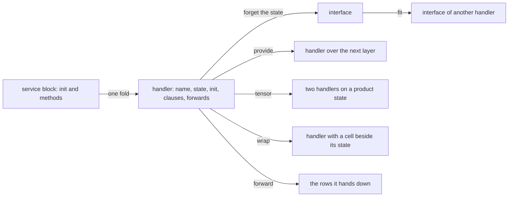

# 2026-10-21 Handlers: the derivation, the probes and the first slice

Status: research note (history, not authority). Base: `ccf876f0b` on `claude/handler-design-aa9683`. It rules nothing; §8 proposes decisions row 445.
The evidence words are those of `docs/core/controlled-english.md` §3.8. Every "tested" below is the output of a probe beside this text, run with `LEAN_NUM_THREADS=3 lake env lean <probe>` against the built tree on 2026-10-21. The literature is under `sources/`, with its index in `sources/README.md`.

## 1. The one thing to know

A service block is already a handler, and the handler is a value the tree can read today with one fold. Nothing new is stored.
The fold reads the service's name, the state it carries, its init, its clauses and what it forwards (`probe-object.lean`).
Its one law is the fit law: two handlers of one service fit when their clauses agree once the state is forgotten. The tree owns that forgetting map as `methodArgs` (`src/Effect4/Program/Services.lean`), and the session's protocol rows are a function of it (`probe-fit.lean`).
The four compositions exist, each as one piece of code. One finding corrects the brief: `provide` is not associative on the typing, and Effect's is not either. It is associative on the incidence, and on the typing under one side condition (§4.1).
The recommended first slice is the handler object, the fit law with its consumer, and a battery. It touches three new files and no existing one (§7).



## 2. The model, in the tree's names

A service's methods are its operations. Method `m` takes `A_m` and answers an exit of `B_m` and `E_m`.
The next layer is the rows the bodies call: the host's rows and the store's rows.
A handler of the service is a runner in Ahman and Bauer's generalised sense (*Runners in action*, Definition 2). Each clause is a co-operation `h_m : A_m → T B_m`, where `T` reads the state and performs the next layer's rows. By their Proposition 3, such a runner is one monad morphism out of the free monad on the methods.
The tree's clause has exactly that shape. A method's request is the state, then its arguments, and its body runs the entry under `provideContext state` (`methodDef`, `src/Effect4/Program/Authoring/ApplicationService.lean`). The body returns directly, and no clause captures a continuation (§5.1).
The state is read and never handed back by a clause (`probe-missing.lean`, `answersState`: false for every method of the cached to-do). What changes lives in the store, behind the Ref rows. So the state the handler carries is a configuration in Ahman and Bauer's words, and the mutable part is one layer down.

In Effect's words, the handler is `Layer.effect(Key, Effect.map(init, state => ({ methods })))` (`vendor/effect-4.0.0-rc.112/src/Layer.ts:1427`). The closure over `state` is the read of the state. A `Ref` made in `init` is the mutable part (`vendor/effect-4.0.0-rc.112/src/Ref.ts:173`). The printer prints exactly this (`printService`, `src/Effect4/Codegen/Print.lean`; §6, F1).

## 3. Step 1: the handler as its own object

**Statement.** A handler is the tuple `(service, state, init, clauses, requires, forwards)`. `state` is the init's answer. `clauses` are the methods with their positions and arities. `requires` is what the init reads from the context: Effect's `RIn` in `Layer<I, E, RIn>`. `forwards` is what the clauses still require after the state's keys are discharged: the open right summand of §4.4.

**Definition, as a fold.** `probe-object.lean` reads it with `cata_eff` over `EffAlgebra.ofLayer`, as `Compiler.Graphs.read` reads its relations (`tools/Compiler/Graphs.lean`). The `defs` node contributes the services of its declarations through `servicesOf` and `Service` (`src/Effect4/Program/Services.lean`), and every other node joins its children. The rows a handler forwards are read off the calls relation of the same module.

**Tested, on the plain to-do:** one handler.

```text
service TodoApp; state Context.Context<"k30_6">; init 0
clauses [add@1/1, list@2/0, complete@3/1, remove@4/1]
requires [k30_6]; forwards []
rows [TodoRepo.insert, TodoRepo.all, TodoRepo.setDone, TodoRepo.delete]
```

**Tested, on the cached to-do:** two handlers. `ListCache` carries a cell, `Ref.Ref<Option.Option<ReadonlyArray<Todo>>>`, with clauses `get@1/0` and `invalidate@2/0`, and requires nothing. `TodoApp` carries `readonly [Context.Context<"k30_6">, Ref.Ref<…>]`, its init at position 3, the same four clauses at positions 4 to 7, the same `requires` and the same rows.
`ListCache` forwards no host row. Its clauses perform the store's operations instead: one `refMake`, one `refGet`, two `refSet` (`probe-missing.lean`, `storeOps`).

**Agreement of folds, tested:** on both programs the fold's service names equal `(servicesOf program.defsOf).map (·.name)`. The fold reads what the root's declarations declare. The slice states this as a theorem (§7).

**What it does not establish.** The object is a view of the block, never stored. It states nothing about what a clause means.

## 4. Step 2: the fit law as the forgetting map

**Statement.** The interface of a handler is its clauses with the state removed from each request. Each clause keeps its arguments after the state, its answer and its error. Two handlers of one service fit when their interfaces agree.

**Definition.** The forgetting map is `methodArgs state d arity` (`src/Effect4/Program/Services.lean`). It answers `none` where the request does not begin with the state. The printer's method types (`methodType`, `src/Effect4/Codegen/Print.lean`) and the session's protocol rows (`methodPort`, `src/Effect4/Api/Session.lean`) both read through it. `probe-fit.lean` folds it over the clauses as `interface`, and `fits` compares two.

**Tested.** The states differ: `Context.Context<"k30_6">` against `readonly [Context.Context<"k30_6">, Ref.Ref<…>]`. The interfaces are one value:

```text
add      [string]  Todo                 SqlError | EmptyTitle
list     []        ReadonlyArray<Todo>  SqlError
complete [number]  Todo                 SqlError | NotFound
remove   [number]  void                 SqlError | NotFound
```

`fits todo cached "TodoApp"` is `true`. Two controls: `ListCache` and `TodoApp` of one program do not fit, and the map at the wrong state, `unit`, is `none` for every clause.

**The consumer, tested.** `ServiceSession.rows` of the two handlers is one table: `Session.next` and the four reply rows, with equal columns. A client of the plain to-do is a client of the cached one. That is what the fit law buys.

**Placement.**

- Concept: 9, host session protocol and boundary (`host-session-protocol`). A client's protocol is a function of the interface. The fold agreement of §3 sits under concept 7 (`initial-algebras-folds`).
- Claim: `handler-fit-imposed`, role compatibility, R6. Statement: for every application `app`, imposed list `ms` and service name, the interfaces of `serviceDefs app` and of `serviceDefs { app with imposed := ms }` agree. Pointer: a planned goal `Handler.interface_imposed` until proved. Its consumer: `ServiceSession.rows_of_fit`, equal interfaces give equal protocol rows, which the slice proves outright.
- Reach: the handlers that `Application.serviceDefs` writes, at any application and any imposed list; the hypothesis is that `serviceDefs` answers `.ok` on both.
- What it does not establish: nothing about the clauses' meaning. Two handlers that fit may answer differently. A handler written by hand, outside `serviceDefs`, is not covered until the statement is over `Handler` alone.
- What it unlocks: the host's handler of a namespace is checked by the same map against the rows' columns (`host/<ns>.handler.obj` in `docs/research/2026-10-21-artifact-layout/README.md` §4.2). The typed service view, which five consumers recompute through `methodArgs` today, gets one owner.

## 5. Step 3: the four compositions

Each is one operation on the handler object of §3, with its law, shown on the to-do by `probe-compose.lean`.

### 5.1 Vertical: `provide`

One handler over another is `LayerTerm.provide` (`Layer.ts:2258`), typed by `LayerTy.provide` (`src/Effect4/Program/Typing/Rules.lean`) and built by `build` (`src/Effect4/Program/Provision.lean`). At the method level it is `provideContext`. On the printed side it is `Effect.provideContext(body, fst(a0))` (`vendor/effect-4.0.0-rc.112/src/Effect.ts:11667`; §6, F1).

**The law, corrected.** The brief names associativity. Tested, on three layers over the native keys, with `a` providing `k31_6` and reading `k30_6`, `b` providing `k32_6`, and `c` providing `k30_6`:

```text
(a ∘ b) ∘ c    out [k31_6]  requires []
a ∘ (b ∘ c)    out [k31_6]  requires [k30_6]
a ∘ (b ∘m c)   out [k31_6]  requires []
```

The inner `provide` hides `c` from `a`. Effect types it the same way: `Layer<ROut2, E, RIn | Exclude<RIn2, ROut>>` at `Layer.ts:2258`, and `provideMerge` at `Layer.ts:2704` keeps `c` exposed, which is the third line. So the typing is associative under one side condition. What the outer layer requires of the innermost, the middle one also provides. The inner composition as `provideMerge` meets it too.
On the incidence, `provide` is overlay, and overlay is associative: `hypergraph_provide` (`tools/Tools/View/LayerGraph.lean`, G1) and `AGraph.overlay_assoc` (`tools/Tools/View/AlgGraph.lean`), both proved.

**On the handler.** A block handler has no service key, so it cannot stand in a `LayerTerm` today. Its vertical composition with the host's layer is the session's: `Built.session` leaves the init's `requires` for the host (§5.4). An Effect user writes `TodoAppLayer.pipe(Layer.provide(TodoRepoLayer))`. §8 asks whether a block service should get a key.

### 5.2 Horizontal: `tensor`

Two handlers side by side are a product state. `Application.stateTy` is `.prod (contextOf keys) (requestTy states)` (`src/Effect4/Program/Authoring/ApplicationService.lean`), and the cached to-do's state is that pair (§3). On the machine the composition is `Reactor.tensor` (`src/Effect4/Run/Runner.lean`). It is Plotkin and Power's tensor of comodels on disjoint operations, the left answer first (*Tensors of comodels and models for operational semantics*, by name).

**The law, tested.** The queue declines the four repository rows, and the repository declines `Session.next`. On those five rows the two orders agree up to the swap of the state. On a row both answer, the left wins: with a reactor that answers every row, `insert` and `all` differ between the orders. On `setDone` and `delete` the repository declines the probe's request shape, so there is no overlap there and the orders agree.
The boundary is the sum: a left operation followed by a right one is a different tree from the reverse, `sum_not_tensor` (`Test/Program/SignatureSum.lean`). Hyland, Plotkin and Power's tensor adds the commutation equation, and the sum adds none (*Combining effects: sum and tensor*, by name). `Reactor.tensor` on overlapping rows is a sum with left priority, not a tensor, and no claim covers that overlap.

**Effect's memo map.** Effect keys its memo map on the layer object (`Layer.ts:411`, `:438`). One layer provided to both sides of a `merge` is built once and shared. Our answer: a layer's identity is its path, and a second site is `LayerTerm.ref` (DB-12). A handler's state is made once by its init, under `Layer.effect`'s one `map`, and the clauses close over it. Two handlers in a tensor share no state: a shared cell is a service of its own, required by both and provided below both. In the view-graph note's form that is a wire two boxes meet on. It is Effect's idiom too: `Layer.provide` of one shared layer to the merged pair.

### 5.3 The transformer: `wrap`

A handler changed by wrapping its clauses is `Application.Imposed.wrap` (`src/Effect4/Program/Authoring/Application.lean`). It maps the clause's program to a program, given the bound state of the imposed block. It takes a handler with state `C` to one with state `C × Cell`. The to-do's two wrappers are `readingThrough` and `invalidatingAfter` (`Test/Dogfood/Scenario/Todo/Data.lean`).

**Tested.** The `list` clause of the plain to-do is two nodes: `provideContext` over `perform TodoRepo.all`. The cached one is seven nodes. A `bind` reads the state's second part. Then `invoke` runs `listCacheGet` with the plain clause as its one program argument. `wrap` with no entry under the name is the identity on the clause.

**Its law** is the fit law: §4's test is this transformer's. The loader is a program parameter of `get` (`getBody`, `src/Effect4/Library/Ref/Cache.lean`). So `get` is a scoped operation in Wu, Schrijvers and Hinze's sense (*Effect handlers in scope*, §7). It runs a program inside its own scope, which an algebraic operation cannot. The tree carries the program in the node's spine (`Eff.invoke`), which is their higher-order syntax made first-order.

### 5.4 Forwarding: the open right summand

What a handler does not handle passes through. A handler of `Σ_svc ⊕ Σ_rest` that is the identity on the right is the restriction law `interpret_inl_restrict` (`src/Effect4/Laws/Effects/Sum.lean`), proved. In the tree the right summand is two things, both tested. One is the rows the clauses perform (§3, `rows`). The other is the keys the init requires, which the session leaves to the host. `todoSession.requires` is `[k30_6]`, `ServiceSession.foreign` is empty, and the methods' own requirement rows are empty, since `methodDef` subtracts the context's keys (`Row.diff t.requires app.contextKeys`).

### 5.5 The two laws between compositions, as planned goals

- **Interchange of `provide` and `tensor`.** `(H ⊗ H') ∘ (K ⊗ K') = (H ∘ K) ⊗ (H' ∘ K')` when `H` reads only `K`'s keys and `H'` only `K'`'s. On the typing, `LayerTy.provide (merge a b) (merge c d) = merge (provide a c) (provide b d)` under that side condition. Claim `layer-provide-tensor-interchange`, concept 8 (`context-requirements`), role compatibility, R4; a planned goal over `LayerTy`, then over `build`. Without the side condition it fails for the reason of §5.1.
- **`wrap` and `tensor`.** `W (H ⊗ H') = W H ⊗ H'` when the transformer names only `H`'s methods. `Application.imposed` wraps by entry name, so it acts on one service's clauses by construction. Claim `imposed-wrap-tensor`, concept 9, role compatibility, R6; a planned goal over `serviceDefs` of two applications with disjoint entries. What it does not establish: anything about a transformer that reads both states.

## 6. Step 4: the two compositions the runner form does not have

### 6.1 A clause that captures its continuation

Exceptions and generators, as handlers, need a clause of type `A × (B → T R) → T R`. Tested by type: `Effects.Handler.handle` is `(op) → M (Answer op)`, and the continuation stays in `Effects.Program.vis`. A method is a `DefDecl`, request to answer, with no binder for a continuation. The failure forms of `Eff`, `catchCause` and `matchCause`, take a program for the cause and no continuation. The to-do uses none of them, and its four `provideContext` nodes return directly.
What the tree has instead: failure as an exit, caught by `catchCause`, which drops the continuation. A generator's work is the bind of the free monad.
**Recommendation: no.** The cost is a second clause form in `DefDecl`, a continuation value in the machine, and a printer with no Effect form to print to. Effect has no first-class continuation. The analogy requirement rules it out.

### 6.2 A parameterised handler

Plotkin and Pretnar's parameter-passing handlers (*Handling algebraic effects*, §3.3) give each handling term the type `P → C`, and the continuation receives the next parameter. In runner form that is a clause `A → C → T (B × C)`, and the dispatch rebinds the state after each call.
Tested: no method's answer is a pair with its state (`answersState`). `Eff.provideContext` is a constructor that hands the state in. `ServiceSession.dispatch` takes one `state : TermSrc` for the lifetime. What a parameter does today is the cached to-do's cell: one `refMake` in the init, one `refGet` and two `refSet` in the clauses. The parameter changes through the store, and no clause returns it.
**Recommendation: no.** Making `provideContext` a clause would cost a flag on `DefRole.serviceMethod`, a rebinding `dispatch`, and a printer closing over a mutable binding. That is not Effect's idiom. Effect's idiom is the `Ref` the tree already uses. The runner form with a cell in the state covers the examples of §3.3.

## 7. Step 5: the natural API

The reuse pass found every form in `src/Effect4/Program/Authoring/`. `probe-api.lean` writes each and prints it through the gate's own printer, `Api.emitModule` and `TypeScript.Render.module`. Nothing is added for authoring. What is added is the read-back: `handlersOf`, `Handler.interface` and `Handler.fits` of §3 and §4.

| Form | The Lean the author writes | The `Eff` it builds | The Effect TypeScript it prints to | Effect, at the pin |
| --- | --- | --- | --- | --- |
| F1 declare a handler | `application.serviceModule "TodoApp"` (`ApplicationService.lean`), or `DefSrc.serviceInit` and `DefSrc.serviceMethod` by hand | `Eff.defs` with one `serviceInit` and four `serviceMethod` roles | `const TodoApp = Context.Service<"TodoApp", { add, list, complete, remove }>("TodoApp")`; `const TodoAppLayer = Layer.effect(TodoApp, Effect.map(TodoAppContext(), (a0) => ({ add: (a1) => TodoApp_add(pair(a0, a1)), … })))` | `Context.Service`, `Context.ts:252`; `Layer.effect`, `Layer.ts:1427` |
| F2 impose a transformer | `{ application with imposed := [listCache] }` | the init pairs the context with the cell; the `list` clause is `invoke listCacheGet` with the plain clause as its program | `TodoApp_list = (a0: [Context<"TodoRepo">, Ref<…>]) => Effect.flatMap(Effect.succeed(snd(a0)), (a1) => listCacheGet(a1, (a2) => Effect.provideContext(TodoRepo.all(), fst(a0))))`; the layer line is unchanged | `Ref.make` inside `Layer.effect`, `Ref.ts:173`; an Effect user wraps an existing service with `Layer.effect(TodoApp, Effect.map(TodoApp, inner => ({ …inner, list: cached(inner.list) }))).pipe(Layer.provide(TodoAppLayer))`, `Layer.ts:2258` |
| F3 vertical | `provide (db.layer (succeed unit)) (ServiceDef.use db)` (`Services.lean`); at the layer, `Layer.provide self that` (`Lifts.lean`) | `Eff.provideLayer l false body`; `LayerTerm.provide` | `Effect.provide(Effect.service(k30_6), Layer.effect(k30_6, Effect.succeed(undefined)))` | `Effect.provide`, `Effect.ts:11383`; `Layer.provide`, `Layer.ts:2258`; the method's `Effect.provideContext`, `Effect.ts:11667` |
| F4 horizontal | `provideAll [l₁, l₂] body`; at the layer, `Layer.merge` | `provideLayer (mergeAll [l₁, l₂]) false body`; `LayerTerm.merge`, typed as the union of the two signatures (tested: out `[k30_6, k31_6]`) | `Effect.provide(body, Layer.mergeAll(Layer.effect(k30_6, …), Layer.effect(k31_6, …)))` | `Layer.mergeAll`, `Layer.ts:1652`; `Layer.merge`, `Layer.ts:1850` |
| F5 read the forwarded row | `handlersOf b`, then `requires` and `forwards` | the init's `requires` and the methods' | `TodoAppContext: () => Effect<Context<"TodoRepo">, never, "TodoRepo">`; every method's third type argument is `never` | the layer's type, `Layer<TodoApp, never, TodoRepo>` |

F2's Effect analogy is two forms, because Effect has no transformer on layers. An Effect user builds the cell inside the layer, which is what we print, or decorates a built service with a second layer. Ours fuses the two since the entries are data.

**The generated files.** The handler is not a file: it is a fold of the program object, `program/<name>.obj` in the artifact layout note's terms. Its relation joins the relations document, `generated/graphs/todo.gen.md` and `todo.gen.json`, as one more table, `handlers`. The table is folded from `Relations.defs` and the declarations in `tools/Compiler/Graphs.lean`, one row a handler, with the columns of §3. Its print is the two constants `printService` writes, inside `program/ts/<name>.gen.ts` today and `host/ts/<ns>.handler.gen.ts` once a handler answers a host namespace. That host handler is the same object; its fit check is §4's map against the namespace's rows.

## 8. Step 6: the first slice, and the rows proposed

**What lands first.** The handler object, the fit law with its consumer, and one battery. Three new files, no existing file changed, so parallel branches merge clean.

1. `src/Effect4/Program/Handler.lean` (`module`, `public import`, `@[expose] public section`): `Handler`, `Handler.ofService`, the algebra, `handlersOf : Eff Op → List Handler` as the fold of §3, `Handler.interface` over `methodArgs`, `Handler.fits`. About sixty lines, all of them in `probe-object.lean` and `probe-fit.lean` now. Reuse: `Service`, `servicesOf`, `methodArgs`, `EffAlgebra.ofLayer`, `cata_eff`.
2. `src/Effect4/Laws/Program/Handler.lean`, each theorem placed:
   - `handlersOf_defs`: the fold at a root block is `servicesOf` of its declarations, filtered through `ofService`. Concept 7, claim `handler-fold-root`, role fundamental property, R14. A `simp` lemma on the fold.
   - `ServiceSession.rows_of_fit`: equal interfaces give equal protocol rows. Concept 9, claim `handler-fit-protocol`, role compatibility, R6. Proved by induction on the methods, since `methodPort` reads only what `interface` reads.
   - `Handler.interface_imposed` as `proof_goal`, placed as §4 says, with `@[semantics "host-session-protocol" (requirement := R6)]`; proved in the slice if `methodDef` unfolds in a day.
3. `Test/Program/Handler.lean`, reachable from `Test/All.lean` at the anchor the coordinator names, with three lines by kind (row 301). The reader is `Handler.fits` on the plain and the cached to-do. The controls are `ListCache` against `TodoApp`, and `methodArgs` at `unit`. The finite evaluation is the two handlers of the cached to-do with their rendered states.

Not in the slice: the `handlers` relation and `inspect --what handlers` (§7), the two planned goals of §5.5, and the key for a block service (below). Each is its own cut.

**Proposed decisions row 445**, the handler object and the fit law:

1. representation: a handler is a view of a service block, read by one fold (`handlersOf`), never stored. Its fields are the service, the state, the init, the clauses, the init's requirements and the clauses' forwarded requirements;
2. meaning: the fit law is interface equality through `methodArgs`; its consumer is the session protocol, `rows_of_fit`; the imposed transformer's fit is `interface_imposed`;
3. the law of `provide` is associativity on the incidence (G1). On the typing it is associativity under the side condition of §5.1. Effect's typing agrees, so no repair is owed;
4. the two compositions of §6 do not enter the next edition;
5. the dictionary: `handler` gains the service block as a second anchor (`Handler`, `src/Effect4/Program/Handler.lean`), and `interface`, `fit` and `transformer` enter §3.6 with the meanings above.

**The questions only the owner can rule.**

- Should a block service get a service key, declared in `SigApp.services` with its state as the carrier? Then a block handler is `LayerTerm.effect key init`, its vertical and horizontal compositions are `LayerTerm.provide` and `merge`, and the layer calculus covers handlers. The cost: one key a service, and a second print of the service value. The state would sit in the context, where the printer writes closures today.
- Is R6 the right home for the fit claims, or does the owner want a concept of its own for handlers once the slice lands?

## 9. What this does not establish

No theorem is proved here. Every "tested" is a finite evaluation on the plain and the cached to-do. The typing checks of §5.1 are on three layers over the native keys. The runner reading of §2 is a reading of the literature against the tree's types, not a simulation. Nothing lands in `src/` from this note.

## 10. Receipt

**The one thing to know before merging.** The brief's associativity law of `provide` does not hold on the typing (§5.1). The slice states the incidence law and the conditional typing law instead, and nothing in the tree needs repair.

**Base and head.** Base `ccf876f0b`. Head: the commit that adds this folder (see the branch).

**Changed files.** `docs/research/2026-10-21-handlers/README.md`, `probe-object.lean`, `probe-fit.lean`, `probe-compose.lean`, `probe-missing.lean`, `probe-api.lean`, `sources/README.md`, `sources/fetch.sh`, `sources/SHA256SUMS`. No file under `src/`, `Test/`, `tools/` or `docs/core/`.

**Commands and results.**

- `cp -c -R <main>/.lake/packages .lake/packages`, then `lake build Effect4 Effect4Laws Test.Api.SessionContract Compiler.Graphs` through the per-worktree runner: `Build completed successfully (1977 jobs)`; then `lake build Test.Program.SignatureSum Tools.View.LayerGraph`: `Build completed successfully (943 jobs)`.
- `lake env lean docs/research/2026-10-21-handlers/probe-<step>.lean` for `object`, `fit`, `compose`, `missing`, `api`: each compiles with the outputs quoted in §3 to §7; `probe-object` measured at 11.2 s wall.
- The view-graph note's `probe-forget.lean`, rerun against this build: the same states and interfaces as §4.
- `python3 scripts/check-language.py --strict docs/research/2026-10-21-handlers/README.md docs/research/2026-10-21-handlers/sources/README.md`: `PASS check-language: no finding`.

**Axiom output.** No module landed, so no `#axiom_audit` is owed. The probes import law-free fixtures (`Test.Api.SessionFixtures`), `Compiler.Graphs`, and for the `#check`s of §5 the proved laws of `Effect4.Laws.Effects.Sum` and `Test.Program.SignatureSum`.

**Open obligations.** The three theorems of §8 and the two planned goals of §5.5, none started. The two owner questions of §8.

**Bounded evidence.** Everything tested is bounded to the to-do, plain and cached, and to three hand-written layers.

## 11. Handler landing receipt

**The one thing to know before merging.** Steps 1–3 land on `handler-slice`. Step 4 reaches its specified stop rule.
The current data type language cannot declare the method functions that form a block service's interface.
The owner also replaces the brief's false associativity premise with the checked condition below.

### 11.1 Base and head

Base: `7cbd23aded83c97861e27a2cc960019a7f0c6c32` on `claude/handler-design-aa9683`.
Implementation head: `78ae53a8ce45272bb03a29c223e2c0876c008e9f` on `handler-slice`.
The receipt's head is the commit that adds this section and updates the generated-file inventory.
The worktree is `/Users/pooks/.codex/worktrees/handler-slice/lean4-effect4`.

| Commit | Change |
| --- | --- |
| `edef6f74e` | The handler view, its interface, the method-type consumer and the session consumer |
| `2b9704503` | Five proved claims, one planned goal, placements and registry entries |
| `78ae53a8c` | The handlers relation, the inspection command and generated documents |

### 11.2 Changed files

| Path | Change |
| --- | --- |
| `src/Effect4/Program/Handler.lean` | The six-field view, its generic fold, interface and fit check |
| `src/Effect4.lean` | The Services import and the Handler import beside it |
| `src/Effect4/Api/Session.lean` | `ServiceSession.methodPort` reads a singleton handler interface |
| `src/Effect4/Codegen/Print.lean` | `methodType` reads a singleton handler interface |
| `src/Effect4/Laws/Program/Handler.lean` | The fold, protocol, imposed-interface and layer composition laws |
| `src/Effect4/Laws.lean` | The Handler import after ApplicationService |
| `tools/ProofGraph/Registry.lean` | Six claims and the module in the three concepts' defaults |
| `tools/Compiler/Graphs.lean` | `handlersTable`, with host calls from the calls relation |
| `tools/Compiler/Inspect.lean` | The `handlers` reading and its document routing |
| `tools/Compiler/Main.lean` | The command's documented usage |
| `scripts/generate.py` | Publication and comparison of the handler TSV |
| `Makefile` | The handler TSV in `GRAPH_OUT` |
| `generated/graphs/todo.gen.md` | The generated handler table |
| `generated/graphs/todo.gen.json` | The generated handler table |
| `generated/graphs/relation-handlers.gen.tsv` | The generated handler table |
| `docs/GENERATED.md` | The generated-file inventory includes handlers |
| `docs/research/2026-10-21-handlers/README.md` | This receipt |

No file under `Test/` changes. The decisions register and `lakefile.toml` stay unchanged.

### 11.3 The typed service view

`Handler.interface` owns the list of method names, arguments after the state, answers and errors.
`Handler.fits` requires one service name and two successful, equal interfaces. Two failed interface reads do not establish fit.
`Handler.rows_of_interface` keeps that successful-read premise explicit.

Two local rewrites remain: `ServiceSession.methodPort` and `methodType`.
Both keep their function types and their refusal values.
The existing laws build without proof edits.

Three sites remain at `methodArgs`:

| Site | Reason |
| --- | --- |
| `entriesOf`, `src/Effect4/Codegen/Surface.lean` | The attempted rewrite breaks `entriesOf`'s formation proof in `src/Effect4/Laws/Codegen/Services.lean`. The rewrite is reverted. |
| `methodClosure`, `src/Effect4/Codegen/Print.lean` | The attempted rewrite breaks the method-closure reading proof in `src/Effect4/Laws/Codegen/Services.lean`. The rewrite is reverted. |
| `serviceFaultOfIn`, `src/Effect4/Program/Services.lean` | Importing Handler here creates an import cycle: Handler imports Services for `Service` and `methodArgs`. |

The base has no explicit `Effect4.Program.Services` import in `src/Effect4.lean`.
This landing adds it beside Handler, after the ApplicationService import.

### 11.4 The corrected condition

The brief's premise is `Row.Subset (Row.diff a.requires b.out) b.requires`.
A checked finite evaluation refutes associativity under that premise, using one key `k`.

| Layer | Output keys | Required keys | Error |
| --- | --- | --- | --- |
| `a` | empty | `k` | `never` |
| `b` | empty | `k` | `never` |
| `c` | `k` | empty | `never` |

The premise holds. `(a.provide b).provide c` requires nothing. `a.provide (b.provide c)` still requires `k`.
The diagnostic command is `LEAN_NUM_THREADS=3 lake env lean /private/tmp/handler-assoc-counterexample.lean`.
It exits zero and prints `(0, 1)` after all four guards pass.
Its retained source is below.

```lean
import Effect4.Program.Typing.Rules
open Effect4 Effect4.Program
namespace HandlerAssocCounterexample
def key : ServiceKey := ⟨⟨30⟩, ⟨6⟩⟩
def empty : Effect4.Row ServiceKey := Effect4.Row.empty
def one : Effect4.Row ServiceKey := Effect4.Row.singleton key
def a : LayerTy := ⟨empty, .never, one⟩
def b : LayerTy := ⟨empty, .never, one⟩
def c : LayerTy := ⟨one, .never, empty⟩
#guard decide (Effect4.Row.Subset (Effect4.Row.diff a.requires b.out) b.requires)
#guard ((a.provide b).provide c).requires = empty
#guard (a.provide (b.provide c)).requires = one
#guard (a.provide b).provide c != a.provide (b.provide c)
#eval (((a.provide b).provide c).requires.elems.length,
  (a.provide (b.provide c)).requires.elems.length)
end HandlerAssocCounterexample
```

The owner approves this replacement premise:

```lean
∀ k, k ∈ a.requires → k ∈ c.out → k ∈ b.out ∨ k ∈ c.requires
```

`provide_assoc_conditional` proves equality of the three columns under that premise.
It uses the existing row membership laws and `Ty.join_assoc`. No row lemma is added.

### 11.5 Claims and placement

All declarations below live in `src/Effect4/Laws/Program/Handler.lean`.
The registry pointers live in `tools/ProofGraph/Registry.lean`.
Each pointer uses `.witness`; the proof graph derives whether its declaration is a planned goal.

| Claim and declaration | Concept | Role | Requirement | Reach and consumer | Evidence |
| --- | --- | --- | --- | --- | --- |
| `handler-fold-root`, `handlersOf_defs` | 7, `initial-algebras-folds` | fundamental property | R14 | Every operation alphabet and root block, including all children. Consumer: the handlers relation. | Proved |
| `handler-fit-protocol`, `Handler.rows_of_interface` | 9, `host-session-protocol` | compatibility | R6 | Two handlers of one service with successful, equal interfaces. Consumer: session protocol clients. | Proved |
| `handler-fit-imposed`, `Handler.interface_imposed` | 9, `host-session-protocol` | compatibility | R6 | Every application and imposed list whose two `serviceDefs` constructions succeed. Consumer: interface comparison before the protocol law. | Proved |
| `layer-provide-assoc-conditional`, `provide_assoc_conditional` | 8, `context-requirements` | compatibility | R4 | The corrected key visibility premise. Consumer: composition of handler layer types. | Proved |
| `layer-provide-tensor-interchange`, `provide_tensor_interchange` | 8, `context-requirements` | compatibility | R4 | Each upper layer requires only keys from its own lower layer. Consumer: composition of handler layer types. | Proved |
| `imposed-wrap-tensor`, `wrap_tensor` | 9, `host-session-protocol` | compatibility | R6 | Shared declarations, disjoint entry names, wrappers naming only left entries, and successful constructions. Consumer: composition of handler interfaces. | Planned goal |

The interchange proof closes within the brief's allowance. The wrapper law remains a `proof_goal`.
The owner chooses equality of method interfaces after removing state for that goal.
Its combined application concatenates the entry lists under shared declarations.
It compares that interface with the two separate interfaces appended.
It states no equality of clause behaviour after state translation.

These are proposed additions to the required properties in `docs/core/semantics.md` under their listed concepts.
The proof placements and semantics registry entries land here. This receipt does not amend that authority.
The proposed decisions row is 445. The one-key diagnostic bounds the replaced premise.
No claim here proves clause meaning, host progress, physical I/O or a layer build law.

### 11.6 Why step 4 stops

`ServiceDef.carrier` in `src/Effect4/Program/Authoring.lean` has type `Ty`.
`Ty` in `src/Effect4/Program/TyCore.lean` has records and data types, but no constructor for a method function.
The TypeScript service profile constructs function types directly in `methodType`, in `src/Effect4/Codegen/Print.lean`.
The legacy reader `parseLegacy`, in `src/Effect4/Codegen/Types.lean`, explicitly excludes object and function types.
A target string in `Ty.handle` therefore cannot supply the required interface declaration.

There is a second boundary. `Application.contextDef` returns the state, not a service value containing its methods.
`Checker.checkLayer` in `src/Effect4/Program/Checker.lean` requires an effect layer's answer to be a subtype of its key's carrier.
Changing the key's carrier alone therefore cannot type `LayerTerm.effect key init` at the existing state-returning init.

A next slice needs a declared representation of the callable interface and a typed construction of its service value.
That construction must close methods over the state without storing host closures as program syntax.
It also needs key allocation, its signature entry, the layer checker connection, and unchanged TypeScript service declarations.
Those changes reach beyond ApplicationService, Authoring and the printer's service site.
The brief therefore requires this landing to stop after step 3.
No block-service key is added, and this receipt makes no claim that handlers enter the layer calculus yet.

### 11.7 Commands and results

Every Lean build runs with `LEAN_NUM_THREADS=3`. No two Lake processes run concurrently in this worktree.
The TypeScript oracle is `@typescript/native-preview` version `7.0.0-dev.20260629.1`.

| Command | Result |
| --- | --- |
| `cp -c -R /Users/pooks/Dev/lean4-effect4/.lake/packages .lake/packages` | Exit zero. Dependency packages use copy-on-write. |
| `LEAN_NUM_THREADS=3 lake build Effect4.Program.Services Effect4.Program.LayerView Effect4.Laws.Program.ApplicationService` | `Build completed successfully (252 jobs).` |
| `LEAN_NUM_THREADS=3 lake build Effect4.Program.Handler Effect4.Codegen.Surface Effect4.Api.Session Effect4.Laws.Api.Session Effect4.Laws.Codegen.Services Effect4.Laws.Codegen.PrintTyped Effect4.Laws.Codegen.ReadLeaf` | `Build completed successfully (434 jobs).` |
| `LEAN_NUM_THREADS=3 lake build Effect4.Laws.Program.Handler ProofGraph.Registry` | `Build completed successfully (393 jobs).` |
| `LEAN_NUM_THREADS=3 lake build Effect4 Effect4Laws ProofGraph.Registry` | `Build completed successfully (1444 jobs).` |
| `LEAN_NUM_THREADS=3 lake build Compiler.Graphs Compiler.Inspect Compiler.Main ProofGraph.AxiomAudit` | `Build completed successfully (488 jobs).` |
| `LEAN_NUM_THREADS=3 python3 scripts/generate.py --only graphs` | Initial generation passes and its outputs enter `78ae53a8c`. |
| `LEAN_NUM_THREADS=3 python3 scripts/generate.py --only graphs` | First repeat passes. `git diff --exit-code -- generated/` exits zero; `git status --porcelain -- generated/` is empty. |
| `LEAN_NUM_THREADS=3 python3 scripts/generate.py --only graphs` | Second repeat passes. Both generated-file checks remain clean. |
| `make batteries-touched BASE=7cbd23ade` | `batteries-touched: 2 batteries`; `Build completed successfully (1374 jobs).` |
| `make check-ts` | Exit zero. Every gate component passes with tsgo `7.0.0-dev.20260629.1`. The reader reports `802 pass`, `0 fail`. Printed comparisons report `408 exact JSON/wire comparisons`. Service identity agrees with Lean. |
| `python3 scripts/check-language.py --strict docs/research/2026-10-21-handlers/README.md docs/GENERATED.md generated/graphs/todo.gen.md` | All three touched Markdown files pass. |
| `git diff --check` | Exit zero. |
| `LEAN_NUM_THREADS=3 lake exe effect4 inspect --group todo --session TodoApp --what handlers --form json --out /private/tmp/handler-inspect-json` | Exit zero. The document holds only the handler table after its introductory paragraph. |
| `LEAN_NUM_THREADS=3 lake exe effect4 inspect --group todo --session TodoApp --what handlers --form tsv --out /private/tmp/handler-inspect-tsv` | Exit zero. The table records `TodoApp`, its four methods, its required key and its four repository calls. |

The first consumer build fails at the attempted Surface and methodClosure rewrites.
Both rewrites are reverted before the passing build above. No existing proof is patched around either change.
Local proof-development builds also report Lean elaboration errors, repaired before the recorded law build.

### 11.8 Axiom output

The command is `LEAN_NUM_THREADS=3 lake env lean /private/tmp/handler-axiom-audit.lean`.
Its file imports the four changed core and law modules and `ProofGraph.AxiomAudit`, then runs:

```lean
#axiom_audit Effect4.Program.Handler Effect4.Api.Session Effect4.Codegen.Print Effect4.Laws.Program.Handler
```

The output is:

```text
#axiom_audit: 309 declarations within [propext, Quot.sound], 0 of them modulo planned goals; 1 planned goals
```

The tool modules compile and their command outputs are checked. The axiom gate covers the changed library modules.

### 11.9 Open obligations and evidence limits

`wrap_tensor` remains a planned goal. No proved claim rests on it.
Step 4 remains unimplemented at its specified scope boundary.
The three unrevised typed-view sites remain as recorded in §11.3.
The required-property additions and dictionary entries remain proposals for their authority owners.

The protocol and interface results are Lean proofs over their stated inputs.
They do not assert equal answers or equal clause behaviour.
The table checks are finite observations of the to-do session.
The counterexample is a finite evaluation that refutes the original premise.
The TypeScript gate gives finite host evidence for its named corpus and runtime cases.
The gate changes no tracked generated bytes.

### 11.10 Proposed decisions row 445

1. A handler is a view of a service block, read by `handlersOf` with one fold, never stored as program syntax.
2. Fit requires one service name and successful, equal interfaces after removing the state from every method request.
3. The fit consumers are session protocol rows and the TypeScript method-type view.
4. The imposed transformer's fit is `Handler.interface_imposed`, for successful constructions of the application service.
5. Provision is associative on layer types under the corrected visibility condition in §11.4.
6. A block service key has the interface as its carrier. Its implementation needs the separate slice in §11.6.
7. A continuation-capturing clause and a clause that returns a new dispatch state stay outside the representation.
8. Mutable state uses the existing `Ref` operations. No rebinding dispatch or continuation value is added.

The proposed dictionary entries are:

| Word | Meaning | Anchor |
| --- | --- | --- |
| `handler` | A service-block view containing its service, state, init, clauses, required keys and forwarded keys | Second anchor: `Handler`, `src/Effect4/Program/Handler.lean` |
| `interface` | The successful list of clause names, arguments after the state, answers and errors | `Handler.interface`, `src/Effect4/Program/Handler.lean` |
| `fit` | Two handlers name one service and have successful, equal interfaces | `Handler.fits`, `src/Effect4/Program/Handler.lean` |
| `transformer` | A wrapper of a clause program, selected by entry name and given the imposed block's bound state | `Application.Imposed.wrap`, `src/Effect4/Program/Authoring/Application.lean` |
