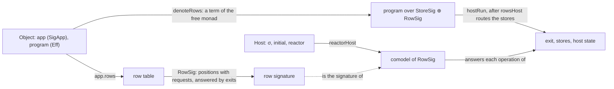
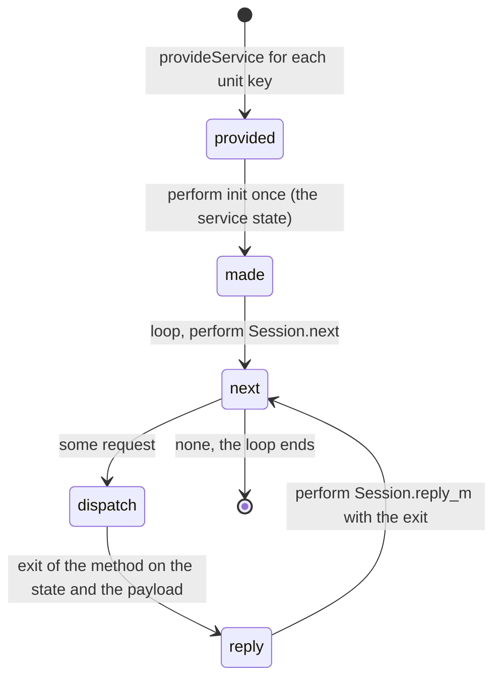
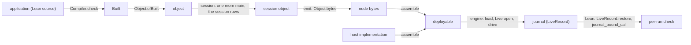

# 2026-10-21 The host and runtime domain, derived: a host is a comodel of the object's `RowSig`, and a deployment is one run

Status: research note (history, not authority). Base: `b8dc489cd` on `refactor/phase1-phase3`.
The evidence words follow `docs/core/controlled-english.md` §3.8.

At that base, every probe compiles with `lake env lean -DwarningAsError=true`.
`audit.sh` runs them and audits their declarations with `#axiom_audit` (`tools/ProofGraph/AxiomAudit.lean`).
The audit covers 187 declarations within `[propext, Quot.sound]`, with no planned goal underneath (`audit.out`).
`closure.sh` measures the OCaml lowering with the tree's own producers (`closure.out`).

**The one thing to know.** The host and runtime domain adds three definitions over the program
object, and no new sort. In the probes' terms, with the landing's names:

```lean
structure Host where     -- a comodel of the object's row signature `RowSig o.app.rows`, by `Run.reactorHost`
  σ : Type
  initial : σ
  reactor : Run.Reactor σ
-- the lifetime's program: the object's block, a main program that serves requests, the session rows
def Object.session (o : Object) (service : String) : Except SessionRefusal Object
-- a deployment's run: load the session object's bytes, then the Lean driver under the host
def deploy (bytes : Bytes) (h : Host) := (Object.load bytes).map (Run.runWith · h.reactor h.initial)
-- the run's data is `LiveRecord`; the fields a law reads: the object, the name, the budget, the journal
```

Every run law that the census of §1.1 reads ranges over at most one run, of one admitted program.
Every host law there ranges over a reactor or a comodel. None ranges over two runs, a typed host
record or a host specification (tested). So the lifetime of an application is one run. A request can enter a run only as a
host answer. So the program of that run loops on a request row. That program is the session
program: the object's block with a main program that serves requests, an object built from the
object (§5). The OCaml engine that runs it is already lowered in the kit's closure,
short of 22 of its 1,619 declarations. An application then lowers no declaration for an untyped
host and 52 for a typed one, where today it lowers 1,369 (`closure.out`).

## Question

What is the least datum that the tree's run and host laws quantify over, for a host, a run and a
deployment? How do they compose with the program object of decisions rows 439 and 440?

The input is the plan note `docs/research/2026-10-20-program-host-runtime.md` §1 to §13, and its
seven holes. The note treats it as input, not as a ruling: §5.3 says where it was right and where
the algebra says otherwise. §9 defines this note's new words: host interface, session program,
session rows, driver, deployment and engine.

## 1. The derivation: the laws first

### 1.1 The raw material

`probe-census.lean` reads the semantics registry (`registry`, `tools/ProofGraph/Registry.lean`).
It selects every claim of the concept `host-session-protocol`, and every claim of
`translation-simulation` whose pointer is a law of `Effect4.Run`, `Effect4.Live` or
`Effect4.LiveRecord`. It adds the top nodes of R6 and R13 and thirteen named laws of the run.
For each pointer it lists the carriers that the statement's binders range over, by the head of the
binder's type. Its result is a finite evaluation over the loaded environment (tested):

| Carrier a binder ranges over | Distinct statements |
| --- | --- |
| `Run` (`src/Effect4/Run/Basic.lean`) | 25 |
| `Live` (`src/Effect4/Run/Live.lean`) | 3 |
| `Api.Built` (`src/Effect4/Api/Built.lean`) | 5 |
| `HostSession.Session` (`src/Effect4/Api/HostSession.lean`) | 3 |
| `Runner.Runner` (`src/Effect4/Api/Runner.lean`) | 2 |
| `Run.Reactor` (`src/Effect4/Run/Basic.lean`) | 7 |
| `Effects.Comodel`, in the `effects` package's `Effects/Coalgebra/Comodel.lean` | 7 |
| `LiveRecord`, `Object`, `Tree.Host`, `HostSpec`, the typed host record, `Compiler.Hosted` | 0 each |
| two binders over a run (`Run` or `Live`) | 0 |

The registry holds 27 claims of `host-session-protocol`. Twenty-six point at a witness, and one is
assumed: `host-progress`, from `docs/core/host-boundary.md`. The census reads 67 rows, which name
57 distinct statements, since a top node of R6 is also a claim's pointer. A census is not a proof
that its list is whole. A law outside the selection could relate two runs, and no law inside it does.

The statements fall into six groups by what they quantify over:

| Group | The laws, each in the file the census names | What they quantify over |
| --- | --- | --- |
| a run replays | `journal_replays` and `play_controls_eq_replay` (`src/Effect4/Laws/Run.lean`; the first is R13's top node); `tape_replays`, `funded_replays`, `tapeFrom_position_replays` (`src/Effect4/Laws/Run/Tape.lean`) | one reached `Run` |
| a run's ledger | `session_keys_once` (`src/Effect4/Laws/Run/Journal.lean`), `reached_history` (`src/Effect4/Laws/Run/Frame.lean`), `reached_callInstance` and `origin_addresses_call` (`src/Effect4/Laws/Api/SessionRef.lean`), `request_performed` (`src/Effect4/Laws/Run/CallMap.lean`) | one reached `Run` |
| a live run | `LiveRecord.restore_save` (`src/Effect4/Laws/Api/LiveRecord.lean`), `Live.replay_at_call_instance` and `Live.journal_replays` (`src/Effect4/Laws/Api/Live.lean`) | one `Live` |
| the driver | `drive_eq_play`, `drive_envelope` (`src/Effect4/Laws/Run.lean`); `runWith_denotes`, `runWith_guarded_denotes` (`src/Effect4/Laws/Api/HostDrive.lean`); `runWith_denotesB` (`src/Effect4/Laws/Api/SessionMeaningLoop.lean`) | one `Built` and one `Reactor` |
| the meaning under a host | `denoteRows_eq_session_host` (`src/Effect4/Laws/Api/SessionMeaning.lean`), `denoteRowsB_eq_session_host` (`src/Effect4/Laws/Api/SessionMeaningLoop.lean`), `h9_blocks` (`src/Effect4/Laws/Api/SessionMeaningBlocks.lean`), `agrees_hostRun_blocks` (`src/Effect4/Laws/Program/ValidatedBlocks.lean`), `reactorHost_ofHost` (`src/Effect4/Laws/Api/HostDrive.lean`) | one `Run` and one comodel, or one reactor |
| the journal's algebra | `replay_unique`, `replay_append`, `behaviour_unique` (`src/Effect4/Laws/Api/Runner.lean`) | a `Runner` and words of `Command` |

### 1.2 What the laws need

A run is a built program opened for running, with its checked session, its budget, its journal and
its verdicts. `Run.open` (`src/Effect4/Run/Basic.lean`) takes a `Built`, a name, a budget and a
binding, and `Run.play` folds `Run.step` over run commands. `journal_replays` proves that the open
and the journal reach the run, phases and ledger included. So the session and the verdicts are
folds of the journal, and the run's data is the open's arguments and the journal.

A host is a reactor and its state. `Run.Reactor σ` is a function of the row, the request and the
state, to an answer and the next state, or none. The driver laws take two properties of it,
`Reactor.Envelops` and `Reactor.ExitsOnly`, and `guardRows_envelops` and `guardRows_exitsOnly`
supply both for any reactor behind its rows' types. The meaning laws read the reactor as a comodel
of the row signature (`reactorHost`, `src/Effect4/Laws/Api/SessionMeaning.lean`). The initial state
is an argument of every driver law.

Nothing else is read. No law of the census quantifies over the relational host specification
`HostSpec` (`src/Effect4/Program/Profile.lean`), whose lane is parked (rows 95 to 101). Its own
laws, in `src/Effect4/Laws/Program/HostBoundary.lean`, read two small models and no run. A reactor
reads as the function of a deterministic `HostSpec.RowStep`, by reading; no theorem relates the
two. No law of the census quantifies over a typed host record or over `Compiler.Hosted`
(`tools/Compiler/Run.lean`), and none relates two runs.

### 1.3 Pared back

Each candidate field below is kept only where a theorem or an operation reads it.

| Candidate | Read by | Verdict |
| --- | --- | --- |
| the host's state type, initial state and reactor | every driver law | kept: `Host` |
| `Compiler.Hosted.view`, the display of the host's state | no law; the `run` command's lines | cut from the host; the command keeps it |
| a typed host record (`Test.Dogfood.Scenario.Todo.Typed.Host`) | no law | a view: a section into reactors (§2.4) |
| `HostSpec` and `LawfulHostSpec` | no run law | stays parked with its lane |
| the run's object | `LiveRecord.restore`, through program admission | kept |
| the run's name | every call claim and reply (`bindCall`, `preflight`) | kept: a replay under another name refuses its rows as `.refused .session` (tested, `probe-run.lean`) |
| the run's binding (`Header.binding`) | no session transition | provenance only: two opens that differ only there replay a journal to equal observations and verdicts (tested) |
| the run's budget | `funded`, `journal_replays` | kept |
| the run's journal | every replay law | kept: the run's data |
| the run's verdicts and session | folds of the journal (`journal_replays`) | not stored, as today |
| `LiveRecord.version` | `restore_unsupportedVersion` | the store's spec should replace it (point 4 of `docs/research/2026-10-21-program-domain-review/README.md` §5) |
| the host's state in the run | nothing: a replay calls no host | outside the run, in the host's own storage |
| a separate interface field in the artifacts | a projection of the object's rows | cut: a target prints the rows instead |
| the plan's artifact set, build plan and derivation records | no law of this domain | build tooling, outside this domain |

So the minimal host is `Host` above, and the minimal run is `LiveRecord` less its version field,
with its binding kept as provenance.
Both already have owners in the tree, except `Host`, which is `Compiler.Hosted` less its display.

## 2. The host interface is the signature, read from the comodel's side

### 2.1 The algebra

A program over the object's signature is a term of the free monad over the stores' operations and
the rows' operations. The denotation states it: `denoteRows` (`src/Effect4/Laws/Program/DenoteRows.lean`)
reads a program into `Effects.Program (RowsSig table) ExitV`. There `RowsSig table` sums the stores'
signature `StoreSig` and the row signature `RowSig table`. A host is a comodel of `RowSig table`:
from its state it answers each operation with an exit and a next state, or not at all. Running a
program under a host routes the stores' comodel beside it (`rowsHost`,
`src/Effect4/Laws/Program/HostRuns.lean`) and runs the term against both (`hostRun`). So the
signature sits between two sides: the program is a term over it, and the host answers it. The
host's side has two names in the literature. A comodel is Plotkin and Power's (2008, *Tensors of
Comodels and Models for Operational Semantics*). A runner is Ahman and Bauer's (2020, *Runners in
Action*). The comodel papers note that `docs/core/semantics.md` §2.9 and §2.10 cite read both, and
this note uses them by name.

The diagram shows the dual pair and the run between them. It claims nothing beyond the
definitions it names.



### 2.2 The interface as data

The host interface is the object's row table, `o.app.rows`, with its named types `o.app.types`. Its
signature is `RowSig o.app.rows`, by definition: the operations are a row's position with a
request, and the answers are exits (`probe-host.lean`, two `rfl` examples). The interface is a
projection of `SigApp` (`src/Effect4/Program/SigApp.lean`), and the laws already name its
signature. No new carrier is needed.

A row enters the interface when the host answers it: an external, asynchronous row
(`externalRow`, `src/Effect4/Program/Compile.lean`). The call map is its dual on the program's
side: each call site with its row and the checker's instance there. It is `Built.calls`
(`src/Effect4/Api/Built.lean`), which `HostSession.callTable` makes once at open. The service
declarations do not enter the interface. On the to-do (`Test.Dogfood.Scenario.Todo.application`,
`Test/Dogfood/Scenario/Todo/Data.lean`), three facts hold (tested, `probe-host.lean`):

- the interface is the four rows of `TodoRepo`, each a data row (`dataRow`, `src/Effect4/Laws/Program/FragmentRowAdmission.lean`);
- the application declares no service and no named type;
- the rows' one key has the built-in unit carrier (`SigApp.serviceTy`), so no service value crosses to the host.

### 2.3 One host, read three ways

The tree spells a host three ways, each a function of a reactor:

| Spelling | Its reader | Who runs it |
| --- | --- | --- |
| `Run.Reactor σ` | the row's record, by spelling | the driver `Run.driveFrom`; the OCaml driver `E4_host` (`ocaml/engine/e4_host.mli`); the kit's `reactor` (`ocaml/engine/kit/kit.mli`) |
| `Tree.Host σ` (`src/Effect4/Run/Tree.lean`) | the row's position, by `table[i]?` | the call tree's runner, `Tree.run`, which the kit uses for the programs it covers |
| `Effects.Comodel (RowSig table) σ` | the row's position, by `externalRow` | the laws: H8, H9 and the block meaning |

`treeHost_eq_reactorHost` (`probe-host.lean`, proved) states that the call tree's host and the
laws' host answer alike at every row whose external reading is its raw one. The to-do's four rows
meet that premise (tested). `reactorHost_ofHost` (`src/Effect4/Laws/Api/HostDrive.lean`) already
proves the other bridge. A comodel read as a reactor (`Reactor.ofHost`) and back, behind the rows'
types, is the comodel behind them, at a table with distinct keys. So the three spellings are one
host.

### 2.4 A typed host is a section into reactors

A typed host is a record of Lean functions over Lean types, one function a row. The to-do's is
`Typed.Host` (`Test/Dogfood/Scenario/Todo/Typed.lean`), a hand record. `Host.reactor` sends it to a
reactor through `Reactor.fallible` (`src/Effect4/Run/Method.lean`), which reads each request by its
type's exact embedding (`Modeled.image`). On the to-do's interface, three facts hold (tested,
`probe-host.lean`, ten requests at three states):

- the typed model's reactor gives the untyped repository's answers and next states;
- every answer is one the row's columns admit at every machine (`answerAdmits`, `src/Effect4/Laws/Api/HostDrive.lean`);
- so the guard of `guardRows_envelops` changes no answer there, and a red control shows it removes an answer outside the column.

No law needs the record. It is an authoring view whose envelope is the proposed claim
`typed-host-envelops` (§4.4).

### 2.5 The interface in each target

| Target | The interface | A host implementation | Evidence |
| --- | --- | --- | --- |
| Lean | `o.app.rows` | a `Host`: a reactor and its state | the laws of §1.1 |
| TypeScript | `rowServiceDecls` (`src/Effect4/Codegen/RowServices.lean`): an Effect service key for each namespace of service rows, and `hostBindings` for the free namespaces of the other rows | an Effect `Layer` that provides the service key; a value that binds each free namespace | `readRowServices_rowServiceDecls`, `readRowServices_exact` (`src/Effect4/Laws/Codegen/RowServices.lean`), proved; the to-do prints `TodoRepoKey` and `TodoRepo` and leaves no free namespace (tested) |
| OCaml, untyped | `Kit.reactor`, the lowered `Run.Reactor`: the same type for every application | an OCaml function of that type | the kit's B4 (`ocaml/engine/kit/kit.mli`), by construction |
| OCaml, typed | the lowered record of a typed host and its adapter | an OCaml value of the record | the to-do's adapter lowers to 52 declarations over the engine (`closure.out`) |

Each target's interface is a print of the table, a map over its rows. The TypeScript emission
today breaks the split at one place. `Compiler.adapters` (`tools/Compiler/Emit.lean`) binds a
package row's namespace to a prelude file that implements it, and `hostImports` writes that import
into the module. The SQL package's namespace `Sql` maps to `./prelude/sql.ts` (tested,
`probe-host.lean`). So emission chooses a host for a module with a package row. The fix keeps every
free namespace free at emission and binds it at assembly.

## 3. The run as data

### 3.1 The record and its laws

The run's data is `LiveRecord` (`src/Effect4/Run/LiveRecord.lean`): the object, the run's name, its
binding, its budget and its journal, beside a format version. `LiveRecord.restore` opens the object
through program admission and feeds the journal through the checked session. `restore_save` proves
that a saved live run restores to the same run. The journal is the free monoid on run commands, and
replay is its action (`replay_unique`). The machine is never stored: the coalgebraic view does not
make a state stored data (`docs/core/system-map.md` §4).

`probe-run.lean` proves three facts that the deployment needs at the driver:

- `runWith_reached`: a driven run is a reached run, since the driver only opens and plays (`drive_eq_play`);
- `runWith_replays`: a driven run is its journal played from the open, with no host called;
- `liveDrive`, with `liveDrive_run`: driving a `Live` keeps it a `Live`, so the engine can save a driven run.

On the to-do, one request's run is the start, the three rows of one answer and the last flush.
Its journal is five commands, `control`, `bind`, `submit`, `apply` and `control` (tested).

### 3.2 The journal checks what a run sent its host

A `bind` row restates a call: its run name, its table, its fiber, its row and its request.
`bindCall` (`src/Effect4/Api/HostSession.lean`) accepts it only where the machine holds exactly that
call. `probe-run.lean` proves the inversion, then reads it at every row of a journal:

```lean
theorem journal_bound_call (l : Live) (i : Nat) (call : Api.HostSession.Call) (token : Nat)
    (h : (Run.rows l.run)[i]? = some (.bind call token, .bound)) :
    requestOf (l.upTo i).run.machine call.fiber token = some (call.op, call.request) ∧
      call.session = (l.upTo i).run.id ∧ call.table = (l.upTo i).run.built.table
```

So a replay of a journal checks every request that its run sent a host: each one is the Lean
machine's request at that point. `replay_at_call_instance` already checks the other direction:
each reply applied was admitted at its call's checked instance. Together they make a replay a
per-run check of the host-call observation. The method is translation validation (Pnueli, Siegel
and Singerman 1998, *Translation Validation*, by name), applied to a run. The check needs no theorem about
the engine that produced the journal. It assumes only that the journal records what was sent.

### 3.3 The to-do's lifetime, measured

The to-do's lifetime (§5) is one run of 68 run commands, and its saved record is 137,402 bytes
(tested, `probe-session.lean`). Of the 68 commands, 22 bind a call, and each call claim carries
the whole row table. With the tables emptied, the record is 28,150 bytes. So 109,252 bytes, four
fifths of the record, are 22 copies of one table (§8, point 4). The block's object node is 7,894
bytes, and the session object's 13,190.

## 4. Emission and assembly as functions

### 4.1 The definitions

`probe-deploy.lean` defines the two functions over the program object, with nothing else in their
arguments:

```lean
structure Artifacts where object : Bytes; interface : RowTable
def emit (o : Object) : Artifacts := ⟨o.bytes, o.app.rows⟩
structure Deployable where artifacts : Artifacts; host : Host
def assemble (a : Artifacts) (h : Host) : Deployable := ⟨a, h⟩
def Deployable.run (d : Deployable) (budget : Api.Budget := {}) (rounds : Nat := 512) :
    Except Object.LoadRefusal (Run × d.host.σ) :=
  (Object.load d.artifacts.object).map fun b =>
    Run.runWith b d.host.reactor d.host.initial "deployment" budget rounds
```

`emit` reads an object and nothing else, so it is host-free by its type. With a target, `emit o t`
adds that target's print of the program and of the rows. The bytes and their law do not depend on
the target. `assemble` pairs, and it computes nothing. The interface field is a projection of the
object, kept in the probe so that a host's comodel has a signature to name (`Host.comodel`). A
landing writes the object's bytes, and each target prints the rows from them.

### 4.2 Their laws

| Law | Statement | Proof | Evidence |
| --- | --- | --- | --- |
| `emit_host_free` | two assemblies of one emission hold the same artifacts | `rfl` | proved |
| `load_bytes_of_wf` | `(toVal o).WF → Object.load o.bytes = o.open.mapError .admission` | `Object.read_bytes` (`src/Effect4/Laws/Api/Object.lean`) | proved |
| `run_assemble_emit` | for a storable object, every assembly of its emission runs `Run.runWith` of the object's program admission, under the assembled host | `load_bytes_of_wf` | proved |
| the to-do | the object is storable; the emission's interface is four rows and its object 7,894 bytes; the block's own deployment finishes at once, in two run commands; truncated bytes refuse at the node reader | `#guard` | tested |

`run_assemble_emit` is the typed `Kit.run`. A deployment's run is the Lean driver's run of the
object's program admission, so every driver law reads it with its premises. Its reach is every
object whose value tree is `Val.WF`, every host and every budget. It does not establish that an
OCaml engine computes this run, that a host answers, or that the drive's rounds suffice.

### 4.3 Where the existing laws attach

| Law | Where it attaches | Its fragment and premises |
| --- | --- | --- |
| `Object.load_bytes`, `Object.load_exact` (`src/Effect4/Laws/Api/Object.lean`) | the emitted bytes and the engine's load | the object's value tree is `Val.WF` |
| `readRowServices_rowServiceDecls`, `readRowServices_exact` | the TypeScript host interface | the table's services print |
| `run_eq_meaning` (`src/Effect4/Laws/Program/Agreement/Segment.lean`), `loopAgreement` (`src/Effect4/Laws/Program/Agreement/Loop.lean`) | nowhere in a deployment | `Straight` and `Looped` exclude an asynchronous host row, so a program with a host call is outside both |
| `drive_envelope` | the deployment's host, the driver beside the application's host | a host inside the envelope is never refused for one; a request outside the request row is outside it (§5.4, the control) |
| `runWith_denotes`, `runWith_guarded_denotes` | a deployment whose program lies in `StraightRows` | funded, at rest, root exited; one fiber |
| `journal_replays`, `restore_save` | the lifetime's record | every reached run; every `Live` |
| `h9_blocks`, `agrees_hostRun_blocks` | the lifetime's meaning | `BlockRows`, funded, at rest, driven by a host, root exited; `HostAnswered`, decided on the run by `agrees` |
| `replay_at_call_instance`, `journal_bound_call` | the per-run check of an OCaml deployment's journal | every `Live` and every row with its verdict |

### 4.4 The obligations this design adds

Each row is placed by `AGENTS.md`'s five points. The concepts are those of
`docs/core/semantics.md` §2, and every claim is proposed.

| Statement | Concept; claim, role | Reach | Does not establish | Unlocks | Status here |
| --- | --- | --- | --- | --- | --- |
| `journal_bound_call` | `host-session-protocol`; `replay-validates-calls`, inversion; consumer: the OCaml deployment's per-run check | every `Live`, every `bound` row | that a driver records what it sent; reply typing; host progress | R6's open part "the host as a relation between the machine's calls and its answers", the calls' half | proved in `probe-run.lean` |
| `run_assemble_emit` | `host-session-protocol`; `deployment-runs-driver`, compatibility; consumer: the deployment's reference run | storable objects, every host | the engine's computation; host progress | R6 and R13 for deployed runs | proved in `probe-deploy.lean` |
| `treeHost_eq_reactorHost` | `host-session-protocol`; `host-one-reading`, compatibility; consumer: the planned goal `ofProgram_eq_denoteRowsB` (`src/Effect4/Laws/Run/Tree.lean`) | rows in their normal form | anything of a run | R6: one host under the kit's runner and the laws | proved in `probe-host.lean` |
| `session_admitted`: a session object opens whenever its object opens and its service forms | `host-session-protocol`; `session-admitted`, compatibility; consumer: `emit` | objects with one block, unit carriers | the run | R6's public typed guarantee for deployed programs | proposed planned goal; tested on two applications |
| `session_blockRows`: the session construction keeps `BlockRows` | `translation-simulation`; `session-block-rows`, compatibility; consumer: `h9_blocks` at every lifetime | blocks in `BlockRows` | progress, forks | R6 for lifetimes | proposed planned goal; tested on two applications |
| `blockB_append`: a block's meaning under an appended row table, at its own rows, is its meaning | `translation-simulation`; `rows-block-append`, compatibility; consumer: every application claim read at its lifetime | bodies that call the table's first rows | outside `BlockRows` | R2's C2 for blocks | proposed planned goal; not tested |
| `fallible_envelops`: a typed host whose images' types are its rows' columns is inside the envelope | `host-session-protocol`; `typed-host-envelops`, preservation; consumer: `drive_envelope` at a typed host | data rows (row 97's interim rule) | handle rows; host progress | R6; no guard on a typed host | proposed planned goal; tested on the to-do |

Two statements stay outside Lean, and `docs/core/host-boundary.md` puts both there. Host progress
is assumed (`host-progress`). That the OCaml engine computes Lean's run is the lowering stage's
trust boundary (row 391 (1)). Its stage law is the target of row 373 (4). The per-run check of
§3.2 replaces neither. It checks each run's journal against Lean, assuming the driver recorded it.

## 5. The lifetime

### 5.1 The decision, from the laws

The session program is the right representation of a deployment's program, and the run as data is
the right representation of its lifetime. They are not two representations of one thing. The
derivation has four steps:

1. Every run law that §1.1 reads ranges over one run of one admitted program: no statement there has two binders over a run.
2. New information enters a run only by a run command: a bind, a receipt, an application or a control (`Command`, `src/Effect4/Api/Runner.lean`).
3. No decision brings a new program into the machine. `RunDecision` (`src/Effect4/Machine/Fibers.lean`) has eight constructors: five act on fibers the program made, one answers a call, one installs a latch, and one moves the clock. Host-started roots are refused by name (`docs/core/system-map.md` §1.1). So a request enters a run only as a host answer, at a call the program makes.
4. So the program of a lifetime loops on a row that answers the next request.

That program is an object: the object's own block, a new main program and the session rows
appended. Its sort is the program sort, `Eff`. Its run's data is a journal, of the run sort,
`List Command`. Each sort keeps its one representation (`docs/core/system-map.md` §4). The run as
data alone cannot be the lifetime, since no run command can start a method.

The diagram shows the session program's control. It claims no law.



### 5.2 The session object, built from the object

`probe-session.lean` defines `session (o : Object) (service : String)`. It reads the service view
(`Object.services`, `src/Effect4/Api/Object.lean`) and each method's request (`methodArgs`,
`src/Effect4/Program/Services.lean`). Then it appends a request row `Session.next` and one reply
row a method. It elaborates the main program by the authoring lifts, in an environment read off
the object's rows and declarations. No source is read. The results on the to-do, each tested:

- the session object has nine rows, the four, `Session.next` and four reply rows, and its program opens (program admission);
- its definitions are the object's, unchanged, and its requirement row is closed;
- the cached to-do's session program opens too, and both session programs lie in `BlockRows`;
- the call map lists the block's four calls, then the main program's five calls of the session rows;
- its TypeScript interface is the service `TodoRepo` and one free namespace, `Session`, which the driver binds;
- the cached block holds two services, `ListCache` and `TodoApp`, so the construction takes the service's name;
- two refusals hold, each a red control: a service that the block does not declare, and a required key whose carrier is a natural.

### 5.3 The plan's holes, rederived

| Hole of the plan note §4 | Verdict | Evidence |
| --- | --- | --- |
| A. a per-request run drops the service's state | holds; the session program fixes it | tested: with the banked cache, the one run answers two lists with one repository call; one run a request asks twice |
| B. the context is not provided | holds for typing only | tested: without the provision the main program's requirement row holds one key, which `M7Fragment`'s closed-row premise refuses beside its empty-table premise; the run still serves the seven requests with the same replies |
| C. the TypeScript adapters are host implementations | holds | tested: emission's import table maps `Sql` to `./prelude/sql.ts` (§2.5) |
| D. formation does not lower | refuted | reading of the generated census: `Formation.checkInput`, specialised at `admitProgram`, is in `ocaml/gen/closure-api_gen.tsv` with no unreachable code, and the public facade exports `Api.Built.of_sketch` (`ocaml/gen/facade/effect4.ml`); `Kit.admit`'s docstring (`src/Effect4/Run/Kit.lean`) is stale |
| E. `Kit.app` has `types = []` | holds | reading: `ocaml/engine/kit/kit.ml`; loading the object supplies the named types |
| F. a per-call program is no typed replacement | holds | the session program is admitted once (tested); a request is a node of it |
| G. the old runner is not the lifetime on stateful applications | holds; no theorem is needed | the stateless to-do's seven replies equal today's per-request exits, as values and as printed text (tested); A's control is the stateful difference |

The plan was right on the three concepts, a host-free `emit`, assembly as the one place a host
enters, and the session program. The algebra says otherwise in seven places:

- `Object.session` is `Object → Object`, not `Object → Program × RowTable`, so the session object composes with `open`, `bytes`, `load` and `ref` with no new carrier;
- the claim `session-eq-serve` has no consumer, so it is cut; the cutover's finite control stands in for it;
- the generated typed host record is an authoring view, and the minimal host is the untyped reactor;
- `assemble` computes nothing, and the plan's checked build plan is tooling outside this domain;
- the interim digest check for formation is unneeded, since formation lowers;
- the engine needs no session constructor, since `emit` ships the session object's bytes;
- the artifact set as a `Row` with merge laws serves group emission, which no law of this domain reads.

### 5.4 The lifetime under the laws, on the to-do

One run of the to-do's session program, under the driver beside the reference repository, serves
the host lane's seven requests and ends (tested):

- it records seven replies, and the repository ends with the next id 3 and one to-do;
- each reply is the exit that today's runner gives the same request, and it prints as today's `run --typed` line;
- the run is funded, at rest, driven by a host and exited: the premises of `h9_blocks` and `agrees_hostRun_blocks`;
- the driver and the repository, read as one model, gave the run's answers, from the start to the drive's end (`Run.agrees`);
- every one of the 22 bind rows is bound, so `journal_bound_call` reads each request sent;
- the lifetime saves as its object and journal and restores to the same run, with no host.

A red control bounds the driver. A request that is no member of the request row is refused at
reply admission. The run then waits at `Session.next`, with no exit. So the driver cannot inject a
request that the methods lack, and `drive_envelope` reads exactly the drivers whose requests are
members.

### 5.5 The equal-observation statement between an OCaml deployment and the Lean run

The statement has two parts. Let `J` be the journal that an OCaml deployment of the session object
`o'` records, and `l` the `Live` that `LiveRecord.restore ⟨1, o', name, binding, budget, J⟩` answers.

1. **Per run, proved in Lean.** Every request the deployment sent its host, at row `i` of `J`,
   is the Lean machine's request at row `i` (`journal_bound_call`). Every reply it applied was
   admitted at its call's instance (`replay_at_call_instance`). The observation is the sequence
   of host calls and applied replies, and the fragment is every journal.
2. **The meaning, proved in Lean, on a fragment.** Let `l.run` be funded, at rest, driven by a
   host and exited with `ex`, and let `o'` lie in `BlockRows`. Take a model whose answers are the
   run's: `agrees model l.run start = some finish`. Past a budget bound, the model's run of the
   block meaning is then `ex`, with the machine's stores, and the model ends at `finish`
   (`agrees_hostRun_blocks`).

Two hypotheses stay outside Lean. The driver records each command it plays, which is where
`docs/core/host-boundary.md` §4.2 puts recovery. Host progress is assumed.

This statement stands in for a stage law. Take a storable session object and a host whose OCaml
and Lean readings answer alike. The stage law would say that the engine's journal is the Lean
driver's journal. Its two sides live in two languages, so Lean cannot state it, and row 391 (1)
names its assumption. The statement establishes no equality of the OCaml engine's code with
Lean's: per run, it checks the journal that the engine leaves. A refused row in the replay shows
that the engine and Lean differ on that run.

## 6. The OCaml engine and the deployment

### 6.1 Today, measured

`lake exe effect4 emit --group todo --target ocaml` writes `lowering.json`, which names five roots
under `Test`: the repository, the lane's start and script, `Host.serveBuiltVal` and
`Host.resultVal` (`Compiler.Groups.todoLowered`, `tools/Compiler/Groups.lean`). `lcnfgen` lowers
them and their closure into `todo_gen.ml`: 27,496 lines and 1,369 declarations, 14 of them under
`Test` (`closure.out`). Of the 1,369, the proposed engine lowers 1,343. The other 26 are the test's
host and script, `Run.runWith` and a few helpers. So today each application lowers the machine
again, with the test's host inside it.

### 6.2 The engine, measured

`recipe-engine.json` names the engine's seven roots, all under `Effect4`:

| Root | What the deployment does with it |
| --- | --- |
| `Effect4.Program.Object.open` | program admission of the loaded object |
| `Effect4.Live.open` | open the run |
| `Effect4.Live.feed` | feed a remote host's run command or a reply |
| `Effect4.Run.drive` | drive with the host, as `liveDrive` does |
| `Effect4.Run.observe` | the run's first-order observation |
| `Effect4.LiveRecord.save`, `Effect4.LiveRecord.restore` | persist and restore the lifetime |

Its closure is 1,619 declarations in 31,201 lines, and none is under `Test`. Of the 1,619, the
kit's own closure `Closure_gen` lowers 1,597 today (`ocaml/gen/closure-api_gen.tsv`). Eleven are
lowered only in the test lanes' unit: the drive, `Rows.answer` and the other row builders. Eleven
are new: `Run.observe` and ten helpers. The public facade already exports `Api.Built.of_sketch`,
`Live.open_`, `LiveRecord.save` and `LiveRecord.restore` (`ocaml/gen/facade/effect4.ml`). So the
engine exists, short of 22 declarations. The facade seals `Api.Built`, so code against it gets a
built program from program admission only.

The object's node reader does not lower yet. `recipe-load.json` lowers `Object.load` and
`Object.bytes` alone, and the producer refuses it. Thirteen declarations have no translation:
`ByteArray` and `UInt32` operations of the spec's SHA-256 digest (`specOf`,
`src/Effect4/Store/Domain/Node.lean`). The OCaml estate has a hand twin of the node codec,
`E4_node` (`ocaml/engine/cas/e4_node.mli`), with its own SHA-256 (`ocaml/engine/bytes/e4_sha256.mli`).

### 6.3 The deployment

An OCaml deployment is three things: the session object's node bytes, a host implementation, and
a thin driver. The driver reads the bytes and loads the object. It opens a `Live`, feeds the start
and drives with the host beside the session rows' reactor. It drives in rounds until the run waits
at `Session.next` with no request. A round bound is a frontier, never a failure (`Kit_machine`'s
M2, `ocaml/engine/kit/kit_machine.mli`). The driver saves the record at each such frontier.

| Host | Lowered for the application | Evidence |
| --- | --- | --- |
| an OCaml function of the kit's `reactor` type | no declaration | the kit's B4, by construction |
| a typed record in OCaml, through the to-do's adapter | 52 declarations over the engine, 9 of them the hand record's | `closure.out`, tested |
| the typed model written in Lean and lowered | 63 declarations over the engine | `closure.out`, tested |

`Kit` then gains four entries and loses two:

- `Kit.load`: bytes to a built program, by `E4_node`'s envelope, the lowered object reader and program admission. The named types come with the object, where `Kit.program_of_bytes` reads a bare program's payload;
- `Kit.deploy`: open, start and drive a `Live` under an OCaml reactor, then save it;
- `Kit.restore`: restore a saved record in the lowered engine, after a crash; the per-run check restores the same record in Lean;
- `Kit.observe`: the lowered `Run.observe`;
- `Kit.app ~rows ~services` with `types = []`, and `Kit.admit` without formation, retire.

`Kit` gains no context parameter. The session program's main discharges the rows' keys itself
(§5.2), and a service with another carrier is open point 2.

The call tree's runner stays in the kit as a test oracle (`explore`, `settle`), with no journal.
`lcnfgen` then lowers the engine once, in the library's recipe. An application's recipe holds at
most its typed host's adapter, which lowers through the engine's artifact as a used artifact
(`uses`, row 434). `Compiler.Native` writes the session object's bytes, the manifest and that
adapter, and it lowers nothing for an untyped host. `Compiler.Lowered` and `todoLowered` retire.

The diagram shows the deployment's data flow. It claims nothing beyond the measurements of §6.



## 7. The landing slice and its acceptance

The slice is Lean only, and it changes no wire. A second slice does the OCaml side (§7.3).

### 7.1 Files, in landing order

1. `src/Effect4/Run/Live.lean`: `Live.drive` and `Live.drive_run`, the probe's `liveDrive`.
2. `src/Effect4/Laws/Api/Live.lean`: `runWith_reached`, `runWith_replays` and `journal_bound_call`, with `bindCall_bound` in `src/Effect4/Laws/Api/HostSession.lean`.
3. `src/Effect4/Api/SessionProgram.lean`, new: `Object.session`, its rows, and a refusal alphabet in place of the probe's strings. It reads `Object.services`, so it stands in the Api plane.
4. `src/Effect4/Laws/Api/SessionProgram.lean`, new: the planned goals `session_admitted`, `session_blockRows` and `blockB_append`, each tagged at its requirement.
5. `src/Effect4/Api/Object.lean`: `Host` and `deploy`, the probe's `Deployable.run`; `src/Effect4/Laws/Api/Object.lean`: `load_bytes_of_wf` and `run_assemble_emit`.
6. `src/Effect4/Run/Tree.lean` and its laws: `treeHost_eq_reactorHost`.
7. `tools/Compiler/Run.lean`: `run` drives the session object once, under the script's driver and the application's host. A line is a reply, printed at its reply row's type.
8. `tools/Compiler/Groups.lean`: a group of the cached to-do, with a script of two lists.
9. `Test/Api/SessionProgram.lean`, new: the probe's evaluations and controls, as a battery.
10. `tools/ProofGraph/Registry.lean`: the six claims of §4.4 other than `typed-host-envelops`, which waits for open point 9.

### 7.2 Acceptance, measured by commands

1. `lake exe effect4 run --group todo --typed` prints the seven lines that `closure.out` records for `b8dc489cd`, byte for byte.
2. A group of the cached to-do prints two lists from one repository call, where the per-request runner makes two.
3. `make batteries-touched BASE=b8dc489cd` is green, and `#axiom_audit` over the touched modules stays within `[propext, Quot.sound]`.
4. `#plan_status` names the three new planned goals and the six new claims.
5. `python3 scripts/check-language.py --show` reports nothing on the touched documents.

### 7.3 The OCaml slice, after it

1. `ocaml/gen/roots.json`: `Effect4.Live.feed`, `Effect4.Live.drive`, `Effect4.Run.observe` and an object reader of `Effect4.Run.Kit` become public roots of the api artifact; `python3 scripts/generate.py --only lcnf` regenerates.
2. `ocaml/engine/kit`: the four entries of §6.3, and the two retirements.
3. `tools/Compiler/Native.lean`: `emit --target ocaml` writes the session object's bytes and the manifest.
4. `ocaml/engine/test/todo`: a deployment lane that runs the session object under an OCaml host, saves its record, and replays it in Lean.

Its acceptance has three parts. The script `closure.sh` reports no lowered declaration for the
to-do's untyped host. The check `make check-ocaml` passes, and the Lean replay of the lane's
record has no refused verdict. A host edit leaves the emitted bytes' digest unchanged.

## 8. Open points, with recommendations

1. **The session program's place.** Recommended: `Object.session` beside the object's operations, as the probe writes it, since it reads only the object. The service is named, as the cached to-do's two services require.
2. **A required service with another carrier.** The session program provides a unit service by `provideService` and refuses any other carrier. Recommended: keep the refusal until a ruling on provision. A value term supplied at assembly would keep the lifetime in `BlockRows`, and a layer would leave it, since `BlockRows` excludes `provideLayer`.
3. **Concurrent requests.** The session program serves one request at a time, and `BlockRows` excludes forks. Recommended: sequential first. A forked server needs H9 beyond one fiber, which no law states.
4. **The table in every call claim.** Four fifths of the to-do's saved lifetime are copies of the row table (§3.3). Recommended: the call claim names the table by its digest (`Store.address`), compared with the digest of `app.rows`. It changes the envelope of `docs/core/host-boundary.md` §4.1, so it waits for a wire slice.
5. **The binding.** No transition reads it (§1.3). Recommended: the deployment's manifest names the host's identity, and the header's binding goes with the next wire slice.
6. **The journal's growth.** A lifetime's record grows with its requests, a save writes the whole journal, and a restore replays all of it. Recommended: bound a lifetime by its run. A host's durable state lives in the host, and the run's state is service state that a new run rebuilds. The store's journal nodes would make a save incremental (`Store.journal_ff`, `src/Effect4/Store/Domain/Cas.lean`, the claim `cas-journal-fast-forward`). Checkpoints of the machine need a law that the tree does not have.
7. **The engine's artifact.** A used artifact must walk flat (row 434), and the api artifact compiles in scopes. Recommended: promote the roots of §7.3 into the api artifact. A typed adapter then lowers through a flat engine artifact, only when a typed host needs it.
8. **The object's reader in OCaml.** Recommended: `E4_node`'s envelope with the spec's digest supplied as a constant at generation, which keeps SHA-256 out of the engine. The alternative is extern rows for the thirteen untranslated declarations.
9. **The typed host record.** Recommended: `eff_rows` writes the record and its adapter from the rows, over `Modeled` types, so a row's data type has one owner. Its proposed claim is `typed-host-envelops`.
10. **The driver's requests.** Recommended: an OCaml or TypeScript driver decodes a request with the request row's Schema (Decision 12, Route A) before it answers `Session.next`. It then stays inside the envelope.
11. **The words.** Recommended dictionary entries in `docs/core/controlled-english.md` §3.6 and §3.7: "session program", "session rows", "deployment", "engine" and "driver", with the meanings of §9.

## 9. The words this note uses

| Word | Its meaning in this note |
| --- | --- |
| host interface | the rows of an object's `SigApp` that the host answers, read as `RowSig o.app.rows` |
| session program | an object's block with a main program that serves requests: provide, make the state once, loop on `Session.next`, reply with each method's exit |
| session rows | `Session.next` and one `Session.reply_m` a method, appended after the application's rows |
| driver | the host of the session rows: it answers `Session.next` and takes the replies |
| deployment | one run of a session object under a host implementation and a driver |
| engine | the lowered library closure that loads, runs, saves and restores any object; no application's code |

## What was read or run

| Evidence | Its source |
| --- | --- |
| reading: every definition and law cited, at `b8dc489cd` | the files named beside each |
| tested: the census of what the run and host laws range over | `probe-census.lean`, run by `audit.sh` and not walked, since its helpers are metaprograms |
| proved: `treeHost_eq_reactorHost`, `runWith_reached`, `runWith_replays`, `liveDrive_run`, `bindCall_bound`, `journal_bound_call`, `emit_host_free`, `load_bytes_of_wf`, `run_assemble_emit` | `probe-host.lean`, `probe-run.lean`, `probe-deploy.lean`; `audit.sh`, `audit.out` |
| tested: the to-do's interface, hosts, runs, session program, lifetime and every control | the `#guard`s of `probe-host.lean`, `probe-run.lean`, `probe-session.lean`, `probe-deploy.lean` |
| tested: today's lowering and the proposed engine and adapters, counted | `closure.sh`, `recipe-engine.json`, `recipe-load.json`, `closure.out` |

The probes build the to-do's object as `Compiler.check` builds it, with the service name written.
A declaration that calls `Compiler.check` reaches `Classical.choice` through `String.capitalize`, a
toolchain constant, so `probe-host.lean` checks the two objects equal inside a `#guard`.

## What this does not establish

- No theorem relates the OCaml engine's execution to Lean's; the per-run check of §3.2 checks one journal at a time, under the driver's record.
- Host progress stays assumed, and a waiting run is a frontier, never a failure.
- The four proposed planned goals are not proved: two are tested on two applications, one on the to-do, and `blockB_append` not at all.
- Forks, scopes, interruptions, handle rows and delayed cell reads stay outside `BlockRows` and outside every lifetime law here.
- No TypeScript module was printed or checked by tsgo, and no rc.112 run was made.
- The probes' theorems are not in the tree. They are proved against the library at `b8dc489cd`, and the slice lands them under the names of §7.
- The to-do is one application. Each finite evaluation holds for its inputs alone.
