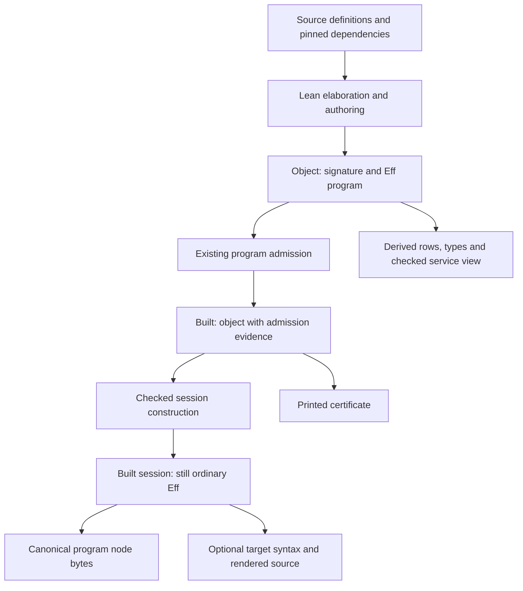
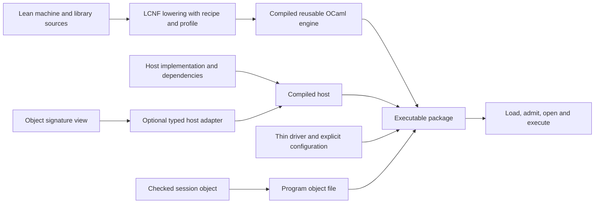
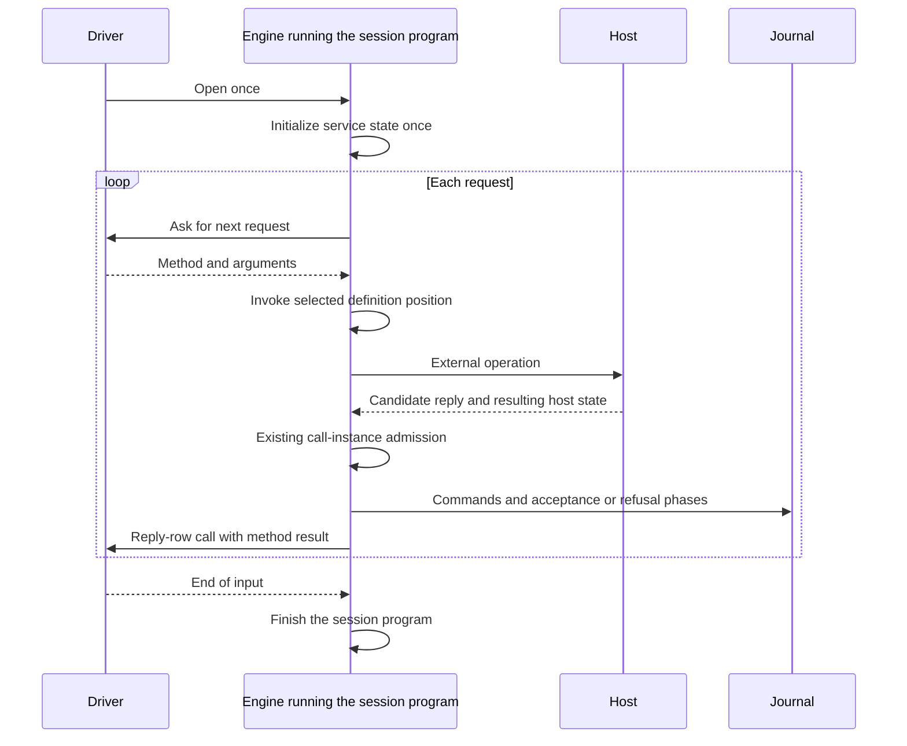

# Host and runtime refinement review

The direction stands. The mandatory raw-row guard does not.
Use the existing call-instance reply admission, retain refused attempts, and construct the session through definition positions.

This packet reviews `3de1eda9a` and its host/runtime design and review notes.
It changes research files only. The library stays unchanged.
The new construction is a finite probe, not a landed API or a transformation theorem.

## 1. What this review checks

The reviewed notes are:

- `docs/research/2026-10-21-host-runtime-design/README.md`;
- `docs/research/2026-10-21-host-runtime-review/README.md`.

The entry conditions are the current program object, the existing session protocol, and the single `Eff` program IR.
`docs/core/system-map.md` owns those representation choices.
`docs/core/host-boundary.md` owns physical host effects, reply admission, resource preparation, and recovery.

Finishing criteria for this review:

1. Rerun the original probes and their axiom audits.
2. Rerun the native closure measurements and inspect their failure control.
3. Test the suspected refusal, identity, and transcript gaps.
4. Test a smaller session construction against the original examples and counterexamples.
5. Record the functional API, dependency relations, evidence limits, and landing order.

The commands and logs in section 8 discharge these review criteria.
They establish no production release readiness.

## 2. Findings and repairs

### 2.1 Keep reply admission at the selected call

**Evidence: finite probe**, `probe-guard.lean`.
The generic row accepts a list and returns an optional value of its element type.
The checked call instantiates that element type as `nat`.
The existing session accepts `some 1` for that call.
`Reactor.guardRows` rejects the same answer because it checks the unspecialized row.

The unguarded driver finishes and keeps the host's next state.
The guarded driver waits and keeps the old state.
An invalid answer behind the guard produces the same observation, journal, phases, and host state as an absent answer.
The existing driver instead records the refused attempt and keeps the resulting host state.

Owners:

- `HostSession.preflight`, `src/Effect4/Api/HostSession.lean`;
- `Reactor.guardRows` and `answerAdmits`, `src/Effect4/Laws/Api/HostDrive.lean`;
- `Run.driveFrom`, `src/Effect4/Run/Basic.lean`;
- the generic call fixture, `Test/Api/TypedReplies.lean`.

**Proposed repair:** keep current call-instance reply admission as the deployment boundary.
A refusal remains visible. Waiting remains a live frontier.
Retain `guardRows` only for a declared restricted profile or a proved transparency premise.
The guard cannot undo a database update or a delivered message.

The pure `Reactor` models an immediate optional answer with resulting state.
It does not model asynchronous host progress while returning `none`.
Real drivers use the existing issue, receive, prepare, and apply lifecycle.
Do not enlarge the canonical program to hold that driver.

### 2.2 Keep definition positions through session construction

**Evidence: finite probe**, `probe-session.lean`.
Service formation already identifies each method by its definition position.
The original construction converts that position into a name, then resolves the name again.
The program domain permits duplicate definition names.

The control prepends a definition with the list method's name and type, then checks program admission.
Its body returns an empty list.
The original construction calls this definition instead of the selected service method.
Both source and result pass admission, so admission alone cannot detect this meaning change.

**Proposed repair:** use the existing service positions directly.
The probe's `invokeAt`, `dispatchAt`, and `mainAt` emit positional calls through existing authoring forms.
They introduce no stored method representation and no traversal of program bodies.

The repaired construction calls the intended method on the counterexample.
On both original applications, it produces exactly the original session object.
These are finite comparisons of program data and replies.
A general transformation theorem remains open.

### 2.3 Session construction must return a program-admitted result

**Evidence: finite probe**, `probe-session.lean`.
An admitted input can already declare `Session.next`.
The original transformation succeeds, but the resulting object fails program admission.
Its claimed program-admission theorem therefore needs more premises.

**Proposed repair:** construct the candidate, then call the existing program-admission function.
The probe's `checkedSession` admits its source and result and refuses remaining service requirements.
It refuses the collision and accepts both original examples.

Use explicit refusal for colliding session names in the first slice.
Do not introduce automatic renaming or another table of names.
A production refusal must retain the existing located program-admission reason.
The probe's diagnostic strings are temporary.

The supported service profile must also name its restrictions:
unit provisions, transportable request and reply types, and methods callable without unsupplied program parameters.
Service formation alone establishes none of these restrictions.
The final program-admission check catches malformed results without a second checker.
A profile check can later improve the location and explanation of each refusal.

### 2.4 Read accepted commands, not every recorded attempt

**Evidence: finite probe**, `probe-transcript.lean`.
The review's `boundAt` reads every `.bind` command from the journal.
Its supporting theorem requires the corresponding phase to be `.bound`.

The control replaces the requests of reply-row bind commands.
`LiveRecord.restore` succeeds because it restores the checked run, including refused attempts.
The original reader reports the forged requests as outputs.
The corrected reader reports none of them as accepted output calls.

**Proposed repair:** derive the output view from `Run.rows`, retaining only accepted binds.
A claim about applied answers must also check their application phases.
Keep the raw journal, including refused attempts.
Do not change restoration into an all-commands-accepted predicate.

A journal records what the driver submits.
It does not establish actual network delivery or database effects.
Compare an independently captured host trace when claiming physical input/output agreement.

### 2.5 Use the theorem for the actual deployment and fragment

**Evidence: source inspection and successful original proof audit.**
`Review.Guard.run_denotes` takes an arbitrary admitted program.
It neither requires that program to load from the deployment nor mentions the deployment's run in its conclusion.
Its `StraightRows` premise excludes the session's definition block.

Use the existing load/run equation to connect the deployed object to the driver.
For the session, use the block-fragment route through `h9_blocks`.
Retain its host-answer agreement, funding, rest, and exit premises.
Guarding raw rows does not discharge those premises.

The one-root service lifetime follows the current system-map policy and the chosen session construction.
A census of theorem binders does not prove that every possible semantics requires that architecture.

### 2.6 Separate generated source, shared library, and file loading

**Evidence: native measurements**, `original-closure.log`, `identity.log`, and `guarded-closure.log`.
The original closure counts reproduce.
LCNF lowering also accepts the omitted raw-row guard.
Its small closure cost does not repair its semantic mismatch.

**Evidence: native compile and link**, `native-compile.log`.
The proposed engine, typed adapter, and model compile and link under the recorded OCaml compiler.
The linked executable initializes modules only. It has no application driver.

**Evidence: negative lowering control**, `load.log`.
The object byte reader and writer still reach unsupported SHA-related byte and word operations.
The expected missing translations appear in the retained log.
The seven engine roots cover in-memory program admission and record save/restore, not their file codecs.

**Evidence: identity comparison**, `identity.log`.
Declaration-name overlap does not imply reusable compiled nodes.
Every compared engine/library overlap differs in type owner under the current generated-node identity.
The new engine is also larger than today's application-specific closure.
The benefit is one engine shared across applications, which the current recipe does not yet provide.

`Gen.projectArgvs` imports library type-owner artifacts into project recipes.
It does not expose the current callable API artifact as a reusable project dependency.
`Export.unusableWhy` rejects that artifact's closure and consumer structure.
Owners: `src/OCaml5/Lcnf/Gen.lean` and `src/OCaml5/Lcnf/Export.lean`.

## 3. The smaller representation

Keep one stored program object:

```lean
structure Object where
  app : SigApp
  program : Eff NativeOp
```

The application signature supplies row and type data.
The program supplies bodies, service roles, and its entry program.
Checks and views derive from this pair.
Host functions, executable paths, run names, and host state are not program content.



Lean source elaboration depends on its environment and toolchain as well as the source text.
The pure program operations begin with their explicit object and configuration inputs.
The session's generated loop contains initialization, method calls, replies, and termination.
No separate server program language is needed.

Use these functional abstractions:

| Abstraction | Existing meaning | API consequence |
| --- | --- | --- |
| Free object | `Eff` is the one program syntax | Transform ordinary programs and reuse their checker |
| Product | `Object` pairs signature and program | Derive interface views instead of storing copies |
| Total-by-refusal map | A checked operation returns a value or a located refusal | Compose through `Except`; do not collapse refusal into absence |
| Exact embedding | Canonical store write/read, under the stated well-formedness premises | Store program nodes through the existing codec |
| Comodel | A host answers operations while changing its own state | Keep the host executable and outside the stored program |
| Monoid action | Commands compose by concatenation and act through `Run.play` | Replay one journal through the existing transition function |
| Projection | Views read canonical inputs or accepted run rows | Cache views without treating them as new sources of truth |

`Run.Reactor` is a concrete host adapter.
Its connections to the row comodel retain their declared hypotheses.
A product of host states does not alone establish disjoint routing.
Choose the handler from the operation before invoking it.
Do not treat a selected handler's pending answer as permission to try another handler.

## 4. A small functional API

The following signatures describe the proposed public composition.
They are a plan, except where the table names an existing operation.
`SessionRefusal` and the checked session constructor have not landed.

| Operation | Inputs and result | Owner or purpose |
| --- | --- | --- |
| `Object.open` | `Object → Except AdmitRefusal Built` | Existing admission |
| checked session constructor | `Built → selected service → Except SessionRefusal Built` | Build one ordinary lifetime program and admit it |
| `Object.bytes` | `Object → Bytes` | Existing canonical program node |
| `Object.load` | `Bytes → Except LoadRefusal Built` | Existing framing, content, then program admission |
| `Object.ref` | `Object → Ref Object` | Existing typed content reference |
| `Live.open` | `Built → run name → budget → binding → Live` | Existing opening operation |
| `Live.feed` | `Live → Event → Live × Verdict` | Existing checked transition |
| proposed `Live.drive` | `Live → Reactor σ → σ → rounds → Live × σ` | Preserve reachability while calling the existing driver |
| `LiveRecord.save` and `restore` | `Live → Record`; `Record → Except Refusal Live` | Existing journal persistence |

Keep the existing field spellings until their migrations land.
The intended smaller record is the program reference, opening inputs, and command journal.
The opening inputs retain the run name and budgets.
Budgets affect execution and replay, so they are not dispensable metadata.

A run name distinguishes interactions. It must be allocated uniquely within the driver’s routing scope.
An arbitrary string supplied to assembly does not establish that uniqueness.
A program reference identifies program content. It cannot replace the run name when that program runs twice.

Replacing repeated tables with a program reference needs an explicit protocol migration and the existing identity checks.
The table-emptying size experiment is not a valid compact encoding.
It changes claims that the current session checks.

Remove the record's version only when its node framing and compatibility policy actually replace it.
A shape specification detects layout changes. It does not identify changes in execution semantics.
Keep producer and engine compatibility identities in package metadata.

Do not introduce a semantic `Deployable` merely to pair an artifact and a host.
A convenience function can compose load, open, and drive.
An executable package still needs linking, file placement, configuration, and a driver.
Those belong to build tooling.

## 5. How the runnable files relate



The engine implements the machine once.
The program file supplies the application as data.
The host implements the program's external operations.
The driver owns process startup, file access, run-name allocation, and physical I/O.
An optional TypeScript output is another target face with its own checks and runtime obligations.

The first native slice should use an untyped host and one reusable engine.
Then add the typed adapter as a consumer of that same engine.
Do not regenerate an engine merely to obtain a small adapter.

The proposed `E4_node` route can avoid lowering SHA implementation code.
It still owes node-kind, specification, canonical-payload, and program-admission agreement with `Object.load`.
That route remains open until it executes a saved object through a real driver.

## 6. One service lifetime and its evidence



The diagram shows the intended sequential profile.
It makes no claim about concurrent methods, interruptible transport, or resource compensation.
Those require the existing host-boundary lifecycle and further fragment obligations.

Replay reads the object, opening inputs, and commands.
It reconstructs the checked program run without calling the host.
It neither reconstructs an external database nor repeats its effects.
A resumed process needs a separate host reconnection and durability contract.

## 7. Dependencies and caching

For a pure operation, cache its result by every semantic input and the producing implementation.
The dependency graph follows those function arguments.
The algebra supplies composition laws. It does not discover undeclared compiler or filesystem dependencies.

| Cached output | Required key inputs |
| --- | --- |
| Elaborated object | Source dependency closure, authoring implementation, Lean toolchain, explicit inputs |
| Session object | Input object, selected service, transformation implementation and profile |
| Program bytes | Object content and codec specification |
| Derived interface or certificate text | Relevant object view, generator, target naming and rendering profile |
| Lowered engine | Source closure, roots, recipe, lowering implementation, target profile, type owner, builtin catalogue, Lean toolchain |
| Compiled engine or host | Generated or hand sources, imported interfaces, compiler, flags, native dependencies |
| Linked package | Engine, host, driver, linker inputs, and embedded files or configuration |
| Replayed run | Object, all opening inputs, journal, and execution semantics |

`Identity.NodeKey` already names the generated-node identity parts in `src/OCaml5/Lcnf/Identity.lean`.
Use those parts where applicable. They do not replace the native compiler's dependency inputs.

A host edit leaves program bytes unchanged.
An application-body edit can reuse the engine.
A signature edit can invalidate the typed adapter.
A printer edit can invalidate rendered source without changing the program object.

Do not cache real host effects as though they were pure results.
Repeated host work needs an explicit idempotency contract.
Content references also retain the existing hash-collision assumption.

## 8. Evidence and reproduction

All commands run at base `3de1eda9a` in an isolated worktree.
The output files in this packet record the measurements.
`probe-build-attempt-1.log` and `probe-build-attempt-2.log` retain corrected probe-authoring errors.
They concern equality syntax and Lean layout, not product failures.
The raw census output retains its trailing spaces.
The whitespace check excludes only `original-audit.log` to keep that evidence unchanged.

```sh
export LEAN_NUM_THREADS=3
export TMPDIR=/private/tmp/effect4-host-runtime-refinement-3de
mkdir -p "$TMPDIR"
lake build Effect4.Laws Compiler.Emit Compiler.Run \
  Test.Dogfood.Scenario.Todo.CachedProgram \
  Test.Dogfood.Scenario.Todo.Typed ProofGraph.AxiomAudit
sh docs/research/2026-10-21-host-runtime-review/audit.sh
sh docs/research/2026-10-21-host-runtime-design/closure.sh
sh docs/research/2026-10-21-host-runtime-refinement/audit.sh
lake exe lcnfgen --stage "$TMPDIR/guarded-engine" \
  --project-recipe docs/research/2026-10-21-host-runtime-refinement/recipe-guarded-engine.json
.lake/build/bin/lcnfgen --identity \
  "$TMPDIR/effect4-host-runtime-closure/engine/closure-engine_gen.tsv" \
  ocaml/gen/closure-api_gen.tsv \
  "$TMPDIR/effect4-host-runtime-closure/today/closure-todo_gen.tsv"
sh docs/research/2026-10-21-host-runtime-refinement/native-compile.sh
.lake/build/bin/effect4 run --group todo --typed
python3 docs/research/2026-10-21-host-runtime-refinement/measure.py
python3 scripts/check-language.py --strict docs/research/2026-10-21-host-runtime-refinement/README.md
```

The original audit scripts replace their scratch directories under `TMPDIR`.
The refinement audit expects the original audit's compiled probe modules there.
The native compile script expects the original closure script's generated sources there.
The baseline also runs directly, without a pipeline that could hide its exit status.

| Evidence | Result file | Scope |
| --- | --- | --- |
| Required import build | `build.log` | Probe dependencies |
| Original probes and audits | `original-audit.log` | Design and review declarations; census is metaprogram inspection |
| New controls and audit | `refinement-audit.log` | Guard, positional construction, accepted transcript reading |
| Native closure measurement | `original-closure.log` | Generated source and declaration names |
| Missing file-reader operations | `load.log` | Expected negative lowering control |
| Guard-inclusive measurement | `guarded-closure.log`, `measurements.json` | Generated source, not deployment correctness |
| Generated-node identity | `identity.log` | Manifest comparison, not a semantic theorem |
| Native compile and link | `native-compile.log`, `ocaml-version.log` | Compiles, links, and initializes; no application driver |
| Current to-do execution | `baseline-run.log` | Lean driver's concrete script |
| Document check | `language.log` | This research note |

## 9. Landing order and obligations

1. Land the checked positional session constructor and its located refusals.
2. Add `Live.drive` through the existing driver and journal relation.
3. Make the native engine a real reusable library with one type owner.
4. Connect object and record file codecs through the existing store framing.
5. Run a saved session object through that engine, a thin driver, and a real host.
6. Compare captured host outputs with accepted journal entries and test corrupted inputs.
7. Add typed adapters against the shared engine.
8. Migrate repeated table claims and record fields with explicit compatibility checks.

Keep wire-format cleanup outside the first executable slice.
The session constructor need not prove success for every formed service.
It must describe its supported profile and refuse everything outside it.

Before proof work, place these obligations in the existing semantics registry concepts:

| Question and role | Concept and requirement | Reach and assumptions | Consumer and exclusion |
| --- | --- | --- | --- |
| Session admission, preservation role | `residual-program-typing`, R6/R13 | Admitted input, selected formed service, explicit transport and provision profile | Checked constructor; does not establish method meaning |
| Positional service invocation agreement, simulation role | `translation-simulation`, R6 | Selected service positions, request encoding, stated sequential block fragment and host relation | Session execution; does not establish concurrency or progress |
| Driven `Live` replays, compatibility role | `host-session-protocol`, R13 | Existing driver, its recorded commands, fixed opening inputs | Save/restore; does not establish physical output capture |
| Native object load agreement, compatibility role | `exact-codecs`, R6/R13 | Node kind, spec, canonical payload and program admission | File loading; does not establish lowering correctness |
| Native session observation agreement, simulation role | `translation-simulation`, R6 | Named target profile, host fixture, numeric domain and observation | Native behaviour gate; finite runs do not prove universal agreement |

Existing claims and their premises stay unchanged.
The new finite probes motivate these obligations. They do not discharge them.
