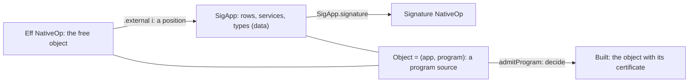
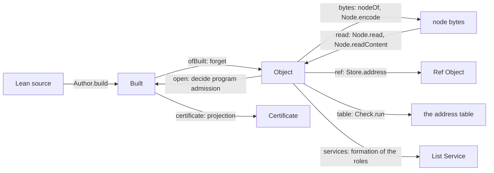
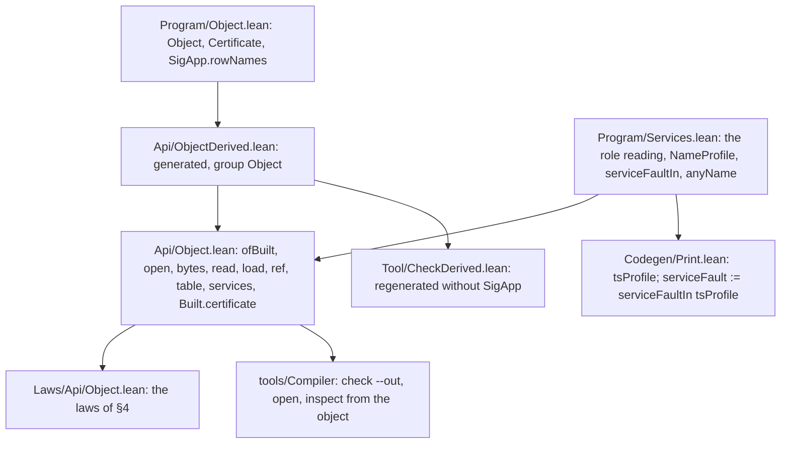

# 2026-10-21 The program domain, composed: a program over its signature Σ_app

Status: a design note with its probes. It proposes and rules nothing. No file under `src/`,
`tools/`, `Test/`, `ocaml/`, `ts/` or `docs/core/` changes. The evidence words are those of
`docs/core/controlled-english.md` §3.8.

Every probe in this folder runs clean with `lake env lean -DwarningAsError=true`. `audit.sh` runs
them all, then audits their declarations with the gate's own walk (`#axiom_audit`,
`tools/ProofGraph/AxiomAudit.lean`). The walk finds 381 declarations within `[propext,
Quot.sound]`, none of them modulo a planned goal (`audit.out`).

**The one thing to know.** The object is a program with its signature, and nothing else:

```lean
structure Object where
  app : SigApp
  program : Eff NativeOp
```

It is `ProgramSource` with its proof erased. The plan's three other fields have other owners. The
row spellings are a projection of the signature, the version is the store node's spec, and the
argument names have no consumer. Every operation below composes owners that exist, and every law
it states is proved in a probe.

## Question

What is the least datum of which the program domain's judgments and readings are functions? How
do the tree's existing proofs compose into its operations and its laws?

The scope is §14 of the plan note (`docs/research/2026-10-20-program-host-runtime.md`). It holds the
tree, the types, the signature, the names, and the judgments over them. Runs, hosts, targets,
emission and assembly wait.

## 1. The reading

### 1.1 A program is a term over a signature

The language signature Σ is Σ_core ⊕ Σ_app (system map §1.1). The core part is fixed:
`nativeSignature` (`src/Effect4/Program/Native.lean`). The application's part is data: `SigApp`
(`src/Effect4/Program/SigApp.lean`) holds the host rows by position, the service declarations and
the named types. `SigApp.signature` interprets that data as a typing signature `Signature NativeOp`.

The program sort's free object is `Eff NativeOp` (`src/Effect4/Program/Eff.lean`). Its fold is
`cata_eff`, and `hom_eq_cata_eff` (`src/Effect4/Program/Fold.lean`) makes every homomorphism out of
it that fold. An operation of the program is a built-in of the core part or a position, and never
a closure. `.external i` names row `i` of `app.rows`, `.call k` names definition `k` of the root
block, and `.param i` names a parameter of the enclosing definition.

So a program alone is an open term: its host calls point into a table it does not hold. The typing
signature's domain states this exactly. `.external i` lies in the domain of `app.signature` exactly
when `i < app.rows.length`, and `.call k` and `.param i` lie outside it (`probe-reading.lean` §2,
each by `rfl`). A program with the signature it is read against is a program source in the
dictionary's sense (§3.1, "program").



### 1.2 Typing is a fold, and program admission is four judgments

The checker is a fold of its algebra. `Checker.check.eq_cata`, generated by `fold_of` in
`src/Effect4/Laws/Program/Folds/Checker.lean`, states it:

```lean
Checker.check sig env p e = (cata_eff (Checker.check.alg sig) e).snd env p
```

The carrier pairs each subtree with a function of the environment and the path. So typing is a
paramorphism with two inherited attributes, and the path is the attribute that locates a refusal.
The whole-program typing reads the references' formation, then the module check of the expansion
(`typeOfProgram`, `src/Effect4/Program/Typing.lean`). Its located refusal is `programRefusal`,
absent exactly when the program types (`programRefusal_none_iff`,
`src/Effect4/Program/CheckedTyping.lean`).

Program admission is four judgments, each with its located refusal and its completeness law
(`probe-reading.lean` §4 restates each law at its full statement):

| Judgment | Decided by | Law | Its word among the seven judgments |
| --- | --- | --- | --- |
| signature admission | `admitSig app` | `admitSig_ok_iff`, against `LawfulSig` | formation of Σ_app |
| raw formation | `Formation.checkInput program rows services` | `checkInput_eq_none_iff`, against `InputFormed` | formation |
| typing | `programTyping app.signature program` | `programRefusal_none_iff`; `TypedProgram.hasTy` to `ModuleHasTy` | the typing judgment |
| the column scan | `findEmptyColumnInEffTy app.types ty` | `findEmptyColumnInEffTy_eq_none_iff` | inhabitance |

`admitProgram` (`src/Effect4/Program/Admission.lean`) decides the four in that order. It answers
`AdmittedProgram program app`, whose proof fields name each check, or `AdmitRefusal`. It is a
decision procedure in the dictionary's sense.

Profile support is a fifth judgment over the same data, and program admission does not run it. A
target asks it: `ProfileData.literalRefusal` (`src/Effect4/Program/ProfileSupport.lean`) is
complete against the literal fold (`literalRefusal_eq_none_iff`).

### 1.3 The program admission certificate is a proposition in all but name

`AdmittedProgram program app` is a `Type`, because its field `ty` is data (a control in
`probe-certificate.lean`). Yet it has at most one inhabitant. The decision procedure answers every
certificate it is given (`admitProgram_eq_ok`, `src/Effect4/Laws/Program/CheckedTyping.lean`). So two
certificates at one index are equal (`admitted_unique`, proved in four lines from that law alone).

Two consequences follow, both proved in `probe-certificate.lean`:

- `Built` is determined by its data: `built_ext` equates two built programs with equal
  application, program and row names.
- `admitProgram` decides its judgment exactly: `admitProgram_ok_iff` states
  `(∃ a, admitProgram program app = .ok a) ↔ Nonempty (AdmittedProgram program app)`.

So `Built` is the dependent pair `Σ (app, program), AdmittedProgram program app`, written as a
structure, with row names beside it. The object is the base of that pair. Forgetting the
certificate is the first projection. Deciding program admission is its partial inverse, defined
exactly on the admitted objects. In equations, each proved in `probe-object.lean` (§4):

```text
ofBuilt : Built → Object                          forget the certificate
open    : Object → Except AdmitRefusal Built      decide program admission
open (ofBuilt b) = .ok b                          retraction, for the signature's row names
open o = .ok b → ofBuilt b = o                    exactness
(∃ b, open o = .ok b) ↔ Nonempty (AdmittedProgram o.program o.app)
```

The pair `(ofBuilt, open)` is an exact embedding of `Built` into `Object`, with the identity as its
normaliser. Its laws are projections of `admitProgram_eq_ok`, as the plan note's §3.1 says.

## 2. The datum

### 2.1 The object

The object (a new word, proposed in §8) is a program with the signature it is read against, as one
first-order datum. Its two fields are the two arguments of every judgment of §1.2. It is
`ProgramSource` (`src/Effect4/Laws/Program/Typed/Admission.lean`) with its field `lawful` erased:
`ProgramSource` spells the same `SigApp` as three fields, and `AdmittedProgram.source`
(`src/Effect4/Laws/Program/Typed/AdmittedSource.lean`) maps a certificate to it.

The generator emits its codec and files it under kind `program` (§5). The structure and its codec
elaborate in `probe-object.lean` (the carriers, `Object` and `Certificate`, and the generated
section).

### 2.2 What is not in it, and why

The plan note's object adds three fields to this pair: a version, the row names and the argument
names. The probes refute all three as fields of the object.

| Plan field | Its owner | Evidence |
| --- | --- | --- |
| `rowNames` | `Row.spelling`: the list is a projection of `app.rows` (`SigApp.rowNames`) | proved: each producer of `Built` writes the projection (`build_rowNames`, `ofProgram_rowNames`, `rebuild_rowNames`, `probe-names.lean`); tested on the to-do; a control shows that only a hand-made value disagrees |
| `version` | the store node's spec: the digest of the carrier's shape document (`specOf`, `src/Effect4/Store/Domain/Node.lean`) | tested: a bare program's node and a later layout are refused by the spec (`probe-object.lean`); a control shows that `LiveRecord`'s version field cannot see a later layout (`probe-record.lean`) |
| `argNames` | none: `DefSrc.decl` (`src/Effect4/Program/Authoring.lean`) keeps the request's types and drops the names, and the printer writes `a1` to `an` (`argNames`, `src/Effect4/Codegen/Print.lean`) | reading: no judgment or reading of the domain consumes them (§8, point 2) |
| the certificate | recomputed by `open` from the two fields | proved: `admitted_unique` |
| the services' entries | read off the roles by `servicesOf` and `entriesOf` | proved: `entriesOf_isSome` (`probe-service.lean`) |
| holes | a sketch's built program holds its holes as rows (`Built.ofSketch`, `src/Effect4/Api/Built.lean`) | reading |

The row names deserve one more sentence. `Built.ofProgram` already recomputes them from the rows,
and `Author.build` writes `Module.rowNames`, which `module_rowNames` proves equal to the projection
of `Module.table`. Only hand-made values in batteries set them otherwise (§8, point 1).

### 2.3 Its neighbours

| Carrier | What it holds beyond the object | Relation to the object |
| --- | --- | --- |
| `Api.Built` (`src/Effect4/Api/Built.lean`) | the admission certificate, the row names | `ofBuilt` forgets the certificate; `open` decides it again |
| `ProgramSource` | the proof `LawfulSig` | the object is its data |
| `Api.Typed app` (`src/Effect4/Api.lean`) | a typing certificate, with `app` as an index | the typing judgment alone, at a fixed signature |
| `Check.CheckInput.module` (`src/Effect4/Program/Check.lean`) | a hole table | the object is the module check's key with no hole |
| `Sketch` (`src/Effect4/Program/Sketch.lean`) | a hole table; no signature | a sketch over a signature is an object once its holes are rows |
| `LiveRecord` (`src/Effect4/Run/LiveRecord.lean`) | a session, a binding, budgets, a journal, a version, the row names | restated as the object and the session's own fields (`probe-record.lean`) |
| `SourceSession`, `EditSession`, the tool's action `open_` | a sketch in place of the program, and a table | an application beside a sketch; they stay as they are in this slice |

## 3. The operations



Each operation is a projection, a decision procedure, a fold or an exact embedding. None of them
traverses a program by hand.

| Operation | What it is | The composition | Its refusal | Probe |
| --- | --- | --- | --- | --- |
| `Object.ofBuilt` | the first projection of the pair | `⟨b.app, b.program⟩` | none | `probe-object.lean`, line 331 |
| `Object.open` | the decision procedure of program admission | `Built.ofProgram o.app o.program` | `AdmitRefusal`: the signature's, formation's, typing's (located) or the column scan's | line 335 |
| `Object.bytes` | the writer of an exact embedding into bytes | `(nodeOf o).encode` | none | line 376 |
| `Object.read` | its exact reader | `Node.read`, then `Node.readContent` | `LoadRefusal.node` (the bytes) or `.content` (version, kind, spec, payload) | line 391 |
| `Object.load` | read, then decide | `read`, then `open` | the three cases of `LoadRefusal` | line 397 |
| `Object.ref` | the object's node digest, typed | `Store.address o` | none | line 379 |
| `Object.table` | the address table: a paramorphism's answer at every address | `(Check.run (.module o.app [] o.program)).table` | each entry holds the checker's located refusal | line 473 |
| `Object.services` | a reading of the roles, after their formation | `serviceFaultIn anyName`, then `servicesOf` | `PrintRefusal`, by service, method or definition | `probe-service.lean`, line 232 |
| `Built.certificate` | a projection with a generated print | six fields of `Built` | none | `probe-object.lean`, line 524 |
| profile support | a judgment a target asks, outside program admission | `profile.literalRefusal o.program`, no new function | `ProfileRefusal`, at the address of the node that states the literal | `probe-reading.lean` §5 |

### 3.1 Forgetting and deciding

```lean
def Object.ofBuilt (b : Api.Built) : Object := ⟨b.app, b.program⟩
def Object.open (o : Object) : Except AdmitRefusal Api.Built := Api.Built.ofProgram o.app o.program
```

`open` adds no check of its own. Its refusal is program admission's, located where program
admission locates it (`open_error_iff`). That refusal is a sum of located refusals. Typing's is a
`TypeRefusal`, located at a program address, and formation's a `FormationRefusal`, at a boundary
path (`Located`, `src/Effect4/Data/Located.lean`). The signature's names a row or a declaration by
its position, and the column scan's names the column's path. The to-do's program at the empty
signature refuses with `.illTyped r`, where `r` is the refusal `Api.explain` gives at the same
signature (a tested control).

`open` is a keyword of Lean as a command, yet `def Object.open` and `o.open` both parse:
`probe-record.lean` declares the one and `probe-object.lean` calls the other. The plan's
`Object.Refusal.unsupportedVersion` is gone, because the reader checks the layout (§5.3).

### 3.2 Bytes, reading and loading

```lean
def Object.bytes (o : Object) : Bytes := (nodeOf o).encode
def Object.read (bs : Bytes) : Except LoadRefusal Object :=
  match Node.read bs with
  | .error why => .error (.node why)
  | .ok n => (Node.readContent n).mapError .content
def Object.load (bs : Bytes) : Except LoadRefusal Api.Built :=
  match read bs with
  | .error why => .error why
  | .ok o => o.open.mapError .admission
```

The bytes are the store's node: version `0`, kind `program`, the spec, then the payload. The reader
is the store's two readers, `Node.read` (`src/Effect4/Store/Domain/NodeRead.lean`) and
`Node.readContent` (`src/Effect4/Store/Domain/Read.lean`). The second checks the version, the kind,
the spec and the payload, in that order, and each check has its refusal. So no codec code is new.

The reader's refusals name the check that failed and no site: the bytes are below the program's
addresses. Exact embeddings compose. `bytes` and `read` are a second one, from `Object` into
bytes, under the frame premise `(toVal o).WF`. Their composite with the first gives the
program-as-data law:

```text
load = read, then open
load (bytes (ofBuilt b)) = .ok b                  for a well-formed tree and the signature's names
load bs = .ok b → bs = bytes (ofBuilt b)
```

On the to-do the object's node is 7,894 bytes: a 34-byte header and a 7,860-byte payload (a finite
probe, `probe-object.lean`). The number moves with the program.

### 3.3 The digest

```lean
def Object.ref (o : Object) : Ref Object := Store.address o
```

The dictionary reserves "address" for a path of child indices (§3.6 of
`docs/core/controlled-english.md`). The object needs both a digest and addresses, since its address
table is indexed by paths. So the operation that names the whole datum is `ref`, the store's typed
node digest, and not `address`.

### 3.4 The address table

```lean
def Object.table (o : Object) : List Table.Entry := (Check.run (.module o.app [] o.program)).table
```

This is the module check's verdict at the object, the key the certified checker already caches
(`Check.run`, `src/Effect4/Program/Check.lean`). By definition it is `Sketch.sourceAnnotate` of the
program at the signature (`table_eq`, `rfl`). It reads through the layer references as program
admission does, and its root holds program admission's type (`table_root_of_open`).

The table is the source table on purpose. `Program.annotate` (`annotate_eq_table`) reads the program
as written, and the checker refuses a layer reference there that program admission accepts
(`src/Effect4/Program/Typing/Source.lean`, row 373 (7)). The source table keeps the program's own
addresses and checks the expansion, so its root agrees with `open`. A part's refusal reaches the
table placed at its base by `Located.under`, the one prefix rule (`Check.Internal.place`).

`inspect --what types` prints the same entries today through a tool round trip
(`Compiler.reading`, `tools/Compiler/Inspect.lean`). On the to-do, the tool's answer and the object's
table give the same text and the same JSON (tested, `probe-inspect.lean`). So do `rows`, `graph` and
`surface`.

### 3.5 The service view: one check, two profiles of names

`servicesOf` reads a block's services off its definitions' roles. `serviceFault` decides whether
they print. Both live in `src/Effect4/Codegen/Print.lean`, and `serviceFault` mixes two judgments.

| Judgment | Its checks in `serviceFault` |
| --- | --- |
| formation of the roles | an initial program at a unit request; distinct method names; each method's request the state and its arguments; no method of an undeclared service |
| profile support of TypeScript's names | a method name that is a TypeScript identifier other than `__proto__`; constants `S` and `SLayer` that collide with nothing; distinct definition names |

`probe-service.lean` writes the check once over a profile of names:

```lean
structure NameProfile where
  defNameFault : List DefDecl → Option String
  serviceConsts : String → List String
  method : String → Bool
  collides : List DefDecl → String → Bool

def serviceFaultIn (p : NameProfile) (defs : List DefDecl) : Option PrintRefusal
def tsProfile : NameProfile      -- each field the corresponding check of `serviceFault`
def anyName : NameProfile        -- a service named by its own name; no target's names

theorem serviceFault_eq (defs) : serviceFault defs = serviceFaultIn tsProfile defs := rfl
```

The printer's check is the profiled check at TypeScript's names, by `rfl`. So moving the printer
onto it changes no answer and no order of refusals. The printer's check implies the domain's
(`serviceFaultIn_anyName`, proved). On a block the domain admits, every service's methods have
their argument types (`entriesOf_isSome`, proved). The view is then:

```lean
def Object.services (o : Object) : Except PrintRefusal (List Service) :=
  match serviceFaultIn anyName o.program.defsOf with
  | some why => .error why
  | none => .ok (servicesOf o.program.defsOf)
```

"Is the block one service" is the answer `.ok [s]`. The plan's refusal `.service "the object holds
no single service"` wrote a message into a field that names a service, and it is gone. The session
program, which needs one service, asks for `[s]` itself.

The to-do's block reads as one service, `TodoApp`, with its initial program at position 0. Its
methods are `add`, `list`, `complete` and `remove`, of arities 1, 0, 1 and 1. Their argument types are
`[string]`, `[]`, `[nat]` and `[nat]` (tested). Two controls bound the split. A method renamed
`delete`, a reserved word of TypeScript, passes the domain's check and fails the printer's. A method
whose request is not the state and its arguments fails both, at the method.

### 3.6 What `check` prints

```lean
structure Certificate where
  answer : Ty
  error : Ty
  requires : List ServiceKey
  rows : RowTable
  services : List (ServiceKey × String)
  declarations : List DefDecl

def Api.Built.certificate (b : Api.Built) : Certificate :=
  { answer := b.ty.answer, error := b.ty.error, requires := b.requires, rows := b.table,
    services := (nativeSignature b.table).keyNames, declarations := b.program.defsOf }
```

Its generated print (`Compiler.tree`, which is `ShapeDoc.printTree`) is the compiler's hand JSON
(`Compiler.certificate`, `tools/Compiler/Check.lean`), byte for byte, on the to-do (tested). A
structure prints as its fields in declaration order, with no name of its own. So the JSON key
`certificate` and the file `certificate.json` keep their bytes.

## 4. The laws

Each row gives the statement, its placement, the kind of its proof and its probe. Concepts are
those of `docs/core/semantics.md` §2, and claims are those of `tools/ProofGraph/Registry.lean`, or
proposed here. Every row is proved in the probe it names, within `[propext, Quot.sound]`, with no
`sorry` anywhere. A line number without a file is in the file of the row above.

| Law | Statement | Placement: concept; claim, role | Kind of proof | Probe, line |
| --- | --- | --- | --- | --- |
| `Object.ofBuilt_of_open` | `o.open = .ok b → ofBuilt b = o` | `exact-codecs`; proposed `object-exact`, compatibility (exactness) | by construction: unfold and split | `probe-object.lean`, 338 |
| `Object.open_ofBuilt` | `b.rowNames = b.app.rowNames → (ofBuilt b).open = .ok b` | `exact-codecs`; `object-exact` (retraction), its pointer | one step: `Built.ofProgram_of_admitted`, then the data agree | 346 |
| `Object.open_ok_iff` | `(∃ b, o.open = .ok b) ↔ Nonempty (AdmittedProgram o.program o.app)` | `exact-codecs`; step of `object-exact`: the embedding's domain is the admitted objects | by construction from the two above | 357 |
| `Object.open_error_iff` | `o.open = .error why ↔ admitProgram o.program o.app = .error why` | `host-session-protocol`; the existing `built-admission-exact`, at objects | one line: `Built.ofProgram_error_iff` | 368 |
| `Object.read_bytes` | `(toVal o).WF → read (bytes o) = .ok o` | `exact-codecs`; proposed `object-bytes-exact` (retraction) | one step each: `Node.decode_encode`, `Node.readContent_nodeOf` | 403 |
| `Object.read_exact` | `read bs = .ok o → bs = bytes o ∧ (toVal o).WF` | `exact-codecs`; `object-bytes-exact` (exactness), composing `cas-node-read-exact` and `cas-get-exact`'s helper | by cases: `Node.read_exact`, `Node.readContent_exact` | 411 |
| `Object.load_bytes` | `(toVal (ofBuilt b)).WF → b.rowNames = b.app.rowNames → load (bytes (ofBuilt b)) = .ok b` | `exact-codecs`; proposed `object-load-exact`, compatibility: the program-as-data law | composition of `read_bytes` and `open_ofBuilt` | 434 |
| `Object.load_exact` | `load bs = .ok b → bs = bytes (ofBuilt b)` | `exact-codecs`; `object-load-exact` | composition of `read_exact` and `ofBuilt_of_open` | 443 |
| `Object.ref_eq_or_collision` | equal digests: equal objects, or two node byte strings with one SHA-256 | `exact-codecs`; the existing `program-digest-exact`, at objects | the existing `address_eq_or_collision` | 463 |
| `Object.table_head`, `table_root_toOption`, `table_root_of_open`, `refusals_nil_iff` | the root entry holds the check through the references, which answers `Api.typeOf`; an object that opens has its certified type there; no refusal exactly when it types | `initial-algebras-folds`; the existing `source-annotation-agrees` and `address-table`, at objects | by the existing laws; `table_root_of_open` by cases on the root check | 481, 488, 496, 513 |
| `namesFrom_eq`, `module_rowNames`, `build_rowNames`, `ofProgram_rowNames`, `rebuild_rowNames` | each producer of `Built` writes `rowNamesOf b.app.rows` | `exact-codecs`; helpers of `object-exact`, consumer `open_ofBuilt`'s premise | `namesFrom_eq` by induction on the declarations, generalizing the base: the head names position `base`, and the tail is the hypothesis at `base + 1`; the rest one step each | `probe-names.lean`, 29, 40, 46, 52, 61 |
| `admitted_unique`, `built_ext`, `admitProgram_ok_iff` | one certificate per index; a built program is its data; program admission is decided exactly | `exact-codecs`; helpers of `object-exact` | one step each from `admitProgram_eq_ok` | `probe-certificate.lean`, 26, 36, 49 |
| `serviceFault_eq` | `serviceFault defs = serviceFaultIn tsProfile defs` | `exact-codecs`; the connector of the refactor | `rfl` | `probe-service.lean`, 93 |
| `serviceFaultIn_anyName` | the printer's check implies the domain's | `exact-codecs`; proposed `service-view-printed`, monotonicity | by cases on the checks; the names part through `repeatOf_eq_none_iff` and a sublist | 150 |
| `entriesOf_isSome` | under the domain's check, `entriesOf` answers every service | `exact-codecs`; proposed `service-view`, adequacy; a new required property, formation of a block's roles | induction on the methods through `mapM_isSome` | 184 |
| `restore_save`, restated | `restore (save l) = .ok l'` with `l'.run = l.run`, under the row-names premise | `host-session-protocol`; the existing `live-session-persists` | the existing proof, with `open_ofBuilt` in place of `ofProgram_of_admitted` | `probe-record.lean`, 79 |

The reach of every law is `Eff NativeOp` at any `SigApp`, the open part of Σ (row 111). The table
laws read the program through its layer references (row 373 (7)). The service laws read the roles
of a definition block (row 339). The certificate's print is the one public JSON (row 418, D2).

What the laws do not establish. None states anything of a run, a host or a target. `load_bytes`
leaves two premises open: the tree's frame lengths (`Val.WF`, decidable, and tested on the to-do)
and the row names. The second disappears if the names become a projection (§8, point 1).
`ref_eq_or_collision` is no injectivity: the plan's `address_injective` needs SHA-256 to be
injective, which the trust ceiling never assumes. The service laws say nothing of what tsgo accepts.

Each proposed claim unlocks a part of a requirement. `object-exact` and `object-load-exact` close an
open part of R13 (`docs/core/system-map.md`): "the service half of the signature as a recorded input".
The object records the whole of Σ_app. `service-view` serves the session program and the printer,
which read one view. `docs/core/semantics.md` has no required property for the formation of a
block's roles, so the slice that lands `service-view` adds one to `exact-codecs`.

## 5. The codec and the digest

### 5.1 Which instances exist

`probe-closure.lean` reads the import graph off the environment. Its findings, each a finite
evaluation:

- The program plane, `Effect4.Api`, `Api.Built`, `Api.Author`, `ProgramWire` and the store's node
  reader do not reach `Effect4.Codegen.Print` or `TypeScript.Identifier`.
- `Canonical (Eff NativeOp)`, `Canonical Row`, `Canonical Ty`, `Canonical DefDecl` and
  `Canonical ServiceKey` are generated in `src/Effect4/Store/Domain/Derived/Program.lean`, which
  reaches no printer. `RowTable` and `TyDecls` are lists of those, `List Row` and
  `List (String × Ty)`, read through the container instances of
  `src/Effect4/Store/Domain/Canonical.lean`.
- `Canonical SigApp` is generated in the Check group's file, `src/Effect4/Tool/CheckDerived.lean`.
  That file imports `Api/RefusalsDerived.lean`, which imports the codegen face for the printer's
  refusal alphabets. So today every codec of `SigApp` reaches the printer.
- `Canonical Table.Entry` is in the Check group's file and `Canonical AdmitRefusal` in
  `Api/RefusalsDerived.lean`. Only the compiler prints them, and it imports both already.
- `Canonical LiveRecord` is generated in the Tool group's file, `src/Effect4/Tool/ToolDerived.lean`
  (reading of `tools/Effect4Gen/manifest.json`).

### 5.2 What the generator adds

`codec/gen.sh` runs the tree's generator (`effect4gen Main`, `tools/Effect4Gen/Main.lean`) on three
carriers. It gives the generator the imports of a proposed group `Object`. They are the carriers'
module and the program group's file, and neither reaches the printer. It emits 262 lines with no
hand code: `SigApp` 72, `Object` 65 with its `Content` instance at kind `program`, and
`Certificate` 93. The output compiles with every warning an error. `probe-object.lean` holds the
output, and `codec/gen.sh` compares it with a fresh run, byte for byte (reproduced,
`codec/gen.out`).

The group's cost is one manifest entry in `tools/Effect4Gen/manifest.json` and a move. `SigApp`
leaves the Check group for the new group, and the Check group imports the new file. Its 72 lines
move unchanged: the generator writes the same `toVal`, so no byte of any carrier moves.

### 5.3 The version is the spec

A node is `version ∷ kind ∷ spec ∷ payload` (`src/Effect4/Store/Domain/Node.lean`). The spec is
the digest of the carrier's shape document. That document's table binds the program family and the
type language (tested: it holds `Eff`, `Stmt`, `LayerTerm`, `Ty` and `Term`). The spec is derived from this document. Nobody bumps it by hand.
The reader compares digests; no theorem assumes distinct layouts have distinct SHA-256 digests.

Three controls in `probe-object.lean`, all tested:

- A bare program's node has kind `program` too, and the reader refuses it by its spec, before it
  reads the payload.
- An extra field under a wrong specification digest refuses at the specification check.
  The same field under the current specification refuses at the payload reader.
- One changed header byte is the node reader's refusal, `.node (.badVersion 1)`.

The plan's alternative cannot see a later layout. `probe-record.lean` takes `LiveRecord`, which has
a version field and a generated codec. At the same layout, version 2 is refused as
`unsupportedVersion 2`. A later layout, one more field, fails the generated decoder before any
reader sees its version field.

The spec check is strict. A case appended to `Eff` changes the shape document.
When its digest differs, an earlier object refuses even if its payload still decodes. Every program node in the store has the
same behaviour today, so the object inherits the store's policy rather than making one (§8, point 3).

### 5.4 The one printer and the frame premise

The JSON of every carrier is `ShapeDoc.printTree` (`src/Effect4/Store/Domain/ShapeJson.lean`),
which the compiler reaches as `Compiler.tree` (`tools/Compiler/Json.lean`). `decode_encode` and
`read_bytes` need `(toVal o).WF`: every frame's payload shorter than `2^64`. It is decidable
(`Val.decWF`), and the to-do's object satisfies it (tested).

## 6. What is new, counted

`count.py` counts code lines, with docstrings and blank lines excluded (`count.out`).

| Part | New | Moved or replaced in the tree | Deleted |
| --- | --- | --- | --- |
| the carriers `Object`, `Certificate` | 25 lines with docstrings | — | — |
| the generated codec | `Object` 65, `Certificate` 93 | `SigApp` 72, from the Check group | — |
| the operations | 23 lines: `SigApp.rowNames`, `ofBuilt`, `open`, `bytes`, `ref`, `LoadRefusal`, `read`, `load`, `table`, `Built.certificate` | — | — |
| the laws of the object | 113 lines | — | — |
| the service view | 18 lines: `NameProfile`, `anyName`, `Object.services`; `tsProfile`, 6, in the printer | 46 lines of the role reading leave `Print.lean`; `serviceFaultOf` and `serviceFault`, 28 lines, become `serviceFaultIn` and `serviceFaultOfIn`, 25 lines | — |
| the laws of the service view | 117 lines | — | — |
| the compiler | `certificate b := tree b.certificate`, 1 line | — | the hand JSON, 4 lines; `opened` and `ask`, 4 lines; the tool arms of `reading`, most of its 15 lines |
| `LiveRecord` | `object : Object` | `restore` reads `open` | the fields `app`, `program`, `rowNames` |

`certificateLines` stays. It renders the certificate as text, beside the Lean names of each key.
An executable knows those names of its own elaboration, so no carrier's print serves it.

If the row names become a projection (§8, point 1), the field `Built.rowNames` goes too. The
producers `Built.ofProgram` and `Author.Internal.finishBuild` lose a stored component.
Public authoring and restoration conclusions remain; the internal helper loses its arbitrary row-name argument. Nine batteries' constructions lose a component: six anonymous
constructors and three record fields. The control that `restore` keeps hand-made names goes with
the freedom it tests.

## 7. The file plan and the acceptance



New files, in landing order:

1. `src/Effect4/Program/Object.lean`, a non-module file, as `SigApp.lean` is: the two carriers and
   `SigApp.rowNames`. It imports `SigApp.lean` alone, so the generated codec does not wait on the
   checker.
2. `src/Effect4/Program/Services.lean`, a module: the role reading moved from `Print.lean` with its
   names unchanged, then `NameProfile`, `serviceFaultIn`, `serviceFaultOfIn` and `anyName`.
3. `src/Effect4/Api/ObjectDerived.lean`, generated by the new group `Object`.
4. `src/Effect4/Api/Object.lean`: the operations of §3.
5. `src/Effect4/Laws/Api/Object.lean`: the laws of §4, and the service laws beside them or in
   `src/Effect4/Laws/Codegen/Services.lean`.
6. A battery, `Test/Api/ObjectContract.lean`: the probes' to-do evaluations and controls.

Two details of order. The group `Object` stands before the Check group in the manifest, since the
Check group's file imports it. `DecidableEq Object` needs `DecidableEq SigApp`, which
`src/Effect4/Program/Typing/SigData.lean` derives today, so that derivation moves beside `SigApp`.

Changed files:

- `tools/Effect4Gen/manifest.json`, and `src/Effect4/Tool/CheckDerived.lean`, regenerated;
- `src/Effect4/Codegen/Print.lean`;
- `src/Effect4/Laws/Codegen/Services.lean`, whose two `unfold serviceFault` steps go one level deeper;
- `src/Effect4/Run/LiveRecord.lean` and `src/Effect4/Laws/Api/LiveRecord.lean`;
- `tools/Compiler/Check.lean`, `tools/Compiler/Inspect.lean` and `tools/Compiler/Main.lean`;
- the three root imports, at their anchors.

The acceptance, §14.3 of the plan note amended by the probes:

1. `lake exe todo check --out todo.obj` writes the object's node bytes.
   `lake exe effect4 open todo.obj` prints the certificate that `lake exe todo check --json` prints.
   The text form differs by the Lean names beside each key (`Elaborated.namesOf`). An executable
   knows them of its own elaboration, and an object does not hold them (`probe-inspect.lean`). The
   bytes read back to the same object, and a second write is byte-identical (`read_bytes`; tested).
2. A node of another layout, such as a bare program's, refuses with `.content .spec`. A changed
   header byte refuses with `.node (.badVersion 1)`. An object whose program does not type at its
   signature refuses with `.admission (.illTyped r)`, where `r` is `Api.explain`'s refusal there.
3. `inspect --what rows|types|graph|surface` prints what it prints today, read from the object
   with no tool round trip (`probe-inspect.lean`).
4. The laws of §4 proved; `#axiom_audit` of the touched modules within `[propext, Quot.sound]`;
   `make batteries-touched` green; `check-ts` unchanged, since no emitted byte changes.

## 8. Open points, with recommendations

1. **The row names.** Keep `Built.rowNames` as a field, and `open_ofBuilt` and `restore_save` keep
   the premise that the names are the signature's. Or make `Built.rowNames` the projection, and the
   premise disappears. Recommended: the projection. `Author.build` and `Built.ofProgram` produce it (proved).
   The landing removes the internal `finishBuild` argument that also permits arbitrary row names. The restated `restore_save` then holds for every live
   session, with its statement unchanged.
2. **The argument names.** Keep them out of the object. A side table keyed by method name would be a
   second owner of each method's arity, which the role already holds. If the target's print wants
   them, they belong where they are erased. `DefSrc.decl` would keep them in `DefDecl`, a program
   syntax change decided with that print. Recommended: out, and decided in the print's slice.
3. **The version.** The node's spec is the object's version, with no field (§5.3). The cost is the
   store's strict policy: a case appended to `Eff` makes saved objects unreadable until they are
   saved again. Recommended: the spec, and the policy for old nodes decided once for the whole
   store. A refusal `spec` that named the expected and the found digests would help a tool explain
   it.
4. **The codec group.** A new generator group `Object`, with `SigApp` moved into it from the Check
   group. The alternative, the object's codec in the Check group, puts the printer under the program
   domain's codec. Recommended: the new group.
5. **The service view.** The role reading moves from `Print.lean` to `Program/Services.lean`. The
   fault check is written once, over a profile of names (§3.5). Recommended: yes, in two steps. First
   add the profiled check with its connector `serviceFault_eq`, then define `serviceFault` by it.
6. **The words.** The dictionary's "address" and "address table" name the digest `Object.ref`,
   not `address`, and the address table `Object.table`, not `types`. The word "object" needs an
   entry in §3.5 of `docs/core/controlled-english.md`, beside "free object", which names a sort. The
   proposed meaning: "a program with the signature it is read against, as one datum". The carrier that
   `check` prints is no certificate in the dictionary's sense: it is evidence of nothing.
   Recommended: keep the code name `Certificate`, which the artifact `certificate.json` already
   uses, and add the qualified sense "printed certificate" to the dictionary.
7. **The refusal alphabets of `load`.** `Node.ReadRefusal` and `Store.ReadRefusal` have no generated
   codec, so `open` cannot print a read refusal as JSON through the one printer. The generator emits
   both in 205 lines, which compile clean with the store's own imports (`codec/gen.sh`, measured).
   `LoadRefusal` holds `AdmitRefusal`, whose codec reaches the printer, so its codec belongs with
   `AdmitRefusal`'s, in `Api/RefusalsDerived.lean`'s group. Recommended: the two read refusals in the
   new group, and `LoadRefusal` beside `AdmitRefusal`.
8. **`Built` as a subtype of the object.** Not worth it. `AdmittedProgram` is a `Type`, so a subtype
   would hold `Nonempty` of it, and every read of `ty` would run program admission again. `built_ext`
   already gives the laws a subtype would give. The syntactic cost is smaller than the semantic one.
   No proof destructs a `Built` today, and its readers would keep compiling through projections. The
   construction sites would change: 17 of them, 5 in `src/` and 12 in `Test/` (`count.out`). For
   scale, 107 files name `Built`, and `.admitted` occurs 47 times, a count that includes other
   carriers' fields of that name. Recommended: keep `Built` as the structure it is.

## What was read or run

| Evidence | Its source |
| --- | --- |
| reading: every definition and law cited above, at `0e45d83d8` | the files named beside each |
| proved: the laws of §4 and their helpers; the walk covers 381 declarations of seven probes, all within `[propext, Quot.sound]` | `probe-names.lean`, `probe-certificate.lean`, `probe-object.lean`, `probe-service.lean`, `probe-record.lean`, with `probe-reading.lean` and `probe-inspect.lean`; `audit.sh`, `audit.out` |
| tested: the to-do's object, its bytes, its table, its certificate, its service view, its session, and every control | the `#guard`s of the same probes and of `probe-inspect.lean` |
| tested: the import closures and the instances' modules | `probe-closure.lean` |
| reproduced: the generated codec, byte for byte against a fresh generator run | `codec/gen.sh`, `codec/gen.out` |
| counted: the lines of §6 | `count.py`, `count.out` |

## What this does not establish

- Nothing of a run, a host, a target's print, emission or assembly.
- The probes' theorems are not in the tree. They are proved against the library at `0e45d83d8`, and
  the slice lands them under the names and files of §7.
- The to-do is one application. Each finite evaluation holds for its inputs alone.
- The digest is no identity: equal digests give equal objects or an exhibited collision.
- The object's bytes are portable within one layout of the program family. Section 5.3 states what
  happens across layouts.
- The service view's laws say nothing of tsgo or of rc.112.
