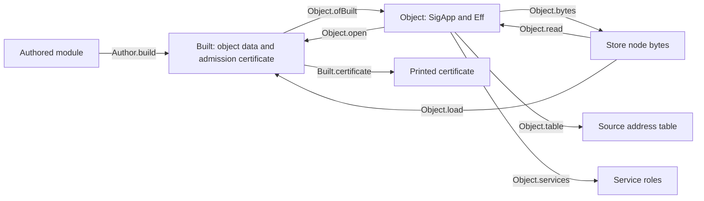

# Program data landing

The object contains its language signature and its program. Every other reading has one existing owner.

## Decisions

Decisions row 439 adopts all eight recommendations of the design note.
`SigApp.rowNames` lives beside `SigApp`, because `Built` needs it without the object codec.
`Built` retains its admission certificate. Its row names become a projection.
The internal `finishBuild` no longer accepts arbitrary row names.
The program's printed certificate retains its existing field order and JSON bytes.
`NameProfile` is executable configuration. No object stores it.
The store node supplies format checks. No object version field duplicates them.
Specification checks compare digests. Distinct layouts are not proved to have distinct SHA-256 digests.
`LiveRecord` retains its current version and uses the object internally.
Its changed layout refuses old records during canonical decoding. This slice adds no migration reader.
`open FILE` prints JSON. Source-based `check` retains its text form and Lean names.
Single-file saving refuses sources containing several programs before writing anything.
`Object.table` calls the existing checker. This slice adds no persistent cache.

## Functional boundaries

Every arrow is pure, except file reading and writing in the compiler driver.
`open`, `read`, `load` and `services` return existing refusals or their tagged sum.
The object adds no program constructor and no program traversal.

## Proof placement before implementation

| Claim | Concept and role | Pointer in the landing | Scope and consumer |
| --- | --- | --- | --- |
| `object-exact` | `exact-codecs`, compatibility | `Object.open_ofBuilt` in `src/Effect4/Laws/Api/Object.lean` | Every `Built`; R13; reopening and record restoration |
| `object-bytes-exact` | `exact-codecs`, compatibility | `Object.read_exact` in the same file | Accepted node bytes; retraction requires `Val.WF`; R13; file reading |
| `object-load-exact` | `exact-codecs`, compatibility | `Object.load_bytes` in the same file | Every `Built` whose encoded value satisfies `Val.WF`; R13; saved-program loading |
| `service-view-printed` | `exact-codecs`, compatibility | `Program.serviceFaultIn_anyName` in `src/Effect4/Laws/Codegen/Services.lean` | TypeScript service success implies domain service success; R8; printer compatibility |
| `service-view` | `exact-codecs`, adequacy | `Program.entriesOf_isSome` in the same file | Successful domain service checks provide readable entries; R8; service reading |

The existing program admission procedure recovers its certificate. `object-exact` needs no additional uniqueness helper.
`open_ok_iff` and `open_error_iff` instantiate `built-admission-exact` at objects.
`ref_eq_or_collision` instantiates `program-digest-exact`. It assumes no hash injectivity.
The table laws instantiate `source-annotation-agrees` and serve R14 inspection.
Service helpers serve the two service claims. Existing author and record statements retain their consumers.
These laws establish no host execution, persistence, progress, target compilation or cross-layout migration.
The byte retraction requires every frame payload to fit the store's 64-bit length field.

## Finish criteria

1. Reproduce the eight design probes and their axiom gate before changing the library.
2. Reproduce both generated codec outputs with the existing generator.
3. Land the carriers, projections, operations, laws and generator ownership.
4. Retain useful authoring and record laws; retain explicit refusal controls.
5. Save and reopen the to-do without source lookup, with identical JSON and repeated bytes.
6. Verify usage errors, malformed bytes, wrong layouts, failed program admission and failed file operations.
7. Build touched modules and batteries; audit their declarations; run reached behavior gates.
8. Commit explicit paths, retaining commands and results in this directory.

The base is `40770f079d8d7594021691e0f0b1d39025b211e0`.
The branch is `codex/program-domain`.
