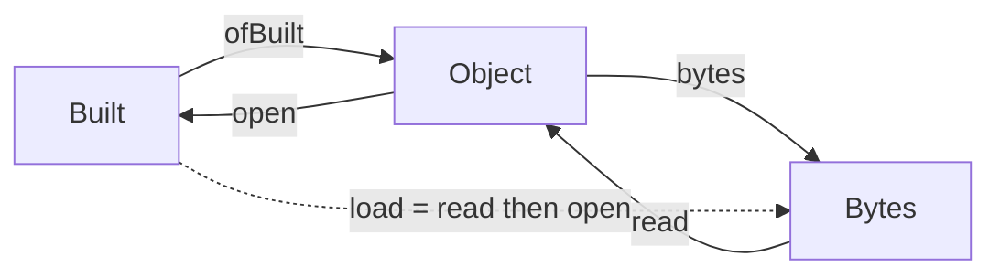

# 2026-10-21 The program domain landing, rederived

Status: a review of `codex/program-domain` at `99007881b` (base `40770f079`), with three probes.
The landing is merged into `refactor/phase1-phase3`. Points 1 to 3 of §5 landed as decisions row 440; the probes stay as the record of what was shown first.
The evidence words are those of `docs/core/controlled-english.md` §3.8.

Every probe runs clean against the landing with `lake env lean -DwarningAsError=true`.
`audit.sh <checkout>` runs them and audits their declarations with `#axiom_audit`.
The walk finds 60 declarations within `[propext, Quot.sound]`, none modulo a planned goal (`audit.out`).

## 1. The one thing to know

The landing is right. The object is the subject of the typing judgment, and nothing else:

```lean
structure Object where
  app : SigApp
  program : Eff NativeOp
```

Every operation is an existing owner called once. The laws hold, and the receipt states its limits honestly.
Three things can still be tightened, each shown by a probe (§4):

1. the three stored-data claims are two exact embeddings and their composite (`probe-exact.lean`);
2. the row-name projection has one consumer, and that consumer is `List.findIdx?` (`probe-names.lean`);
3. the profiled service check is a conjunction: formation and naming (`probe-services.lean`).

## 2. The rederivation

### 2.1 The object is the subject of a judgment

A program of an algebraic-effects language is a term of the free monad over a signature.
Here the term is `Eff NativeOp`, and a host call `.external i` is a position in a row table.
So a program alone is an open term. The signature it is read against is `SigApp`: rows, services, named types.
The typing judgment is `Σ_app ⊢ e : τ`, decided by `typeOfProgram app.signature program`.
Its subject is the pair `(Σ_app, e)`. That pair is `Object`.

`Built` is the subject with its derivation (`AdmittedProgram`). Two facts make the two interchangeable:

- derivations are unique: `admitted_unique` (`src/Effect4/Laws/Run.lean`);
- the decision procedure reproduces any derivation it is given: `admitProgram_eq_ok` (`src/Effect4/Laws/Program/CheckedTyping.lean`).

So `Built` is the admitted objects, `{ o : Object // ∃ b, o.open = .ok b }`, up to isomorphism.
`Object.ofBuilt` forgets the derivation. `Object.open` decides it. The pair is an exact embedding (§3.5 of the dictionary):
`open (ofBuilt b) = .ok b` (`open_ofBuilt`) and `open o = .ok b → ofBuilt b = o` (`ofBuilt_of_open`).
The landing proves both. The design note's advice holds: `Built` stays a structure, because its `ty` is data the derivation caches.

### 2.2 The bytes are a second exact embedding, and the load is the composite

The store files an object as a node, `version ∷ kind ∷ spec ∷ payload` (`src/Effect4/Store/Domain/Node.lean`).
`Object.bytes` writes it, `Object.read` reads it, and the pair is exact on the storable objects, those whose value tree is `Val.WF`
(`read_bytes`, `read_exact`). `Object.load` is read then open.

Exact embeddings compose. `probe-exact.lean` states the dictionary's notion as a structure, `Exact α β`,
with `comp`, and shows `load` is the composite's reader pointwise (`load_toOption`). Then:

- `load_bytes` is the composite's retraction;
- `load_exact` is the composite's exactness.

The landing proves these two by hand, in fifteen lines each. The proofs are correct. The statement is the finding:
the three registry claims `object-exact`, `object-bytes-exact` and `object-load-exact` are one composite of two embeddings.
The tree has the notion at the value tree, `Image α` (`src/Effect4/Store/Carrier/Image.lean`), with `equiv` and `subtype`, and no composition.



### 2.3 The version is the spec

The node's spec is the digest of the carrier's shape document. A layout change changes the spec, and nobody bumps it.
The design note tested the alternative on `LiveRecord`: a later layout fails the decoder before its version field is read.
The landing keeps that version field (`LiveRecord.version`, `Refusal.unsupportedVersion`) by ruling, beside the object.
The record is wire content of the tool protocol, not a store node, so it has no spec. See §5, point 4.

### 2.4 The names

Row names are a projection of the rows (`SigApp.rowNames`), and `Built.rowNames` reads it.
The landing proves every producer of `Built` writes it (`finishBuild_retains`, `module_rowNames`, `namesFrom_eq`).
`probe-names.lean` goes one step further. The projection has one consumer, `Built.positionOf`, and

```lean
theorem positionOf_eq (b : Built) (s : String) :
    b.positionOf s = b.app.rows.findIdx? (·.spelling == s)
```

The projection is a `zipIdx` spelled for a `find?`. Its consumers outside the laws are five dogfood batteries that dispatch a host by spelling.

### 2.5 The service view is formation and naming

The landing reads a block's services once, under a profile of names (`serviceFaultIn p defs`).
The program domain's profile is `anyName`; the printer's is `tsProfile`, and `serviceFault = serviceFaultIn tsProfile` by `rfl`.
The principle underneath holds: a name is semantic exactly when a role refers to it.
A method's role names its service, so every profile checks service names.
Roles refer to definitions by position, so definition names are the target's business.

The landing proves one direction, `serviceFaultIn_anyName`: the printer's success gives the domain's.
`probe-services.lean` proves the equivalence that says what the profile means:

```lean
theorem serviceFaultIn_tsProfile_iff (defs : List DefDecl) :
    serviceFaultIn tsProfile defs = none ↔ serviceFaultIn anyName defs = none ∧ tsNames defs
```

`tsNames` is the four naming conditions: no repeated definition name, no repeated service constant, every method name plain, no collision.
The printer's check is formation and naming. The order the printer reports its refusals in is not part of the claim.

## 3. Where the review agrees

| Point | Evidence |
| --- | --- |
| The object is two fields | §2.1; `probe-object.lean` of the design note refuted the other three |
| `open` is `Built.ofProgram`; exact both ways | `open_ofBuilt`, `ofBuilt_of_open`, `open_ok_iff`, `open_error_iff` |
| The bytes are the node codec; the spec is the version | `read_bytes`, `read_exact`; the spec controls in `Test/Api/ObjectContract.lean` |
| `ref` is `Store.address`; no injectivity is assumed | `ref_eq_or_collision` |
| `table` is `Check.run` at the module, through layer references | `table_eq`, `table_root_of_open`; the `sharedLayer` control |
| The service reading is one check over a profile | `serviceFault_eq` by `rfl`; the controls in `Test/Codegen/ProgramServices.lean` |
| `Built` stays a structure | `ty` is cached data; a subtype would recompute it |
| The compiler saves and opens without source | eight command-control groups, `cli-controls.txt` |
| The receipt names its limits | the `WF` frame premise, no hash injectivity, no migration reader, no host claim |

## 4. The probes

| Probe | States | Result |
| --- | --- | --- |
| `probe-exact.lean` | `Exact α β` with `comp`; `builtObject : Exact Built Object`; `objectBytes : Exact Object Bytes` on `WF`; `load_toOption`; `load_bytes` and `load_exact` as the composite's laws | tested |
| `probe-names.lean` | `find_zipIdx_eq_findIdx?`; `positionOf_eq` | proved |
| `probe-services.lean` | `serviceFaultOfIn_tsProfile_iff` at one service; `serviceFaultIn_tsProfile_iff` at a block | proved |

The probes import `Effect4.Laws.Api.Object`, `Effect4.Api.Author` and `Effect4.Laws.Codegen.Services` from the landing.
They add no axiom and no planned goal.

## 5. Improvements, in order of value

1. **State the composite once.** Add the dictionary's exact embedding as a carrier with `comp` (`src/Effect4/Store/Carrier/`).
   State `object-load-exact` as the composite of `object-exact` and `object-bytes-exact`.
   Cost: one small module and two shorter proofs. Gain: the claim says what a load is.
2. **Land the conjunction.** Replace `serviceFaultIn_anyName` with `serviceFaultIn_tsProfile_iff` as the pointer of `service-view-printed`.
   Cost: the probe's proof, placed. Gain: the profile's meaning is a theorem, and the printer's refusal order is an explicit non-claim.
3. **Cut the row-name projection.** Define `Built.positionOf` by `findIdx?`.
   Delete `SigApp.rowNames`, `Built.rowNames`, `namesFrom_eq` and `module_rowNames`.
   Delete the names conjunct of `finishBuild_retains` and `build_retains`, and `build_table`, which has no consumer.
   The authoring's `Module.rowNames : RowNames` stays; it is the elaborator's own map. The native fixture's row-name check goes with it.
4. **One versioning for saved sessions.** `LiveRecord.version` cannot see a layout change, and the record has no spec.
   One way: file the record as store content at a kind made for it (`job` or `checkpoint`, `src/Effect4/Store/Carrier/Kind.lean`), and drop the field.
   The other: keep the field, and say in its docstring that it versions the protocol, not the layout.
   The first is the design's own policy.
5. **Name the printed certificate as the dictionary does.** `Program.Certificate` sits beside `AdmittedProgram`, which the dictionary calls the certificate,
   and its docstring says it certifies nothing. Rename it `PrintedCertificate`. Cost: one generated codec regenerates.
6. **Name the program admission as the dictionary does.** `Object.open` is `admitProgram` at the object. `open` in the tree opens a run, a session or a document.
   Rename it `Object.admit`; the compiler's `open FILE.obj` stays, since it reads and then admits.
7. **Emit the object.** The emitted canonical artifact `<name>.eff` is the bare tree (`Api.bytesOf`), the artifact that could not be rechecked without source.
   The next slice should emit `Object.bytes` as the canonical artifact and name `Object.ref` in the manifest. The certificate's `program` line then names the tree and `ref` names the object; both stay, and the text says which is which.
8. **Say where the object files.** `Kind.program`'s docstring says "An `Eff` program". The object files there too, told apart by its spec. Say so.
9. **Let `open` print text.** `certificateLines` takes the declared names as a parameter that defaults to none, so `open FILE.obj` can print what `check` prints, minus the Lean names. Add `--json` to `open` as `check` has it.
10. **One sentence on the hole table.** `Object.table` checks at `.module o.app [] o.program`. The empty hole table is right, because `Built.ofSketch` already appends the holes to the application. The docstring should say so.

Points 1 to 3 have probes. Points 4 to 10 are renames, docstrings and a next-slice direction.
A later cut, not for now: the four service refusals (`service`, `serviceMethod`, `serviceName`, `strayMethod`) are the domain's, spelled in the printer's alphabet `PrintRefusal`.
A `ServiceRefusal` in the program plane, embedded into `PrintRefusal`, would make the import of `Codegen.Refusal` from `Program.Services` unnecessary. It changes a refusal shown to agents, so it waits for a codec slice.

## 6. What this review does not establish

The probes state no host execution, no persistence, no migration and no target claim.
`probe-exact.lean` restates two landed laws through a composite; it adds no reach.
`probe-services.lean` is about the check's success, not the refusal reported on a block with several faults.
The landing's behaviour gates were run by Codex, not here; the receipt records them.
