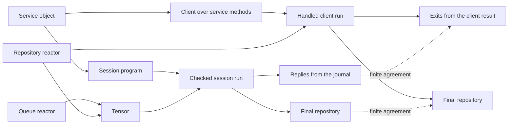

# 2026-10-21 Running a program: the reactor as a comodel, the queue as a client

This note contains the design, scoped contract and landing receipt. It proposes decisions row 442 for the coordinator.
Evidence words follow `docs/core/controlled-english.md` §3.8. Section 6 records the checked revision and distinguishes proofs from finite evaluations.

## 1. The one thing to know

The program's call-tree denotation is free on `RowsSig table`, the interpreted signature of store operations and row calls.
A reactor supplies a partial comodel, interpreted through the state monad over `Option`.
The queue is a reply-blind client. Its remaining requests are its state.
The tensor combines reactors over separate state components.

This slice lands those two operations and their equations.
The to-do compares the queued session with a client built over the same service definitions.
Those comparisons are finite evaluations. General client agreement remains open.



## 2. The formal semantics, with the tree's names

### 2.1 Signatures and the free monad

A signature gives each operation its request and answer types: `Σ = { op : A_op → B_op }`.
The tree's `RowTable` holds `Row` declarations with request, answer and error columns (`src/Effect4/Program/Eff.lean`).
The free call tree unfolds one step into a sum:

```text
T_Σ X ≅ X + Σ_op (A_op × (B_op → T_Σ X))
```

Stored `Eff NativeOp` has first-order binders, scopes, blocks and loops.
It remains the one stored program representation.
`denoteRows` reads it into `Effects.Program (RowsSig table) ExitV` (`src/Effect4/Laws/Program/DenoteRows.lean`).
The free-monad equation describes that call-tree meaning, rather than identifying all stored constructors with external calls.

Literature: Plotkin and Power, 2003, *Algebraic Operations and Generic Effects*.
Plotkin and Pretnar, 2013, [Handling Algebraic Effects](https://homepages.inf.ed.ac.uk/gdp/publications/handling-algebraic-effects.pdf), supplies the free-model interpretation.

### 2.2 The reactor is a comodel; running is the unique map

An ordinary comodel supplies `ôp : A_op × S → B_op × S` for each operation.
The tree uses the partial form:

```text
Reactor σ = Row → Val → σ → Option (Answer × σ)
run_R : T_Σ X × S → Option (X × S)
run_R (return x, s) = some (x, s)
run_R (op(a, k), s) = R(op, a, s) >>= fun (b, s') => run_R (k b, s')
```

`Reactor` lives in `src/Effect4/Run/Basic.lean`.
`reactorHost` converts exit answers into `Effects.Comodel (RowSig table) σ` (`src/Effect4/Laws/Api/SessionMeaning.lean`).
That conversion leaves non-exit answers unanswered.
The induced interpretation uses `StateT σ Option`.
`meaningUnder_eq_run` connects interpreted meaning with comodel execution (`src/Effect4/Laws/Program/HostRuns.lean`).

Literature: Ahman and Bauer, 2020, [Runners in Action](https://arxiv.org/pdf/1910.11629).
Their generalized runner correspondence supplies the unique monad morphism from the free call tree.
Uustalu, 2015, *Stateful Runners of Effectful Computations*, supplies the stateful reading, by name.

`Run.drive` records bind, submit and apply commands through the checked session.
`agrees_hostRun_blocks` connects completed block runs to their host meaning (`src/Effect4/Laws/Program/ValidatedBlocks.lean`).
Its premises require a reached, funded, resting, host-driven `BlockRows` run and agreement with the host's answers.
It retains the machine stores and host state. It establishes no progress for arbitrary bounded runs.

The journal is the free monoid on `Command`, acting on the run.
`replay_unique` and `journal_replays` state its replay properties (`src/Effect4/Laws/Api/Runner.lean`, `src/Effect4/Laws/Run.lean`).
Katsumata, Rivas and Uustalu, 2020, *Interaction Laws of Monads and Comonads*, describes the broader interaction-law perspective, by name.
The tree states no general interaction law `T X × D Y → X × Y`.

### 2.3 The tensor of two reactors

Disjoint operation signatures act on separate components of a product state:

```text
tensor(R, R') : reactor in S × S'
  op ∈ Σ:   (a, (s, s')) ↦ ((b, (t, s')))  when R(op, a, s) = (b, t)
  op ∈ Σ':  (a, (s, s')) ↦ ((b, (s, t')))  when R'(op, a, s') = (b, t')
```

Literature: Plotkin and Power, 2008, [Tensors of Comodels and Models for Operational Semantics](https://homepages.inf.ed.ac.uk/gdp/publications/Tensors_Comodels_Models.pdf).
Their combination of comodels uses product state and the tensor of their theories.
This is distinct from their tensor of a comodel with a model.

`Reactor.tensor` implements the component equations (`src/Effect4/Run/Runner.lean`).
The left reactor answers first. When it declines, the right may answer.
On disjoint supported rows this gives the componentwise construction above.
On overlapping supports it gives left priority. No commutativity claim covers that overlap.
`tensor_right` therefore requires the left reactor to decline.
`Reactor.first` combines reactors over one shared state (`src/Effect4/Run/Method.lean`).

The former fixture `route` selects a host before calling it, at `git:b42f25495:Test/Api/SessionFixtures.lean`.
The replacement agrees on the generated session rows and the disjoint repository rows.
Its prefix convention also acknowledges other reply-prefixed rows. The boundary control records this difference.

### 2.4 The service block is a handler

Service methods give a signature `Σ_svc = { m : A_m → Exit(B_m, E_m) }`.
The stored call is `perform (.call k)`, at its definition's position.
Bodies interpret methods using application operations:

```text
h : Σ_svc → T_Σapp
handle_h (return x) = return x
handle_h (m(a, k)) = h_m(a) >>= (handle_h ∘ k)
```

`Eff.defs decls bodies main layers` retains those bodies beside their client `main`.
Calls select the stored definitions. This is the handler reading of their call-tree meaning.
Recursive definitions and bounded execution retain their existing semantic premises.
The to-do client initializes once and records seven method exits as nested pairs.
It builds through `application.serviceModule "TodoApp"` and `Author.build`.
Literature: Plotkin and Pretnar, 2009 and 2013, *Handling Algebraic Effects*, by name.

### 2.5 A client is a reactor; the queue is the reply-blind client

The session signature makes client moves into server operations:

```text
Σ_sess = { next : 1 → 1 + Σ_m A_m, reply_m : Exit_m → 1 }
```

`Object.session` appends these rows (`src/Effect4/Api/Session.lean`).
One-step unfolding gives the following protocol-restricted equations for a client `C : T_Σsvc 1`:

```text
asReactor(C), with state T_Σsvc 1:
  next    (⋆, return ⋆) = (none, return ⋆)
  next    (⋆, m(a, k))  = (some (m,a), m(a, k))
  reply_m (e, m(a, k))  = (⋆, k e)
```

A reply-blind client's remaining calls form a list:

```text
C_q = m₁(a₁, λ_. m₂(a₂, λ_. … return ⋆))
q   = [(m₁,a₁), (m₂,a₂), …]
queue:
  next    (⋆, q)         =  (head? q, q)
  reply_m (e, r :: q)    =  (⋆, q)
```

The queue advances at `next`; the general equations advance at `reply`.
These are different unrestricted reactors. Two successive `next` calls distinguish them: `a,b` against `a,a`.
The intended agreement requires the generated session's next/reply ordering and a reply for the selected method.
The general equations leave mismatched replies unspecified.

The proposed observation compares replies and the final application store:

```text
run_(queue ⊗ R_app) (session_h, (q, s))
  ≈ run_R_app (handle_h C_q, s)
```

The to-do checks this observation finitely.
Its session records seven replies. Its client returns the same exits as nested pairs.
Both leave `(3, [(2, "café 日本 🙂", false)])` as the repository.
No theorem here states general client agreement.

The requested `Reactor.queue requests` signature retains its extra argument.
Both equations depend only on the current list supplied as reactor state.
`Run.runWith` supplies the initial state. The extra argument neither initializes nor resets it.
Removing that argument is a possible later API simplification, outside this exact contract.

### 2.6 The channel's type and its dual

A session-type reading describes the server/client ordering:

```text
S_srv = μX. &{ end : end, m : ?A_m . !Exit_m . X }_m
S_cli = μX. ⊕{ end : end, m : !A_m . ?Exit_m . X }_m
```

`next` combines selection and request receipt, including termination. `reply_m` sends the selected method's exit.
The row types themselves do not enforce this temporal ordering.
The tree has no session-type judgment. The generated program supplies the ordering for this slice.

Literature, by name: Honda, 1993, *Types for Dyadic Interaction*.
Honda, Vasconcelos and Kubo, 1998, *Language Primitives and Type Discipline for Structured Communication-Based Programming*.
Wadler, 2012, *Propositions as Sessions*.
Orchard and Yoshida, 2016, *Effects as Sessions, Sessions as Effects*, supplies the encoding perspective, by name.

## 3. The slice

Base: `b42f25495` or later on `refactor/phase1-phase3`. One branch, one worktree, commits by explicit paths after narrow builds.

### 3.1 Core: `src/Effect4/Run/Runner.lean`

A new non-module file, imported by `src/Effect4.lean` after `Effect4.Run.Method`. Its header states §2.2, §2.3 and §2.5 in the tree's words with the citations by name. It holds exactly:

```lean
/-- The tensor of two reactors: a row is answered by the left reactor when it answers, else by the
right, each on its own component of the product state (Plotkin and Power 2008, by name). -/
def Reactor.tensor {α β : Type} (r : Reactor α) (s : Reactor β) : Reactor (α × β)

/-- The queue: the reply-blind client as a reactor of the session rows. `next` answers the head
of the remaining requests, or none; a reply row answers the unit and keeps the queue. Rows are
known by their spellings `Session.next` and `Session.reply_`; no other row is answered. -/
def Reactor.queue : Reactor (List Val)
```

`queue` answers `Session.next` with `.ofExit (.success (.some r))` and the queue unchanged, or with `.ofExit (.success .none)` and `[]`. It answers a row whose spelling starts with `Session.reply_` with `.ofExit (.success .unit)` and the queue's tail, or declines when the queue is empty. It answers any other row with `none`.
The spellings are the ones `Object.session` writes. Read them from one definition beside `ServiceSession.rows`, used by the constructor and the queue both, never from two string literals.
No `String` traversal may reach `Classical.choice` in a definition the engine lowers. The initial prefix probe uses `String.startsWith`. The landing uses the byte-list prefix operation after the axiom gate rejects that probe.

### 3.2 Laws: `src/Effect4/Laws/Run/Runner.lean`

Imported by `src/Effect4/Laws.lean` after `Effect4.Laws.Run.Tape`. Placement before proof work: concept `host-session-protocol`, role compatibility, R6 and R13.
One registry claim, `queue-reactor`, in `tools/ProofGraph/Registry.lean` after `service-session-retains`, pointer `Effect4.Run.Reactor.queue_spec`:

```lean
@[semantics "host-session-protocol" (requirement := R6)]
theorem Reactor.queue_spec (requests : List Val) :
    (∀ row v q, row.spelling = "Session.next" →
      Reactor.queue requests row v q = some (.ofExit (.success (q.head?.elim .none (fun value => .some value))), q.tail)) ∧
    (∀ row v q, isReplyRow row = true → Reactor.queue requests row v q = some (.ofExit (.success .unit), q))
```

State it over the shared spelling definitions of §3.1, in whatever exact form compiles; the two equations of §2.5 are the content.
Two further theorems, `Reactor.tensor_left` and `Reactor.tensor_right`, state the tensor's two equations and are helpers of `queue-reactor`.
No theorem states the agreement of §2.5; it is a finite evaluation in this slice (§3.3), and §5 places the general case.

### 3.3 Batteries

- `Test/Api/SessionFixtures.lean`: delete `script` and `route`; the hosts are `Reactor.tensor (Reactor.queue requests) recordedRepository` and `Reactor.tensor (Reactor.queue requests) noHost`. Add the client fixture `clientMain`: the to-do's seven calls, each exit kept as nested pairs. Build it through `Author.build { m with main := clientMain }` over `application.serviceModule "TodoApp"`.
- `Test/Api/SessionContract.lean`: every existing line keeps its observation. Replies are read off the journal, `Run.rows` with the `.bound` verdict at the reply rows, not off a reactor's state. Add the agreement as two finite evaluations. The session under the queue and the inlined client give the same seven exits. They leave the same final repository. Add one control from the design's probe. A request outside the request row is refused at reply admission, and the run waits with no exit.
- `Test/Program/RunAdmissionControls.lean` or the nearest existing battery: `tensor_left` and `tensor_right` as readers on the to-do's two hosts.

### 3.4 Documents

- `docs/core/controlled-english.md` §3: three entries, one a line below.
- **tensor**: of two reactors, Plotkin and Power 2008 by name.
- **queue**: the reply-blind client as a reactor of the session rows.
- **client**: a program over a service's methods, `perform (.call k)` at the block. Its handled form is the block's main program.
- "Runner" is the literature's name for a reactor. It enters only the literature column, as the host entry already has it.
- `docs/core/semantics.md` concept 9: one entry for `queue-reactor` with the two equations, and one open part for the general client-as-reactor, with §2.5's equations and no pointer.
- `docs/core/host-boundary.md`: one paragraph. A deployment's session reactor reads its external client as a comodel. The gate uses a request trace as a reply-blind client. No driver is generated.
- `docs/core/api-surface.md`: the `Run` row gains `Reactor.tensor`, `Reactor.queue` and the laws.
- `docs/STATE.md`: one line under what is true at HEAD.
- The decisions row is the coordinator's; propose it in the receipt.

### 3.5 Not in this slice

- No driver object, no driver file, no generated client: a client is user code (§4).
- The shared spelling definitions leave `Object.session`'s construction unchanged. No printer, TypeScript or OCaml change. If `ocaml/gen/closure-*.tsv` changes because `Runner.lean` is reached from a lowered root, regenerate (`python3 scripts/generate.py --only lcnf`) and run `make check-ocaml`; otherwise no behaviour gate is reached.
- No hosted stage: `asReactor` of a program stays equations.
- No new refusal alphabet, no `partial`, no `sorry`.

### 3.6 Finishing criteria, in order

1. `LEAN_NUM_THREADS=3 lake build Effect4.Run.Runner Effect4.Laws.Run.Runner Test.Api.SessionContract` and the direct importers.
2. `#axiom_audit Effect4.Run.Runner Effect4.Laws.Run.Runner Test.Api.SessionFixtures Test.Api.SessionContract` at `[propext, Quot.sound]`, no planned goal.
3. `LEAN_NUM_THREADS=3 make batteries-touched BASE=<base>`.
4. `python3 scripts/check-language.py --strict` on every document touched; `python3 scripts/check-docs.py`.
5. The receipt, folded into the landing's note. It records base and head, the changed files, the commands and their results, the axiom output, the open obligations and the proposed decisions row.

## 4. What comes next, so this slice does not pre-empt it

The client calls service methods. The block supplies their handler.
A method's body over another signature can itself be handled.
Ahman and Bauer's generalized runners provide one mathematical account of computations implementing co-operations.
A host object and its target forms remain later design work.
This slice adds no driver, generated client or hosted stage.

## 5. Placement of the open part

General client-as-reactor agreement belongs to concept 9, `host-session-protocol`, serving R6 and R13.
Its observation compares replies and application stores under the generated session's protocol ordering.
Its definition needs the machine to advance a client to its next call and resume it with the selected reply.
The definition must retain live frontiers, call identity and reply admission.
No definition or planned goal for that operation lands here.
The equations remain in §2.5, and `docs/core/semantics.md` lists the required property as open.

## 6. Landing receipt

The coordinator records decisions row 442. This branch proposes it and does not edit the decisions register.
The queue's equations are proved. The session/client agreements remain finite observations.

### 6.1 Representation review and retained boundaries

| Attempt | Decision and evidence | Consequence |
| --- | --- | --- |
| Remove the fixture's reply accumulator | Read bound reply calls from `Run.rows`. Existing session observations read that projection. | One journal owns the replies. No reactor state duplicates them. |
| Replace fixture routing with one composition | Use `Reactor.tensor`, with separate queue and repository states. `tensor_left` and `tensor_right` state the component equations. | Overlapping support remains left-priority. The right law keeps its decline premise. |
| Remove the queue's captured list | The current state supplies the queue. The contract's extra argument is ignored, with a mismatched-argument control. | No closure captures a second list. A future signature simplification can remove the unused argument. |
| Use the standard string-prefix helper | The audit rejects `String.startsWith` through `Classical.choice`. The existing byte-list prefix operation passes the core audit. | No custom string traversal or trust exception enters core. |
| Identify queue state with arbitrary client state | Repeated `next` calls distinguish their equations. | The future relation must retain protocol phase, rather than claim unrestricted equality. |
| Add a second interpreter | Existing `reactorHost`, `Effects.Comodel.handler` and `meaningUnder_eq_run` supply the interpretation. | The slice adds only composition and queue operations. |

The reified machine exposes more than a terminal answer.
The call, token, checked instance, command verdict, frontier and journal are inspectable data.
That permits a future relation to state exactly which client call corresponds to each server request and reply.
The relation can distinguish waiting from failure and bound calls from accepted or applied answers.
This is a prospective use of existing structure, not a newly proved interaction theorem.

Three existing connections make that next step concrete:

- `journal_replays` rebuilds the recorded run (`src/Effect4/Laws/Run.lean`). A reply view needs no second mutable log.
- `Run.reached_callInstance` supplies the checked instance at a reached call (`src/Effect4/Laws/Api/SessionRef.lean`). A client-step relation can refer to that owner.
- `agrees_hostRun_blocks` retains machine stores and host state (`src/Effect4/Laws/Program/ValidatedBlocks.lean`). Its completion and fragment premises remain explicit.

The pinned `effects` package provides two further reusable constructions:

- `Effects.System.peel`, `run_peel` and `run_peel_complete` connect hidden operations with externally visible steps.
  They require total inner operations and retain completed-observation conditions.
  [The pinned stepping laws](https://github.com/pure-algebra/lean4-effects/blob/bf5ab8fd26ee009abbf465821a3664ea20948a49/Effects/Coalgebra/Run.lean) also provide `Effects.Program.run_of_sim_program`.
  Relating the reified client machine to that interface remains future proof work.
- `Effects.Comodel.through` and `run_through` connect call-tree translation with execution under an implementing host.
  [The pinned comodel laws](https://github.com/pure-algebra/lean4-effects/blob/bf5ab8fd26ee009abbf465821a3664ea20948a49/Effects/Coalgebra/Comodel.lean) supply that connection without another interpreter.
  The existing block-run theorem remains conditional when connecting it to checked machine execution.

The future relation must handle the phase difference between requesting and replying.
It must also keep unanswered calls as frontiers.
The current slice does not claim that reification proves all machine behaviour, all host behaviour or a stronger theorem than the literature.

### 6.2 Proof placement

| Declaration | Concept and role | Requirement and consumer | Reach and limit |
| --- | --- | --- | --- |
| `Reactor.queue_spec` | `host-session-protocol`, compatibility, claim `queue-reactor` | R6 and R13; the session fixture | Every queue state; request consumption and reply acknowledgement. No reply-admission or progress theorem. |
| `Reactor.tensor_left` | Helper of `queue-reactor` | R13; the to-do session-row reader | A successful left answer retains right state. No disjointness or commutativity theorem. |
| `Reactor.tensor_right` | Helper of `queue-reactor` | R13; the to-do repository-row reader | A declined left call delegates to the right. The premise remains in the statement. |

The semantics registry entry and planned statements precede proof work.
The proved declarations replace those goals in place.

### 6.3 Verification

Base: `b42f25495350ccebb45c5d5ea5147211ed45a1d2`, on `refactor/phase1-phase3`.
Verified implementation head: `b01ba6fc7361fad8405a895451aa9337e4c2adb4`.
The receipt follows that head in a documentation-only commit on `codex/runner-slice`.
`git rev-parse codex/runner-slice` gives the branch head including this receipt.
The worktree is `/Users/pooks/.codex/worktrees/runner-slice/lean4-effect4`.
No commit is pushed or merged into the coordinator's branch.

| Commit | Content |
| --- | --- |
| `945cdd68d` | Core operations, shared spellings, pre-placed claims and proofs. |
| `b2eb7f0d6` | Fixture replacement, client, finite agreements and controls. |
| `f9f8b3a4b` | Dictionary, authorities and strict-language repairs. |
| `b01ba6fc` | Direct-reader migration and independently reviewed claim qualifications. |

Changed files:

```text
src/Effect4/Api/Session.lean
src/Effect4/Run/Runner.lean
src/Effect4/Laws/Run/Runner.lean
src/Effect4.lean
src/Effect4/Laws.lean
tools/ProofGraph/Registry.lean
Test/Api/SessionFixtures.lean
Test/Api/SessionContract.lean
tools/TestSupport/ServiceSession.lean
docs/core/controlled-english.md
docs/core/semantics.md
docs/core/host-boundary.md
docs/core/api-surface.md
docs/STATE.md
docs/research/2026-10-21-runner-slice/README.md
docs/research/2026-10-21-runner-slice/evidence/Audit.lean
docs/research/2026-10-21-runner-slice/evidence/closure.py
docs/research/2026-10-21-runner-slice/evidence/build.log
docs/research/2026-10-21-runner-slice/evidence/audit.log
docs/research/2026-10-21-runner-slice/evidence/batteries.log
docs/research/2026-10-21-runner-slice/evidence/closure.log
docs/research/2026-10-21-runner-slice/evidence/language.log
docs/research/2026-10-21-runner-slice/evidence/docs.log
```

The fixture's existing Lean consumer needs the journal projection too.
Its observation source changes; its emitted program and expected reply values retain their existing definitions.
The nearest battery, `Test/Api/SessionContract.lean`, holds the two tensor readers.
`Test/Program/RunAdmissionControls.lean` needs no new import.

The final verification follows the brief's order:

```sh
LEAN_NUM_THREADS=3 lake build Effect4 Effect4.Laws Effect4.Run.Runner Effect4.Laws.Run.Runner Test.Api.SessionContract Effect4.Author Effect4.Api.RefusalsDerived Effect4.Laws.Api.Session TestSupport.ServiceSession ProofGraph.Registry ProofGraph.AxiomAudit
LEAN_NUM_THREADS=3 lake env lean -DwarningAsError=true docs/research/2026-10-21-runner-slice/evidence/Audit.lean
LEAN_NUM_THREADS=3 make batteries-touched BASE=b42f25495350ccebb45c5d5ea5147211ed45a1d2
python3 scripts/check-language.py --strict docs/core/controlled-english.md docs/core/semantics.md docs/core/host-boundary.md docs/core/api-surface.md docs/STATE.md docs/research/2026-10-21-runner-slice/README.md
python3 scripts/check-docs.py
git diff --check b42f25495350ccebb45c5d5ea5147211ed45a1d2
```

| Check | Result | Retained output |
| --- | --- | --- |
| Narrow modules, direct importers and edited library roots | PASS; 1924 Lake jobs. No whole `Test` build. | `evidence/build.log` |
| Requested four-module axiom gate | PASS; 79 declarations, no planned goal or dependency on one. | `evidence/audit.log` |
| Shared spelling-owner axiom gate | PASS; 104 declarations, no planned goal or dependency on one. | `evidence/audit.log` |
| Affected batteries | PASS; two batteries, 983 Lake jobs. | `evidence/batteries.log` |
| Strict language, every touched Markdown file | PASS. Existing findings in the touched authorities are repaired without broadening claims. | `evidence/language.log` |
| Authority paths, links, citations and targets | PASS; 97 documents. | `evidence/docs.log` |
| Whitespace | PASS. | Command above. |

The axiom output is:

```text
#axiom_audit: 79 declarations within [propext, Quot.sound], 0 of them modulo planned goals; 0 planned goals
#axiom_audit: 104 declarations within [propext, Quot.sound], 0 of them modulo planned goals; 0 planned goals
```

The first prefix experiment fails the same gate:

```lean
def isReplyRow (row : Program.Row) : Bool := row.spelling.startsWith replyPrefix
```

Its diagnostic identifies the cause:

```text
Effect4.Api.ServiceSession.isReplyRow
→ String.startsWith (Init.Data.String.TakeDrop)
→ ⋯ 9 more toolchain constants
→ Classical.propDecidable (Init.Classical)
→ Classical.choice (Init.Prelude)
```

The landed definition instead calls `List.isPrefixOf` on UTF-8 bytes.
Both final axiom checks include its dependencies.
No trust exemption changes.

The finite evaluations retain every prior session observation.
They add the equal seven exits and final repository, plus the malformed-request control.
That control records `.refused .envelope`, then `.refused .noCall`.
The run still waits at `Session.next`, without an exit or reply, and retains its repository.
Additional controls cover mismatched queue arguments, repeated `next`, overlapping reactors, and an unselected reply-prefixed row.

Native reach is checked separately, without generating artifacts:

```sh
python3 docs/research/2026-10-21-runner-slice/evidence/closure.py
```

`evidence/closure.log` records the result.
No lowering import reaches either new runner module.
The existing native declaration manifests contain no changed executable declaration from this slice.
The constructor's refusal type is imported through `Api.RefusalsDerived`; that does not make its session functions lowered roots.
No native output changes, so the conditional LCNF regeneration and OCaml gate are not reached.
No TypeScript or printer behavior changes. This receipt claims no new target execution evidence.
Semantics report generation remains paused under decisions row 418 (6).

### 6.4 Open obligations and proposed row 442

General client-as-reactor agreement remains open, under the protocol conditions in §5.
No hosted stage, driver object, generated client or target execution claim lands.
A future removal of the unused queue argument requires an API change. (Done in the coordinator's review, §7.)

Proposed decisions row 442:

> Add `Reactor.tensor` over product state and `Reactor.queue` for reply-blind session requests.
> Share protocol spellings with `ServiceSession.rows`.
> Place their equations under `queue-reactor`, compatibility, host-session-protocol, R6 and R13.
> Read fixture replies from the checked run journal.
> Keep general client-as-reactor agreement open under the session's request/reply ordering.
> Add no driver, generated client or hosted stage.

## 7. The coordinator's review, after the landing

The landing is right, and Codex's receipt names the two things left over. Both are landed on the integration branch after the fast-forward.

1. **The queue's argument goes.** `Reactor.queue : Reactor (List Val)`; the state is the run's, as every reactor's is. The brief's signature was the coordinator's error.
2. **The queue advances on the reply, not on `next`.** The brief's §2.5 wrote `next` as head and tail, which the general equations of the same section contradict. An unanswered call stays pending until its reply feeds the continuation. The queue is now their image on a reply-blind client. `next` reads the head and keeps it, the reply consumes it, and a reply with no pending call is declined. The journal of the to-do's lifetime is unchanged, so the agreements and the seven replies stand. A repeated `next` now repeats its request, as the general client does, and the phase difference Codex's receipt had to carry is gone.

The authority documents and the dictionary say the same. Codex's broad wording repairs in `docs/core/semantics.md` and `docs/core/host-boundary.md` are wording only and stand.
