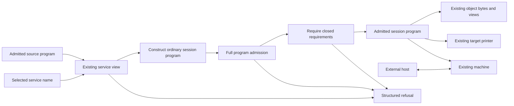

# Checked service sessions

This landing adds the checked service-session constructor. The engine, object-file loader, and driver remain later work.
The source remains one `Eff` program beside its application signature.

## Public operation

Import `Effect4.Author` or `Effect4`. Apply the constructor to an admitted program and a service name.

```lean
built.session "TodoApp"
-- Except SessionRefusal Built
```

`Built.session` lives in `src/Effect4/Api/Session.lean`.
It reads the existing service view, constructs ordinary program syntax, and applies full program admission once to the result.
It returns a closed requirement row or a structured refusal.
It never resolves a definition's name after reading its position.



The transformation reads no files and performs no host effects.
It retains declarations, bodies, module layers, named types, and service declarations.
It replaces the main program and appends protocol rows after existing rows.
Existing definition positions, external positions, and module-layer addresses stay in place.

## Protocol construction

For each method, the service view supplies its definition position and argument arity.
The definition supplies its request, answer, and error types.
The constructor derives these rows:

| Row | Request | Answer |
| --- | --- | --- |
| `Session.next` | `unit` | Optional tagged sum of method arguments |
| `Session.reply_<method>` | The method's exit value | `unit` |

The main program provides initializer requirements with unit values and initializes once.
It captures that result, receives requests, dispatches by tag, calls the recorded definition position, and replies with the method's exit.
An absent request ends the loop.
A typed method failure becomes a reply, so a later request can continue.
An initializer failure ends the program before any request call.

The captured initializer result can contain mutable references or a context.
Methods do not need to return a new state pair.
The existing machine owns mutable state, failure, scopes, and finalization.

## Mathematical basis

This API composes existing constructors and judgments. It introduces no second program representation, method carrier, host checker, or deployment description.
The sequential protocol and its tags are explicit design choices.
They are not a uniquely determined categorical dual.

Plotkin and Pretnar's [Handling Algebraic Effects](https://homepages.inf.ed.ac.uk/gdp/publications/handling-algebraic-effects.pdf)
connects handlers with models and induced homomorphisms.
Plotkin and Power's [Tensors of Comodels and Models for Operational Semantics](https://homepages.inf.ed.ac.uk/gdp/publications/Tensors_Comodels_Models.pdf)
separates computation from stateful interpretations of operations.
These sources support the program/host separation. They do not prove this constructor's protocol or implementation.
`Eff` remains this project's scoped program syntax.

## Laws and refusal ownership

The proof placement precedes implementation in [the plan](plan.md).
Both registered claims belong to `host-session-protocol`, with compatibility role, serving R6 and R13.

| Declaration | Property | Evidence scope |
| --- | --- | --- |
| `Built.session_ok_iff` | Success exactly when candidate construction and program admission succeed and the result's requirements are empty | Lean proof |
| `Built.session_retains` | Success retains the source block fields and signature declarations, with appended rows and a replaced main program | Lean proof |
| `ServiceSession.finish_admission_error_iff` | Final admission failures retain their exact payload | Lean proof; helper of `service-session-checked` |

The laws live in `src/Effect4/Laws/Api/Session.lean`.
They do not establish arbitrary-service acceptance, transport support, termination, or equality with the replaced main program's behaviour.

`SessionRefusal` composes the existing service-formation, scope, and program-admission refusals.
It also names a missing service or remaining requirements at the new main program.
The Refusals generator group owns its codec. No serializer is written by hand.

## Acceptance cases

The permanent fixtures and controls live in `Test/Api/SessionFixtures.lean` and `Test/Api/SessionContract.lean`.
The target comparison lives in `tools/TestSupport/ServiceSession.lean` and `scripts/check-service-identity.py`.

| Case | Required observation | Evidence kind |
| --- | --- | --- |
| Ordinary to-do | All scripted replies and the final repository state match expectations | Finite Lean execution |
| Cached to-do | Two list requests make one repository lookup within one lifetime | Finite Lean execution |
| Separate cached runs | Two runs make two repository lookups | Negative lifetime control |
| Repeated definition names | Dispatch reaches the selected method's position | Finite Lean execution |
| Two value arguments | Dispatch retains their values and order | Finite Lean execution |
| Stored module-layer reference | The same reference returns its stored value | Finite Lean execution |
| Unusual method strings | Construction and dispatch accept data names without target restrictions | Finite Lean execution |
| Initializer failure | No request or reply reaches the host | Finite Lean execution |
| Method failure and mutable state | Failure replies, then two requests update the same cell | Lean and actual Effect execution |
| Protocol-row collision | Full admission reports the exact duplicate key | Located refusal control |
| Unsupported provision or program parameter | Existing admission reports the failing site | Located refusal control |
| Remaining requirements | Construction refuses the keys at the generated main program | Refusal control |
| Internal handle input versus output | Incoming handle column refuses; outgoing handle column constructs | Profile-boundary control |

## Target-name repair

The review found a separate TypeScript printer fault exposed by session construction.
A service named `Session` captured the free host namespace used by `Session.next` and its reply rows.
Program admission, emission, and read-back accepted the module; tsgo 7 refused the missing properties.
The same problem affected a generated layer constant beside a matching host namespace.

`Codegen.Print.serviceNamesFault` now checks service constants against qualified row roots.
Permanent controls in `Test/Codegen/ServicesPrint.lean` fail before the repair and pass afterward.
The constructor still accepts those data names. The target printer returns its existing naming refusal.
The earlier emission and compiler diagnostics remain in [the evidence folder](target-names/).

## Limits and later work

The constructor's success means program admission and closed requirements.
Target printing and transport support remain separate judgments.
For example, nested external-handle arguments can require allocation that existing reply admission does not perform.
No extra transport profile or blanket name restriction enters this constructor.
Host replies continue through the existing call-instance admission path.
The constructor adds no raw-row guard and changes no journal interpretation.

The next agreed work concerns the engine, object-file loader, and driver.
This landing adds no cache policy or deployment metadata.

## Proposed decision entry

The coordinator can record this entry in `docs/core/decisions.md`.
Automatic approval review rejected a direct register edit because the project reserves that file for the coordinator.

`Built.session` constructs an ordinary admitted lifetime from an admitted service block.
Calls retain positions. Existing declarations and signature declarations remain; protocol rows append.
Initializer requirements receive unit values, checked by existing program admission.
Remaining requirements refuse. `SessionRefusal` retains each refusal owner's payload, with a generated codec.
The construction and retention laws serve R6 and R13.
Host replies retain call-instance admission. Target support, transport support, and host progress remain separate.

## Verification record

The base is `33e55d96e`. [The code head](code-head.txt) and [changed paths](changed-files.txt) record the implementation commit.
The retained build, audit, generator, and execution logs supply the measured results.
The first core-build attempt records two namespace ambiguities; the corrected build passes.

| Command | Result | Record |
| --- | --- | --- |
| `LEAN_NUM_THREADS=3 python3 scripts/generate.py --only derived` | Generated codecs and their acceptance guards pass | `generate.log` |
| `LEAN_NUM_THREADS=3 lake build Effect4 Effect4.Laws Test.Api.SessionContract Test.Codegen.ServicesPrint Test.Codegen.ProgramServices Test.Codegen.DefinitionsPrint ProofGraph.AxiomAudit ProofGraph.Plan` | Pass, 1908 jobs | `final-build.log` |
| `LEAN_NUM_THREADS=3 lake env lean -DwarningAsError=true docs/research/2026-10-21-session-landing/audit.lean` | 1581 declarations within the trust ceiling; zero planned goals; both registered claims proved | `audit.log` |
| `LEAN_NUM_THREADS=3 make check-ts` | Pass; target and service-identity checks run freshly; other lanes reuse matching results | `check-ts.log` |
| `LEAN_NUM_THREADS=3 make check-ocaml` | Pass; regeneration changes no native artifacts; native comparison lanes reuse matching results | `check-ocaml.log` |
| `LEAN_NUM_THREADS=3 make batteries-touched BASE=33e55d96e` | Pass, 65 selected batteries, 1465 jobs | `batteries-touched.log`, `touched-modules.txt` |
| `python3 scripts/check-docs.py` | All references resolve in 97 authority documents | `docs.log` |
| `python3 scripts/check-language.py --strict docs/research/2026-10-21-session-landing/README.md docs/research/2026-10-21-session-landing/plan.md` | New documents pass; changed authority prose adds no findings | `language.log`, `language-delta.log` |
| `git diff --check` | Pass | `diff-check.log` |

The fresh outside comparison uses tsgo `7.0.0-dev.20260629.1`, Effect `4.0.0-rc.112`, and Bun `1.4.2`.
`service-identity-report.json` records the commands, versions, observations, and emitted hashes.
The program returns a typed failure, then replies `7` and `9` from one cell, matching Lean.
Resetting the cell between requests would return `2` for the final reply.

Independent final reviews inspect the constructor and proofs, and the execution gate separately.
Neither review finds an actionable issue. Those reviews are source reviews; the command records supply execution evidence.
The whole test suite and semantics regeneration are not run.
