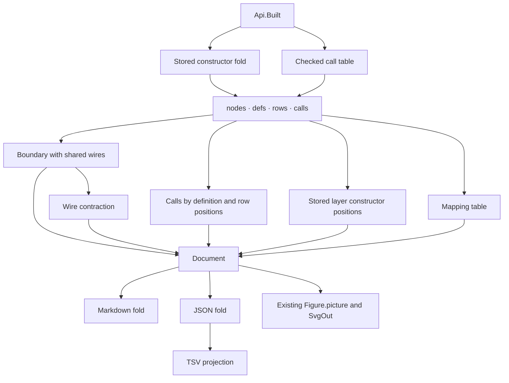

# 2026-10-21 The view as graphs: the derivation and the brief

Status: a design brief and a landing receipt. Decisions row 443 rules that the rows come first. Section 7 records the landing. The evidence words are those of `docs/core/controlled-english.md` §3.8.
The prove-out is `probe-view.lean`, run with `lake env lean` against the built tree on 2026-10-21.
Its outputs are in `out/`: one Markdown file, one JSON file, and a TSV and an SVG for each figure. `out/figures.jpg` is the page as the browser drew it. `probe-rows.lean` reads the same object as four relations, `out/relation-*.gen.tsv` (§2.6).
The literature is under `sources/`, with its index in `sources/README.md`.

## 1. The one thing to know

One value, folded three ways, is the whole deliverable. The value is a `Tools.Document.Document` (`tools/Tools/Document.lean`) whose blocks are a table and five graphs.
The Markdown fold writes the table and a Mermaid diagram for each graph. The JSON fold writes the rows. The HTML fold draws each graph through the view's one layout, `Tools.View.Graph.layout`, to an SVG.
All three folds exist (decisions row 365). The prove-out used them unchanged, and the drawings in `out/figures.jpg` are theirs.

What the tree lacks is the derivation: the folds from a program's data into the graph blocks. The brief adds those folds, their laws, and the command that writes the three forms. It adds no drawer and no carrier.

## 2. The derivation

### 2.1 The data a graph is read from

A graph is read from a program object and nothing else.

- A `Built` (`src/Effect4/Api/Built.lean`): its program, with the definitions and their roles, and its application, with the row table and the named types.
- The checked call table, `Api.HostSession.callTable` (`src/Effect4/Api/HostSession.lean`): every call instance by its address, with its operation. An operation is a call of a definition or an external row.
- A `LayerTerm` (`src/Effect4/Program/Eff.lean`): Effect's layer calculus as data, one constructor per combinator, each citing its line of `vendor/effect-4.0.0-rc.112/src/Layer.ts`.
- The namespace of a row is the part of its spelling before the dot. The rows of one namespace are one host's typing signature. A service is the name a `serviceMethod` role carries.

### 2.2 Three graphs, each a fold

**The boundary, G∂.** Its vertices are the hosts, the service blocks and the main program. Its edges go from a provider to a consumer.
The fold reads the call table. A body's call of a row gives an edge from the row's host to the body's service. A body's call of a definition of another service gives an edge from that service to the body's service. The main program's calls give edges into `main`.
`probe-view.lean` reads it as `boundary`. On the session object of the to-do it has four vertices and three edges (`out/boundary-plain.gen.tsv`).

**The inside, G∘.** Its vertices are the definitions and the rows, and its edges are the call table's edges. `probe-view.lean` reads it as `callGraph`, and `out/calls.gen.tsv` lists its fourteen edges.
It is the picture of one box of G∂ opened.

**The layer term, Gλ.** Its vertices are the constructor occurrences of a `LayerTerm`, keyed by path, and its edges go from a term to its children. A `ref` is a vertex whose detail names its target, so sharing is visible.
`probe-view.lean` reads it as `termGraph`, by a hand match. The slice writes it with `cata_layer` (`src/Effect4/Program/Fold.lean`).

A run is not a graph. Decisions row 413 shows the journal, the host's calls and the fibers as tables, and this note keeps that.

### 2.3 Composition is overlay

The tree holds Mokhov's algebraic graph, `Tools.View.AGraph` (`tools/Tools/View/AlgGraph.lean`), with its edge-set model and the eight axioms proved of the model.
Its four constructors are the empty graph, a vertex, the overlay of two graphs and the connection of two. Overlay is commutative, associative and idempotent.

Read G∂ in the hypergraph form of Fong 2015 and of Bonchi, Sobociński and Zanasi 2016. A wire is a vertex of its own, named by its tag. A box is a vertex with an edge from each input wire and an edge to each output wire.
Then every layer combinator is overlay.

- `effect(tag, body)` is the box of its service: an edge from each tag the body requires, an edge to `tag`.
- `provide(self, that)` is the overlay of the two graphs. The wires they share by name are one vertex, so the output of `that` meets the input of `self` with no extra rule. This gives named incidence gluing. A pushout theorem also needs explicit boundary maps, which this slice does not add.
- `merge(left, right)` is the overlay too. Two boxes into one wire show where last-wins applies (`Context.mergeAll`, `Layer.ts:1600`).
- `provideMerge` is `provide` with the shared wires kept on the outer boundary.
- The boundary itself is the pair of wire sets a term exposes: the inputs it requires and the outputs it provides. `provide` hides the shared wires; `provideMerge` keeps them. The boundary is data beside the graph, the two legs of the cospan, and the graph does not change.

`out/hypergraph.gen.tsv` is this form of the to-do: seven vertices, six edges, three of the vertices wires.

The box form of G∂, the first drawing, is the hypergraph with each wire contracted to an edge. Contraction is a graph operation on the data, so the two drawings are one value read two ways.

### 2.6 The rows come first

The owner reviewed the four drawings on 2026-10-21, by voice. Every node looks the same, a box with text. A row and a definition cannot be told apart, and the mapping to the algebra is not visible. A tabular form was asked for, with the location of each thing. The location is itself the graph.

The location is the address. `Node.addresses` (`src/Effect4/Program/Typing/Table.lean`) lists every node of a program by its path, and `Node.at_` (`src/Effect4/Program/Refs.lean`) reads the node there. The one-layer view (`view_eff`, `view_layer`, `src/Effect4/Program/LayerView.lean`) gives the node's constructor and its arguments. The glyph table (`Tools.View.Glyph.table`, `tools/Tools/View/Glyph.lean`) gives each constructor its mark and its word.

`probe-rows.lean` reads the session object of the to-do as four relations, in `out/relation-*.gen.tsv`.

| Relation | One row is | Columns | On the to-do |
| --- | --- | --- | --- |
| nodes | a node of the program term | address, the definition or main it lies in, sort, mark and word, what it names | 70 |
| defs | a definition of the block | k, name, role, the address of its body | 5 |
| rows | a row of a host | i, spelling, namespace, request type, answer type | 9 |
| calls | a call instance of the call table | address, the definition it lies in, the sort of its target, the target, the target's address | 14 |

The graphs of §2.2 are queries over these relations, and no second carrier is needed.

- The term tree is the prefix order of `nodes.address`.
- The inside, G∘, is `calls` joined to `defs` and `rows` on the target.
- The boundary, G∂, is `calls` grouped by the service of its definition and the namespace of its row.
- The layer term, Gλ, is the rows of `nodes` whose sort is `layer`, under the prefix order.

So the slice writes the relations first and the drawings as folds of them. A drawing carries the mark of each node's constructor from the glyph table, not a box with text. The status word of a `GraphNode` names the sort. That is the change the review asks for, and it is a change to the derivation, not to the drawer.

### 2.4 The laws, placed

Each law below is placed before it is worked (`AGENTS.md`, Trust). The concept is concept 7 of `docs/core/semantics.md`, `initial-algebras-folds`, where the algebraic graph's laws already sit. The consumer is the `inspect` command of §5 and the site's figures.

| Law | Statement | Kind | Reach |
| --- | --- | --- | --- |
| G1 glue | the hypergraph of `provide(self, that)` is the overlay of the hypergraphs of `self` and `that` | by definition of the fold, a `simp` lemma | every `LayerTerm` |
| G2 merge | the hypergraph of `merge(l, r)` equals that of `merge(r, l)` in the edge-set model | `AGraph.overlay_comm`, already proved | every `LayerTerm` |
| G3 contract | the box form is the wire contraction of the hypergraph form | a definition and a finite check on the to-do | the to-do, then a theorem |
| G4 closure | every row vertex of G∘ lies under a host vertex of G∂ exactly when `ServiceSession.foreign` is empty | a finite check on the to-do, tied to `Built.session_ok_iff` (`src/Effect4/Laws/Api/Session.lean`) | the to-do, then a theorem |
| G5 order | the nodes follow checked Kahn order when it serves every edge, or the stable input order for a cycle | a definition over `Tools.View.Flow.orderFor`, and the law that the layout's ranks go forward (`Tools.View.Graph.ranks_forward`) | every graph block |
| G6 rows | the JSON fold reads back: `Document.ofJson (Document.json d) = .ok d` | a retraction; `Tools.Document.Json` holds both maps; no exactness claim | every document |

What the drawing does not show: the tensor's left priority (`Reactor.tensor`, `src/Effect4/Run/Runner.lean`). Overlay is commutative and the tensor is not where two reactors answer one row. The picture is of disjoint rows, and a figure's caption says so.

G5 is evidence from the prove-out. Its first hypergraph drawing listed the wires after `main`. The layout routed three edges back up and around. That drawing was replaced by the sorted one. `Block.graph` takes its nodes in the order the drawing ranks them (decisions row 365), so the derivation sorts.

### 2.5 The three forms from the one value

| Form | Fold | Output | Today |
| --- | --- | --- | --- |
| the table | `Document.markdown` on a `Block.table` | `todo.gen.md`, the mapping of our words to Effect's and the algebra's | `out/todo.gen.md` |
| the rows | `Tools.Document.Json.Document.json` | `todo.gen.json`, every node with its key, label, status and detail, every edge by key | `out/todo.gen.json`; the TSV is a projection of it |
| the drawing | `Tools.Document.Figure.picture` through `Graph.layout` and `Tools.View.SvgOut.fileText` | one `.gen.svg` a figure; Mermaid from `Tools.Document.mermaid` in the Markdown | `out/*.gen.svg`, `out/figures.jpg` |

No hand-written drawing. The look is the view's look (`tools/view/out/looks/looks.css`, `tools/Tools/Document/page.css`).

## 3. The candidate drawings

The owner asked to see the representations the literature gives and then choose. `out/figures.jpg` shows four, all from one value.

| Drawing | Literature | What it shows well | What it hides | Cost in the tree |
| --- | --- | --- | --- | --- |
| D1 boxes with dependency edges | Mokhov 2017; the layout the tree has | who provides to whom, at a glance; the cached block with the same boundary | the tag on a wire; where two providers meet | none |
| D3 hypergraph, wires as vertices | Fong 2015, Baez–Fong 2015, BSZ 2016 | the tag on every wire; composition as overlay; last-wins as two boxes into one wire | twice the vertices | none; G3 relates it to D1 |
| D2 the layer term as a term graph | Hasegawa 1997 for sharing; Mokhov 2017 for the expression | the syntax of a composition, `fresh` and `ref` included | the wires | `cata_layer` |
| S string diagram with ports | Selinger 2010; Joyal–Street 1991 | the order of ports on a box; the identity of a wire through a box | nothing the others show, at a layout cost | `Tools.View.GraphAttachment` has port attachments; not proved out |

The recommendation is a proposal, not a ruling. The rows of §2.6 come first, and every drawing is a query over them. D3 is the semantic form, because composition is overlay there and the laws are the algebraic graph's. D1 is its contraction, for reading. D2 is the syntax. S waits for the handler slice, where ports carry meaning. A drawing marks each node by its constructor's glyph, so a row, a definition and a wire read apart.

## 4. The reuse pass

| Exists | Where | The slice uses it as |
| --- | --- | --- |
| the figure graph as data | `Tools.Document.Block.graph`, `GraphNode` | the one carrier of a graph block |
| the three folds | `Document.markdown`, `Tools.Document.Json.Document.json`, `Tools.Document.Html.algebra` | the three forms |
| the one layout and the SVG | `Tools.View.Graph.layout`, `Tools.Document.Figure.picture`, `Tools.View.SvgOut.fileText` | the drawing |
| the algebraic graph and its laws | `Tools.View.AGraph`, `AlgGraph.lean` | the model G1 and G2 are stated in |
| the call table and its law | `Api.HostSession.callTable`, `callInstance_callTable` | the source of G∂ and G∘ |
| the layer fold | `cata_layer`, `Fold.lean` | the source of Gλ |
| Kahn's order | `Tools.View.Flow.orderFor` | G5 |
| the read-back | `Tools.Document.Json.Document.ofJson` | G6 |
| the inspect command | `Compiler.inspect`, `tools/Compiler/Inspect.lean` (decisions row 435) | the home of the new forms |

Nothing new is drawn. `probe-view.lean` is 150 lines, and its three readers are the slice's three folds.

## 5. The slice

Landing base: `9375bbe8b` on `refactor/phase1-phase3`. The earlier probe uses the base named in its retained evidence. One seat, one branch. Commits by explicit paths after a narrow build.

1. **The relations, then the folds.** A module `tools/Compiler/Graphs.lean` with the four relations of §2.6 as `Block.table`s read from a `Built`. Over them, `boundary : Api.Built → Block`, `calls : Api.Built → Block` and `layers : Api.Built → List Block` as queries. Each is a `Block.graph` whose nodes carry their sort and mark.
   `boundary` reads the call table as §2.2 says, in the hypergraph form, with the box form as its contraction (G3). `layers` folds each layer term of the block with `cata_layer` (Gλ). Every node list is in Kahn's order (G5). No `partial`, no hand match over `LayerTerm`.
2. **The command.** `inspect --what relations | boundary | calls | layers` beside the existing `graph`, with `--form md | json | svg | tsv`. Markdown and JSON are the document folds. SVG is `Figure.picture` through `SvgOut.fileText`, one file a figure. The JSON is the one the site reads (`effect4-document/1`).
3. **The table.** The mapping table of `out/todo.gen.md` becomes a `Block.table` the command writes with the figures. Its rows are read from the same data. One row stands for a host, a block or a main, and one row for a combinator the layers use.
4. **The laws.** G1 and G2 as theorems in `tools/Tools/View/` beside `AlgGraph.lean`, placed under concept 7. G3, G4 and G5 as finite checks in a battery under `Test/`, reachable from `Test/All.lean` at the anchor the coordinator names. Each line is a reader, a control or a finite evaluation. G6 as a theorem if `Tools.Document.Json` admits it in a day. Else a finite check and a planned goal with its claim.
5. **The generated group.** `generated/graphs/todo.gen.md` and `todo.gen.json` for the dogfood to-do, written by `python3 scripts/generate.py --only graphs` through the command. `docs/GENERATED.md` lists the group with its producer, its inputs and the check that a rerun changes no byte.
6. **The receipt.** Folded into the push's note. It gives the one thing to know, base and head, the files, the commands and their results. It gives `#axiom_audit` over the touched modules, the open obligations, and what is bounded to the to-do.

Gates: `LEAN_NUM_THREADS=3 lake build <Module>` per touched module; `#axiom_audit` over them; `make batteries-touched BASE=<rev>`; `python3 scripts/check-language.py --strict` on the documents; the generated group's rerun check.

Not in this slice: a string diagram with ports, motion, a run as a graph, and a drawing of handler composition. Also not in it: any change to `Graph.layout`, `SvgOut` or the look, and any second graph carrier.

## 6. What this note does not establish

The prove-out is a finite probe on the session objects of the to-do, plain and cached. Neither probe proves a law of §2.4. Section 7 records the landed laws, including the use of `overlay_comm`. The drawings are the view's, unchanged, so nothing is claimed about their layout beyond `ranks_forward`.
Effect's side is cited by line and checked by the behaviour gates, not proved. Hasegawa 1997 is not vendored, so sharing graphs are cited by title.


## 7. Landing receipt

### The one thing the coordinator must know

The four relations own the figures. The implementation retains stored references and distinguishes their addresses from expanded checked call addresses.
G6 now has an unrestricted Lean proof. The JSON reader has no nesting limit.
Its existing `Lean.Json` carrier reaches `Classical.choice`, outside the semantic proof graph's axiom ceiling.
The semantics registry records that missing ceiling-admitted evidence explicitly. It neither calls G6 assumed nor weakens the ceiling.

Base: `9375bbe8bdcf7c04cf9254ae10cfaa51fc9316a8`.
Branch: `codex/view-graph`.
Implementation head: `221965a0cf9130c5bb73453471e1297046dbdede`.
The receipt commit follows that implementation head.

### The representation

`Compiler.Graphs.read`, in `tools/Compiler/Graphs.lean`, reads an admitted program into four `Block.table` values.
Every drawing and every mapping row queries those values.
The node relation uses `EffAlgebra.ofLayer` with the generated folds, including `cata_layer`.
There is no new graph carrier, drawer, or hand match over `LayerTerm`.



The refinements follow from probes and the existing owners:

| Finding | Decision | Evidence |
| --- | --- | --- |
| Duplicate definition names are admitted | Keys use positions; names remain labels | `shared` and `shadowed` controls in `Test/Codegen/CompilerGraphs.lean` |
| A provider can have several consumers | One provider wire joins all its consumers | Shared-wire control in that battery |
| The checked call table expands references | Calls retain the expanded address and add their stored `origin` | `referencedCall` control in that battery |
| Layer sharing needs its stored occurrence | Nodes retain the original `ref` and its target | `moduleLayer` and `referencedCall` controls |
| Glyph words need not identify constructors | Nodes retain the constructor name beside its glyph and word | The mapping distinguishes `provide`, `provideMerge`, and `ref` |
| A service key has a name and a type code | The relation prints both fields | `Compiler.Graphs.names` in `tools/Compiler/Graphs.lean` |
| A module layer can call a host | Calls and boundary include its module owner | `referencedCall` control |
| An empty definition block still has a main | The node relation determines the main address | `emptyBlock` and bare-main controls |
| A cyclic call graph has no topological order | Keep all edges and the existing stable fallback | `recursive` control |
| The to-do session has no stored layer constructor | Its document states that fact and emits no empty layer figure | Generated document and command checks |
| A stored `ref` is not a TypeScript combinator | The mapping names a hoisted layer constant | `Program/Refs.lean` owns that reading |
| The old JSON reader refuses depth 65 | Structural recursion replaces the fixed bound | G6 and the depth regressions in `Test/Tools/GraphJson.lean` |

The dictionary's typed distinction matters to G1 and G2.
Their observation consists of named vertices and edges, without constructor addresses or evaluation order.
`provide` uses overlay by the fold equation. Swapping `merge` operands keeps that edge-set observation by `AGraph.overlay_comm`.
These statements do not prove the command's boundary query agrees with a layer interpretation.
They also establish no decorated-cospan pushout, hidden boundary, cache identity, or last-wins evaluation.

The JSON proof composes four steps: inline retraction, list retraction, block induction, and document retraction.
Its reader computes the nested body of a part and reuses the existing strict field readers.
It introduces no syntax carrier or depth parameter.

### Placement and scope

| Obligation | Placement | Evidence and limit |
| --- | --- | --- |
| G1 | `layer-graph-glue`, concept `initial-algebras-folds`, compatibility | `Tools.View.LayerGraph.hypergraph_provide` in `tools/Tools/View/LayerGraph.lean`; every layer and atom algebra |
| G2 | `layer-graph-merge`, the same concept and role | `Tools.View.LayerGraph.hypergraph_merge_comm`; equality of the named incidence edge-set model |
| G3 | Finite battery in `Test/Codegen/CompilerGraphs.lean` | To-do contraction and a shared-wire control; no general contraction theorem |
| G4 | The same finite battery and a reader of `Built.session_ok_iff` | To-do row coverage and empty foreign requirements; no general biconditional |
| G5 | `Compiler.Graphs.ordered` and the same battery | Existing checked Kahn order; all to-do edges go forward; cycles retain the fallback |
| G6 | `document-json-fold-retraction`, concept 7, compatibility | `Tools.Document.Json.Document.ofJson_json` in `tools/Tools/Document/Json.lean`; unrestricted Lean theorem, outside the semantic axiom ceiling |

The G1 and G2 semantics registry entries precede proof work. The G6 entry precedes its proof after the owner removes the depth limit.
The final G6 pointer records absence of ceiling-admitted evidence, with the theorem named in its reason.
A witness pointer would make the semantic report reject the inherited `Classical.choice` dependency.
The registry loads `Tools.View.LayerGraph` as a root for G1 and G2.
`Test/All.lean` imports both new batteries immediately after `Test.Codegen.CompilerEmit`.

### Verification

All commands run from the isolated worktree. Lake runs sequentially with `LEAN_NUM_THREADS=3`.
The retained scripts and raw output are in `landing/`.

| Command | Result | Evidence |
| --- | --- | --- |
| `LEAN_NUM_THREADS=3 lake env lean -DwarningAsError=true docs/research/2026-10-21-view-graph/probe-rows.lean` | Pass; 70 nodes, 5 definitions, 9 rows, 14 calls | `landing/probe-rows.log` |
| `LEAN_NUM_THREADS=3 lake env lean -DwarningAsError=true docs/research/2026-10-21-view-graph/probe-view.lean` | Pass; the five original probe figures | `landing/probe-view.log` |
| `LEAN_NUM_THREADS=3 lake build Compiler.Graphs Tools.View.LayerGraph Tools.Document.Json Compiler.Inspect Compiler.InspectDocument Compiler.Main Compiler.Exe ProofGraph.Registry Test.Codegen.CompilerEmit Test.Codegen.CompilerGraphs Test.Tools.GraphJson effect4` | Pass; 1,891 jobs | `landing/build.log` |
| `LEAN_NUM_THREADS=3 lake env lean -DwarningAsError=true docs/research/2026-10-21-view-graph/landing/audit-core.lean` | Pass; 119 declarations within the ceiling; no planned goals | `landing/audit-core.log` |
| `LEAN_NUM_THREADS=3 lake env lean -DwarningAsError=true docs/research/2026-10-21-view-graph/landing/audit-tools.lean` | Exit 1; rendering dependencies reach `Classical.choice`; registry audit passes | `landing/audit-tools.log` |
| `LEAN_NUM_THREADS=3 lake env lean -DwarningAsError=true docs/research/2026-10-21-view-graph/landing/registry.lean` | Pass; three registry claims accepted with their declared evidence limits | `landing/registry.log` |
| `python3 docs/research/2026-10-21-view-graph/landing/commands.py` | Pass; sixteen selection/form pairs, refusal controls, TSV agreement, and eight corpus documents | `landing/commands.log` |
| `python3 scripts/generate.py --only graphs` | Pass; six files written through the command | `landing/generate.log` |
| `python3 scripts/generate.py --only graphs --output-dir /private/tmp/view-graph-final-rerun` | Pass; all six fresh files match byte for byte | `landing/rerun.log` |
| `make batteries-touched BASE=9375bbe8b` | Pass; 195 selected batteries; 1,859 jobs | `landing/batteries.log` |
| `python3 scripts/check-language.py --strict docs/research/2026-10-21-view-graph/README.md docs/GENERATED.md generated/graphs/todo.gen.md` | Pass | `landing/language.log` |
| `.lake/build/bin/effect4 inspect --group todo --session TodoApp --what relations --form svg --out docs/research/2026-10-21-view-graph/landing/figures` | Pass; three figures rendered and viewed | `landing/figures/` |
| `git diff --check` | Pass | No whitespace errors |

The original probes need their output directory: `mkdir -p tools/view/out/view-graph`.
The affected-battery selector falls back to import names for two cached modules with older `.ilean` timestamps.
That fallback selects 195 batteries. This is not a run of all `Test`.

The command controls check malformed options, unknown sessions, stale figures, separate program names, and multiple JSON documents.
They also check that refusals leave existing output files unchanged.
SVG files parse as XML. Visual review uses the existing SVG output, converted by `rsvg-convert` without changing the figures.
The retained figures are [boundary](landing/figures/todo.boundary.gen.svg), [boxes](landing/figures/todo.boundary-boxes.gen.svg), and [calls](landing/figures/todo.calls.gen.svg).
The command retains the legacy `inspect --what graph --json` reading.

The exact axiom summaries are:

```text
#axiom_audit: 119 declarations within [propext, Quot.sound], 0 of them modulo planned goals; 0 planned goals
#axiom_audit: 41 of 456 declarations reach axioms outside [propext, Quot.sound]
#axiom_audit: 56 of 73 declarations reach axioms outside [propext, Quot.sound]
#axiom_audit: 321 declarations within [propext, Quot.sound], 0 of them modulo planned goals; 0 planned goals
```

The first summary covers the graph query, layer laws, and two new batteries.
The second covers the command modules and their existing battery. The third covers `Tools.Document.Json`, including G6.
The fourth covers `ProofGraph.Registry`. The full output records the paths through the existing rendering and JSON dependencies.
The failed audits remain failed; this slice adds no exception and changes no trust policy.

### Changed files

| Files | Change |
| --- | --- |
| `tools/Compiler/Graphs.lean` | Four relations, graph queries, mapping, and document |
| `tools/Compiler/Inspect.lean`, `tools/Compiler/InspectDocument.lean`, `tools/Compiler/Main.lean` | Selections, formats, publication, and refusal handling |
| `tools/Tools/View/LayerGraph.lean` | Incidence algebra and G1/G2 |
| `tools/Tools/Document/Json.lean` | Structural reader and unrestricted G6 |
| `tools/ProofGraph/Registry.lean` | Three placed claims and the layer-law root |
| `Test/Codegen/CompilerGraphs.lean`, `Test/Tools/GraphJson.lean`, `Test/Codegen/CompilerEmit.lean`, `Test/All.lean` | Readers, controls, finite checks, and imports |
| `scripts/generate.py`, `Makefile`, `docs/GENERATED.md` | Generated group, dependency inputs, and rerun check |
| `generated/graphs/todo.gen.md`, `generated/graphs/todo.gen.json` | To-do document folds |
| `generated/graphs/relation-nodes.gen.tsv`, `generated/graphs/relation-defs.gen.tsv`, `generated/graphs/relation-rows.gen.tsv`, `generated/graphs/relation-calls.gen.tsv` | Four relation projections |
| `docs/research/2026-10-21-view-graph/README.md` and `landing/` | Receipt, executable checks, raw output, and command figures |

The generated Markdown passes strict language checks. Existing findings in the touched `docs/GENERATED.md` are also repaired.
The branch leaves `Graph.layout`, `SvgOut`, `tools/view/make_videos.py`, `lakefile.toml`, and `docs/core/decisions.md` unchanged.

### Open obligations and proposed decisions

No planned goal supports the new graph queries or incidence laws.
G6 has no unfinished Lean proof. Evidence within the stricter semantic axiom ceiling remains open.
That limit also applies to the existing JSON, SVG, and command rendering paths.

General contraction, the proposed G4 biconditional, and agreement between layer incidence and the command boundary remain open.
The figures establish no host execution result or handler-composition law.
The generated group is bounded to the dogfood to-do session object.
The extra batteries cover the named edge cases; they are not universal graph correctness theorems.

| Proposed decisions follow-up to row 443 | Rationale |
| --- | --- |
| Keep position keys and stored call origins | Duplicate names and reference expansion must not change identity |
| Keep named incidence separate from constructor positions | Only the named incidence observation has G2's commutativity |
| Use the existing Kahn fallback for cycles | A cycle has no order that puts every edge forward |
| Remove the document JSON nesting limit | The owner requests unrestricted G6; structural recursion and its theorem now implement it |
| Keep the existing semantic axiom ceiling | Record the completed JSON theorem and its unadmitted rendering dependency separately |

The coordinator records these decisions. This branch does not edit `docs/core/decisions.md` or `lakefile.toml`.

## 8. The forms: a row and a definition read apart

The owner reviewed the landed figures on 2026-10-21, by voice. The nodes were still boxes with text. Nothing related a row of the tables to its mark in the graph.
This slice gives a node a form, and it gives a row's cell the key of its node.

**The form is data.** `Tools.Form` (`tools/Tools/Form.lean`) is the one vocabulary both the document and the drawing kit import. A box computes, a wire names, a port is a row of the host.
`Tools.Document.GraphNode.form` holds it, `Tools.View.GNode.form` carries it to the layout's calls, and `Tools.Document.Figure.graphOf` passes it through.

**Each fold draws its form.** The Markdown fold writes a box `[…]`, a wire as a stadium `([…])` and a port as a subroutine `[[…]]`, which GitHub draws.
The JSON fold writes a `form` field and reads it back. `Form.ofWord_word` is the retraction of the word, and `readNode_node` takes the new case by `cases form`.
The drawing kit draws a wire as a pill, its corners half its height whatever the look's radius. It draws a port as a box with the host's post at its left (`Call.vrule .host`). That post is the mark the page already uses for a decision of the host.

**The row names its node.** A relation row's scope cell and target cell hold the node's key as code. They link its name to `#node:<key>`, the key the drawn node carries.
The calls query reads the target's key from that cell, by position, so the name join the review found is gone.

**Why this is the hypergraph's picture.** `probe-hyper.lean` showed that two providers of one tag collapse to one vertex when boxes are keyed by their tag, by `overlay_idem`.
The forms draw that rule. A box is keyed by its position and drawn as a rectangle. A wire is keyed by its name and drawn as a pill. So a clash shows as two rectangles on one pill.

Changed: `tools/Tools/Form.lean` (new), `tools/Tools/Document.lean`, `tools/Tools/Document/Json.lean`, `tools/Tools/View/Graph.lean`, `tools/Tools/Document/Figure.lean` and `tools/Compiler/Graphs.lean`. Also `Test/Tools/GraphJson.lean` (every form in the coverage document), `Test/Codegen/CompilerGraphs.lean` (the forms of the to-do's figures, the target keys by position) and `generated/graphs/`.

Verified 2026-10-21. The touched modules and their consumers build. `landing/audit-core.lean` reports 125 declarations within the ceiling. `make batteries-touched BASE=c0830ac08` passes. `generated/graphs` is regenerated, and its page passes the strict language check.
