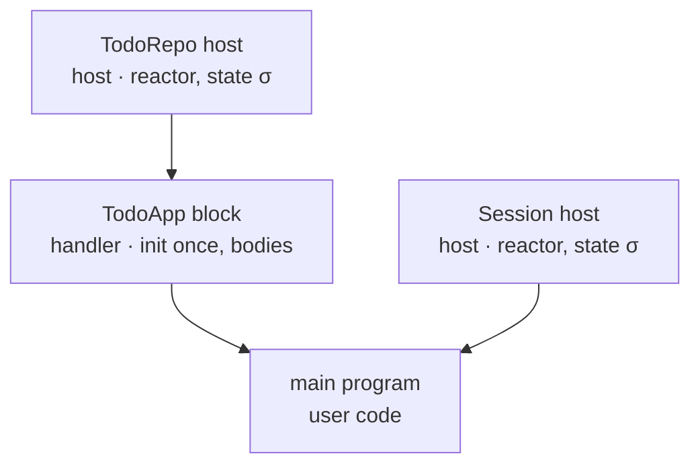
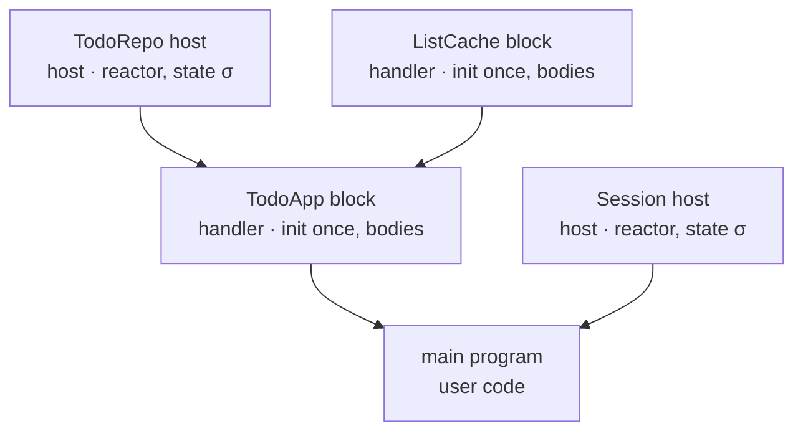
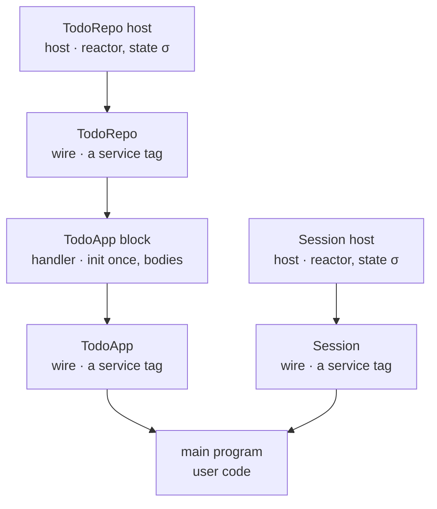
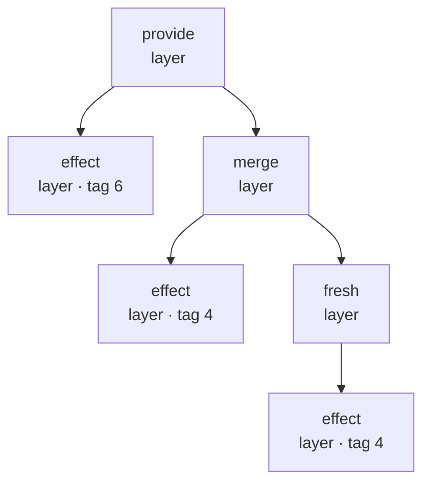
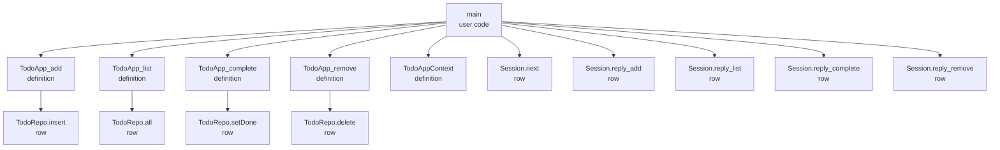

<!-- walk-view.lean (prove-out)
-->
# The to-do as graphs

| ours | Effect TypeScript | algebra |
| --- | --- | --- |
| a host namespace of rows | a Layer\<Tag\> the host supplies | a comodel of the row signature |
| a service block | Layer.effect(Tag, map(init, closures)) | a handler, one program per method |
| the main program | Effect.provide(program, layer) | a term over the methods, handled |
| rows a block calls | Layer.provide(block, host) | composition: connect(host, block) |
| two blocks of disjoint services | Layer.merge | the tensor: overlay |
| a second block of one service | a second Layer of one Tag | a second handler; the same boundary |

D1 the boundary, Mokhov's graph: boxes and dependency edges

D1 the cached block has the same boundary

D3 the boundary as a hypergraph: wires are nodes typed by a tag

D2 a layer term as a term graph: provide over merge over fresh

G2 inside the box: the call graph of the session object, plain

