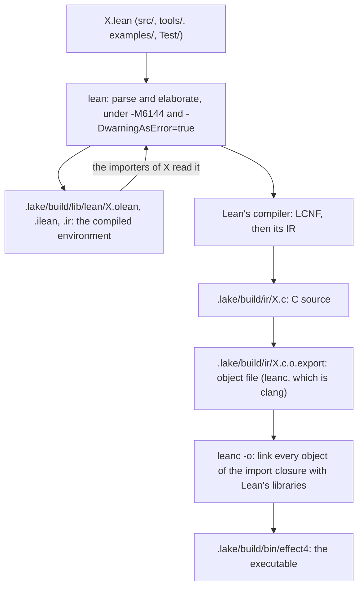

# 2026-10-22 build hygiene: the executable, the imports, the scripts and the make entry points

Status: research note (history, not authority). Base: `007c7cd17`, branch
`claude/build-hygiene-c8f19a`.

**The one thing to know before merging:** the `effect4` executable links 199 law modules and
132 Aesop modules through one import, `Test.Api.HostList` → `Effect4.Laws.Api.HostDrive`. Its
116 MB are still mostly Lean's own library, which any non-module file that reaches `Lean` pulls
in.

## Question

The owner asked four things on 2026-10-22, by voice:

1. What `lake exe effect4` makes: the compilation, the C target and the executable.
2. Whether the Lean needs reorganizing, especially for program authoring.
3. What gets imported, and whether the import hygiene holds.
4. Which scripts and make entry points to keep, merge or cut.

## What was read or run (each with its evidence word)

- The build directory of the main checkout, `/Users/pooks/Dev/lean4-effect4/.lake/build`, at the
  same commit as the base (`007c7cd17`, branch `refactor/phase1-phase3`). This worktree has no
  build of its own. Evidence: tested (measured with `ls`, `du`, `size -m`, `/usr/bin/time`).
- The import graph of every workspace source and of the packages under `.lake/packages`, read
  with the one header reader `scripts/lib/lean_imports.py`. The measuring scripts lie in the
  session's scratchpad and are not in the tree. Evidence: tested.
- Four probe executables built in the scratchpad with the toolchain's `lean -c` and `leanc`, and
  one Lake probe project. Evidence: tested.
- `Makefile`, `lakefile.toml`, `.github/workflows/lean_action_ci.yml`, `docs/ARCHITECTURE.md`,
  `docs/core/system-map.md` §2, decisions rows 200 and 202. Evidence: reading.

## Findings (each with its evidence)

### 1. The compilation and the C target

#### 1.1 The pipeline, from a `.lean` file to an executable

Lean compiles each module on its own, and Lake links the modules that an executable reaches.
The diagram gives the order. Each box names where Lake writes the artifact.



1. `lean` elaborates the module and writes three files. The `.olean` is the compiled
   environment that importers load. The `.ilean` is the reference index that the editor and
   `make batteries-touched` read. The `.ir` is Lean's compiler IR, for the interpreter.
2. Lean's compiler turns every definition with code into LCNF, then into its IR, then into C source.
   The C of `Effect4.Program.Eff` opens with its imports in a comment and includes
   `lean/lean.h`.
3. `leanc` compiles the C to an object file, `.c.o.export`.
4. The executable's link takes the object of every module in its import closure, the import
   closure being every module that its root reaches by imports. It adds Lean's static
   libraries. `.lake/build/bin/effect4.rsp` holds the link line: 871 objects, then `-lleancpp
   -lInit -lStd -lLean -lleanrt -lc++ -lLake -lgmp -luv -lssl -lcrypto -Wl,-dead_strip`.

One module, `Effect4.Program.Eff`, shows the sizes of each artifact.

| Artifact | Bytes |
| --- | ---: |
| `Eff.olean` | 6,187,640 |
| `Eff.olean.private` | 1,539,000 |
| `Eff.ir` | 654,160 |
| `Eff.ilean` | 74,466 |
| `Eff.c` | 1,056,777 |
| `Eff.c.o.export` | 725,816 |

The two flags in `moreLeanArgs` act on step 1. `-M6144` caps each Lean process at 6 GB of memory.
`-DwarningAsError=true` turns every warning into an error.

`precompileModules = true` (the libraries `Effect4Tactics`, `ProofGraphNative` and
`Effect4GenNative`) adds a step: Lake links the library's objects into a shared library, a
`.dylib`. Lean then loads it into the elaborator of every importer, so a tactic runs as native
code, not in the interpreter. The build directory holds `libeffect4_Effect4Tactics.dylib`
and five other shared libraries. The batteries `TestProgram` and `TestDogfood` load the core's
shared library the same way (`dynlibs`).

#### 1.2 The `effect4` executable

The root `Compiler.Exe` (`tools/Compiler/Exe.lean`) imports `Compiler.Groups`, which imports
`Compiler.Main` and two batteries. The measured closure:

| Measure | Value | Command |
| --- | ---: | --- |
| workspace modules | 595 | `python3 scripts/lean-imports.py --closure Compiler.Exe \| wc -w` |
| all modules, packages included | 873 | the scratchpad graph over `.lake/packages` |
| lines of source | 309,949 | the same graph |
| objects on the link line | 871 | `tr ' ' '\n' < .lake/build/bin/effect4.rsp \| grep -c c.o.export` (link of 2026-10-21) |
| C source | 167.8 MB | sum over the closure's `.c` |
| objects | 92.6 MB | sum over the closure's `.c.o.export` |
| `.olean` files | 1,084.4 MB | sum over the closure |
| executable | 116,026,128 bytes | `ls -l .lake/build/bin/effect4` |

The closure by area, from the same graph:

| Area | Modules | Lines | Objects |
| --- | ---: | ---: | ---: |
| `Effect4.Laws` (the law graph) | 199 | 121,985 | 30.4 MB |
| the package `aesop` | 132 | 17,331 | 13.1 MB |
| `Effect4.Program` | 104 | 32,306 | 11.6 MB |
| the package `whatwg` | 77 | 26,963 | 7.6 MB |
| `Effect4.Store` | 38 | 19,494 | 4.1 MB |
| `Effect4.Codegen` | 33 | 11,441 | 3.8 MB |
| `Effect4.Machine` | 22 | 16,410 | 3.1 MB |
| `Effect4.Tool` | 16 | 11,596 | 2.9 MB |
| `Tools` | 26 | 6,391 | 2.7 MB |
| `Effect4.Schema` | 18 | 6,973 | 2.6 MB |
| the package `batteries` | 34 | 4,921 | 2.4 MB |
| `Effect4.Api` | 17 | 8,822 | 2.2 MB |
| `Compiler` | 19 | 5,259 | 1.9 MB |
| the other 13 areas | 138 | 20,057 | 4.2 MB |

The brief expected the law graph to stay out of the executable, and it does not. Each foreign
part enters through few imports, its doors:

| Part | Modules | Door (importer → imported) |
| --- | ---: | --- |
| the law graph, Aesop, Batteries, `ProofGraph` | 371 | `Test.Api.HostList` → `Effect4.Laws.Api.HostDrive`, reached from `Compiler.Groups` → `Test.Api.PackagesContract` |
| batteries (`Test.*`) | 10 | `Compiler.Groups` → `Test.Dogfood.Scenario.Todo.HostLane` and `Test.Api.PackagesContract` |
| the view kit and `whatwg` | 77 + 25 | `Compiler.Graphs`, `Compiler.InspectDocument`, `Compiler.Report` → `Tools.Document*`, `Tools.View.Glyph`, `Tools.View.Flow` |
| the whole core root `Effect4` | 1 | `Tools.View.Glyph` → `Effect4` |

`Test.Api.HostList` needs two executable definitions from the law graph: `Reactor.ofHost`
(`src/Effect4/Laws/Api/HostDrive.lean`) and `tapeHost` (`src/Effect4/Laws/Program/HostRuns.lean`).
Without that one import the closure is 483 modules and 46.3 MB of objects, with no law module
and no Aesop. Without the view kit as well it is 278 modules and 29.5 MB.

**What accounts for the 116 MB.** Five probe executables measure Lean's share. Each writes one
line to its output.

| Probe | Bytes |
| --- | ---: |
| `def main` over `Init` alone | 2,362,688 |
| `import Lean`, one call of `Lean.Name.mkSimple` | 102,499,200 |
| `import Lean.Data.Json`, one call of `Lean.Json.compress` | 102,496,352 |
| a `module` root importing a `module` file that has `public meta import Lean` and one macro | 1,066,896 |
| a non-module root importing that same `module` file | 102,496,656 |

So an executable is about 102 MB as soon as any part of it reaches Lean's library at run time.
The `-Wl,-dead_strip` of the link cannot remove it: each module's initializer calls its
imports' initializers, which reach every module of Lean. A `meta import` keeps Lean out, but
only when every file on the path is a `module` file. The executable `effect4` is 116 MB, so its
own code adds about 13.5 MB to Lean's 102.5 MB. Its `__text` section is 74,448,588 bytes
against 65,936,292 for the `import Lean` probe (`size -m`).

The `effect4` closure reaches Lean's library through four tool modules that import it as plain
files: `Compiler.Elaborated` (`Lean.Elab.Term`), `Tools.Document.Json` (`Lean.Data.Json`),
`Tools.Graph.Index` (`Lean.Elab.Tactic.Omega`) and `Tools.View.Glyph` (`Lean`). The eight core
modules that import Lean all do so with `public meta import`. The core still has 101 non-module
files, so a non-module importer of a meta-importing core module pulls Lean in too.

**Startup.** Each command ran three times, warm, from the main checkout:

| Command | Wall time |
| --- | ---: |
| `effect4 --version` | 0.21 s |
| `effect4 check --group todo` | 0.21 s |
| the `import Lean` probe | 0.02 s (1.95 s on its first, cold run) |
| `view-pages` with a bad flag (471 modules) | 0.02 s |
| `semantics-report` with no argument (17 workspace modules) | 0.02 s |

`view-pages` initializes 471 modules in 0.02 seconds. So the count of modules does not explain
the other 0.19 seconds. The work at initialization does: the top-level values that the `effect4`
closure computes when it starts. This note names no culprit, since no profile was taken.

**A leaner executable needs four steps.**

1. The executable stops importing batteries: `Compiler.Groups` reads its groups from
   `examples/`, which the examples seat is moving.
2. `Reactor.ofHost`, `rowPosition` and `tapeHost` move to the core, or `Test.Api.HostList` stops
   using them. The closure loses 390 modules.
3. The document and view part of the command line (`inspect --form svg`, the reports) moves
   behind its own executable. The closure loses 205 more modules.
4. To leave Lean's 102 MB, every file of the closure becomes a `module` file with Lean behind
   `meta import`. That includes the seven sites of row 202 and their 39 importers, which row
   202 (a) keeps non-module. Steps 1 to 3 cut build and link time, not the binary's size.

#### 1.3 The other executables

| Executable | Root | Modules | Core | Laws | Objects | Binary | Run by |
| --- | --- | ---: | ---: | ---: | ---: | ---: | --- |
| `effect4` | `Compiler.Exe` | 873 | 334 | 199 | 92.6 MB | 116.0 MB | `scripts/generate.py` (graphs), `make check-program-object` |
| `view-pages` | `Drivers.GlyphSheet` | 471 | 334 | 0 | 45.9 MB | 108.3 MB | `tools/view/v` |
| `view-live` | `Drivers.Live` | 453 | 221 | 6 | 47.8 MB | not built | nothing (`tools/view/play --live` runs the driver with `lake env lean --run`) |
| `effect4gen-catalogue` | `Effect4Gen.CatalogueExe` | 130 | 107 | 0 | 15.2 MB | 104.2 MB | `scripts/generate.py` (derived) |
| `lcnfgen` | `OCaml5.Tools.LcnfGen` | 21 | 0 | 0 | 4.0 MB | 104.7 MB | `scripts/generate.py` (lcnf) |
| `semantics-report` | `Drivers.Semantics` | 17 | 0 | 1 | 2.2 MB | 104.0 MB | `make gen-semantics` |
| `semantics-controls` | `Drivers.SemanticsControls` | 16 | 0 | 1 | 2.5 MB | 103.8 MB | nothing (row 447 (5), backlog) |
| `effect4gen` | `Effect4Gen.Exe` | 14 | 0 | 0 | 3.6 MB | 104.9 MB | `scripts/generate.py` (derived) |
| `architecture-map` | `Tools.Architecture` | 4 | 0 | 0 | 0.6 MB | 103.1 MB | `make gen-architecture` |
| `kernel-replay` | `Drivers.KernelReplay` | 1 | 0 | 0 | 0.0 MB | 102.8 MB | `make check-kernel` |

Every executable imports Lean, so each one is between 102.8 MB and 116.0 MB. The drivers that
load an environment at run time (`lcnfgen`, `semantics-report`, `kernel-replay`) need Lean by
their nature. Two executables run under no gate and no script: `semantics-controls` and
`view-live`.

#### 1.4 The artifact cache

Lake's artifact cache (`enableArtifactCache` in `lakefile.toml`) stores each output under its
content hash in `~/.elan/toolchains/leanprover--lean4---v4.33.1/lake/cache`. A build whose inputs
match an entry restores the output as a hard link. `make status` reports the size:

```text
cache     33.0 GB in Lake's artifact cache, 26.1 GB of it used by no build directory (lake cache clean frees it and rebuilds nothing)
```

What it holds, by file kind (a link count of 1 means no build directory uses the file):

| Kind | Size | Used by no build directory |
| --- | ---: | ---: |
| `.olean` | 14.10 GB | 10.26 GB |
| executables (no extension, 135 files of 50 MB or more) | 13.50 GB | 11.56 GB |
| `.dylib` | 3.07 GB | 2.80 GB |
| `.c` | 1.10 GB | 0.76 GB |
| `.olean.private` | 0.46 GB | 0.27 GB |
| `.ilean` | 0.32 GB | 0.22 GB |
| `.o` | 0.31 GB | 0.19 GB |

Every relink of an executable stores about 102 MB more, since Lean's library is in each binary.
`lake cache clean` frees the 26.1 GB that no build directory uses and rebuilds nothing. A
worktree seeds the cache again from its own outputs on its next build. `AGENTS.md` gives the rule
for a new worktree: clone `.lake/packages` copy-on-write, then run `lake build`, which restores
from the cache.

### 2. The imports, measured

#### 2.1 The two roots

| Root | Imports | Tops | Redundant | Closure |
| --- | ---: | ---: | ---: | ---: |
| `src/Effect4.lean` | 193 | 28 | 165 | 351 (335 workspace, 9 `hash`, 7 `typescript`) |
| `src/Effect4/Laws.lean` | 112 | 112 | 0 | 1,264, packages included |

A top is an import that no other import of the root reaches. A redundant import is reached
through another one. The law root has no redundant import since yesterday's cleanup.

The 193 imports of the core root fall in 52 runs over 14 folders. The folders are `Data`,
`Store`, `Machine`, `Schema`, `Program`, `Codegen`, `Step`, `Library`, `Api`, `Run`, `Author`,
`Emit`, `Ingest` and `Tool`. `Program` alone opens 12 runs. So the order is a history of landings, not a
structure: its comments date the landings (the store "landed 2026-09-05").

The 28 tops, in the root's order:

- `Effect4.Data.JsonOptic`
- `Effect4.Store.Carrier.Exact`
- `Effect4.Store.Domain.Genesis`
- `Effect4.Store.Domain.PinDerived`
- `Effect4.Machine.Fold`
- `Effect4.Program.TyClasses`
- `Effect4.Program.Polarity`
- `Effect4.Schema.TyFaces`
- `Effect4.Program.Binders`
- `Effect4.Program.Scoped`
- `Effect4.Codegen.Diagnostics`
- `Effect4.Program.HostBoundary`
- `Effect4.Program.Provision`
- `Effect4.Program.ConfigValue`
- `Effect4.Run.Runner`
- `Effect4.Author`
- `Effect4.Emit`
- `Effect4.Library`
- `Effect4.Ingest.Taxonomy`
- `Effect4.Program.TyCache`
- `Effect4.Program.Authoring.Claims`
- `Effect4.Program.Authoring.ApplicationService`
- `Effect4.Library.Ref.Cache`
- `Effect4.Library.Ref.CacheModel`
- `Effect4.Library.Stream.ArrayModel`
- `Effect4.Schema.Prepare`
- `Effect4.Tool.Exchange`
- `Effect4.Tool.Native`

#### 2.2 What a program author imports

| Root | Modules | Lines | What an author does not need in it |
| --- | ---: | ---: | --- |
| `Test.Dogfood.Scenario.Todo` (the to-do application) | 742 | 277,994 | 284 law modules, 132 Aesop, 35 Batteries, 6 `ProofGraph` |
| `Effect4.Author` | 214 | 82,419 | 21 codegen modules and 7 of `typescript`, through `Codegen.Forms` and `Codegen.Authoring.Forms` |
| `Effect4.Api` | 124 | 57,963 | none: no codegen, no law |
| `Effect4.Program.Authoring` | 65 | 35,776 | 7 machine modules (11,139 lines) beyond the 14 that `Eff` needs |
| `Effect4.Program.Eff` (the program IR) | 31 | 13,577 | the floor: `Eff` stands on 14 machine modules |

The to-do application reaches the law graph through its own test helper: `Todo.lean` imports
`Test.Dogfood.Scenario`, which imports `Effect4.Laws.Author`. Its own code needs `Effect4.Author`,
`Effect4.Program.Authoring.Application`, `Effect4.Codegen.RowServices` and
`Effect4.Library.Ref.Cache`.

The machine enters every authoring closure through two imports:

- `Effect4.Program.Native` imports `Effect4.Machine.Stores` for one constant, `Env.firstFreeName`.
  That constant is declared in `Effect4.Machine.ContextMap`, which `Eff` already reaches.
- `Effect4.Program.Typing.Rules` imports `Effect4.Machine.Context` for `Requirement`, a
  `Row ServiceKey`. `Machine.Context` imports `Machine.Fibers`, which brings `Frames`.

With those two imports moved to `ContextMap`, `Effect4.Program.Authoring` is 55 modules and
24,204 lines, against 65 and 35,776. Its machine part is then the 14 modules of `Eff`.

**A minimal authoring root** would be one module, here called `Effect4.Authoring`, importing:

- the 19 modules of `Effect4.Program.Authoring.*`;
- `Effect4.Step`, `Effect4.Step.Elab`, `Effect4.Step.Elab.Inputs`, `Effect4.Step.Inputs`,
  `Effect4.Step.Lists`, `Effect4.Step.Rename`, `Effect4.Step.Callback`;
- `Effect4.Schema.Modeled.Derive`, `Effect4.Schema.FieldRef.Elab`;
- `Effect4.Library.Words`, `Effect4.Library.Waiting`;
- `Effect4.Program.Sketch`, `Effect4.Program.Edit`, `Effect4.Program.Address`.

`Effect4.Author` is that list today plus `Effect4.Api.Author`, `Effect4.Api.Session`, the two codegen
forms modules, `Effect4.Program.SketchWire` and the typing source modules. Without its two codegen
imports, `Effect4.Author` is 185 modules, with one codegen module left
(`Effect4.Codegen.Refusal`, through `Effect4.Program.Services`).

#### 2.3 Hygiene findings

- **Re-exports in place of cycles:** none found. The workspace import graph has no module
  cycle, and Lean refuses one. At the level of libraries, three pairs import each other:
  `Compiler` and `Tools`, `OCaml5` and `Tools`, `Test` and `Compiler`.
- **Imports with no name used:** this is a finite name probe, not confirmed by a build. For each
  import, the probe looks for any declared name of the imported module in the importer's text. It skips
  an imported module that declares an instance, a notation, a macro or an attribute. The core
  has 15 such imports, the law graph 134, and the tool roots 20. Of the 15 in the core, 4 are
  `Effect4.Api` re-exporting authoring modules, and 5 import `Effect4.Program.Authoring.Tuples`.
  A build after deleting each import confirms or refutes it.
- **`public import` against `import` in `module` files:** 455 `public import`, 117 `public meta
  import`, and 7 plain `import all Init.Data.String.Defs` (or `Init.Data.Nat.ToString`), each a
  deliberate private import.
- **Modules that row 200 makes `module` files:** the core has 335 modules. 281 reach no package
  or only `hash`, and 234 of those are `module` files. The other 47 are the seven sites of row
  202, 39 importers of them, and `Effect4.Store.Domain.ContextCanonical`, which imports none of
  the seven and could convert. The 54 core modules that reach `typescript` stay non-module, as
  row 200 says.
- **The seven specialization sites of row 202** (`Program.Typed`, `Program.Compile`,
  `Program.Admit`, `Program.Admission`, `Program.Provision`, `Schema.Codec`, `Api.Frontier`) are
  all non-module, as row 202 (a) rules. Their 39 importers must stay non-module too, since a
  `module` file imports only `module` files.

#### 2.4 The dependency direction of `docs/ARCHITECTURE.md`

Fourteen rules from the document and the `lakefile.toml` comments were checked against every
import of `src/`, `tools/`, `Test/` and `examples/`. Nine hold with no violation:

- the core never imports the law graph, a tool root, `Test` or `Examples`;
- the law graph imports no tool root other than `ProofGraph`;
- `Machine` imports from `Program` only `Program.TyCore` and `Program.TyEq`;
- `Machine` does not import `Schema.Codec`;
- `Api`, outside `Api.Codegen`, imports from `Codegen` only `Codegen.Refusal`;
- `Store.Domain.Shape` imports no Schema module;
- `Data` imports nothing above `Data`;
- Aesop is imported only under `Effect4.Laws` and `Test`;
- `whatwg` is imported only under `Tools`.

Five rules have violations:

| Rule (source) | Violations |
| --- | --- |
| `ProofGraph` imports no tool root (`lakefile.toml`) | `ProofGraph.Summary` → `Tools.Graph.Summary`; `ProofGraph.Why` → `Tools.Graph.Path` (both imported modules import nothing) |
| no module of `Conform` outside `Conform.Effect4` imports `OCaml5` (`lakefile.toml`) | `Conform.Lcnf.Semantics` → `OCaml5.Lcnf.Prim`; `Conform.Lcnf.Validity` → `OCaml5.Lcnf.Index`, `OCaml5.Lcnf.Census`, `OCaml5.Lcnf.Externs`; `Conform.Source.Description` → `OCaml5.Lcnf.Index` |
| `OCaml5` imports from the core only `Machine` and `Api` (`docs/ARCHITECTURE.md`) | 13: `OCaml5.Eff.Emit` → `Program.TyFoldExtras`; `OCaml5.Eff.Goldens` → `Store.Domain.Canonical`; `OCaml5.Eff.Metadata` → `Store.Domain.Derived.Program`; `OCaml5.Eff.World` → `Program.Native`, `Program.Node`; `OCaml5.Store.DiskOracle` → `Store.Domain.Cas`; `OCaml5.Store.Facts` → `Store.Domain.Store`, `Store.Domain.Genesis`; `OCaml5.Tools.CasGoldens` → `Store.Domain.Word`, `Store.Domain.Cas`, `Store.Domain.Genesis`; `OCaml5.Tools.EffGen` → `Program.Definitions`; `OCaml5.Tools.EffWire` → `Store.Domain.ProgramWire` |
| `Tools` consumes `OCaml5`, not the reverse (`docs/ARCHITECTURE.md`) | `OCaml5.Eff.Metadata` → `Tools.ProfileJson`; `OCaml5.Eff.World` → `Tools.ProgramStructure`, `Tools.WireTags`; `OCaml5.Tools.EffWire` → `Tools.ProgramStructure`; `OCaml5.Tools.CasGoldens` → `TestSupport.CasEntry`; four `OCaml5` modules → `Compiler.GeneratedStamp` |
| a tool root imports no battery (implied by `lakefile.toml`'s `Test` comment) | 18: `Compiler.Groups` → 2 batteries; `Drivers.Truth` → 13; `Drivers.Corpus` → `Test.Program.Gen`; `Drivers.CodecValues` → 1; `TestSupport.ServiceSession` → `Test.Api.SessionFixtures` |

`docs/ARCHITECTURE.md` also says that `OCaml5.Lcnf` consumes the generic `Source` and `Lcnf`
utilities of `Conform`. The measured direction is the reverse: `Conform.Lcnf` imports
`OCaml5.Lcnf`, and no `OCaml5` module imports `Conform`.

### 3. The scripts and the make entry points

#### 3.1 Every entry of `scripts/`

Lines are `wc -l` at the base. "Run by" names every caller that `git grep` finds.

| Entry | Lines | Last commit | What it does | Run by |
| --- | ---: | --- | --- | --- |
| `build-profile.py` | 59 | `43866b849` 2026-10-03 | the critical path of the last build's log | `make build-profile` |
| `build-progress.sh` | 43 | `294c89cde` 2026-10-09 | live count of modules a running `lake build` writes | nothing: **deleted** |
| `check-conform.py` | 354 | `bb7862fa0` 2026-10-20 | the native and compiler conformance lanes | `make check-native`, `make check-compiler` |
| `check-docs.py` | 40 | `370300fba` 2026-10-15 | the documents' references, `--fix` repairs | `make check-docs`, `repair-docs` |
| `check-effect-runtime-census.sh` | 148 | `6d9f29c16` 2026-10-07 | the runtime census against the vendored source | `make check-census` |
| `check-export-classes.py` | 89 | `d5b4130e7` 2026-10-20 | the OCaml export classes | `make check-ocaml` |
| `check-language.py` | 258 | `c599d04cf` 2026-10-03 | the controlled-English checker | `make check-language`, `make site` |
| `check-lcnf-interfaces.py` | 167 | `79fd87bfa` 2026-10-20 | the generated OCaml interfaces | `make check-ocaml` |
| `check-lcnf-sealing.py` | 48 | `9dc684fcb` 2026-10-21 | the sealing of the generated OCaml | `make check-ocaml` |
| `check-lock-install.py` | 43 | `06fb190e0` 2026-10-16 | the TypeScript install against its lock | the install rule `$(GEN)/ts-install` |
| `check-mcp-protocol.py` | 145 | `f17805f63` 2026-10-18 | MCP stdio checks against upstream schemas (needs `jsonschema`) | no gate; cited by `src/Effect4/Laws/Tool/Wire.lean` and rows 415, 416 |
| `check-program-object.py` | 155 | `d70690698` 2026-10-21 | saved program objects through `effect4` | `make check-program-object` |
| `check-proofgraph-input.mjs` | 198 | `802997d48` 2026-10-12 | the proof graph view's input | `make gen-architecture` |
| `check-schema-census.sh` | 327 | `1529a1fe5` 2026-09-04 | the Schema tag pins | `make check-schema-pins` |
| `check-service-identity.py` | 186 | `4d5648581` 2026-10-21 | the service identity against rc.112 | `make check-service-identity` |
| `gate-cache.py` | 67 | `62f354976` 2026-10-18 | content keys and shared passes of the checks | every marker rule |
| `generate-effect-runtime-census.sh` | 411 | `25b162723` 2026-10-06 | the runtime census table | `generated/effect-runtime-census.tsv` rule |
| `generate.py` | 395 | `78ae53a8c` 2026-10-21 | every generated group | `make gen-<group>` (not this seat's file) |
| `lean-imports.py` | 288 | `96dcaa4cd` 2026-10-16 | header imports, closures, dynlib flags, touched batteries | `build_imports`, `native_flags`, three closures, `make batteries-touched` |
| `profile-module.py` | 110 | `90c766a53` 2026-10-04 | one module under the profiler | `make profile-module` |
| `report-effect-runtime-coverage.sh` | 64 | `6d9f29c16` 2026-10-07 | the one coverage report block | a person (`AGENTS.md`) |
| `status.py` | 432 | `75d3cd5d8` 2026-10-22 | `make status` | `make status` |
| `test-trust-boundaries.sh` | 18 | `36c832ab1` 2026-10-07 | the axiom gate's admission fixtures | `make check-tools` |
| `wire-roots.py` | 87 | `96dcaa4cd` 2026-10-16 | connects orphan modules to the roots | `make build` |
| `lib/build_profile.py` | 65 | `df9d1c408` 2026-10-09 | build log and import graph | `build-profile.py`, `status.py` |
| `lib/conform_report.py` | 280 | `d4e2d3a6b` 2026-10-15 | the conformance report format | `check-conform.py` |
| `lib/derived_plan.py` | 65 | `c1bc710bd` 2026-10-03 | the derived group's plan | `generate.py` |
| `lib/doc_refs.py` | 298 | `370300fba` 2026-10-15 | the reference checker | `check-docs.py`, `check-language.py`, `status.py` |
| `lib/gate_cache.py` | 206 | `2062a13aa` 2026-10-18 | the content keys | `gate-cache.py`, `status.py` |
| `lib/language.py` | 533 | `1461f5bfb` 2026-10-03 | the dictionary and rules reader | `check-language.py` |
| `lib/lcnf_interfaces.py` | 148 | `79fd87bfa` 2026-10-20 | the OCaml interface reader | `check-lcnf-interfaces.py`, `generate.py` |
| `lib/lean_imports.py` | 149 | `d4e2d3a6b` 2026-10-15 | the one header reader | six scripts |
| `lib/line_cites.py` | 478 | `c599d04cf` 2026-10-03 | line citations to names | `check-language.py` |
| `lib/portable.sh` | 82 | `40f453763` 2026-09-05 | shell helpers for macOS and Linux | `check-effect-runtime-census.sh` |
| `lib/store_facts.py` | 43 | `2062a13aa` 2026-10-18 | the store facts reader | `generate.py` |

`scripts/__pycache__` is not tracked, and `.gitignore` already lists `__pycache__/`.

Two pairs share one job, and each pair is a thin command beside its library: `build-profile.py`
with `lib/build_profile.py`, and `gate-cache.py` with `lib/gate_cache.py`. The `Makefile` names
each command, so the merge waits for the `Makefile` change of §4.1.

The scripts held four hand copies of one reader, the module that a source path holds. Each knew
only `src/` and `tools/`, and none knew the new `examples/` folder. `scripts/lib/lean_imports.py`
did not know it either: `lean-imports.py --closure` would drop an `Examples` module from a
producer's key. Commit `0e92efbe0` fixes both.

#### 3.2 Every target of the `Makefile`

The `Makefile` has 46 named targets, 12 `gen-<group>` targets and 17 `check-<x>` targets. The
"Used by" column names `AGENTS.md`, the CI workflow, the documents or another target.

| Target | Purpose | Used by |
| --- | --- | --- |
| `help` | lists the targets with a `##` comment | the default goal; CI comment |
| `status` | one screen, measured | a person (`AGENTS.md`) |
| `build` | `lake build Effect4 Effect4Laws` after `wire-roots` | a person (`AGENTS.md`); CI; `check` |
| `check` | `build` | a person (`AGENTS.md`); `check-full` |
| `check-full` | `check`, `check-ts`, `check-ocaml` | a person (`AGENTS.md`) |
| `check-ts` | six TypeScript lanes | a person (`AGENTS.md`); CI |
| `check-ocaml` | `native`, `compiler`, `ocaml` lanes | a person (`AGENTS.md`); CI |
| `batteries-touched` | the batteries a change reaches | a person (`AGENTS.md`) |
| `check-sweep` | seven checks and `check-gen` | a person (`AGENTS.md`) |
| `check-gen` | drift of the Lean-only groups | CI; `check-sweep` |
| `check-gen-full` | drift of every group | CI (nightly) |
| `check-kernel` | the kernel replay | documents only |
| `check-<x>` (17) | one lane each | `check-ts`, `check-ocaml`, `check-sweep`, CI |
| `check-tsdiag`, `check-tsgo` | written twice: an explicit rule and the pattern rule | — |
| `doctor` | tool versions | CI |
| `gen` | every stale group | a person |
| `gen-hermetic` | the Lean-only groups | `check-gen` |
| `gen-<group>` (12) | one group | a person (`AGENTS.md`); CI (`gen-lcnf`) |
| `gen-semantics` | the semantics report | a person; `site`, `gen-architecture` |
| `gen-truth-corpus` | the truth corpus | a person |
| `gen-rocq`, `gen-rocq-lane` | the Rocq inputs and lane | a person (`rocq/README.md`) |
| `gen-store-rocq` | `StoreCode.v`, which `gen-rocq` also writes | nothing found |
| `gen-assignability`, `gen-row-citations`, `gen-tsdiag` | promote a fresh report | a person |
| `corpus` | the printed corpus | `check-gen`, three lanes |
| `site`, `deploy-site` | the documentation site | CI; a person |
| `gen-architecture` | the architecture map, a report | a person |
| `build-tools` | the tool roots | CI |
| `build-profile`, `profile-module`, `statement-census`, `bank-census` | measurements | a person |
| `wire-roots`, `repair-docs` | internals of `build` and `check-docs` | `build`, the docs key |
| `clean`, `clean-gen`, `clean-check` | forget build, markers | a person |

## Proposals (not rulings)

### 4.1 The `Makefile` sections

The coordinator lands this by moving lines, after the other two seats merge. Each section opens
with a `##@` line, and `help` prints the sections in order. Every target keeps its name.

```text
##@ Entry points (a person types these)
help status doctor build check check-full batteries-touched gen check-sweep clean

##@ Behaviour gates (check-full)
check-ts:    check-tsgo check-target check-ts-reader check-tsdiag check-ingest-smoke check-service-identity
check-ocaml: check-native check-compiler, and its own lane (the pattern rule over `ocaml`)

##@ Sweep (by name, when the owner asks)
check-roots check-docs check-language check-census check-schema-pins check-tools
check-program-object check-gen check-gen-full check-kernel

##@ Generators (each writes committed files)
gen-hermetic gen-<group> (12) corpus gen-truth-corpus gen-rocq gen-rocq-lane
gen-assignability gen-row-citations gen-tsdiag

##@ Reports and the site (never committed)
gen-semantics gen-architecture site deploy-site

##@ Measurements
build-profile profile-module statement-census bank-census

##@ Internals (no ## comment, not listed)
wire-roots repair-docs build-tools clean-gen clean-check _run-* FORCE the marker rules
```

Four deletions go with it:

1. The explicit `check-tsdiag:` and `check-tsgo:` lines, which the pattern rule `check-%` already
   makes.
2. `gen-store-rocq`, if the owner confirms that `gen-rocq` covers `rocq/StoreCode.v`.
3. The fixed `echo` of `help`, whose group list omits `variances`: print `$(GEN_GROUPS)`.
4. `build-profile.py` and `gate-cache.py` fold into their libraries as `python3 -m`
   commands, once the `Makefile` names the libraries.

The CI step `make check-ocaml check-compiler` names `check-compiler`, which `check-ocaml` already holds.

### 4.2 The Lean reorganization

Each part gives its cost in rebuilds, from the measured importers (1,736 workspace modules).

| Part | Change | Gain (measured) | Rebuild cost |
| --- | --- | --- | --- |
| A | `Reactor.ofHost`, `rowPosition`, `tapeHost` move to the core, beside `Effect4.Run`; `Test.Api.HostList` imports them there | `effect4`: 873 → 483 modules, 92.6 → 46.3 MB of objects, no law module, no Aesop | 21 importers of `HostDrive`, 15 of `HostList` |
| B | `Compiler.Groups` reads its groups from `examples/`, not from batteries | no battery in any executable | 5 importers of `Compiler.Groups` |
| C | the document and view commands of `effect4` move to their own executable | `effect4`: 483 → 278 modules, 29.5 MB of objects | `Compiler.Main` and `Compiler.Exe` |
| D | `Program.Native` imports `Machine.ContextMap` for `firstFreeName`; `Requirement` moves from `Machine.Context` to a module under `ContextMap` | `Program.Authoring`: 65 → 55 modules, 35,776 → 24,204 lines | about 1,230 importers, once |
| E | the minimal authoring root `Effect4.Authoring` of §2.2; `Effect4.Author` keeps the codegen forms | an author imports 55 modules, not 214 | none: a new root |
| F | `src/Effect4.lean` lists its 28 tops, ordered by the system map's layers: `Data`, `Store`, `Machine`, `Program`, `Schema`, `Step`, `Library`, `Codegen`, `Api`, `Run`, `Tool`, `Ingest`, `Author`, `Emit` | 193 → 28 imports; `wire-roots.py` keeps orphans reached | 18 importers of `Effect4` |
| G | `docs/ARCHITECTURE.md` states the measured direction of `OCaml5`, `Conform` and `ProofGraph` (§2.4) | the document matches the imports | none |
| H | `Effect4.Store.Domain.ContextCanonical` becomes a `module` file | row 200 holds at 235 of 235 eligible modules outside row 202 | its importers |

The core's `module` files make parts D and F rebuild only where the interface changes. A
`public import` dropped in part D removes names that importers may reach through it, so part D
needs one build to find those importers.

### 4.3 Decisions row 450 (proposal)

| Field | Content |
| --- | --- |
| Row | 450 |
| Title | The build's hygiene: what the executable links, the authoring root, the core root's order, the scripts and the `Makefile`'s sections |
| What | (1) **The executable links no law module** (representation): parts A and B of §4.2. (2) **The executable's size stays Lean's** (domain, for the owner): the 102 MB floor holds while any non-module file reaches Lean, which ties it to row 202 (a). The owner rules whether a lean binary is a goal. (3) **One minimal authoring root** (representation): parts D and E. (4) **The core root lists its tops by layer** (method): part F. (5) **The architecture document follows the measured imports** (method): part G, with the five violations of §2.4 either repaired or written down as the rule. (6) **The scripts know every source folder** (method): landed, `0e92efbe0`; `build-progress.sh` deleted, `9d58f2e8b`. (7) **The `Makefile`'s sections** (method): §4.1, landed by the coordinator after the documentation and examples seats merge. (8) **Two executables no gate runs** (for the owner): `semantics-controls` and `view-live` go, or a gate runs them. |
| Evidence | this note, §1 to §3 |
| Owner | coordinator; (2) and (8) the owner |
| Status | proposed |

## What this does not establish

- The import probe of §2.3 reads names in text. It confirms no unused import; only a build after
  the deletion does.
- The closure sizes of §4.2 are computed on the import graph with the edge cut. No build ran with
  the change, so a module that needs a removed name is not found here.
- The startup cause of §1.2 is not profiled. The note shows only that the module count does not
  explain it.
- The probes of §1.2 measure one toolchain (Lean 4.33.1, `leanprover--lean4---v4.33.1`) on one Mac
  (Darwin arm64). The floor may differ on Linux.
- The sizes come from the main checkout's build of the same commit. The link line dates from
  2026-10-21, so a module added since is not in the 871 objects.
- No Lean declaration changed, so no `#axiom_audit` ran.

## Receipt

**The one thing to know before merging:** the `effect4` executable links the law graph through
`Test.Api.HostList` → `Effect4.Laws.Api.HostDrive`. Its size is Lean's library while any
non-module file reaches Lean.

### Base and head

Branch `claude/build-hygiene-c8f19a`, base `007c7cd17`. The head is the commit that adds this
note. The two script commits are `9d58f2e8b` and `0e92efbe0`.

### Changed files

| File | Added | Removed | Change |
| --- | ---: | ---: | --- |
| `scripts/build-progress.sh` | 0 | 43 | deleted: nothing runs it |
| `scripts/lib/lean_imports.py` | 15 | 3 | `SOURCE_DIRS` gains `examples`; `module_name`, the one path reader |
| `scripts/lean-imports.py` | 7 | 18 | its copy of the path reader goes; `--touched` reads `examples/` |
| `scripts/lib/build_profile.py` | 4 | 5 | its copy goes; it reads `examples/` |
| `scripts/profile-module.py` | 4 | 7 | its copy goes |
| `docs/research/2026-10-22-build-hygiene/README.md` | this note | 0 | new, force-added |

`scripts/` loses 46 lines net: 30 added and 76 removed.

### Commands and results

```text
python3 scripts/wire-roots.py --check        PASS roots: every module is reached by its root
make batteries-touched BASE=HEAD             batteries-touched: no battery reached
python3 scripts/lean-imports.py --closure Compiler.Exe | wc -w     595
python3 scripts/lean-imports.py --closure Examples                 examples/Examples.lean
python3 scripts/build-profile.py <synthetic log>                   4 modules rebuilt, 5 s summed; critical path over 18 modules
python3 scripts/profile-module.py                                  prints its usage
python3 -m py_compile (the four touched scripts)                   ok
make status                                                        see below
python3 scripts/check-language.py --strict docs/research/2026-10-22-build-hygiene/README.md
```

`make status` after the changes:

```text
effect4   claude/build-hygiene-c8f19a @ 0e92efbe0 2026-10-22
dirty     clean
build     never (lake build)
cache     33.1 GB in Lake's artifact cache, 26.3 GB of it used by no build directory (lake cache clean frees it and rebuilds nothing)
checks    never: roots native compiler ts-reader target ocaml ingest-smoke service-identity census schema-pins tools tsgo tsdiag docs language program-object
generated stale: variances derived eff wire cas ts readme fixtures graphs (make check-gen); no committed generated file differs
claims    306 proved · 2 modulo · 3 goal · 4 absent · 1 refuted · 1 assumed  (generated/semantics.md)
goals     7 open planned goal(s) (proof_goal)
plan      requirements 14 open; 8 next goal(s): ofJson_image wrap_tensor ofProgram_eq_denoteRowsB once_placed_outside_census ofProgram_approx rows_divergence_adequate explain_replays revert_program  (generated/semantics.md)
duplicate never measured (make statement-census)  (.lake/gen/statement-census.txt)
decisions 49 open · 260 ruled · 63 landed · 4 closed · 71 other  (docs/core/decisions.md)
issues    6 open · 88 ruled · 1 basis · 5 landed · 1 other  (docs/DESIGN-ISSUES.md)
counterex 137 seeded · 49 repaired · 3 pinned · 4 retired  (Test/Counterexamples/REGISTER.md)
docs      2 stale reference(s) in 1 document(s) (make check-docs)
```

`scripts/lib/lean_imports.py` is in the `Makefile`'s `CHECK_CACHE_SOURCES`, so every check key
changes once, and the next run of each check runs it.

### Axiom output

No Lean declaration changed.

### Open obligations

- The `Makefile` sections of §4.1: the coordinator's, after the two other seats merge.
- Row 450 of §4.3: proposed, not in the register.
- `scripts/check-mcp-protocol.py` runs under no gate. A source docstring cites it, so this seat
  kept it. A gate runs it, or it goes with its citations.
- Stale references found and left, since the files are not this seat's:
  - `lakefile.toml` names `make check-semantics`, which no longer exists;
  - `docs/GENERATED.md` says `make check-sweep` runs `tools/Drivers/SemanticsControls.lean`, which
    it does not;
  - `python3 scripts/check-docs.py` reports two stale paths in `docs/ARCHITECTURE.md`:
    `tools/Tools/Exposure.lean` (deleted) and `tools/Drivers/Emit.lean`.

### Message to the coordinator

1. The one thing: `effect4` links 199 law modules and 132 of Aesop through
   `Test.Api.HostList` → `Effect4.Laws.Api.HostDrive`.
2. `scripts/`: 46 lines cut net. `build-progress.sh` is deleted, and the scripts know `examples/`.
3. The executable: 873 modules in its closure, 116,026,128 bytes, 0.21 s to start.
4. The binary stays about 102 MB while any non-module file reaches Lean.
5. Owner rulings: whether a lean binary is a goal (it reopens row 202 (a)), and the fate of
   `semantics-controls` and `view-live`.
6. Yours: the `Makefile` sections of §4.1 after the merges, and row 450.
