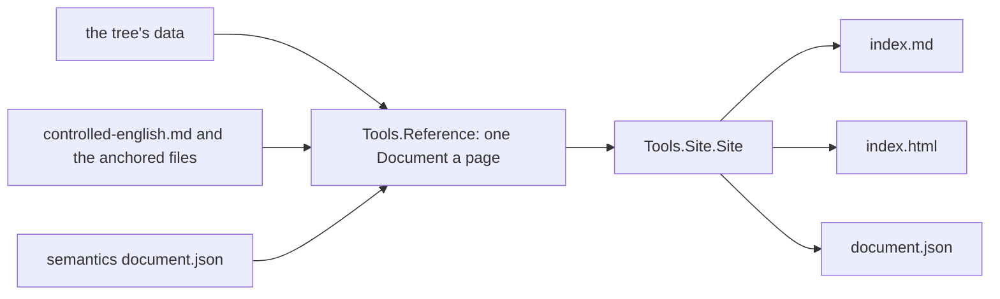

# 2026-10-22 the documentation generator: the reference set

The reference set is one generator and one style. Every page is a `Tools.Document` folded from the
tree's data, and the set is a `Tools.Site.Site`. Run `make gen-reference`. The pages stand under
`generated/reference/`. The studio shows the index at
`http://localhost:8783/generated/reference/index.html`.

## 1. Census

Each count below comes from a Lean evaluation at base `007c7cd17` or from the generated pages.

### 1.1 The data sources

| Source | Declaration | Rows | Carries |
| --- | --- | --- | --- |
| the `Eff` constructors | `arms` (`src/Effect4/Program/Eff.lean`) | 26 | constructor, combinator, primitive, cite |
| the layer constructors | `LayerTerm` (`src/Effect4/Program/Eff.lean`) | 10 | the combinator and the `Layer.ts` line, in docstrings only (10 of 10) |
| the derived forms | `all` (`src/Effect4/Codegen/Forms.lean`) | 19 | id, head, arity, argument classes, expansion, citation |
| the native rows | `NativeOp.spelled` (`src/Effect4/Program/Native.lean`) | 23 | through `nativeSignature`: the fields of `Row` |
| the marks | `Shape` (`tools/Tools/View/Glyph.lean`) | 37 | glyph, kind, meaning |
| the kinds of a mark | `Kind` (`tools/Tools/View/Glyph.lean`) | 7 | meaning and motion grammar; no docstring |
| the constructors drawn | `table` (`tools/Tools/View/Glyph.lean`) | 190 | mark, variant, word, meaning, over 18 sorts |
| the forms of a node | `Form` (`tools/Tools/Form.lean`) | 3 | word; no docstring per constructor |
| the ingest's refusals | `Code` (`src/Effect4/Ingest/Taxonomy.lean`) | 23 | wire code, spectrum, status, detail template |
| the reader's refusals | `ReadRefusal` (`src/Effect4/Codegen/Refusal.lean`) | 8 | fields; meaning in docstrings (8 of 8) |
| the printer's refusals | `PrintRefusal` (`src/Effect4/Codegen/Refusal.lean`) | 15 | fields; docstrings on 13 of 15 |
| the class table's refusals | `ClassRefusal` (`src/Effect4/Codegen/Refusal.lean`) | 5 | docstrings (5 of 5) |
| the dictionary | `docs/core/controlled-english.md` §3 | 361 entries, 503 anchors | term, anchor names and paths |
| the semantics report | `Tools.SemanticsDocument` | 3,007 table rows | one document, 1.2 MB of JSON |

The native rows had one renderer before: `ts/eff/ingest/render-readme.ts`, over the TypeScript
projection `profile.gen.ts`. The layer and refusal meanings had none.

### 1.2 The folds and the shell

`Tools.Document` holds seven block kinds: para, fields, items, code, table, graph and part. Each of
the Markdown, JSON and HTML folds handles all seven, and `Document.ofJson_json` holds. The pages
need no new block kind: a table carries every fact, and a figure draws the three node forms.

`Tools.Site` already wrote a set of pages: each page's HTML, its Markdown twin and its JSON, with
the navigation, the checks and `site.json`. Three things were missing for this set:

- a page whose Markdown twin another producer writes: the semantics page;
- a set whose root lists every page, in place of a `contents` page;
- the data face for a set served from a folder other than the site's root.

### 1.3 The page's rules

A selector census ran in a browser over every rendered page: the 7 reference pages, the 37 site
pages and the specimen. Every selector of `tools/Tools/Document/page.css` matches some page. Four
selectors match no reference page and stay for the site: `.crumbs ol`, `.crumbs li + li::before`,
`h4, h5, h6` and `details.diagram`. Every custom property that the rules define is read, and every
look property that they read is defined. One rule left the file: the `@font-face`. The face is the
look's data face, so `looks.css` writes it now (`fontFace`, `tools/Tools/Site.lean`).

## 2. Design

| Page | Data | Fold |
| --- | --- | --- |
| index | each page's path, its source declarations, its table rows (`rows`) | a table |
| `forms` | `arms`; `LayerTerm` through `ctor_docs%`; `Forms.all` | three tables |
| `native` | `nativeSignature.rowOf` at each of `NativeOp.spelled`, types by `Ty.render` | a table |
| `marks` | `Shape`, `Kind`, `Glyph.table`, `Form` | three tables, a list per kind, a figure |
| `refusals` | `Code.all`; the three alphabets through `ctor_docs%` | four tables |
| `dictionary` | the §3 tables, each anchor and what its file holds (`Finding`) | fields and a table per part |
| `semantics` | the report's document, read back by `Document.reads` | the report's own blocks |

Rules of the set:

- A page's title is its subject's name. A column head is the data's field name.
- A pin links the vendored file at its line, `#L` in GitHub's form. The driver checks that the file
  holds the line.
- `ctor_docs%` reads a constructor's docstring and fields at elaboration. A constructor added to a
  type shows on the page at the next build.
- `Finding` has five values. A `declaration` is a line that declares the name. A `word` is the name
  in the file with no such line. The values `file`, `missing` and `no file` complete the alphabet.
- The semantics page stands in the set that `make gen-reference-semantics` writes under
  `.lake/gen/reference/`, from a fresh report. It is never committed. The committed index links it.

## 3. Receipt

### 3.1 The one thing to know first

The semantics page is not committed (coordinator, 2026-10-22): its two files hold 3.3 MB and change
at each report. `make gen-reference-semantics` writes the whole set with it under
`.lake/gen/reference/`, and the committed index links it there. `generated/reference/` holds the
index and five pages, 21 files, 0.5 MB. No path under `generated/` needs a `.gitignore` line.

### 3.2 Base and head

Base `007c7cd17`. Head: the commit of this note on `claude/docs-generator-eaebde`.

### 3.3 Changed files

| File | Added | Removed |
| --- | --- | --- |
| `tools/Tools/Reference.lean` (new) | 540 | 0 |
| `tools/Drivers/Reference.lean` (new) | 82 | 0 |
| `Test/Audit/ReferencePages.lean` (new) | 43 | 0 |
| `tools/Tools/Site.lean` | 24 | 11 |
| `tools/Tools/Document/page.css` | 0 | 3 |
| `tools/Drivers/Site.lean` | 1 | 1 |
| `tools/Drivers/DocSpecimen.lean` | 2 | 1 |
| `scripts/generate.py` | 27 | 1 |
| `Makefile` (an appended section) | 13 | 0 |
| `docs/GENERATED.md` (the row `reference`) | 1 | 0 |
| `Test/All.lean` (after `Test.Audit.SiteControls`) | 1 | 0 |
| `generated/reference/` (21 files, new) | 6,209 | 0 |

### 3.4 Commands and results

| Command | Result |
| --- | --- |
| `LEAN_NUM_THREADS=3 lake build Tools Compiler.Exe Drivers.Reference` | 1,609 jobs, success |
| `python3 scripts/generate.py --only reference`, twice | PASS; `git status generated/` clean after each |
| `python3 scripts/generate.py --only reference --output-dir DIR` | PASS |
| `make batteries-touched BASE=007c7cd17` | 2 batteries: `Test.Audit.ReferencePages`, `Test.Audit.SiteControls`; success |
| `tools/view/v -d` | the specimen written to `tools/view/out/docs` |
| `python3 scripts/check-language.py --strict` on the six `index.md` | PASS |
| `python3 scripts/check-language.py --strict docs/GENERATED.md` | PASS |
| `lake env lean --run tools/Drivers/Reference.lean .lake/gen/reference REPORT`, at the report of `generated/semantics.md` | 7 pages; pins climb four folders |

### 3.5 Axiom output

`#axiom_audit Test.Audit.ReferencePages` reports 3 declarations within `[propext, Quot.sound]`. It
reports 0 modulo planned goals. The battery is the gated module.

`Tools.Reference` and `Tools.Site` are outside the gate's roots. `#axiom_audit` finds 29 of 174 and
84 of 201 declarations that reach `Classical.choice`. The cause is the `String` operations and
`lean4-whatwg`'s typed shell, as for every rendering module.

### 3.6 Open obligations

- The dictionary page finds 8 anchors whose file holds the word and declares nothing. For example,
  `PrintRefusal` is anchored at `src/Effect4/Codegen/PrintLeaf.lean`. It is declared in
  `src/Effect4/Codegen/Refusal.lean`. The dictionary's owner repairs the anchors.
- `Form` has no dictionary entry for box, wire or port, and no docstring per constructor. The page
  shows each form's word and Mermaid shape only.
- `Kind` has no docstrings. The page reads `Kind.means` instead.
- The ingest README still renders the native rows from TypeScript. Its native table could read
  `generated/reference/native/index.md` instead.
- The semantics page's title is overridden to `semantics` in the built set. `generated/semantics.md`
  keeps the report's title until the report changes it.
- A `lean_exe` entry is not needed: the driver runs through `lake env lean --run`, as `TsGen` does.
- The pages landed in one commit, not three. They share one module, one driver and one battery,
  and a split would land code that the next commit rewrites.
- Checks not run: `make check-full`. No printer, reader or native row changed.

### 3.7 Templates

None. Every fact stands in a table cell, a field or a figure. The docstrings that the `meaning`
columns show are the tree's own words, read by `ctor_docs%`.

### 3.8 Proposed decisions row 448: the reference set

1. The reference set is `generated/reference/`. One driver writes it: `tools/Drivers/Reference.lean`
   over `Tools.Reference`, `Tools.Site` and the folds of `Tools.Document`.
2. A page holds its subject's name, its tables and its figures. A sentence enters only as a template
   over a row's fields, listed in `Tools.Reference.templates`.
3. A pin links its vendored file and line, and the driver refuses a pin whose file lacks the line.
4. The dictionary page checks each anchor against its file. The dictionary stays hand-written.
5. The semantics page is the report's document in the set's shell. It is a build artifact under
   `.lake/gen/reference/` (`make gen-reference-semantics`), never committed, and the committed index
   links it. Its Markdown stays `generated/semantics.md`.
6. The face of the data is the look's and is written into `looks.css`. `page.css` names no face.
7. Proposed: `reference` joins `GEN_GROUPS` and `HERMETIC_GROUPS`, and its paths join
   `GENERATED_PATHS`. The coordinator owns those lines.
