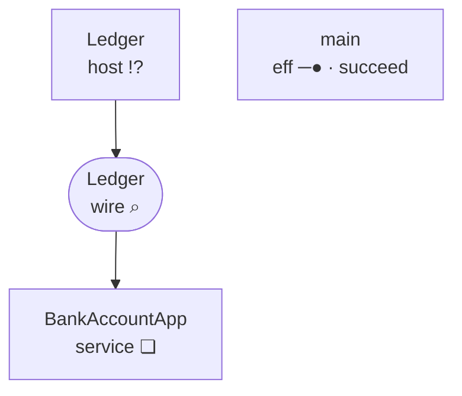
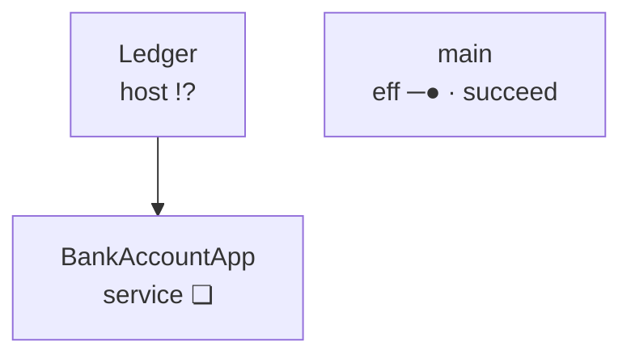
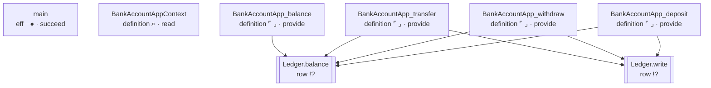

<!-- GENERATED by Compiler.Graphs; do not edit
lake exe effect4 inspect --what relations, the program bankAccount
-->
# \`bankAccount\` · relations

## Nodes

| address | in | sort | mark | word | names | constructor |
| --- | --- | --- | --- | --- | --- | --- |
|  | `block` block | eff | ❏ | define |  | defs |
| 0 | `defs` definitions | effs | · | cons |  | cons |
| 0.0 | `def:0` [BankAccountAppContext](#calls:node:def:0) | eff | ⌕ | read |  | withFiber |
| 0.0.0 | `def:0` [BankAccountAppContext](#calls:node:def:0) | action | ⌕ | read | key 31:6 | context |
| 0.1 | `defs` definitions | effs | · | cons |  | cons |
| 0.1.0 | `def:1` [BankAccountApp_deposit](#calls:node:def:1) | eff | ⌜ ⌟ | provide |  | provideContext |
| 0.1.0.0 | `def:1` [BankAccountApp_deposit](#calls:node:def:1) | eff | ─▶ | bind |  | bind |
| 0.1.0.0.0 | `def:1` [BankAccountApp_deposit](#calls:node:def:1) | eff | ─● | succeed |  | succeed |
| 0.1.0.0.1 | `def:1` [BankAccountApp_deposit](#calls:node:def:1) | eff | ─▶ | bind |  | bind |
| 0.1.0.0.1.0 | `def:1` [BankAccountApp_deposit](#calls:node:def:1) | eff | ─● | succeed |  | succeed |
| 0.1.0.0.1.1 | `def:1` [BankAccountApp_deposit](#calls:node:def:1) | eff | ─▶ | bind |  | bind |
| 0.1.0.0.1.1.0 | `def:1` [BankAccountApp_deposit](#calls:node:def:1) | eff | !? | perform | row Ledger.balance | perform |
| 0.1.0.0.1.1.1 | `def:1` [BankAccountApp_deposit](#calls:node:def:1) | eff | !? | perform | row Ledger.write | perform |
| 0.1.1 | `defs` definitions | effs | · | cons |  | cons |
| 0.1.1.0 | `def:2` [BankAccountApp_withdraw](#calls:node:def:2) | eff | ⌜ ⌟ | provide |  | provideContext |
| 0.1.1.0.0 | `def:2` [BankAccountApp_withdraw](#calls:node:def:2) | eff | ─▶ | bind |  | bind |
| 0.1.1.0.0.0 | `def:2` [BankAccountApp_withdraw](#calls:node:def:2) | eff | ─● | succeed |  | succeed |
| 0.1.1.0.0.1 | `def:2` [BankAccountApp_withdraw](#calls:node:def:2) | eff | ─▶ | bind |  | bind |
| 0.1.1.0.0.1.0 | `def:2` [BankAccountApp_withdraw](#calls:node:def:2) | eff | ─● | succeed |  | succeed |
| 0.1.1.0.0.1.1 | `def:2` [BankAccountApp_withdraw](#calls:node:def:2) | eff | ─▶ | bind |  | bind |
| 0.1.1.0.0.1.1.0 | `def:2` [BankAccountApp_withdraw](#calls:node:def:2) | eff | !? | perform | row Ledger.balance | perform |
| 0.1.1.0.0.1.1.1 | `def:2` [BankAccountApp_withdraw](#calls:node:def:2) | eff | ⑂ | select |  | select |
| 0.1.1.0.0.1.1.1.0 | `def:2` [BankAccountApp_withdraw](#calls:node:def:2) | eff | × | fail |  | fail |
| 0.1.1.0.0.1.1.1.1 | `def:2` [BankAccountApp_withdraw](#calls:node:def:2) | eff | !? | perform | row Ledger.write | perform |
| 0.1.1.1 | `defs` definitions | effs | · | cons |  | cons |
| 0.1.1.1.0 | `def:3` [BankAccountApp_transfer](#calls:node:def:3) | eff | ⌜ ⌟ | provide |  | provideContext |
| 0.1.1.1.0.0 | `def:3` [BankAccountApp_transfer](#calls:node:def:3) | eff | ─▶ | bind |  | bind |
| 0.1.1.1.0.0.0 | `def:3` [BankAccountApp_transfer](#calls:node:def:3) | eff | ─● | succeed |  | succeed |
| 0.1.1.1.0.0.1 | `def:3` [BankAccountApp_transfer](#calls:node:def:3) | eff | ─▶ | bind |  | bind |
| 0.1.1.1.0.0.1.0 | `def:3` [BankAccountApp_transfer](#calls:node:def:3) | eff | ─● | succeed |  | succeed |
| 0.1.1.1.0.0.1.1 | `def:3` [BankAccountApp_transfer](#calls:node:def:3) | eff | ─▶ | bind |  | bind |
| 0.1.1.1.0.0.1.1.0 | `def:3` [BankAccountApp_transfer](#calls:node:def:3) | eff | ─● | succeed |  | succeed |
| 0.1.1.1.0.0.1.1.1 | `def:3` [BankAccountApp_transfer](#calls:node:def:3) | eff | ⑂ | select |  | select |
| 0.1.1.1.0.0.1.1.1.0 | `def:3` [BankAccountApp_transfer](#calls:node:def:3) | eff | × | fail |  | fail |
| 0.1.1.1.0.0.1.1.1.1 | `def:3` [BankAccountApp_transfer](#calls:node:def:3) | eff | ─▶ | bind |  | bind |
| 0.1.1.1.0.0.1.1.1.1.0 | `def:3` [BankAccountApp_transfer](#calls:node:def:3) | eff | ─▶ | bind |  | bind |
| 0.1.1.1.0.0.1.1.1.1.0.0 | `def:3` [BankAccountApp_transfer](#calls:node:def:3) | eff | !? | perform | row Ledger.balance | perform |
| 0.1.1.1.0.0.1.1.1.1.0.1 | `def:3` [BankAccountApp_transfer](#calls:node:def:3) | eff | ⑂ | select |  | select |
| 0.1.1.1.0.0.1.1.1.1.0.1.0 | `def:3` [BankAccountApp_transfer](#calls:node:def:3) | eff | × | fail |  | fail |
| 0.1.1.1.0.0.1.1.1.1.0.1.1 | `def:3` [BankAccountApp_transfer](#calls:node:def:3) | eff | !? | perform | row Ledger.write | perform |
| 0.1.1.1.0.0.1.1.1.1.1 | `def:3` [BankAccountApp_transfer](#calls:node:def:3) | eff | ─▶ | bind |  | bind |
| 0.1.1.1.0.0.1.1.1.1.1.0 | `def:3` [BankAccountApp_transfer](#calls:node:def:3) | eff | ─▶ | bind |  | bind |
| 0.1.1.1.0.0.1.1.1.1.1.0.0 | `def:3` [BankAccountApp_transfer](#calls:node:def:3) | eff | !? | perform | row Ledger.balance | perform |
| 0.1.1.1.0.0.1.1.1.1.1.0.1 | `def:3` [BankAccountApp_transfer](#calls:node:def:3) | eff | !? | perform | row Ledger.write | perform |
| 0.1.1.1.0.0.1.1.1.1.1.1 | `def:3` [BankAccountApp_transfer](#calls:node:def:3) | eff | ─● | succeed |  | succeed |
| 0.1.1.1.1 | `defs` definitions | effs | · | cons |  | cons |
| 0.1.1.1.1.0 | `def:4` [BankAccountApp_balance](#calls:node:def:4) | eff | ⌜ ⌟ | provide |  | provideContext |
| 0.1.1.1.1.0.0 | `def:4` [BankAccountApp_balance](#calls:node:def:4) | eff | ─▶ | bind |  | bind |
| 0.1.1.1.1.0.0.0 | `def:4` [BankAccountApp_balance](#calls:node:def:4) | eff | ─● | succeed |  | succeed |
| 0.1.1.1.1.0.0.1 | `def:4` [BankAccountApp_balance](#calls:node:def:4) | eff | !? | perform | row Ledger.balance | perform |
| 0.1.1.1.1.1 | `defs` definitions | effs | · | nil |  | nil |
| 1 | `main` [main](#calls:node:main) | eff | ─● | succeed |  | succeed |
| 2 | `layers` [layers](#calls:node:layers) | layers | · | nil |  | nil |

## Definitions

| k | name | role | body |
| --- | --- | --- | --- |
| 0 | BankAccountAppContext | init of `BankAccountApp` | 0.0 |
| 1 | BankAccountApp_deposit | method `deposit` of `BankAccountApp` | 0.1.0 |
| 2 | BankAccountApp_withdraw | method `withdraw` of `BankAccountApp` | 0.1.1.0 |
| 3 | BankAccountApp_transfer | method `transfer` of `BankAccountApp` | 0.1.1.1.0 |
| 4 | BankAccountApp_balance | method `balance` of `BankAccountApp` | 0.1.1.1.1.0 |

## Rows

| i | spelling | namespace | request | answer |
| --- | --- | --- | --- | --- |
| 0 | Ledger.balance | Ledger | number | number |
| 1 | Ledger.write | Ledger | readonly \[number, number\] | number |

## Calls

| address | from | targetSort | target | targetAddress | origin |
| --- | --- | --- | --- | --- | --- |
| 0.1.0.0.1.1.0 | `def:1` [BankAccountApp_deposit](#calls:node:def:1) | row | `row:0` [Ledger.balance](#calls:node:row:0) | 0 | 0.1.0.0.1.1.0 |
| 0.1.0.0.1.1.1 | `def:1` [BankAccountApp_deposit](#calls:node:def:1) | row | `row:1` [Ledger.write](#calls:node:row:1) | 1 | 0.1.0.0.1.1.1 |
| 0.1.1.0.0.1.1.0 | `def:2` [BankAccountApp_withdraw](#calls:node:def:2) | row | `row:0` [Ledger.balance](#calls:node:row:0) | 0 | 0.1.1.0.0.1.1.0 |
| 0.1.1.0.0.1.1.1.1 | `def:2` [BankAccountApp_withdraw](#calls:node:def:2) | row | `row:1` [Ledger.write](#calls:node:row:1) | 1 | 0.1.1.0.0.1.1.1.1 |
| 0.1.1.1.0.0.1.1.1.1.0.0 | `def:3` [BankAccountApp_transfer](#calls:node:def:3) | row | `row:0` [Ledger.balance](#calls:node:row:0) | 0 | 0.1.1.1.0.0.1.1.1.1.0.0 |
| 0.1.1.1.0.0.1.1.1.1.0.1.1 | `def:3` [BankAccountApp_transfer](#calls:node:def:3) | row | `row:1` [Ledger.write](#calls:node:row:1) | 1 | 0.1.1.1.0.0.1.1.1.1.0.1.1 |
| 0.1.1.1.0.0.1.1.1.1.1.0.0 | `def:3` [BankAccountApp_transfer](#calls:node:def:3) | row | `row:0` [Ledger.balance](#calls:node:row:0) | 0 | 0.1.1.1.0.0.1.1.1.1.1.0.0 |
| 0.1.1.1.0.0.1.1.1.1.1.0.1 | `def:3` [BankAccountApp_transfer](#calls:node:def:3) | row | `row:1` [Ledger.write](#calls:node:row:1) | 1 | 0.1.1.1.0.0.1.1.1.1.1.0.1 |
| 0.1.1.1.1.0.0.1 | `def:4` [BankAccountApp_balance](#calls:node:def:4) | row | `row:0` [Ledger.balance](#calls:node:row:0) | 0 | 0.1.1.1.1.0.0.1 |

## Handlers

| service | state | init | clauses | requires | forwards | rows |
| --- | --- | --- | --- | --- | --- | --- |
| BankAccountApp | Context.Context\<"k31_6"\> | 0 | deposit@1/2, withdraw@2/2, transfer@3/3, balance@4/1 | k31_6 |  | Ledger.balance, Ledger.write |

boundary

boxes

calls

