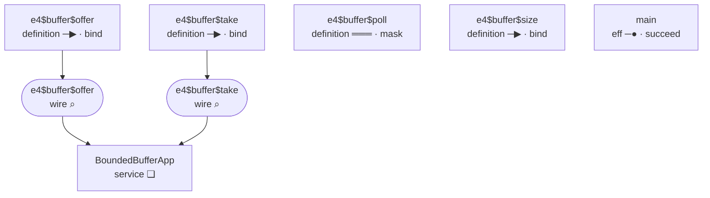
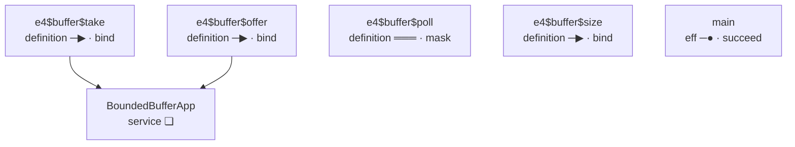
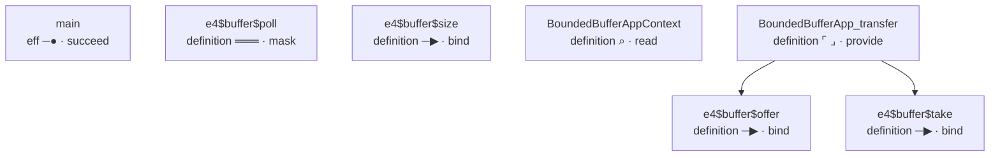

<!-- GENERATED by Compiler.Graphs; do not edit
lake exe effect4 inspect --what relations, the program boundedBuffer
-->
# \`boundedBuffer\` · relations

## Nodes

| address | in | sort | mark | word | names | constructor |
| --- | --- | --- | --- | --- | --- | --- |
|  | `block` block | eff | ❏ | define |  | defs |
| 0 | `defs` definitions | effs | · | cons |  | cons |
| 0.0 | `def:0` [e4$buffer$take](#calls:node:def:0) | eff | ─▶ | bind |  | bind |
| 0.0.0 | `def:0` [e4$buffer$take](#calls:node:def:0) | eff | ⌕ | read |  | withFiber |
| 0.0.0.0 | `def:0` [e4$buffer$take](#calls:node:def:0) | action | ⌕ | read |  | getInterruptible |
| 0.0.1 | `def:0` [e4$buffer$take](#calls:node:def:0) | eff | ═══ | mask |  | uninterruptible |
| 0.0.1.0 | `def:0` [e4$buffer$take](#calls:node:def:0) | eff | ─▶ | bind |  | bind |
| 0.0.1.0.0 | `def:0` [e4$buffer$take](#calls:node:def:0) | eff | !? | perform |  | perform |
| 0.0.1.0.1 | `def:0` [e4$buffer$take](#calls:node:def:0) | eff | ─▶ | bind |  | bind |
| 0.0.1.0.1.0 | `def:0` [e4$buffer$take](#calls:node:def:0) | eff | ↺ | iterate |  | iterate |
| 0.0.1.0.1.0.0 | `def:0` [e4$buffer$take](#calls:node:def:0) | eff | ─▶ | bind |  | bind |
| 0.0.1.0.1.0.0.0 | `def:0` [e4$buffer$take](#calls:node:def:0) | eff | !? | perform |  | perform |
| 0.0.1.0.1.0.0.1 | `def:0` [e4$buffer$take](#calls:node:def:0) | eff | ─▶ | bind |  | bind |
| 0.0.1.0.1.0.0.1.0 | `def:0` [e4$buffer$take](#calls:node:def:0) | eff | !? | perform |  | perform |
| 0.0.1.0.1.0.0.1.1 | `def:0` [e4$buffer$take](#calls:node:def:0) | eff | ─▶ | bind |  | bind |
| 0.0.1.0.1.0.0.1.1.0 | `def:0` [e4$buffer$take](#calls:node:def:0) | eff | ↺ | iterate |  | iterate |
| 0.0.1.0.1.0.0.1.1.0.0 | `def:0` [e4$buffer$take](#calls:node:def:0) | eff | ⑂ | select |  | select |
| 0.0.1.0.1.0.0.1.1.0.0.0 | `def:0` [e4$buffer$take](#calls:node:def:0) | eff | ─● | succeed |  | succeed |
| 0.0.1.0.1.0.0.1.1.0.0.1 | `def:0` [e4$buffer$take](#calls:node:def:0) | eff | ─▶ | bind |  | bind |
| 0.0.1.0.1.0.0.1.1.0.0.1.0 | `def:0` [e4$buffer$take](#calls:node:def:0) | eff | ⌕ | read |  | withFiber |
| 0.0.1.0.1.0.0.1.1.0.0.1.0.0 | `def:0` [e4$buffer$take](#calls:node:def:0) | action | ──▶ | fork |  | fork |
| 0.0.1.0.1.0.0.1.1.0.0.1.0.0.0 | `def:0` [e4$buffer$take](#calls:node:def:0) | eff | !? | perform |  | perform |
| 0.0.1.0.1.0.0.1.1.0.0.1.1 | `def:0` [e4$buffer$take](#calls:node:def:0) | eff | ─● | succeed |  | succeed |
| 0.0.1.0.1.0.0.1.1.1 | `def:0` [e4$buffer$take](#calls:node:def:0) | eff | ─▶ | bind |  | bind |
| 0.0.1.0.1.0.0.1.1.1.0 | `def:0` [e4$buffer$take](#calls:node:def:0) | eff | ↺ | iterate |  | iterate |
| 0.0.1.0.1.0.0.1.1.1.0.0 | `def:0` [e4$buffer$take](#calls:node:def:0) | eff | ⑂ | select |  | select |
| 0.0.1.0.1.0.0.1.1.1.0.0.0 | `def:0` [e4$buffer$take](#calls:node:def:0) | eff | ─● | succeed |  | succeed |
| 0.0.1.0.1.0.0.1.1.1.0.0.1 | `def:0` [e4$buffer$take](#calls:node:def:0) | eff | ─▶ | bind |  | bind |
| 0.0.1.0.1.0.0.1.1.1.0.0.1.0 | `def:0` [e4$buffer$take](#calls:node:def:0) | eff | ⌕ | read |  | withFiber |
| 0.0.1.0.1.0.0.1.1.1.0.0.1.0.0 | `def:0` [e4$buffer$take](#calls:node:def:0) | action | ──▶ | fork |  | fork |
| 0.0.1.0.1.0.0.1.1.1.0.0.1.0.0.0 | `def:0` [e4$buffer$take](#calls:node:def:0) | eff | !? | perform |  | perform |
| 0.0.1.0.1.0.0.1.1.1.0.0.1.1 | `def:0` [e4$buffer$take](#calls:node:def:0) | eff | ─● | succeed |  | succeed |
| 0.0.1.0.1.0.0.1.1.1.1 | `def:0` [e4$buffer$take](#calls:node:def:0) | eff | ⑂ | select |  | select |
| 0.0.1.0.1.0.0.1.1.1.1.0 | `def:0` [e4$buffer$take](#calls:node:def:0) | eff | ─▶ | bind |  | bind |
| 0.0.1.0.1.0.0.1.1.1.1.0.0 | `def:0` [e4$buffer$take](#calls:node:def:0) | eff | ○ | on exit |  | onExit |
| 0.0.1.0.1.0.0.1.1.1.1.0.0.0 | `def:0` [e4$buffer$take](#calls:node:def:0) | eff | ═══ | restore |  | restore |
| 0.0.1.0.1.0.0.1.1.1.1.0.0.0.0 | `def:0` [e4$buffer$take](#calls:node:def:0) | eff | !? | perform |  | perform |
| 0.0.1.0.1.0.0.1.1.1.1.0.0.1 | `def:0` [e4$buffer$take](#calls:node:def:0) | eff | ⑂ | select |  | select |
| 0.0.1.0.1.0.0.1.1.1.1.0.0.1.0 | `def:0` [e4$buffer$take](#calls:node:def:0) | eff | ─▶ | bind |  | bind |
| 0.0.1.0.1.0.0.1.1.1.1.0.0.1.0.0 | `def:0` [e4$buffer$take](#calls:node:def:0) | eff | !? | perform |  | perform |
| 0.0.1.0.1.0.0.1.1.1.1.0.0.1.0.1 | `def:0` [e4$buffer$take](#calls:node:def:0) | eff | ↺ | iterate |  | iterate |
| 0.0.1.0.1.0.0.1.1.1.1.0.0.1.0.1.0 | `def:0` [e4$buffer$take](#calls:node:def:0) | eff | ⑂ | select |  | select |
| 0.0.1.0.1.0.0.1.1.1.1.0.0.1.0.1.0.0 | `def:0` [e4$buffer$take](#calls:node:def:0) | eff | ─● | succeed |  | succeed |
| 0.0.1.0.1.0.0.1.1.1.1.0.0.1.0.1.0.1 | `def:0` [e4$buffer$take](#calls:node:def:0) | eff | ─▶ | bind |  | bind |
| 0.0.1.0.1.0.0.1.1.1.1.0.0.1.0.1.0.1.0 | `def:0` [e4$buffer$take](#calls:node:def:0) | eff | ⌕ | read |  | withFiber |
| 0.0.1.0.1.0.0.1.1.1.1.0.0.1.0.1.0.1.0.0 | `def:0` [e4$buffer$take](#calls:node:def:0) | action | ──▶ | fork |  | fork |
| 0.0.1.0.1.0.0.1.1.1.1.0.0.1.0.1.0.1.0.0.0 | `def:0` [e4$buffer$take](#calls:node:def:0) | eff | !? | perform |  | perform |
| 0.0.1.0.1.0.0.1.1.1.1.0.0.1.0.1.0.1.1 | `def:0` [e4$buffer$take](#calls:node:def:0) | eff | ─● | succeed |  | succeed |
| 0.0.1.0.1.0.0.1.1.1.1.0.0.1.1 | `def:0` [e4$buffer$take](#calls:node:def:0) | eff | ─● | succeed |  | succeed |
| 0.0.1.0.1.0.0.1.1.1.1.0.1 | `def:0` [e4$buffer$take](#calls:node:def:0) | eff | ─● | succeed |  | succeed |
| 0.0.1.0.1.0.0.1.1.1.1.1 | `def:0` [e4$buffer$take](#calls:node:def:0) | eff | ─● | succeed |  | succeed |
| 0.0.1.0.1.1 | `def:0` [e4$buffer$take](#calls:node:def:0) | eff | ⑂ | select |  | select |
| 0.0.1.0.1.1.0 | `def:0` [e4$buffer$take](#calls:node:def:0) | eff | × | fail |  | failCause |
| 0.0.1.0.1.1.1 | `def:0` [e4$buffer$take](#calls:node:def:0) | eff | ─● | succeed |  | succeed |
| 0.1 | `defs` definitions | effs | · | cons |  | cons |
| 0.1.0 | `def:1` [e4$buffer$offer](#calls:node:def:1) | eff | ─▶ | bind |  | bind |
| 0.1.0.0 | `def:1` [e4$buffer$offer](#calls:node:def:1) | eff | ⌕ | read |  | withFiber |
| 0.1.0.0.0 | `def:1` [e4$buffer$offer](#calls:node:def:1) | action | ⌕ | read |  | getInterruptible |
| 0.1.0.1 | `def:1` [e4$buffer$offer](#calls:node:def:1) | eff | ═══ | mask |  | uninterruptible |
| 0.1.0.1.0 | `def:1` [e4$buffer$offer](#calls:node:def:1) | eff | ─▶ | bind |  | bind |
| 0.1.0.1.0.0 | `def:1` [e4$buffer$offer](#calls:node:def:1) | eff | !? | perform |  | perform |
| 0.1.0.1.0.1 | `def:1` [e4$buffer$offer](#calls:node:def:1) | eff | ─▶ | bind |  | bind |
| 0.1.0.1.0.1.0 | `def:1` [e4$buffer$offer](#calls:node:def:1) | eff | !? | perform |  | perform |
| 0.1.0.1.0.1.1 | `def:1` [e4$buffer$offer](#calls:node:def:1) | eff | ─▶ | bind |  | bind |
| 0.1.0.1.0.1.1.0 | `def:1` [e4$buffer$offer](#calls:node:def:1) | eff | !? | perform |  | perform |
| 0.1.0.1.0.1.1.1 | `def:1` [e4$buffer$offer](#calls:node:def:1) | eff | ─▶ | bind |  | bind |
| 0.1.0.1.0.1.1.1.0 | `def:1` [e4$buffer$offer](#calls:node:def:1) | eff | ↺ | iterate |  | iterate |
| 0.1.0.1.0.1.1.1.0.0 | `def:1` [e4$buffer$offer](#calls:node:def:1) | eff | ⑂ | select |  | select |
| 0.1.0.1.0.1.1.1.0.0.0 | `def:1` [e4$buffer$offer](#calls:node:def:1) | eff | ─● | succeed |  | succeed |
| 0.1.0.1.0.1.1.1.0.0.1 | `def:1` [e4$buffer$offer](#calls:node:def:1) | eff | ─▶ | bind |  | bind |
| 0.1.0.1.0.1.1.1.0.0.1.0 | `def:1` [e4$buffer$offer](#calls:node:def:1) | eff | ⌕ | read |  | withFiber |
| 0.1.0.1.0.1.1.1.0.0.1.0.0 | `def:1` [e4$buffer$offer](#calls:node:def:1) | action | ──▶ | fork |  | fork |
| 0.1.0.1.0.1.1.1.0.0.1.0.0.0 | `def:1` [e4$buffer$offer](#calls:node:def:1) | eff | !? | perform |  | perform |
| 0.1.0.1.0.1.1.1.0.0.1.1 | `def:1` [e4$buffer$offer](#calls:node:def:1) | eff | ─● | succeed |  | succeed |
| 0.1.0.1.0.1.1.1.1 | `def:1` [e4$buffer$offer](#calls:node:def:1) | eff | ⑂ | select |  | select |
| 0.1.0.1.0.1.1.1.1.0 | `def:1` [e4$buffer$offer](#calls:node:def:1) | eff | ○ | on exit |  | onExit |
| 0.1.0.1.0.1.1.1.1.0.0 | `def:1` [e4$buffer$offer](#calls:node:def:1) | eff | ═══ | restore |  | restore |
| 0.1.0.1.0.1.1.1.1.0.0.0 | `def:1` [e4$buffer$offer](#calls:node:def:1) | eff | !? | perform |  | perform |
| 0.1.0.1.0.1.1.1.1.0.1 | `def:1` [e4$buffer$offer](#calls:node:def:1) | eff | ⑂ | select |  | select |
| 0.1.0.1.0.1.1.1.1.0.1.0 | `def:1` [e4$buffer$offer](#calls:node:def:1) | eff | ─▶ | bind |  | bind |
| 0.1.0.1.0.1.1.1.1.0.1.0.0 | `def:1` [e4$buffer$offer](#calls:node:def:1) | eff | !? | perform |  | perform |
| 0.1.0.1.0.1.1.1.1.0.1.0.1 | `def:1` [e4$buffer$offer](#calls:node:def:1) | eff | ↺ | iterate |  | iterate |
| 0.1.0.1.0.1.1.1.1.0.1.0.1.0 | `def:1` [e4$buffer$offer](#calls:node:def:1) | eff | ⑂ | select |  | select |
| 0.1.0.1.0.1.1.1.1.0.1.0.1.0.0 | `def:1` [e4$buffer$offer](#calls:node:def:1) | eff | ─● | succeed |  | succeed |
| 0.1.0.1.0.1.1.1.1.0.1.0.1.0.1 | `def:1` [e4$buffer$offer](#calls:node:def:1) | eff | ─▶ | bind |  | bind |
| 0.1.0.1.0.1.1.1.1.0.1.0.1.0.1.0 | `def:1` [e4$buffer$offer](#calls:node:def:1) | eff | ⌕ | read |  | withFiber |
| 0.1.0.1.0.1.1.1.1.0.1.0.1.0.1.0.0 | `def:1` [e4$buffer$offer](#calls:node:def:1) | action | ──▶ | fork |  | fork |
| 0.1.0.1.0.1.1.1.1.0.1.0.1.0.1.0.0.0 | `def:1` [e4$buffer$offer](#calls:node:def:1) | eff | !? | perform |  | perform |
| 0.1.0.1.0.1.1.1.1.0.1.0.1.0.1.1 | `def:1` [e4$buffer$offer](#calls:node:def:1) | eff | ─● | succeed |  | succeed |
| 0.1.0.1.0.1.1.1.1.0.1.1 | `def:1` [e4$buffer$offer](#calls:node:def:1) | eff | ─● | succeed |  | succeed |
| 0.1.0.1.0.1.1.1.1.1 | `def:1` [e4$buffer$offer](#calls:node:def:1) | eff | ─● | succeed |  | succeed |
| 0.1.1 | `defs` definitions | effs | · | cons |  | cons |
| 0.1.1.0 | `def:2` [e4$buffer$poll](#calls:node:def:2) | eff | ═══ | mask |  | uninterruptible |
| 0.1.1.0.0 | `def:2` [e4$buffer$poll](#calls:node:def:2) | eff | ─▶ | bind |  | bind |
| 0.1.1.0.0.0 | `def:2` [e4$buffer$poll](#calls:node:def:2) | eff | !? | perform |  | perform |
| 0.1.1.0.0.1 | `def:2` [e4$buffer$poll](#calls:node:def:2) | eff | ─▶ | bind |  | bind |
| 0.1.1.0.0.1.0 | `def:2` [e4$buffer$poll](#calls:node:def:2) | eff | ↺ | iterate |  | iterate |
| 0.1.1.0.0.1.0.0 | `def:2` [e4$buffer$poll](#calls:node:def:2) | eff | ⑂ | select |  | select |
| 0.1.1.0.0.1.0.0.0 | `def:2` [e4$buffer$poll](#calls:node:def:2) | eff | ─● | succeed |  | succeed |
| 0.1.1.0.0.1.0.0.1 | `def:2` [e4$buffer$poll](#calls:node:def:2) | eff | ─▶ | bind |  | bind |
| 0.1.1.0.0.1.0.0.1.0 | `def:2` [e4$buffer$poll](#calls:node:def:2) | eff | ⌕ | read |  | withFiber |
| 0.1.1.0.0.1.0.0.1.0.0 | `def:2` [e4$buffer$poll](#calls:node:def:2) | action | ──▶ | fork |  | fork |
| 0.1.1.0.0.1.0.0.1.0.0.0 | `def:2` [e4$buffer$poll](#calls:node:def:2) | eff | !? | perform |  | perform |
| 0.1.1.0.0.1.0.0.1.1 | `def:2` [e4$buffer$poll](#calls:node:def:2) | eff | ─● | succeed |  | succeed |
| 0.1.1.0.0.1.1 | `def:2` [e4$buffer$poll](#calls:node:def:2) | eff | ─● | succeed |  | succeed |
| 0.1.1.1 | `defs` definitions | effs | · | cons |  | cons |
| 0.1.1.1.0 | `def:3` [e4$buffer$size](#calls:node:def:3) | eff | ─▶ | bind |  | bind |
| 0.1.1.1.0.0 | `def:3` [e4$buffer$size](#calls:node:def:3) | eff | !? | perform |  | perform |
| 0.1.1.1.0.1 | `def:3` [e4$buffer$size](#calls:node:def:3) | eff | ─● | succeed |  | succeed |
| 0.1.1.1.1 | `defs` definitions | effs | · | cons |  | cons |
| 0.1.1.1.1.0 | `def:4` [BoundedBufferAppContext](#calls:node:def:4) | eff | ⌕ | read |  | withFiber |
| 0.1.1.1.1.0.0 | `def:4` [BoundedBufferAppContext](#calls:node:def:4) | action | ⌕ | read |  | context |
| 0.1.1.1.1.1 | `defs` definitions | effs | · | cons |  | cons |
| 0.1.1.1.1.1.0 | `def:5` [BoundedBufferApp_transfer](#calls:node:def:5) | eff | ⌜ ⌟ | provide |  | provideContext |
| 0.1.1.1.1.1.0.0 | `def:5` [BoundedBufferApp_transfer](#calls:node:def:5) | eff | ─▶ | bind |  | bind |
| 0.1.1.1.1.1.0.0.0 | `def:5` [BoundedBufferApp_transfer](#calls:node:def:5) | eff | ─● | succeed |  | succeed |
| 0.1.1.1.1.1.0.0.1 | `def:5` [BoundedBufferApp_transfer](#calls:node:def:5) | eff | ─▶ | bind |  | bind |
| 0.1.1.1.1.1.0.0.1.0 | `def:5` [BoundedBufferApp_transfer](#calls:node:def:5) | eff | !? | perform |  | perform |
| 0.1.1.1.1.1.0.0.1.1 | `def:5` [BoundedBufferApp_transfer](#calls:node:def:5) | eff | ─▶ | bind |  | bind |
| 0.1.1.1.1.1.0.0.1.1.0 | `def:5` [BoundedBufferApp_transfer](#calls:node:def:5) | eff | ⌕ | read |  | withFiber |
| 0.1.1.1.1.1.0.0.1.1.0.0 | `def:5` [BoundedBufferApp_transfer](#calls:node:def:5) | action | ──▶ | fork |  | fork |
| 0.1.1.1.1.1.0.0.1.1.0.0.0 | `def:5` [BoundedBufferApp_transfer](#calls:node:def:5) | eff | ↺ | iterate |  | iterate |
| 0.1.1.1.1.1.0.0.1.1.0.0.0.0 | `def:5` [BoundedBufferApp_transfer](#calls:node:def:5) | eff | !? | perform | call e4$buffer$offer | perform |
| 0.1.1.1.1.1.0.0.1.1.1 | `def:5` [BoundedBufferApp_transfer](#calls:node:def:5) | eff | ─▶ | bind |  | bind |
| 0.1.1.1.1.1.0.0.1.1.1.0 | `def:5` [BoundedBufferApp_transfer](#calls:node:def:5) | eff | ⌕ | read |  | withFiber |
| 0.1.1.1.1.1.0.0.1.1.1.0.0 | `def:5` [BoundedBufferApp_transfer](#calls:node:def:5) | action | ──▶ | fork |  | fork |
| 0.1.1.1.1.1.0.0.1.1.1.0.0.0 | `def:5` [BoundedBufferApp_transfer](#calls:node:def:5) | eff | ↺ | iterate |  | iterate |
| 0.1.1.1.1.1.0.0.1.1.1.0.0.0.0 | `def:5` [BoundedBufferApp_transfer](#calls:node:def:5) | eff | !? | perform | call e4$buffer$offer | perform |
| 0.1.1.1.1.1.0.0.1.1.1.1 | `def:5` [BoundedBufferApp_transfer](#calls:node:def:5) | eff | ─▶ | bind |  | bind |
| 0.1.1.1.1.1.0.0.1.1.1.1.0 | `def:5` [BoundedBufferApp_transfer](#calls:node:def:5) | eff | ⌕ | read |  | withFiber |
| 0.1.1.1.1.1.0.0.1.1.1.1.0.0 | `def:5` [BoundedBufferApp_transfer](#calls:node:def:5) | action | ──▶ | fork |  | fork |
| 0.1.1.1.1.1.0.0.1.1.1.1.0.0.0 | `def:5` [BoundedBufferApp_transfer](#calls:node:def:5) | eff | ↺ | iterate |  | iterate |
| 0.1.1.1.1.1.0.0.1.1.1.1.0.0.0.0 | `def:5` [BoundedBufferApp_transfer](#calls:node:def:5) | eff | ─▶ | bind |  | bind |
| 0.1.1.1.1.1.0.0.1.1.1.1.0.0.0.0.0 | `def:5` [BoundedBufferApp_transfer](#calls:node:def:5) | eff | !? | perform | call e4$buffer$take | perform |
| 0.1.1.1.1.1.0.0.1.1.1.1.0.0.0.0.1 | `def:5` [BoundedBufferApp_transfer](#calls:node:def:5) | eff | ─● | succeed |  | succeed |
| 0.1.1.1.1.1.0.0.1.1.1.1.1 | `def:5` [BoundedBufferApp_transfer](#calls:node:def:5) | eff | ─▶ | bind |  | bind |
| 0.1.1.1.1.1.0.0.1.1.1.1.1.0 | `def:5` [BoundedBufferApp_transfer](#calls:node:def:5) | eff | ⌕ | read |  | withFiber |
| 0.1.1.1.1.1.0.0.1.1.1.1.1.0.0 | `def:5` [BoundedBufferApp_transfer](#calls:node:def:5) | action | ──▶ | fork |  | fork |
| 0.1.1.1.1.1.0.0.1.1.1.1.1.0.0.0 | `def:5` [BoundedBufferApp_transfer](#calls:node:def:5) | eff | ↺ | iterate |  | iterate |
| 0.1.1.1.1.1.0.0.1.1.1.1.1.0.0.0.0 | `def:5` [BoundedBufferApp_transfer](#calls:node:def:5) | eff | ─▶ | bind |  | bind |
| 0.1.1.1.1.1.0.0.1.1.1.1.1.0.0.0.0.0 | `def:5` [BoundedBufferApp_transfer](#calls:node:def:5) | eff | !? | perform | call e4$buffer$take | perform |
| 0.1.1.1.1.1.0.0.1.1.1.1.1.0.0.0.0.1 | `def:5` [BoundedBufferApp_transfer](#calls:node:def:5) | eff | ─● | succeed |  | succeed |
| 0.1.1.1.1.1.0.0.1.1.1.1.1.1 | `def:5` [BoundedBufferApp_transfer](#calls:node:def:5) | eff | ─▶ | bind |  | bind |
| 0.1.1.1.1.1.0.0.1.1.1.1.1.1.0 | `def:5` [BoundedBufferApp_transfer](#calls:node:def:5) | eff | ◉ | await |  | awaitFiber |
| 0.1.1.1.1.1.0.0.1.1.1.1.1.1.1 | `def:5` [BoundedBufferApp_transfer](#calls:node:def:5) | eff | ─▶ | bind |  | bind |
| 0.1.1.1.1.1.0.0.1.1.1.1.1.1.1.0 | `def:5` [BoundedBufferApp_transfer](#calls:node:def:5) | eff | ◉ | await |  | awaitFiber |
| 0.1.1.1.1.1.0.0.1.1.1.1.1.1.1.1 | `def:5` [BoundedBufferApp_transfer](#calls:node:def:5) | eff | ─▶ | bind |  | bind |
| 0.1.1.1.1.1.0.0.1.1.1.1.1.1.1.1.0 | `def:5` [BoundedBufferApp_transfer](#calls:node:def:5) | eff | ◉ | await |  | awaitFiber |
| 0.1.1.1.1.1.0.0.1.1.1.1.1.1.1.1.1 | `def:5` [BoundedBufferApp_transfer](#calls:node:def:5) | eff | ─▶ | bind |  | bind |
| 0.1.1.1.1.1.0.0.1.1.1.1.1.1.1.1.1.0 | `def:5` [BoundedBufferApp_transfer](#calls:node:def:5) | eff | ◉ | await |  | awaitFiber |
| 0.1.1.1.1.1.0.0.1.1.1.1.1.1.1.1.1.1 | `def:5` [BoundedBufferApp_transfer](#calls:node:def:5) | eff | ─● | succeed |  | succeed |
| 0.1.1.1.1.1.1 | `defs` definitions | effs | · | nil |  | nil |
| 1 | `main` [main](#calls:node:main) | eff | ─● | succeed |  | succeed |
| 2 | `layers` [layers](#calls:node:layers) | layers | · | nil |  | nil |

## Definitions

| k | name | role | body |
| --- | --- | --- | --- |
| 0 | e4$buffer$take | plain | 0.0 |
| 1 | e4$buffer$offer | plain | 0.1.0 |
| 2 | e4$buffer$poll | plain | 0.1.1.0 |
| 3 | e4$buffer$size | plain | 0.1.1.1.0 |
| 4 | BoundedBufferAppContext | init of `BoundedBufferApp` | 0.1.1.1.1.0 |
| 5 | BoundedBufferApp_transfer | method `transfer` of `BoundedBufferApp` | 0.1.1.1.1.1.0 |

## Rows

## Calls

| address | from | targetSort | target | targetAddress | origin |
| --- | --- | --- | --- | --- | --- |
| 0.1.1.1.1.1.0.0.1.1.0.0.0.0 | `def:5` [BoundedBufferApp_transfer](#calls:node:def:5) | def | `def:1` [e4$buffer$offer](#calls:node:def:1) | 0.1.0 | 0.1.1.1.1.1.0.0.1.1.0.0.0.0 |
| 0.1.1.1.1.1.0.0.1.1.1.0.0.0.0 | `def:5` [BoundedBufferApp_transfer](#calls:node:def:5) | def | `def:1` [e4$buffer$offer](#calls:node:def:1) | 0.1.0 | 0.1.1.1.1.1.0.0.1.1.1.0.0.0.0 |
| 0.1.1.1.1.1.0.0.1.1.1.1.0.0.0.0.0 | `def:5` [BoundedBufferApp_transfer](#calls:node:def:5) | def | `def:0` [e4$buffer$take](#calls:node:def:0) | 0.0 | 0.1.1.1.1.1.0.0.1.1.1.1.0.0.0.0.0 |
| 0.1.1.1.1.1.0.0.1.1.1.1.1.0.0.0.0.0 | `def:5` [BoundedBufferApp_transfer](#calls:node:def:5) | def | `def:0` [e4$buffer$take](#calls:node:def:0) | 0.0 | 0.1.1.1.1.1.0.0.1.1.1.1.1.0.0.0.0.0 |

## Handlers

| service | state | init | clauses | requires | forwards | rows |
| --- | --- | --- | --- | --- | --- | --- |
| BoundedBufferApp | Context.Context\<never\> | 4 | transfer@5/1 |  |  |  |

boundary

boxes

calls

