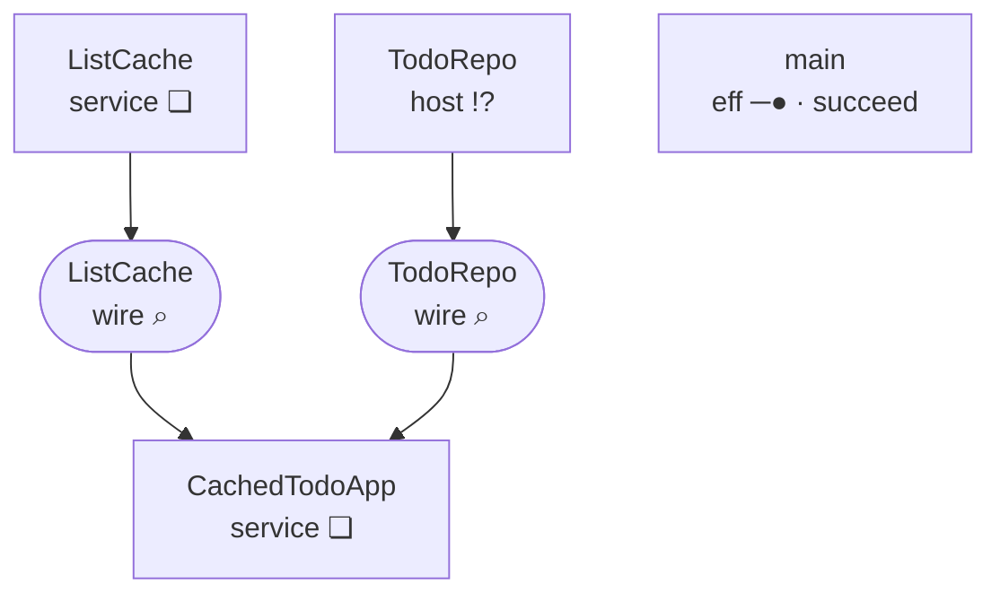
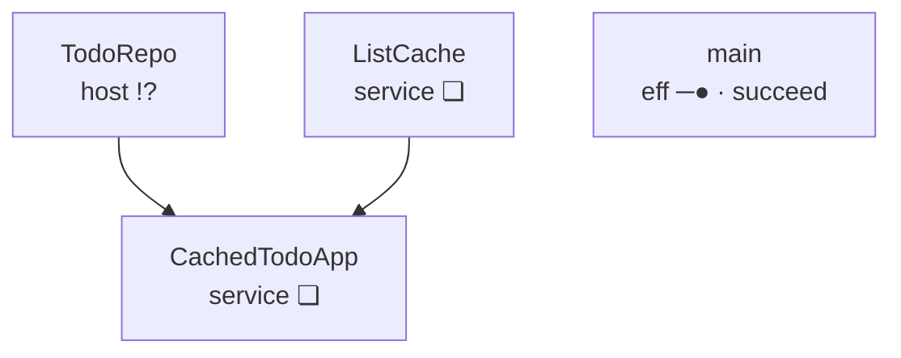
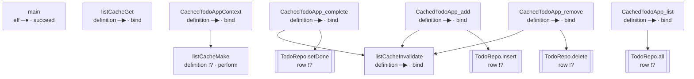

<!-- GENERATED by Compiler.Graphs; do not edit
lake exe effect4 inspect --what relations, the program cachedTodo
-->
# \`cachedTodo\` · relations

## Nodes

| address | in | sort | mark | word | names | constructor |
| --- | --- | --- | --- | --- | --- | --- |
|  | `block` block | eff | ❏ | define |  | defs |
| 0 | `defs` definitions | effs | · | cons |  | cons |
| 0.0 | `def:0` [listCacheMake](#calls:node:def:0) | eff | !? | perform |  | perform |
| 0.1 | `defs` definitions | effs | · | cons |  | cons |
| 0.1.0 | `def:1` [listCacheGet](#calls:node:def:1) | eff | ─▶ | bind |  | bind |
| 0.1.0.0 | `def:1` [listCacheGet](#calls:node:def:1) | eff | !? | perform |  | perform |
| 0.1.0.1 | `def:1` [listCacheGet](#calls:node:def:1) | eff | ⑂ | select |  | select |
| 0.1.0.1.0 | `def:1` [listCacheGet](#calls:node:def:1) | eff | ─▶ | bind |  | bind |
| 0.1.0.1.0.0 | `def:1` [listCacheGet](#calls:node:def:1) | eff | !? | perform |  | perform |
| 0.1.0.1.0.1 | `def:1` [listCacheGet](#calls:node:def:1) | eff | ─▶ | bind |  | bind |
| 0.1.0.1.0.1.0 | `def:1` [listCacheGet](#calls:node:def:1) | eff | !? | perform |  | perform |
| 0.1.0.1.0.1.1 | `def:1` [listCacheGet](#calls:node:def:1) | eff | ─● | succeed |  | succeed |
| 0.1.0.1.1 | `def:1` [listCacheGet](#calls:node:def:1) | eff | ─● | succeed |  | succeed |
| 0.1.1 | `defs` definitions | effs | · | cons |  | cons |
| 0.1.1.0 | `def:2` [listCacheInvalidate](#calls:node:def:2) | eff | ─▶ | bind |  | bind |
| 0.1.1.0.0 | `def:2` [listCacheInvalidate](#calls:node:def:2) | eff | !? | perform |  | perform |
| 0.1.1.0.1 | `def:2` [listCacheInvalidate](#calls:node:def:2) | eff | ─● | succeed |  | succeed |
| 0.1.1.1 | `defs` definitions | effs | · | cons |  | cons |
| 0.1.1.1.0 | `def:3` [CachedTodoAppContext](#calls:node:def:3) | eff | ─▶ | bind |  | bind |
| 0.1.1.1.0.0 | `def:3` [CachedTodoAppContext](#calls:node:def:3) | eff | ⌕ | read |  | withFiber |
| 0.1.1.1.0.0.0 | `def:3` [CachedTodoAppContext](#calls:node:def:3) | action | ⌕ | read | key 30:6 | context |
| 0.1.1.1.0.1 | `def:3` [CachedTodoAppContext](#calls:node:def:3) | eff | ─▶ | bind |  | bind |
| 0.1.1.1.0.1.0 | `def:3` [CachedTodoAppContext](#calls:node:def:3) | eff | !? | perform | call listCacheMake | perform |
| 0.1.1.1.0.1.1 | `def:3` [CachedTodoAppContext](#calls:node:def:3) | eff | ─● | succeed |  | succeed |
| 0.1.1.1.1 | `defs` definitions | effs | · | cons |  | cons |
| 0.1.1.1.1.0 | `def:4` [CachedTodoApp_add](#calls:node:def:4) | eff | ─▶ | bind |  | bind |
| 0.1.1.1.1.0.0 | `def:4` [CachedTodoApp_add](#calls:node:def:4) | eff | ─● | succeed |  | succeed |
| 0.1.1.1.1.0.1 | `def:4` [CachedTodoApp_add](#calls:node:def:4) | eff | ─▶ | bind |  | bind |
| 0.1.1.1.1.0.1.0 | `def:4` [CachedTodoApp_add](#calls:node:def:4) | eff | ⌜ ⌟ | provide |  | provideContext |
| 0.1.1.1.1.0.1.0.0 | `def:4` [CachedTodoApp_add](#calls:node:def:4) | eff | ─▶ | bind |  | bind |
| 0.1.1.1.1.0.1.0.0.0 | `def:4` [CachedTodoApp_add](#calls:node:def:4) | eff | ─● | succeed |  | succeed |
| 0.1.1.1.1.0.1.0.0.1 | `def:4` [CachedTodoApp_add](#calls:node:def:4) | eff | ⑂ | select |  | select |
| 0.1.1.1.1.0.1.0.0.1.0 | `def:4` [CachedTodoApp_add](#calls:node:def:4) | eff | × | fail |  | fail |
| 0.1.1.1.1.0.1.0.0.1.1 | `def:4` [CachedTodoApp_add](#calls:node:def:4) | eff | !? | perform | row TodoRepo.insert | perform |
| 0.1.1.1.1.0.1.1 | `def:4` [CachedTodoApp_add](#calls:node:def:4) | eff | ─▶ | bind |  | bind |
| 0.1.1.1.1.0.1.1.0 | `def:4` [CachedTodoApp_add](#calls:node:def:4) | eff | !? | perform | call listCacheInvalidate | perform |
| 0.1.1.1.1.0.1.1.1 | `def:4` [CachedTodoApp_add](#calls:node:def:4) | eff | ─● | succeed |  | succeed |
| 0.1.1.1.1.1 | `defs` definitions | effs | · | cons |  | cons |
| 0.1.1.1.1.1.0 | `def:5` [CachedTodoApp_list](#calls:node:def:5) | eff | ─▶ | bind |  | bind |
| 0.1.1.1.1.1.0.0 | `def:5` [CachedTodoApp_list](#calls:node:def:5) | eff | ─● | succeed |  | succeed |
| 0.1.1.1.1.1.0.1 | `def:5` [CachedTodoApp_list](#calls:node:def:5) | eff | ⟦ ⟧ | invoke |  | invoke |
| 0.1.1.1.1.1.0.1.0 | `def:5` [CachedTodoApp_list](#calls:node:def:5) | effs | · | cons |  | cons |
| 0.1.1.1.1.1.0.1.0.0 | `def:5` [CachedTodoApp_list](#calls:node:def:5) | eff | ⌜ ⌟ | provide |  | provideContext |
| 0.1.1.1.1.1.0.1.0.0.0 | `def:5` [CachedTodoApp_list](#calls:node:def:5) | eff | !? | perform | row TodoRepo.all | perform |
| 0.1.1.1.1.1.0.1.0.1 | `def:5` [CachedTodoApp_list](#calls:node:def:5) | effs | · | nil |  | nil |
| 0.1.1.1.1.1.1 | `defs` definitions | effs | · | cons |  | cons |
| 0.1.1.1.1.1.1.0 | `def:6` [CachedTodoApp_complete](#calls:node:def:6) | eff | ─▶ | bind |  | bind |
| 0.1.1.1.1.1.1.0.0 | `def:6` [CachedTodoApp_complete](#calls:node:def:6) | eff | ─● | succeed |  | succeed |
| 0.1.1.1.1.1.1.0.1 | `def:6` [CachedTodoApp_complete](#calls:node:def:6) | eff | ─▶ | bind |  | bind |
| 0.1.1.1.1.1.1.0.1.0 | `def:6` [CachedTodoApp_complete](#calls:node:def:6) | eff | ⌜ ⌟ | provide |  | provideContext |
| 0.1.1.1.1.1.1.0.1.0.0 | `def:6` [CachedTodoApp_complete](#calls:node:def:6) | eff | ─▶ | bind |  | bind |
| 0.1.1.1.1.1.1.0.1.0.0.0 | `def:6` [CachedTodoApp_complete](#calls:node:def:6) | eff | ─● | succeed |  | succeed |
| 0.1.1.1.1.1.1.0.1.0.0.1 | `def:6` [CachedTodoApp_complete](#calls:node:def:6) | eff | ─▶ | bind |  | bind |
| 0.1.1.1.1.1.1.0.1.0.0.1.0 | `def:6` [CachedTodoApp_complete](#calls:node:def:6) | eff | !? | perform | row TodoRepo.setDone | perform |
| 0.1.1.1.1.1.1.0.1.0.0.1.1 | `def:6` [CachedTodoApp_complete](#calls:node:def:6) | eff | ⑂ | select |  | select |
| 0.1.1.1.1.1.1.0.1.0.0.1.1.0 | `def:6` [CachedTodoApp_complete](#calls:node:def:6) | eff | × | fail |  | fail |
| 0.1.1.1.1.1.1.0.1.0.0.1.1.1 | `def:6` [CachedTodoApp_complete](#calls:node:def:6) | eff | ─● | succeed |  | succeed |
| 0.1.1.1.1.1.1.0.1.1 | `def:6` [CachedTodoApp_complete](#calls:node:def:6) | eff | ─▶ | bind |  | bind |
| 0.1.1.1.1.1.1.0.1.1.0 | `def:6` [CachedTodoApp_complete](#calls:node:def:6) | eff | !? | perform | call listCacheInvalidate | perform |
| 0.1.1.1.1.1.1.0.1.1.1 | `def:6` [CachedTodoApp_complete](#calls:node:def:6) | eff | ─● | succeed |  | succeed |
| 0.1.1.1.1.1.1.1 | `defs` definitions | effs | · | cons |  | cons |
| 0.1.1.1.1.1.1.1.0 | `def:7` [CachedTodoApp_remove](#calls:node:def:7) | eff | ─▶ | bind |  | bind |
| 0.1.1.1.1.1.1.1.0.0 | `def:7` [CachedTodoApp_remove](#calls:node:def:7) | eff | ─● | succeed |  | succeed |
| 0.1.1.1.1.1.1.1.0.1 | `def:7` [CachedTodoApp_remove](#calls:node:def:7) | eff | ─▶ | bind |  | bind |
| 0.1.1.1.1.1.1.1.0.1.0 | `def:7` [CachedTodoApp_remove](#calls:node:def:7) | eff | ⌜ ⌟ | provide |  | provideContext |
| 0.1.1.1.1.1.1.1.0.1.0.0 | `def:7` [CachedTodoApp_remove](#calls:node:def:7) | eff | ─▶ | bind |  | bind |
| 0.1.1.1.1.1.1.1.0.1.0.0.0 | `def:7` [CachedTodoApp_remove](#calls:node:def:7) | eff | ─● | succeed |  | succeed |
| 0.1.1.1.1.1.1.1.0.1.0.0.1 | `def:7` [CachedTodoApp_remove](#calls:node:def:7) | eff | ─▶ | bind |  | bind |
| 0.1.1.1.1.1.1.1.0.1.0.0.1.0 | `def:7` [CachedTodoApp_remove](#calls:node:def:7) | eff | !? | perform | row TodoRepo.delete | perform |
| 0.1.1.1.1.1.1.1.0.1.0.0.1.1 | `def:7` [CachedTodoApp_remove](#calls:node:def:7) | eff | ⑂ | select |  | select |
| 0.1.1.1.1.1.1.1.0.1.0.0.1.1.0 | `def:7` [CachedTodoApp_remove](#calls:node:def:7) | eff | ─● | succeed |  | succeed |
| 0.1.1.1.1.1.1.1.0.1.0.0.1.1.1 | `def:7` [CachedTodoApp_remove](#calls:node:def:7) | eff | × | fail |  | fail |
| 0.1.1.1.1.1.1.1.0.1.1 | `def:7` [CachedTodoApp_remove](#calls:node:def:7) | eff | ─▶ | bind |  | bind |
| 0.1.1.1.1.1.1.1.0.1.1.0 | `def:7` [CachedTodoApp_remove](#calls:node:def:7) | eff | !? | perform | call listCacheInvalidate | perform |
| 0.1.1.1.1.1.1.1.0.1.1.1 | `def:7` [CachedTodoApp_remove](#calls:node:def:7) | eff | ─● | succeed |  | succeed |
| 0.1.1.1.1.1.1.1.1 | `defs` definitions | effs | · | nil |  | nil |
| 1 | `main` [main](#calls:node:main) | eff | ─● | succeed |  | succeed |
| 2 | `layers` [layers](#calls:node:layers) | layers | · | nil |  | nil |

## Definitions

| k | name | role | body |
| --- | --- | --- | --- |
| 0 | listCacheMake | init of `ListCache` | 0.0 |
| 1 | listCacheGet | method `get` of `ListCache` | 0.1.0 |
| 2 | listCacheInvalidate | method `invalidate` of `ListCache` | 0.1.1.0 |
| 3 | CachedTodoAppContext | init of `CachedTodoApp` | 0.1.1.1.0 |
| 4 | CachedTodoApp_add | method `add` of `CachedTodoApp` | 0.1.1.1.1.0 |
| 5 | CachedTodoApp_list | method `list` of `CachedTodoApp` | 0.1.1.1.1.1.0 |
| 6 | CachedTodoApp_complete | method `complete` of `CachedTodoApp` | 0.1.1.1.1.1.1.0 |
| 7 | CachedTodoApp_remove | method `remove` of `CachedTodoApp` | 0.1.1.1.1.1.1.1.0 |

## Rows

| i | spelling | namespace | request | answer |
| --- | --- | --- | --- | --- |
| 0 | TodoRepo.insert | TodoRepo | string | { readonly done: boolean; readonly id: number; readonly title: string } |
| 1 | TodoRepo.all | TodoRepo | void | ReadonlyArray\<{ readonly done: boolean; readonly id: number; readonly title: string }\> |
| 2 | TodoRepo.setDone | TodoRepo | readonly \[number, boolean\] | Option.Option\<{ readonly done: boolean; readonly id: number; readonly title: string }\> |
| 3 | TodoRepo.delete | TodoRepo | number | boolean |

## Calls

| address | from | targetSort | target | targetAddress | origin |
| --- | --- | --- | --- | --- | --- |
| 0.1.1.1.0.1.0 | `def:3` [CachedTodoAppContext](#calls:node:def:3) | def | `def:0` [listCacheMake](#calls:node:def:0) | 0.0 | 0.1.1.1.0.1.0 |
| 0.1.1.1.1.0.1.0.0.1.1 | `def:4` [CachedTodoApp_add](#calls:node:def:4) | row | `row:0` [TodoRepo.insert](#calls:node:row:0) | 0 | 0.1.1.1.1.0.1.0.0.1.1 |
| 0.1.1.1.1.0.1.1.0 | `def:4` [CachedTodoApp_add](#calls:node:def:4) | def | `def:2` [listCacheInvalidate](#calls:node:def:2) | 0.1.1.0 | 0.1.1.1.1.0.1.1.0 |
| 0.1.1.1.1.1.0.1.0.0.0 | `def:5` [CachedTodoApp_list](#calls:node:def:5) | row | `row:1` [TodoRepo.all](#calls:node:row:1) | 1 | 0.1.1.1.1.1.0.1.0.0.0 |
| 0.1.1.1.1.1.1.0.1.0.0.1.0 | `def:6` [CachedTodoApp_complete](#calls:node:def:6) | row | `row:2` [TodoRepo.setDone](#calls:node:row:2) | 2 | 0.1.1.1.1.1.1.0.1.0.0.1.0 |
| 0.1.1.1.1.1.1.0.1.1.0 | `def:6` [CachedTodoApp_complete](#calls:node:def:6) | def | `def:2` [listCacheInvalidate](#calls:node:def:2) | 0.1.1.0 | 0.1.1.1.1.1.1.0.1.1.0 |
| 0.1.1.1.1.1.1.1.0.1.0.0.1.0 | `def:7` [CachedTodoApp_remove](#calls:node:def:7) | row | `row:3` [TodoRepo.delete](#calls:node:row:3) | 3 | 0.1.1.1.1.1.1.1.0.1.0.0.1.0 |
| 0.1.1.1.1.1.1.1.0.1.1.0 | `def:7` [CachedTodoApp_remove](#calls:node:def:7) | def | `def:2` [listCacheInvalidate](#calls:node:def:2) | 0.1.1.0 | 0.1.1.1.1.1.1.1.0.1.1.0 |

## Handlers

| service | state | init | clauses | requires | forwards | rows |
| --- | --- | --- | --- | --- | --- | --- |
| ListCache | Ref.Ref\<Option.Option\<ReadonlyArray\<{ readonly done: boolean; readonly id: number; readonly title: string }\>\>\> | 0 | get@1/0, invalidate@2/0 |  |  |  |
| CachedTodoApp | readonly \[Context.Context\<"k30_6"\>, Ref.Ref\<Option.Option\<ReadonlyArray\<{ readonly done: boolean; readonly id: number; readonly title: string }\>\>\>\] | 3 | add@4/1, list@5/0, complete@6/1, remove@7/1 | k30_6 |  | TodoRepo.insert, TodoRepo.all, TodoRepo.setDone, TodoRepo.delete |

boundary

boxes

calls

