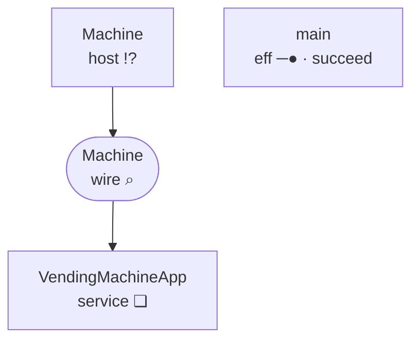
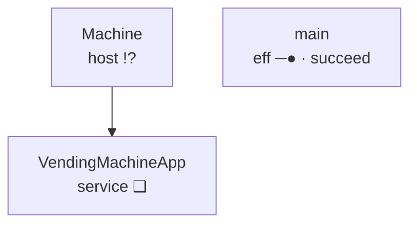
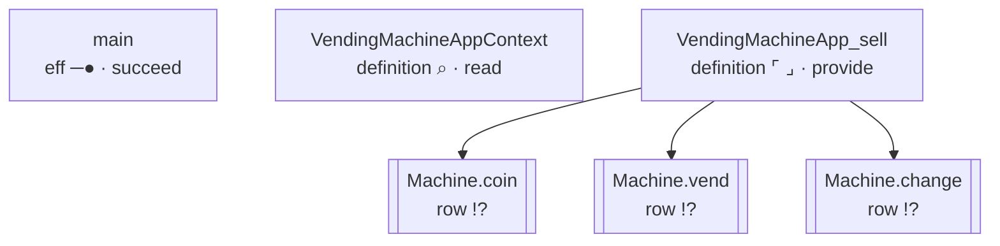

<!-- GENERATED by Compiler.Graphs; do not edit
lake exe effect4 inspect --what relations, the program vendingMachine
-->
# \`vendingMachine\` · relations

## Nodes

| address | in | sort | mark | word | names | constructor |
| --- | --- | --- | --- | --- | --- | --- |
|  | `block` block | eff | ❏ | define |  | defs |
| 0 | `defs` definitions | effs | · | cons |  | cons |
| 0.0 | `def:0` [VendingMachineAppContext](#calls:node:def:0) | eff | ⌕ | read |  | withFiber |
| 0.0.0 | `def:0` [VendingMachineAppContext](#calls:node:def:0) | action | ⌕ | read | key 34:6 | context |
| 0.1 | `defs` definitions | effs | · | cons |  | cons |
| 0.1.0 | `def:1` [VendingMachineApp_sell](#calls:node:def:1) | eff | ⌜ ⌟ | provide |  | provideContext |
| 0.1.0.0 | `def:1` [VendingMachineApp_sell](#calls:node:def:1) | eff | ─▶ | bind |  | bind |
| 0.1.0.0.0 | `def:1` [VendingMachineApp_sell](#calls:node:def:1) | eff | ─● | succeed |  | succeed |
| 0.1.0.0.1 | `def:1` [VendingMachineApp_sell](#calls:node:def:1) | eff | ─▶ | bind |  | bind |
| 0.1.0.0.1.0 | `def:1` [VendingMachineApp_sell](#calls:node:def:1) | eff | ─● | succeed |  | succeed |
| 0.1.0.0.1.1 | `def:1` [VendingMachineApp_sell](#calls:node:def:1) | eff | ─▶ | bind |  | bind |
| 0.1.0.0.1.1.0 | `def:1` [VendingMachineApp_sell](#calls:node:def:1) | eff | ↺ | iterate |  | iterate |
| 0.1.0.0.1.1.0.0 | `def:1` [VendingMachineApp_sell](#calls:node:def:1) | eff | !? | perform | row Machine.coin | perform |
| 0.1.0.0.1.1.1 | `def:1` [VendingMachineApp_sell](#calls:node:def:1) | eff | ─▶ | bind |  | bind |
| 0.1.0.0.1.1.1.0 | `def:1` [VendingMachineApp_sell](#calls:node:def:1) | eff | !? | perform | row Machine.vend | perform |
| 0.1.0.0.1.1.1.1 | `def:1` [VendingMachineApp_sell](#calls:node:def:1) | eff | ─▶ | bind |  | bind |
| 0.1.0.0.1.1.1.1.0 | `def:1` [VendingMachineApp_sell](#calls:node:def:1) | eff | !? | perform | row Machine.change | perform |
| 0.1.0.0.1.1.1.1.1 | `def:1` [VendingMachineApp_sell](#calls:node:def:1) | eff | ─● | succeed |  | succeed |
| 0.1.1 | `defs` definitions | effs | · | nil |  | nil |
| 1 | `main` [main](#calls:node:main) | eff | ─● | succeed |  | succeed |
| 2 | `layers` [layers](#calls:node:layers) | layers | · | nil |  | nil |

## Definitions

| k | name | role | body |
| --- | --- | --- | --- |
| 0 | VendingMachineAppContext | init of `VendingMachineApp` | 0.0 |
| 1 | VendingMachineApp_sell | method `sell` of `VendingMachineApp` | 0.1.0 |

## Rows

| i | spelling | namespace | request | answer |
| --- | --- | --- | --- | --- |
| 0 | Machine.coin | Machine | void | number |
| 1 | Machine.vend | Machine | string | string |
| 2 | Machine.change | Machine | number | void |

## Calls

| address | from | targetSort | target | targetAddress | origin |
| --- | --- | --- | --- | --- | --- |
| 0.1.0.0.1.1.0.0 | `def:1` [VendingMachineApp_sell](#calls:node:def:1) | row | `row:0` [Machine.coin](#calls:node:row:0) | 0 | 0.1.0.0.1.1.0.0 |
| 0.1.0.0.1.1.1.0 | `def:1` [VendingMachineApp_sell](#calls:node:def:1) | row | `row:1` [Machine.vend](#calls:node:row:1) | 1 | 0.1.0.0.1.1.1.0 |
| 0.1.0.0.1.1.1.1.0 | `def:1` [VendingMachineApp_sell](#calls:node:def:1) | row | `row:2` [Machine.change](#calls:node:row:2) | 2 | 0.1.0.0.1.1.1.1.0 |

## Handlers

| service | state | init | clauses | requires | forwards | rows |
| --- | --- | --- | --- | --- | --- | --- |
| VendingMachineApp | Context.Context\<"k34_6"\> | 0 | sell@1/2 | k34_6 |  | Machine.coin, Machine.vend, Machine.change |

boundary

boxes

calls

