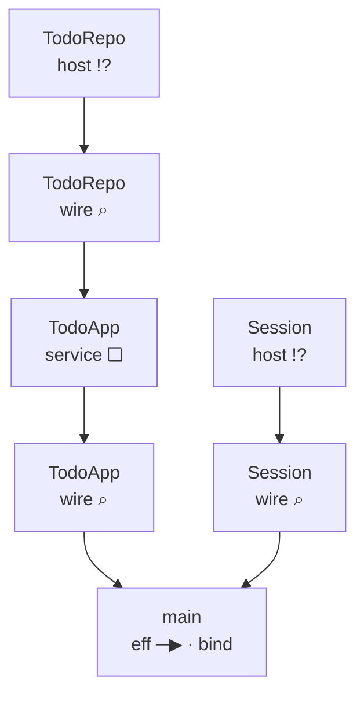
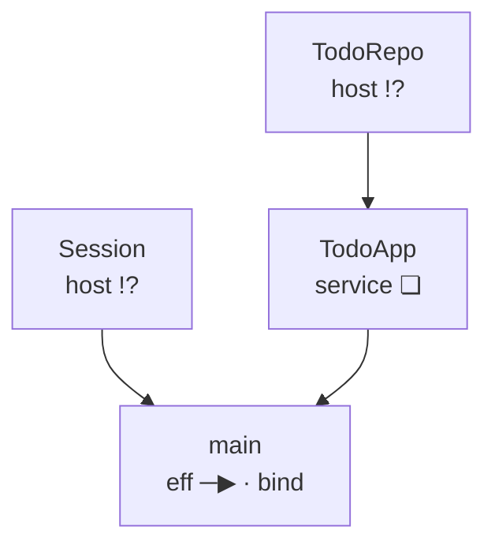
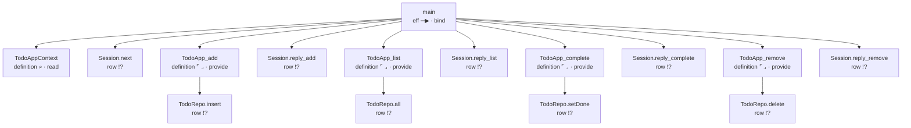

<!-- GENERATED by Compiler.Graphs; do not edit
python3 scripts/generate.py --only graphs
-->
# The program as relations and graphs

Node addresses name stored syntax. Call addresses name the checked expansion; origin names the stored call or reference.

## Nodes

| address | in | sort | mark | word | names | constructor |
| --- | --- | --- | --- | --- | --- | --- |
|  | `block` block | eff | ❏ | define |  | defs |
| 0 | `defs` definitions | effs | · | cons |  | cons |
| 0.0 | `def:0` TodoAppContext | eff | ⌕ | read |  | withFiber |
| 0.0.0 | `def:0` TodoAppContext | action | ⌕ | read |  | context |
| 0.1 | `defs` definitions | effs | · | cons |  | cons |
| 0.1.0 | `def:1` TodoApp_add | eff | ⌜ ⌟ | provide |  | provideContext |
| 0.1.0.0 | `def:1` TodoApp_add | eff | ─▶ | bind |  | bind |
| 0.1.0.0.0 | `def:1` TodoApp_add | eff | ─● | succeed |  | succeed |
| 0.1.0.0.1 | `def:1` TodoApp_add | eff | ⑂ | select |  | select |
| 0.1.0.0.1.0 | `def:1` TodoApp_add | eff | × | fail |  | fail |
| 0.1.0.0.1.1 | `def:1` TodoApp_add | eff | !? | perform | row TodoRepo.insert | perform |
| 0.1.1 | `defs` definitions | effs | · | cons |  | cons |
| 0.1.1.0 | `def:2` TodoApp_list | eff | ⌜ ⌟ | provide |  | provideContext |
| 0.1.1.0.0 | `def:2` TodoApp_list | eff | !? | perform | row TodoRepo.all | perform |
| 0.1.1.1 | `defs` definitions | effs | · | cons |  | cons |
| 0.1.1.1.0 | `def:3` TodoApp_complete | eff | ⌜ ⌟ | provide |  | provideContext |
| 0.1.1.1.0.0 | `def:3` TodoApp_complete | eff | ─▶ | bind |  | bind |
| 0.1.1.1.0.0.0 | `def:3` TodoApp_complete | eff | ─● | succeed |  | succeed |
| 0.1.1.1.0.0.1 | `def:3` TodoApp_complete | eff | ─▶ | bind |  | bind |
| 0.1.1.1.0.0.1.0 | `def:3` TodoApp_complete | eff | !? | perform | row TodoRepo.setDone | perform |
| 0.1.1.1.0.0.1.1 | `def:3` TodoApp_complete | eff | ⑂ | select |  | select |
| 0.1.1.1.0.0.1.1.0 | `def:3` TodoApp_complete | eff | × | fail |  | fail |
| 0.1.1.1.0.0.1.1.1 | `def:3` TodoApp_complete | eff | ─● | succeed |  | succeed |
| 0.1.1.1.1 | `defs` definitions | effs | · | cons |  | cons |
| 0.1.1.1.1.0 | `def:4` TodoApp_remove | eff | ⌜ ⌟ | provide |  | provideContext |
| 0.1.1.1.1.0.0 | `def:4` TodoApp_remove | eff | ─▶ | bind |  | bind |
| 0.1.1.1.1.0.0.0 | `def:4` TodoApp_remove | eff | ─● | succeed |  | succeed |
| 0.1.1.1.1.0.0.1 | `def:4` TodoApp_remove | eff | ─▶ | bind |  | bind |
| 0.1.1.1.1.0.0.1.0 | `def:4` TodoApp_remove | eff | !? | perform | row TodoRepo.delete | perform |
| 0.1.1.1.1.0.0.1.1 | `def:4` TodoApp_remove | eff | ⑂ | select |  | select |
| 0.1.1.1.1.0.0.1.1.0 | `def:4` TodoApp_remove | eff | ─● | succeed |  | succeed |
| 0.1.1.1.1.0.0.1.1.1 | `def:4` TodoApp_remove | eff | × | fail |  | fail |
| 0.1.1.1.1.1 | `defs` definitions | effs | · | nil |  | nil |
| 1 | `main` main | eff | ─▶ | bind |  | bind |
| 1.0 | `main` main | eff | !? | perform | call TodoAppContext | perform |
| 1.1 | `main` main | eff | ↺ | iterate |  | iterate |
| 1.1.0 | `main` main | eff | ─▶ | bind |  | bind |
| 1.1.0.0 | `main` main | eff | !? | perform | row Session.next | perform |
| 1.1.0.1 | `main` main | eff | ⑂ | select |  | select |
| 1.1.0.1.0 | `main` main | eff | ─● | succeed |  | succeed |
| 1.1.0.1.1 | `main` main | eff | ⑂ | select |  | select |
| 1.1.0.1.1.0 | `main` main | eff | ─▶ | bind |  | bind |
| 1.1.0.1.1.0.0 | `main` main | eff | ‖ | exit |  | exit |
| 1.1.0.1.1.0.0.0 | `main` main | eff | !? | perform | call TodoApp_add | perform |
| 1.1.0.1.1.0.1 | `main` main | eff | ─▶ | bind |  | bind |
| 1.1.0.1.1.0.1.0 | `main` main | eff | !? | perform | row Session.reply_add | perform |
| 1.1.0.1.1.0.1.1 | `main` main | eff | ─● | succeed |  | succeed |
| 1.1.0.1.1.1 | `main` main | eff | ⑂ | select |  | select |
| 1.1.0.1.1.1.0 | `main` main | eff | ─▶ | bind |  | bind |
| 1.1.0.1.1.1.0.0 | `main` main | eff | ‖ | exit |  | exit |
| 1.1.0.1.1.1.0.0.0 | `main` main | eff | !? | perform | call TodoApp_list | perform |
| 1.1.0.1.1.1.0.1 | `main` main | eff | ─▶ | bind |  | bind |
| 1.1.0.1.1.1.0.1.0 | `main` main | eff | !? | perform | row Session.reply_list | perform |
| 1.1.0.1.1.1.0.1.1 | `main` main | eff | ─● | succeed |  | succeed |
| 1.1.0.1.1.1.1 | `main` main | eff | ⑂ | select |  | select |
| 1.1.0.1.1.1.1.0 | `main` main | eff | ─▶ | bind |  | bind |
| 1.1.0.1.1.1.1.0.0 | `main` main | eff | ‖ | exit |  | exit |
| 1.1.0.1.1.1.1.0.0.0 | `main` main | eff | !? | perform | call TodoApp_complete | perform |
| 1.1.0.1.1.1.1.0.1 | `main` main | eff | ─▶ | bind |  | bind |
| 1.1.0.1.1.1.1.0.1.0 | `main` main | eff | !? | perform | row Session.reply_complete | perform |
| 1.1.0.1.1.1.1.0.1.1 | `main` main | eff | ─● | succeed |  | succeed |
| 1.1.0.1.1.1.1.1 | `main` main | eff | ⑂ | select |  | select |
| 1.1.0.1.1.1.1.1.0 | `main` main | eff | ─▶ | bind |  | bind |
| 1.1.0.1.1.1.1.1.0.0 | `main` main | eff | ‖ | exit |  | exit |
| 1.1.0.1.1.1.1.1.0.0.0 | `main` main | eff | !? | perform | call TodoApp_remove | perform |
| 1.1.0.1.1.1.1.1.0.1 | `main` main | eff | ─▶ | bind |  | bind |
| 1.1.0.1.1.1.1.1.0.1.0 | `main` main | eff | !? | perform | row Session.reply_remove | perform |
| 1.1.0.1.1.1.1.1.0.1.1 | `main` main | eff | ─● | succeed |  | succeed |
| 1.1.0.1.1.1.1.1.1 | `main` main | eff | ─● | succeed |  | succeed |
| 2 | `layers` layers | layers | · | nil |  | nil |

## Definitions

| k | name | role | body |
| --- | --- | --- | --- |
| 0 | TodoAppContext | init of `TodoApp` | 0.0 |
| 1 | TodoApp_add | method `add` of `TodoApp` | 0.1.0 |
| 2 | TodoApp_list | method `list` of `TodoApp` | 0.1.1.0 |
| 3 | TodoApp_complete | method `complete` of `TodoApp` | 0.1.1.1.0 |
| 4 | TodoApp_remove | method `remove` of `TodoApp` | 0.1.1.1.1.0 |

## Rows

| i | spelling | namespace | request | answer |
| --- | --- | --- | --- | --- |
| 0 | TodoRepo.insert | TodoRepo | string | { readonly done: boolean; readonly id: number; readonly title: string } |
| 1 | TodoRepo.all | TodoRepo | void | ReadonlyArray\<{ readonly done: boolean; readonly id: number; readonly title: string }\> |
| 2 | TodoRepo.setDone | TodoRepo | readonly \[number, boolean\] | Option.Option\<{ readonly done: boolean; readonly id: number; readonly title: string }\> |
| 3 | TodoRepo.delete | TodoRepo | number | boolean |
| 4 | Session.next | Session | void | Option.Option\<readonly \["add", string\] \| readonly \["list", void\] \| readonly \["remove", number\] \| readonly \["complete", number\]\> |
| 5 | Session.reply_add | Session | Exit.Exit\<{ readonly done: boolean; readonly id: number; readonly title: string }, readonly \["SqlError", string\] \| readonly \["EmptyTitle", "a title is required"\]\> | void |
| 6 | Session.reply_list | Session | Exit.Exit\<ReadonlyArray\<{ readonly done: boolean; readonly id: number; readonly title: string }\>, readonly \["SqlError", string\]\> | void |
| 7 | Session.reply_complete | Session | Exit.Exit\<{ readonly done: boolean; readonly id: number; readonly title: string }, readonly \["SqlError", string\] \| { readonly \_tag: "NotFound"; readonly id: number }\> | void |
| 8 | Session.reply_remove | Session | Exit.Exit\<void, readonly \["SqlError", string\] \| { readonly \_tag: "NotFound"; readonly id: number }\> | void |

## Calls

| address | from | targetSort | target | targetAddress | origin |
| --- | --- | --- | --- | --- | --- |
| 0.1.0.0.1.1 | `def:1` TodoApp_add | row | TodoRepo.insert | 0 | 0.1.0.0.1.1 |
| 0.1.1.0.0 | `def:2` TodoApp_list | row | TodoRepo.all | 1 | 0.1.1.0.0 |
| 0.1.1.1.0.0.1.0 | `def:3` TodoApp_complete | row | TodoRepo.setDone | 2 | 0.1.1.1.0.0.1.0 |
| 0.1.1.1.1.0.0.1.0 | `def:4` TodoApp_remove | row | TodoRepo.delete | 3 | 0.1.1.1.1.0.0.1.0 |
| 1.0 | `main` main | def | TodoAppContext | 0.0 | 1.0 |
| 1.1.0.0 | `main` main | row | Session.next | 4 | 1.1.0.0 |
| 1.1.0.1.1.0.0.0 | `main` main | def | TodoApp_add | 0.1.0 | 1.1.0.1.1.0.0.0 |
| 1.1.0.1.1.0.1.0 | `main` main | row | Session.reply_add | 5 | 1.1.0.1.1.0.1.0 |
| 1.1.0.1.1.1.0.0.0 | `main` main | def | TodoApp_list | 0.1.1.0 | 1.1.0.1.1.1.0.0.0 |
| 1.1.0.1.1.1.0.1.0 | `main` main | row | Session.reply_list | 6 | 1.1.0.1.1.1.0.1.0 |
| 1.1.0.1.1.1.1.0.0.0 | `main` main | def | TodoApp_complete | 0.1.1.1.0 | 1.1.0.1.1.1.1.0.0.0 |
| 1.1.0.1.1.1.1.0.1.0 | `main` main | row | Session.reply_complete | 7 | 1.1.0.1.1.1.1.0.1.0 |
| 1.1.0.1.1.1.1.1.0.0.0 | `main` main | def | TodoApp_remove | 0.1.1.1.1.0 | 1.1.0.1.1.1.1.1.0.0.0 |
| 1.1.0.1.1.1.1.1.0.1.0 | `main` main | row | Session.reply_remove | 8 | 1.1.0.1.1.1.1.1.0.1.0 |

## The program and its boundary

| ours | Effect TypeScript | algebra |
| --- | --- | --- |
| TodoRepo host namespace | Layer\<Tag\> supplied by the host | comodel of the row operation syntax signature |
| Session host namespace | Layer\<Tag\> supplied by the host | comodel of the row operation syntax signature |
| TodoApp service block | Layer.effect(Tag, map(init, closures)) | handler with one program per method |
| main | Effect.provide(program, layer) | term over the handled methods |
| host:TodoRepo to service:TodoApp | Layer.provide | provider-to-consumer incidence |
| service:TodoApp to main | Layer.provide | provider-to-consumer incidence |
| host:Session to main | Layer.provide | provider-to-consumer incidence |

Boundary incidence: shared service wires join providers to consumers; no execution order is claimed.

The boundary with each service wire contracted.

Calls from definitions and main to definitions and host rows.

This program has no stored layer constructors.

