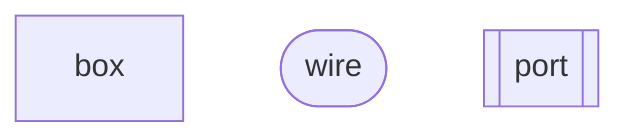

<!-- GENERATED by tools/Drivers/Reference.lean (make gen-reference); do not edit
inputs: tools/Tools/View/Glyph.lean, tools/Tools/Form.lean
-->
# marks

## Shape

| shape | glyph | kind | means | rows |
| --- | --- | --- | --- | --- |
| `box` | `[ ]` | `body` | an operation that runs once: a box with its word | 7 |
| `value` | `─●` | `body` | a value that leaves its box on the success wire | 4 |
| `series` | `─▶` | `wire` | one part wired into the next: sequence | 3 |
| `parallel` | `═` | `wire` | parts side by side, each its own wire: a merge | 2 |
| `block` | `▤` | `container` | a block of statements, read top to bottom | 1 |
| `alternative` | `⑂` | `wire` | alternatives side by side, one of them taken: a handler, a branch | 7 |
| `loop` | `↺` | `wire` | a wire that returns to an earlier point: a loop | 5 |
| `region` | `⌜ ⌟` | `container` | an enclosure that provides what its inside reads: a layer, a service, a context | 7 |
| `bracket` | `[ ]` | `container` | the bracket of a scope, \[k … k\]: closed, its span whole | 7 |
| `openBracket` | `[ ┄` | `container` | the open bracket \[ of a scope still open: a close owed | 4 |
| `rail` | `═══` | `container` | the double rail of an uninterruptible span: delivery blocked, never dropped | 4 |
| `arrow` | `──▶` | `bond` | a directed arrow from a parent's lane to a child's: a fork | 5 |
| `blockedArrow` | `⊣` | `force` | the blocked arrow ⊣: an interrupt, Talmy's Antagonist | 9 |
| `spider` | `◉` | `bond` | the spider: one completion fused to every waiter | 13 |
| `rest` | `┄` | `wire` | a rest: the fiber lets go of its turn | 4 |
| `hollowBox` | `□` | `vessel` | the hollow box with its token: a park, a queued task (promised) | 3 |
| `filledBox` | `■` | `vessel` | the filled box with the same token: a resume, a run task (kept) | 2 |
| `hollowDot` | `○` | `vessel` | the hollow dot: a promise not yet kept, a finalizer registered or a deferred unresolved | 5 |
| `filledDot` | `●` | `vessel` | the filled dot: a finalizer run (kept) | 2 |
| `port` | `!?` | `bond` | a port of the row protocol: !request then ?answer | 3 |
| `probe` | `⌕` | `body` | a read of the machine's own state | 7 |
| `call` | `⟦ ⟧` | `body` | a call of a named definition | 3 |
| `library` | `❏` | `container` | a block of named definitions | 1 |
| `cross` | `×` | `body` | the reason ×: a typed failure | 6 |
| `hash` | `#` | `body` | the reason #: a defect | 3 |
| `reasons` | `× ⊣` | `body` | a cause: its reasons in order on one line, × # ⊣ | 2 |
| `exitBar` | `‖` | `cadence` | the final bar ‖: an exit, the reasons after it | 6 |
| `hole` | `◌` | `vessel` | a hole: the place a frame's result returns to | 10 |
| `enter` | `▶` | `body` | the entry ▶: a fiber enters its loop | 1 |
| `barLine` | `│` | `cadence` | the bar line across every staff: a host's decision | 8 |
| `fermata` | `𝄐` | `cadence` | the fermata 𝄐: a frontier, held live | 6 |
| `caesura` | `//` | `cadence` | the caesura //: a halt on malformed code | 4 |
| `panel` | `{ }` | `container` | a record: a system of rows, the names once in a muted column at the left | 3 |
| `cells` | `[│]` | `container` | a list or a tuple: a lane read from its front, the elements left to right | 5 |
| `slot` | `⊔` | `vessel` | an option: a low shelf that holds a value or stands empty | 3 |
| `tag` | `#n` | `body` | a handle into the machine's stores: its numeral on a tag | 5 |
| `atom` | `1` | `body` | a value written as its literal: a number, a string, a truth value | 20 |

## Kind

| kind | means | enter | change | leave |
| --- | --- | --- | --- | --- |
| `body` | a thing with an identity that persists and moves: a value, an operation, a failure on its wire, a handle | grows from its centre | moves along a shallow arc and settles | docks in its target and fades |
| `vessel` | a form promised hollow and kept filled: a park, a task, a finalizer, a hole, a deferred, an option | its outline is drawn from its start edge | its fill comes in: the promise kept | fades |
| `container` | an enclosure that holds others, and some must close: a scope, a region, a rail, a record, a list | opens from its leading edge along the reading | grows about its anchor to hold what enters | closes toward its trailing edge |
| `wire` | a path that carries a value: a sequence, a loop, a branch, a rest | is drawn along its direction | carries; nothing moves on it | is taken in along its direction, from its tail |
| `bond` | a relation between bodies: a fork's arrow, a spider's legs, a port | grows from its source along its direction | a leg fills when its end arrives | fades when the relation ends |
| `force` | an impulse that arrives, is blocked or lands, and is spent: an interrupt | travels along its direction to its target | stops at a bar: a rail holds it, or it lands | fades as its reason is written |
| `cadence` | a mark in the reading's time that stands still: a bar line, an exit, a fermata, a caesura | is drawn from top to bottom | stands | recedes in tone as the cursor passes |

### body

- `[ ]` `box`
- `─●` `value`
- `⌕` `probe`
- `⟦ ⟧` `call`
- `×` `cross`
- `#` `hash`
- `× ⊣` `reasons`
- `▶` `enter`
- `#n` `tag`
- `1` `atom`

### vessel

- `□` `hollowBox`
- `■` `filledBox`
- `○` `hollowDot`
- `●` `filledDot`
- `◌` `hole`
- `⊔` `slot`

### container

- `▤` `block`
- `⌜ ⌟` `region`
- `[ ]` `bracket`
- `[ ┄` `openBracket`
- `═══` `rail`
- `❏` `library`
- `{ }` `panel`
- `[│]` `cells`

### wire

- `─▶` `series`
- `═` `parallel`
- `⑂` `alternative`
- `↺` `loop`
- `┄` `rest`

### bond

- `──▶` `arrow`
- `◉` `spider`
- `!?` `port`

### force

- `⊣` `blockedArrow`

### cadence

- `‖` `exitBar`
- `│` `barLine`
- `𝄐` `fermata`
- `//` `caesura`

## Glyph.table

| constructor | sort | shape | variant | word | means |
| --- | --- | --- | --- | --- | --- |
| `Eff.succeed` | program | `value` | — | succeed | a value leaves on the success wire |
| `Eff.fail` | program | `cross` | — | fail | a typed failure, the reason × |
| `Eff.failCause` | program | `cross` | cause | fail | a failure with a whole cause |
| `Eff.sync` | program | `box` | — | run | a synchronous step |
| `Eff.suspend` | program | `box` | lazy | suspend | a program built when it is reached |
| `Eff.perform` | program | `port` | — | perform | a row's request and its answer |
| `Eff.bind` | program | `series` | — | bind | the first part's value wired into the rest |
| `Eff.gen` | program | `block` | — | generate | a block of statements |
| `Eff.catchCause` | program | `alternative` | — | catch | a handler beside the failure wire |
| `Eff.matchCause` | program | `alternative` | both arms | match | one arm per exit, one taken |
| `Eff.onExit` | program | `hollowDot` | — | on exit | a program registered to run at the exit |
| `Eff.exit` | program | `exitBar` | — | exit | an exit taken as a program |
| `Eff.uninterruptible` | program | `rail` | — | mask | the span under the double rail |
| `Eff.interruptible` | program | `rail` | lifted | unmask | a span that interrupts may reach |
| `Eff.yieldNow` | program | `rest` | — | yield | the fiber gives up its turn |
| `Eff.awaitFiber` | program | `spider` | — | await | a leg of the fiber's exit |
| `Eff.withFiber` | program | `probe` | fiber | read | the current fiber, read |
| `Eff.scoped` | program | `bracket` | — | scope | a scope around its inside |
| `Eff.acquireRelease` | program | `bracket` | acquire and release | scope | an acquire, its use, its release at close |
| `Eff.provideLayer` | program | `region` | layer | provide | the services a layer builds, around the inside |
| `Eff.service` | program | `probe` | service | read | a service read from the context |
| `Eff.provideService` | program | `region` | service | provide | one service, around the inside |
| `Eff.catchIf` | program | `alternative` | if | catch | a handler for the failures a test admits |
| `Eff.select` | program | `alternative` | select | select | the arm a tag picks |
| `Eff.iterate` | program | `loop` | — | iterate | a body run while its test holds |
| `Eff.restore` | program | `rail` | restore | restore | the interruptibility saved at the mask's entry |
| `Eff.defs` | program | `library` | — | define | named definitions, then their body |
| `Eff.invoke` | program | `call` | — | invoke | a call of a named definition |
| `Eff.provideContext` | program | `region` | context | provide | a whole context, around the inside |
| `Stmt.bindYield` | statement | `series` | yield\* | bind | a statement's value bound to a name |
| `Stmt.yieldDiscard` | statement | `series` | discard | bind | a statement run for its effect |
| `Stmt.ret` | statement | `value` | return | succeed | the block's value |
| `Stmt.ifElse` | statement | `alternative` | if | branch | two arms, one taken |
| `Stmt.whileTrue` | statement | `loop` | while | loop | statements run while a test holds |
| `Stmt.breakLoop` | statement | `loop` | break | break | the way out of the loop |
| `ActionTerm.fork` | fiber action | `arrow` | — | fork | a child fiber; the parent continues |
| `ActionTerm.forkIn` | fiber action | `arrow` | in a scope | fork | a child whose life a scope holds |
| `ActionTerm.forkScoped` | fiber action | `arrow` | scoped | fork | a child in the current scope |
| `ActionTerm.runIn` | fiber action | `bracket` | run in | scope | a program run in a given scope |
| `ActionTerm.interrupt` | fiber action | `blockedArrow` | — | interrupt | an interrupt sent to a fiber |
| `ActionTerm.interruptScoped` | fiber action | `blockedArrow` | scoped | interrupt | an interrupt to a scope's fibers |
| `ActionTerm.interruptAll` | fiber action | `blockedArrow` | all | interrupt | an interrupt to every fiber given |
| `ActionTerm.awaitAll` | fiber action | `spider` | all | await | one leg per fiber, all exits |
| `ActionTerm.awaitAllFailFast` | fiber action | `spider` | all, fail fast | await | all exits, or the first failure |
| `ActionTerm.snapshotChildren` | fiber action | `probe` | children | read | the fiber's children, read |
| `ActionTerm.awaitNewChildren` | fiber action | `spider` | new children | await | the children forked since a snapshot |
| `ActionTerm.raceAll` | fiber action | `spider` | race | race | the first exit settles; the others take ⊣ |
| `ActionTerm.raceAllFirst` | fiber action | `spider` | race, first | race | the first exit of any kind settles |
| `ActionTerm.getId` | fiber action | `probe` | id | read | the fiber's identity, read |
| `ActionTerm.closeScope` | fiber action | `bracket` | close | close | a scope closed with an exit |
| `ActionTerm.getInterruptible` | fiber action | `probe` | interruptibility | read | the fiber's interruptibility, read |
| `ActionTerm.context` | fiber action | `probe` | context | read | the fiber's context, read |
| `LayerTerm.succeed` | layer | `value` | layer | succeed | a layer that holds a built service |
| `LayerTerm.effect` | layer | `box` | layer | run | a layer built by a program |
| `LayerTerm.effectDiscard` | layer | `box` | layer, discard | run | a program run for its effect when the layer builds |
| `LayerTerm.provide` | layer | `region` | layer | provide | a layer's services, around another layer |
| `LayerTerm.provideMerge` | layer | `region` | layer, merge | provide | provided and kept beside |
| `LayerTerm.merge` | layer | `parallel` | — | merge | two layers side by side |
| `LayerTerm.fresh` | layer | `box` | fresh | build | a layer built anew, not shared |
| `LayerTerm.orDie` | layer | `hash` | or die | die | a layer's failure made a defect |
| `LayerTerm.ref` | layer | `call` | layer | invoke | a named layer, shared |
| `LayerTerm.mergeAll` | layer | `parallel` | all | merge | many layers side by side |
| `CauseTerm.fail` | cause term | `cross` | — | fail | the reason × |
| `CauseTerm.die` | cause term | `hash` | — | die | the reason # |
| `CauseTerm.interrupt` | cause term | `blockedArrow` | — | interrupt | the reason ⊣ |
| `CauseTerm.both` | cause term | `reasons` | — | combine | two causes in order, one line of reasons |
| `Prim.success` | runtime code and frame | `value` | — | succeed | a value, compiled |
| `Prim.failure` | runtime code and frame | `cross` | cause | fail | a cause, compiled |
| `Prim.sync` | runtime code and frame | `box` | — | run | a synchronous step, compiled |
| `Prim.suspend` | runtime code and frame | `box` | lazy | suspend | a suspended program, compiled |
| `Prim.withFiber` | runtime code and frame | `probe` | fiber | read | the current fiber, read |
| `Prim.yieldableError` | runtime code and frame | `cross` | yieldable | fail | an error yielded as a program |
| `Prim.iterator` | runtime code and frame | `loop` | iterator | iterate | a generator's steps |
| `Prim.onSuccess` | runtime code and frame | `hole` | success | continue | the hole a success returns to |
| `Prim.onSuccessConst` | runtime code and frame | `hole` | success, constant | continue | a hole that ignores the value |
| `Prim.onFailure` | runtime code and frame | `hole` | failure | continue | the hole a failure returns to |
| `Prim.onSuccessAndFailure` | runtime code and frame | `hole` | both | continue | a hole for either exit |
| `Prim.exitFrame` | runtime code and frame | `hole` | exit | continue | the hole that takes the exit itself |
| `Prim.onExit` | runtime code and frame | `hollowDot` | frame | on exit | the frame that runs a program at the exit |
| `Prim.setInterruptible` | runtime code and frame | `rail` | boundary | mask | the frame that restores the saved flag |
| `Prim.whileLoop` | runtime code and frame | `loop` | while | loop | a loop, compiled |
| `Prim.yieldNowWith` | runtime code and frame | `rest` | — | yield | a yield, compiled |
| `Prim.async` | runtime code and frame | `hollowBox` | async | park | a park on a host registration |
| `Prim.asyncFinalizer` | runtime code and frame | `hollowDot` | async | cancel | the removal of a registration |
| `FrameEvent.popped` | frame event | `hole` | popped | pop | a hole filled: the frame popped |
| `FrameEvent.ranContAll` | frame event | `hole` | passed | pass | a frame passed on a failure's walk |
| `FrameEvent.pushed` | frame event | `hole` | pushed | push | a hole opened: the frame pushed |
| `FrameEvent.ranFinalizer` | frame event | `filledDot` | frame | finalize | a finalizer run from a frame |
| `FrameEvent.substituted` | frame event | `hole` | substituted | substitute | a frame replaced by its continuation |
| `FrameEvent.deferred` | frame event | `blockedArrow` | deferred | interrupt | a deferred interrupt delivered |
| `FrameEvent.yielded` | frame event | `rest` | yielded | yield | the fiber gave up its turn |
| `RunEvent.forked` | run event | `arrow` | event | fork | a child's birth |
| `RunEvent.started` | run event | `enter` | — | enter | a fiber enters its loop |
| `RunEvent.scheduledTask` | run event | `hollowBox` | task | queue | a task queued on a dispatcher |
| `RunEvent.ranTask` | run event | `filledBox` | task | dispatch | a queued task run |
| `RunEvent.yieldInjected` | run event | `rest` | injected | yield | a yield the machine adds |
| `RunEvent.parkedOn` | run event | `hollowBox` | — | park | a park on a token |
| `RunEvent.resumedWith` | run event | `filledBox` | — | resume | the resume on the same token |
| `RunEvent.interruptRecorded` | run event | `blockedArrow` | recorded | interrupt | an interrupt recorded on its target |
| `RunEvent.interruptDeferred` | run event | `blockedArrow` | deferred | interrupt | an interrupt held over the rail |
| `RunEvent.childrenInterrupted` | run event | `blockedArrow` | children | interrupt | a fiber's children interrupted |
| `RunEvent.observerFired` | run event | `spider` | observed | observe | an exit reaching one leg |
| `RunEvent.frame` | run event | `hole` | event | frame | a frame event on the fiber |
| `RunEvent.finalizerProgram` | run event | `filledDot` | program | finalize | a finalizer run against an exit |
| `RunEvent.scopeLinked` | run event | `bracket` | linked | link | a fiber linked to a scope as a finalizer |
| `RunEvent.scopeClosedOnLink` | run event | `bracket` | closed on link | close | a link to a scope already closed |
| `RunEvent.raceStarted` | run event | `spider` | started | race | a race begun |
| `RunEvent.raceLaunched` | run event | `arrow` | race entrant | fork | an entrant forked |
| `RunEvent.raceSettled` | run event | `spider` | settled | race | the race's first exit |
| `RunEvent.contextSet` | run event | `region` | context set | provide | a fiber's context replaced |
| `RunEvent.callback` | run event | `port` | callback | register | a callback registered |
| `RunEvent.exited` | run event | `exitBar` | — | exit | a fiber's exit, its reasons after it |
| `RunDecision.fire` | decision | `barLine` | drain | decide | the host drains one dispatcher |
| `RunDecision.flush` | decision | `barLine` | flush | decide | the host runs every armed dispatcher |
| `RunDecision.evaluate` | decision | `barLine` | evaluate | decide | the host runs one fiber |
| `RunDecision.yieldVerdict` | decision | `barLine` | verdict | decide | the host decides a yield |
| `RunDecision.answerAsync` | decision | `barLine` | answer | decide | the host answers a park |
| `RunDecision.interruptFrom` | decision | `barLine` | interrupt | decide | the host sends an interrupt |
| `RunDecision.installMiddleware` | decision | `barLine` | install | decide | the host installs middleware |
| `RunDecision.advance` | decision | `barLine` | advance | decide | the host advances the clock |
| `Observer.resumeAwait` | observer | `spider` | await | observe | a waiter resumed by the exit |
| `Observer.untrackChild` | observer | `spider` | untrack | observe | a parent letting go of its child |
| `Observer.dropScopeFinalizer` | observer | `hollowDot` | drop | unregister | a child's finalizer dropped from its scope |
| `Observer.countdown` | observer | `spider` | countdown | observe | one of n exits counted |
| `Observer.raceCallback` | observer | `spider` | race | observe | an entrant's exit reaching the race |
| `Observer.callback` | observer | `port` | callback | register | a callback keyed on an exit |
| `Reason.fail` | reason | `cross` | — | fail | the reason × |
| `Reason.die` | reason | `hash` | — | die | the reason # |
| `Reason.interrupt` | reason | `blockedArrow` | — | interrupt | the reason ⊣ and its interruptor |
| `Exit.success` | exit | `exitBar` | success | exit | ‖ and the value |
| `Exit.failure` | exit | `exitBar` | failure | exit | ‖ and the reasons, in order |
| `ScopeState.empty` | scope state | `openBracket` | empty | hold | a scope with nothing registered yet: its close owed |
| `ScopeState.openEmpty` | scope state | `openBracket` | none | hold | an open scope, no finalizer |
| `ScopeState.openInline` | scope state | `openBracket` | one | hold | an open scope, one finalizer |
| `ScopeState.openMap` | scope state | `openBracket` | many | hold | an open scope, finalizers by key |
| `ScopeState.closed` | scope state | `bracket` | closed | close | a closed scope, its span whole, its exit kept |
| `Outcome.finished` | outcome | `exitBar` | finished | finish | the run's final bar |
| `Outcome.frontier` | outcome | `fermata` | — | wait | the run held live |
| `Outcome.stuck` | outcome | `caesura` | — | halt | a halt, outside every typed state |
| `FrontierReason.commandFuel` | frontier | `fermata` | budget | wait | a command budget spent |
| `FrontierReason.compileFuel` | frontier | `fermata` | compile budget | wait | a compile budget spent |
| `FrontierReason.awaitHost` | frontier | `fermata` | host | wait | a host answer owed |
| `FrontierReason.awaitTimer` | frontier | `fermata` | timer | wait | a timer owed |
| `FrontierReason.awaitDecision` | frontier | `fermata` | decision | wait | a decision owed |
| `Stuck.unknownFiber` | halt | `caesura` | fiber | halt | a fiber no store holds |
| `Stuck.unknownScope` | halt | `caesura` | scope | halt | a scope no store holds |
| `Stuck.unknownRace` | halt | `caesura` | race | halt | a race no store holds |
| `Ty.never` | type | `atom` | never | never | no value: the type has none |
| `Ty.unit` | type | `atom` | unit | unit | the one value () |
| `Ty.nat` | type | `atom` | nat | number | a natural number, its numeral |
| `Ty.int` | type | `atom` | int | number | an integer, its numeral |
| `Ty.string` | type | `atom` | string | string | a string, quoted |
| `Ty.bool` | type | `atom` | bool | truth | true or false |
| `Ty.handle` | type | `tag` | named | handle | a handle of a named kind, its numeral |
| `Ty.option` | type | `slot` | — | option | a cup: the value, or empty |
| `Ty.list` | type | `cells` | — | list | a row of cells, the first at the left |
| `Ty.prod` | type | `cells` | pair | pair | two cells side by side |
| `Ty.except` | type | `alternative` | except | either | one of two arms, the one the value takes |
| `Ty.exitOf` | type | `exitBar` | type | exit | an exit: ‖ and its value or its reasons |
| `Ty.causeOf` | type | `reasons` | type | cause | a cause, its reasons in order |
| `Ty.fiberOf` | type | `tag` | fiber | handle | a fiber's handle, its numeral |
| `Ty.union` | type | `alternative` | union | either | one of its arms, the first that reads the value |
| `Ty.lit` | type | `atom` | literal | literal | the one value it names |
| `Ty.refOf` | type | `tag` | ref | handle | a reference cell's handle |
| `Ty.deferredOf` | type | `hollowDot` | deferred | promise | a deferred's handle, hollow while it is owed |
| `Ty.var` | type | `atom` | variable | variable | a type variable: the value drawn raw |
| `Ty.unknown` | type | `atom` | unknown | unknown | an unknown type: the value drawn raw |
| `Ty.record` | type | `panel` | — | record | a panel of named fields |
| `Ty.map` | type | `panel` | map | map | a panel of keys and their values |
| `Ty.tuple` | type | `cells` | tuple | tuple | cells side by side, by position |
| `Ty.app` | type | `call` | type | apply | a named type applied: the value drawn raw |
| `Ty.null` | type | `atom` | null | null | the value null |
| `Ty.undefined` | type | `atom` | undefined | undefined | the value undefined |
| `Ty.number` | type | `atom` | number | number | a number, its numeral |
| `Ty.bytes` | type | `atom` | bytes | bytes | bytes, by their count |
| `Ty.contextOf` | type | `region` | context type | context | a context: the value drawn raw |
| `Val.unit` | value | `atom` | unit | unit | the one value () |
| `Val.bool` | value | `atom` | bool | truth | true or false |
| `Val.nat` | value | `atom` | nat | number | a natural number |
| `Val.str` | value | `atom` | string | string | a string, quoted |
| `Val.bytes` | value | `atom` | bytes | bytes | bytes, by their count |
| `Val.list` | value | `cells` | — | list | a row of cells |
| `Val.pair` | value | `cells` | pair | pair | two cells side by side |
| `Val.none` | value | `slot` | empty | option | an empty cup |
| `Val.some` | value | `slot` | — | option | a cup that holds a value |
| `Val.ctor` | value | `panel` | constructor | construct | a constructor's index and its arguments |
| `Val.ref` | value | `tag` | node | address | a reference to a node |
| `Val.handle` | value | `tag` | — | handle | a handle into a store, its numeral |
| `Val.negInt` | value | `atom` | negative | number | a negative integer |
| `Val.float` | value | `atom` | float | number | a binary64 number |

## Form

Form

| form | mermaid |
| --- | --- |
| `box` | `["…"]` |
| `wire` | `(["…"])` |
| `port` | `[["…"]]` |

