<!-- GENERATED by tools/Drivers/Semantics.lean (make gen-semantics); do not edit
format: effect4-semantics-report v8
command: make gen-semantics
inputs: tools/ProofGraph/Registry.lean, tools/Tools/Semantics.lean, tools/Drivers/Semantics.lean, tools/Tools/SemanticsDisplay.lean, tools/Tools/SemanticsDocument.lean, tools/Tools/Document.lean, tools/Tools/Document/Json.lean, src/Effect4/Laws/Auto/Semantics.lean, Test/Counterexamples/REGISTER.md, docs/core/decisions.md, lean-toolchain
-->
# Semantics evidence

Effect4 makes 279 claims about Effect's runtime: 252 proved, 4 modulo, 18 goal, 1 refuted, 3 absent, 1 assumed.

A claim's evidence comes from its Lean declaration and is never written by hand (decisions row 203). `The open work` lists the planned goals that the remaining claims rest on, and why each waits.

Every witness uses no axiom beyond `propext` and `Quot.sound`, or the page is not written. That ceiling covers the evidence shown here, not the whole library. A claim's English is written by hand. A placement that a declaration inherits from its module is provisional.

A register record links a claim to a historical attack. Read the whole row: an early status word may stand beside a later repair.

## How to read a status

- proved: a theorem whose proof rests on no planned goal.
- modulo: a theorem proved from planned goals; it names the goals it rests on.
- goal: a planned goal (`proof_goal`), a statement whose proof is still `sorry`; a claim whose statement is one.
- open: a requirement with a node not yet proved, or a part not yet stated as a goal.
- refuted: a register record refutes the claim with a theorem.
- absent: no declaration states the claim yet; its row gives the reason.
- assumed: the claim is taken from an outside source, with its reason.
- missing: in the plan, a name that no node holds.

## Open work

The open part of the plan: 23 planned goals, and 5 theorems proved modulo them. A goal's docstring, written with its statement, says why its proof waits. A chain shows how a theorem reaches a goal. Each step is an edge of the plan, from a node to a node its proof reaches first.

### combine_deps

No docstring says why this goal waits.

Module: `Effect4.Laws.Program.CheckAgreement` · Claims: `checker-combine-deps`, `checker-ask-value` · Requirements: `R14`

```lean
∀ (i : Effect4.Program.Check.CheckInput),
  Eq
    (Effect4.Program.Check.Internal.combine i
      (List.map (fun d => Effect4.Program.Check.run d.input)
        (Effect4.Program.Check.Internal.deps i)))
    (Effect4.Program.Check.run i)
```

Proved modulo this goal (2), each by its shortest chain of nearest nodes:

- `ask_value` → `combine_deps`
- `open_coherent` → `ask_value` → `combine_deps`

### explain_replays

No docstring says why this goal waits.

Module: `Effect4.Laws.Program.CheckAgreement` · Claims: `checker-explanation-replays` · Requirements: `R14`

```lean
∀ (o : Effect4.Program.Check.Oracle) (input : Effect4.Program.Check.CheckInput)
  (explanation : Effect4.Program.Check.Explanation) (key : Effect4.Program.Check.CheckInput),
  Eq (Effect4.Program.Check.explain o input).value (Option.some explanation) →
    Eq explanation.part (Option.some key) →
      Effect4.Program.Check.ExplanationReplays input key explanation.refusal
```

### coherent

Placement: initial-algebras-folds; source-session-coherent's reachable-state obligation, R14. The sealed replay witnesses every accepted action history, including revert. Consumer: SourceSession.reached_view. This establishes no admission or progress claim.

Module: `Effect4.Laws.Program.SourceTable` · Claims: `source-document-coherent`, `source-session-coherent` · Requirements: `R14`

```lean
∀ (d : Effect4.Program.Doc), d.session.Coherent
```

Proved modulo this goal (1), each by its shortest chain of nearest nodes:

- `reached_view` → `coherent`

### commit_one_keepExact

A single kept edit retains both exact observations, including an initially refused root.

Module: `Effect4.Laws.Program.SourceDocument` · Claims: `source-document-local-keep` · Requirements: `R14`

```lean
∀ {o : Effect4.Program.Check.Oracle} {d next : Effect4.Program.Doc} {snap : Effect4.Program.Snap}
  {place : Effect4.Program.Place} {change : Effect4.Program.Change}
  {receipt : Effect4.Program.Receipt} {path : List Nat} {expected : Effect4.Program.NativeEff},
  d.session.Coherent →
    Ne path List.nil →
      Eq (Effect4.Program.Place.resolve d.session.app d.session.sketch place)
          (Except.ok { fst := path, snd := expected }) →
        Eq
            (Effect4.Program.Doc.step o d snap
                (Effect4.Program.DocAction.commit
                  (List.cons { fst := place, snd := change } List.nil)
                  Effect4.Program.FeedPolicy.keepExact)).value
            (Except.ok { fst := next, snd := receipt }) →
          And (Eq next.session.view.type d.session.view.type)
            (Eq (Effect4.Program.Table.typedAt next.session.table path)
              (Effect4.Program.Table.typedAt d.session.table path))
```

### commit_single_sound

The old single-edit observations, with the required initial positive-root premise.

Module: `Effect4.Laws.Program.SourceDocument` · Claims: `source-document-single-transport` · Requirements: `R14`

```lean
∀ {o : Effect4.Program.Check.Oracle} {d next : Effect4.Program.Doc} {snap : Effect4.Program.Snap}
  {path : List Nat} {expected : Effect4.Program.NativeEff} {change : Effect4.Program.Change}
  {policy : Effect4.Program.FeedPolicy} {receipt : Effect4.Program.Receipt},
  d.session.Coherent →
    Or (Eq policy Effect4.Program.FeedPolicy.keepExact)
        (Eq policy Effect4.Program.FeedPolicy.recheck) →
      (Eq policy Effect4.Program.FeedPolicy.keepExact →
          Exists fun T => Eq (d.session.sketch.sourceCheck d.session.app) (Except.ok T)) →
        Eq
            (Effect4.Program.Doc.step o d snap
                (Effect4.Program.DocAction.commit
                  (List.cons { fst := Effect4.Program.Place.at_ path expected, snd := change }
                    List.nil)
                  policy)).value
            (Except.ok { fst := next, snd := receipt }) →
          And (Eq snap d.snap)
            (And (Eq next.id d.id)
              (And (Eq next.revision (instHAdd.hAdd d.revision 1))
                (And next.session.Coherent
                  (And (Eq next.session.app d.session.app)
                    (And
                      (Exists fun e =>
                        And
                          (Eq (Effect4.Program.DocInternal.editOf d.session path change)
                            (Except.ok e))
                          (Eq (d.session.sketch.edit d.session.app e)
                            (Option.some next.session.sketch)))
                      (Exists fun T' =>
                        And (Eq (next.session.sketch.sourceCheck d.session.app) (Except.ok T'))
                          (Eq policy Effect4.Program.FeedPolicy.keepExact →
                            And (Eq (d.session.sketch.sourceCheck d.session.app) (Except.ok T'))
                              (Eq (Effect4.Program.Table.typedAt next.session.table path)
                                (Effect4.Program.Table.typedAt d.session.table path)))))))))
```

### commit_sound

Corrected old commit observation: keepExact needs an initially positive root.

Module: `Effect4.Laws.Program.SourceDocument` · Claims: `source-document-commit` · Requirements: `R14`

```lean
∀ {o : Effect4.Program.Check.Oracle} {d next : Effect4.Program.Doc} {snap : Effect4.Program.Snap}
  {items : List (Prod Effect4.Program.Place Effect4.Program.Change)}
  {policy : Effect4.Program.FeedPolicy} {receipt : Effect4.Program.Receipt},
  d.session.Coherent →
    Or (Eq policy Effect4.Program.FeedPolicy.keepExact)
        (Eq policy Effect4.Program.FeedPolicy.recheck) →
      (Eq policy Effect4.Program.FeedPolicy.keepExact →
          Exists fun T => Eq (d.session.sketch.sourceCheck d.session.app) (Except.ok T)) →
        Eq (Effect4.Program.Doc.step o d snap (Effect4.Program.DocAction.commit items policy)).value
            (Except.ok { fst := next, snd := receipt }) →
          And (Eq snap d.snap)
            (And (Eq next.origin d.origin)
              (And (Eq next.snap.revision (instHAdd.hAdd d.snap.revision 1))
                (And next.session.Coherent
                  (And (Eq next.session.app d.session.app)
                    (Exists fun T' =>
                      And (Eq (next.session.sketch.sourceCheck next.session.app) (Except.ok T'))
                        (Eq policy Effect4.Program.FeedPolicy.keepExact →
                          Eq (d.session.sketch.sourceCheck d.session.app) (Except.ok T')))))))
```

### revert_program

An entry's immediate revert restores its prior program and retains appended hole rows.

Module: `Effect4.Laws.Program.SourceDocument` · Claims: `source-document-revert` · Requirements: `R14`

```lean
∀ {o : Effect4.Program.Check.Oracle} {before after back : Effect4.Program.Doc}
  {snap : Effect4.Program.Snap} {action : Effect4.Program.DocAction}
  {receipt inverse : Effect4.Program.Receipt},
  before.session.Coherent →
    Eq (Effect4.Program.Doc.step o before snap action).value
        (Except.ok { fst := after, snd := receipt }) →
      Eq
          (Effect4.Program.Doc.step o after after.snap
              (Effect4.Program.DocAction.revert before.history.length)).value
          (Except.ok { fst := back, snd := inverse }) →
        And (Eq back.session.sketch.program before.session.sketch.program)
          (Eq back.session.sketch.holes after.session.sketch.holes)
```

### step_coherent

No docstring says why this goal waits.

Module: `Effect4.Laws.Program.SourceDocument` · Claims: `source-document-step` · Requirements: `R14`

```lean
∀ {o : Effect4.Program.Check.Oracle} {d next : Effect4.Program.Doc} {snap : Effect4.Program.Snap}
  {action : Effect4.Program.DocAction} {receipt : Effect4.Program.Receipt},
  d.session.Coherent →
    Eq (Effect4.Program.Doc.step o d snap action).value
        (Except.ok { fst := next, snd := receipt }) →
      And (Eq snap d.snap)
        (And (Eq next.origin d.origin)
          (And (Eq next.history (instHAppendOfAppend.hAppend d.history (List.cons action List.nil)))
            (And next.session.Coherent (Eq next.session.app d.session.app))))
```

### add_wf

No docstring says why this goal waits.

Module: `Effect4.Laws.Program.FillSet` · Claims: `pending-fill-construction` · Requirements: `R14`

```lean
∀ (o : Effect4.Program.Check.Oracle) (fs : Effect4.Program.FillSet)
  (submissions : List (Prod (List Nat) Effect4.Program.NativeEff)),
  (Effect4.Program.FillSet.add o fs submissions).value.fst.WellFormed
```

### publish_eq_materialize

No docstring says why this goal waits.

Module: `Effect4.Laws.Program.FillSet` · Claims: `pending-fill-publication` · Requirements: `R14`

```lean
∀ {o : Effect4.Program.Check.Oracle} {fs : Effect4.Program.FillSet} {d next : Effect4.Program.Doc}
  {action : Effect4.Program.DocAction} {receipt : Effect4.Program.Receipt}
  {T : Effect4.Program.EffTy},
  Eq fs.anchor d.snap →
    Eq fs.source d.session →
      d.session.Coherent →
        Eq (fs.base.sourceCheck fs.app) (Except.ok T) →
          Eq (Effect4.Program.Eff.refSites List.nil fs.base.program) List.nil →
            (∀ (x : Prod (List Nat) Effect4.Program.NativeEff),
                List.instMembership.mem fs.entries x →
                  Eq (Effect4.Program.Eff.refSites List.nil x.snd) List.nil) →
              Eq fs.publication (Except.ok action) →
                Eq (Effect4.Program.Doc.step o d fs.anchor action).value
                    (Except.ok { fst := next, snd := receipt }) →
                  Eq (Effect4.Program.FillReference.materialize fs.app fs.base fs.entries)
                    (Except.ok next.session.sketch)
```

### once_placed_outside_census

Control-source uniqueness outside the source census (planned goal). The part of `once_placed_pushes_once` that the source-use budget does not reach: a once-placed source in a program with a generator, statements, a layer, a definition, an invocation, a call or a program parameter, a parallel scope, an authored race, or with the source in a finalizer child or loop body. Placement: concept `scope-lifetime-finalization`, R11, a step of the claim `once-placed-finalizer`. Reach: every row table, compile budget and raw native decision prefix. Route: extend the source ownership `SourceScope.ConfigurationAt` beyond the direct fragment, then debit races, parallel closes and finalizer-child sources. It establishes no progress or log-writer provenance. Consumer: `once_placed_pushes_once`.

Module: `Effect4.Laws.Program.FinalizerRun` · Claims: `once-placed-finalizer` · Requirements: `R11`

```lean
∀ (p : Effect4.Program.NativeEff) (table : Effect4.Program.RowTable) (cf : Nat)
  (m : Effect4.Program.NativeMachine) (q : List Nat),
  Eq (Effect4.Program.OncePlaced (Effect4.Program.Node.eff p) q) Bool.true →
    Not (Effect4.Program.FinalizerRun.Census p q) →
      Effect4.Program.Guard.Reachable p table cf m →
        instLENat.le
          (List.countP (Effect4.Program.FinalizerRun.registeredAt q)
            (m.trace
              (Effect4.Prim Effect4.Program.EffName Effect4.Program.EffThunk Effect4.Machine.Val
                Effect4.Machine.Err Effect4.Machine.Defect Effect4.FiberId Effect4.Machine.Ann)
              (Effect4.FrameFiber Effect4.Program.EffName Effect4.Program.EffThunk
                Effect4.Machine.Val Effect4.Machine.Err Effect4.Machine.Defect Effect4.FiberId
                Effect4.Machine.Ann)
              (Effect4.FrameEvent Effect4.Program.EffName Effect4.Program.EffThunk
                Effect4.Machine.Val Effect4.Machine.Err Effect4.Machine.Defect Effect4.FiberId
                Effect4.Machine.Ann)))
          1
```

Proved modulo this goal (1), each by its shortest chain of nearest nodes:

- `once_placed_pushes_once` → `once_placed_outside_census`

### feed_coherent

No docstring says why this goal waits.

Module: `Effect4.Laws.Program.SourceTable` · Claims: `source-feed-coherent` · Requirements: `R14`

```lean
∀ {o : Effect4.Program.Check.Oracle} {policy : Effect4.Program.FeedPolicy}
  {s next : Effect4.Program.SourceSession} {e : Effect4.Program.Edit}
  {step : Effect4.Program.Edit.Step},
  s.Coherent →
    Eq (Effect4.Program.SourceSession.feed o policy s e).value
        (Except.ok { fst := next, snd := step }) →
      next.Coherent
```

### feed_draft

Exact old feedStep observations through the existing expansion edit engine. The expression uses EditSession.feed as its reference; it defines no second edit interpreter. Reach: coherent source sessions, every edit, and certified oracles. Consumer: replay_drafts_view and transport of source-session-coherent. R14.

Module: `Effect4.Laws.Program.SourceTable` · Claims: `source-feed-draft` · Requirements: `R14`

```lean
∀ (o : Effect4.Program.Check.Oracle) (s : Effect4.Program.SourceSession),
  s.Coherent →
    ∀ (e : Effect4.Program.Edit),
      Exists fun next =>
        Exists fun step =>
          And
            (Eq (Effect4.Program.SourceSession.feed o Effect4.Program.FeedPolicy.draft s e).value
              (Except.ok { fst := next, snd := step }))
            (And (Eq step.edit e)
              (And
                (Eq step.replaced
                  (Effect4.Program.SourceSession.feed_draft.match_1
                    (fun x => Option Effect4.Program.NativeEff)
                    ((Effect4.Program.Node.eff s.sketch.program).at_ e.path)
                    (fun old => Option.some old) fun x => Option.none))
                (Effect4.Program.SourceSession.feed_draft.match_5 (fun x => Prop)
                  (s.sketch.edit s.app e)
                  (fun _ => And (Eq next s) (Eq step.delta Effect4.Program.Edit.Delta.unchanged))
                  fun candidate =>
                  And (Eq next.app s.app)
                    (And (Eq next.sketch candidate)
                      (have expanded := Effect4.Program.EditSession.open s.app s.sketch.expand;
                      have reference :=
                        Effect4.Program.SourceSession.feed_draft.match_7
                          (fun x => Prod Effect4.Program.EditSession Effect4.Program.Edit.Delta)
                          (Effect4.Program.Edit.expanded candidate.expand e)
                          (fun edit =>
                            ite (Eq (s.expandedEditAgrees candidate e) Bool.true)
                              (expanded.feed edit)
                              { fst := Effect4.Program.EditSession.open s.app candidate.expand,
                                snd := Effect4.Program.Edit.Delta.rechecked })
                          fun _ =>
                          { fst := Effect4.Program.EditSession.open s.app candidate.expand,
                            snd := Effect4.Program.Edit.Delta.rechecked };
                      And
                        (Eq next.table
                          (Effect4.Program.Table.atSource candidate.sites
                            (Effect4.Program.Eff.firstRefFault candidate.program)
                            reference.fst.table))
                        (Eq step.delta
                          (Effect4.Program.Edit.Delta.atSource candidate.sites reference.snd)))))))
```

### feed_keepExact

No docstring says why this goal waits.

Module: `Effect4.Laws.Program.SourceTable` · Claims: `source-feed-keep-exact` · Requirements: `R14`

```lean
∀ {o : Effect4.Program.Check.Oracle} {s next : Effect4.Program.SourceSession}
  {e : Effect4.Program.Edit} {step : Effect4.Program.Edit.Step},
  s.Coherent →
    Ne e.path List.nil →
      Eq (Effect4.Program.SourceSession.feed o Effect4.Program.FeedPolicy.keepExact s e).value
          (Except.ok { fst := next, snd := step }) →
        And (Eq next.view.type s.view.type)
          (And
            (Eq (Effect4.Program.Table.typedAt next.table e.path)
              (Effect4.Program.Table.typedAt s.table e.path))
            (And
              (Eq (s.expandedEditAgrees next.sketch e) Bool.true →
                Eq step.delta (Effect4.Program.Edit.Delta.spliced (List.cons e.path List.nil)))
              (Eq (s.expandedEditAgrees next.sketch e) Bool.false →
                Eq step.delta Effect4.Program.Edit.Delta.rechecked)))
```

### feed_keeps

No docstring says why this goal waits.

Module: `Effect4.Laws.Program.SourceTable` · Claims: `source-feed-edit` · Requirements: `R14`

```lean
∀ {o : Effect4.Program.Check.Oracle} {policy : Effect4.Program.FeedPolicy}
  {s next : Effect4.Program.SourceSession} {e : Effect4.Program.Edit}
  {step : Effect4.Program.Edit.Step},
  Eq (Effect4.Program.SourceSession.feed o policy s e).value
      (Except.ok { fst := next, snd := step }) →
    And (Eq next.app s.app)
      (And (Eq step.edit e)
        (And (Eq (s.sketch.edit s.app e) Option.none → Eq next s)
          (∀ (candidate : Effect4.Program.Sketch),
            Eq (s.sketch.edit s.app e) (Option.some candidate) → Eq next.sketch candidate)))
```

### feed_root

The root feed is exactly the module recheck route, including its actual part trace.

Module: `Effect4.Laws.Program.SourceTable` · Claims: `source-feed-root` · Requirements: `R14`

```lean
∀ (o : Effect4.Program.Check.Oracle) (policy : Effect4.Program.FeedPolicy)
  (s : Effect4.Program.SourceSession) (e : Effect4.Program.Edit)
  (candidate : Effect4.Program.Sketch),
  Eq e.path List.nil →
    Eq (s.sketch.edit s.app e) (Option.some candidate) →
      Eq (Effect4.Program.SourceSession.feed o policy s e)
        (Effect4.Program.SourceSession.recheck o policy s candidate e s.sketch.program)
```

### feed_undo

No docstring says why this goal waits.

Module: `Effect4.Laws.Program.SourceTable` · Claims: `source-session-undo` · Requirements: `R14`

```lean
∀ {o : Effect4.Program.Check.Oracle} {s next : Effect4.Program.SourceSession} {a : List Nat}
  {q old : Effect4.Program.NativeEff} {candidate : Effect4.Program.Sketch}
  {step : Effect4.Program.Edit.Step},
  s.Coherent →
    Eq ((Effect4.Program.Node.eff s.sketch.program).at_ a)
        (Option.some (Effect4.Program.Node.eff old)) →
      Eq (s.sketch.fillAt a q) (Option.some candidate) →
        Eq
            (Effect4.Program.SourceSession.feed o Effect4.Program.FeedPolicy.draft s
                (Effect4.Program.Edit.fill a q)).value
            (Except.ok { fst := next, snd := step }) →
          Exists fun back =>
            Eq
              (Effect4.Program.SourceSession.feed o Effect4.Program.FeedPolicy.draft next
                  (Effect4.Program.Edit.fill a old)).value
              (Except.ok { fst := s, snd := back })
```

### replay_drafts_view

The old draft-list reach, stated through the sole document replay. Placement: source-session-coherent, initial-algebras-folds, R14. This retains every old application, initial sketch, and edit list without a coherence premise. Consumer: the draft case of Doc.coherent and transport of the old reached_view observation. It establishes no admission, progress, or native behavior.

Module: `Effect4.Laws.Program.SourceTable` · Claims: `source-session-draft-transport` · Requirements: `R14`

```lean
∀ (app : Effect4.Program.SigApp) (initial : Effect4.Program.Sketch)
  (edits : List Effect4.Program.Edit) (id : Effect4.Program.DocId),
  Exists fun session =>
    And
      (Eq
        (Effect4.Program.replayDoc { id := id, app := app, sketch := initial }
          (List.map Effect4.Program.DocAction.draft edits))
        (Except.ok session))
      (And (Eq session.app app)
        (And (Eq session.sketch (List.foldl (fun s e => (s.edit app e).getD s) initial edits))
          (And (Eq session.view.table (session.sketch.sourceTable app))
            (And (Eq session.view.refusals (session.sketch.sourceRefusals app))
              (Eq session.view.type (session.sketch.sourceCheck app).toOption)))))
```

### kept_eq_certified

No docstring says why this goal waits.

Module: `Effect4.Laws.Program.FillSet` · Claims: `kept-fill-reference` · Requirements: `R14`

```lean
∀ (s : Effect4.Program.SourceSession),
  s.Coherent →
    ∀ (p : List Nat) (q : Effect4.Program.NativeEff),
      Ne p List.nil →
        Eq (Effect4.Program.Eff.refSites List.nil s.sketch.program) List.nil →
          Eq (Effect4.Program.Eff.refSites List.nil q) List.nil →
            Iff (Effect4.Program.FeedCertified s { fst := p, snd := q })
              (Eq (Effect4.Program.FillReference.certifiedB s.sketch s.app p q) Bool.true)
```

### ofProgram_approx

A larger budget only extends the tree: the loop budget and the definitions' depth both grow, and each arm is monotone in both, for every program.

Module: `Effect4.Laws.Run.Tree` · Claims: — · Requirements: `R12`

```lean
∀ (table : Effect4.Program.RowTable) {k k' : Nat},
  instLENat.le k k' →
    ∀ (program : Effect4.Program.NativeEff),
      (Effect4.Run.Tree.ofProgram table k program).Approx
        (Effect4.Run.Tree.ofProgram table k' program)
```

### ofProgram_eq_denoteRowsB

Where Lean has a tree, this is it: on `Budget.v`'s fragment, the tree is `denoteRowsB`'s, node for node. A planned goal: a proof over Lean's code needs `denoteRowsB` printed too.

Module: `Effect4.Laws.Run.Tree` · Claims: — · Requirements: `R6`

```lean
∀ (table : Effect4.Program.RowTable) (k : Nat) (program : Effect4.Program.NativeEff),
  Eq (Effect4.Run.Tree.Plain program) Bool.true →
    Eq (Effect4.Run.Tree.ofProgram table k program)
      (Effect4.Run.Tree.ofRows (Effect4.Program.Denote.denoteRowsB table k program List.nil))
```

### rows_divergence_adequate

Divergence adequacy at the driver, on loops (planned goal): a program whose driven run, at every budget, neither exits nor waits on a call has a diverging chain under the reactor. Placement: concept `host-session-protocol`, the proposed claim `rows-divergence-adequate`, role adequacy; requirement R12, the system map's open part "divergence is witnessed by compatible finite prefixes". Reach: the row fragment with loops, a reactor inside the envelope that answers with exits, a fixed round count. Route: at a budget `k`, case on the chain's run under the reactor host. A cut is the goal. A finish or a wait needs a session budget at which the drive is funded and at rest; that is the open claim `embedded-budget-sufficient`. Then `runWith_finishes`'s converse direction (H9 on loops) gives an exit, and `frontier_waits` a wait, against the premise. It establishes no progress and no fairness. Consumer: R12's divergence adequacy, with `runWith_exit_of_diverges` its other direction.

Module: `Effect4.Laws.Run.Outcome` · Claims: — · Requirements: `R12`

```lean
∀ (σ : Type) (b : Effect4.Api.Built) (r : Effect4.Run.Reactor σ) (st : σ) (id : String)
  (rounds : Nat),
  r.Envelops b.app →
    r.ExitsOnly →
      Eq (Effect4.Program.Denote.LoopedRows b.program) Bool.true →
        Eq (Effect4.Program.Denote.LoopedDataRows b.table b.program) Bool.true →
          (∀ (budget : Effect4.Api.Budget),
              And (Eq (Effect4.Run.runWith b r st id budget rounds).fst.exit Option.none)
                (Eq
                  (Effect4.Program.awaits (Effect4.Run.runWith b r st id budget rounds).fst.machine)
                  List.nil)) →
            (Effect4.Program.effChain b.table b.program List.nil).Diverges
              (Effect4.Program.Denote.rowsHost (Effect4.Run.reactorHost b.table r))
              { fst := Effect4.Machine.Stores.empty, snd := st }
```

### ofJson_image

The reader inverts the writer at some bound. Placement: concept `exact-codecs`, R3, the claim `document-json-complete`. Route: induction over the representation family through the generated fold; at each node the tag step is `RepresentationTag.ofTagName_tagName` (or `CheckTag`'s), and each field lookup reads the sorted entries `normJ` writes (`sortE_perm`; a node's fixed keys are distinct). Consumer: `ofJson_complete`.

Module: `Effect4.Laws.Schema.DocumentJson` · Claims: `document-json-complete` · Requirements: `R3`

```lean
∀ (r : Effect4.Representation),
  Exists fun fuel =>
    Exists fun r' =>
      And
        (Eq
          (Effect4.Schema.DocumentJson.readRepresentation fuel
            (Effect4.Schema.Codec.normJ r.toJson))
          (Except.ok r'))
        (Eq (Effect4.Schema.Codec.normJ r'.toJson) (Effect4.Schema.Codec.normJ r.toJson))
```

Proved modulo this goal (1), each by its shortest chain of nearest nodes:

- `ofJson_complete` → `ofJson_image`

## Store Typing

World-indexed semantic value membership (Fits) and store typings. 31 claims: 30 proved, 1 absent.

| Claim | Role | Status | Evidence |
| --- | --- | --- | --- |
| `fits-mono` | monotonicity | proved | `Effect4.Program.Typed.fits_mono` |
| `fits-subn` | preservation | proved | `Effect4.Program.Typed.fits_subN` |
| `fits-normalize` | compatibility | proved | `Effect4.Program.Typed.fits_normalize` |
| `fits-scope-inv` | inversion | proved | `Effect4.Program.Typed.fits_scope_inv` |
| `term-maps-mono` | monotonicity | proved | `Effect4.Program.Typed.TermMaps.mono` |
| `term-typed-maps` | fundamentalProperty | proved | `Effect4.Program.Typed.termMaps_of_typed` |
| `fold-typed-atomic-update` | compatibility | proved | `Effect4.Program.Typed.fold_typed_atomic_update` |
| `handle-identity-laws` | canonicalForms | proved | `Effect4.Program.Typed.handle_identity_laws` |
| `saved-mask-image-membership` | canonicalForms | proved | `Effect4.Program.Typed.saved_mask_image_membership` |
| `modeled-membership` | compatibility | proved | `Effect4.Schema.Model.member` |
| `step-language-typed` | compatibility | proved | `Effect4.Modules.Step.typed` |
| `recursive-types-decided` | decidability | proved | `Effect4.Program.hasTyIn_iff` |
| `recursive-types-unfold` | inversion | proved | `Effect4.Program.memberIn_unfold_iff` |
| `recursive-types-conservative` | compatibility | proved | `Effect4.Program.tyDecls_conservative` |
| `recursive-types-sub` | preservation | proved | `Effect4.Program.memberIn_sub` |
| `recursive-types-inhabited` | decidability | proved | `Effect4.Program.inhabited_iff_memberIn` |
| `recursive-types-normalize` | compatibility | proved | `Effect4.Program.memberIn_normalize` |
| `guarded-fixed-point-unique` | compatibility | proved | `Effect4.Program.guarded_fixedPoint_unique` |
| `tydecls-expansion` | compatibility | proved | `Effect4.Program.memberIn_iff_expand` |
| `modeled-name` | compatibility | proved | `Effect4.Schema.Modeled.memberIn_ref` |
| `store-safety` | progress | absent | Machine safety is established by inductive configuration typing rather than operational progress (decisions row 139) |
| `semaphore-profile-closed` | preservation | proved | `Effect4.Semaphore.Model.profile_closed` |
| `waiting-wrapper-typed` | compatibility | proved | `Effect4.Modules.waitRetryAt_answers` |
| `protected-form-typed` | compatibility | proved | `Effect4.Modules.protectedBy_has` |
| `pool-use-typed` | compatibility | proved | `Effect4.Pool.use_types` |
| `pool-make-typed` | compatibility | proved | `Effect4.Pool.make_types` |
| `pool-close-typed` | compatibility | proved | `Effect4.Pool.close_answers` |
| `pool-profile-closed` | preservation | proved | `Effect4.Pool.Model.profile_closed` |
| `pool-lease-enrols` | inversion | proved | `Effect4.Pool.Model.lease_enrols_iff` |
| `stream-source-declarations` | compatibility | proved | `Effect4.Stream.Source.fromDefinitions_declarations` |
| `answer-flow-history` | preservation | proved | `Effect4.Program.PlaceFunding.NativeFlow.history` |

### fits-mono

Membership is monotone under host world order

Membership is monotone under the host world order.

Module: `Effect4.Laws.Program.Typed.Membership` · Literature: TAPL, §13.5, pp. 165–169 (proofTechnique) · Literature: Ahmed2004, audit P1 (adaptedResult)

```lean
∀ {w w' : Effect4.Program.Typed.World},
  w.leHost w' →
    ∀ {ty : Effect4.Program.Ty} {v : Effect4.Machine.Val},
      Effect4.Program.Typed.Fits w v ty → Effect4.Program.Typed.Fits w' v ty
```

### fits-subn

Membership is closed under the checker's subtyping order

Membership is closed under the checker's order.

Module: `Effect4.Laws.Program.Typed.Membership` · Literature: TAPL, §15.1, p. 181 (definitionUsed)

```lean
∀ (w : Effect4.Program.Typed.World) {a b : Effect4.Program.Ty},
  Eq (a.subN b) Bool.true →
    ∀ (v : Effect4.Machine.Val), Effect4.Program.Typed.Fits w v a → Effect4.Program.Typed.Fits w v b
```

### fits-normalize

Membership is invariant under type normalization

Membership is invariant under normalization (row 137; `E4-TYPED-CE-009`'s repair).

Module: `Effect4.Laws.Program.Typed.Membership` · Literature: Castagna2024, audit P6 (adaptedResult)

```lean
∀ (w : Effect4.Program.Typed.World) (t : Effect4.Program.Ty) (v : Effect4.Machine.Val),
  Iff (Effect4.Program.Typed.Fits w v t.normalize) (Effect4.Program.Typed.Fits w v t)
```

### fits-scope-inv

A member of Ty.scope is a present scope's handle

A member of `Ty.scope` is a present scope's handle (row 156): the handle former's scope arm reads the scope store, and no other arm accepts the scope target. The posts that answer a scope handle state `Fits w' ans Ty.scope`; their consumers read the scope back here.

Module: `Effect4.Laws.Program.Typed.Membership` · Literature: ATTAPL, ch. 3, pp. 87–136 (analogy)

```lean
∀ {w : Effect4.Program.Typed.World} {v : Effect4.Machine.Val},
  Effect4.Program.Typed.Fits w v Effect4.Program.Ty.scope →
    Exists fun sc =>
      And (Eq v (Effect4.Machine.Val.scopeHandle sc)) (Effect4.Program.Typed.ScopeLive w sc)
```

### term-maps-mono

A binder term's map between member types is monotone under host world order

The term relation is closed under later worlds, by the order's transitivity: what `storePre_mono` needs of a read-modify-write row. Quantifying over later worlds is what closes it; a statement at one world is not closed (the control `termMaps_oneWorld_not_mono` of the retired battery `git:68856e778:Test/Program/ProtocolPosts.lean`).

Module: `Effect4.Laws.Program.Typed.Residual` · Literature: Ahmed2004, audit P1 (adaptedResult)

```lean
∀ {w w' : Effect4.Program.Typed.World} {f : Effect4.Program.Term} {env : List Effect4.Machine.Val}
  {A R : Effect4.Program.Ty},
  w.leHost w' →
    Effect4.Program.Typed.TermMaps w f env A R → Effect4.Program.Typed.TermMaps w' f env A R
```

### term-typed-maps

A binder term the term typer admits at the node's environment and the cell's type maps that type into its own type at every later world, over an environment that fits (the state plan's T3b)

A typed binder term maps its parameter into its type, at every later world (the claim `term-typed-maps`): a term the checker types at `tys ++ [A]` with type `R`, over an environment that fits `tys`, runs at `env ++ [a]` for every member `a` of `A` to a member of `R`. It is the term relation's fundamental property for the term typer (`TermMaps`, `Typed/Residual.lean`): the environment stays typed at every later world (`envTyped_mono`), the current value extends it (`envTyped_append`), and a typed term over fitting values evaluates into its type (`evalTerm_progress`). Under any signature whose atoms are the native table's. Its consumer is `syncRow_typed`, which discharges a read-modify-write row's pre from the term's typing. It says nothing of a term the checker refuses.

Module: `Effect4.Laws.Program.Typed.Denotation.Terms` · Literature: Ahmed2004, audit P1 (adaptedResult)

```lean
∀ {sig : Effect4.Program.Signature Effect4.Program.NativeOp},
  Eq sig.atomOf Effect4.Program.nativeAtomTy →
    ∀ {w : Effect4.Program.Typed.World},
      sig.types.Within w.types →
        ∀ {tys : Effect4.Program.TyEnv} {env : List Effect4.Machine.Val},
          Effect4.Program.Typed.EnvTyped w tys env →
            ∀ {f : Effect4.Program.Term} {A R : Effect4.Program.Ty},
              Eq
                  (Effect4.Program.termTy sig
                    (instHAppendOfAppend.hAppend tys (List.cons A List.nil)) f)
                  (Option.some R) →
                Effect4.Program.Typed.TermMaps w f env A R
```

### fold-typed-atomic-update

The list fold with two binders, the accumulator and the element: its scope, evaluation, failure, weakening and typing rules; a fold the checker types answers a member of its type over values that fit, in a fixed world; a term reads back from its printed image; one Ref.modify whose term the checker types is one store step that answers B and stores A (decisions row 228)

The list fold's rules hold (the claim `fold-typed-atomic-update`), at every signature. Each field is one theorem: the two definitional equations, the builder's scope law (`Authoring.fold_scoped`), `foldlM_refuses`, `evalTerm_weaken`, `termTy_weaken`, `termTy_fold_invIn`, `fold_fits`, the fold's cases of `evalTerm_progress` and of `evalTerm_fitsAll`, `refModify_typed_step`, and the fold's cases of `readTerm_printTerm` and `readTerm_exact`.

It establishes nothing about a module that uses the fold and no agreement with a target. Its consumer is the Queue's service pass (decisions row 228), on the M5 and M6 path through `syncRow_typed`.

Module: `Effect4.Laws.Program.Typed.ListFold` · Literature: Ahmed2004, audit P1 (adaptedResult)

```lean
∀ (sig : Effect4.Program.Signature Effect4.Program.NativeOp),
  Effect4.Program.Typed.ListFoldRules sig
```

### handle-identity-laws

The identity of a handle in a term: sameHandle is total on two members of one handle type at any payload types, reflexive and symmetric, and it decides key equality; a handle an allocation just made is the same as no handle of a value that fits the earlier world; a later world keeps a list's membership; a term's handles are its environment's (decisions row 229)

The laws of a handle's identity hold (the claim `handle-identity-laws`). Each field is one theorem: `sameHandle_eval`, the two totality theorems, `sameHandle_refl`, `sameHandle_symm`, the two allocation facts, the two freshness theorems and their two list forms, `list_later`, and `RawHandles.evalTerm_handles` with its fold case.

It establishes no correspondence in a target: that two handles have equal keys exactly when their host objects are one object is each target's relation. Its consumer is the Queue's withdrawal by identity (decisions row 229).

Module: `Effect4.Laws.Program.Typed.HandleIdentity` · Literature: Ahmed2004, audit P1 (analogy)

```lean
Effect4.Program.Typed.HandleIdentityLaws
```

### saved-mask-image-membership

The mask's saved state: membership at Ty.maskRestore is exactly the two saved images, in Fits and in the shape check; the image is no Boolean, a Boolean is no image, and no subtyping relates the two types; the target is reserved against an external allocation, a host answer column and a service carrier; an image holds no handle, so every world, every store and every environment keep its membership (decisions row 244; no reply admission)

The saved state's membership (the claim `saved-mask-image-membership`; concept `store-typing`, requirement R4; decisions row 244). The image is the frame `ctor 7` over the bit (`Value.maskImage`, `src/Effect4/Machine/Value.lean`): data, with no handle.

Reach: `Fits` at any world, `Val.hasTy` at any allocation table, the three refusals at their own functions. It does not establish reply admission: `externalValue` asked at the type admits an image as it admits any handle-free member, and the refusal of a host answer is the column scan at table admission. Its consumers are the getter's typed clause and M5 arm (`clause_getInterruptible`, `getInterruptible_arm`), the restore node's arm (`restore_arm`), and every store that holds a saved value.

Module: `Effect4.Laws.Program.Typed.Mask`

```lean
Effect4.Program.Typed.SavedMaskImage
```

### modeled-membership

On the checked domain, every carrier value's encoding inhabits its type at every allocation table: the refusal fold answers none at the type, and the carrier and its image are the carrier fold's (Model.member); an instance of Modeled inherits it across its equivalence, with no proof of its own (Modeled.member); nothing for an identity type, an optional field or a refused constructor, and no codec admission (decisions row 330, slice L1)

Membership on the checked domain (claim `modeled-membership`): every carrier value's encoding inhabits its type, at every allocation table.

Module: `Effect4.Laws.Schema.Modeled`

```lean
∀ (t : Effect4.Program.Ty),
  Eq (Effect4.Schema.Model.refusal t) Option.none →
    ∀ (x : Effect4.Schema.Model.Carrier t) (alloc : List String),
      Eq (Effect4.Program.Val.hasTy ((Effect4.Schema.Model.image t).toVal x) t alloc) Bool.true
```

### step-language-typed

A stored step translates to its indexed type from native atom typing, typed caller inputs and Step.Facts; records retain formation and normality, and empty-value subtyping follows from the shared construction law; a fold additionally requires the caller type list to match the source scope length; Step.normal derives Facts for a closed step; no run, optional field, allocation or host behavior follows (decisions row 330)

The typing law, requiring scope alignment only when a fold occurs.

Module: `Effect4.Laws.Step`

```lean
∀ {Γ : List Effect4.Program.Ty} {Op : Type} (sig : Effect4.Program.Signature Op),
  Eq sig.atomOf Effect4.Program.nativeAtomTy →
    ∀
      {src :
        {t : Effect4.Program.Ty} → Effect4.Modules.Input Γ t → Effect4.Program.Authoring.TermSrc}
      {env : Effect4.Program.Authoring.Env} {path : List Nat} {types : List Effect4.Program.Ty},
      (∀ {t : Effect4.Program.Ty} (x : Effect4.Modules.Input Γ t),
          Effect4.Modules.TypesEach sig (src x) env path types t) →
        ∀ {s : Effect4.Program.Ty} (e : Effect4.Modules.Step Γ s),
          e.Facts →
            autoParam (e.ScopeFacts env types.length) Effect4.Modules.Step.typed._auto_1 →
              Effect4.Modules.TypesEach sig (Effect4.Modules.Step.term (fun {t} => src) e) env path
                types s
```

### recursive-types-decided

Membership under a declaration table is an inductive predicate, MemberIn: a union holds its sides' members, a declared reference its body's, and a head its step's when every question holds (Val.obligations); the checker Val.hasTyIn, well founded on the value's size and then on the declared names not yet unfolded, with no fuel, decides it on every table, guarded or not, so it computes the least fixed point; nothing of Fits, a world, a parameter or a target (decisions rows 124, 158 and 400)

The checker decides membership under the table, on every table, guarded or not: the least fixed point is what it computes.

Module: `Effect4.Laws.Program.TyDecls` · Literature: TAPL, §21.1–§21.2, pp. 282–284 (audit T110) (definitionUsed)

```lean
∀ {decls : Effect4.Program.TyDecls} {allocated : List String} {v : Effect4.Machine.Val}
  {t : Effect4.Program.Ty},
  Iff (Eq (Effect4.Program.Val.hasTyIn decls List.nil v t allocated) Bool.true)
    (Effect4.Program.MemberIn decls allocated v t)
```

### recursive-types-unfold

Iso-recursive unfolding: a reference to a declared name, app n args or its normal form handle n, has exactly its body's members; a declared name is read by its body, never as a handle, and an undeclared reference keeps the handle arm (decisions rows 158 and 400)

The iso-recursive unfolding: a reference to a declared name has the body's members, and no others.

Module: `Effect4.Laws.Program.TyDecls` · Literature: TAPL, §20.2, p. 275 (audit T110) (adaptedResult)

```lean
∀ {decls : Effect4.Program.TyDecls} {allocated : List String} {v : Effect4.Machine.Val}
  {t : Effect4.Program.Ty} {name : String} {body : Effect4.Program.Ty},
  Eq (decls.unfold? t) (Option.some { fst := name, snd := body }) →
    Iff (Effect4.Program.MemberIn decls allocated v t)
      (Effect4.Program.MemberIn decls allocated v body)
```

### recursive-types-conservative

On the empty table the checker is Val.hasTy from any set of unfolded names, MemberIn is Val.hasTy's answer, and inhabitance is inhabited, so every statement over them reads the empty table unchanged; nothing of Fits, which takes no table yet (decisions row 400)

Conservativity (claim `recursive-types-conservative`): on the empty table the checker is `Val.hasTy` from any set of unfolded names, membership is `Val.hasTy`'s answer, and inhabitance is `inhabited`. So every existing statement over `Val.hasTy` and `inhabited` reads the empty table unchanged. It says nothing of `Fits`, which takes no table yet.

Module: `Effect4.Laws.Program.TyDecls`

```lean
And
  (∀ (seen : List String) (v : Effect4.Machine.Val) (t : Effect4.Program.Ty)
    (allocated : List String),
    Eq (Effect4.Program.Val.hasTyIn List.nil seen v t allocated)
      (Effect4.Program.Val.hasTy v t allocated))
  (And
    (∀ (allocated : List String) (v : Effect4.Machine.Val) (t : Effect4.Program.Ty),
      Iff (Effect4.Program.MemberIn List.nil allocated v t)
        (Eq (Effect4.Program.Val.hasTy v t allocated) Bool.true))
    (∀ (t : Effect4.Program.Ty),
      Eq (Effect4.Program.TyDecls.inhabited List.nil t) (Effect4.Program.inhabited t)))
```

### recursive-types-sub

The order stays nominal and sound: Ty.sub, unchanged, keeps the members of every table; MemberIn is the admission fold Val.hasTy.alg with each declared name read from the checker (memberIn_iff_cata), so the fold condition AdmitsSub applies; a declared reference is below itself by name, and no rule compares two bodies; Ty.subN under a table follows with recursive-types-normalize (decisions rows 124 and 158)

The order is sound for membership under the table: `Ty.sub`, unchanged, keeps the members of every table. A declared reference is below itself by name; no rule compares two bodies.

Module: `Effect4.Laws.Program.TyDecls` · Literature: TAPL, §19.3, p. 251 (audit T107) (definitionUsed) · Literature: TAPL, §21.11, p. 311 (audit T55) (excludedFeature)

```lean
∀ {decls : Effect4.Program.TyDecls} {allocated : List String} {v : Effect4.Machine.Val}
  {a b : Effect4.Program.Ty},
  Eq (a.sub b) Bool.true →
    Effect4.Program.MemberIn decls allocated v a → Effect4.Program.MemberIn decls allocated v b
```

### recursive-types-inhabited

Inhabitance under a table, the least fixed point by saturation (TyDecls.saturate), a name read at its declaration as the checker reads it, agrees with membership: a type with a member is inhabited (inhabited_of_memberIn), and an inhabited type has a member built at an extension of any allocation table, round by round (exists_memberIn_fresh); a guarded table can still have an empty name (Stream) (decisions rows 124 and 127)

Inhabitance agrees with membership under the table (claim `recursive-types-inhabited`): the least fixed point over the table says `true` exactly where some value is a member. The soundness half is proved (`inhabited_of_memberIn`); the completeness half is `exists_memberIn_of_inhabited`.

Module: `Effect4.Laws.Program.TyDeclsInhabited`

```lean
∀ {decls : Effect4.Program.TyDecls} {t : Effect4.Program.Ty},
  Iff (Eq (decls.inhabited t) Bool.true)
    (Exists fun v => Exists fun allocated => Effect4.Program.MemberIn decls allocated v t)
```

### recursive-types-normalize

Membership under a table is invariant under type normalization, which spells a reference with no argument as a handle: the admission fold under any oracle keeps its admission (cata_declAlg_normalize, hasTy_normalize's induction over declAlg; the congruence arms through AdmitsNormalize); the wiring slice's fits_normalize and fits_subN under a table need it

Membership under the table is invariant under normalization (claim `recursive-types-normalize`). It is what the checker's order needs: `Ty.subN` compares normal forms, and a reference keeps its name in its normal form (decisions row 406 (1)). Proved modulo its part `cata_declAlg_normalize`. Consumer: `Ty.subN` under a table, and the world's `fits_normalize` once the table enters the world. It establishes nothing of `Fits`.

Module: `Effect4.Laws.Program.TyDecls`

```lean
∀ (decls : Effect4.Program.TyDecls) (allocated : List String) (v : Effect4.Machine.Val)
  (t : Effect4.Program.Ty),
  Iff (Effect4.Program.MemberIn decls allocated v t.normalize)
    (Effect4.Program.MemberIn decls allocated v t)
```

### guarded-fixed-point-unique

On a guarded table, one whose declared names all have a rank in the head references' topological order (TyDecls.rankedNames, by saturation), every fixed point of the admission fold admits exactly the members of each body, so the least fixed point is the greatest: two fixed points agree by recursion on the value's size and, at one value, by the rounds of the ranking (fixedPoint_agree_at); membership is a fixed point of every table (checkerOracle_fixedPoint); on an unguarded table it fails (A = A has the constant oracle true as a fixed point and no member, Test/Program/TyDecls.lean)

On a guarded table the fixed point is unique (claim `guarded-fixed-point-unique`): every fixed point admits exactly the members of each body. So the least fixed point is no choice there: it is the greatest one too. Proved from `fixedPoint_agree`. Consumer: the formal note's argument that guardedness fixes the meaning, and the table's admission.

Module: `Effect4.Laws.Program.TyDecls` · Literature: TAPL, §21.8, p. 299 (audit T55) (adaptedResult)

```lean
∀ {decls : Effect4.Program.TyDecls},
  Eq decls.guarded Bool.true →
    ∀ {o : String → Effect4.Program.Adm},
      Effect4.Program.FixedPoint decls o →
        ∀ {name : String} {body : Effect4.Program.Ty},
          Eq (decls.body? name) (Option.some body) →
            ∀ (v : Effect4.Machine.Val) (allocated : List String),
              Iff (Eq (o name v allocated) Bool.true)
                (Effect4.Program.MemberIn decls allocated v body)
```

### tydecls-expansion

A declared name with no recursion abbreviates its expansion: on a guarded table, take a table of expansions that solves it (TyDecls.Expands: each declared name's entry is its body's expansion) and declares only its names; membership under the table at every type is Val.hasTy at the type's expansion (Ty.expand, which replaces a declared reference only where the checker reads by shape); the expansions are a fixed point because each question of a step expands with its type (obligations_expand), and guardedness makes the fixed point unique; a recursive table has no solution and an alias cycle is unguarded (decisions rows 401 and 402)

A declared name with no recursion abbreviates its expansion (claim `tydecls-expansion`). Take a guarded table, and a table of expansions that solves it and declares only its names. Then membership under the table at every type is `Val.hasTy` at the type's expansion. Proved from the fixed point: the expansions are one (`expandOracle_fixedPoint`), and on a guarded table it agrees with membership (`fixedPoint_agree_at`). Consumer: `memberIn_iff_expansions`, and `Modeled.memberIn_ref`.

Module: `Effect4.Laws.Program.TyExpand`

```lean
∀ {decls exps : Effect4.Program.TyDecls},
  Eq decls.guarded Bool.true →
    exps.Expands decls →
      (∀ (n : String) (x : Effect4.Program.Ty),
          Eq (exps.body? n) (Option.some x) → Eq (decls.body? n).isSome Bool.true) →
        ∀ {allocated : List String} {v : Effect4.Machine.Val} {t : Effect4.Program.Ty},
          Iff (Effect4.Program.MemberIn decls allocated v t)
            (Eq (Effect4.Program.Val.hasTy v (Effect4.Program.Ty.expand exps t) allocated)
              Bool.true)
```

### modeled-name

A derived Modeled type is named in the declaration table: its reference handle n has exactly its code's members under every guarded table whose computed expansions solve it and that holds the type's declarations (Modeled.memberIn_ref), so its codec writes members of its name (Modeled.memberIn_image); the deriver proves the reference expands to the code from each field instance's own proof, so a field instance may be opaque; nothing reads the reference yet: Fits and reply admission take no table (decisions row 402)

A named type's reference has exactly the members of its code (claim `modeled-name`, decisions row 402). Take a guarded table whose computed expansions solve it, and that holds each of the type's declarations as its entry. Membership under it at the type's reference is then `Val.hasTy` at the type's code. Proved from `memberIn_iff_expansions` and the instance's `ref_expands`. Placement: concept `store-typing`, R3. Consumer: `memberIn_image`, and the wiring slice, where reply admission reads the application's table.

Module: `Effect4.Laws.Schema.Modeled`

```lean
∀ (α : Type) [m : Effect4.Schema.Modeled α] {decls : Effect4.Program.TyDecls},
  Eq decls.guarded Bool.true →
    Eq decls.expandable Bool.true →
      (∀ (e : Prod String Effect4.Program.Ty),
          List.instMembership.mem (m.decls α) e → Eq (decls.body? e.fst) (Option.some e.snd)) →
        ∀ (alloc : List String) (v : Effect4.Store.Val),
          Iff (Effect4.Program.MemberIn decls alloc v (m.ref α))
            (Eq (Effect4.Program.Val.hasTy v (m.ty α) alloc) Bool.true)
```

### store-safety

Store safety through inductive configuration typing

Literature: TAPL, §13.5, pp. 165–169 (excludedFeature)

### semaphore-profile-closed

Each transition of Semaphore's abstract model keeps the first profile, with no premise on its request (the model's half of semaphore-accounting-preserved; nothing about a program, and no progress of a waiter; decisions rows 259 to 261 and 265)

The first profile is closed. Each transition of the model leaves a state of the profile. No premise names the request: a take removes its own entry first, and a release is total. Consumer: the public law, along a run. It establishes nothing about a program, and no progress of a waiter.

Module: `Effect4.Laws.Library.Semaphore.Profile`

```lean
∀ (s : Effect4.Semaphore.Model.State) (op : Effect4.Semaphore.Model.Op),
  Effect4.Semaphore.Model.Profile s →
    Effect4.Semaphore.Model.Profile (Effect4.Semaphore.Model.step s op)
```

### waiting-wrapper-typed

The waiting wrapper at a caller's restore answers its result type at every typed scope, when the module's part is typed: its attempt answers the join of what its two exits answer, and its withdrawal answers a type; the wrapper with no loop answers its hint's type from the same part, with no premise on that type (waitAnswer_answers, HintTy.canonical) (the shared typing of a module that waits, decisions row 275, point 3; its users are Semaphore's take and its protected form, and the Queue's take and offer; a result type in normal form; no run)

The loop at a caller's restore answers the result, where the module's part is typed and the caller's restore keeps what its argument answers, at every scope that the surface's binders reach. The result type is its own normal form.

Module: `Effect4.Laws.Step.Waiting`

```lean
∀ {table : Effect4.Program.RowTable}
  {restore :
    Effect4.Program.Authoring.Src Effect4.Program.NativeOp →
      Effect4.Program.Authoring.Src Effect4.Program.NativeOp}
  {result : Effect4.Program.Ty} {ended : String} {w : Effect4.Modules.Waiter}
  {s : Effect4.Modules.TypedScope} {F : Effect4.Program.Ty},
  Eq result.normalize result →
    (∀ (t : Effect4.Modules.TypedScope)
        (inner : Effect4.Program.Authoring.Src Effect4.Program.NativeOp) (Y : Effect4.Program.Ty),
        s.Reaches t →
          Effect4.Modules.Answers (Effect4.Program.nativeSignature table) inner t Y →
            Effect4.Modules.Answers (Effect4.Program.nativeSignature table) (restore inner) t Y) →
      Effect4.Modules.Waiter.Typed table w s result F →
        Effect4.Modules.Answers (Effect4.Program.nativeSignature table)
          (Effect4.Modules.waitRetryAt restore result ended w) s result
```

### protected-form-typed

The protected form keeps its body's effect type: one mask over an acquisition that answers a type, a body of any effect type at the restore site, and a release that answers a type under the exit's binder; the form has the body's answer, its failure type in normal form and its requirement (decisions row 276, point 1; its users are Semaphore's two protected forms; typing only: no run, no law of the mask and no release at an exit)

The protected body has its body's effect type, with the failure type in normal form. The acquisition answers a type with no failure, for every restore function that keeps what its argument answers. The body has one effect type for every kept reader of the acquired value: it may fail, and it may require a service. The release answers a type with no failure, under the body's exit.

Module: `Effect4.Laws.Step.Waiting`

```lean
∀ {table : Effect4.Program.RowTable}
  {acquire :
    (Effect4.Program.Authoring.Src Effect4.Program.NativeOp →
        Effect4.Program.Authoring.Src Effect4.Program.NativeOp) →
      Effect4.Program.Authoring.Src Effect4.Program.NativeOp}
  {release body :
    Effect4.Program.Authoring.TermSrc → Effect4.Program.Authoring.Src Effect4.Program.NativeOp}
  {s : Effect4.Modules.TypedScope} {G F : Effect4.Program.Ty} {b : Effect4.Program.EffTy},
  (∀
      (restore :
        Effect4.Program.Authoring.Src Effect4.Program.NativeOp →
          Effect4.Program.Authoring.Src Effect4.Program.NativeOp),
      (∀ (t : Effect4.Modules.TypedScope)
          (inner : Effect4.Program.Authoring.Src Effect4.Program.NativeOp) (Y : Effect4.Program.Ty),
          (s.push Effect4.Modules.Stem.restore Effect4.Program.Ty.maskRestore).Reaches t →
            Effect4.Modules.Answers (Effect4.Program.nativeSignature table) inner t Y →
              Effect4.Modules.Answers (Effect4.Program.nativeSignature table) (restore inner) t Y) →
        Effect4.Modules.Answers (Effect4.Program.nativeSignature table) (acquire restore)
          (s.push Effect4.Modules.Stem.restore Effect4.Program.Ty.maskRestore) G) →
    (∀ (got : Effect4.Program.Authoring.TermSrc),
        Effect4.Modules.Kept (Effect4.Program.nativeSignature table) got
            ((s.push Effect4.Modules.Stem.restore Effect4.Program.Ty.maskRestore).push
              Effect4.Modules.Stem.answer G)
            G →
          Effect4.Modules.Has (Effect4.Program.nativeSignature table) (body got)
            ((s.push Effect4.Modules.Stem.restore Effect4.Program.Ty.maskRestore).push
              Effect4.Modules.Stem.answer G)
            b) →
      (∀ (got : Effect4.Program.Authoring.TermSrc),
          Effect4.Modules.Kept (Effect4.Program.nativeSignature table) got
              ((s.push Effect4.Modules.Stem.restore Effect4.Program.Ty.maskRestore).push
                Effect4.Modules.Stem.answer G)
              G →
            Effect4.Modules.Answers (Effect4.Program.nativeSignature table) (release got)
              (((s.push Effect4.Modules.Stem.restore Effect4.Program.Ty.maskRestore).push
                    Effect4.Modules.Stem.answer G).push
                Effect4.Modules.Stem.exit (b.answer.exitOf b.error))
              F) →
        Effect4.Modules.Has (Effect4.Program.nativeSignature table)
          (Effect4.Modules.protectedBy acquire release body) s
          { answer := b.answer, error := b.error.normalize, requires := b.requires }
```

### pool-use-typed

Pool's use keeps its body's effect type at every typed scope: for a kept handle at the reference type of Pool's cell and a body of one effect type at every kept resource, the form has the body's answer, its failure type in normal form and its requirement; the lease and the return add no failure and no requirement, and the refusal at a closed pool adds none, since an interruption has no failure type (the protected form's second user; decisions rows 267, 276 and 279; a resource type in normal form whose item record and cell record are formed; typing only: no run, no law of the mask and no return at an exit)

`Pool.use` is typed at every scope, for a body of one effect type at every kept reader of a resource and at every scope that the surface's binders reach. It keeps the body's answer, its failure type in normal form and its requirement: the lease and the return add no failure and no requirement.

Module: `Effect4.Laws.Library.Pool.Ops`

```lean
∀ {table : Effect4.Program.RowTable} {A : Effect4.Program.Ty},
  Effect4.Pool.Model.ResourceTy A →
    ∀ {pool : Effect4.Program.Authoring.TermSrc}
      {body :
        Effect4.Program.Authoring.TermSrc → Effect4.Program.Authoring.Src Effect4.Program.NativeOp}
      {s : Effect4.Modules.TypedScope} {b : Effect4.Program.EffTy},
      Effect4.Modules.Kept (Effect4.Program.nativeSignature table) pool s
          (Effect4.Pool.cellTy A).refOf →
        (∀ (t : Effect4.Modules.TypedScope) (r : Effect4.Program.Authoring.TermSrc),
            s.Reaches t →
              Effect4.Modules.Kept (Effect4.Program.nativeSignature table) r t A →
                Effect4.Modules.Has (Effect4.Program.nativeSignature table) (body r) t b) →
          Effect4.Modules.Has (Effect4.Program.nativeSignature table) (Effect4.Pool.use A pool body)
            s { answer := b.answer, error := b.error.normalize, requires := b.requires }
```

### pool-make-typed

Pool's make answers the pool's handle at every typed scope, for an acquisition of one effect type whose answer is the resource's type: its failure type is the acquisition's in normal form, so a failed acquisition fails make, and its requirement is the acquisition's with the scope's key, so a pool is made inside a scope (decisions rows 267 and 268; a positive size, and a resource type in normal form whose item record and cell record are formed; typing only: no run and no finalizer's run; an acquisition whose answer type is another type is outside the statement)

`Pool.make` is typed at every scope, for an acquisition of one effect type at every scope that the surface's binders reach, whose answer is the resource's type. It answers the handle of a cell at Pool's cell type. Its failure type is the acquisition's, in normal form: a failed acquisition fails `make`. Its requirement is the acquisition's, with the scope's service: `make` registers the close as a finalizer of the scope that it runs in, so a pool is made inside a scope.

Module: `Effect4.Laws.Library.Pool.Ops`

```lean
∀ {table : Effect4.Program.RowTable} {A : Effect4.Program.Ty},
  Effect4.Pool.Model.ResourceTy A →
    ∀ (size : Nat) (positive : instLTNat.lt 0 size)
      {acquire : Effect4.Program.Authoring.Src Effect4.Program.NativeOp}
      {s : Effect4.Modules.TypedScope} {a : Effect4.Program.EffTy},
      Eq a.answer A →
        (∀ (t : Effect4.Modules.TypedScope),
            s.Reaches t → Effect4.Modules.Has (Effect4.Program.nativeSignature table) acquire t a) →
          Effect4.Modules.Has (Effect4.Program.nativeSignature table)
            (Effect4.Pool.make A size acquire positive) s
            { answer := (Effect4.Pool.cellTy A).refOf, error := a.error.normalize,
              requires :=
                a.requires.union
                  (Effect4.Machine.Env.Requirement.single
                    (Effect4.Program.nativeSignature table).scopeKey) }
```

### pool-close-typed

Pool's close answers the unit at every typed scope, with no failure and no requirement, for a kept handle at the reference type of Pool's cell: the close's first step, the posted wake at the counted waiters, and the closer's loop over the closer's step; so it is a release that cannot fail, and make registers it (decisions rows 268 and 276, point 2; a resource type in normal form whose item record and cell record are formed; typing only: no wait along a run, no end of the loop and no finalizer's run)

The close is typed at every scope: it answers nothing, it has no failure and it requires nothing. So it is a release that cannot fail, and `make` registers it.

Module: `Effect4.Laws.Library.Pool.Ops`

```lean
∀ {table : Effect4.Program.RowTable} {A : Effect4.Program.Ty},
  Effect4.Pool.Model.ResourceTy A →
    ∀ {pool : Effect4.Program.Authoring.TermSrc} {s : Effect4.Modules.TypedScope},
      Effect4.Modules.Kept (Effect4.Program.nativeSignature table) pool s
          (Effect4.Pool.cellTy A).refOf →
        Effect4.Modules.Answers (Effect4.Program.nativeSignature table) (Effect4.Pool.close pool) s
          Effect4.Program.Ty.unit
```

### pool-profile-closed

Each transition of Pool's abstract model keeps the first profile, with no premise on its request (the model's half of pool-profile-preserved; nothing about a program, and no progress of a waiter; decisions rows 267 to 269)

The first profile is closed. Each transition of the model leaves a state of the profile. No premise names the request: a lease removes its own entry first, and a return of a lease that holds nothing changes nothing. Consumer: the public law, along a run. It establishes nothing about a program, and no progress of a waiter.

Module: `Effect4.Laws.Library.Pool.Profile`

```lean
∀ (s : Effect4.Pool.Model.State) (op : Effect4.Pool.Model.Op),
  Effect4.Pool.Model.Profile s → Effect4.Pool.Model.Profile (Effect4.Pool.Model.step s op)
```

### pool-lease-enrols

One lease of Pool's model enrols its request exactly when the pool is open and a lease holds every item (on the profile's states; a helper of the public waiting wrapper; no fairness and no liveness)

The enrolment rule. Lease or enrol adds a waiter only when the pool is open and no item is idle: on a state of the profile, the request is enrolled after the step exactly when the pool is open and a lease holds every item. The request's own entry leaves first, so an entry after the step is this step's enrolment. Consumers: the lease step's agreement, and then the public waiting wrapper. It is a fact of this one transition. It states no fairness and no liveness, and nothing about a later selection.

Module: `Effect4.Laws.Library.Pool.Profile`

```lean
∀ {s : Effect4.Pool.Model.State},
  Effect4.Pool.Model.Profile s →
    ∀ (id : Nat),
      Iff (List.instMembership.mem (Effect4.Pool.Model.lease s id).fst.waiters id)
        (And (Eq s.closing Bool.false)
          (∀ (it : Effect4.Pool.Model.Item),
            List.instMembership.mem s.items it → Eq it.borrowed Bool.true))
```

### stream-source-declarations

An accepted definition-backed Stream source derives its normalized batch/completion protocol, open and close state requests, and unit close answer from the supplied operation declarations; each invocation uses the corresponding declaration name; no body admission, nonempty batch, execution, finalization or host behavior follows

An accepted adapter derives its metadata and invocations from the same declarations. Equality of normalized columns does not establish admission of any definition body.

Module: `Effect4.Laws.Library.Stream.Definitions`

```lean
∀ {opened pull close : Effect4.Program.Authoring.DefSrc Effect4.Program.NativeOp}
  {arguments : List Effect4.Program.Authoring.TermSrc} {source : Effect4.Stream.Source},
  Eq (Effect4.Stream.Source.fromDefinitions opened pull close arguments) (Except.ok source) →
    And
      (Eq pull.answer.normalize (Effect4.Program.Stream.pulledTy source.elem source.done).normalize)
      (And (Eq opened.answer.normalize pull.decl.request.normalize)
        (And (Eq close.decl.request.normalize pull.decl.request.normalize)
          (And (Eq close.answer.normalize Effect4.Program.Ty.unit)
            (And (Eq source.opened (Effect4.Program.Authoring.Def.invoke opened.name arguments))
              (And
                (∀ (state : Effect4.Program.Authoring.TermSrc),
                  Eq (source.pull state)
                    (Effect4.Program.Authoring.Def.invoke pull.name (List.cons state List.nil)))
                (∀ (state : Effect4.Program.Authoring.TermSrc),
                  Eq (source.close state)
                    (Effect4.Program.Authoring.Def.invoke close.name
                      (List.cons state List.nil))))))))
```

### answer-flow-history

A per-fiber frame predicate that each command keeps, given its local facts at each arm, holds through every admitted history of a program of the direct lexical fragment (PlaceFunding.NativeFlow.history), and a place ledger whose debit reads it stays funded (LocalOn.history_funded); nothing of a crew's answer-class model, its local facts, progress or a host observation

The flow holds along every admitted history of a direct-fragment program, from a load that holds it. Placement: the proposed claim `answer-flow-history`, role preservation; a step of the crews' writer ledgers (`LocalOn.history_funded`). It establishes no progress, release order or host observation.

Module: `Effect4.Laws.Program.PlaceFunding.Flow`

```lean
∀ {World : Type w} (b : Effect4.Api.Built)
  {G :
    World →
      Effect4.FiberId →
        Effect4.FrameFiber Effect4.Program.EffName Effect4.Program.EffThunk Effect4.Machine.Val
            Effect4.Machine.Err Effect4.Machine.Defect Effect4.FiberId Effect4.Machine.Ann →
          Prop}
  {worldOf : Effect4.Machine.Stores → Effect4.FiberId → World},
  Effect4.Program.PlaceFunding.NativeFlow b.program b.table G worldOf →
    Effect4.Program.SourceScope.Fragment b.program →
      ∀ (compileFuel : Nat),
        Effect4.Machine.AnswerFlow.Flows G worldOf (Effect4.Api.load b.program compileFuel) →
          ∀ (m : Effect4.Program.NativeMachine),
            Effect4.Run.HistoryOf b compileFuel m →
              And (Effect4.Program.SourceScope.ConfigurationAt b.program m)
                (Effect4.Machine.AnswerFlow.Flows G worldOf m)
```

## Residual Program Typing

TypedProg, the protocol-indexed judgment on residual programs. 20 claims: 19 proved, 1 refuted.

| Claim | Role | Status | Evidence | Contested by |
| --- | --- | --- | --- | --- |
| `instantiated-formation` | compatibility | proved | `Effect4.Program.rowTy_instantiated_formed` | — |
| `seq-typed` | compatibility | proved | `Effect4.Program.Typed.seq_typed` | — |
| `close-typed` | preservation | proved | `Effect4.Program.Typed.close_typed` | — |
| `sound-at-app-signature` | compatibility | proved | `Effect4.Program.Denote.run_typed_app` | — |
| `straight-meaning-typed` | fundamentalProperty | proved | `Effect4.Program.Denote.meaning_typed` | — |
| `denote-typed` | fundamentalProperty | proved | `Effect4.Program.Typed.denotesTyped` | `E4-TYPED-CE-020`, `E4-TYPED-CE-021`, `E4-TYPED-CE-022`, `E4-TYPED-CE-023`, `E4-TYPED-CE-031` |
| `invocation-arm` | fundamentalProperty | proved | `Effect4.Program.Typed.call_arm` | — |
| `rebuild-admission` | compatibility | proved | `Effect4.Program.Authoring.rebuild_spec` | — |
| `denote-typed-layer-free` | fundamentalProperty | proved | `Effect4.Program.Typed.denotesTyped_of_layerFree` | — |
| `load-typed-layer-free` | preservation | proved | `Effect4.Program.Typed.loadsTyped_of_layerFree` | — |
| `provide-layer-arm` | compatibility | proved | `Effect4.Program.Typed.provideLayerArm` | `E4-TYPED-CE-023`, `E4-TYPED-CE-031` |
| `load-typed` | preservation | proved | `Effect4.Program.Typed.loadsTyped` | — |
| `load-typed-checked` | preservation | proved | `Effect4.Program.Typed.load_typed` | — |
| `bind-closed` | compatibility | refuted | `Test.Program.TypedProgBindRed.typedProg_not_bind_closed` | — |
| `guard-bind-typed` | compatibility | proved | `Effect4.Program.Typed.guardBind_typed` | — |
| `on-failure-typed` | compatibility | proved | `Effect4.Program.Typed.catchGuard_typed` | — |
| `all-guard-typed` | compatibility | proved | `Effect4.Program.Typed.allGuard_typed` | — |
| `on-exit-typed` | compatibility | proved | `Effect4.Program.Typed.onExit_typed` | — |
| `scoped-body-substitution-boundary` | compatibility | proved | `Effect4.Program.Typed.scoped_body_substitution_boundary` | — |
| `admitted-source-lawful` | compatibility | proved | `Effect4.Program.Typed.lawfulSig_of_admitted` | `E4-TYPED-CE-041` |

### instantiated-formation

Successful row template use checks instantiated map keys and deferred error columns

`instantiated-formation`: a successful row use retains the actual bindings, the request's and then the binder term's (`bindTerm`), and strict formation of every substituted column. Typing consumes this through `rowTy`. This is a static property; it makes no host reply or execution claim.

Module: `Effect4.Laws.Program.Template`

```lean
∀ {row : Effect4.Program.Row} {request : Effect4.Program.Ty} {use : Option Effect4.Program.TermUse}
  {ty : Effect4.Program.EffTy},
  Eq (Effect4.Program.rowTy row request use) (Option.some ty) →
    Exists fun σ =>
      Exists fun bindings =>
        And
          (Eq (Effect4.Program.Bounds.matchB List.nil row.request.normalize request.normalize)
            (Option.some σ))
          (And (Eq (Effect4.Program.bindTerm σ use) (Except.ok bindings))
            (Effect4.Program.Formation.Formed
              (Effect4.Program.Formation.instantiatedSites row bindings)))
```

### seq-typed

The seqR compatibility lemma: denoteR sequences with typed continuations

The `seqR` compatibility lemma. A first program typed at `mid`, a value continuation typed at `ty` at every later world on every value that fits `mid`'s answer column, and equal error columns: the sequence `denoteR` builds is typed at `ty`. A failure of the first program skips the continuation and must fit `ty`'s error column, which the equal columns give. The instance of `seqGuard_typed` at `seqR`.

Module: `Effect4.Laws.Program.Typed.Seq` · Literature: ATTAPL, ch. 3, pp. 87–136 (adaptedResult)

```lean
∀ (root : Effect4.Program.Typed.ProgramSource) {w : Effect4.Program.Typed.World}
  {mid ty : Effect4.Program.EffTy} {a : Effect4.Program.Sched.RProgram}
  {k : Effect4.Machine.Val → Effect4.Program.Sched.RProgram},
  Effect4.Program.Typed.TypedProg root w mid a →
    (∀ (w' : Effect4.Program.Typed.World),
        w.leHost w' →
          ∀ (v : Effect4.Machine.Val),
            Effect4.Program.Typed.Fits w' v mid.answer →
              Effect4.Program.Typed.TypedProg root w' ty (k v)) →
      Eq mid.error ty.error →
        Effect4.Program.Typed.TypedProg root w ty
          (Effects.Program.bind
            (Effect4.Program.Sched.guardR Effect4.Program.Sched.GuardKind.onSuccess a)
            (Effect4.Program.Sched.seqR k))
```

### close-typed

Closing a typed program with unguard preserves typing

Closing keeps the type. Closing a typed program with `unguard` is typed at the same type: every leaf becomes a closing marker carrying the leaf's exit.

Module: `Effect4.Laws.Program.Typed.Seq` · Literature: deVilhenaPottier2021, audit P8 (proofTechnique)

```lean
∀ (root : Effect4.Program.Typed.ProgramSource) {w : Effect4.Program.Typed.World}
  {T : Effect4.Program.EffTy} {a : Effect4.Program.Sched.RProgram},
  Effect4.Program.Typed.TypedProg root w T a →
    ∀ (g : Effect4.Machine.ExitV → Effect4.Program.Sched.RProgram),
      Effect4.Program.Typed.TypedProg root w T
        (Effects.Program.bind a fun ex =>
          Effects.Program.vis (Sum.inr (Effect4.Program.Sched.FiberOp.unguard ex)) g)
```

### sound-at-app-signature

Meaning, loop and run soundness at an application's signature: any table, service declarations at fresh codes, by C3's reflection (R1)

`run_typed` (the machine) at an application's signature (R1).

Module: `Effect4.Laws.Program.SoundAnySignature`

```lean
∀ (t : Effect4.Program.RowTable) (s : List (Prod Effect4.ServiceKey Effect4.Program.Ty)),
  (∀ (entry : Prod Effect4.ServiceKey Effect4.Program.Ty),
      List.instMembership.mem s entry → { rows := t }.FreshCode entry) →
    ∀ (e : Effect4.Program.NativeEff) (ty : Effect4.Program.EffTy) (fuel : Nat),
      Eq (Effect4.Program.Denote.Straight e) Bool.true →
        Eq (Effect4.Program.effTy { rows := t, services := s }.signature List.nil e)
            (Option.some ty) →
          instLENat.le (Effect4.Program.Agreement.depth e) fuel →
            instLENat.le (instHAdd.hAdd (instHMul.hMul 2 (Effect4.Program.Agreement.steps e)) 6)
                fuel →
              And (Eq (Effect4.Api.run e fuel).outcome Effect4.Api.Outcome.finished)
                (Exists fun ex =>
                  And (Eq (Effect4.Api.run e fuel).exit (Option.some ex))
                    (Effect4.Program.Denote.ExitHasTy ty.answer ty.error
                      (Effect4.Api.run e fuel).stores ex))
```

### straight-meaning-typed

Typed straight programs return ExitHasTy from the empty environment and stores

A typed straight program's meaning has its type. From the empty stores, the exit is a valid value of the answer type or a cause inside the error type.

Module: `Effect4.Laws.Program.MeaningSound`

```lean
∀ (e : Effect4.Program.NativeEff) (t : Effect4.Program.EffTy),
  Eq (Effect4.Program.Denote.Straight e) Bool.true →
    Eq (Effect4.Program.effTy Effect4.Program.nativeSignature List.nil e) (Option.some t) →
      Effect4.Program.Denote.ExitHasTy t.answer t.error
        (Effect4.Program.Denote.meaning e List.nil Effect4.Machine.Stores.empty).snd
        (Effect4.Program.Denote.meaning e List.nil Effect4.Machine.Stores.empty).fst
```

### denote-typed

The denotation of a checked program is TypedProg at its certificate (M5)

M5's fundamental property (decisions rows 148 and 349, `denotesTyped`): at every source whose layer references are well formed, a checked point denotes a program typed by the ambient judgment at every world whose service table is the source's and every row holding its requirement row. The arms by induction on fuel (`childDenotes_upto`), the layer family's by `provideLayerArm`.

Module: `Effect4.Laws.Program.Typed.LayerArm` · Literature: XiaEtAl2020, audit P37 (definitionUsed)

```lean
∀ (root : Effect4.Program.Typed.ProgramSource), Effect4.Program.Typed.DenotesTyped root
```

Register record `E4-TYPED-CE-020` (REPAIRED)

```text
| `E4-TYPED-CE-020` | REPAIRED 2026-10-01 (seat D2, merged `aabb1b5e`: `DenotesTyped` takes row 170's premise `layerRefsWF`, discharged at the load by `layerRefsWF_of_typeOf`); SEEDED 2026-10-01 (seat D2) | `DenotesTyped` is false at a root whose layer reference targets a reference | Codex's candidate (`docs/research/2026-10-01-landing/codex-second-eyes/2016-d1-review.md`): three `provideLayer`s of `Test.Program.TypedSplit.key` with unit bodies, the last `.ref [1,0,0]` to `.ref [0,0]`; the point `[1,1]` is `PointTyped` at `pure unit` through `Eff.expandIn`, the run's `.ref` arm answers `badShapeExit` (reading, not compiled) | decisions row 170: the premise `layerRefsWF` on `DenotesTyped`, discharged at the load from `typeOfProgram` |
```

Register record `E4-TYPED-CE-021` (REPAIRED)

```text
| `E4-TYPED-CE-021` | REPAIRED 2026-10-01 (seat D2, merged `aabb1b5e`: `PointTyped` carries the completed view, row 175 (a)); SEEDED 2026-10-01 (seat D2) | `DenotesTyped` is false at a point whose completed view holds an exit the world refuses, because `PointTyped` never reads `point.completed` | seat D2's witness: the corpus program `awaitFiber.value`, point `[1]`, env `[fiber 1]`, completed `[(1, success "x")]`, world `Γ 1 = pure nat`; `PointTyped` at `pure (exitOf nat never)`, the denotation `.pure (success (exitOk "x"))` refused | decisions row 175 (ruled): `PointTyped` carries the completed view |
```

Register record `E4-TYPED-CE-022` (REPAIRED)

```text
| `E4-TYPED-CE-022` | REPAIRED 2026-10-01 (seat D2, merged `aabb1b5e`: `DenotesTyped` ranges over worlds whose service table is the source's, row 175); SEEDED 2026-10-01 (seat D2) | `DenotesTyped` is false at a world whose service table differs from the checker's | seat D2's witness: `.service ⟨4,4⟩` (native carrier `nat`) at a world with `serviceTy := fun _ => none` and a context holding `str "x"` under the key | decisions row 175 (ruled): `DenotesTyped` ranges over worlds whose service table is the source's |
```

Register record `E4-TYPED-CE-023` (REPAIRED)

```text
| `E4-TYPED-CE-023` | REPAIRED 2026-10-02 (seat L: built layers answer the fiber-context image, decisions row 176 (b), `f8571cf0`, merged `9a2b7651`; the layer family's arm proved at every source, `provideLayerArm`, `8c9464b6`, merged `71b1c9c1`); SEEDED 2026-10-02 (seat L, `c1c05314`, merged `3f9c2a77`; D2's reserved id) | `DenotesTyped` holds at a typed `provideLayer` point whose memo lookup hits | `memoSrc`, `provideLayer (effect K (succeed 7)) false (succeed unit)` checked at `pure unit`: the hit answers a fiber-context image, which fits `Ty.context` and which the build's reader `Env.decode` refuses, so `addCurrentMemoMapR` answers `badShapeExit`; `old_memo_refuted : ¬ DenotesTyped memoSrc`, kernel-checked at `c1c05314` over the old helpers (`Test/Program/LayerDenotation.lean`; the history control `hit_image_refused_old` stays) | decisions row 176 (b) (ruled): a build answers `builtContext`, every reader is `Val.context?`; row 187 types the memo rows so a guard keeps the hit's type |
```

Register record `E4-TYPED-CE-031` (REPAIRED)

```text
| `E4-TYPED-CE-031` | REPAIRED 2026-10-02 (seat L, L1 `569d3d69`, merged `71b1c9c1`: `orDie` resolves its inner layer on both machines, `resolveLayerWith` and `denoteLayerWith`'s `orDie` arm; the controls `orDie_runs`, `chain_runs` and their reference twins); SEEDED 2026-10-02 (seat L, `c1c05314`, merged `3f9c2a77`) | `ProvideLayerArm` and `DenotesTyped` hold at a well-formed program with a layer reference under `orDie` | `orDieSrc`: `layerRefsWF` admits `orDie (ref t)` and the checker types the expansion, where the reference is its target's term, while the run compiled `orDie`'s inner term directly, the wrong shape at every fuel; `orDie_arm_refuted : ¬ ProvideLayerArm orDieSrc`, `orDie_denotes_refuted`, kernel-checked at `c1c05314` over the old arms | decisions row 185 (owner, 2026-10-02): `orDie` builds its inner layer as it resolves (`Layer.ts:3327-3328`, `self.build(memoMap, scope)`) |
```

### invocation-arm

An invocation of a checked definition block denotes TypedProg at the declared row: the body at its point, its type widened to the declaration (M5's arm, decisions row 328, G3)

An invocation (decisions row 328, goal G3; the arm of `denote-typed`): the counted step, then the definition's body at its path, its one variable the request's value. The checker types the invocation by the definition's declared row (`invoke_hasTy`), which the declaration's formation keeps closed: the request's value fits the declared request and the node's type is the declared columns (`rowTy_closed_some`). The body is typed at its point by the block's typing (`BodiesTyped`), one unit of fuel lighter (`Point.redirect`), and its type widens to the declared columns (`DefDecl.admits`). Its consumer is `perform_arm`.

Module: `Effect4.Laws.Program.Typed.Denotation`

```lean
∀ {root : Effect4.Program.Typed.ProgramSource} {w : Effect4.Program.Typed.World}
  {p : Effect4.Program.Point} {ty : Effect4.Program.EffTy}
  {available : Effect4.Machine.Env.Requirement} {k : Nat} {r : Effect4.Program.Term} {f : Nat},
  Eq p.fuel (instHAdd.hAdd f 1) →
    Eq ((Effect4.Program.Node.eff root.program).at_ p.path)
        (Option.some
          (Effect4.Program.Node.eff
            (Effect4.Program.Eff.perform (Effect4.Program.NativeOp.call k) r))) →
      Effect4.Program.Typed.PointTyped root w p ty →
        Effect4.Program.Typed.Tied root w →
          Effect4.Program.Typed.BodiesTyped root →
            (∀ (c : Effect4.Program.NativeEff) (path : List Nat),
                Eq ((Effect4.Program.Node.eff root.program).at_ path)
                    (Option.some (Effect4.Program.Node.eff c)) →
                  Effect4.Program.Typed.ChildDenotes root f c path) →
              Effect4.Row.Subset ty.requires available →
                Effect4.Program.Typed.AmbientProg root w available
                  (Effect4.Program.Typed.AmbientPosition.result
                    { fst := ty, snd := { fst := available, snd := available } }.fst
                    { fst := ty, snd := { fst := available, snd := available } }.snd.fst
                    { fst := ty, snd := { fst := available, snd := available } }.snd.snd)
                  (Effect4.Program.Sched.denoteR root.program
                    (Effect4.Program.Eff.perform (Effect4.Program.NativeOp.call k) r) p)
```

### rebuild-admission

Successful rebuilding checks the exact candidate under the retained host table and row names (Built.rebuild)

Successful rebuilding retains the host setup and checks exactly the candidate. The returned `Built.admitted` certificate is indexed by those program and table fields.

Module: `Effect4.Laws.Program.Author`

```lean
∀ {before after : Effect4.Api.Built} {candidate : Effect4.Api.Program},
  Eq (before.rebuild candidate) (Except.ok after) →
    And (Eq after.program candidate)
      (And (Eq after.app before.app) (Eq after.rowNames before.rowNames))
```

### denote-typed-layer-free

M5 on the layer-free fragment: every arm but provideLayer's, assembled by induction on fuel

M5 on the layer-free fragment: a program none of whose nodes is a `provideLayer` satisfies the fundamental property; the layer family's arm cannot be reached there (`provideLayerArm_of_layerFree`).

Module: `Effect4.Laws.Program.Typed.Assembly` · Literature: XiaEtAl2020, audit P37 (definitionUsed)

```lean
∀ (root : Effect4.Program.Typed.ProgramSource),
  Effect4.Program.Typed.LayerFree root.program → Effect4.Program.Typed.DenotesTyped root
```

### load-typed-layer-free

The typed load on the layer-free fragment: a checked program loads into J (M5's load connector, the marker premise discharged)

The typed load on the layer-free fragment: a checked program none of whose nodes is a `provideLayer` loads into `J` (`denotesTyped_of_layerFree`, then the load connector).

Module: `Effect4.Laws.Program.Typed.Commands.Finish`

```lean
∀ (root : Effect4.Program.Typed.ProgramSource) (rootTy : Effect4.Program.EffTy)
  (fuel compileFuel : Nat),
  Effect4.Program.Typed.LayerFree root.program →
    Effect4.Program.Typed.LoadsTyped root rootTy fuel compileFuel
```

### provide-layer-arm

The layer family's arm: a layer build at an admitted layer point answers the built context at the layer's checked error type, and the provide protocol around it is typed (decisions rows 176 (b), 185-187)

`ProvideLayerArm` holds at every source: the hypothesis the assembly was conditional on.

Module: `Effect4.Laws.Program.Typed.LayerArm`

```lean
∀ (root : Effect4.Program.Typed.ProgramSource), Effect4.Program.Typed.ProvideLayerArm root
```

Register record `E4-TYPED-CE-023` (REPAIRED)

```text
| `E4-TYPED-CE-023` | REPAIRED 2026-10-02 (seat L: built layers answer the fiber-context image, decisions row 176 (b), `f8571cf0`, merged `9a2b7651`; the layer family's arm proved at every source, `provideLayerArm`, `8c9464b6`, merged `71b1c9c1`); SEEDED 2026-10-02 (seat L, `c1c05314`, merged `3f9c2a77`; D2's reserved id) | `DenotesTyped` holds at a typed `provideLayer` point whose memo lookup hits | `memoSrc`, `provideLayer (effect K (succeed 7)) false (succeed unit)` checked at `pure unit`: the hit answers a fiber-context image, which fits `Ty.context` and which the build's reader `Env.decode` refuses, so `addCurrentMemoMapR` answers `badShapeExit`; `old_memo_refuted : ¬ DenotesTyped memoSrc`, kernel-checked at `c1c05314` over the old helpers (`Test/Program/LayerDenotation.lean`; the history control `hit_image_refused_old` stays) | decisions row 176 (b) (ruled): a build answers `builtContext`, every reader is `Val.context?`; row 187 types the memo rows so a guard keeps the hit's type |
```

Register record `E4-TYPED-CE-031` (REPAIRED)

```text
| `E4-TYPED-CE-031` | REPAIRED 2026-10-02 (seat L, L1 `569d3d69`, merged `71b1c9c1`: `orDie` resolves its inner layer on both machines, `resolveLayerWith` and `denoteLayerWith`'s `orDie` arm; the controls `orDie_runs`, `chain_runs` and their reference twins); SEEDED 2026-10-02 (seat L, `c1c05314`, merged `3f9c2a77`) | `ProvideLayerArm` and `DenotesTyped` hold at a well-formed program with a layer reference under `orDie` | `orDieSrc`: `layerRefsWF` admits `orDie (ref t)` and the checker types the expansion, where the reference is its target's term, while the run compiled `orDie`'s inner term directly, the wrong shape at every fuel; `orDie_arm_refuted : ¬ ProvideLayerArm orDieSrc`, `orDie_denotes_refuted`, kernel-checked at `c1c05314` over the old arms | decisions row 185 (owner, 2026-10-02): `orDie` builds its inner layer as it resolves (`Layer.ts:3327-3328`, `self.build(memoMap, scope)`) |
```

### load-typed

M5: a lawful, checked, closed source with an empty requirement row loads into J

M5 (`loadsTyped`): a lawful, checked, closed source whose requirement row is empty loads into `J` at the initial world, at every fuel and compile budget.

Module: `Effect4.Laws.Program.Typed.LayerArm`

```lean
∀ (root : Effect4.Program.Typed.ProgramSource) (rootTy : Effect4.Program.EffTy)
  (fuel compileFuel : Nat), Effect4.Program.Typed.LoadsTyped root rootTy fuel compileFuel
```

### load-typed-checked

The typed load for every checked program: M5 with no lawful-signature or closed-row premise

The typed load for a checked closed program: row 117's empty requirement row applies at the load. The source's lawful-signature premise is not read here.

Module: `Effect4.Laws.Program.Typed.LayerArm`

```lean
∀ (root : Effect4.Program.Typed.ProgramSource) (rootTy : Effect4.Program.EffTy)
  (fuel compileFuel : Nat),
  Eq (Effect4.Program.typeOfProgram root.sig.signature root.program) (Option.some rootTy) →
    Eq rootTy.requires Effect4.Machine.Env.Requirement.empty →
      Exists fun w =>
        Effect4.Program.Typed.MachineTyped root rootTy w
          (Effect4.Program.Sched.loadR root.program fuel compileFuel)
```

### bind-closed

TypedProg is closed under bind

Red control: `TypedProg` is not closed under bind. `closeAtNat` is typed at `nat`, `toUnit` is typed at `unit` on every exit at every later world, and their sequence is not typed at `unit`: the marker's exit must fit the current type.

Module: `Test.Program.TypedProgBindRed` · Literature: deVilhenaPottier2021, audit P8 (excludedFeature)

```lean
∀ (root : Effect4.Program.Typed.ProgramSource) (w : Effect4.Program.Typed.World),
  Exists fun mid =>
    Exists fun ty =>
      Exists fun p =>
        Exists fun k =>
          And (Effect4.Program.Typed.TypedProg root w mid p)
            (And
              (∀ (w' : Effect4.Program.Typed.World),
                w.leHost w' →
                  ∀ (ex : Effect4.Machine.ExitV),
                    Effect4.Program.Typed.ExitOk w' mid ex →
                      Effect4.Program.Typed.TypedProg root w' ty (k ex))
              (Not (Effect4.Program.Typed.TypedProg root w ty (Effects.Program.bind p k))))
```

Register record `E4-TYPED-CE-030` (REPAIRED)

```text
| `E4-TYPED-CE-030` | REPAIRED 2026-10-01 (seat D2, merged `aabb1b5e`: every guard shape has its compatibility lemma); SEEDED 2026-10-01 (coordinator; the red controls landed with decisions row 148, in the battery under the gate's ceiling) | `TypedProg` is closed under bind: a program typed at `mid` and a continuation typed at `ty` at every later world on every exit `ExitOk` admits at `mid` make a sequence typed at `ty` | `Test/Program/TypedProgBindRed.lean`: `typedProg_not_bind_closed` (`:32`; a closing marker's exit must fit the current type), `bind_not_typed` and `guard_bind_not_closed` (a first program whose only closing marker sits inside a guard body does not bind either); green control `seq_sample` | no bind rule: M5 sequences per construct (`seq_typed`, `src/Effect4/Laws/Program/Typed/Seq.lean:59`, with `close_typed`); the `onFailure`, `all` and `onExit` shapes beside it, landed by seat D2 (`catchGuard_typed`, `allGuard_typed`, `onExit_typed`, the general `guardBind_typed`; decisions row 148) |
```

### guard-bind-typed

The guard compatibility lemma: a guarded program bound into its arms is typed (the general form of seq_typed, row 148)

The guard compatibility lemma (the general form of `seq_typed`, decisions row 148): a first program typed at `mid`, a continuation typed at `ty` at every later world on every exit the guard's arm takes and `mid` admits, and every exit the arm does not take admitted at `ty`: the guarded sequence is typed at `ty`. Every guard `denoteR` builds has this shape (`guardR kind a`, bound to a continuation); the body closes by `close_typed`.

Module: `Effect4.Laws.Program.Typed.Seq`

```lean
∀ (root : Effect4.Program.Typed.ProgramSource) {w : Effect4.Program.Typed.World}
  {mid ty : Effect4.Program.EffTy} {kind : Effect4.Program.Sched.GuardKind}
  {a : Effect4.Program.Sched.RProgram} {K : Effect4.Machine.ExitV → Effect4.Program.Sched.RProgram},
  Effect4.Program.Typed.TypedProg root w mid a →
    (∀ (w' : Effect4.Program.Typed.World),
        w.leHost w' →
          ∀ (ex : Effect4.Machine.ExitV),
            Eq (kind.hasExitArm ex) Bool.true →
              Effect4.Program.Typed.ExitOk w' mid ex →
                Effect4.Program.Typed.TypedProg root w' ty (K ex)) →
      (∀ (w' : Effect4.Program.Typed.World),
          w.leHost w' →
            ∀ (ex : Effect4.Machine.ExitV),
              Effect4.Program.Typed.ExitOk w' mid ex →
                Eq (kind.hasExitArm ex) Bool.false → Effect4.Program.Typed.ExitOk w' ty ex) →
        Effect4.Program.Typed.TypedProg root w ty
          (Effects.Program.bind (Effect4.Program.Sched.guardR kind a) K)
```

### on-failure-typed

The onFailure shape (catchCause, catchIf, orDie, a finalizer's cleanup) is typed

The `onFailure` shape (`catchCause`, `catchIf`, `orDie`, a finalizer's cleanup): the continuation at every failure `mid` admits; a success skips it and must fit `ty`'s answer column, below which `mid`'s is.

Module: `Effect4.Laws.Program.Typed.Seq`

```lean
∀ (root : Effect4.Program.Typed.ProgramSource) {w : Effect4.Program.Typed.World}
  {mid ty : Effect4.Program.EffTy} {a : Effect4.Program.Sched.RProgram}
  {K : Effect4.Machine.ExitV → Effect4.Program.Sched.RProgram},
  Effect4.Program.Typed.TypedProg root w mid a →
    Eq (mid.answer.subN ty.answer) Bool.true →
      (∀ (w' : Effect4.Program.Typed.World),
          w.leHost w' →
            ∀
              (c :
                Effect4.Cause Effect4.Machine.Err Effect4.Machine.Defect Effect4.FiberId
                  Effect4.Machine.Ann),
              Effect4.Program.Typed.ExitOk w' mid (Effect4.Exit.failure c) →
                Effect4.Program.Typed.TypedProg root w' ty (K (Effect4.Exit.failure c))) →
        Effect4.Program.Typed.TypedProg root w ty
          (Effects.Program.bind
            (Effect4.Program.Sched.guardR Effect4.Program.Sched.GuardKind.onFailure a) K)
```

### all-guard-typed

The all and onExit guard shapes (exit, matchCause, a finalizer's boundary) are typed

The `all` and `onExit` shapes (`exit`, `matchCause`, a finalizer's boundary): a guard whose arm takes every exit runs the continuation on every exit `mid` admits; nothing skips.

Module: `Effect4.Laws.Program.Typed.Seq`

```lean
∀ (root : Effect4.Program.Typed.ProgramSource) {w : Effect4.Program.Typed.World}
  {mid ty : Effect4.Program.EffTy} {kind : Effect4.Program.Sched.GuardKind},
  (∀ (ex : Effect4.Machine.ExitV), Eq (kind.hasExitArm ex) Bool.true) →
    ∀ {a : Effect4.Program.Sched.RProgram}
      {K : Effect4.Machine.ExitV → Effect4.Program.Sched.RProgram},
      Effect4.Program.Typed.TypedProg root w mid a →
        (∀ (w' : Effect4.Program.Typed.World),
            w.leHost w' →
              ∀ (ex : Effect4.Machine.ExitV),
                Effect4.Program.Typed.ExitOk w' mid ex →
                  Effect4.Program.Typed.TypedProg root w' ty (K ex)) →
          Effect4.Program.Typed.TypedProg root w ty
            (Effects.Program.bind (Effect4.Program.Sched.guardR kind a) K)
```

### on-exit-typed

The onExit shape onExitR builds: the body and the finalizer at their types

The `onExit` shape (`onExitR`, `DenoteR.lean`): the body typed at `b`, below the result in both columns, and the finalizer typed at `f` on every exit `b` admits, its error column below the result's: the region is typed at the result. The guard's arm takes every exit (`allGuard_typed`); each runs the finalizer's boundary (`finalizer_typed`).

Module: `Effect4.Laws.Program.Typed.Seq`

```lean
∀ (root : Effect4.Program.Typed.ProgramSource) {w : Effect4.Program.Typed.World}
  {b f ty : Effect4.Program.EffTy} {body : Effect4.Program.Sched.RProgram}
  {fin : Effect4.Machine.ExitV → Effect4.Program.Sched.RProgram} {flag : Bool},
  Eq (b.answer.subN ty.answer) Bool.true →
    Eq (b.error.subN ty.error) Bool.true →
      Eq (f.error.subN ty.error) Bool.true →
        Effect4.Program.Typed.TypedProg root w b body →
          (∀ (w' : Effect4.Program.Typed.World),
              w.leHost w' →
                ∀ (ex : Effect4.Machine.ExitV),
                  Effect4.Program.Typed.ExitOk w' b ex →
                    Effect4.Program.Typed.TypedProg root w' f (fin ex)) →
            Effect4.Program.Typed.TypedProg root w ty (Effect4.Program.Sched.onExitR body fin flag)
```

### scoped-body-substitution-boundary

A restore site is one node that binds nothing, with its checked body at child 0: both saved choices run that one body in the node's environment; a typed point at the node denotes a typed program, its saved term evaluates to an image, and its body's point is typed at the node's type; a saved value passed as data keeps its choice and holds no handle; the mask's builder is the program's own expansion over bind (decisions rows 245, 246; the restore node's half of the claim; no agreement with a target)

The restore node's body (the claim `scoped-body-substitution-boundary`, for the mask; concept `residual-program-typing`, requirement R4; decisions rows 245 and 246).

Reach: the checker at any signature and path; the compile at a positive budget; the typed state at a source whose layer references are well formed and a world whose service table is the source's (`denotesTyped`). It does not establish agreement with a target. The claim's second half, a later constructor that binds a scope, has no statement: the mask adds none. Its consumers are the Queue's waiting wrapper and the Semaphore's protected permit, which descend into a restore site's body by `bodyTyped`.

Module: `Effect4.Laws.Program.Typed.Mask`

```lean
Effect4.Program.Typed.RestoreBodyBoundary
```

### admitted-source-lawful

An admitted program's signature, its row table and its service declarations, is lawful: program admission runs admitSig (the bridge from admission to the typed state)

The bridge (proved; claim `admitted-source-lawful`). An admitted program's signature is lawful: admission ran `admitSig` (decisions row 21), and `admitSig_ok_iff` reads its `ok` as `LawfulSig`. `E4-TYPED-CE-041`'s three witnesses, which the table-indexed admission admitted, are refused now (`Test/Counterexamples/Program/AdmissionUnserved.lean`).

Module: `Effect4.Laws.Program.Typed.AdmittedSource`

```lean
∀ {program : Effect4.Program.NativeEff} {app : Effect4.Program.SigApp}
  (a : Effect4.Program.AdmittedProgram program app), Effect4.Program.LawfulSig app
```

Register record `E4-TYPED-CE-041` (REPAIRED)

```text
| `E4-TYPED-CE-041` | REPAIRED 2026-10-04 (seat S, branch `seat/sigapp`: decisions row 21's slice, step 2; `lawfulSig_of_admitted` has no premise, `[propext, Quot.sound]`); SEEDED 2026-10-04 (Claude, the Σ_app slice survey; kernel-checked by `decide +kernel`) | A program the API admits denotes a lawful source: `AdmittedProgram program table` implies `LawfulSig ⟨table, []⟩`, the premise of M5–M7 (`ProgramSource.lawful`) | `Test/Counterexamples/Program/AdmissionUnserved.lean`, one witness per clause the API did not check: a row requiring the key at service code 30, which no built-in carrier serves, performed by the program; a row whose answer mentions an unbound parameter; a parameter under a union head. Each was admitted by `admitProgram` and refused by `admitSig`. Repaired: `admitProgram` refuses each with the refusal `admitSig` gives (`refused`: `.signature (.unservedKey 0 appKey)`; `refused_unscoped`: `.signature (.row 0 .notWellScoped)`; `refused_union`: `.signature (.row 0 (.templateNotAdmissible "request"))`; `decide +kernel`), `not_lawful` stays, and each old acceptance is a red control under `#guard_msgs (error)`; the green controls admit clause 1's program once the application declares the key's carrier (`admitted_served`) and type a read of the declared service at its carrier (`admitted_reads_declared`, against `refused_reads_undeclared`) | decisions row 21's slice, step 2 (`docs/research/2026-10-04-claude-lead/sigapp-slice-plan.md`): program admission runs the signature's located refusal (`admitSig`, `src/Effect4/Program/SigApp.lean`) at `AdmittedProgram program app`, whose certificate holds `admitSig app = .ok ()`; the bridge `lawfulSig_of_admitted` is `admitSig_ok_iff` read off that field, and the premise `AdmissionGap` is deleted |
```

## Scope Lifetime & Finalization

Lifetimes, finalizer registration, and LIFO unwinding. 16 claims: 15 proved, 1 modulo.

| Claim | Role | Status | Evidence |
| --- | --- | --- | --- |
| `finalizer-starts-bounded` | preservation | proved | `Effect4.Program.FinalizerRun.starts_le_pushes` |
| `once-placed-finalizer` | preservation | modulo | `Effect4.Program.FinalizerRun.once_placed_pushes_once`, modulo `once_placed_outside_census` |
| `close-idempotent` | preservation | proved | `Effect4.Scope.close_idempotent` |
| `close-twice` | preservation | proved | `Effect4.Scope.close_twice` |
| `close-order-eq` | inversion | proved | `Effect4.Scope.closeOrder_eq` |
| `close-reentrant-add` | preservation | proved | `Effect4.Scope.close_reentrant_add` |
| `close-seq-protocol` | fundamentalProperty | proved | `Effect4.Program.Typed.closeSeqProtocol` |
| `saved-mask-restoration` | preservation | proved | `Effect4.Program.Typed.saved_mask_restoration` |
| `saved-mask-pop-discipline` | preservation | proved | `Effect4.Machine.saved_mask_pop_discipline` |
| `saved-mask-chain-runs` | preservation | proved | `Effect4.Program.compiled_mask_chain_runs` |
| `saved-mask-region-bracket` | preservation | proved | `Effect4.Program.compiled_region_bracket` |
| `stepped-fiber-live` | inversion | proved | `Effect4.Program.stepped_live` |
| `pool-return-front` | inversion | proved | `Effect4.Pool.Model.giveBack_front` |
| `pool-return-once` | inversion | proved | `Effect4.Pool.Model.giveBack_once` |
| `pool-close-refuses` | inversion | proved | `Effect4.Pool.Model.close_refuses` |
| `pool-drain-waits` | inversion | proved | `Effect4.Pool.Model.drain_waits` |

### finalizer-starts-bounded

Every native decision prefix starts an onExit finalizer no more often than it pushes that source's finalizer frame; arbitrary program, table and budget; no progress, source uniqueness or cleanup-log claim

Finalizer starts spend recorded pushes, retaining any unspent stack credits. Every native decision prefix satisfies the bound.

Module: `Effect4.Laws.Program.FinalizerRun`

```lean
∀ (p : Effect4.Program.NativeEff) (table : Effect4.Program.RowTable) (cf : Nat)
  (m : Effect4.Program.NativeMachine) (q : List Nat),
  Effect4.Program.Guard.Reachable p table cf m →
    instLENat.le
      (List.countP (Effect4.Program.FinalizerRun.startedAt q)
        (m.trace
          (Effect4.Prim Effect4.Program.EffName Effect4.Program.EffThunk Effect4.Machine.Val
            Effect4.Machine.Err Effect4.Machine.Defect Effect4.FiberId Effect4.Machine.Ann)
          (Effect4.FrameFiber Effect4.Program.EffName Effect4.Program.EffThunk Effect4.Machine.Val
            Effect4.Machine.Err Effect4.Machine.Defect Effect4.FiberId Effect4.Machine.Ann)
          (Effect4.FrameEvent Effect4.Program.EffName Effect4.Program.EffThunk Effect4.Machine.Val
            Effect4.Machine.Err Effect4.Machine.Defect Effect4.FiberId Effect4.Machine.Ann)))
      (List.countP (Effect4.Program.FinalizerRun.registeredAt q)
        (m.trace
          (Effect4.Prim Effect4.Program.EffName Effect4.Program.EffThunk Effect4.Machine.Val
            Effect4.Machine.Err Effect4.Machine.Defect Effect4.FiberId Effect4.Machine.Ann)
          (Effect4.FrameFiber Effect4.Program.EffName Effect4.Program.EffThunk Effect4.Machine.Val
            Effect4.Machine.Err Effect4.Machine.Defect Effect4.FiberId Effect4.Machine.Ann)
          (Effect4.FrameEvent Effect4.Program.EffName Effect4.Program.EffThunk Effect4.Machine.Val
            Effect4.Machine.Err Effect4.Machine.Defect Effect4.FiberId Effect4.Machine.Ann)))
```

### once-placed-finalizer

A once-placed source pushes its finalizer frame at most once across every fiber of a native decision prefix; no progress or log-writer claim

Control-source uniqueness obligation of the at-most-once claim. A once-placed source pushes its finalizer frame at most once across all fibers. The census case is proved (`census_pushes_once`); the rest is `once_placed_outside_census`. Consumer: the atomic cleanup-log claim. It supplies no finalizer progress.

Module: `Effect4.Laws.Program.FinalizerRun`

```lean
∀ (p : Effect4.Program.NativeEff) (table : Effect4.Program.RowTable) (cf : Nat)
  (m : Effect4.Program.NativeMachine) (q : List Nat),
  Eq (Effect4.Program.OncePlaced (Effect4.Program.Node.eff p) q) Bool.true →
    Effect4.Program.Guard.Reachable p table cf m →
      instLENat.le
        (List.countP (Effect4.Program.FinalizerRun.registeredAt q)
          (m.trace
            (Effect4.Prim Effect4.Program.EffName Effect4.Program.EffThunk Effect4.Machine.Val
              Effect4.Machine.Err Effect4.Machine.Defect Effect4.FiberId Effect4.Machine.Ann)
            (Effect4.FrameFiber Effect4.Program.EffName Effect4.Program.EffThunk Effect4.Machine.Val
              Effect4.Machine.Err Effect4.Machine.Defect Effect4.FiberId Effect4.Machine.Ann)
            (Effect4.FrameEvent Effect4.Program.EffName Effect4.Program.EffThunk Effect4.Machine.Val
              Effect4.Machine.Err Effect4.Machine.Defect Effect4.FiberId Effect4.Machine.Ann)))
        1
```

### close-idempotent

Closing an already-closed scope returns void without re-running finalizers

Closing an already-closed scope returns it without running a finalizer. census: scope.close-state-first

Module: `Effect4.Machine.Scope` · Literature: PFPL, ch. 28, §28.1, p. 261 (adaptedResult)

```lean
∀ {κ φ : Type u} {β : Type v} {ε δ ι α : Type u}
  (run : φ → Effect4.Exit β ε δ ι α → Effect4.Exit Unit ε δ ι α)
  (self : Effect4.Scope κ φ β ε δ ι α) (exit : Effect4.Exit β ε δ ι α),
  Eq self.isClosed Bool.true →
    Eq (Effect4.Scope.close run self exit) { fst := self, snd := Effect4.Exit.void }
```

### close-twice

A second close runs nothing

A second close runs nothing. census: scope.close-state-first

Module: `Effect4.Machine.Scope`

```lean
∀ {κ φ : Type u} {β : Type v} {ε δ ι α : Type u}
  (run : φ → Effect4.Exit β ε δ ι α → Effect4.Exit Unit ε δ ι α)
  (self : Effect4.Scope κ φ β ε δ ι α) (first second : Effect4.Exit β ε δ ι α),
  Eq (Effect4.Scope.close run (Effect4.Scope.close run self first).fst second)
    { fst := (Effect4.Scope.close run self first).fst, snd := Effect4.Exit.void }
```

### close-order-eq

Scope finalizers run in reverse registration order (LIFO)

Finalizers are materialised in insertion order and iterated backwards. census: scope.close-lifo

Module: `Effect4.Machine.Scope` · Literature: ATTAPL, ch. 3, pp. 87–136 (analogy)

```lean
∀ {κ φ : Type u} {β : Type v} {ε δ ι α : Type u} (self : Effect4.Scope κ φ β ε δ ι α),
  Eq self.closeOrder (List.map Prod.snd self.finalizers).reverse
```

### close-reentrant-add

Re-entrant finalizer addition observes closed state immediately

The sharp form of "state before finalizers": a finalizer that re-enters the scope while it closes sees a `Closed` scope, so its own registration runs immediately with the closing exit rather than being recorded. census: rule.scope-close-lifo-state-first

Module: `Effect4.Machine.Scope`

```lean
∀ {κ φ : Type u} {β : Type v} {ε δ ι α : Type u} [inst : DecidableEq κ]
  (run : φ → Effect4.Exit β ε δ ι α → Effect4.Exit Unit ε δ ι α)
  (self : Effect4.Scope κ φ β ε δ ι α) (exit : Effect4.Exit β ε δ ι α) (key : κ) (finalizer : φ),
  Eq self.isClosed Bool.false →
    Eq (Effect4.Scope.addExit run (self.closeState exit) key finalizer)
      { fst := self.closeState exit, snd := run finalizer exit }
```

### close-seq-protocol

The sequential close walk meets the ambient iterator protocol at one row for admitted finalizers

A typed walk frame has its protocol: coinduction from the invariant.

Module: `Effect4.Laws.Program.Typed.Commands.Clauses.Close` · Literature: deVilhenaPottier2021, audit P8 (adaptedResult)

```lean
∀ {root : Effect4.Program.Typed.ProgramSource} {w : Effect4.Program.Typed.World}
  {row : Effect4.Machine.Env.Requirement} {tin tout : Effect4.Program.EffTy}
  {name : Effect4.Program.EffName},
  Effect4.Program.Typed.CloseSeqTyped root
      { fst := w,
        snd :=
          { fst := row,
            snd := { fst := row, snd := { fst := tin, snd := { fst := tout, snd := name } } } } } →
    Effect4.Program.Typed.AmbientIteratorProtocol root w row row tin tout name
```

### saved-mask-restoration

The mask's law at the boundaries of regions, on the frame machine: the getter masks and answers the image of the entry flag; a restore site at a true bit is the interruptible region over its body, and at a false bit it is its body's own code; a region's entry sets its own flag at every fiber and saves the earlier flag exactly when it changes it; the saved frame's pass returns that flag on every exit, and with a cause pending an exit that leaves the fiber interruptible fails there with it (decisions rows 227, 244 to 246; no progress, nothing about a module, and no statement for a region that changes no flag)

The mask's law at the boundaries of regions (the claim `saved-mask-restoration`; concept `scope-lifetime-finalization`, requirement R11; decisions rows 227 and 244 to 246).

Reach: the frame machine at the program's interpreter, any completed view, any fiber and any machine; the compile at a positive budget; both saved bits; any exit. It does not establish progress, and it names no module that uses the mask. It does not state that a region which changes no flag ends with its entry flag: such a region pushes no frame, and its exit flag is what its body left (the module's head; the receipt's open part). The reference machine's clause is related to the frame's by the simulation (`evaluate_rel`'s cases `actMask` and `actGetInterruptible`, `Laws/Program/Simulation/Evaluate.lean`), and it keeps the typed state (`clause_mask`, `clause_getInterruptible`). Its consumers are the Queue's waiting wrapper and the Semaphore's protected permit.

Module: `Effect4.Laws.Program.Typed.Mask`

```lean
Effect4.Program.Typed.MaskRestoration
```

### saved-mask-pop-discipline

At one fixed base bit, the frame machine keeps the chain of restoring frames on a fiber's stack: FrameFiber.popFrom from an empty scratch stack, getCont, Machine.frameExitState and the entry of each region keep it, and two fibers with one base and one stack have one flag (a local law at every demand, skip flag and carried cause; no statement of a run, of a completed exit, of cleanup or of delivery)

The saved mask's chain through a pop of the stack (the proposed registry claim `saved-mask-pop-discipline`; concept `scope-lifetime-finalization`, requirement R11). It is a step of the open run-level half of `saved-mask-restoration`. Each field cites one theorem of this module, so its status is derived from theirs (`#plan_status`).

Reach: the polymorphic `FrameFiber`, at every stack, demand, skip flag and carried cause, with one fixed base. The pop asks for an empty scratch stack, as `getCont` calls it.

It does not establish a law of a run, a completed exit, a cleanup's multiplicity, a delivery, a budget or liveness. It says nothing of a host or of a printed form. The bracket of a whole region and each fiber's base in a run are not stated.

Its consumers are the later lift through `Machine.Lift`, then the waiting wrapper under a masked caller and Semaphore's protected permit.

Module: `Effect4.Laws.Machine.MaskDiscipline`

```lean
∀ (ν σ : Type u) (β : Type v) (ε δ ι α : Type u) [inst : DecidableEq ε] [inst_1 : DecidableEq δ]
  [inst_2 : DecidableEq ι] [inst_3 : DecidableEq α], Effect4.Machine.MaskPopDiscipline ν σ β ε δ ι α
```

### saved-mask-chain-runs

Each live fiber of a run of a compiled program holds the saved mask's chain at its start flag: the invariant MaskRuns, at a table of start flags, is kept by every decision tape and fuel at the compiled program's interpreter, from each machine that holds it; each command keeps it under the condition just before a clearing, which the command loop discharges, so each entry outside the machine that returns a machine keeps it, with no premise for the condition (the lift of saved-mask-pop-discipline to runs; no typing, no admission and no premise on the table; no bracket of a region, no flag or stack of an exited fiber, no cleanup's multiplicity, no delivery, no budget, no liveness)

Each live fiber of a run of a compiled program holds the saved mask's chain at its start flag (the proposed registry claim `saved-mask-chain-runs`; concept `scope-lifetime-finalization`, requirement R11). It is the placed statement of the claim: the lift of `saved_mask_pop_discipline` to runs, at the compiled program's interpreter `interpOf root table` and under the native evaluator `evaluatorFor root table`. A printed form of the statement hides that instance.

Its general form is `Machine.saved_mask_chain_runs`, at the frame evaluator. This statement is `Machine.replayEval_maskRuns` at the native evaluator's premise `evaluateNative_keepsMask`.

Reach: every program, row table, decision tape and fuel, from each machine that holds the invariant. It asks for no typing, no admission and no premise on the table.

It does not establish the bracket of a region, a flag or a stack of an exited fiber as a state invariant, a cleanup's multiplicity, a delivery, a budget or liveness. An invariant is not progress.

Its consumers are the bracket's law, then the waiting wrapper under a masked caller, Semaphore's protected permit and Pool's `use`.

Module: `Effect4.Laws.Program.MaskRuns`

```lean
∀ (root : Effect4.Program.NativeEff) (table : Effect4.Program.RowTable) (fuel : Nat)
  (tape :
    List
      (Effect4.Machine.RunDecision Effect4.Program.EffName Effect4.Program.EffThunk
        Effect4.Machine.Val Effect4.Machine.Err Effect4.Machine.Defect Effect4.FiberId
        Effect4.Machine.Ann))
  (bases : List Bool)
  (m :
    Effect4.Machine.RunMachine Effect4.Program.EffName Effect4.Program.EffThunk Effect4.Machine.Val
      Effect4.Machine.Err Effect4.Machine.Defect Effect4.FiberId Effect4.Machine.Ann
      Effect4.Machine.Ctx Effect4.Machine.Stores),
  Effect4.Machine.MaskRuns bases m →
    Exists fun bases' =>
      And (bases.IsPrefix bases')
        (Effect4.Machine.MaskRuns bases'
          (Effect4.Machine.replayEval (Effect4.Program.interpOf root table) fuel tape m).machine)
```

### saved-mask-region-bracket

A region of a compiled program ends at its entry's stack and at its entry flag, for an arbitrary body: at two cuts of one command loop's run where a pending command steps the fiber, the later cut's stack shape above ++ below is a premise, and it is the region's only mark on the machine; the theorem then gives the entry's stack and the entry flag at the region's end, which is the fiber that the pop of the own frames leaves where no own frame answers, and the pop goes on from it; it does not give that a body's run keeps that shape (the run-level half of saved-mask-restoration; no premise on an exit, by stepped-fiber-live; no cleanup, no release count, no delivery, no budget, no liveness; nothing of a region whose fiber exits inside it; the client premise of the mask's derived form stays: nothing acquired or registered before the body begins, decisions rows 227, 244 to 246)

A region of a compiled program ends at its entry's stack and at its entry flag, for an arbitrary body (the proposed registry claim `saved-mask-region-bracket`; concept `scope-lifetime-finalization`, requirement R11). It is the run-level half of `saved-mask-restoration`, at the compiled program's interpreter `interpOf p table` and under the native evaluator.

The two cuts are cuts of one command loop's run (`LoopCut`, at tables in the prefix order), and at each a pending command steps the fiber. The first is the region's entry: its stack is the entry's stack, and its flag is the entry flag. At the second the fiber is inside the region: its stack is the own frames `above` over the entry's stack. Where the pop of the own frames answers nothing, the body's exit has passed each own frame. Then the region's end has the entry's stack and the entry flag, and the pop of the fiber goes on as the pop of the region's end (`RegionEnds`).

Its two facts are its steps. The stack at the region's end is the entry's stack (`FrameFiber.regionEnd_stack`). The fiber is live at both cuts (`stepped_live`), so the statement takes no premise on an exit. Its general form is `Machine.saved_mask_region_bracket`, which takes that premise.

Reach: every program, row table, demand, skip flag and carried cause. It asks for no typing and no admission. A region that changes its flag and a region that changes no flag are one case: the statement reads the entry's stack and the entry flag alone.

The later cut's stack shape `above ++ below` is a premise, and it is the region's only mark on the machine. The theorem then gives the entry's stack and the entry flag at the region's end. It does not give that a body's run keeps that shape.

It gives no cleanup, no release count, no delivery, no budget and no liveness, and nothing of a region whose fiber exits inside it. The client premise of the mask's derived form stays with the client: nothing is acquired or registered before the body begins (decisions rows 227 and 244 to 246).

Its consumers are the waiting wrapper under a masked caller, then Semaphore's protected permit and Pool's `use`.

Module: `Effect4.Laws.Program.MaskBracket`

```lean
∀ (p : Effect4.Program.NativeEff) (table : Effect4.Program.RowTable) {bases bases' : List Bool}
  {m m' : Effect4.Program.NativeMachine} {cmds cmds' : List Effect4.Program.Guard.NCmd},
  Effect4.Program.LoopCut p table bases m cmds →
    Effect4.Program.LoopCut p table bases' m' cmds' →
      bases.IsPrefix bases' →
        ∀ {c c' : Effect4.Program.Guard.NCmd},
          List.instMembership.mem cmds c →
            List.instMembership.mem cmds' c' →
              ∀ {id : Effect4.FiberId},
                Effect4.Machine.Steps id c →
                  Effect4.Machine.Steps id c' →
                    ∀ {f g : Effect4.Program.Guard.NFiber},
                      Eq (Effect4.Machine.RunMachine.fiber? m id) (Option.some f) →
                        Eq (Effect4.Machine.RunMachine.fiber? m' id) (Option.some g) →
                          ∀ {above : List Effect4.Program.NCode},
                            Eq
                                (g.frame
                                    (Effect4.Prim Effect4.Program.EffName Effect4.Program.EffThunk
                                      Effect4.Machine.Val Effect4.Machine.Err Effect4.Machine.Defect
                                      Effect4.FiberId Effect4.Machine.Ann)
                                    (Effect4.FrameFiber Effect4.Program.EffName
                                      Effect4.Program.EffThunk Effect4.Machine.Val
                                      Effect4.Machine.Err Effect4.Machine.Defect Effect4.FiberId
                                      Effect4.Machine.Ann)).stack
                                (instHAppendOfAppend.hAppend above
                                  (f.frame
                                      (Effect4.Prim Effect4.Program.EffName Effect4.Program.EffThunk
                                        Effect4.Machine.Val Effect4.Machine.Err
                                        Effect4.Machine.Defect Effect4.FiberId Effect4.Machine.Ann)
                                      (Effect4.FrameFiber Effect4.Program.EffName
                                        Effect4.Program.EffThunk Effect4.Machine.Val
                                        Effect4.Machine.Err Effect4.Machine.Defect Effect4.FiberId
                                        Effect4.Machine.Ann)).stack) →
                              ∀ (demand : Effect4.Arm) (skip : Bool)
                                (cause : Option Effect4.Machine.CauseV),
                                Eq
                                    (((g.frame
                                                (Effect4.Prim Effect4.Program.EffName
                                                  Effect4.Program.EffThunk Effect4.Machine.Val
                                                  Effect4.Machine.Err Effect4.Machine.Defect
                                                  Effect4.FiberId Effect4.Machine.Ann)
                                                (Effect4.FrameFiber Effect4.Program.EffName
                                                  Effect4.Program.EffThunk Effect4.Machine.Val
                                                  Effect4.Machine.Err Effect4.Machine.Defect
                                                  Effect4.FiberId Effect4.Machine.Ann)).own
                                            above).getCont
                                        demand skip cause).answer
                                    Effect4.ContAnswer.empty →
                                  (f.frame
                                        (Effect4.Prim Effect4.Program.EffName
                                          Effect4.Program.EffThunk Effect4.Machine.Val
                                          Effect4.Machine.Err Effect4.Machine.Defect Effect4.FiberId
                                          Effect4.Machine.Ann)
                                        (Effect4.FrameFiber Effect4.Program.EffName
                                          Effect4.Program.EffThunk Effect4.Machine.Val
                                          Effect4.Machine.Err Effect4.Machine.Defect Effect4.FiberId
                                          Effect4.Machine.Ann)).RegionEnds
                                    (g.frame
                                      (Effect4.Prim Effect4.Program.EffName Effect4.Program.EffThunk
                                        Effect4.Machine.Val Effect4.Machine.Err
                                        Effect4.Machine.Defect Effect4.FiberId Effect4.Machine.Ann)
                                      (Effect4.FrameFiber Effect4.Program.EffName
                                        Effect4.Program.EffThunk Effect4.Machine.Val
                                        Effect4.Machine.Err Effect4.Machine.Defect Effect4.FiberId
                                        Effect4.Machine.Ann))
                                    above demand skip cause
```

### stepped-fiber-live

At each cut of a compiled command loop, a fiber that a pending command steps has not exited: the guard's queue gives the fiber of each pending Cmd.loop and Cmd.deliver as running, and the guard's state gives each exited fiber as not running (every program and row table, each machine and pending commands that hold GuardState and GuardQueue; false at a hand-written interpreter; no statement that a fiber is stepped, and nothing of a fiber that no pending command steps)

At each cut of a compiled command loop, a fiber that a pending command steps has not exited (the proposed registry claim `stepped-fiber-live`; concept `scope-lifetime-finalization`, requirement R11). The guard's queue gives the fiber of each pending `Cmd.loop` and `Cmd.deliver` as running and not parked, and the guard's state gives each exited fiber as not running. It is the second fact of the bracket, and its own source.

So no compiled program reaches a machine where the command loop steps an exited fiber. The invariant `MaskRuns` ranges over the live fibers for that machine's sake (`Laws/Machine/MaskRuns.lean`).

Reach: every program and row table, and each machine and pending commands that hold the guard's state and the guard's queue. `Guard.driveStep_invariants` keeps both along a command loop, and `Guard.guardState_reachable` gives the state at each reachable machine.

It does not establish that a fiber is stepped, and it gives nothing of a fiber that no pending command steps. The statement is false at a hand-written interpreter: there the command loop steps an exited fiber, and `Test/Machine/MaskBracket.lean` holds two such cuts.

Its consumers are `compiled_region_bracket`, and each law that reads a fiber at its own step.

Module: `Effect4.Laws.Program.MaskBracket`

```lean
∀ (p : Effect4.Program.NativeEff) (table : Effect4.Program.RowTable)
  {m : Effect4.Program.NativeMachine} {cmds : List Effect4.Program.Guard.NCmd},
  Effect4.Program.Guard.GuardState m →
    Effect4.Program.Guard.GuardQueue p table m cmds →
      ∀ {c : Effect4.Program.Guard.NCmd},
        List.instMembership.mem cmds c →
          ∀ {id : Effect4.FiberId},
            Effect4.Machine.Steps id c →
              ∀ {f : Effect4.Program.Guard.NFiber},
                Eq (Effect4.Machine.RunMachine.fiber? m id) (Option.some f) →
                  Eq
                    (f.exit
                      (Effect4.Prim Effect4.Program.EffName Effect4.Program.EffThunk
                        Effect4.Machine.Val Effect4.Machine.Err Effect4.Machine.Defect
                        Effect4.FiberId Effect4.Machine.Ann)
                      (Effect4.FrameFiber Effect4.Program.EffName Effect4.Program.EffThunk
                        Effect4.Machine.Val Effect4.Machine.Err Effect4.Machine.Defect
                        Effect4.FiberId Effect4.Machine.Ann))
                    Option.none
```

### pool-return-front

A return of a lease that holds its item puts the item at the front of the idle items, keeps every item, and leaves the lease holding nothing (a helper of pool-lease-return; no finalizer's run)

A return puts its item at the front, and it keeps every item. Where the lease holds the item, the item's stamp joins the front of the idle stamps, the lease returned, and a wake is owed exactly when a waiter is enrolled. Every item stays, with its resource: a return finalizes nothing. After it the lease holds no item. Consumer: the proposed claim `pool-lease-return`. It states one transition, and nothing about a finalizer's run.

Module: `Effect4.Laws.Library.Pool.Profile`

```lean
∀ {s : Effect4.Pool.Model.State} {i l : Nat},
  Eq (s.items.any fun x => x.heldBy i l) Bool.true →
    And (Eq (Effect4.Pool.Model.giveBack s i l).fst.available (List.cons i s.available))
      (And
        (Eq (Effect4.Pool.Model.giveBack s i l).snd
          { fst := Bool.true, snd := s.waiters.isEmpty.not })
        (And
          (Eq
            (List.map (fun it => { fst := it.stamp, snd := it.resource })
              (Effect4.Pool.Model.giveBack s i l).fst.items)
            (List.map (fun it => { fst := it.stamp, snd := it.resource }) s.items))
          (Eq ((Effect4.Pool.Model.giveBack s i l).fst.items.any fun x => x.heldBy i l)
            Bool.false)))
```

### pool-return-once

A second return of one lease changes nothing in Pool's model, and it owes no wake (a helper of pool-lease-return, from pool-return-front; the model's step only: no program and no finalizer's run)

A lease returns at most once. After a return of a lease, a second return of the same lease changes nothing and owes no wake, whatever the first one did. Consumer: the proposed claim `pool-lease-return`.

Module: `Effect4.Laws.Library.Pool.Profile`

```lean
∀ (s : Effect4.Pool.Model.State) (i l : Nat),
  Eq (Effect4.Pool.Model.giveBack (Effect4.Pool.Model.giveBack s i l).fst i l)
    { fst := (Effect4.Pool.Model.giveBack s i l).fst,
      snd := { fst := Bool.false, snd := Bool.false } }
```

### pool-close-refuses

After the close's first step of Pool's model every lease is refused, and a refused lease changes no item (a helper of pool-close-waits; no wait for a lease and no finalizer's run; decisions row 268)

After the close's first step no lease begins. The step leaves a closing pool, it tells whether it began the close, and its count is the count of the waiters. At a closing pool every lease is refused, and a refused lease changes no item, no idle stamp and no stamp of a lease. No transition opens the pool again (`step_closing`). Consumer: the proposed claim `pool-close-waits`. It states no wait for a lease, no finalizer's run and no completed close.

Module: `Effect4.Laws.Library.Pool.Profile`

```lean
∀ (s : Effect4.Pool.Model.State),
  And (Eq (Effect4.Pool.Model.close s).fst.closing Bool.true)
    (And (Eq (Effect4.Pool.Model.close s).snd { fst := s.closing.not, snd := s.waiters.length })
      (∀ (id : Nat),
        Eq (Effect4.Pool.Model.lease (Effect4.Pool.Model.close s).fst id)
          { fst := Effect4.Pool.Model.withdraw (Effect4.Pool.Model.close s).fst id,
            snd := { fst := Bool.true, snd := Option.none } }))
```

### pool-drain-waits

The closer's step of Pool's model answers that the pool is drained exactly when no lease is outstanding, it enrols the closer exactly otherwise, and it changes the waiters alone (a helper of pool-close-waits; one transition: no wait along a run, no progress of the closer and no finalizer's run; decisions rows 268 and 276)

The closer's step answers true exactly where no lease is outstanding (decisions rows 268 and 276, point 2). It enrols the closer exactly otherwise: the closer's own entry leaves first, so an entry after the step is this step's enrolment. The check and the enrolment are one transition, so each later return finds a waiter. The step changes the waiters alone: it frees no item, and it finalizes none. Consumer: the proposed claim `pool-close-waits`. It states one transition. It states no wait along a run, no progress of the closer and no finalizer's run.

Module: `Effect4.Laws.Library.Pool.Profile`

```lean
∀ (s : Effect4.Pool.Model.State) (id : Nat),
  And
    (Iff (Eq (Effect4.Pool.Model.drain s id).snd Bool.true)
      (Eq (Effect4.Pool.Model.leases s) List.nil))
    (And
      (Iff (List.instMembership.mem (Effect4.Pool.Model.drain s id).fst.waiters id)
        (Ne (Effect4.Pool.Model.leases s) List.nil))
      (Eq (Effect4.Pool.Model.drain s id).fst
        { items := s.items, available := s.available,
          waiters := (Effect4.Pool.Model.drain s id).fst.waiters, closing := s.closing,
          next := s.next }))
```

## Reactive Scheduling

Multi-fiber execution, decision steps, and configuration invariants. 25 claims: 23 proved, 2 absent.

| Claim | Role | Status | Evidence | Contested by |
| --- | --- | --- | --- | --- |
| `machine-typed-not-halted` | inversion | proved | `Effect4.Program.Typed.machineTyped_not_halted` | — |
| `flush-fair` | fundamentalProperty | proved | `Effect4.Machine.Scheduling.flush_fair` | — |
| `random-descent` | fundamentalProperty | proved | `Effect4.Machine.Descent.complete_unique` | — |
| `step-loop-preserves` | preservation | proved | `Effect4.Program.Typed.loop_preserves` | `E4-TYPED-CE-025` |
| `step-deliver-preserves` | preservation | proved | `Effect4.Program.Typed.deliver_preserves` | `E4-TYPED-CE-025` |
| `store-frame-typing` | preservation | proved | `Effect4.Program.Typed.configTyped_frame` | — |
| `waiter-completion-typing` | preservation | proved | `Effect4.Program.Typed.completionStrong_await` | — |
| `step-wake-preserves` | preservation | proved | `Effect4.Program.Typed.wake_preserves` | — |
| `step-launch-preserves` | preservation | proved | `Effect4.Program.Typed.launch_preserves` | `E4-TYPED-CE-029` |
| `step-registration-done-preserves` | preservation | proved | `Effect4.Program.Typed.registrationDone_preserves` | — |
| `drivestate-lift` | simulation | proved | `Effect4.Machine.Lift.driveState_lift` | — |
| `typed-state-admitted` | preservation | proved | `Effect4.Program.Typed.reachable_typed` | — |
| `run-work-selection` | compatibility | proved | `Effect4.Run.nextControl_spec` | — |
| `scheduler-progress` | progress | absent | Operational progress is an open obligation; machineTyped_not_halted provides an invariant consequence (stuck = none) without successor existence | — |
| `fair-tape-drains-armed` | adequacy | proved | `Effect4.Machine.Scheduling.fairTape_unarmed` | — |
| `frontier-names-work` | inversion | proved | `Effect4.Api.frontier_empty_iff_deadlocked` | — |
| `decision-keeps-typed` | preservation | proved | `Effect4.Program.Typed.decision_preserves` | — |
| `fair-scheduling` | adequacy | absent | Weak fairness progress is open (R12; decisions row 86) | — |
| `queue-step-capacity` | preservation | proved | `Effect4.Queue.Model.positive_suspend_step_capacity` | — |
| `queue-first-profile-closed` | preservation | proved | `Effect4.Queue.Model.first_profile_closed` | — |
| `semaphore-visit-selects-earliest` | inversion | proved | `Effect4.Semaphore.Model.visit_selects_earliest` | — |
| `semaphore-visit-stops` | inversion | proved | `Effect4.Semaphore.Model.visit_stops_iff` | — |
| `queue-first-step-invariant` | preservation | proved | `Effect4.Queue.Model.first_step_inv` | — |
| `queue-first-run-flags` | preservation | proved | `Effect4.Queue.Model.first_run_flags` | — |
| `pool-select-takes-first` | inversion | proved | `Effect4.Pool.Model.select_takes_first` | — |

### machine-typed-not-halted

Halted machine configuration outside MachineTyped invariant

A halted machine is outside `J` (row 139; probe C's `typedState_halt`, read at `J`).

Module: `Effect4.Laws.Program.Typed.Assembly` · Literature: PFPL, ch. 28, §28.2, p. 263 (adaptedResult)

```lean
∀ (root : Effect4.Program.Typed.ProgramSource) (rootTy : Effect4.Program.EffTy)
  (w : Effect4.Program.Typed.World) (m : Effect4.Program.Sched.RState)
  (why : Effect4.Machine.Stuck),
  Not (Effect4.Program.Typed.MachineTyped root rootTy w (Effect4.Machine.RunMachine.halt m why))
```

### flush-fair

Every initially armed owner in a duplicate-free queue is entered within its length in rounds

LIVE/fair: under enough command fuel for the initial queue, every initially armed owner is entered within its length in rounds, even if callbacks rearm.

Module: `Effect4.Laws.Machine.Scheduling` · Literature: LynchVaandrager1995, audit C4 (proofTechnique)

```lean
∀ {ν σ : Type u} {β : Type v} {ε δ ι α χ : Type u} {St : Type (max u v)} [inst : DecidableEq ε]
  [inst_1 : DecidableEq δ] [inst_2 : DecidableEq ι] [inst_3 : DecidableEq α]
  (interp : Effect4.Machine.RunInterp ν σ β ε δ ι α χ St) (fuel rounds : Nat)
  (m : Effect4.Machine.RunMachine ν σ β ε δ ι α χ St),
  (m.armed (Effect4.Prim ν σ β ε δ ι α) (Effect4.FrameFiber ν σ β ε δ ι α)
        (Effect4.FrameEvent ν σ β ε δ ι α)).Nodup →
    Eq
        (Effect4.Machine.Scheduling.FlushReady interp fuel
          (m.armed (Effect4.Prim ν σ β ε δ ι α) (Effect4.FrameFiber ν σ β ε δ ι α)
              (Effect4.FrameEvent ν σ β ε δ ι α)).length
          m)
        Bool.true →
      instLENat.le
          (m.armed (Effect4.Prim ν σ β ε δ ι α) (Effect4.FrameFiber ν σ β ε δ ι α)
              (Effect4.FrameEvent ν σ β ε δ ι α)).length
          rounds →
        ∀ (owner : Effect4.FiberId),
          List.instMembership.mem
              (m.armed (Effect4.Prim ν σ β ε δ ι α) (Effect4.FrameFiber ν σ β ε δ ι α)
                (Effect4.FrameEvent ν σ β ε δ ι α))
              owner →
            Eq (Effect4.Machine.Scheduling.FiredWithin interp fuel rounds m owner) Bool.true
```

### random-descent

Under a bisimulation that is an equivalence, and the local diamond up to it, every complete tape of a step labelled by decisions has one length and an equal end; one complete tape bounds every tape. Nothing of the machine: the checked fragment of decisions row 361 is its use

Every complete tape has the same length and an `R`-equal end. The pointer of the claim `random-descent`.

Module: `Effect4.Laws.Machine.Descent`

```lean
∀ {S : Type u} {D : Type v} {step : S → D → Option S} {R : S → S → Prop},
  Equivalence R →
    Effect4.Machine.Descent.Bisim step R →
      Effect4.Machine.Descent.Diamond step R →
        ∀ {s t1 t2 : S} {c1 c2 : List D},
          Eq (Effect4.Machine.Descent.run step s c1) (Option.some t1) →
            Effect4.Machine.Descent.Terminal step t1 →
              Eq (Effect4.Machine.Descent.run step s c2) (Option.some t2) →
                Effect4.Machine.Descent.Terminal step t2 → And (R t1 t2) (Eq c1.length c2.length)
```

### step-loop-preserves

The loop decision preserves configuration typing

`loop` keeps `I` (`loop_preserves`): every clause, the walk.

Module: `Effect4.Laws.Program.Typed.Commands.Clauses.All` · Literature: WrightFelleisen1994, audit P36 (adaptedResult)

```lean
∀ (root : Effect4.Program.Typed.ProgramSource) (rootTy : Effect4.Program.EffTy)
  (id : Effect4.FiberId) (y : Bool),
  Effect4.Program.Typed.StepPreserves root rootTy (Effect4.Machine.Cmd.loop id y)
```

Register record `E4-TYPED-CE-025` (REPAIRED)

```text
| `E4-TYPED-CE-025` | REPAIRED 2026-10-03 (row 134 (b), the waiter column `MachineWide.waiters`; the refuted goals `M6Ledger.step_loop` and `step_deliver` are proved over it: `loop_preserves`, `deliver_preserves`, `Typed/Commands/Clauses/All.lean`, `053aa3d9`, `[propext, Quot.sound]`); SEEDED 2026-10-01 (seat D3, `5789df56`, merged `7d50cfe6`; kernel-checked at `[propext, Quot.sound]`) | `StepPreserves` for `loop` and `deliver` is false: completing a Deferred owes its waiters the completion at tokens no clause relates to the cell | `docs/research/2026-10-01-landing/seat-D3/probes/LoopDeliver.lean`: `loop_false`, `deliver_false` | row 134 (b): a waiter column in `J` (ruled; seat D5) |
```

### step-deliver-preserves

The deliver decision preserves configuration typing

`deliver` keeps `I` (`deliver_preserves`): every clause, the walk.

Module: `Effect4.Laws.Program.Typed.Commands.Clauses.All`

```lean
∀ (root : Effect4.Program.Typed.ProgramSource) (rootTy : Effect4.Program.EffTy)
  (id : Effect4.FiberId) (y : Bool),
  Effect4.Program.Typed.StepPreserves root rootTy (Effect4.Machine.Cmd.deliver id y)
```

Register record `E4-TYPED-CE-025` (REPAIRED)

```text
| `E4-TYPED-CE-025` | REPAIRED 2026-10-03 (row 134 (b), the waiter column `MachineWide.waiters`; the refuted goals `M6Ledger.step_loop` and `step_deliver` are proved over it: `loop_preserves`, `deliver_preserves`, `Typed/Commands/Clauses/All.lean`, `053aa3d9`, `[propext, Quot.sound]`); SEEDED 2026-10-01 (seat D3, `5789df56`, merged `7d50cfe6`; kernel-checked at `[propext, Quot.sound]`) | `StepPreserves` for `loop` and `deliver` is false: completing a Deferred owes its waiters the completion at tokens no clause relates to the cell | `docs/research/2026-10-01-landing/seat-D3/probes/LoopDeliver.lean`: `loop_false`, `deliver_false` | row 134 (b): a waiter column in `J` (ruled; seat D5) |
```

### store-frame-typing

A store edit satisfying the stated frame, store typing, key and due-owner premises keeps configuration typing

A store edit keeps `I` at the world over the edited store (`note.md` §4): the views `J` reads move as the frame says, and the new store states its own clauses (well-formedness, the generated store typing, no new internal key, owners for its scheduled due entries).

Module: `Effect4.Laws.Program.Typed.Commands.Bookkeeping` · Literature: deVilhenaPottier2021, §4.2.4 (frame rule); audit P8 (analogy)

```lean
∀ {root : Effect4.Program.Typed.ProgramSource} {rootTy : Effect4.Program.EffTy}
  {w : Effect4.Program.Typed.World} {m : Effect4.Program.Sched.RState}
  {q : List Effect4.Program.Sched.RCmd},
  Effect4.Program.Typed.ConfigTyped root rootTy w m q →
    ∀ {s : Effect4.Machine.Stores},
      Effect4.Program.Typed.StoreFrame m.state s →
        s.WF →
          Effect4.Program.Typed.StoresOk (Effect4.Program.Typed.preds root)
              { ids := w.ids, state := s, Γ := w.Γ, «Π» := w.«Π», Ρ := w.Ρ, Θ := w.Θ,
                serviceTy := w.serviceTy, types := w.types }
              Effect4.Program.Typed.Expect.root s →
            List.instHasSubset.Subset
                (Effect4.Program.Guard.internalKeys
                  { fibers := m.fibers, races := m.races, nextId := m.nextId,
                    nextToken := m.nextToken, nextRace := m.nextRace,
                    middlewareInstalled := m.middlewareInstalled, armed := m.armed, state := s,
                    trace := m.trace, stuck := m.stuck, forks := m.forks })
                (Effect4.Program.Guard.internalKeys m) →
              (∀
                  (o :
                    Effect4.Machine.Owed
                      (Effect4.Machine.Completion Effect4.Machine.Val Effect4.Machine.Err
                        Effect4.Machine.Defect Effect4.FiberId Effect4.Machine.Ann)),
                  List.instMembership.mem
                      (s.deferreds.due
                        (Effect4.Machine.Completion Effect4.Machine.Val Effect4.Machine.Err
                          Effect4.Machine.Defect Effect4.FiberId Effect4.Machine.Ann))
                      o →
                    ∀ (owner : Effect4.FiberId) (priority : Nat),
                      Eq o.mode (Effect4.Machine.WakeMode.scheduled owner priority) →
                        Eq (Effect4.Machine.RunMachine.fiber? m owner).isSome Bool.true) →
                And
                  (w.leHost
                    { ids := w.ids, state := s, Γ := w.Γ, «Π» := w.«Π», Ρ := w.Ρ, Θ := w.Θ,
                      serviceTy := w.serviceTy, types := w.types })
                  (Effect4.Program.Typed.ConfigTyped root rootTy
                    { ids := w.ids, state := s, Γ := w.Γ, «Π» := w.«Π», Ρ := w.Ρ, Θ := w.Θ,
                      serviceTy := w.serviceTy, types := w.types }
                    { fibers := m.fibers, races := m.races, nextId := m.nextId,
                      nextToken := m.nextToken, nextRace := m.nextRace,
                      middlewareInstalled := m.middlewareInstalled, armed := m.armed, state := s,
                      trace := m.trace, stuck := m.stuck, forks := m.forks }
                    q)
```

### waiter-completion-typing

A completion fitting its cell's columns meets a waiter's declared answer and error demand

The waiter → due transfer (`note.md` §3): a waiter declared at a type that accepts its cell's columns accepts any completion the cell holds, the cell's completion moving along both columns (`fitsExit_sub`; a delayed read along the checker's order, `Ty.sub_le_subN`).

Module: `Effect4.Laws.Program.Typed.Commands.Bookkeeping` · Literature: deVilhenaPottier2021, §3.3 (protocol subsumption); audit P8 (proofTechnique)

```lean
∀ {w : Effect4.Program.Typed.World} {a e : Effect4.Program.Ty} {ty : Effect4.Program.EffTy}
  {c :
    Effect4.Machine.Completion Effect4.Machine.Val Effect4.Machine.Err Effect4.Machine.Defect
      Effect4.FiberId Effect4.Machine.Ann},
  Effect4.Program.Typed.AwaitDemand a e ty →
    Effect4.Program.Typed.CompletionStrong w
        { answer := a, error := e, requires := Effect4.Machine.Env.Requirement.empty } c →
      Effect4.Program.Typed.CompletionStrong w ty c
```

### step-wake-preserves

The wake command keeps configuration typing through its waiter-to-due transfer

`wake` keeps `I` at the world over the woken store.

Module: `Effect4.Laws.Program.Typed.Commands.Bookkeeping` · Literature: LynchVaandrager1995, §6 (invariants); audit C4 (proofTechnique)

```lean
∀ (root : Effect4.Program.Typed.ProgramSource) (rootTy : Effect4.Program.EffTy)
  (list : Effect4.Machine.WakeKey) (phase : Effect4.Machine.WakePhase),
  Effect4.Program.Typed.StepPreserves root rootTy (Effect4.Machine.Cmd.wake list phase)
```

### step-launch-preserves

The launch command keeps configuration typing when adding a fresh race entrant

`launch` keeps `I` (`Machine/Fibers.lean:1879-1896`, rc.112 `:1520-1528`): the entrant is allocated at the old `nextId` and declared at the race's result type (its program, typed at a type whose columns are below it, widened there; closed because the race token's declaration is), the race loses that program, and the entrant's evaluation and enrollment are queued ahead of the next launch. Every other arm leaves the machine and drops the head.

Module: `Effect4.Laws.Program.Typed.Commands.Launch`

```lean
∀ (root : Effect4.Program.Typed.ProgramSource) (rootTy : Effect4.Program.EffTy) (raceId : Nat),
  Effect4.Program.Typed.StepPreserves root rootTy (Effect4.Machine.Cmd.launch raceId)
```

Register record `E4-TYPED-CE-029` (REPAIRED)

```text
| `E4-TYPED-CE-029` | REPAIRED 2026-10-03 (row 134 (e), fresh-bounded fiber ids; the refuted goal `M6Ledger.step_launch` is proved over it: `launch_preserves`, `Typed/Commands/Launch.lean`); SEEDED 2026-10-01 (seat D3, `5789df56`, merged `7d50cfe6`; kernel-checked at `[propext, Quot.sound]`) | `StepPreserves` for `launch` is false: a race's live set may name the next fiber id | `docs/research/2026-10-01-landing/seat-D3/probes/Races.lean`: `Launch.launch_false` | row 134 (e): fresh-bounded fiber ids (ruled; seat D5) |
```

### step-registration-done-preserves

Completing race registration keeps configuration typing through immediate settlement or parking

`registrationDone` keeps `I` at the same world (Concept 4, scheduler step preservation; `Machine/Fibers.lean:1912-1931`). The head's authority names the race and its running, unparked host on the race's marker; `RegistrationState` gives the race token's declared type `resultTy` and a host stack accepting it (`StackReply`); `RaceOk` gives the race column at that type (`RacePayload`), which does not read `registering`. An accepted exit is typed by the column and installed as `raceSettle` (`raceSettle_typed`) under the queued `loop`. With no answer the cancel frame is pushed (`stackAccepts_raceFinalizer`): a deferred interrupt clears the park and the queued `loop` reads the marker, which `ReadCode` leaves to `RegistrationState`; otherwise the host parks idle at the race key with a `void` record, which no observer reads (decisions row 134 (d); `configTyped_rupdate_park`), and the race retains its declared token.

Module: `Effect4.Laws.Program.Typed.Commands.Registration`

```lean
∀ (root : Effect4.Program.Typed.ProgramSource) (rootTy : Effect4.Program.EffTy) (raceId : Nat)
  (yielding : Bool),
  Effect4.Program.Typed.StepPreserves root rootTy
    (Effect4.Machine.Cmd.registrationDone raceId yielding)
```

### drivestate-lift

Command loop invariant lifting for driveState

Lift 1, the command loop. The original interface is the constant-budget instance of the indexed command fold.

Module: `Effect4.Laws.Machine.Lift` · Literature: PFPL, ch. 28, pp. 261–268 (proofTechnique)

```lean
∀ {ν σ : Type u} {β : Type v} {ε δ ι α χ : Type u} {St : Type (max u v)} [inst : DecidableEq ε]
  [inst_1 : DecidableEq δ] [inst_2 : DecidableEq ι] [inst_3 : DecidableEq α]
  {κ φ η : Type (max u v)} [inst_4 : Effect4.Machine.FiberCore ν β ε δ ι α κ φ]
  [inst_5 : Effect4.Machine.FiberEvaluator ν σ β ε δ ι α χ St κ φ η] {W : Type w}
  (o : Effect4.Laws.Effects.WorldOrder W) (interp : Effect4.Machine.RunInterp ν σ β ε δ ι α χ St κ)
  (I :
    W →
      Effect4.Machine.RunMachine ν σ β ε δ ι α χ St κ φ η →
        List (Effect4.Machine.Cmd ν σ β ε δ ι α κ) → Prop),
  Effect4.Machine.Lift.StepKeeps o interp I →
    ∀ (fuel : Nat) (w : W) (m : Effect4.Machine.RunMachine ν σ β ε δ ι α χ St κ φ η)
      (cmds : List (Effect4.Machine.Cmd ν σ β ε δ ι α κ)),
      I w m cmds →
        Exists fun w' =>
          And (o.le w w')
            (I w' (Effect4.Machine.driveState interp fuel m cmds).fst
              (Effect4.Machine.driveState interp fuel m cmds).snd)
```

### typed-state-admitted

Every admitted replay of a checked program ends in J: host answers admitted at the ghost token table keep the typed state

Every admitted replay of a checked program is typed: the reference replay of a tape whose host answers are admitted (`AdmittedTape`, the ghost admission at `Θ`) ends in `J`, for every checked closed program, with row 117's empty requirement row at the load. M5 (`load_typed`) and M6 (`decision_preserves`) through `admitted_typed`. Concept 4 (`typed-state-reachable`); it reduces the host lane's typing half (T4) to executable admission (`admit_sound`, decisions rows 97–99).

Module: `Effect4.Laws.Program.Typed.Commands.Clauses.All`

```lean
∀ (root : Effect4.Program.Typed.ProgramSource) (rootTy : Effect4.Program.EffTy) (fuel : Nat),
  Eq (Effect4.Program.typeOfProgram root.sig.signature root.program) (Option.some rootTy) →
    Eq rootTy.requires Effect4.Machine.Env.Requirement.empty →
      ∀ (tape : List Effect4.Api.Decision),
        Effect4.Program.Typed.AdmittedTape root rootTy fuel tape →
          Exists fun w =>
            Effect4.Program.Typed.MachineTyped root rootTy w
              (Effect4.Machine.ReplayResult.machine
                (Effect4.Program.Sched.replayR root.program fuel tape))
```

### run-work-selection

The opt-in control planner selects exactly a queued flush or the first runnable evaluation on a non-stuck machine

The selected control belongs to the declared two-choice policy.

Module: `Effect4.Laws.Run`

```lean
∀ (s : Effect4.Run) (decision : Effect4.Api.Decision),
  Iff (Eq s.nextControl (Option.some decision))
    (And
      (Eq
        (s.machine.stuck
          (Effect4.Prim Effect4.Program.EffName Effect4.Program.EffThunk Effect4.Machine.Val
            Effect4.Machine.Err Effect4.Machine.Defect Effect4.FiberId Effect4.Machine.Ann)
          (Effect4.FrameFiber Effect4.Program.EffName Effect4.Program.EffThunk Effect4.Machine.Val
            Effect4.Machine.Err Effect4.Machine.Defect Effect4.FiberId Effect4.Machine.Ann)
          (Effect4.FrameEvent Effect4.Program.EffName Effect4.Program.EffThunk Effect4.Machine.Val
            Effect4.Machine.Err Effect4.Machine.Defect Effect4.FiberId Effect4.Machine.Ann))
        Option.none)
      (Or (And (Eq decision Effect4.Api.flush) (Ne s.work.queued List.nil))
        (Exists fun fiber =>
          And (Eq decision (Effect4.Machine.RunDecision.evaluate fiber))
            (And (Eq s.work.queued List.nil) (Eq s.work.runnable.head? (Option.some fiber))))))
```

### scheduler-progress

Operational progress with successor transitions or live frontier classification

### fair-tape-drains-armed

A fair finite tape that suffices leaves no armed owner at its live end (R12-a: the finite endpoint consequence of FairTape's final prefix; not general fairness, not infinite tapes)

A fair finite tape leaves nothing armed at its live end (R12-a, the finite endpoint consequence): when the whole tape suffices and its replay is not stuck, `FairTape` at the split `tape ++ []` asks each armed owner for a later servicing decision inside the empty suffix, so no owner is armed. Concept `reactive-scheduling`, claim `fair-tape-drains-armed`. Reach: one finite tape, at any interpreter and fuel. It does not establish liveness on infinite tapes, termination, host progress, general scheduler fairness (`flush_fair` permits rearming), or that the frontier names the remaining waits (R12-b). It serves R12 as the finite half of "liveness under `FairTape`".

Module: `Effect4.Laws.Machine.Scheduling`

```lean
∀ {ν σ : Type u} {β : Type v} {ε δ ι α χ : Type u} {St : Type (max u v)} [inst : DecidableEq ε]
  [inst_1 : DecidableEq δ] [inst_2 : DecidableEq ι] [inst_3 : DecidableEq α]
  (interp : Effect4.Machine.RunInterp ν σ β ε δ ι α χ St) (fuel : Nat)
  (m : Effect4.Machine.RunMachine ν σ β ε δ ι α χ St)
  (tape : List (Effect4.Machine.RunDecision ν σ β ε δ ι α)),
  Effect4.Machine.Scheduling.FairTape interp fuel m tape →
    Eq (Effect4.Machine.Suffices interp fuel tape m) Bool.true →
      Eq
          ((Effect4.Machine.replayEval interp fuel tape m).machine.stuck
            (Effect4.Prim ν σ β ε δ ι α) (Effect4.FrameFiber ν σ β ε δ ι α)
            (Effect4.FrameEvent ν σ β ε δ ι α))
          Option.none →
        Eq
          ((Effect4.Machine.replayEval interp fuel tape m).machine.armed
            (Effect4.Prim ν σ β ε δ ι α) (Effect4.FrameFiber ν σ β ε δ ι α)
            (Effect4.FrameEvent ν σ β ε δ ι α))
          List.nil
```

### frontier-names-work

R12-b: at a live, unfinished machine whose tape ran out, the frontier is empty exactly at a deadlock: nothing runnable, nothing armed, no host request, no timer, no compile budget (not progress, not liveness)

R12-b: at a live, unfinished machine, the tape frontier is empty exactly at a deadlock. So the frontier names a reason whenever work is armed (`E4-SCHED-CE-021`, repaired by decisions row 201 (b)).

Concept `reactive-scheduling`, claim `frontier-names-work`: the frontier half of the classification that `scheduler-progress` asks for. Reach: every frame machine (`NativeMachine`), with no reachability or typing premise, at the tape exhaustion site; a fuel frontier always names `.commandFuel` (`commandFuel_iff`). It does not establish that the named decision steps the machine, what any decision does at a deadlocked machine, or liveness (R12-c). It serves R12: `Deadlocked` requires nothing armed.

Module: `Effect4.Laws.Api.Frontier`

```lean
∀ (m : Effect4.Program.NativeMachine),
  Eq
      (m.stuck
        (Effect4.Prim Effect4.Program.EffName Effect4.Program.EffThunk Effect4.Machine.Val
          Effect4.Machine.Err Effect4.Machine.Defect Effect4.FiberId Effect4.Machine.Ann)
        (Effect4.FrameFiber Effect4.Program.EffName Effect4.Program.EffThunk Effect4.Machine.Val
          Effect4.Machine.Err Effect4.Machine.Defect Effect4.FiberId Effect4.Machine.Ann)
        (Effect4.FrameEvent Effect4.Program.EffName Effect4.Program.EffThunk Effect4.Machine.Val
          Effect4.Machine.Err Effect4.Machine.Defect Effect4.FiberId Effect4.Machine.Ann))
      Option.none →
    Eq (Effect4.Machine.RunMachine.finished m) Bool.false →
      Iff (Eq (Effect4.Api.frontierReasons Effect4.Machine.Exhaustion.tape m) List.nil)
        (Effect4.Api.Deadlocked m)
```

### decision-keeps-typed

M6b: one tape decision keeps J when its host answer, if any, is admitted

A tape decision keeps `J` (`decision_preserves`): the command facts and the six edits through the decision lift (`decisionKeeps_of_ledger`).

Module: `Effect4.Laws.Program.Typed.Commands.Clauses.All`

```lean
∀ (root : Effect4.Program.Typed.ProgramSource) (rootTy : Effect4.Program.EffTy) (fuel : Nat)
  (d : Effect4.Api.Decision), Effect4.Program.Typed.DecisionKeeps root rootTy fuel d
```

### fair-scheduling

Progress under weak fairness

Literature: PFPL, chs. 39–41, pp. 371–406 (excludedFeature)

### queue-step-capacity

One step of the Queue's abstract model under suspend keeps the capacity, the strategy and the buffer's bound (a helper of queue-expansion-agrees on its abstract client's side; lengths in the natural-number model, no delivery and no target; decisions rows 219, 233 and 255)

Abstract positive-capacity suspend steps keep the configuration and buffer bound. Consumer: the later Queue term-to-model refinement. No wrapper or host claim. The proof does not use `_hpos`.

Module: `Effect4.Laws.Library.Queue.Capacity`

```lean
∀ (c : Nat) (s : Effect4.Queue.Model.State) (op : Effect4.Queue.Model.Op),
  instLTNat.lt 0 c →
    Eq s.capacity (Option.some c) →
      Eq s.strategy Effect4.Queue.Model.Strategy.suspend →
        instLENat.le s.messages.length c →
          have next := (Effect4.Queue.Model.step Effect4.Queue.Model.Fault.none { s := s } op).s;
          And (Eq next.capacity (Option.some c))
            (And (Eq next.strategy Effect4.Queue.Model.Strategy.suspend)
              (instLENat.le next.messages.length c))
```

### queue-first-profile-closed

Each first operation of the Queue's abstract model keeps the first profile, when its request keeps the step's premise (a helper of queue-expansion-agrees: the domain of the step goals; no agreement of a term with the model; decisions rows 219, 233 and 255)

The first profile is closed. Each first operation of the model leaves a state of the profile, when its request keeps the premise. Consumer: each step goal of the Queue's term-to-model refinement, along a run. No wrapper or host claim.

Module: `Effect4.Laws.Library.Queue.Profile`

```lean
∀ (s : Effect4.Queue.Model.State) (op : Effect4.Queue.Model.Op),
  Effect4.Queue.Model.FirstProfile s →
    Eq (Effect4.Queue.Model.firstOp op) Bool.true →
      Effect4.Queue.Model.Requested s op →
        Effect4.Queue.Model.FirstProfile
          (Effect4.Queue.Model.step Effect4.Queue.Model.Fault.none { s := s } op).s
```

### semaphore-visit-selects-earliest

One visit of Semaphore's model selects the earliest fitting waiter at or after its cursor, and that waiter leaves (a helper of semaphore-expansion-agrees' waiting clauses; one visit, no walk and no liveness; decisions row 259)

A visit resumes the earliest fitting waiter at or after its cursor. On a profile state, the selected waiter is enrolled, its stamp is at or after the cursor, and its count fits the free count. Its stamp is the least among the waiters that are at or after the cursor and fit. The selected waiter leaves the list, and nothing else changes. Consumer: the waiting clauses of the proposed claim `semaphore-expansion-agrees`. It states one visit, and nothing about a whole walk.

Module: `Effect4.Laws.Library.Semaphore.Profile`

```lean
∀ {s : Effect4.Semaphore.Model.State},
  Effect4.Semaphore.Model.Profile s →
    ∀ {cursor : Nat} {w : Effect4.Semaphore.Model.Waiter},
      Eq (Effect4.Semaphore.Model.visit s cursor).snd (Option.some w) →
        And (List.instMembership.mem s.waiters w)
          (And (instLENat.le cursor w.stamp)
            (And (instLENat.le w.need (Effect4.Semaphore.Model.free s))
              (And
                (∀ (u : Effect4.Semaphore.Model.Waiter),
                  List.instMembership.mem s.waiters u →
                    instLENat.le cursor u.stamp →
                      instLENat.le u.need (Effect4.Semaphore.Model.free s) →
                        instLENat.le w.stamp u.stamp)
                (Eq (Effect4.Semaphore.Model.visit s cursor).fst
                  { permits := s.permits, taken := s.taken, waiters := s.waiters.erase w,
                    next := s.next }))))
```

### semaphore-visit-stops

One visit of Semaphore's model selects nobody exactly when no permit is free or no waiter at or after the cursor fits, and then it changes nothing (a helper of semaphore-expansion-agrees' waiting clauses; one visit, no walk and no liveness; decisions row 259)

A visit stops only when no permit is free or no such waiter fits. A visit selects nobody exactly when the free count is zero, or each waiter at or after the cursor needs more than the free count. It then changes nothing. Consumer: the waiting clauses of the proposed claim `semaphore-expansion-agrees`. It states one visit, and no liveness.

Module: `Effect4.Laws.Library.Semaphore.Profile`

```lean
∀ (s : Effect4.Semaphore.Model.State) (cursor : Nat),
  And
    (Iff (Eq (Effect4.Semaphore.Model.visit s cursor).snd Option.none)
      (Or (Eq (Effect4.Semaphore.Model.free s) 0)
        (∀ (u : Effect4.Semaphore.Model.Waiter),
          List.instMembership.mem s.waiters u →
            instLENat.le cursor u.stamp → instLTNat.lt (Effect4.Semaphore.Model.free s) u.need)))
    (Eq (Effect4.Semaphore.Model.visit s cursor).snd Option.none →
      Eq (Effect4.Semaphore.Model.visit s cursor).fst s)
```

### queue-first-step-invariant

One step of a first operation of the Queue's abstract model keeps the run invariant of the first profile: the profile, the buffer's bound, tidy, quiet at the run's signalled, and the two flags (the model's half of wait-registration-no-gap and of waiting-request-obligation-preserved; no program, no delivery of a signal and no liveness; decisions rows 219, 233, 255 and 275)

One step of a first operation keeps the run invariant. From every run of the invariant, the model's step by a first operation whose request keeps `Requested` leaves a run of the invariant. So the step keeps both flags. After it no taker stands ready without a signal. Each request that waited still waits, is the step's own, or is named by a signal.

It is the model's half of `wait-registration-no-gap` and of `waiting-request-obligation-preserved`. Consumer: `first_run_inv`, and then the run-level law of the Queue's wrapper. The statement is of the model alone: no program, no delivery of a signal, no liveness and no fairness.

Module: `Effect4.Laws.Library.Queue.Invariant`

```lean
∀ (r : Effect4.Queue.Model.Run) (op : Effect4.Queue.Model.Op),
  Effect4.Queue.Model.FirstRunInv r →
    Eq (Effect4.Queue.Model.firstOp op) Bool.true →
      Effect4.Queue.Model.Requested r.s op →
        Effect4.Queue.Model.FirstRunInv
          (Effect4.Queue.Model.step Effect4.Queue.Model.Fault.none r op)
```

### queue-first-run-flags

From the empty queue of a positive capacity both flags of the Queue's abstract model hold after every list of first operations whose requests keep their premises at each prefix (the bounded exploration's two flags at every length, on the first profile; decisions rows 219, 233, 255 and 275)

From the empty queue both flags hold after every list of first operations. The model's bounded exploration holds both flags to a fixed depth, over more operations. This statement holds them at every length, on the first profile. Consumer: the run-level law of the Queue's wrapper. It says nothing of `close` or `shutdown`, and nothing of a delivery.

Module: `Effect4.Laws.Library.Queue.Invariant`

```lean
∀ (c : Nat) (ops : List Effect4.Queue.Model.Op),
  Effect4.Queue.Model.FirstOps { s := { capacity := Option.some (instHAdd.hAdd c 1) } } ops →
    And
      (Eq
        (List.foldl (Effect4.Queue.Model.step Effect4.Queue.Model.Fault.none)
            { s := { capacity := Option.some (instHAdd.hAdd c 1) } } ops).ok
        Bool.true)
      (Eq
        (List.foldl (Effect4.Queue.Model.step Effect4.Queue.Model.Fault.none)
            { s := { capacity := Option.some (instHAdd.hAdd c 1) } } ops).named
        Bool.true)
```

### pool-select-takes-first

One selection of Pool's model takes the first waiters of the state that it finds, at most its count, and it changes the waiters alone (a helper of pool-wake-selection; one selection, no run and no liveness)

A selection takes the first waiters of the state that it finds, at most its count, and exactly those. The selected identities are a prefix of the waiters, in the order of enrolment. They are as many as the count, or every waiter where fewer wait. They leave the list, and nothing else changes: a wake reserves nothing. Consumer: the proposed claim `pool-wake-selection`. It states one selection, and nothing about a run.

Module: `Effect4.Laws.Library.Pool.Profile`

```lean
∀ (s : Effect4.Pool.Model.State) (count : Nat),
  And
    (Eq
      (instHAppendOfAppend.hAppend (Effect4.Pool.Model.select s count).snd
        (Effect4.Pool.Model.select s count).fst.waiters)
      s.waiters)
    (And (Eq (Effect4.Pool.Model.select s count).snd.length (instMinNat.min count s.waiters.length))
      (Eq (Effect4.Pool.Model.select s count).fst
        { items := s.items, available := s.available, waiters := List.drop count s.waiters,
          closing := s.closing, next := s.next }))
```

## Exact Codecs

Invertible embeddings for JSON and Schema representations. 35 claims: 34 proved, 1 modulo.

| Claim | Role | Status | Evidence |
| --- | --- | --- | --- |
| `type-metadata-exact` | compatibility | proved | `Effect4.Codegen.Metadata.type_metadata_exact` |
| `decode-iff` | decidability | proved | `Effect4.Schema.decode_iff` |
| `decode-encode` | compatibility | proved | `Effect4.Schema.decode_encode` |
| `of-schema-exact` | compatibility | proved | `Effect4.Schema.Bridge.ofSchema_exact` |
| `of-schema-schema` | compatibility | proved | `Effect4.Schema.Bridge.ofSchema_schema` |
| `document-json-exact` | compatibility | proved | `Effect4.Representation.ofJson_exact` |
| `document-json-complete` | compatibility | modulo | `Effect4.Schema.DocumentJson.ofJson_complete`, modulo `ofJson_image` |
| `collection-term-print-read` | compatibility | proved | `Effect4.Program.readTerm_printTerm` |
| `record-codec-layout` | compatibility | proved | `Effect4.Schema.decode_iff` |
| `service-identifier-injective` | compatibility | proved | `Effect4.Program.keyIdentifier_injective` |
| `error-payload-exact` | compatibility | proved | `Effect4.Program.errOf_valOfErr` |
| `payload-class-decl-exact` | compatibility | proved | `Effect4.Codegen.admitModule_classDecls` |
| `mask-rows-table-premises` | compatibility | proved | `Effect4.Program.mask_rows_table_premises` |
| `sketch-wire` | compatibility | proved | `Effect4.Program.Sketch.decode_exact` |
| `json-read-exact` | compatibility | proved | `Effect4.Store.Canonical.ofJson_exact` |
| `typed-print-connector` | compatibility | proved | `Effect4.Program.printTyped_eq_print` |
| `typed-print-erasure` | compatibility | proved | `Effect4.Codegen.eraseJoinArgs_printTyped` |
| `typed-print-read` | compatibility | proved | `Effect4.Codegen.readTyped_printTyped` |
| `module-defs-round-trip` | compatibility | proved | `Effect4.Api.printModule_roundTrip` |
| `modeled-codec` | compatibility | proved | `Effect4.Schema.Modeled.codec_roundtrip` |
| `record-field-laws` | compatibility | proved | `Effect4.Schema.FieldRef.frame_laws` |
| `cas-node-read-exact` | compatibility | proved | `Effect4.Store.Node.read_exact` |
| `cas-get-exact` | compatibility | proved | `Effect4.Store.Cas.get_exact` |
| `cas-admission-handles` | preservation | proved | `Effect4.Store.putNode_ok_handleFree` |
| `cas-advance-head` | compatibility | proved | `Effect4.Store.advance_head` |
| `cas-advance-stale` | compatibility | proved | `Effect4.Store.advance_stale` |
| `cas-advance-duplicate` | compatibility | proved | `Effect4.Store.advance_duplicate` |
| `cas-journal-fast-forward` | preservation | proved | `Effect4.Store.journal_ff` |
| `cas-commit-grows` | preservation | proved | `Effect4.Store.commit_grows` |
| `cas-commit-bytes` | preservation | proved | `Effect4.Store.bytes_never_change` |
| `cas-commit-reads` | compatibility | proved | `Effect4.Store.commit_reads` |
| `cas-interrupted-closed` | preservation | proved | `Effect4.Store.interrupted_closed` |
| `cas-interrupted-roots` | compatibility | proved | `Effect4.Store.interrupted_roots` |
| `cas-resident-injective` | compatibility | proved | `Effect4.Store.address_inj_resident` |
| `program-digest-exact` | compatibility | proved | `Effect4.Store.address_eq_or_collision` |

### type-metadata-exact

Structural TypeScript metadata retains the exact stored Ty declaration

The two directions of the proposed `type-metadata-exact` claim, with no source restriction.

Module: `Effect4.Laws.Codegen.Metadata`

```lean
And
  (∀ (t : Effect4.Program.Ty),
    Eq (Effect4.Codegen.Metadata.readTy (Effect4.Codegen.Metadata.writeTy t)) (Option.some t))
  (∀ (e : TypeScript.Expr) (t : Effect4.Program.Ty),
    Eq (Effect4.Codegen.Metadata.readTy e) (Option.some t) →
      Eq (Effect4.Codegen.Metadata.writeTy t) e)
```

### decode-iff

Exactness of JSON decoding modulo normJ

The JSON pair is an exact embedding modulo `N_J` (decisions row 128; `AGENTS.md`'s exact embedding with the normaliser `Codec.normJ`): a JSON decodes to a value exactly when it is that value's encoding up to the order of object entries.

Module: `Effect4.Laws.Schema.Codec` · Literature: RendelOstermann2010, audit P32 (definitionUsed)

```lean
∀ {t : Effect4.Program.Ty} {j : Effect4.Json} {v : Effect4.Machine.Val},
  Iff (Eq (Effect4.Schema.decode t j) (Option.some v))
    (Exists fun j' =>
      And (Eq (Effect4.Schema.encode t v) (Option.some j'))
        (Eq (Effect4.Schema.Codec.normJ j') (Effect4.Schema.Codec.normJ j)))
```

### decode-encode

Retraction of JSON encoding on canonical types

S-3 round trip without an arbitrary default JSON inhabitant or a failing `get!`.

Module: `Effect4.Laws.Schema.Codec` · Literature: FosterEtAl2007, audit P11 (adaptedResult)

```lean
∀ {t : Effect4.Program.CTy} {v : Effect4.Machine.Val},
  Eq (Effect4.Program.Val.hasTy v t.toRaw) Bool.true →
    Eq (t.toRaw.isCodecValue v) Bool.true →
      Eq ((Effect4.Schema.encode t.toRaw v).bind (Effect4.Schema.decode t.toRaw)) (Option.some v)
```

### of-schema-exact

Exactness of Schema reader modulo normS

Exactness of the reader, modulo `N_S` (decisions row 128): a representation `ofSchema` reads is the read type's schema up to the annotation entries that change no decoding. By `fun_induction ofSchema`: one case per arm and branch of the reader, the refusing ones closed by `nomatch`.

Module: `Effect4.Schema.Bridge` · Literature: RendelOstermann2010, audit P32 (adaptedResult)

```lean
∀ (r : Effect4.Representation) (t : Effect4.Program.Ty),
  Eq (Effect4.Schema.Bridge.ofSchema r) (Option.some t) →
    Eq (Effect4.Schema.Bridge.normS r) (Effect4.Schema.Bridge.schema t)
```

### of-schema-schema

Retraction of Schema generation on reserved-free types

Raw Schema retraction on the closed exact profile. The profile excludes unsupported forms, nonstring map keys, two-item tuples, and the reserved handle id.

Module: `Effect4.Schema.Bridge`

```lean
∀ (t : Effect4.Program.Ty),
  Eq t.closed Bool.true →
    Eq (Effect4.Schema.Bridge.reservedFree t) Bool.true →
      Eq (Effect4.Schema.Bridge.ofSchema (Effect4.Schema.Bridge.schema t)) (Option.some t)
```

### document-json-exact

rc.112's persisted Schema JSON read into a representation is that JSON modulo normJ (Representation.ofJson_exact): the reader dispatches on the frozen tag table and admits its answer through the re-encode guard (Reencode.guard_exact); nothing of rc.112's field admission, which admits fewer documents, or of the preparation for the bridge (decisions row 396 (2); slice A1)

Exactness of the reader: what it answers is its input, modulo `normJ`.

Module: `Effect4.Schema.DocumentJson`

```lean
∀ {j : Effect4.Json} {r : Effect4.Representation},
  Eq (Effect4.Representation.ofJson j) (Except.ok r) →
    Eq (Effect4.Schema.Codec.normJ j) (Effect4.Schema.Codec.normJ r.toJson)
```

### document-json-complete

A JSON value whose normal form is a writer image is admitted at some nesting bound, with that normal form (DocumentJson.ofJson_complete), modulo the planned goal ofJson_image; nothing at the public reader's fixed bound (decisions row 396 (2); slice A1)

The reader is complete against the writer's image (claim `document-json-complete`): a JSON value with a writer image's normal form is admitted at some bound, and what it answers has that normal form. Proved modulo the goal `ofJson_image`, through the guard's laws (`Reencode.guard_congr`, `Reencode.guard_image`). Consumer: slice A2's comparison of the rows' types with rc.112's documents.

Module: `Effect4.Laws.Schema.DocumentJson`

```lean
∀ {j : Effect4.Json} {r : Effect4.Representation},
  Eq (Effect4.Schema.Codec.normJ j) (Effect4.Schema.Codec.normJ r.toJson) →
    Exists fun fuel =>
      Exists fun r' =>
        And
          (Eq
            (Effect4.Reencode.guard Effect4.Schema.Codec.normJ Effect4.Representation.toJson
              (Effect4.Schema.DocumentJson.readRepresentation fuel)
              Effect4.Schema.DocumentJson.notTheImage j)
            (Except.ok r'))
          (Eq (Effect4.Schema.Codec.normJ j) (Effect4.Schema.Codec.normJ r'.toJson))
```

### collection-term-print-read

Every scoped term reconstructs after structural printing, including records, payload class constructions under classes that cover them (decisions row 120), and every static tuple index

The term round trip (`collection-term-print-read`): a scoped term whose class constructions the classes cover reads back from its printing. Since decisions row 120, part E2, a class construction prints as `new Tag({ … })` and reads back from the module's classes, with `_tag` restored first (`Classes.classTag?`); placed at R8 (`translation-simulation`) as a step of `read_print`, and at R3 as the record terms' printed form.

Module: `Effect4.Laws.Codegen.ReadLeaf`

```lean
∀ {classes : Effect4.Codegen.Classes.Classes} {n : Nat} (t : Effect4.Program.Term),
  Eq (Effect4.Program.Term.scoped n t) Bool.true →
    Eq (Effect4.Program.Term.covers classes t) Bool.true →
      Eq t.unannotated Bool.true →
        Eq (Effect4.Program.readTerm classes n (Effect4.Program.printTerm n t)) (Except.ok t)
```

### record-codec-layout

Record JSON decoding is exact under normJ; named record values retain optional presence

The JSON pair is an exact embedding modulo `N_J` (decisions row 128; `AGENTS.md`'s exact embedding with the normaliser `Codec.normJ`): a JSON decodes to a value exactly when it is that value's encoding up to the order of object entries.

Module: `Effect4.Laws.Schema.Codec`

```lean
∀ {t : Effect4.Program.Ty} {j : Effect4.Json} {v : Effect4.Machine.Val},
  Iff (Eq (Effect4.Schema.decode t j) (Option.some v))
    (Exists fun j' =>
      And (Eq (Effect4.Schema.encode t v) (Option.some j'))
        (Eq (Effect4.Schema.Codec.normJ j') (Effect4.Schema.Codec.normJ j)))
```

### service-identifier-injective

At one signature's scope key, distinct service keys print distinct target Identifier types

At one fixed signature's scope identity and under one module's key names, different keys have different target Identifier syntax, independently of their carriers. This is a syntax theorem; the pinned TypeScript assignment controls separately test the target interpretation.

Module: `Effect4.Laws.Codegen.ReadLeaf`

```lean
∀ (scopeKey : Effect4.ServiceKey) (names : Effect4.Program.KeyNames),
  Function.Injective (Effect4.Program.keyIdentifier scopeKey names)
```

### error-payload-exact

A typed failure's record payload reads back exactly through the error image: errOf inverts valOfErr at every represented error, the handle-free record frame included (decisions row 120)

A value read out of the error alphabet rebuilds the same error (`errOf` on the left inverse of `valOfErr`). `boom` has no image, so it is excluded by the hypothesis rather than by a side condition. A payload rebuilds through the last arm (`errOf_payload`).

Module: `Effect4.Laws.Program.Admit`

```lean
∀ (e : Effect4.Machine.Err) (v : Effect4.Machine.Val),
  Eq (Effect4.Program.valOfErr e) (Option.some v) → Eq (Effect4.Program.errOf v) e
```

### payload-class-decl-exact

An admitted module's payload class declarations are exactly the ones the printer writes for the program it reads to (decisions row 120, part E2)

The envelope admits exactly the printed class declarations (decisions row 120, part E2): an admitted module's leading class declarations are the ones the printer writes for the program it reads to (`ClassTable.moduleClasses`), in order. Concept `exact-codecs`, claim `payload-class-decl-exact` (R3); with `ModuleEmission.admit`, the class section's exact embedding at the boundary.

Module: `Effect4.Laws.Codegen.Admit`

```lean
∀ {table : Effect4.Program.RowTable} {name : String}
  {allowed : List Effect4.Codegen.Bindings.Origin} {ambient : List TypeScript.Import}
  {module : TypeScript.Module} {r : Effect4.Codegen.ModuleReading table name allowed ambient},
  Eq (Effect4.Codegen.admitModule name module table allowed ambient) (Except.ok r) →
    Eq (Effect4.Program.splitClasses module.decls).fst r.classDecls
```

### mask-rows-table-premises

The mask's two printed rows, the getter as the mask that answers its own restore and a restore site as pipe(E, saved), have two reserved heads and keep the row table's nine decided premises at the extended table; a restore site is readable exactly when its saved term is a readable leaf and its body is readable; read_print and read_exact keep their statements (decisions row 245; program syntax only)

The mask's two rows keep the table's premises (the claim `mask-rows-table-premises`; concept `exact-codecs`, requirement R8; decisions row 245).

Reach: program syntax. The table is the one table of `Codegen/Templates.lean`, and each premise is decided again by the kernel at the extended table. It does not establish typing: a restore site of an ill-typed saved term reads back as well. It establishes no behaviour of a target. An annotated position prints and is not read, as before: `Readable` excludes it. Its consumers are the checked module production and reading, through `read_print` and `read_exact`.

Module: `Effect4.Laws.Codegen.Mask`

```lean
Effect4.Program.MaskRowsPremises
```

### sketch-wire

A sketch's bytes are its program's canonical bytes and its hole table's (Sketch.encode): a well-formed sketch reads back (Sketch.decode_encode), and whatever reads was that sketch's bytes, well-formed (Sketch.decode_exact); the query tool takes a hole table with a request and gives the grown one with an omission, so the sketch it answers can be sent back; nothing of a stored sketch's renumbering when its application gains a row (decisions row 305, point 3)

Exactness: whatever reads as a sketch was that sketch's bytes, and its value trees are well-formed. The pointer of `sketch-wire`.

Module: `Effect4.Laws.Program.SketchWire`

```lean
∀ {b : Prod Effect4.Store.Bytes Effect4.Store.Bytes} {s : Effect4.Program.Sketch},
  Eq (Effect4.Program.Sketch.decode b) (Option.some s) →
    And (Eq b s.encode)
      (And (Effect4.Store.ProgramGen.EffC.instCanonicalEff.toVal s.program).WF
        (Effect4.Store.instCanonicalList.toVal s.holes).WF)
```

### json-read-exact

A canonical carrier read from JSON is the carrier whose canonical print that JSON is (Canonical.ofJson_exact): the reader takes only the canonical print, a number as the binary64 of a natural, hex exact, fields in the shape's order, a case's name checked against its tag; JSON whose objects come in any order, and whose lists may be arrays, reads once normalised by the shape (Canonical.ofJsonAnyOrder, Canonical.ofJsonAnyOrder_exact), the named normaliser, and the tools print each list as an array (Canonical.printArrays), the encoding ts/eff/eff.gen.ts types; nothing of the round trip, which needs every natural at most 2^53 and no option holding a shape that prints null (the agent's schema form; decisions row 334)

A carrier read from JSON is the carrier whose canonical print that JSON is. The pointer of `json-read-exact`.

Module: `Effect4.Laws.Store.ShapeRead`

```lean
∀ {α : Type} [inst : Effect4.Store.Canonical α] {j : Effect4.Json} {a : α},
  Eq (Effect4.Store.Canonical.ofJson j) (Option.some a) → Eq (Effect4.Store.Canonical.print a) j
```

### typed-print-connector

The typed print, the table-driven print with each node's address, writes a call's type arguments where the row check joins the call's request, in the order of the row's variables, and the type arguments of an approved eliminator site where the site's checked context needs them; a program with no such row and no such site (NoJoin) has the typed print that is its print, byte for byte (printTyped_eq_print); it does not say that tsgo accepts a printed call (decisions row 325)

Without a row join annotation, the typed print is the ordinary print. This remains the pointer of `typed-print-connector`, exact-codecs, R8. The `NoJoin` premise states absence at every checked address. It makes no TypeScript typing or execution claim.

Module: `Effect4.Laws.Codegen.PrintTyped`

```lean
∀ {Op : Type} (s : Effect4.Program.Signature Op) (env0 : Effect4.Program.TyEnv)
  (p : Effect4.Program.Eff Op),
  Effect4.Program.NoJoin s env0 p →
    Eq (Effect4.Program.printTyped s env0 p) (Effect4.Program.print s (List.length env0) p)
```

### typed-print-erasure

A successful typed print erases to the print: at a readable program and a lawful spelling, the named erasure of the inserted type arguments gives the print of the program, byte for byte; the erasure keeps an operation's own arguments and the stored type annotations; it does not say that tsgo accepts the typed print, or anything of its run (decisions row 325; slice P2b)

Every successful public typed print erases to the existing ordinary print. The exact old readable and spelling premises remain visible (exact-codecs, R8).

Module: `Effect4.Laws.Codegen.PrintTyped`

```lean
∀ {Op : Type} {classes : Effect4.Codegen.Classes.Classes} {sig : Effect4.Program.Signature Op}
  {spell : String → List Effect4.Program.RowArg → Option Op},
  Effect4.Program.LawfulSpelling sig spell →
    ∀ {env0 : Effect4.Program.TyEnv} {e : Effect4.Program.Eff Op},
      Eq (Effect4.Program.Readable classes sig (List.length env0) e) Bool.true →
        ∀ {x : TypeScript.Expr},
          Eq (Effect4.Program.printTyped sig env0 e) (Except.ok x) →
            Eq (Effect4.Program.print sig (List.length env0) e)
              (Except.ok (Effect4.Codegen.eraseJoinArgs classes sig spell (List.length env0) x))
```

### typed-print-read

The reader reads a successful typed print back to its program after the named erasure, at a readable program and a lawful spelling, by the existing read_print; what the typed reader accepts is the erasure of a print (readTyped_exact); the raw reader still refuses an inserted argument before the erasure, and no equality of raw foreign spellings follows (decisions row 325; slice P3)

The existing reader reads every successful public typed print after named erasure. The theorem carries the existing read_print fragment (exact-codecs, R8).

Module: `Effect4.Laws.Codegen.PrintTyped`

```lean
∀ {Op : Type} {classes : Effect4.Codegen.Classes.Classes} {sig : Effect4.Program.Signature Op}
  {spell : String → List Effect4.Program.RowArg → Option Op},
  Effect4.Program.LawfulSpelling sig spell →
    ∀ {env0 : Effect4.Program.TyEnv} {e : Effect4.Program.Eff Op},
      Eq (Effect4.Program.Readable classes sig (List.length env0) e) Bool.true →
        ∀ {x : TypeScript.Expr},
          Eq (Effect4.Program.printTyped sig env0 e) (Except.ok x) →
            Eq (Effect4.Codegen.readTyped classes sig spell (List.length env0) x) (Except.ok e)
```

### module-defs-round-trip

A module with a definition block reads back: the module printer prints each definition as a constant before the layers, an arrow from its request and its parameters, each a function named by its declaration (slice HO-3a), with its declared result type around a suspension of its body, an invocation as the definition's name applied to its request, and an invocation with programs as that name applied to the request and to each program as an arrow of the binder due at the call (slice HO-3b, read back under the block's invocation laws, LawfulInvokes); the block's module layers print after the services as constants named by their paths (printModuleLayers), and a reference to one prints as that name; when each declaration has columns readable under the module's payload classes (a column that names a class reads as the class's record), a canonical requirement row and a name with no layer path, each body and each of its own layers at the signature and spelling map its parameters extend (LawfulSpelling.withParams; a body's own hoisted layers print as constants at the top of its suspension, row 341, step 3b), the main program, each layer and each module layer read back at the block's signature through the block's spelling map, and each module layer's name decodes to its path, the module reads back to the program, its module layers rebuilt in order (readModule_printModule_defs), after its classes and the services of the rows it declares, which the file reader reads back exactly against the table (readRowServices_rowServiceDecls, readRowServices_exact; the file, ModuleEmission.readFile); the block's spelling map is lawful under the signature's invocation laws and readable names (LawfulSpelling.withDefs), which the native signature and the printer's name check give (nativeCalls, defsNamed_of_fault), so the program interface's module round trip holds for a program with a block (Api.printModule_roundTrip); the printer refuses an empty block and a reference out of its scope (Eff.inScope), and a header's requirement row reads back by the requirement reader (readKeys); the block's services, declared by its definitions' roles, print after the definitions as an Effect service's key and layer each (printServices) and give the roles back from the layers (roleOf), when serviceFault finds no fault (printServices_ok, restoreRoles); a method whose definition takes programs takes them after its arguments and passes them on, and the arity read back is the closure's parameters less those programs (slice HO-5, readServiceMethods_ok); it does not say that tsgo accepts the module or how rc.112 runs it (decisions rows 328, 338, 339 and 341, G6; slices PROC-3 and CO-6b)

Through the application face: a program whose pieces are readable under a lawful table has a module whose reading is the program, with or without a definition block. The module is the one that ships, its pieces printed typed, and the face's reader reads it after the named erasure (`ModuleEmission.readModule`).

Module: `Effect4.Laws.Api.ModuleReadable`

```lean
∀ {name : String} {program : Effect4.Api.Program} {table : Effect4.Program.RowTable},
  Eq (Effect4.Program.LawfulTable table) Bool.true →
    (∀ (e : Effect4.Codegen.ModuleEmission program table name),
        Or
          (Eq
            (Effect4.Program.moduleReadable e.classes (Effect4.Program.nativeSignature table)
              program)
            Bool.true)
          (Eq
            (Effect4.Program.blockReadable e.classes (Effect4.Program.nativeSignature table)
              program)
            Bool.true)) →
      ∀ {module : TypeScript.Module},
        Eq (Effect4.Api.printModule name program table) (Option.some module) →
          Eq (Effect4.Api.readModule module table) (Except.ok program)
```

### modeled-codec

A modeled value survives JSON and back at the normal form of its type, under codec admission at the value (Ty.isCodecValue): decoding its encoding and reading the value back answers the value; admission stays a premise, since a natural above 2^53 inhabits nat and has no exact JSON image; no TypeScript codec and no target execution (decisions row 330, slice L1)

The JSON round trip of a modeled value (claim `modeled-codec`), at the normal form of its type. Membership comes from `Modeled.member` and `hasTy_normalize`. Codec admission stays a premise: it is value-specific, and a natural above 2^53 has no exact JSON image.

Module: `Effect4.Laws.Schema.Modeled`

```lean
∀ (α : Type) [m : Effect4.Schema.Modeled α] (a : α),
  Eq
      ((Effect4.Program.CTy.ofRaw (m.ty α)).toRaw.isCodecValue
        ((Effect4.Schema.Modeled.image α).toVal a))
      Bool.true →
    Eq
      (((Effect4.Schema.encode (Effect4.Program.CTy.ofRaw (m.ty α)).toRaw
                ((Effect4.Schema.Modeled.image α).toVal a)).bind
            (Effect4.Schema.decode (Effect4.Program.CTy.ofRaw (m.ty α)).toRaw)).bind
        (Effect4.Schema.Modeled.image α).ofVal)
      (Option.some a)
```

### record-field-laws

A field reference is a lens on the record frame: for a record with ascending names, at every identity context, the machine's read at the reference's name reads the field's encoding, and its overwrite at that name writes the record the reference's write gives (FieldRef.frame_laws); on carriers the reference is a lawful lens whose writes at two positions commute; nothing of an optional field (decisions row 330, slice L2)

The record frame's field laws (claim `record-field-laws`): for a record with ascending names, the machine's read at a reference's name reads the field's encoding, and its overwrite at that name writes the record that the reference's write gives.

Module: `Effect4.Laws.Schema.FieldRef`

```lean
∀ {L : Effect4.Schema.Model.Leaves} {fs : List (Prod String (Prod Bool Effect4.Program.Ty))}
  {t : Effect4.Program.Ty},
  Effect4.Field.Ascending Effect4.Field.bytesKey fs →
    ∀ (f : Effect4.Schema.FieldRef fs t)
      (x : Effect4.Schema.Model.CarrierAt L (Effect4.Program.Ty.record fs))
      (v : Effect4.Schema.Model.CarrierAt L t),
      And
        (Eq
          (Effect4.Machine.Record.read Bool.false
            ((Effect4.Schema.Model.imageAt L (Effect4.Program.Ty.record fs)).toVal x) f.name)
          (Option.some ((Effect4.Schema.Model.imageAt L t).toVal (f.get x))))
        (Eq
          (Effect4.Machine.Record.set
            ((Effect4.Schema.Model.imageAt L (Effect4.Program.Ty.record fs)).toVal x) f.name
            ((Effect4.Schema.Model.imageAt L t).toVal v))
          (Option.some
            ((Effect4.Schema.Model.imageAt L (Effect4.Program.Ty.record fs)).toVal (f.set x v))))
```

### cas-node-read-exact

Successful node byte reading returns its exact encoded node; no admission, hashing, capacity, or persistence claim (seams ST1a, R13)

`cas-node-read-exact`, exact-codecs, R13: bytes, payload formation, and node version. This establishes neither graph admission nor disk integrity.

Module: `Effect4.Store.Domain.NodeRead`

```lean
∀ {bytes : Effect4.Store.Bytes} {n : Effect4.Store.Node},
  Eq (Effect4.Store.Node.read bytes) (Except.ok n) →
    And (Eq bytes n.encode) (And n.payload.WF (Eq n.version 0))
```

### cas-get-exact

A successful typed read names the carrier's exact resident node after version, kind, per-value specification, and canonical payload checks; replay stays explicit, with no atomicity or admission claim for an arbitrary interpreter (seams ST1a, R13)

`cas-get-exact`: a successful read gives the resident carrier's exact node. The replay parameter remains explicit; this law assumes no hash injectivity or host persistence.

Module: `Effect4.Store.Domain.Cas`

```lean
∀ [inst : Effect4.Store.Content Effect4.Document]
  {replay : List Effect4.Store.Event → Except Effect4.Store.TxnRefusal Effect4.Store.Store}
  {α : Type} [inst_1 : Effect4.Store.Content α] {cas : Effect4.Store.CasOf replay}
  {ref : Effect4.Store.Ref α} {value : α},
  Eq (Effect4.Store.Cas.get cas ref) (Except.ok value) →
    Eq (cas.store.find ref.digest) (Option.some (Effect4.Store.nodeOf value))
```

### cas-admission-handles

Every successful node insertion passes the kind's handle rule before edge and resident checks; no progress or host persistence claim (seams ST1a, R13)

Every accepted node passes M2 before edge or resident checks. Placement: exact-codecs, stored node admission, preservation, R13. Consumers: `putNode_sound`, word admission, and replay.

Module: `Effect4.Store.Domain.Store`

```lean
∀ {s : Effect4.Store.Store} {n : Effect4.Store.Node} {o : Effect4.Store.Outcome}
  {d : Effect4.Store.Digest} {s' : Effect4.Store.Store},
  Eq (s.putNode n) (Except.ok { fst := o, snd := { fst := d, snd := s' } }) →
    Eq n.handleInContent Bool.false
```

### cas-advance-head

Changed accepted root moves check the complete expected head and increase its generation exactly once; no host persistence, crash, or progress claim (seams ST1b, R13)

advance_head: a changed accepted target raises exactly one generation.

Module: `Effect4.Store.Domain.Cas`

```lean
∀ {store next : Effect4.Store.Store} {name : String} {old : Effect4.Store.Root}
  {target : Effect4.Store.AnyRef} {outcome : Effect4.Store.MoveOutcome},
  Eq (store.root? name) (Option.some old) →
    Not (And (Eq target.kind old.kind) (Eq target.digest old.head.digest)) →
      Eq (store.move (Effect4.Store.Move.advance name old.head target))
          (Except.ok { fst := outcome, snd := next }) →
        And (Eq outcome (Effect4.Store.MoveOutcome.advanced (instHAdd.hAdd old.head.generation 1)))
          (Eq next
            (store.installRoot
              { name := old.name, policy := old.policy, kind := old.kind,
                head :=
                  { digest := target.digest, generation := instHAdd.hAdd old.head.generation 1 } }))
```

### cas-advance-stale

A stale complete expected head refuses before every target or policy check; no host persistence, crash, or progress claim (seams ST1b, R13)

advance_head: a stale full head refuses before every target check.

Module: `Effect4.Store.Domain.Cas`

```lean
∀ {store : Effect4.Store.Store} {name : String} {old : Effect4.Store.Root}
  {expected : Effect4.Store.Head Effect4.Store.Digest} (target : Effect4.Store.AnyRef),
  Eq (store.root? name) (Option.some old) →
    Ne old.head expected →
      Eq (store.move (Effect4.Store.Move.advance name expected target))
        (Except.error
          (Effect4.Store.TxnRefusal.staleRoot name (Option.some expected) (Option.some old.head)))
```

### cas-advance-duplicate

An identical complete target retains the exact store and generation; no host persistence, crash, or progress claim (seams ST1b, R13)

advance_head: an identical complete target retains the previous generation.

Module: `Effect4.Store.Domain.Cas`

```lean
∀ {store : Effect4.Store.Store} {name : String} {old : Effect4.Store.Root},
  Eq (store.root? name) (Option.some old) →
    Eq
      (store.move
        (Effect4.Store.Move.advance name old.head { kind := old.kind, digest := old.head.digest }))
      (Except.ok { fst := Effect4.Store.MoveOutcome.duplicate old.head.generation, snd := store })
```

### cas-journal-fast-forward

A changed accepted journal target reaches the prior head through designated parent fields; no host persistence, crash, or progress claim (seams ST1b, R13)

journal_ff: a changed journal target reaches the previous head through designated parents.

Module: `Effect4.Store.Domain.Cas`

```lean
∀ {store next : Effect4.Store.Store} {name : String} {old : Effect4.Store.Root}
  {target : Effect4.Store.AnyRef} {outcome : Effect4.Store.MoveOutcome},
  Eq (store.root? name) (Option.some old) →
    Eq old.policy Effect4.Store.RootPolicy.journal →
      Not (And (Eq target.kind old.kind) (Eq target.digest old.head.digest)) →
        Eq (store.move (Effect4.Store.Move.advance name old.head target))
            (Except.ok { fst := outcome, snd := next }) →
          Eq (store.parentReaches old.head.digest store.nodes.length target.digest) Bool.true
```

### cas-commit-grows

Accepted transactions retain every earlier resident at its digest; no host persistence, crash, or progress claim (seams ST1b, R13)

commit_grows: every accepted transaction retains every earlier resident.

Module: `Effect4.Store.Domain.Cas`

```lean
∀ {store next : Effect4.Store.Store} {transaction : Effect4.Store.Txn}
  {receipt : Effect4.Store.Receipt},
  Eq (store.commit transaction) (Except.ok { fst := receipt, snd := next }) → store.sub next
```

### cas-commit-bytes

Reading an earlier resident after an accepted transaction returns the same node; no host persistence, crash, or progress claim (seams ST1b, R13)

bytes_never_change: reading a resident after an accepted commit returns the same node.

Module: `Effect4.Store.Domain.Cas`

```lean
∀ {store next : Effect4.Store.Store} {transaction : Effect4.Store.Txn}
  {receipt : Effect4.Store.Receipt} {digest : Effect4.Store.Digest} {node : Effect4.Store.Node},
  Eq (store.commit transaction) (Except.ok { fst := receipt, snd := next }) →
    Eq (store.find digest) (Option.some node) → Eq (next.find digest) (Option.some node)
```

### cas-commit-reads

Every submitted node reads back after an accepted transaction; conflicts refuse; no host persistence, crash, or progress claim (seams ST1b, R13)

commit_reads: every submitted node reads back after an accepted atomic commit.

Module: `Effect4.Store.Domain.Cas`

```lean
∀ {store next : Effect4.Store.Store} {transaction : Effect4.Store.Txn}
  {receipt : Effect4.Store.Receipt},
  Eq (store.commit transaction) (Except.ok { fst := receipt, snd := next }) →
    ∀ (node : Effect4.Store.Node),
      List.instMembership.mem transaction.nodes node →
        Eq (next.find (Effect4.Store.sha256 node.encode)) (Option.some node)
```

### cas-interrupted-closed

An accepted cut from a closed store retains node closure after complete transaction validation; no host persistence, crash, or progress claim (seams ST1b, R13)

interrupted_closed: every accepted cut of a closed store retains node closure.

Module: `Effect4.Store.Domain.Cas`

```lean
∀ {store next : Effect4.Store.Store} {transaction : Effect4.Store.Txn} {cut : Effect4.Store.Cut},
  Effect4.Store.Closed store →
    Eq (store.interrupted transaction cut) (Except.ok next) → Effect4.Store.Closed next
```

### cas-interrupted-roots

An accepted cut retains the exact old root table or returns the exact committed store; no host persistence, crash, or progress claim (seams ST1b, R13)

interrupted_roots: every cut has the exact old roots or the exact published store.

Module: `Effect4.Store.Domain.Cas`

```lean
∀ {store next : Effect4.Store.Store} {transaction : Effect4.Store.Txn} {cut : Effect4.Store.Cut},
  Eq (store.interrupted transaction cut) (Except.ok next) →
    Or (Eq next.roots store.roots)
      (Exists fun receipt =>
        Eq (store.commit transaction) (Except.ok { fst := receipt, snd := next }))
```

### cas-resident-injective

Two nodes resident at their own equal addresses in one store are equal; both lookup premises remain; no hash injectivity or host persistence claim (seams K0, R13)

Resident node identity for `cas-resident-injective` (R13, decisions row 411 (1)). Both nodes reside at their own addresses in the same store. No hash injectivity premise is needed. `Test/Store/NodeContract.lean` consumes this law before the transaction slices.

Module: `Effect4.Store.Domain.Store`

```lean
∀ {s : Effect4.Store.Store} {n m : Effect4.Store.Node},
  Eq (s.find (Effect4.Store.sha256 n.encode)) (Option.some n) →
    Eq (s.find (Effect4.Store.sha256 m.encode)) (Option.some m) →
      Eq (Effect4.Store.sha256 n.encode) (Effect4.Store.sha256 m.encode) → Eq n m
```

### program-digest-exact

A program files in the store under kind program (Content (Eff NativeOp), generated), so two programs with one address are equal or a digest collision (address_eq_or_collision at programs); nothing of a piece's key, which moves with its depth (the MCP note's ruling 3)

Level 0, no premise about the hash: equal addresses are equal carriers, or two different node byte strings with one digest — a collision, exhibited.

Module: `Effect4.Store.Domain.Node`

```lean
∀ [inst : Effect4.Store.Content Effect4.Document] {α : Type} [inst_1 : Effect4.Store.Content α]
  {a b : α},
  (inst_1.toVal a).WF →
    (inst_1.toVal b).WF →
      Eq (Effect4.Store.address a) (Effect4.Store.address b) →
        Or (Eq a b)
          (And (Ne (Effect4.Store.nodeOf a).encode (Effect4.Store.nodeOf b).encode)
            (Eq (Effect4.Store.sha256 (Effect4.Store.nodeOf a).encode)
              (Effect4.Store.sha256 (Effect4.Store.nodeOf b).encode)))
```

## Subtyping Algebra

Preorder laws, normalization, and join-semilattice on CTy. 13 claims: 13 proved.

| Claim | Role | Status | Evidence |
| --- | --- | --- | --- |
| `raw-formation` | decidability | proved | `Effect4.Program.Formation.checkInput_eq_none_iff` |
| `subn-refl` | compatibility | proved | `Effect4.Program.Ty.subN_refl` |
| `subn-trans` | transitivity | proved | `Effect4.Program.Ty.subN_trans` |
| `subn-equiv-iff` | decidability | proved | `Effect4.Program.Ty.subN_equiv_iff` |
| `normalize-idem` | compatibility | proved | `Effect4.Program.Ty.normalize_idem` |
| `sub-antisymm-canonical` | antisymmetry | proved | `Effect4.Program.Ty.sub_antisymm_canonical` |
| `template-match-complete` | decidability | proved | `Effect4.Program.Bounds.matchB_complete` |
| `slice-lattice-minimal` | monotonicity | proved | `Effect4.SliceView.lattice_minimal` |
| `union-rule-lift` | compatibility | proved | `Effect4.Program.UnionRule.lift_laws` |
| `union-rule-extend` | compatibility | proved | `Effect4.Program.UnionRule.Eliminator.extendAll_laws` |
| `variance-semiring` | compatibility | proved | `Effect4.Program.Var4.semiring_laws` |
| `instantiate-respects-polarity` | monotonicity | proved | `Effect4.Program.Ty.sub_instantiate_polarity` |
| `checked-types-closed` | inversion | proved | `Effect4.Program.check_closed` |

### raw-formation

Raw formation checking agrees with distinct record names, admitted map keys, a deferred's admitted error column, and no type variable outside a template; a declared service carrier is a strict formation site (decisions rows 288, 297)

The `raw-formation` claim, used by every checked boundary's certificate.

Module: `Effect4.Program.Formation`

```lean
∀ {Op : Type} [inst : Effect4.Program.ScopedOp Op] (program : Effect4.Program.Eff Op)
  (table : List Effect4.Program.Row)
  (services : optParam (List (Prod Effect4.ServiceKey Effect4.Program.Ty)) List.nil),
  Iff (Eq (Effect4.Program.Formation.checkInput program table services) Option.none)
    (Effect4.Program.Formation.InputFormed program table services)
```

### subn-refl

Reflexivity of normalized subtyping

Module: `Effect4.Laws.Program.TypeAlgebra` · Literature: TAPL, §15.2, p. 182 (definitionUsed)

```lean
∀ (a : Effect4.Program.Ty), Eq (a.subN a) Bool.true
```

### subn-trans

Transitivity of normalized subtyping

Module: `Effect4.Laws.Program.TypeAlgebra` · Literature: TAPL, §15.2, p. 182 (proofTechnique)

```lean
∀ {a b c : Effect4.Program.Ty},
  Eq (a.subN b) Bool.true → Eq (b.subN c) Bool.true → Eq (a.subN c) Bool.true
```

### subn-equiv-iff

Kernel of subN is syntactic normal form equality

The kernel of the checker's order is equality of normal forms.

Module: `Effect4.Laws.Program.TypeAlgebra` · Literature: TAPL, §16.3, p. 218 (adaptedResult)

```lean
∀ (a b : Effect4.Program.Ty),
  Iff (And (Eq (a.subN b) Bool.true) (Eq (b.subN a) Bool.true)) (Eq a.normalize b.normalize)
```

### normalize-idem

Normalization idempotence

Construction is total; no checked partial constructor is needed.

Module: `Effect4.Program.Ty`

```lean
∀ (t : Effect4.Program.Ty), Eq t.normalize.normalize t.normalize
```

### sub-antisymm-canonical

Antisymmetry of subtyping on canonical representatives CTy

Module: `Effect4.Laws.Program.TypeAlgebra` · Literature: Castagna2024, audit P6 (adaptedResult)

```lean
∀ (a b : Effect4.Program.CTy),
  Eq (a.toRaw.sub b.toRaw) Bool.true → Eq (b.toRaw.sub a.toRaw) Bool.true → Eq a b
```

### template-match-complete

The match of a template by bounds is complete: on a template that is its own normal form, is admissible and holds no nominal reference, a normal request below some instance has a match, from any seed that the instance agrees with; no premise asks where a parameter first occurs or where never stands; the match is sound by its guard (matchB_sound), its bindings are the least (matchB_least), an argument list is checked at one final list of bindings (matchArgsB_sound), and smaller arguments have a match with smaller bindings (matchArgsB_monotone); every template of the tree is in reach, as a finite check; the row check and a binder term read the match by bounds with no guard (slice UNGUARD); it does not match under a union head or a nominal reference, and it establishes nothing of tsgo's inference (decisions rows 299, 303)

The match by bounds is complete: a normal request below some instance of the template has a match. The template is normal, admissible and holds no nominal reference. No premise asks where a parameter first occurs, and none asks where `never` stands: `Ty.anchored` and `Ty.bottomFree` (`src/Effect4/Laws/Program/Template.lean`) are not premises.

Module: `Effect4.Laws.Program.Bounds`

```lean
∀ (seed : Effect4.Program.Bounds.Subst) {t r : Effect4.Program.Ty},
  Effect4.Program.Bounds.TemplateOK t →
    r.Normal →
      ∀ {τ : Effect4.Program.Bounds.Subst},
        (∀ (j : Nat) (u : Effect4.Program.Ty),
            Eq (List.lookup j seed) (Option.some u) →
              Eq (Effect4.Program.Ty.instantiate τ (Effect4.Program.Ty.var j)).normalize
                u.normalize) →
          Eq (r.sub (Effect4.Program.Ty.instantiate τ t).normalize) Bool.true →
            Exists fun σ => Eq (Effect4.Program.Bounds.matchB seed t r) (Option.some σ)
```

### slice-lattice-minimal

For a monotone map from the type slices of one program to a preorder of types: a minimal valid slice exists below each valid slice, the one-pass descent ends at one below its start, a refined query has a minimal slice below a minimal slice of the wider query, and the join of two valid slices is valid for the join of their queries; no statement names Eff, Ty or the checker (decisions rows 282, 286)

The claim `slice-lattice-minimal`, as one statement: its four parts, for one monotone view. A minimal valid type slice exists below each valid slice (Theorem 4.5). The descent ends at one, below its start. A refined query has a minimal slice below a minimal slice of the wider query (Theorem 4.6). The join of two valid slices is valid for the join of their queries (Theorem 4.7). It is the pointer that the claim's row needs, and it adds nothing to its four parts.

Module: `Effect4.Laws.Slice.Lattice`

```lean
∀ {α : Type u} {T : Type v} [inst : LE T] [DecidableEq α] [Std.IsPreorder T]
  [inst_3 : DecidableLE T] [inst_4 : Max T] [Std.LawfulOrderSup T] (v : Effect4.SliceView α T),
  And
    (∀ {q : T} {s : Effect4.Slice α},
      v.Valid q s → Exists fun m => And (Effect4.Slice.instLE.le m s) (v.Minimal q m))
    (And
      (∀ {q : T} {s : Effect4.Slice α},
        v.Valid q s → And (Effect4.Slice.instLE.le (v.descend q s) s) (v.Minimal q (v.descend q s)))
      (And
        (∀ {q₁ q₂ : T} {m₂ : Effect4.Slice α},
          inst.le q₁ q₂ →
            v.Minimal q₂ m₂ →
              Exists fun m₁ => And (Effect4.Slice.instLE.le m₁ m₂) (v.Minimal q₁ m₁))
        (∀ {q₁ q₂ : T} {a b : Effect4.Slice α},
          v.Valid q₁ a →
            v.Valid q₂ b → v.Valid (inst_4.max q₁ q₂) (Effect4.Slice.instMax.max a b))))
```

### union-rule-lift

A member rule lifted to every type by reading the union members of the normal form and joining the answers: it answers the least answer at never; at one normal union member it is the member rule, up to the join with the least answer; two types with one normal form have one answer; a member rule that is monotone in the order lifts to a monotone rule; a property of a value and an answer that the join keeps on each side passes from the union members to the lifted rule; the join law is an equation at a type, at a pair of types and at a carrier whose order is antisymmetric (lift_union_eq, lift_union_eq_pair, lift_union_eq_of_antisymm), and a map with the four properties of the lifted rule is the lifted rule, at a type and at a pair of types (lift_unique, lift_unique_pair); its order is read in Lean core's classes: a carrier with those classes is a carrier of answers (AnswerOrder.ofCore), and the checker's order on raw types is the order of canonical types by definition (subN_iff_le); the two record rules are its instances, and the fiber rule is the first converted rule (union-rule-extend) (decisions rows 282, 285, 293, 298, 300)

The claim `union-rule-lift`, as one statement: its five parts of the brief, for one member rule. The lifted rule answers the least answer at `never`. At a normal type that is one union member it is the member rule, up to the join with the least answer. Two types with one normal form have one answer. A member rule that is monotone in the order lifts to a monotone rule. A property of a value and an answer that the join keeps on each side passes from the union members to the lifted rule. It is the pointer that the claim's row needs, and it adds nothing to its parts. `lift_all`, `lift_upper` and `lift_least` stand beside it.

Module: `Effect4.Laws.Program.UnionRule`

```lean
∀ {α : Type} [inst : Effect4.Program.UnionRule.Answer α]
  [inst_1 : Effect4.Program.UnionRule.AnswerOrder α] (rule : Effect4.Program.Ty → Option α),
  And (Eq (Effect4.Program.UnionRule.lift rule Effect4.Program.Ty.never) (Option.some inst.bot))
    (And
      (∀ {t : Effect4.Program.Ty},
        t.Normal →
          Eq t.isMember Bool.true →
            Eq (Effect4.Program.UnionRule.lift rule t) (Option.map (inst.join inst.bot) (rule t)))
      (And
        (∀ {s t : Effect4.Program.Ty},
          Eq s.normalize t.normalize →
            Eq (Effect4.Program.UnionRule.lift rule s) (Effect4.Program.UnionRule.lift rule t))
        (And
          (Effect4.Program.UnionRule.Below rule rule →
            ∀ {s t : Effect4.Program.Ty} {b : α},
              Eq (s.subN t) Bool.true →
                Eq (Effect4.Program.UnionRule.lift rule t) (Option.some b) →
                  Exists fun a =>
                    And (Eq (Effect4.Program.UnionRule.lift rule s) (Option.some a))
                      (inst_1.le a b))
          (∀ {V : Type} {In : V → Effect4.Program.Ty → Prop} {P : V → α → Prop},
            (∀ {v : V} {t : Effect4.Program.Ty}, In v t → In v t.normalize) →
              (∀ {v : V} {t : Effect4.Program.Ty},
                  In v t → Exists fun m => And (List.instMembership.mem t.members m) (In v m)) →
                (∀ {v : V} (a b : α), P v a → P v (inst.join a b)) →
                  (∀ {v : V} (a b : α), P v b → P v (inst.join a b)) →
                    (∀ {m : Effect4.Program.Ty} {a : α} {v : V},
                        m.Normal →
                          Eq m.isMember Bool.true → Eq (rule m) (Option.some a) → In v m → P v a) →
                      ∀ {t : Effect4.Program.Ty} {a : α} {v : V},
                        Eq (Effect4.Program.UnionRule.lift rule t) (Option.some a) →
                          In v t → P v a))))
```

### union-rule-extend

A converted eliminator of the checker is the full fallback of its member rule: the member rule's own answer where the member rule answers at the raw target, and the lifted rule over every normalized union member elsewhere; for every UnionRule.Eliminator it agrees with the member rule, it is the lifted rule where the member rule refuses, and it keeps every answer of the earlier guarded rule (Eliminator.extendAll_laws); it answers a least answer at never; its answer a puts the target below C a in Ty.subN, and an answer b is above a exactly when the target is below C b; a retained member that the member rule refuses refuses the whole target; it is monotone at every smaller type (Eliminator.extendAll_mono), and its answer equals the lifted rule's up to the order (Eliminator.extendAll_lift); the fiber, list and exit rules are instances (fiberTy, Checker.listOf?, Checker.exitOf?); the cause rule reads two heads, so it is the full fallback of Member.cause with four member facts of an upper type (causeInputError_upper); the option rule reads the normal form alone, so it is the lifted rule of Member.option, and it is the earlier normalized-head rule where the normal form has at most one member and is not never (optionTy_eq_normal; decisions row 304); the guarded rule's laws stay for their earlier consumers (Eliminator.extend_laws); it does not establish checker-monotone or anything that tsgo accepts (decisions rows 292 to 294, 296, 298 and 304; slice P2b)

The full-fallback contract, without a proper-union refusal. Consumer: the fiber classifier reader.

Module: `Effect4.Laws.Program.UnionRule`

```lean
∀ {α : Type} [inst : Effect4.Program.UnionRule.Answer α]
  [inst_1 : Effect4.Program.UnionRule.AnswerOrder α] {rule : Effect4.Program.Ty → Option α}
  {C : α → Effect4.Program.Ty},
  Effect4.Program.UnionRule.Eliminator rule C →
    And
      (∀ {t : Effect4.Program.Ty} {a : α},
        Eq (rule t) (Option.some a) →
          Eq (Effect4.Program.UnionRule.extendAll rule t) (Option.some a))
      (And
        (∀ {t : Effect4.Program.Ty},
          Eq (rule t) Option.none →
            Eq (Effect4.Program.UnionRule.extendAll rule t) (Effect4.Program.UnionRule.lift rule t))
        (And
          (Exists fun a =>
            And
              (Eq (Effect4.Program.UnionRule.extendAll rule Effect4.Program.Ty.never)
                (Option.some a))
              (∀ (b : α), inst_1.le a b))
          (And
            (∀ {t : Effect4.Program.Ty} {a : α},
              Eq (Effect4.Program.UnionRule.extendAll rule t) (Option.some a) →
                And (Eq (t.subN (C a)) Bool.true)
                  (∀ (b : α), Iff (inst_1.le a b) (Eq (t.subN (C b)) Bool.true)))
            (∀ {t : Effect4.Program.Ty} {a : α},
              Eq (Effect4.Program.UnionRule.extend rule t) (Option.some a) →
                Eq (Effect4.Program.UnionRule.extendAll rule t) (Option.some a)))))
```

### variance-semiring

The variance semiring: Var4, the four parity sets of the signed paths that reach an occurrence (bi, co, contra, inv), with join and composition, is a commutative idempotent semiring with bi as zero and co as one, ordered by inclusion with join as least upper bound; on the declared alphabet's image the walk's composition (Bounds.comp) is its product and the reference's Boolean reading (Ty.Variance.select) is its select (Bounds.comp_toVar4, Ty.Variance.select_toVar4); the polarity of a template's parameter is one fold of the generated TyAlgebra at a reading of the heads (Ty.polarity, HeadReading.sub); it establishes no subtyping fact of Ty (the OpenAI math review, slice VAR-1)

The variance semiring (claim `variance-semiring`): join and composition form a commutative idempotent semiring with `bi` as zero and `co` as one, composition distributes over join, and the order is a preorder whose join is `+`. A step of `instantiate-respects-polarity` (slice VAR-2) and of the row census (slice VAR-3).

Module: `Effect4.Laws.Program.Polarity`

```lean
And (∀ (a b : Effect4.Program.Var4), Eq (instHAdd.hAdd a b) (instHAdd.hAdd b a))
  (And
    (∀ (a b c : Effect4.Program.Var4),
      Eq (instHAdd.hAdd (instHAdd.hAdd a b) c) (instHAdd.hAdd a (instHAdd.hAdd b c)))
    (And (∀ (a : Effect4.Program.Var4), Eq (instHAdd.hAdd a a) a)
      (And (∀ (a : Effect4.Program.Var4), Eq (instHAdd.hAdd Effect4.Program.Var4.bi a) a)
        (And (∀ (a b : Effect4.Program.Var4), Eq (instHMul.hMul a b) (instHMul.hMul b a))
          (And
            (∀ (a b c : Effect4.Program.Var4),
              Eq (instHMul.hMul (instHMul.hMul a b) c) (instHMul.hMul a (instHMul.hMul b c)))
            (And (∀ (a : Effect4.Program.Var4), Eq (instHMul.hMul Effect4.Program.Var4.co a) a)
              (And
                (∀ (a : Effect4.Program.Var4),
                  Eq (instHMul.hMul Effect4.Program.Var4.bi a) Effect4.Program.Var4.bi)
                (And
                  (∀ (a b c : Effect4.Program.Var4),
                    Eq (instHMul.hMul a (instHAdd.hAdd b c))
                      (instHAdd.hAdd (instHMul.hMul a b) (instHMul.hMul a c)))
                  (And (∀ (a : Effect4.Program.Var4), Eq (a.le a) Bool.true)
                    (∀ (a b c : Effect4.Program.Var4),
                      Eq ((instHAdd.hAdd a b).le c) ((a.le c).and (b.le c))))))))))))
```

### instantiate-respects-polarity

Instantiation respects polarity: if every parameter's two bindings are related by raw Ty.sub at the parameter's polarity in a template (a bivariant parameter asks nothing, an invariant one both directions), the two instances are related; with matchArgsB_monotone it gives a smaller answer at a smaller request where the answer reads its parameters at co or bi; no semantic variance, nothing of tsgo's inference (slice VAR-2)

Instantiation respects polarity (claim `instantiate-respects-polarity`, slice VAR-2): if every parameter's two bindings are related by `Ty.sub` at the parameter's polarity in `t` (a bivariant parameter asks nothing, an invariant one both directions), the two instances are related. It is the probe's `eval_respects` at the model of `Ty` (raw `Ty.sub`, each head read at its variance, `HeadReading.sub`). Its consumers are `checker-monotone`'s share at a row (with `Bounds.matchArgsB_monotone`, at an answer that reads its parameters at co or bi) and HO-4's instantiated rows. It establishes no semantic variance and nothing of tsgo's inference.

Module: `Effect4.Laws.Program.Polarity`

```lean
∀ (t : Effect4.Program.Ty) (σ σ' : Effect4.Program.Ty.Subst),
  (∀ (i : Nat),
      Eq
        ((Effect4.Program.Ty.polarity Effect4.Program.HeadReading.sub i t).select
          ((σ.at i).sub (σ'.at i)) ((σ'.at i).sub (σ.at i)))
        Bool.true) →
    Eq ((Effect4.Program.Ty.instantiate σ t).sub (Effect4.Program.Ty.instantiate σ' t)) Bool.true
```

### checked-types-closed

A formed program that the checker admits has closed types: at a closed environment, a typing signature with closed atoms and closed service carriers, and annotations formed outside a template; no premise on a row or on a layer reference; the whole-program checker has the same property, and an admitted program has closed types with no premise (typeOfProgram_closed, AdmittedProgram.closed); the checker alone does not have it (decisions rows 288 point 6 a, 297)

A formed program that the checker admits has closed types, at a closed environment and a signature with closed atoms and closed service carriers (the claim `checked-types-closed`). The annotations are formed outside a template, so each states a closed type (`Formation.closed_of_formed`), and each rule of the checker keeps closed types closed (`hasTy_closed`). The path is any path: the checker's answer does not depend on it.

Module: `Effect4.Laws.Program.Typing.Closed`

```lean
∀ {Op : Type} [inst : Effect4.Program.ScopedOp Op] (sig : Effect4.Program.Signature Op),
  Effect4.Program.ClosedSig sig →
    ∀ {env : Effect4.Program.TyEnv},
      (∀ (t : Effect4.Program.Ty), List.instMembership.mem env t → Eq t.closed Bool.true) →
        ∀ {p : List Nat} {e : Effect4.Program.Eff Op} {t : Effect4.Program.EffTy},
          Effect4.Program.Formation.Formed (Effect4.Program.Formation.programSites e) →
            Eq (Effect4.Program.Checker.check sig env p e) (Except.ok t) →
              And (Eq t.answer.closed Bool.true) (Eq t.error.closed Bool.true)
```

## Initial Algebras & Folds

Free syntax objects, catamorphisms, and fold uniqueness. 58 claims: 39 proved, 1 modulo, 18 goal.

| Claim | Role | Status | Evidence |
| --- | --- | --- | --- |
| `checker-combine-deps` | compatibility | goal | `Effect4.Program.Check.combine_deps` |
| `checker-placed-verdict` | compatibility | proved | `Effect4.Program.Check.run_placed` |
| `checker-part-extension` | compatibility | proved | `Effect4.Program.Check.run_part_extends` |
| `checker-explanation-replays` | compatibility | goal | `Effect4.Program.Check.explain_replays` |
| `hom-eq-cata-eff` | fundamentalProperty | proved | `Effect4.Program.hom_eq_cata_eff` |
| `inhabited-iff-fits` | decidability | proved | `Effect4.Program.Typed.inhabited_iff_fits` |
| `cata-eff-congr-on` | compatibility | proved | `Effect4.Program.cata_eff_congr_on` |
| `addressed-replacement` | compatibility | proved | `Effect4.Program.Node.replaceAt_spec` |
| `address-composes` | compatibility | proved | `Effect4.Program.Node.replaceAt_append` |
| `path-fold-natural` | compatibility | proved | `Effect4.Program.foldMapAt_eff_base` |
| `checker-base-natural` | compatibility | proved | `Effect4.Program.Checker.check_rebase` |
| `operation-data-scoped` | decidability | proved | `Effect4.Program.Eff.perform_scoped_iff` |
| `reference-expansion-complete` | substitution | proved | `Effect4.Program.expanded_refs_nil_of_wf` |
| `sketch-conservative` | compatibility | proved | `Effect4.Program.holes_conservative` |
| `sketch-weakening` | weakening | proved | `Effect4.Program.sketch_weakening` |
| `hole-rule` | compatibility | proved | `Effect4.Program.Sketch.hole_hasTy` |
| `defs-conservative` | compatibility | proved | `Effect4.Program.defs_conservative` |
| `invocation-rule` | compatibility | proved | `Effect4.Program.invoke_hasTy` |
| `module-check` | compatibility | proved | `Effect4.Program.checkModule_sound` |
| `typed-replacement` | substitution | proved | `Effect4.Program.NodeHasTy.replace` |
| `focus-function` | inversion | proved | `Effect4.Program.NodeHasTy.replace_envAt` |
| `address-table` | compatibility | proved | `Effect4.Program.refusals_nil_iff` |
| `edit-splices-table` | preservation | proved | `Effect4.Program.table_splice` |
| `edit-session-coherent` | preservation | proved | `Effect4.Program.EditSession.reached_view` |
| `edit-session-undo` | compatibility | proved | `Effect4.Program.EditSession.feed_undo` |
| `edit-repaint-set` | preservation | proved | `Effect4.Program.EditSession.feed_repaint` |
| `module-address-table` | compatibility | proved | `Effect4.Program.Sketch.refusals_nil_iff` |
| `module-annotate-table` | compatibility | proved | `Effect4.Program.Sketch.annotate_eq_table` |
| `module-table-splices` | preservation | proved | `Effect4.Program.Sketch.table_fill` |
| `omit-splices-table` | preservation | proved | `Effect4.Program.Sketch.table_omit` |
| `module-holes-conservative` | compatibility | proved | `Effect4.Program.Sketch.check_filled_module` |
| `call-instance-address` | inversion | proved | `Effect4.Program.callAt_rowTy` |
| `annotate-table` | compatibility | proved | `Effect4.Program.annotate_eq_table` |
| `term-slot-environment` | inversion | proved | `Effect4.Program.hasTy_extSlotEnv` |
| `fold-cache-local-agreement` | compatibility | proved | `Effect4.Program.TyCache.check_agreement` |
| `dependency-summary-exact` | decidability | proved | `Tools.Graph.Summary.check_summary_exact` |
| `view-reachability-summary-exact` | decidability | proved | `Tools.View.Flow.checkReach_exact` |
| `references-move` | preservation | proved | `Effect4.Program.references_move` |
| `source-annotation-agrees` | compatibility | proved | `Effect4.Program.Sketch.sourceAnnotate_eq_sourceTable` |
| `source-feed-coherent` | preservation | goal | `Effect4.Program.SourceSession.feed_coherent` |
| `source-feed-edit` | compatibility | goal | `Effect4.Program.SourceSession.feed_keeps` |
| `source-feed-draft` | compatibility | goal | `Effect4.Program.SourceSession.feed_draft` |
| `source-feed-keep-exact` | compatibility | goal | `Effect4.Program.SourceSession.feed_keepExact` |
| `source-feed-root` | compatibility | goal | `Effect4.Program.SourceSession.feed_root` |
| `source-document-coherent` | preservation | goal | `Effect4.Program.Doc.coherent` |
| `source-session-draft-transport` | compatibility | goal | `Effect4.Program.SourceSession.replay_drafts_view` |
| `source-document-replay` | compatibility | proved | `Effect4.Program.Doc.step_replay` |
| `source-document-atomic` | compatibility | proved | `Effect4.Program.Doc.step_refuses` |
| `source-document-step` | preservation | goal | `Effect4.Program.Doc.step_coherent` |
| `source-document-commit` | compatibility | goal | `Effect4.Program.Doc.commit_sound` |
| `source-document-local-keep` | compatibility | goal | `Effect4.Program.Doc.commit_one_keepExact` |
| `source-document-single-transport` | compatibility | goal | `Effect4.Program.Doc.commit_single_sound` |
| `source-document-revert` | compatibility | goal | `Effect4.Program.Doc.revert_program` |
| `kept-fill-reference` | compatibility | goal | `Effect4.Program.kept_eq_certified` |
| `pending-fill-construction` | preservation | goal | `Effect4.Program.FillSet.add_wf` |
| `pending-fill-publication` | compatibility | goal | `Effect4.Program.FillSet.publish_eq_materialize` |
| `source-session-coherent` | preservation | modulo | `Effect4.Program.SourceSession.reached_view`, modulo `coherent` |
| `source-session-undo` | compatibility | goal | `Effect4.Program.SourceSession.feed_undo` |

### checker-combine-deps

The combined actual dependency answers equal the complete verdict. This includes source layer projection for every module and part key; no admission, native execution, or progress claim (seams V1, R14)

Module: `Effect4.Laws.Program.CheckAgreement`

```lean
∀ (i : Effect4.Program.Check.CheckInput),
  Eq
    (Effect4.Program.Check.Internal.combine i
      (List.map (fun d => Effect4.Program.Check.run d.input)
        (Effect4.Program.Check.Internal.deps i)))
    (Effect4.Program.Check.run i)
```

### checker-placed-verdict

A part verdict placed at a base equals checking that part at the base, including the complete annotation table; no admission, native execution, or progress claim (seams V1, R14)

Module: `Effect4.Laws.Program.CheckAgreement`

```lean
∀ (d : Effect4.Program.SigData) (env : Effect4.Program.TyEnv) (q : Effect4.Program.NativeEff)
  (base : List Nat),
  Eq
    (Effect4.Program.Check.Internal.place base
      (Effect4.Program.Check.run (Effect4.Program.Check.CheckInput.part d env q)))
    { result := (Effect4.Program.Annotate.check d.signature env base q).snd,
      table := (Effect4.Program.Annotate.check d.signature env base q).fst }
```

### checker-part-extension

A positive part verdict agrees at an extending signature, including the complete annotation table. Negative and module reuse are excluded; no admission, native execution, or progress claim (seams V1, R14)

Module: `Effect4.Laws.Program.CheckAgreement`

```lean
∀ {a b : Effect4.Program.SigData} (env : Effect4.Program.TyEnv) (q : Effect4.Program.NativeEff)
  (t : Effect4.Program.EffTy),
  Eq (a.extendsB b) Bool.true →
    Eq (Effect4.Program.Check.run (Effect4.Program.Check.CheckInput.part a env q)).result
        (Except.ok t) →
      Eq (Effect4.Program.Check.run (Effect4.Program.Check.CheckInput.part a env q))
        (Effect4.Program.Check.run (Effect4.Program.Check.CheckInput.part b env q))
```

### checker-explanation-replays

A selected local explanation names an actual dependency with its exact placed refusal. Aggregate failures need no invented part; no admission, native execution, or progress claim (seams V1, R14)

Module: `Effect4.Laws.Program.CheckAgreement`

```lean
∀ (o : Effect4.Program.Check.Oracle) (input : Effect4.Program.Check.CheckInput)
  (explanation : Effect4.Program.Check.Explanation) (key : Effect4.Program.Check.CheckInput),
  Eq (Effect4.Program.Check.explain o input).value (Option.some explanation) →
    Eq explanation.part (Option.some key) →
      Effect4.Program.Check.ExplanationReplays input key explanation.refusal
```

### hom-eq-cata-eff

Pointwise equality of algebra homomorphisms with cata_eff

Module: `Effect4.Program.Fold` · Literature: MeijerFokkingaPaterson1991, audit P24 (definitionUsed) · Literature: Gibbons2002, audit P12 (proofTechnique)

```lean
∀ {Op : Type} {R : Effect4.Program.EffFam → Type u} {alg : Effect4.Program.EffAlgebra Op R}
  (hom : Effect4.Program.EffHom alg) (node : Effect4.Program.Eff Op),
  Eq (hom.f_eff node) (Effect4.Program.cata_eff alg node)
```

### inhabited-iff-fits

Syntactic inhabited fold agrees with semantic value existence in Fits

Inhabitance agrees with membership (proved), on every type: the fold says `true` exactly when some world that declares no name has a member. Row 127's agreement theorem. Under a declaration table inhabitance is `TyDecls.inhabited` (`inhabited_iff_memberIn`).

Module: `Effect4.Laws.Program.Typed.Membership` · Literature: TAPL, §16.1, p. 210 (adaptedResult)

```lean
∀ (t : Effect4.Program.Ty),
  Iff (Eq (Effect4.Program.inhabited t) Bool.true)
    (Exists fun w => Exists fun v => And (Eq w.types List.nil) (Effect4.Program.Typed.Fits w v t))
```

### cata-eff-congr-on

Fold congruence along agreeing signature algebras

Fold congruence at `Eff`.

Module: `Effect4.Program.Typing.SignatureSupport`

```lean
∀ {Op : Type} {R : Effect4.Program.EffFam → Type u} {alg₁ alg₂ : Effect4.Program.EffAlgebra Op R}
  {okOp : Op → Prop} {okKey : Effect4.ServiceKey → Prop} {okDef : Nat → Prop},
  alg₁.AgreeOn alg₂ okOp okKey okDef →
    ∀ (e : Effect4.Program.Eff Op),
      Effect4.Program.cata_eff (Effect4.Program.readsAlg okOp okKey okDef) e →
        Eq (Effect4.Program.cata_eff alg₁ e) (Effect4.Program.cata_eff alg₂ e)
```

### addressed-replacement

Successful same-sort path replacement reads back, retains the root sort, and restores the original tree

A successful addressed edit exposes its replacement, preserves the root sort, and is reversed by restoring the original node. This is the structural witness for Concept 7's proposed `addressed-replacement` claim, consumed by the layer laws below.

Module: `Effect4.Laws.Program.References`

```lean
∀ {Op : Type} {node result replacement : Effect4.Program.Node Op} {path : List Nat},
  Eq (node.replaceAt path replacement) (Option.some result) →
    And (Eq (result.at_ path) (Option.some replacement))
      (And (Eq result.ctorIdx node.ctorIdx)
        (∀ (old : Effect4.Program.Node Op),
          Eq (node.at_ path) (Option.some old) → Eq (result.replaceAt path old) (Option.some node)))
```

### address-composes

An address is a composite of child lenses: the node and the environment at p ++ q are the ones at q inside the node at p (Node.at_append, Node.envAt_append), and an edit at p ++ q is the edit at q inside the node at p, put back at p (Node.replaceAt_append); below an edit the edited node reads the replacement; nothing of typing, of behaviour, or of a moved subtree's variable levels and layer-reference targets (seat ORG's theory map, section 3)

An edit at `p ++ q` is the edit at `q` inside the node at `p`, put back at `p`. The pointer of `address-composes`. No proof consumes it yet: the splice over a whole program's parts reads a block's two children directly (`Node.replaceAt_defs_main`, `Node.replaceAt_defs_body`). A move or a paste of a subtree is its first consumer.

Module: `Effect4.Laws.Program.Address`

```lean
∀ {Op : Type} (n : Effect4.Program.Node Op) (p q : List Nat) (r : Effect4.Program.Node Op),
  Eq (n.replaceAt (instHAppendOfAppend.hAppend p q) r)
    ((n.at_ p).bind fun m => (m.replaceAt q r).bind fun m' => n.replaceAt p m')
```

### path-fold-natural

A path fold is natural in its base: the fold from q ++ r is the fold from r with each yield read below q (foldMapAt_eff_base and six siblings), and a map that keeps the operation commutes with the fold (foldMapAt_eff_hom); the address list's shift is their instance; nothing of a judgment, a table, or a refusal's location, which the checker's base law owns (checker-base-natural; seat ORG's L5 and L6)

A path fold from `q ++ r` is the fold from `r`, each yield read below `q`. At a program. The pointer of `path-fold-natural`.

Module: `Effect4.Laws.Program.Address`

```lean
∀ {Op : Type} {M : Type u} (unit : M) (op : M → M → M) (e : Effect4.Program.Eff Op) (q r : List Nat)
  (f1 : Effect4.Program.Eff Op → List Nat → M) (f2 : Effect4.Program.Stmt Op → List Nat → M)
  (f3 : Effect4.Program.Stmts Op → List Nat → M) (f4 : Effect4.Program.Effs Op → List Nat → M)
  (f5 : Effect4.Program.ActionTerm Op → List Nat → M)
  (f6 : Effect4.Program.LayerTerm Op → List Nat → M)
  (f7 : Effect4.Program.LayerTerms Op → List Nat → M),
  Eq
    (Effect4.Program.foldMapAt_eff unit op (instHAppendOfAppend.hAppend q r) e f1 f2 f3 f4 f5 f6 f7)
    (Effect4.Program.foldMapAt_eff unit op r e (fun x p => f1 x (instHAppendOfAppend.hAppend q p))
      (fun x p => f2 x (instHAppendOfAppend.hAppend q p))
      (fun x p => f3 x (instHAppendOfAppend.hAppend q p))
      (fun x p => f4 x (instHAppendOfAppend.hAppend q p))
      (fun x p => f5 x (instHAppendOfAppend.hAppend q p))
      (fun x p => f6 x (instHAppendOfAppend.hAppend q p)) fun x p =>
      f7 x (instHAppendOfAppend.hAppend q p))
```

### checker-base-natural

The checker is natural in its base path: checking at q ++ p is checking at p with each refusal moved below q (Checker.check_rebase and its six siblings), so a subtree's table at q ++ a is its table at a with each entry moved below q (tableAt_rebase); nothing of the verdict's correctness (check_sound), of a definition block's module check, or of cost (seat ORG's L7 and L8)

The checker at `q ++ p` is the checker at `p`, its refusal moved below `q`. The pointer of `checker-base-natural`.

Module: `Effect4.Laws.Program.Typing.Rebase`

```lean
∀ {Op : Type} (sig : Effect4.Program.Signature Op) (q : List Nat) (env : Effect4.Program.TyEnv)
  (p : List Nat) (e : Effect4.Program.Eff Op),
  Eq (Effect4.Program.Checker.check sig env (instHAppendOfAppend.hAppend q p) e)
    (Except.mapError (Effect4.Program.TypeRefusal.rebase q)
      (Effect4.Program.Checker.check sig env p e))
```

### operation-data-scoped

The scope fold decides a perform node: scoped exactly when its operation's own data (the alphabet's ScopedOp) and its request are

An operation's own data is scope-checked. A `perform` node is scoped at level `n` exactly when its operation's data is, by the alphabet's `ScopedOp` instance, and its request is: the generated operation arm of the scope fold (`scopedAlgebra`, `Program/Scoped.lean`), read as a decision.

Concept `initial-algebras-folds`, claim `operation-data-scoped` (role decidability), serving R4 (state plan T0). Reach: the scope check `Eff.scopedAt`, at every level, at every alphabet with a `ScopedOp` instance, with no other hypothesis. It does not establish term typing: scope is not typing, and the type of a term an operation carries is state plan T3's (`rowTy`). It does not establish that an instance follows `ScopedOp`'s binder convention, which is each instance's contract. Consumer: T3's term rows, where the checker refuses an unscoped term before typing it; the red controls are `Test/Program/ScopedOpContract.lean`.

Module: `Effect4.Laws.Program.Authoring`

```lean
∀ {Op : Type} [inst : Effect4.Program.ScopedOp Op] (n : Nat) (op : Op) (arg : Effect4.Program.Term),
  Iff (Eq (Effect4.Program.Eff.scopedAt n (Effect4.Program.Eff.perform op arg)) Bool.true)
    (And (Eq (inst.scopedAt op n) Bool.true) (Eq (Effect4.Program.Term.scoped n arg) Bool.true))
```

### reference-expansion-complete

A program with well-formed layer references expands to a program with no reference site, at the bound of expandRefs

A well-formed program expands to a program with no reference site, at the bound that `Eff.expandRefs` uses: one more round than the program has reference sites. The case of no reference site is the same statement, at one round.

Module: `Effect4.Laws.Program.ReferenceExpansion`

```lean
∀ {Op : Type} (root : Effect4.Program.Eff Op),
  Eq root.layerRefsWF Bool.true →
    Eq (Effect4.Program.Eff.refSites List.nil root.expandRefs) List.nil
```

### sketch-conservative

A program that performs no hole row is checked the same with any hole table appended after the application's rows, refusals included, at every environment and path (decisions rows 288, 291)

H1, the claim `sketch-conservative`: a program that performs no hole is checked the same with any hole table, refusals included, at every environment and path. The premise is `SigProgram` at the application's signature: every operation that the program performs is one of the application's, and every service key that it reads has a carrier. It is C3's reflection (`check_restrict`) at the hole table.

Module: `Effect4.Laws.Program.Sketch`

```lean
∀ (app : Effect4.Program.SigApp) (holes : Effect4.Program.RowTable) {e : Effect4.Program.NativeEff},
  Effect4.Program.SigProgram app.signature e →
    ∀ (env : Effect4.Program.TyEnv) (p : List Nat),
      Eq (Effect4.Program.Checker.check (app.withHoles holes).signature env p e)
        (Effect4.Program.Checker.check app.signature env p e)
```

### sketch-weakening

A program with holes that the checker admits stays admitted at its type with more holes declared, and the checker reads the rows of the holes that the program performs and no later row

The claim `sketch-weakening`, as one statement: H2 and H3 for one application and two hole tables. It is the pointer that the claim's row needs, and it adds nothing to its two parts.

Module: `Effect4.Laws.Program.Sketch`

```lean
∀ (app : Effect4.Program.SigApp) (holes more : Effect4.Program.RowTable),
  And
    (∀ {e : Effect4.Program.NativeEff} {env : Effect4.Program.TyEnv} {p : List Nat}
      {t : Effect4.Program.EffTy},
      Eq (Effect4.Program.Checker.check (app.withHoles holes).signature env p e) (Except.ok t) →
        Eq
          (Effect4.Program.Checker.check
            (app.withHoles (instHAppendOfAppend.hAppend holes more)).signature env p e)
          (Except.ok t))
    (∀ {e : Effect4.Program.NativeEff},
      Effect4.Program.SigProgram (app.withHoles holes).signature e →
        ∀ (env : Effect4.Program.TyEnv) (p : List Nat),
          Eq
            (Effect4.Program.Checker.check
              (app.withHoles (instHAppendOfAppend.hAppend holes more)).signature env p e)
            (Effect4.Program.Checker.check (app.withHoles holes).signature env p e))
```

### hole-rule

A hole row with a unit request and closed, formed columns types its perform at those columns in normal form, in every environment, at any position of the hole table; no rule is added to HasTy

The hole's rule, the claim `hole-rule`: hole `k` has the type that its row declares, in every environment. The row is a hole row with closed columns that pass strict formation, the check that the row check runs at each use (`checkRow`). The answer and the error are read in normal form, as the checker gives every type.

No rule is added to the typing judgment: this is `HasTy.perform` at a closed row (`rowTy_closed`). The row has no parameter, and its request is a unit, which the literal has in any environment.

Module: `Effect4.Laws.Program.Sketch`

```lean
∀ (app : Effect4.Program.SigApp) (holes : Effect4.Program.RowTable) (k : Nat) {name : String}
  {answer error : Effect4.Program.Ty} {requires : List Effect4.ServiceKey}
  (env : Effect4.Program.TyEnv),
  Eq (List.instGetElem?NatLtLength.getElem? holes k)
      (Option.some (Effect4.Program.Row.hole name answer error requires)) →
    Eq answer.closed Bool.true →
      Eq error.closed Bool.true →
        Effect4.Program.Formation.Formed
            (Effect4.Program.Formation.instantiatedSites
              (Effect4.Program.Row.hole name answer error requires).normalizeTypes List.nil) →
          Conform.Effect4.Typing.HasTy (app.withHoles holes).signature env
            (Effect4.Program.Sketch.hole app k)
            { answer := answer.normalize, error := error.normalize,
              requires := Effect4.Machine.Env.Requirement.ofList requires }
```

### defs-conservative

A program that invokes no definition is checked the same at any definition block's signature, refusals included, at every environment and path, with no service key assumed typed (decisions row 328, G1)

G1, the claim `defs-conservative` (decisions row 328, point 5): a program that invokes no definition is checked the same at any block's signature, refusals included, at every environment and path. No service key is assumed typed: the block's signature changes only an invocation's domain bit and row.

Module: `Effect4.Laws.Program.Definitions`

```lean
∀ {Op : Type} (sig : Effect4.Program.Signature Op) (decls : List Effect4.Program.DefDecl)
  {e : Effect4.Program.Eff Op},
  Effect4.Program.NoInvocation sig e →
    ∀ (env : Effect4.Program.TyEnv) (p : List Nat),
      Eq (Effect4.Program.Checker.check (sig.withDefs decls) env p e)
        (Effect4.Program.Checker.check sig env p e)
```

### invocation-rule

At a block's signature the invocation of a definition has the type of the row it declares, in normal form, at its request's type; no rule is added to HasTy (decisions row 328, G2)

G2, the claim `invocation-rule` (decisions row 328): at a block's signature, the invocation of definition `k` has the type of the row that definition `k` declares, in normal form, at its request's type. It is `HasTy.perform` read at the block's signature: no rule is added to `HasTy`.

Module: `Effect4.Laws.Program.Definitions`

```lean
∀ {Op : Type} (sig : Effect4.Program.Signature Op) (decls : List Effect4.Program.DefDecl) {op : Op}
  {k : Nat} {d : Effect4.Program.DefDecl},
  Eq (sig.callOf op) (Option.some k) →
    Eq (List.instGetElem?NatLtLength.getElem? decls k) (Option.some d) →
      Eq d.params List.nil →
        ∀ (env : Effect4.Program.TyEnv) (request : Effect4.Program.Term)
          (t : Effect4.Program.EffTy),
          Iff
            (Conform.Effect4.Typing.HasTy (sig.withDefs decls) env
              (Effect4.Program.Eff.perform op request) t)
            (Exists fun requestTy =>
              And (Eq (Effect4.Program.termTy sig env request) (Option.some requestTy))
                (Eq (Effect4.Program.rowTy d.row.normalizeTypes requestTy (sig.termUse env op))
                  (Option.some t)))
```

### module-check

The whole module's check and the module judgment agree at the root: what the check accepts the judgment derives, and what the judgment derives the check accepts (decisions row 328, G2)

G2's soundness, the claim `module-check`: what the module check accepts, the module judgment derives.

Module: `Effect4.Laws.Program.Definitions`

```lean
∀ {Op : Type} (sig : Effect4.Program.Signature Op) (e : Effect4.Program.Eff Op)
  (t : Effect4.Program.EffTy),
  Eq (Effect4.Program.Checker.checkModule sig e) (Except.ok t) → Effect4.Program.ModuleHasTy sig e t
```

### typed-replacement

A typed node splits at an address of a program into an environment and a type of the focus, and every program of that type in that environment, under every extension of the typing signature, stands in the focus's place with the node keeping its type; one statement over the six typing judgments, with no rule added; the environment and the type are existential, and the focus's type is kept exactly (decisions rows 288, 294)

The replacement law, at a node: the claim `typed-replacement`. A typed node splits at an address of a program into an environment and a type of the focus. Every program of that type in that environment, under every extension of the signature, stands in the focus's place, and the node keeps its type. The six statements below are its instances. It is `NodeHasTy.replace_envAt` without the function that names the environment.

Module: `Effect4.Laws.Program.Typing.Replace`

```lean
∀ {Op : Type} {s : Effect4.Program.Signature Op} (path : List Nat) {n : Effect4.Program.Node Op}
  {τ : Effect4.Program.NodeTy Op} {q : Effect4.Program.Eff Op},
  Effect4.Program.NodeHasTy s n τ →
    Eq (n.at_ path) (Option.some (Effect4.Program.Node.eff q)) →
      Exists fun env =>
        Exists fun t =>
          And (Conform.Effect4.Typing.HasTy s env q t)
            (∀ {s' : Effect4.Program.Signature Op} {q' : Effect4.Program.Eff Op}
              {n' : Effect4.Program.Node Op},
              Effect4.Program.SigExtends s s' →
                Conform.Effect4.Typing.HasTy s' env q' t →
                  Eq (n.replaceAt path (Effect4.Program.Node.eff q')) (Option.some n') →
                    Effect4.Program.NodeHasTy s' n' τ)
```

### focus-function

The typing rules invert along a path, as a function: at an address of a program in a typed node, the fold of the step function answers the environment of the focus, the checker answers its type there, and the replacement law holds at that pair with no existential; the step has one case for each arm of Node.child, and Checker.check does not change; one answer costs up to one check of the program (decisions rows 292, 296)

The law at the environment that the step function answers: the claim `focus-function`. A typed node splits at an address of a program into an environment and a type of the focus, and the environment is the one that `Node.envAt` computes from the node's own. Every program of that type in that environment, under every extension of the signature, stands in the focus's place, and the node keeps its type. `NodeHasTy.replace` is this statement without the function.

Module: `Effect4.Laws.Program.Typing.Replace`

```lean
∀ {Op : Type} {s : Effect4.Program.Signature Op} (path : List Nat) {n : Effect4.Program.Node Op}
  {τ : Effect4.Program.NodeTy Op} {q : Effect4.Program.Eff Op},
  Effect4.Program.NodeHasTy s n τ →
    Eq (n.at_ path) (Option.some (Effect4.Program.Node.eff q)) →
      Exists fun env =>
        Exists fun t =>
          And
            (Eq (Effect4.Program.Node.envAt s τ.env n path)
              (Option.some (Effect4.Program.NodeEnv.env env)))
            (And (Conform.Effect4.Typing.HasTy s env q t)
              (∀ {s' : Effect4.Program.Signature Op} {q' : Effect4.Program.Eff Op}
                {n' : Effect4.Program.Node Op},
                Effect4.Program.SigExtends s s' →
                  Conform.Effect4.Typing.HasTy s' env q' t →
                    Eq (n.replaceAt path (Effect4.Program.Node.eff q')) (Option.some n') →
                      Effect4.Program.NodeHasTy s' n' τ))
```

### address-table

The address table of a program has one entry for each address of a node, and no other (mem_addresses_iff); an entry of a program holds the environment that the step function answers and the checker's answer there; the distinct refusals of the entries start with the located refusal of explain (refusals_head), and the list is empty exactly when the checker admits the program; an entry after a refused sibling is not reached and holds no answer; the table is a specification, and each entry costs up to one check of the program; no law orders the refusals after the head (decisions row 302)

The list of refusals is empty exactly when the checker admits the program. It is the table's form of `explain_none_iff`. The pointer of the claim `address-table`. Its consumer is the query driver's refusals (slice QUERY).

Module: `Effect4.Laws.Program.Typing.Table`

```lean
∀ {Op : Type} (s : Effect4.Program.Signature Op) (env0 : Effect4.Program.TyEnv)
  (p : Effect4.Program.Eff Op),
  Iff (Eq (Effect4.Program.refusals s env0 p) List.nil)
    (Eq (Effect4.Program.effTy s env0 p).isSome Bool.true)
```

### edit-splices-table

An edit that keeps its focus's type splices the address table: in a program that the checker types, replace the sub-program at the address that focusAt answers by a program of the focus's type in the focus's environment; the edited program's table is the old table with the subtree's segment replaced by the new sub-program's table at the focus's environment and the subtree's own addresses (Table.splice), so nothing outside the subtree is checked again; nothing of an edit that changes the type, of layer references, of a refused program, or of a whole program with a block (cutover slice S1; Reps, Teitelbaum and Demers 1983; decisions rows 302 and 334)

An edit that keeps its focus's type splices the address table (the claim `edit-splices-table`). In a program that the checker types, take the focus that `focusAt` answers at an address. Replace the sub-program there by a program of the focus's type in the focus's environment. The edited program's table is the old table with the subtree at the address replaced by the new sub-program's table, at the focus's environment and at the subtree's own addresses. Nothing outside the subtree is checked again.

Module: `Effect4.Laws.Program.Typing.Splice`

```lean
∀ {Op : Type} {s : Effect4.Program.Signature Op} {env0 : Effect4.Program.TyEnv}
  {p p' q' : Effect4.Program.Eff Op} {T : Effect4.Program.EffTy} {path : List Nat}
  {f : Effect4.Program.Focus Op},
  Conform.Effect4.Typing.HasTy s env0 p T →
    Eq (Effect4.Program.focusAt s env0 p path) (Option.some f) →
      Conform.Effect4.Typing.HasTy s f.env q' f.ty →
        Eq ((Effect4.Program.Node.eff p).replaceAt path (Effect4.Program.Node.eff q'))
            (Option.some (Effect4.Program.Node.eff p')) →
          Eq (Effect4.Program.table s env0 p')
            (Effect4.Program.Table.splice (Effect4.Program.table s env0 p) path
              (Effect4.Program.tableAt s (Option.some (Effect4.Program.NodeEnv.env f.env))
                (Effect4.Program.Node.eff q') path))
```

### edit-session-coherent

What an edit session shows after an open and any run of edits is the checker's answer on its sketch, refusals and type, definition blocks and holes included, because its table stays its sketch's table: the open computes it part by part, and each edit keeps it, splicing below the root where the table types the root and the edited address and the checker gives the new sub-program the old type at the part's signature (Sketch.table_fill), and computing it again elsewhere; nothing of an edit of the hole table, of a run of the program, or of the cost (decisions row 334)

What a session shows is the checker's answer on its sketch, after an open and any run of edits: the sketch's refusals, whose head is the check's and which are empty exactly when the sketch checks, and the sketch's type. An edit that splices checks only its new subtree; an edit that checks again checks the whole sketch. The pointer of `edit-session-coherent`.

Module: `Effect4.Laws.Program.Edit`

```lean
∀ (app : Effect4.Program.SigApp) (s : Effect4.Program.Sketch) (edits : List Effect4.Program.Edit),
  And
    (Eq ((Effect4.Program.EditSession.open app s).run edits).view.refusals
      (((Effect4.Program.EditSession.open app s).run edits).sketch.refusals app))
    (Eq ((Effect4.Program.EditSession.open app s).run edits).view.type
      (((Effect4.Program.EditSession.open app s).run edits).sketch.check app).toOption)
```

### edit-session-undo

An edit that applies, then the edit that puts back the old sub-program, restores a coherent edit session exactly, its table included: the path lens's get-put (replaceAt_spec) restores the sketch, and coherence the table; nothing of two edits at disjoint addresses, or of undoing a run (decisions row 334)

Undo: an edit that applies, then the edit that puts back the old sub-program, restores a coherent session exactly, its table included. The path lens's get-put (`replaceAt_spec`) restores the sketch, and coherence restores the table. The pointer of `edit-session-undo`.

Module: `Effect4.Laws.Program.Edit`

```lean
∀ {l : Effect4.Program.EditSession},
  l.Coherent →
    ∀ {a : List Nat} {q old : Effect4.Program.NativeEff} {s' : Effect4.Program.Sketch},
      Eq ((Effect4.Program.Node.eff l.sketch.program).at_ a)
          (Option.some (Effect4.Program.Node.eff old)) →
        Eq (l.sketch.fillAt a q) (Option.some s') →
          Eq
            ((l.feed (Effect4.Program.Edit.fill a q)).fst.feed
                (Effect4.Program.Edit.fill a old)).fst
            l
```

### edit-repaint-set

A spliced edit repaints its subtree and nothing else: the addresses an edit session shows again after an edit that kept its focus's type are the new subtree's, at the edited address, and every entry of the new table at another address is an entry of the old table; nothing of an edit that changes the type, which shows the whole table again, or of a page drawn from the table (decisions row 334; the live authoring note's repaint set)

A spliced edit repaints its subtree and nothing else: the addresses it shows again are the new subtree's, and every entry of the new table at another address is an entry of the old table. The pointer of `edit-repaint-set`.

Module: `Effect4.Laws.Program.Edit`

```lean
∀ {l : Effect4.Program.EditSession} {a : List Nat} {q : Effect4.Program.NativeEff}
  {shown : List (List Nat)},
  Eq (l.feed (Effect4.Program.Edit.fill a q)).snd (Effect4.Program.Edit.Delta.spliced shown) →
    And
      (Eq shown
        (List.map (fun x => instHAppendOfAppend.hAppend a x)
          (Effect4.Program.Node.eff q).addresses))
      (∀ (x : Effect4.Program.Table.Entry),
        List.instMembership.mem (l.feed (Effect4.Program.Edit.fill a q)).fst.table x →
          Not (List.instMembership.mem shown x.path) → List.instMembership.mem l.table x)
```

### module-address-table

The address table of a sketch reads a whole program, definition block included: the root's entry holds the module check's answer, and every other address is read in the part that holds it, at the part's signature and environment, located at the whole program's address; the distinct refusals start with the sketch's check's refusal (Sketch.refusals_head), and the list is empty exactly when the sketch checks; every part of a typed module is typed (moduleHasTy_partAt_typed); no law orders the refusals after the head, and no law yet equates the table with the program's off a block (cutover slice S1; decisions rows 302, 328 and 333)

The list of refusals of a sketch is empty exactly when the sketch checks, block included: the proposed claim `module-address-table`. Its consumer is the query tool's refusals.

Module: `Effect4.Laws.Program.Sketch`

```lean
∀ (s : Effect4.Program.Sketch) (app : Effect4.Program.SigApp),
  Iff (Eq (s.refusals app) List.nil) (Eq (s.check app).toOption.isSome Bool.true)
```

### module-annotate-table

A sketch's address table, computed part by part (Sketch.annotate: the module check's answer at the root, each body's table at its base in its declared request, the main program's table at \[1\], all at the block's signature), is its table's specification (Sketch.table), refused sketches and mismatched blocks included; nothing of the cost (decisions rows 328, 333 and 334)

A sketch's table, part by part, is its table. The pointer of `module-annotate-table`.

Module: `Effect4.Laws.Program.Typing.PartsTable`

```lean
∀ (s : Effect4.Program.Sketch) (app : Effect4.Program.SigApp), Eq (s.annotate app) (s.table app)
```

### module-table-splices

A filling at a sketch's focus below the root, of the focus's type in the focus's environment at the part's signature, splices the whole program's table: the root keeps the module check's answer, the other parts' entries stay, and the edited part's segment is the splice law's, definition blocks included; nothing of an edit at the root, of an edit that changes the type, or of layer references (decisions rows 328, 333 and 334)

A filling at a sketch's focus, of the focus's type, splices the sketch's table. Below the root, in the part that holds the address, at the part's signature: the root's entry holds the same check, the other parts' entries stay, and the part's segment is the splice law's. The pointer of `module-table-splices`.

Module: `Effect4.Laws.Program.Typing.PartsTable`

```lean
∀ {s s' : Effect4.Program.Sketch} {app : Effect4.Program.SigApp} {T : Effect4.Program.EffTy}
  {path : List Nat} {f : Effect4.Program.Focus Effect4.Program.NativeOp}
  {q' : Effect4.Program.NativeEff},
  Eq (s.check app) (Except.ok T) →
    Ne path List.nil →
      Eq (s.focusAt app path) (Option.some f) →
        Conform.Effect4.Typing.HasTy (s.sigAt app path) f.env q' f.ty →
          Eq (s.fillAt path q') (Option.some s') →
            Eq (s'.table app)
              (Effect4.Program.Table.splice (s.table app) path
                (Effect4.Program.tableAt (s.sigAt app path)
                  (Option.some (Effect4.Program.NodeEnv.env f.env)) (Effect4.Program.Node.eff q')
                  path))
```

### omit-splices-table

An omission at a typed sketch's focus below the root, whose hole row declares the focus's closed and normal columns, splices the table: the hole's one entry replaces the subtree's segment, because a typed sketch's table stays under a grown hole table (Sketch.table_more_holes); a planned goal; until it is proved, the edit session checks the table again at an omission (decisions row 334)

An omission at the focus's type splices the table: the hole row declares the focus's three columns, and the table is the old one with the subtree's segment replaced by the hole's one entry. The grown sketch keeps its table (`Sketch.table_more_holes`), and the hole is a filling of the focus's type (`Sketch.table_fill`). The pointer of `omit-splices-table`.

Module: `Effect4.Laws.Program.Edit`

```lean
∀ {s s' : Effect4.Program.Sketch} {app : Effect4.Program.SigApp} {T : Effect4.Program.EffTy}
  {path : List Nat} {f : Effect4.Program.Focus Effect4.Program.NativeOp} (name : String),
  Eq (s.check app) (Except.ok T) →
    Ne path List.nil →
      Eq (s.focusAt app path) (Option.some f) →
        Eq f.ty.answer.closed Bool.true →
          Eq f.ty.error.closed Bool.true →
            Eq f.ty.answer.normalize f.ty.answer →
              Eq f.ty.error.normalize f.ty.error →
                Effect4.Program.Formation.Formed
                    (Effect4.Program.Formation.instantiatedSites
                      (Effect4.Program.Row.hole name f.ty.answer f.ty.error
                          f.ty.requires.elems).normalizeTypes
                      List.nil) →
                  Eq
                      (s.omitAt app path
                        (Effect4.Program.Row.hole name f.ty.answer f.ty.error f.ty.requires.elems))
                      (Option.some s') →
                    Eq (s'.table app)
                      (Effect4.Program.Table.splice (s.table app) path
                        (List.cons
                          { path := path, env := Option.some (Effect4.Program.NodeEnv.env f.env),
                            result := Option.some (Except.ok f.ty) }
                          List.nil))
```

### module-holes-conservative

A sketch whose whole program performs no hole, each body and the main program read at the block's signature, is checked by the module check as its program, refusals included (Sketch.check_filled_module); the module check is unchanged under an extension of the signature for such a program (checkModule_restrict); nothing of a program that performs a hole (decisions rows 282 and 328)

H1 on a whole program: a sketch whose program performs no hole is checked as its program by the module check, definition block included. So a sketch with every hole filled is an ordinary module. The pointer of `module-holes-conservative`.

Module: `Effect4.Laws.Program.Sketch`

```lean
∀ (s : Effect4.Program.Sketch) (app : Effect4.Program.SigApp),
  Effect4.Program.ModuleSigProgram app.signature s.program →
    Eq (s.check app) (Effect4.Program.Checker.checkModule app.signature s.program)
```

### call-instance-address

The call instance at an address is the row check's answer: where callAt answers, the node there is a call of the instance's operation, its request has the instance's request type in the address's environment, and the row check at that type answers the instance's two columns; the instance keeps the row's bindings at the request (rowBindings), which instantiate the two columns where the row check answers (checkRow_rowBindings) (nothing about a run's call at that address: no registration records it; decisions row 310)

The call instance is the row check's answer at the request's type. Where `callAt` answers, the node at the address is a `perform` of the instance's operation. The request has the instance's request type in the environment at the address. The row check at that type answers the instance's two columns, and the instance's bindings are the row's there.

Module: `Effect4.Laws.Program.Typing.Call`

```lean
∀ {Op : Type} {s : Effect4.Program.Signature Op} {env0 : Effect4.Program.TyEnv}
  {p : Effect4.Program.Eff Op} {path : List Nat} {c : Effect4.Program.CallInstance Op},
  Eq (Effect4.Program.callAt s env0 p path) (Option.some c) →
    Exists fun request =>
      Exists fun env =>
        Exists fun t =>
          And
            (Eq ((Effect4.Program.Node.eff p).at_ path)
              (Option.some (Effect4.Program.Node.eff (Effect4.Program.Eff.perform c.op request))))
            (And
              (Eq
                (Effect4.Program.Node.envAt s (Effect4.Program.NodeEnv.env env0)
                  (Effect4.Program.Node.eff p) path)
                (Option.some (Effect4.Program.NodeEnv.env env)))
              (And (Eq (Effect4.Program.termTy s env request) (Option.some c.request))
                (And
                  (Eq (Effect4.Program.rowTy (s.rowOf c.op) c.request (s.termUse env c.op))
                    (Option.some t))
                  (And (Eq t.answer c.answer)
                    (And (Eq t.error c.error)
                      (Eq
                        (Effect4.Program.rowBindings (s.rowOf c.op) c.request (s.termUse env c.op))
                        (Option.some c.bindings)))))))
```

### annotate-table

The address table in one traversal: annotate, the checker's seven functions with a record at each node, answers the address table at every program, entry for entry and in its order; each node's checker arm runs once, and a child's environment comes from the answers before it; past a refused read the subtree is not reached, as in the table; no theorem counts the cost, and the left child's entries are copied at each node (decisions rows 302, 324)

The one traversal answers the address table. `annotate` checks each node once, and its entries are the table's, in the table's order: the environment and the checker's answer at every address of a program, and no environment where a step reads a refused sibling. The pointer of the claim proposed as `annotate-table`; it implements the claim `address-table`, whose specification is the table. Its consumers are the typed print (slice P2) and the session's call instances.

It says nothing of the cost, and nothing past a refused read: there, as in the table, the subtree is not reached.

Module: `Effect4.Laws.Program.Typing.Annotate`

```lean
∀ {Op : Type} (s : Effect4.Program.Signature Op) (env0 : Effect4.Program.TyEnv)
  (p : Effect4.Program.Eff Op),
  Eq (Effect4.Program.annotate s env0 p) (Effect4.Program.table s env0 p)
```

### term-slot-environment

On a typed node, the term in each slot whose rule extends the node's environment has a type at the environment that the slot table answers: the test of catchIf, the test, the step and the result of iterate, and an operation's own term at the instance of its parameter; the proof is the inversion of HasTy at the three constructors; it does not say that the environment is the only one, and it says nothing at a refused node (decisions row 302)

On a typed node, the term in a slot has a type at the slot's environment. The slot table answers an environment at each slot that the node has (`Node.extSlotTerm`), and the typing rule of the node types the slot's term there: the test of `catchIf`, the test, the step and the result of `iterate`, and an operation's own term at the instance of its parameter. The proof is the inversion of `HasTy` at the three constructors. The pointer of the claim `term-slot-environment`. Its consumer is the TypeScript printer at an eliminator inside such a term (slice PRINT).

It does not say that the environment is the only one at which the term has a type, and it says nothing at a node that the checker refuses.

Module: `Effect4.Laws.Program.Typing.Table`

```lean
∀ {Op : Type} {s : Effect4.Program.Signature Op} {env : Effect4.Program.TyEnv}
  {p : Effect4.Program.Eff Op} {T : Effect4.Program.EffTy},
  Conform.Effect4.Typing.HasTy s env p T →
    ∀ {slot : Effect4.Program.ExtSlot} {t : Effect4.Program.Term},
      Eq (Effect4.Program.Node.extSlotTerm s (Effect4.Program.Node.eff p) slot) (Option.some t) →
        Exists fun env' =>
          Exists fun ty =>
            And
              (Eq (Effect4.Program.Node.extSlotEnv s env (Effect4.Program.Node.eff p) slot)
                (Option.some env'))
              (Eq (Effect4.Program.termTy s env' t) (Option.some ty))
```

### fold-cache-local-agreement

Every answer that accepted entries of a type-fold cache hold is cata_ty of the same layer at its own source type: check accepts entries whose children stand in earlier entries and whose answers meet the layer's local equation over the generated view, so payloads, names, flags and child order are part of each equation; check accepts the entries that prepare builds at every type, so answer returns the fold at every type (answer_eq); nothing of speed, of reuse after an edit, of a typing judgment, or of an input the layer inherits (slice D6, serving R14)

Local agreement: every answer that accepted entries hold is `cata_ty` of the same layer at its own source. The pointer of the claim `fold-cache-local-agreement`. Its consumers are `CheckedCache.query_agrees`, `answer_agrees` and slice D6's memoized folds. It says nothing of a type that no entry holds, and nothing of speed.

Module: `Effect4.Laws.Program.Folds.TyCache`

```lean
∀ {R : Type u} [inst : DecidableEq R]
  (layer : Effect4.Program.TyCtor → List (Effect4.Program.TyArgF R) → R)
  (entries : Effect4.Program.TyCache.Entries R),
  Eq (Effect4.Program.TyCache.check layer entries) Bool.true →
    ∀ (t : Effect4.Program.Ty) (r : R),
      Eq (Effect4.Program.TyCache.lookup entries t) (Option.some r) →
        Eq r (Effect4.Program.cata_ty (Effect4.Program.TyAlgebra.ofLayer layer) t)
```

### dependency-summary-exact

A distance table that check accepts on a finite graph with cycles reports a label at a node if and only if a directed path from the node reaches a node that seeds the label: each seed and each child's label has an entry, and each entry is a seed or has a child at a smaller distance, one distance per node and label; #axiom_audit checked runs it over the axiom walk's answers and their captured graph (ProofGraph.checkDependencies); nothing of the capture's fidelity to the environment, of a theorem that a node names, or of speed

An accepted summary: a table that `check` accepts holds an entry at a node and a label if and only if a path from the node reaches a seed of the label. The pointer of the claim `dependency-summary-exact`. Its consumers are `Checked.reports_iff`, the axiom walk's checked summaries and the flow's directed queries. It certifies the supplied graph, not its extraction.

Module: `Tools.Graph.Summary`

```lean
∀ {n m : Nat} {g : Tools.Graph.Summary.Graph n m} {d : Tools.Graph.Summary.Distances n m},
  Eq (Tools.Graph.Summary.check g d) Bool.true →
    ∀ (u : Fin n) (l : Fin m),
      Iff (Tools.Graph.Summary.Present d u l) (Tools.Graph.Summary.Reaches g u l)
```

### view-reachability-summary-exact

A flow's distance table that checkReach accepts (every edge's ends below the position bound, and check on the reach graph) reports a target at a source if and only if Flow.Reach leads from the source to the target; an end at or above the bound is refused, never dropped; ReachTable answers directed queries under this law; nothing of a schedule, a layout, a forest or weak connectedness

A checked flow summary: when `checkReach` accepts a distance table, the table reports a target at a source if and only if `Reach` leads from the source to the target. The pointer of the claim `view-reachability-summary-exact`. Its consumers are directed queries of the application graph, explanations and impact reports. It establishes no schedule.

Module: `Tools.View.FlowReach`

```lean
∀ {n : Nat} {es : List Tools.View.Flow.Edge} {d : Tools.Graph.Summary.Distances n n},
  Eq (Tools.View.Flow.checkReach n es d) Bool.true →
    ∀ (source target : Fin n),
      Iff (Tools.Graph.Summary.Present d source target)
        (Tools.View.Flow.Reach es source.val target.val)
```

### references-move

A subtree whose layer references stay inside it keeps every reference well formed when it is pasted with Node.rebaseRefs, at an address below the root, outside the module's layers and in one scope; nothing of typing, of references that leave the subtree, of variable levels or row positions, or of any run (decisions row 336 (6); seat ORG's L9)

A subtree whose references stay inside it, pasted with its references moved, keeps every reference well formed (the proposed claim `references-move`; seat ORG's L9; decisions row 336 (6)).

The source `root` has well-formed references, and `n` stands at `src` in it, below the root or as a whole program that is no block. Every reference of `root` whose site is in `n` names a target in `n`. The host has well-formed references, and none whose site is outside `dst` names a target at or below `dst`. The address `dst` is below the root, outside the module's layers, and every path below it has its scope (`Eff.scopeOf_append` gives this below any node that is no spine of a block's bodies). Then the host with `n.rebaseRefs src dst` put at `dst` has well-formed references.

Each site of the result is read at its address (`at_of_mem_refSites`) and sorted against `dst` (`Path.prefix_cases`). A site below `dst` is a moved reference of `n`: its target moved with it (`Path.rebase_append`), and the four conditions are the source's, read past the two bases (`Path.lt_append_left`, `Path.properPrefix_append_left`, `Node.layerAt_mapRefs`). No site stands strictly above `dst`, since a reference is a leaf (`Node.at_ref_cons`). A site beside `dst` is the host's, and so is its verdict: the block shape is kept (`Node.replaceAt_cons_isBlock`), and its target's layer is kept or edited below (`Node.at_replaceAt_disjoint`, `Node.at_replaceAt_above`).

It does not establish that the result types, nor anything of a reference that leaves the subtree, of a paste into the module's layers, of variable levels or row positions, or of a run.

Module: `Effect4.Laws.Program.AddressMove`

```lean
∀ {Op : Type} {root host host' : Effect4.Program.Eff Op} {src dst : List Nat}
  {n : Effect4.Program.Node Op},
  Eq root.layerRefsWF Bool.true →
    Or (Ne src List.nil) (Eq root.isBlock Bool.false) →
      Eq ((Effect4.Program.Node.eff root).at_ src) (Option.some n) →
        (∀ (x : Prod (List Nat) (List Nat)),
            List.instMembership.mem (Effect4.Program.Eff.refSites List.nil root) x →
              (Exists fun r => Eq x.fst (instHAppendOfAppend.hAppend src r)) →
                Exists fun r => Eq x.snd (instHAppendOfAppend.hAppend src r)) →
          Eq host.layerRefsWF Bool.true →
            (∀ (x : Prod (List Nat) (List Nat)),
                List.instMembership.mem (Effect4.Program.Eff.refSites List.nil host) x →
                  Not (Exists fun r => Eq x.fst (instHAppendOfAppend.hAppend dst r)) →
                    Not (Exists fun r => Eq x.snd (instHAppendOfAppend.hAppend dst r))) →
              Ne dst List.nil →
                Eq (host.inModule dst) Bool.false →
                  (∀ (q : List Nat),
                      Eq (host.scopeOf (instHAppendOfAppend.hAppend dst q)) (host.scopeOf dst)) →
                    Eq
                        ((Effect4.Program.Node.eff host).replaceAt dst
                          (Effect4.Program.Node.rebaseRefs src dst n))
                        (Option.some (Effect4.Program.Node.eff host')) →
                      Eq host'.layerRefsWF Bool.true
```

### source-annotation-agrees

A sketch's one-pass table read through its layer references is the specification: each address of the program as written holds the expansion's entry there, and the root holds the check through the references, which succeeds exactly as admission's typeOfProgram does at the application and the hole table; nothing of sketch admission (admitSig) or of a refusal inside a copy, which keeps the expansion's address (decisions row 373 (7))

The table at the source's addresses, in one traversal of the expansion, is its specification: one entry for each address of the sketch as written, in its order. At the root it holds the check through the references, and at every other address the expansion's entry there. The pointer of the proposed claim `source-annotation-agrees`.

Module: `Effect4.Laws.Program.SourceTable`

```lean
∀ (s : Effect4.Program.Sketch) (app : Effect4.Program.SigApp),
  Eq (s.sourceAnnotate app) (s.sourceTable app)
```

### source-feed-coherent

A successful feed preserves the source table under initial coherence and the selected policy; no admission, progress, or native execution claim (seams S1, R14)

Module: `Effect4.Laws.Program.SourceTable`

```lean
∀ {o : Effect4.Program.Check.Oracle} {policy : Effect4.Program.FeedPolicy}
  {s next : Effect4.Program.SourceSession} {e : Effect4.Program.Edit}
  {step : Effect4.Program.Edit.Step},
  s.Coherent →
    Eq (Effect4.Program.SourceSession.feed o policy s e).value
        (Except.ok { fst := next, snd := step }) →
      next.Coherent
```

### source-feed-edit

A successful feed retains the application and exact edit; an invalid edit retains the source, and a valid edit returns its candidate; no admission, progress, or native execution claim (seams S1, R14)

Module: `Effect4.Laws.Program.SourceTable`

```lean
∀ {o : Effect4.Program.Check.Oracle} {policy : Effect4.Program.FeedPolicy}
  {s next : Effect4.Program.SourceSession} {e : Effect4.Program.Edit}
  {step : Effect4.Program.Edit.Step},
  Eq (Effect4.Program.SourceSession.feed o policy s e).value
      (Except.ok { fst := next, snd := step }) →
    And (Eq next.app s.app)
      (And (Eq step.edit e)
        (And (Eq (s.sketch.edit s.app e) Option.none → Eq next s)
          (∀ (candidate : Effect4.Program.Sketch),
            Eq (s.sketch.edit s.app e) (Option.some candidate) → Eq next.sketch candidate)))
```

### source-feed-draft

Every draft from a coherent source agrees with the existing expanded edit observation and exact source projection; no admission, progress, or native execution claim (seams S1, R14)

Exact old feedStep observations through the existing expansion edit engine. The expression uses EditSession.feed as its reference; it defines no second edit interpreter. Reach: coherent source sessions, every edit, and certified oracles. Consumer: replay_drafts_view and transport of source-session-coherent. R14.

Module: `Effect4.Laws.Program.SourceTable`

```lean
∀ (o : Effect4.Program.Check.Oracle) (s : Effect4.Program.SourceSession),
  s.Coherent →
    ∀ (e : Effect4.Program.Edit),
      Exists fun next =>
        Exists fun step =>
          And
            (Eq (Effect4.Program.SourceSession.feed o Effect4.Program.FeedPolicy.draft s e).value
              (Except.ok { fst := next, snd := step }))
            (And (Eq step.edit e)
              (And
                (Eq step.replaced
                  (Effect4.Program.SourceSession.feed_draft.match_1
                    (fun x => Option Effect4.Program.NativeEff)
                    ((Effect4.Program.Node.eff s.sketch.program).at_ e.path)
                    (fun old => Option.some old) fun x => Option.none))
                (Effect4.Program.SourceSession.feed_draft.match_5 (fun x => Prop)
                  (s.sketch.edit s.app e)
                  (fun _ => And (Eq next s) (Eq step.delta Effect4.Program.Edit.Delta.unchanged))
                  fun candidate =>
                  And (Eq next.app s.app)
                    (And (Eq next.sketch candidate)
                      (have expanded := Effect4.Program.EditSession.open s.app s.sketch.expand;
                      have reference :=
                        Effect4.Program.SourceSession.feed_draft.match_7
                          (fun x => Prod Effect4.Program.EditSession Effect4.Program.Edit.Delta)
                          (Effect4.Program.Edit.expanded candidate.expand e)
                          (fun edit =>
                            ite (Eq (s.expandedEditAgrees candidate e) Bool.true)
                              (expanded.feed edit)
                              { fst := Effect4.Program.EditSession.open s.app candidate.expand,
                                snd := Effect4.Program.Edit.Delta.rechecked })
                          fun _ =>
                          { fst := Effect4.Program.EditSession.open s.app candidate.expand,
                            snd := Effect4.Program.Edit.Delta.rechecked };
                      And
                        (Eq next.table
                          (Effect4.Program.Table.atSource candidate.sites
                            (Effect4.Program.Eff.firstRefFault candidate.program)
                            reference.fst.table))
                        (Eq step.delta
                          (Effect4.Program.Edit.Delta.atSource candidate.sites reference.snd)))))))
```

### source-feed-keep-exact

A successful nonroot keepExact feed retains root and local types, using the exact whole-expansion guard for splice or recheck; no admission, progress, or native execution claim (seams S1, R14)

Module: `Effect4.Laws.Program.SourceTable`

```lean
∀ {o : Effect4.Program.Check.Oracle} {s next : Effect4.Program.SourceSession}
  {e : Effect4.Program.Edit} {step : Effect4.Program.Edit.Step},
  s.Coherent →
    Ne e.path List.nil →
      Eq (Effect4.Program.SourceSession.feed o Effect4.Program.FeedPolicy.keepExact s e).value
          (Except.ok { fst := next, snd := step }) →
        And (Eq next.view.type s.view.type)
          (And
            (Eq (Effect4.Program.Table.typedAt next.table e.path)
              (Effect4.Program.Table.typedAt s.table e.path))
            (And
              (Eq (s.expandedEditAgrees next.sketch e) Bool.true →
                Eq step.delta (Effect4.Program.Edit.Delta.spliced (List.cons e.path List.nil)))
              (Eq (s.expandedEditAgrees next.sketch e) Bool.false →
                Eq step.delta Effect4.Program.Edit.Delta.rechecked)))
```

### source-feed-root

Every root edit with a candidate equals the entire checked module recheck, including actual dependency answers; no admission, progress, or native execution claim (seams S1, R14)

The root feed is exactly the module recheck route, including its actual part trace.

Module: `Effect4.Laws.Program.SourceTable`

```lean
∀ (o : Effect4.Program.Check.Oracle) (policy : Effect4.Program.FeedPolicy)
  (s : Effect4.Program.SourceSession) (e : Effect4.Program.Edit)
  (candidate : Effect4.Program.Sketch),
  Eq e.path List.nil →
    Eq (s.sketch.edit s.app e) (Option.some candidate) →
      Eq (Effect4.Program.SourceSession.feed o policy s e)
        (Effect4.Program.SourceSession.recheck o policy s candidate e s.sketch.program)
```

### source-document-coherent

Every sealed document has its exact source table, without a separate coherence premise; no admission, progress, or native execution claim (seams S1, R14)

Placement: initial-algebras-folds; source-session-coherent's reachable-state obligation, R14. The sealed replay witnesses every accepted action history, including revert. Consumer: SourceSession.reached_view. This establishes no admission or progress claim.

Module: `Effect4.Laws.Program.SourceTable`

```lean
∀ (d : Effect4.Program.Doc), d.session.Coherent
```

### source-session-draft-transport

Every old application, sketch, and edit list has canonical draft replay with the exact edited sketch, source table, refusals, and root observation; no admission, progress, or native execution claim (seams S1, R14)

The old draft-list reach, stated through the sole document replay. Placement: source-session-coherent, initial-algebras-folds, R14. This retains every old application, initial sketch, and edit list without a coherence premise. Consumer: the draft case of Doc.coherent and transport of the old reached_view observation. It establishes no admission, progress, or native behavior.

Module: `Effect4.Laws.Program.SourceTable`

```lean
∀ (app : Effect4.Program.SigApp) (initial : Effect4.Program.Sketch)
  (edits : List Effect4.Program.Edit) (id : Effect4.Program.DocId),
  Exists fun session =>
    And
      (Eq
        (Effect4.Program.replayDoc { id := id, app := app, sketch := initial }
          (List.map Effect4.Program.DocAction.draft edits))
        (Except.ok session))
      (And (Eq session.app app)
        (And (Eq session.sketch (List.foldl (fun s e => (s.edit app e).getD s) initial edits))
          (And (Eq session.view.table (session.sketch.sourceTable app))
            (And (Eq session.view.refusals (session.sketch.sourceRefusals app))
              (Eq session.view.type (session.sketch.sourceCheck app).toOption)))))
```

### source-document-replay

Appending an action replays through the same interpreter and exact history ledger; no admission, progress, or native execution claim (seams S1, R14)

Module: `Effect4.Laws.Program.SourceDocument`

```lean
∀ (origin : Effect4.Program.DocOrigin) (history : List Effect4.Program.DocAction)
  (action : Effect4.Program.DocAction),
  Eq
    (Effect4.Program.replayDoc origin
      (instHAppendOfAppend.hAppend history (List.cons action List.nil)))
    (Except.map (fun x => x.session)
      (Effect4.Program.DocInternal.replayStep Effect4.Program.Check.Oracle.uncached
          (Effect4.Program.DocInternal.replayState origin history) action).value)
```

### source-document-atomic

A refused step offers no replacement document, so the caller retains the original document; no admission, progress, or native execution claim (seams S1, R14)

Module: `Effect4.Laws.Program.SourceDocument`

```lean
∀ {o : Effect4.Program.Check.Oracle} {d : Effect4.Program.Doc} {snap : Effect4.Program.Snap}
  {action : Effect4.Program.DocAction} {why : Effect4.Program.DocRefusal},
  Eq (Effect4.Program.Doc.step o d snap action).value (Except.error why) →
    Eq ((Except.map Prod.fst (Effect4.Program.Doc.step o d snap action).value).toOption.getD d) d
```

### source-document-step

A successful step from a coherent document retains its origin and application, appends one action, and remains coherent; no admission, progress, or native execution claim (seams S1, R14)

Module: `Effect4.Laws.Program.SourceDocument`

```lean
∀ {o : Effect4.Program.Check.Oracle} {d next : Effect4.Program.Doc} {snap : Effect4.Program.Snap}
  {action : Effect4.Program.DocAction} {receipt : Effect4.Program.Receipt},
  d.session.Coherent →
    Eq (Effect4.Program.Doc.step o d snap action).value
        (Except.ok { fst := next, snd := receipt }) →
      And (Eq snap d.snap)
        (And (Eq next.origin d.origin)
          (And (Eq next.history (instHAppendOfAppend.hAppend d.history (List.cons action List.nil)))
            (And next.session.Coherent (Eq next.session.app d.session.app))))
```

### source-document-commit

A successful keepExact or recheck commit is positive, with initial positivity required for keepExact; no admission, progress, or native execution claim (seams S1, R14)

Corrected old commit observation: keepExact needs an initially positive root.

Module: `Effect4.Laws.Program.SourceDocument`

```lean
∀ {o : Effect4.Program.Check.Oracle} {d next : Effect4.Program.Doc} {snap : Effect4.Program.Snap}
  {items : List (Prod Effect4.Program.Place Effect4.Program.Change)}
  {policy : Effect4.Program.FeedPolicy} {receipt : Effect4.Program.Receipt},
  d.session.Coherent →
    Or (Eq policy Effect4.Program.FeedPolicy.keepExact)
        (Eq policy Effect4.Program.FeedPolicy.recheck) →
      (Eq policy Effect4.Program.FeedPolicy.keepExact →
          Exists fun T => Eq (d.session.sketch.sourceCheck d.session.app) (Except.ok T)) →
        Eq (Effect4.Program.Doc.step o d snap (Effect4.Program.DocAction.commit items policy)).value
            (Except.ok { fst := next, snd := receipt }) →
          And (Eq snap d.snap)
            (And (Eq next.origin d.origin)
              (And (Eq next.snap.revision (instHAdd.hAdd d.snap.revision 1))
                (And next.session.Coherent
                  (And (Eq next.session.app d.session.app)
                    (Exists fun T' =>
                      And (Eq (next.session.sketch.sourceCheck next.session.app) (Except.ok T'))
                        (Eq policy Effect4.Program.FeedPolicy.keepExact →
                          Eq (d.session.sketch.sourceCheck d.session.app) (Except.ok T')))))))
```

### source-document-local-keep

A successful single nonroot kept change retains the exact root and local observations, including an initially refused root; no admission, progress, or native execution claim (seams S1, R14)

A single kept edit retains both exact observations, including an initially refused root.

Module: `Effect4.Laws.Program.SourceDocument`

```lean
∀ {o : Effect4.Program.Check.Oracle} {d next : Effect4.Program.Doc} {snap : Effect4.Program.Snap}
  {place : Effect4.Program.Place} {change : Effect4.Program.Change}
  {receipt : Effect4.Program.Receipt} {path : List Nat} {expected : Effect4.Program.NativeEff},
  d.session.Coherent →
    Ne path List.nil →
      Eq (Effect4.Program.Place.resolve d.session.app d.session.sketch place)
          (Except.ok { fst := path, snd := expected }) →
        Eq
            (Effect4.Program.Doc.step o d snap
                (Effect4.Program.DocAction.commit
                  (List.cons { fst := place, snd := change } List.nil)
                  Effect4.Program.FeedPolicy.keepExact)).value
            (Except.ok { fst := next, snd := receipt }) →
          And (Eq next.session.view.type d.session.view.type)
            (Eq (Effect4.Program.Table.typedAt next.session.table path)
              (Effect4.Program.Table.typedAt d.session.table path))
```

### source-document-single-transport

The old single-edit observation holds under its exact replacement and initial positive-root premise for keepExact; no admission, progress, or native execution claim (seams S1, R14)

The old single-edit observations, with the required initial positive-root premise.

Module: `Effect4.Laws.Program.SourceDocument`

```lean
∀ {o : Effect4.Program.Check.Oracle} {d next : Effect4.Program.Doc} {snap : Effect4.Program.Snap}
  {path : List Nat} {expected : Effect4.Program.NativeEff} {change : Effect4.Program.Change}
  {policy : Effect4.Program.FeedPolicy} {receipt : Effect4.Program.Receipt},
  d.session.Coherent →
    Or (Eq policy Effect4.Program.FeedPolicy.keepExact)
        (Eq policy Effect4.Program.FeedPolicy.recheck) →
      (Eq policy Effect4.Program.FeedPolicy.keepExact →
          Exists fun T => Eq (d.session.sketch.sourceCheck d.session.app) (Except.ok T)) →
        Eq
            (Effect4.Program.Doc.step o d snap
                (Effect4.Program.DocAction.commit
                  (List.cons { fst := Effect4.Program.Place.at_ path expected, snd := change }
                    List.nil)
                  policy)).value
            (Except.ok { fst := next, snd := receipt }) →
          And (Eq snap d.snap)
            (And (Eq next.id d.id)
              (And (Eq next.revision (instHAdd.hAdd d.revision 1))
                (And next.session.Coherent
                  (And (Eq next.session.app d.session.app)
                    (And
                      (Exists fun e =>
                        And
                          (Eq (Effect4.Program.DocInternal.editOf d.session path change)
                            (Except.ok e))
                          (Eq (d.session.sketch.edit d.session.app e)
                            (Option.some next.session.sketch)))
                      (Exists fun T' =>
                        And (Eq (next.session.sketch.sourceCheck d.session.app) (Except.ok T'))
                          (Eq policy Effect4.Program.FeedPolicy.keepExact →
                            And (Eq (d.session.sketch.sourceCheck d.session.app) (Except.ok T'))
                              (Eq (Effect4.Program.Table.typedAt next.session.table path)
                                (Effect4.Program.Table.typedAt d.session.table path)))))))))
```

### source-document-revert

An accepted action and its immediate selected-entry revert restore the prior program and retain appended hole rows; no admission, progress, or native execution claim (seams S1, R14)

An entry's immediate revert restores its prior program and retains appended hole rows.

Module: `Effect4.Laws.Program.SourceDocument`

```lean
∀ {o : Effect4.Program.Check.Oracle} {before after back : Effect4.Program.Doc}
  {snap : Effect4.Program.Snap} {action : Effect4.Program.DocAction}
  {receipt inverse : Effect4.Program.Receipt},
  before.session.Coherent →
    Eq (Effect4.Program.Doc.step o before snap action).value
        (Except.ok { fst := after, snd := receipt }) →
      Eq
          (Effect4.Program.Doc.step o after after.snap
              (Effect4.Program.DocAction.revert before.history.length)).value
          (Except.ok { fst := back, snd := inverse }) →
        And (Eq back.session.sketch.program before.session.sketch.program)
          (Eq back.session.sketch.holes after.session.sketch.holes)
```

### kept-fill-reference

For coherent sources at nonroot addresses, keepExact acceptance equals old certification when both base and filling have no references; no admission, progress, or native execution claim (seams S2, R14)

Module: `Effect4.Laws.Program.FillSet`

```lean
∀ (s : Effect4.Program.SourceSession),
  s.Coherent →
    ∀ (p : List Nat) (q : Effect4.Program.NativeEff),
      Ne p List.nil →
        Eq (Effect4.Program.Eff.refSites List.nil s.sketch.program) List.nil →
          Eq (Effect4.Program.Eff.refSites List.nil q) List.nil →
            Iff (Effect4.Program.FeedCertified s { fst := p, snd := q })
              (Eq (Effect4.Program.FillReference.certifiedB s.sketch s.app p q) Bool.true)
```

### pending-fill-construction

Every sealed pending set has conflict-free, incomparable entries certified by the anchor's keepExact feed; no admission, progress, or native execution claim (seams S2, R14)

Module: `Effect4.Laws.Program.FillSet`

```lean
∀ (o : Effect4.Program.Check.Oracle) (fs : Effect4.Program.FillSet)
  (submissions : List (Prod (List Nat) Effect4.Program.NativeEff)),
  (Effect4.Program.FillSet.add o fs submissions).value.fst.WellFormed
```

### pending-fill-publication

A successful publication agrees with old materialization at its exact coherent anchor, under positive-base and reference-free premises; no admission, progress, or native execution claim (seams S2, R14)

Module: `Effect4.Laws.Program.FillSet`

```lean
∀ {o : Effect4.Program.Check.Oracle} {fs : Effect4.Program.FillSet} {d next : Effect4.Program.Doc}
  {action : Effect4.Program.DocAction} {receipt : Effect4.Program.Receipt}
  {T : Effect4.Program.EffTy},
  Eq fs.anchor d.snap →
    Eq fs.source d.session →
      d.session.Coherent →
        Eq (fs.base.sourceCheck fs.app) (Except.ok T) →
          Eq (Effect4.Program.Eff.refSites List.nil fs.base.program) List.nil →
            (∀ (x : Prod (List Nat) Effect4.Program.NativeEff),
                List.instMembership.mem fs.entries x →
                  Eq (Effect4.Program.Eff.refSites List.nil x.snd) List.nil) →
              Eq fs.publication (Except.ok action) →
                Eq (Effect4.Program.Doc.step o d fs.anchor action).value
                    (Except.ok { fst := next, snd := receipt }) →
                  Eq (Effect4.Program.FillReference.materialize fs.app fs.base fs.entries)
                    (Except.ok next.session.sketch)
```

### source-session-coherent

Every sealed document shows its exact source table, refusals, and root type without a separate coherence premise; source-session-draft-transport retains the old application, sketch, and edit-list scope; no native execution, progress, or cost claim (seams S1, R14)

Every sealed document exposes the exact source table, refusals, and root observation.

Module: `Effect4.Laws.Program.SourceTable`

```lean
∀ (d : Effect4.Program.Doc),
  And (Eq d.session.view.table (d.session.sketch.sourceTable d.session.app))
    (And (Eq d.session.view.refusals (d.session.sketch.sourceRefusals d.session.app))
      (Eq d.session.view.type (d.session.sketch.sourceCheck d.session.app).toOption))
```

### source-session-undo

An edit of a sketch as written, then the edit that puts back the old sub-program, restores a coherent source session exactly; nothing of undoing a run (decisions row 373 (7))

Module: `Effect4.Laws.Program.SourceTable`

```lean
∀ {o : Effect4.Program.Check.Oracle} {s next : Effect4.Program.SourceSession} {a : List Nat}
  {q old : Effect4.Program.NativeEff} {candidate : Effect4.Program.Sketch}
  {step : Effect4.Program.Edit.Step},
  s.Coherent →
    Eq ((Effect4.Program.Node.eff s.sketch.program).at_ a)
        (Option.some (Effect4.Program.Node.eff old)) →
      Eq (s.sketch.fillAt a q) (Option.some candidate) →
        Eq
            (Effect4.Program.SourceSession.feed o Effect4.Program.FeedPolicy.draft s
                (Effect4.Program.Edit.fill a q)).value
            (Except.ok { fst := next, snd := step }) →
          Exists fun back =>
            Eq
              (Effect4.Program.SourceSession.feed o Effect4.Program.FeedPolicy.draft next
                  (Effect4.Program.Edit.fill a old)).value
              (Except.ok { fst := s, snd := back })
```

## Context Requirements

Graded coeffects, requirement rows, and layer discharge. 8 claims: 8 proved.

| Claim | Role | Status | Evidence |
| --- | --- | --- | --- |
| `satisfies-empty` | compatibility | proved | `Effect4.Machine.Env.Context.satisfies_empty` |
| `satisfies-single` | inversion | proved | `Effect4.Machine.Env.Context.satisfies_single` |
| `satisfies-union` | compatibility | proved | `Effect4.Machine.Env.Context.satisfies_union` |
| `satisfies-weaken` | weakening | proved | `Effect4.Machine.Env.Context.satisfies_weaken` |
| `emission-requirements-complete` | compatibility | proved | `Effect4.Codegen.ModuleEmission.annotation_complete` |
| `provide-discharges` | preservation | proved | `Effect4.Program.Provision.LayerTy.provide_discharges` |
| `provide-closed` | fundamentalProperty | proved | `Effect4.Program.Provision.LayerTy.provide_closed` |
| `build-total` | progress | proved | `Effect4.Program.Provision.build_total` |

### satisfies-empty

The empty requirement is satisfied by every context

Law 7 (satisfaction, empty): every environment satisfies the empty row.

Module: `Effect4.Machine.Context` · Literature: PetricekOrchardMycroft2014, audit C8 (analogy)

```lean
∀ {U : Effect4.ServiceUniverse} (self : Effect4.Machine.Env.Context U),
  self.Satisfies Effect4.Machine.Env.Requirement.empty
```

### satisfies-single

A singleton requirement is satisfied iff the key is present in the context

Law 8 (satisfaction, singleton): iff the key is bound.

Module: `Effect4.Machine.Context`

```lean
∀ {U : Effect4.ServiceUniverse} (self : Effect4.Machine.Env.Context U) (key : Effect4.ServiceKey),
  Iff (self.Satisfies (Effect4.Machine.Env.Requirement.single key))
    (Eq (self.get? key).isSome Bool.true)
```

### satisfies-union

Union requirement satisfaction splits across components

Law 9 (satisfaction, union): iff both rows are satisfied.

Module: `Effect4.Machine.Context`

```lean
∀ {U : Effect4.ServiceUniverse} (self : Effect4.Machine.Env.Context U)
  (r s : Effect4.Machine.Env.Requirement),
  Iff (self.Satisfies (r.union s)) (And (self.Satisfies r) (self.Satisfies s))
```

### satisfies-weaken

Context satisfaction is monotone under requirement row inclusion

Law 10 (weakening): satisfying a row satisfies every subrow.

Module: `Effect4.Machine.Context`

```lean
∀ {U : Effect4.ServiceUniverse} (self : Effect4.Machine.Env.Context U)
  {r s : Effect4.Machine.Env.Requirement},
  self.Satisfies s → Effect4.Row.Subset r s → self.Satisfies r
```

### emission-requirements-complete

A checked emission's main declaration carries its answer, error and complete requirement row

R5/R8: a checked emission retains an explicit answer, error and complete requirement annotation on its main declaration, each key spelled under the table's key names (decisions row 378 (22)). This certifies generated syntax, not TypeScript execution.

Module: `Effect4.Laws.Codegen.Checked`

```lean
∀ {program : Effect4.Program.NativeEff} {table : Effect4.Program.RowTable} {name : String}
  (emission : Effect4.Codegen.ModuleEmission program table name),
  Exists fun layers =>
    Exists fun main =>
      Exists fun body =>
        Exists fun answer =>
          Exists fun error =>
            And
              (Eq emission.declarations
                (instHAppendOfAppend.hAppend layers (List.cons main List.nil)))
              (And
                (Eq
                  (Effect4.Program.printDecl name emission.typing.ty body
                    (Effect4.Program.nativeSignature table).typeEnv)
                  (Except.ok main))
                (Eq main.type
                  (Option.some
                    (TypeScript.TypeRef.name (List.cons "Effect" (List.cons "Effect" List.nil))
                      (List.cons answer
                        (List.cons error
                          (List.cons
                            (Effect4.Program.requirementType Effect4.Program.nativeScopeKey
                              (Effect4.Program.nativeSignature table).keyNames
                              emission.typing.ty.requires)
                            List.nil)))))))
```

### provide-discharges

Providing a layer discharges its output services from requirement rows

A requirement of the dependent that the dependency provides is discharged.

Module: `Effect4.Program.Provision` · Literature: Leijen2014, audit P22 (adaptedResult)

```lean
∀ (s t : Effect4.Program.LayerTy) (key : Effect4.ServiceKey),
  Effect4.Row.instMembership.mem t.out key →
    Not (Effect4.Row.instMembership.mem t.requires key) →
      Not (Effect4.Row.instMembership.mem (s.provide t).requires key)
```

### provide-closed

A closed dependency layer that covers all requirements yields a closed program

The closure theorem. A dependency that is itself closed and provides everything the dependent needs closes the dependent: `Layer<ROut, E, never>`. This is the sentence `Effect.provide(program, layer)` type-checks by, and the sentence a deployment is checked by.

Module: `Effect4.Program.Provision`

```lean
∀ (s t : Effect4.Program.LayerTy),
  t.Closed → Effect4.Row.Subset s.requires t.out → (s.provide t).Closed
```

### build-total

Build totality: under a typed leaf semantics, a layer the checker types builds under every context satisfying its requirement row, and the built context satisfies its output row (restored, decisions row 147)

Build totality (`build_total`, cut at `b08f3b58`, restored under decisions row 147): under a typed leaf semantics, a layer the checker types builds under every context that satisfies its requirement row, and the built context satisfies its output row.

Module: `Effect4.Laws.Program.BuildTotal`

```lean
∀ {Op : Type} (sig : Effect4.Program.Signature Op) (sem : Effect4.Program.Provision.LeafSem Op),
  Effect4.Program.Provision.LeafSem.Typed sig sem →
    ∀ (l : Effect4.Program.LayerTerm Op) (t : Effect4.Program.LayerTy)
      (ctx : Effect4.Machine.Env.Ctx),
      Eq (Effect4.Program.layerTy sig l) (Option.some t) →
        Effect4.Machine.Env.Context.Satisfies ctx t.requires →
          Exists fun out =>
            And (Eq (Effect4.Program.Provision.build sem l ctx) (Option.some out))
              (Effect4.Machine.Env.Context.Satisfies out t.out)
```

## Host Session Protocol

Session automaton, external reply ingestion, and boundary capabilities. 18 claims: 16 proved, 1 modulo, 1 assumed.

| Claim | Role | Status | Evidence | Contested by |
| --- | --- | --- | --- | --- |
| `checker-ask-value` | compatibility | modulo | `Effect4.Program.Check.Checked.ask_value`, modulo `combine_deps` | — |
| `checker-oracle-agrees` | compatibility | proved | `Effect4.Program.Check.Oracle.eq_uncached` | — |
| `run-admitted-history` | compatibility | proved | `Effect4.Run.reached_history` | — |
| `keys-once` | preservation | proved | `Effect4.Run.session_keys_once` | — |
| `allows-answer` | preservation | proved | `Effect4.Run.allows_answer` | — |
| `reply-commute` | compatibility | proved | `Effect4.Api.HostSession.reply_commute` | — |
| `session-success-prepared-membership` | preservation | proved | `Effect4.Api.HostSession.preflight_success_prepared_fits` | — |
| `reply-at-call-instance` | preservation | proved | `Effect4.Program.instance_prepared_success` | — |
| `built-admission-exact` | compatibility | proved | `Effect4.Api.Built.ofSketch_error_iff` | — |
| `live-session-persists` | compatibility | proved | `Effect4.LiveRecord.restore_save` | — |
| `block-call-instance` | preservation | proved | `Effect4.Program.checkModule_programCallAt` | — |
| `session-failure-shape-free` | preservation | proved | `Effect4.Api.HostSession.preflight_failure_noShapeDefect` | `E4-HOST-CE-008` |
| `frontier-awaithost` | inversion | proved | `Effect4.Api.observe_awaitingAsync_iff` | — |
| `host-progress` | progress | assumed | assumed: docs/core/host-boundary.md | — |
| `rows-loop-frontier` | simulation | proved | `Effect4.Run.rows_loop_frontier` | — |
| `rows-loop-frontier-host` | simulation | proved | `Effect4.Run.rows_loop_frontier_host` | — |
| `replay-at-call-instance` | preservation | proved | `Effect4.Live.replay_at_call_instance` | — |
| `run-conforms-postcondition` | adequacy | proved | `Effect4.Run.conforms_sat` | — |

### checker-ask-value

Every certified oracle ask returns the exact uncached verdict. Semantic traces contain answers and exclude invocation counts; no admission, native execution, or progress claim (seams V1, R14)

The unchanged exact observation of ask; module decomposition remains its stated premise.

Module: `Effect4.Laws.Program.CheckAgreement`

```lean
∀ (o : Effect4.Program.Check.Oracle) (i : Effect4.Program.Check.CheckInput),
  Eq (Effect4.Program.Check.Checked.ask o i).value (Effect4.Program.Check.run i)
```

### checker-oracle-agrees

Every certified checker oracle equals the uncached checker on the complete verdict; no arbitrary native callback or forged package is admitted (seams S0, R6 and R14)

The oracle has one value up to equality. So a memo or Incremental behind an oracle can change cost and never an answer, for every consumer at once.

Module: `Effect4.Program.Check`

```lean
∀ (o : Effect4.Program.Check.Oracle), Eq o Effect4.Program.Check.Oracle.uncached
```

### run-admitted-history

Every reached recorded run has its built program's call table and a history of session-admitted native decisions, at its compile budget; no progress or outside-host claim

Every reached run's machine is a history of its program. Reach: every built program, name, budget and profile, every row.

Module: `Effect4.Laws.Run.Frame`

```lean
∀ (s : Effect4.Run),
  s.Reached →
    And (Eq s.session.calls (Effect4.Api.HostSession.callTable s.built.program s.built.app))
      (Effect4.Run.HistoryOf s.built s.budget.compileFuel s.machine)
```

### keys-once

A reached run binds, submits and applies each key at most once, and applies no retired key

Each key is bound once, received once and applied once, and a retired call is never applied. In every recorded run of every program: the session binds a key at most once, accepts at most one reply receipt and applies at most one reply at a key, and no key that a control or an application retired is ever applied. Concept `host-session-protocol`, R6; the proposed claim `keys-once` (role preservation). The machine's part is that a guard the machine dropped never holds a request again (`reservedKeys_steppedBy`): a later park takes a fresh token. Consumer: `stale_never_applies`, clauses one to three. Reach: every program, table, budget and journal of the four row kinds, with its raw rows. It does not establish reply admission at the application, the retirement edge of the host protocol, the order of two applications, or which reply a host sends: a host may answer a call with any body it chooses.

Module: `Effect4.Laws.Run.Journal`

```lean
∀ (s : Effect4.Run),
  s.Reached →
    And s.boundKeys.Nodup
      (And s.submittedKeys.Nodup
        (And s.appliedKeys.Nodup
          (∀ (k : Effect4.Api.HostSession.Key),
            List.instMembership.mem s.retiredKeys k →
              Not (List.instMembership.mem s.appliedKeys k))))
```

### allows-answer

Answering an async request is an allowed transition from awaitingAsync

An answer is an edge from `awaitingAsync` to every state, so the machine it leaves is never a protocol refusal.

Module: `Effect4.Laws.Run` · Literature: Wadler2012, audit P35 (adaptedResult)

```lean
∀ (key : Effect4.Api.HostSession.Key) (target : Effect4.Api.HostProtocol.State),
  Eq
    (Effect4.Api.HostProtocol.allows Effect4.Api.HostProtocol.State.awaitingAsync
      (Effect4.Api.HostProtocol.Label.answer key) target)
    Bool.true
```

### reply-commute

Independent host replies commute in session submission

Two accepted receipts for distinct keys commute as whole sessions. The machine, active calls, call IDs, consumed ledger, and retired ownership are unchanged in either order. This is receipt/storage only, not `answerAsync` continuation execution.

Module: `Effect4.Laws.Api.HostSession` · Literature: LynchVaandrager1995, audit C4 (analogy)

```lean
∀ {program : Effect4.Api.Program} {app : Effect4.Program.SigApp}
  (s : Effect4.Api.HostSession.Session program app) (a b : Effect4.Api.HostSession.Reply),
  Ne a.key b.key →
    Eq (Effect4.Api.HostSession.submit s a).phase Effect4.Api.HostSession.Phase.preflight →
      Eq (Effect4.Api.HostSession.submit s b).phase Effect4.Api.HostSession.Phase.preflight →
        Eq (Effect4.Api.HostSession.submit (Effect4.Api.HostSession.submit s a).session b).session
          (Effect4.Api.HostSession.submit (Effect4.Api.HostSession.submit s b).session a).session
```

### session-success-prepared-membership

A session-accepted successful reply prepares a member of its selected shape-decided row, or, where the row's own columns refuse it, it is admitted at its call's checked instance (InstanceSuccess; decisions row 323)

A session-accepted successful completion prepares the actual row-typed value, or it is admitted at the call's checked instance and reaches the program unchanged. On the row's path membership requires the selected row's shape-decided answer column. Failures, world-reading columns and token-world correlation remain outside this theorem. The session is not executed here.

Module: `Effect4.Laws.Api.HostSession`

```lean
∀ {program : Effect4.Api.Program} {app : Effect4.Program.SigApp}
  (s : Effect4.Api.HostSession.Session program app) (reply : Effect4.Api.HostSession.Reply)
  (decision : Effect4.Program.NativeDecision) (value : Effect4.Machine.Val),
  Eq
      (s.machine.stuck
        (Effect4.Prim Effect4.Program.EffName Effect4.Program.EffThunk Effect4.Machine.Val
          Effect4.Machine.Err Effect4.Machine.Defect Effect4.FiberId Effect4.Machine.Ann)
        (Effect4.FrameFiber Effect4.Program.EffName Effect4.Program.EffThunk Effect4.Machine.Val
          Effect4.Machine.Err Effect4.Machine.Defect Effect4.FiberId Effect4.Machine.Ann)
        (Effect4.FrameEvent Effect4.Program.EffName Effect4.Program.EffThunk Effect4.Machine.Val
          Effect4.Machine.Err Effect4.Machine.Defect Effect4.FiberId Effect4.Machine.Ann))
      Option.none →
    Eq reply.completion (Effect4.Machine.Completion.ofExit (Effect4.Exit.success value)) →
      Eq (Effect4.Api.HostSession.preflight s reply) (Except.ok decision) →
        Or (Effect4.Api.HostSession.PreparedSuccess s reply decision)
          (Effect4.Api.HostSession.InstanceSuccess s reply decision)
```

### reply-at-call-instance

A reply admitted at its call's checked instance is a handle-free member of the instance's answer column, and the machine prepares it unchanged, at a row whose answer column allocates nothing; a failure admitted there holds no reserved defect; the registration keeps its call's address and the session reads programCallAt there, from a table made once at open (reached_callInstance); in a recorded, funded run that address holds a call of the operation in the program (origin_addresses_call); the expansion of layer references keeping it there is open (decisions rows 183, 323)

A success admitted at its call's instance is a member of the instance's answer column, holds no handle, and reaches the program unchanged: the machine's preparation leaves the stores as they are and answers the value itself.

Module: `Effect4.Laws.Program.Admit`

```lean
∀ (program : Effect4.Program.NativeEff) (app : Effect4.Program.SigApp)
  (instanceAt : List Nat → Option (Effect4.Program.CallInstance Effect4.Program.NativeOp))
  (m : Effect4.Program.NativeMachine) (r : Effect4.Program.RecordedReply)
  (value : Effect4.Machine.Val),
  Eq
      (m.stuck
        (Effect4.Prim Effect4.Program.EffName Effect4.Program.EffThunk Effect4.Machine.Val
          Effect4.Machine.Err Effect4.Machine.Defect Effect4.FiberId Effect4.Machine.Ann)
        (Effect4.FrameFiber Effect4.Program.EffName Effect4.Program.EffThunk Effect4.Machine.Val
          Effect4.Machine.Err Effect4.Machine.Defect Effect4.FiberId Effect4.Machine.Ann)
        (Effect4.FrameEvent Effect4.Program.EffName Effect4.Program.EffThunk Effect4.Machine.Val
          Effect4.Machine.Err Effect4.Machine.Defect Effect4.FiberId Effect4.Machine.Ann))
      Option.none →
    Eq r.completion (Effect4.Machine.Completion.ofExit (Effect4.Exit.success value)) →
      Effect4.Program.InstanceEnvelope app instanceAt m r →
        Exists fun origin =>
          Exists fun c =>
            And (Eq (Effect4.Program.originOf m r.fiber r.token) (Option.some origin))
              (And (Eq (instanceAt origin) (Option.some c))
                (And (Eq c.op r.op)
                  (And
                    (Eq
                      (Effect4.Program.Val.memberIn app.types value c.answer
                        (m.state
                              (Effect4.Prim Effect4.Program.EffName Effect4.Program.EffThunk
                                Effect4.Machine.Val Effect4.Machine.Err Effect4.Machine.Defect
                                Effect4.FiberId Effect4.Machine.Ann)
                              (Effect4.FrameFiber Effect4.Program.EffName Effect4.Program.EffThunk
                                Effect4.Machine.Val Effect4.Machine.Err Effect4.Machine.Defect
                                Effect4.FiberId Effect4.Machine.Ann)
                              (Effect4.FrameEvent Effect4.Program.EffName Effect4.Program.EffThunk
                                Effect4.Machine.Val Effect4.Machine.Err Effect4.Machine.Defect
                                Effect4.FiberId Effect4.Machine.Ann)).externals.allocated)
                      Bool.true)
                    (And (Eq (Effect4.Store.Val.handles value) List.nil)
                      (Eq
                        (Effect4.Machine.prepareAsyncAnswer
                          (Effect4.Program.interpOf program app.rows) m r.fiber r.token
                          r.completion)
                        {
                          fst :=
                            m.state
                              (Effect4.Prim Effect4.Program.EffName Effect4.Program.EffThunk
                                Effect4.Machine.Val Effect4.Machine.Err Effect4.Machine.Defect
                                Effect4.FiberId Effect4.Machine.Ann)
                              (Effect4.FrameFiber Effect4.Program.EffName Effect4.Program.EffThunk
                                Effect4.Machine.Val Effect4.Machine.Err Effect4.Machine.Defect
                                Effect4.FiberId Effect4.Machine.Ann)
                              (Effect4.FrameEvent Effect4.Program.EffName Effect4.Program.EffThunk
                                Effect4.Machine.Val Effect4.Machine.Err Effect4.Machine.Defect
                                Effect4.FiberId Effect4.Machine.Ann),
                          snd := Effect4.Prim.success value })))))
```

### built-admission-exact

Built.ofSketch returns exactly the full program-admission refusal at the application extended by the sketch's hole rows, and Built.ofProgram at the recorded application exactly; no native forgery, host execution, or progress claim (seams S4, R6 and R13)

Full admission at the application extended by the sketch's holes and `Built.ofSketch` return the same refusal.

Module: `Effect4.Laws.Api.Built`

```lean
∀ (app : Effect4.Program.SigApp) (s : Effect4.Program.Sketch) (why : Effect4.Program.AdmitRefusal),
  Iff (Eq (Effect4.Api.Built.ofSketch app s) (Except.error why))
    (Eq (Effect4.Program.admitProgram s.program (app.withHoles s.holes)) (Except.error why))
```

### live-session-persists

Restoring a live session's own record returns its exact run after full admission and ordered journal replay, retaining recorded row spellings and empty session names; no repeated host effects or host reconnection claim (seams S4, R6 and R13)

A saved live session restores to the same run (E1). Saving a `Live` session and restoring it through `LiveRecord.restore` succeeds and produces a `Live` whose `run` is `l.run`, including its journal, phases, waiting calls and row spellings.

Placement: 1. Concept: `host-session-protocol`, property `typed-replay-session`. 2. Question: proposed claim `live-session-persists` (role compatibility), extending `Live.journal_replays` at R13; consumer: `Tools.Session`'s `save` and `load`. 3. Reach: every `Live`. Composes `admitProgram_eq_ok`, `Live.feedAll_wire` and `Live.journal_replays`. 4. What it does not establish: that another host's journal replays, host reconnection, external resources, or that side effects run at most once. 5. Unlocks: R13 and R6 for persistent authoring sessions.

Module: `Effect4.Laws.Api.LiveRecord`

```lean
∀ (l : Effect4.Live),
  Exists fun l' => And (Eq (Effect4.LiveRecord.save l).restore (Except.ok l')) (Eq l'.run l.run)
```

### block-call-instance

On a program that the module check admits, the call instance answers at every call, with the call's operation: in a definition's body at the block's signature and its declared request, in a block's main program at the block's signature, and in a program with no block (programCallAt over Eff.partAt); the session's call table is its lookup, and HostSession.instanceAt_complete supplies an instance at each call of an admitted program; Run.reached_callInstance reads that table in a reached run; it does not say that the expansion of layer references keeps a call at its address, nor anything of a run (decisions rows 323, 328, 333)

The claim `block-call-instance`. On a program that the module check admits, the call instance answers at every call, with the call's operation: inside a definition's body, in the main program of a block, and in a program with no block. Before this law the session's call table missed every call of a program with a block (seat HOST's probe, part B).

Module: `Effect4.Laws.Program.Typing.Parts`

```lean
∀ {Op : Type} {s : Effect4.Program.Signature Op} {p : Effect4.Program.Eff Op}
  {T : Effect4.Program.EffTy} {path : List Nat} {op : Op} {request : Effect4.Program.Term},
  Eq (Effect4.Program.Checker.checkModule s p) (Except.ok T) →
    Eq ((Effect4.Program.Node.eff p).at_ path)
        (Option.some (Effect4.Program.Node.eff (Effect4.Program.Eff.perform op request))) →
      Exists fun c =>
        And (Eq (Effect4.Program.programCallAt s List.nil p path) (Option.some c)) (Eq c.op op)
```

### session-failure-shape-free

A session-accepted failing reply carries no reserved defect: the failure half of admit_sound (decisions row 191, E4-HOST-CE-008)

An accepted failing reply has no shape defect (decisions row 191, `E4-HOST-CE-008`): executable admission refuses the reserved defects (`admit_failure_reservedFree`), so a session-accepted failure satisfies `NoShapeDefect` at every type. This is the failure half of `admit_sound`, executable admission implying the ghost `AnswerOk`; the value half waits on row 97's handle declarations, and the cause's membership in the error column is `external_error_typed`.

Module: `Effect4.Laws.Api.HostSession`

```lean
∀ {program : Effect4.Api.Program} {app : Effect4.Program.SigApp}
  (s : Effect4.Api.HostSession.Session program app) (reply : Effect4.Api.HostSession.Reply)
  (decision : Effect4.Program.NativeDecision) (c : Effect4.Machine.CauseV),
  Eq reply.completion (Effect4.Machine.Completion.ofExit (Effect4.Exit.failure c)) →
    Eq (Effect4.Api.HostSession.preflight s reply) (Except.ok decision) →
      ∀ (ty : Effect4.Program.EffTy),
        Effect4.Program.Typed.NoShapeDefect ty (Effect4.Exit.failure c)
```

Register record `E4-HOST-CE-008` (REPAIRED)

```text
| `E4-HOST-CE-008` | REPAIRED 2026-10-03 (decisions row 191: `admit` and `externalAdmits` refuse a host failure carrying `badName` or `notImplemented`, `Refusal.reservedDefect`; `preflight_failure_noShapeDefect`, `Laws/Api/HostSession.lean`, `[propext, Quot.sound]`); SEEDED 2026-10-03 (Codex, `docs/research/2026-10-03-session-work/t4-audit.lean`; registered by Claude) | Executable admission is at least as strict as the typed exit judgment on failures: `admit = none` on a failing reply gives `CompletionStrong`, the failure half of `admit_sound` (T4) | `Test/Counterexamples/Machine/Runtime/HostReservedDefect.lean`: the session accepted `die badName` (`preflight` returned the answer decision, `admit` no refusal, `externalAdmits` true) while `ExitOk` refuses it at every world (`NoShapeDefect`, row 152) | Admission refuses the two reserved defects before reading the error column, on the decision path and the oracle path; ordinary defects and interrupts stay admitted at every error column. The value half of admission (row 97) is unchanged. |
```

### frontier-awaithost

Machine awaitingAsync state matches frontier awaitHost reasons

Module: `Effect4.Laws.Api.Frontier`

```lean
∀ (why : Effect4.Machine.Exhaustion) (m : Effect4.Program.NativeMachine),
  Iff (Eq (Effect4.Api.HostProtocol.observe m) Effect4.Api.HostProtocol.State.awaitingAsync)
    (Exists fun key =>
      List.instMembership.mem (Effect4.Api.frontierReasons why m)
        (Effect4.Api.FrontierReason.awaitHost key))
```

### host-progress

Host session progress under external answers

Reason: Host session progress is subject to external driver execution; outside closed runtime

### rows-loop-frontier

H8's detailed frontier on loops: for a recorded run of a LoopedRows program the row fragment with loops admits, funded, at rest and driven by a host, every call the machine waits on is a host row, and past a budget bound the detailed observation of the budgeted meaning under the run's reply tape waits at that row and request, with the machine's stores and the tape read to its end (no progress claim: a wait is a frontier, never a failure; nothing of a fork, a scope or an interruption; the host-meaning widening, slice L4)

H8's detailed frontier on loops (Q4): for a recorded run of a program of the row fragment with loops that is funded, at rest and driven by a host, every call the machine waits on is a host row, and past a budget bound the detailed observation of the budgeted meaning under the run's reply tape waits at that row and request, with the machine's stores and the tape read to its end. The session prefix (`session_settled`) leaves a root parked on that call, and the local wait is the meaning's (`localWaitC_to_rowsB`). Concept `host-session-protocol`, claim `rows-loop-frontier`, role simulation; requirement R12 (and R6). Consumers: the waiting driver and the resource prefix (slices S1 and S2). It establishes no progress: a wait is a frontier, never a failure, and nothing says the host answers; nothing of a fork, a scope or an interruption.

Module: `Effect4.Laws.Api.SessionMeaningLoop`

```lean
Effect4.Run.H8FrontierLoopedRows
```

### rows-loop-frontier-host

H9's detailed frontier on loops: the same under any host whose answers are the run's and which leaves the waited call unanswered: past a budget bound the meaning under the host waits at that call, with the machine's stores and the host where the answers left it (the host's silence is a premise; the host-meaning widening, slice L4)

H9's detailed frontier on loops (Q4 under a host): as `rows_loop_frontier`, under any host whose answers are the run's (`HostAnswered`) and which does not answer the call the machine waits on: past a budget bound the meaning under the host waits at that call, with the machine's stores and the host where the answers left it. Concept `host-session-protocol`, claim `rows-loop-frontier-host`, role simulation; requirement R12 (and R6). It does not establish that the host leaves the call unanswered: that is the premise.

Module: `Effect4.Laws.Api.SessionMeaningLoop`

```lean
Effect4.Run.H9FrontierLoopedRows
```

### replay-at-call-instance

At a row of a live run that applied the reply stored at a key, the session held that reply at the run before the row and its preflight admitted it, and the session's instance lookup is the checker's instanceAt on the run's program: a success prepares a member of the row's shape-decided column or of the call's checked instance, and a failure holds no shape defect; LiveRecord.restore answers a Live after full admission and journal replay, so the law reads every restored run; the converse half is Live.replay_recorded; nothing of membership in the instance from the row's columns (admitAnswer_instance), handle rows, AnswerOk or progress (decisions rows 98 and 373 (8))

A replayed run's applied answers were admitted at their call (decisions rows 98, 323 and 373 (8)). Take a row of a live run's journal that applied the reply stored at a key. At the run after the rows before it (`Live.upTo`), the session held that reply, and its `preflight` admitted it. There the session's instance lookup is the checker's instance on the run's program (`instanceAt`). So the answer fits its call. Where the application declares no named type (decisions row 407 (5)), a success prepares a member of the row's shape-decided answer column (`PreparedSuccess`). Where the row's columns refuse it, it is a handle-free member of the call's checked instance, prepared unchanged (`InstanceSuccess`). A failure holds no reserved defect, at every type. `Live.feedAll` answers a `Live`, so this holds of every run that it replays.

Placement: concept `host-session-protocol`, property `typed-replay-session`. Question: the proposed claim `replay-at-call-instance` (role preservation), an open part of R6. Consumers: `Live.feedAll`, then the OCaml checked session (slice DM7), then row 99's typed answers on data rows. Reach: every `Live` and every row whose verdict is `applied`. The instance path stands only where the row's answer column allocates nothing. It applies `application_payload`, `application_live`, `reached_callInstance`, `preflight_success_prepared_fits` and `preflight_failure_noShapeDefect`. It does not establish that the row's columns admit only members of the call's instance (`admitAnswer_instance`). It does not establish that the expansion of layer references keeps a call at its address (`expansion-keeps-call`). It says nothing of handle rows or delayed cell reads (row 100), or of the ghost admission `AnswerOk` (row 99). It does not establish that a run is funded, host progress, or anything of a lowered session. Unlocks: R6, and row 99's step on data rows.

Module: `Effect4.Laws.Api.Live`

```lean
∀ (l : Effect4.Live) (i : Nat) (key : Effect4.Api.HostSession.Key),
  Eq (List.instGetElem?NatLtLength.getElem? l.run.rows i)
      (Option.some
        { fst := Effect4.Api.Runner.Command.apply key,
          snd := Effect4.Api.HostSession.Phase.applied }) →
    Exists fun reply =>
      Exists fun decision =>
        And
          (Eq (Effect4.Api.HostSession.readReply (l.upTo i).run.session.pending key)
            (Option.some reply))
          (And
            (Eq (Effect4.Api.HostSession.preflight (l.upTo i).run.session reply)
              (Except.ok decision))
            (And
              (Eq (l.upTo i).run.session.callInstance
                (Effect4.Api.HostSession.instanceAt l.run.built.program l.run.built.app))
              (And
                (∀ (value : Effect4.Machine.Val),
                  Eq reply.completion
                      (Effect4.Machine.Completion.ofExit (Effect4.Exit.success value)) →
                    Or
                      (Effect4.Api.HostSession.PreparedSuccess (l.upTo i).run.session reply
                        decision)
                      (Effect4.Api.HostSession.InstanceSuccess (l.upTo i).run.session reply
                        decision))
                (∀
                  (cause :
                    Effect4.Cause Effect4.Machine.Err Effect4.Machine.Defect Effect4.FiberId
                      Effect4.Machine.Ann),
                  Eq reply.completion
                      (Effect4.Machine.Completion.ofExit (Effect4.Exit.failure cause)) →
                    ∀ (ty : Effect4.Program.EffTy),
                      Effect4.Program.Typed.NoShapeDefect ty (Effect4.Exit.failure cause)))))
```

### run-conforms-postcondition

A reached run that conforms to the declared row protocols meets every postcondition its call tree meets under them (Effects.Program.Sat), through denoteRows_eq_session_host and the checked host's soundness; nothing of a run that does not conform, or of the protocols' demands, which conforms checks and no theorem reads yet (the claims packet, slice PROTOCOL)

A conforming run has every postcondition that its call tree meets under the declared protocols. For a recorded run of a `StraightRows` program that is funded, at rest, driven by a host and conforms, a postcondition that the call tree meets under the stores and the declared protocols (`Effects.Program.Sat`) holds of the root's exit.

Placement: concept `host-session-protocol`, role adequacy; question: the proposed registry claim `run-conforms-postcondition`; consumer: `Todo.complete_answers_requested` (`git:451b05e15:Test/Dogfood/Scenario/Todo/Claims.lean`, retired by row 410). Reach: H9's (`denoteRows_eq_session_host`), the run's own tape. Does not establish: that a host conforms; the demand on the requests, which the proof does not read; progress. Unlocks: a claim under a promise of the rows, read on a real run by a decided premise (R6).

Module: `Effect4.Laws.Program.Validated`

```lean
∀ (protocols : Effect4.Program.RowProtocols) (s : Effect4.Run),
  s.Reached →
    Eq s.funded Bool.true →
      Eq s.atRest Bool.true →
        Eq s.hostDriven Bool.true →
          Eq (Effect4.Program.Denote.StraightRows s.built.table s.built.program) Bool.true →
            Eq (Effect4.Run.conforms protocols s) Bool.true →
              ∀ {Q : Effect4.Machine.ExitV → Prop},
                Effects.Program.Sat (Effect4.Run.rowsProtocol s.built.table protocols) Q
                    (Effect4.Program.Denote.denoteRows s.built.table s.built.program List.nil) →
                  ∀ (ex : Effect4.Machine.ExitV), Eq s.exit (Option.some ex) → Q ex
```

## Translation & Simulation

Semantic preservation, replay relations, and capstone M7. 55 claims: 55 proved.

| Claim | Role | Status | Evidence |
| --- | --- | --- | --- |
| `recorded-call-tree-prefix` | inversion | proved | `Effect4.Run.CallTree.bound_in_tree` |
| `run-eq-meaning` | simulation | proved | `Effect4.Program.Agreement.run_eq_meaning` |
| `loop-agreement` | simulation | proved | `Effect4.Program.Agreement.loopAgreement` |
| `block-handler-monotone` | monotonicity | proved | `Effect4.Program.Denote.denoteBlockB_approx` |
| `block-handler-unfolds` | compatibility | proved | `Effect4.Program.Denote.invoke_unfolds_at_limitB` |
| `run-eq-ref` | simulation | proved | `Effect4.Program.Sched.run_eq_ref` |
| `profile-plus-exact` | compatibility | proved | `Effect4.Program.intAddIn_eq_some_iff` |
| `profile-mul-exact` | compatibility | proved | `Effect4.Program.mulIn_eq_some_iff` |
| `rows-denotation-straight` | compatibility | proved | `Effect4.Program.Denote.denoteRows_straight` |
| `rows-denotation-append` | compatibility | proved | `Effect4.Program.Denote.meaningUnder_append` |
| `rows-denotation-reference` | compatibility | proved | `Effect4.Program.Sched.denoteR_straightRows` |
| `run-eq-ref-table` | simulation | proved | `Effect4.Program.Sched.run_eq_ref_table` |
| `session-eq-ref` | simulation | proved | `Effect4.Run.session_eq_ref` |
| `rows-denotation-session` | simulation | proved | `Effect4.Run.denoteRows_eq_session` |
| `rows-denotation-host` | simulation | proved | `Effect4.Run.denoteRows_eq_session_host` |
| `rows-loop-session` | simulation | proved | `Effect4.Run.h8_loopedRows` |
| `rows-loop-host` | simulation | proved | `Effect4.Run.denoteRowsB_eq_session_host` |
| `rows-block-host` | simulation | proved | `Effect4.Run.h9_blocks` |
| `rows-loop-driver` | simulation | proved | `Effect4.Run.runWith_denotesB` |
| `rows-loop-straight` | compatibility | proved | `Effect4.Program.Denote.denoteRowsB_straight` |
| `rows-loop-looped` | compatibility | proved | `Effect4.Program.Denote.denoteRowsB_looped` |
| `rows-denotation-driver` | simulation | proved | `Effect4.Run.runWith_denotes` |
| `m7-route` | fundamentalProperty | proved | `Effect4.Program.Typed.m7_of_ledger` |
| `m7-exits-typed` | adequacy | proved | `Effect4.Program.Typed.m7_proved` |
| `m7-stores-typed` | adequacy | proved | `Effect4.Program.Typed.m7_proved` |
| `m7-never-halts` | progress | proved | `Effect4.Program.Typed.m7_proved` |
| `m7-admitted` | fundamentalProperty | proved | `Effect4.Program.Typed.m7_admitted` |
| `m7-exit-handles-valid` | preservation | proved | `Effect4.Program.Typed.exitHandles_valid` |
| `obs-typed-admitted` | adequacy | proved | `Effect4.Program.Typed.obs_typed` |
| `m7-results-exit-hasty` | adequacy | proved | `Effect4.Program.Typed.exits_hasTy` |
| `replay-externals` | preservation | proved | `Effect4.Program.Sched.replay_externals` |
| `run-controls-replay` | simulation | proved | `Effect4.Run.play_controls_eq_replay` |
| `run-tape-replay` | simulation | proved | `Effect4.Run.tape_replays` |
| `funded-run-replay` | simulation | proved | `Effect4.Run.funded_replays` |
| `journal-position-replay` | simulation | proved | `Effect4.Run.tapeFrom_position_replays` |
| `pool-steps-agree` | simulation | proved | `Effect4.Pool.Model.pool_steps_agree` |
| `queue-steps-agree` | simulation | proved | `Effect4.Queue.Model.queue_steps_agree` |
| `semaphore-steps-agree` | simulation | proved | `Effect4.Semaphore.Model.semaphore_steps_agree` |
| `straight-composition-agreement` | simulation | proved | `Effect4.Program.Denote.StraightEq.run_agrees` |
| `mask-printed-form-profile` | compatibility | proved | `Effect4.Program.mask_printed_form_profile` |
| `step-language-sound` | simulation | proved | `Effect4.Modules.Step.sound` |
| `step-frame` | preservation | proved | `Effect4.Modules.Step.frame` |
| `latch-steps-agree` | simulation | proved | `Effect4.Latch.Model.latch_steps_agree` |
| `latch-registration-agrees` | simulation | proved | `Effect4.Latch.Model.latch_registration_agrees` |
| `partitioned-semaphore-bookkeeping` | simulation | proved | `Effect4.PartitionedSemaphore.Model.bookkeeping_agrees` |
| `pubsub-single-steps-agree` | simulation | proved | `Effect4.PubSub.Model.single_steps_agree` |
| `channel-batch-transform` | compatibility | proved | `Effect4.Channel.Internal.mapEffectOf_protocol` |
| `channel-completion-transform` | compatibility | proved | `Effect4.Channel.Internal.mapDoneEffectOf_protocol` |
| `pull-protocol-selection` | compatibility | proved | `Effect4.Pull.matchEffect_protocol` |
| `pull-completion-recovery` | compatibility | proved | `Effect4.Pull.catchDone_meaning` |
| `stream-array-step-agreement` | simulation | proved | `Effect4.Stream.arrayStep_agrees` |
| `ref-steps-agree` | simulation | proved | `Effect4.Ref.ref_steps_agree` |
| `run-agrees-model` | simulation | proved | `Effect4.Run.agrees_hostRun` |
| `ref-cache-agrees` | simulation | proved | `Effect4.Ref.Cache.cache_agrees` |
| `ref-cache-invalidated-reads-through` | compatibility | proved | `Effect4.Ref.Cache.invalidate_get` |

### recorded-call-tree-prefix

Each recorded call binding on StraightRows without cause handlers names a wait in the admitted call tree, using replies submitted in that run; arbitrary command budget, no progress

Every accepted call binding names a wait in the admitted call tree. The tape contains only exits carried by submitted replies in this run. This is the command-prefix connection consumed by the original routing clause.

Module: `Effect4.Laws.Run.CallTree`

```lean
∀ (s : Effect4.Run),
  s.Reached →
    Eq (Effect4.Program.Denote.StraightRows s.built.table s.built.program) Bool.true →
      Eq (Effect4.Run.CallTree.NoCauseHandler s.built.program) Bool.true →
        Effect4.Program.SourceScope.ExternalOnly s.built.program →
          Effect4.Program.SourceScope.ConcreteReplies s.built.table →
            ∀ (call : Effect4.Api.HostSession.Call) (token : Nat),
              List.instMembership.mem (s.journal.zip s.phases)
                  { fst := Effect4.Api.Runner.Command.bind call token,
                    snd := Effect4.Api.HostSession.Phase.bound } →
                Exists fun i =>
                  Exists fun row =>
                    Exists fun T =>
                      And (Eq call.op (Effect4.Program.NativeOp.external i))
                        (And (Eq (Effect4.Program.externalRow s.built.table i) (Option.some row))
                          (And
                            (∀ (ex : Effect4.Machine.ExitV),
                              List.instMembership.mem T ex →
                                Exists fun reply =>
                                  And
                                    (List.instMembership.mem s.journal
                                      (Effect4.Api.Runner.Command.submit reply))
                                    (Eq reply.completion (Effect4.Machine.Completion.ofExit ex)))
                            (Eq
                              (Effect4.Run.CallTree.treeWaits s.built.table s.built.program T
                                s.built.app.types)
                              (Effect4.Program.Denote.RowsStop.waiting i call.request))))
```

### run-eq-meaning

Frame machine execution matches denotational meaning on Straight fragment

The ordinary run of a straight-line program, with fuel for its depth and its commands, finishes with the exit and the stores of its meaning — under the op budget or past it, where the root yields, parks, and `flush` fires its dispatcher round after round (`E4-DEN-CE-005`, repaired). The trace is not pinned (`E4-DEN-CE-003`).

Module: `Effect4.Laws.Program.Agreement.Segment` · Literature: Leroy2009, audit C10 (analogy)

```lean
∀ (e : Effect4.Program.NativeEff) (fuel : Nat),
  Eq (Effect4.Program.Denote.Straight e) Bool.true →
    instLENat.le (Effect4.Program.Agreement.depth e) fuel →
      instLENat.le (instHAdd.hAdd (instHMul.hMul 2 (Effect4.Program.Agreement.steps e)) 6) fuel →
        And (Eq (Effect4.Api.run e fuel).outcome Effect4.Api.Outcome.finished)
          (And
            (Eq (Effect4.Api.run e fuel).exit
              (Option.some
                (Effect4.Program.Denote.meaning e List.nil Effect4.Machine.Stores.empty).fst))
            (Eq (Effect4.Api.run e fuel).stores
              (Effect4.Program.Denote.meaning e List.nil Effect4.Machine.Stores.empty).snd))
```

### loop-agreement

Loop agreement on the loop-bearing fragment (Looped)

The loop agreement (O12, S8a-L). For every program of the loop-bearing fragment: when its budgeted meaning finishes at a budget `k`, the machine's ordinary run finishes with that exit and those stores at every fuel past a bound. The bound is the compile depth and twice the local step bound at `k`; by `meaningB_unique` the answer does not depend on the budget that found it.

Module: `Effect4.Laws.Program.Agreement.Loop`

```lean
∀ (e : Effect4.Program.NativeEff),
  Eq (Effect4.Program.Denote.Looped e) Bool.true → Effect4.Program.Agreement.LoopAgreement e
```

### block-handler-monotone

A block meaning refines when the call budget increases and the parameters approximate pointwise at every context and request (PROC-6)

The monotonicity claim block-handler-monotone (R10), consumed by `hostRunBlockB_stable`. Parameters approximate pointwise at every context and request; a budget cut supplies no progress.

Module: `Effect4.Laws.Program.BlockMeaning`

```lean
∀ (table : Effect4.Program.RowTable) (bodies : List Effect4.Program.NativeEff) (k : Nat)
  (params params' : List (Effect4.Program.Denote.ParamTreeB table)),
  And (Eq params.length params'.length)
      (∀ (j : Nat) (f g : Effect4.Program.Denote.ParamTreeB table),
        Eq (List.instGetElem?NatLtLength.getElem? params j) (Option.some f) →
          Eq (List.instGetElem?NatLtLength.getElem? params' j) (Option.some g) →
            ∀ (ctx : Effect4.Machine.Ctx) (w : Effect4.Machine.Val), (f ctx w).Approx (g ctx w)) →
    ∀ (e : Effect4.Program.NativeEff) (ctx : Effect4.Machine.Ctx) (env : List Effect4.Machine.Val),
      (Effect4.Program.Denote.denoteBlockB table bodies k params e ctx env).Approx
        (Effect4.Program.Denote.denoteBlockB table bodies (instHAdd.hAdd k 1) params' e ctx env)
```

### block-handler-unfolds

An invocation converges exactly when its body finishes with argument trees at the caller's budget, at the fixed host, context, request and stores (PROC-6)

The invocation part of block-handler-unfolds (R10), consumed by the cached application claim. The existential budget keeps argument closures at the caller's budget, for any argument count.

Module: `Effect4.Laws.Program.BlockMeaning` · Literature: XiaEtAl2020, audit P37, section 4.2 (analogy)

```lean
∀ {σ : Type} {table : Effect4.Program.RowTable}
  (host : Effects.Comodel (Effect4.Program.Denote.RowSig table) σ)
  (bodies : List Effect4.Program.NativeEff)
  (params : List (Effect4.Program.Denote.ParamTreeB table)) (j : Nat) (r : Effect4.Program.Term)
  (args : Effect4.Program.Effs Effect4.Program.NativeOp) (body : Effect4.Program.NativeEff)
  (ctx : Effect4.Machine.Ctx) (env : List Effect4.Machine.Val) (v : Effect4.Machine.Val),
  Eq (List.instGetElem?NatLtLength.getElem? bodies j) (Option.some body) →
    Eq (Effect4.Program.evalTerm env r) (Option.some v) →
      ∀ (s : Effect4.Machine.Stores) (st : σ) (ex : Effect4.Machine.ExitV)
        (out : Prod Effect4.Machine.Stores σ),
        Iff
          (Exists fun k =>
            Eq
              (Effect4.Program.Denote.hostRunBlockB host bodies k params
                (Effect4.Program.Eff.invoke j r args) ctx env s st)
              (Option.some { fst := Option.some ex, snd := out }))
          (Exists fun k =>
            Eq
              (Effect4.Program.Denote.hostRunBlockB host bodies k
                (List.map
                  (fun arg ctx' w =>
                    Effect4.Program.Denote.denoteBlockB table bodies (instHAdd.hAdd k 1) params arg
                      ctx' (instHAppendOfAppend.hAppend env (List.cons w List.nil)))
                  args.toList)
                body ctx (List.cons v List.nil) s st)
              (Option.some { fst := Option.some ex, snd := out }))
```

### run-eq-ref

Frame machine replay matches term reference replay at empty host table

`run_eq_ref`. The frame machine's replay and the term reference's replay of the same program, at the same compile and command budget, on the same `Completion` tape, end the same way and observe the same thing: every fiber's exit and the whole stores. No premise: the relation is inhabited at the load and preserved by every command. Nothing is said about an external host.

At the empty table (DI-57). `Api.replay` takes a `RowTable`; this theorem takes none, so it stays at its default, the empty table. The reference takes the row table too (`interpR`, `replayR`), and the agreement at every row table is `run_eq_ref_table` (`Laws/Program/Table/Agreement.lean`, decisions row 314).

Module: `Effect4.Laws.Program.RuntimeR` · Literature: LynchVaandrager1995, audit C4 (proofTechnique)

```lean
∀ (e : Effect4.Program.NativeEff) (fuel : Nat) (tape : List Effect4.Api.Decision),
  And
    (Eq (Effect4.Api.replay e fuel tape).outcome
      (Effect4.Program.Sched.classify (Effect4.Program.Sched.replayR e fuel tape)))
    (Eq (Effect4.Machine.obs (Effect4.Api.replay e fuel tape).machine)
      (Effect4.Program.Sched.obsR
        (Effect4.Machine.ReplayResult.machine (Effect4.Program.Sched.replayR e fuel tape))))
```

### profile-plus-exact

The checked integer addition answers exactly when the reference addition answers inside the profile, for two arguments inside it: a face equals the reference inside its profile and refuses outside it (DI-56), for the one operation that grows; nothing about the OCaml row or the TypeScript helper, each a trusted row run by a control (decisions rows 108 and 321)

The checked row answers exactly when the reference row answers inside the profile. Premise: both arguments are inside it.

Module: `Effect4.Laws.Machine.IntegerProfile`

```lean
∀ (bound : Nat) (x y v : Effect4.Machine.Val),
  Eq (Effect4.Program.Within bound x) Bool.true →
    Eq (Effect4.Program.Within bound y) Bool.true →
      Iff (Eq (Effect4.Program.intAddIn bound x y) (Option.some v))
        (And (Eq (Effect4.Program.intAdd x y) (Option.some v))
          (Eq (Effect4.Program.Within bound v) Bool.true))
```

### profile-mul-exact

The checked natural multiplication answers exactly for the represented atom product inside the supplied bound; target rows remain trusted implementations with finite controls (DI-56)

The represented natural multiplication uses exactly the checked product judgment. Claim: profile-mul-exact, translation-simulation R8. Target execution remains a separate control.

Module: `Effect4.Laws.Machine.IntegerProfile`

```lean
∀ (bound a b n : Nat),
  Iff (Eq (Effect4.Program.scaleIn bound a b) (Option.some n))
    (And
      (Eq
        (Effect4.Program.NativeAtom.mul.eval
          (List.cons (Effect4.Store.Val.nat a) (List.cons (Effect4.Store.Val.nat b) List.nil)))
        (Option.some (Effect4.Store.Val.nat n)))
      (Eq (Effect4.Program.Within bound (Effect4.Store.Val.nat n)) Bool.true))
```

### rows-denotation-straight

The call tree over the stores and the host rows extends denote: on Straight it is denote's tree injected on the left of the coproduct (DI-69; the fragment StraightRows admits catchIf, decisions row 310)

On `Straight` the tree is `denote`'s tree, injected on the left. The connector of the two denotations: `denote` is `denoteRows` at no host call.

Module: `Effect4.Laws.Program.DenoteRows`

```lean
∀ (table : Effect4.Program.RowTable) (e : Effect4.Program.NativeEff)
  (env : List Effect4.Machine.Val),
  Eq (Effect4.Program.Denote.Straight e) Bool.true →
    Eq (Effect4.Program.Denote.denoteRows table e env) (Effect4.Program.Denote.denote e env).inl
```

### rows-denotation-append

C2 of DB-01 for host rows, on StraightRows: the meaning of an old program under a host of an appended row table is its meaning under that host restricted to its own rows (nothing outside the fragment, where C2 stays operational; decisions row 310)

C2 for host rows, on the fragment: the meaning of an old program under a host of an appended table is its meaning under that host's restriction to its own table.

Module: `Effect4.Laws.Program.DenoteRowsAppend`

```lean
∀ {σ : Type} (table ext : Effect4.Program.RowTable)
  (host :
    Effects.Handler (Effect4.Program.Denote.RowSig (instHAppendOfAppend.hAppend table ext))
      (StateT σ Option))
  (e : Effect4.Program.NativeEff) (env : List Effect4.Machine.Val) (s : Effect4.Machine.Stores)
  (state : σ),
  Eq (Effect4.Program.Denote.StraightRows table e) Bool.true →
    Eq (Effect4.Program.Denote.meaningUnder host e env s state)
      (Effect4.Program.Denote.meaningUnder (Effect4.Program.Denote.restrictRows table ext host) e
        env s state)
```

### rows-denotation-reference

The reference machine's term of a StraightRows program, its control markers erased, is the program's call tree read into the reference machine's signature, when the compile budget covers the program's depth (a step of rows-denotation-session on the reference route; decisions row 310)

The reference's term of a program of the fragment, with its control markers erased, is the program's tree over the stores and the rows, when the compile budget covers its depth. It extends `denoteR_straight` by the one arm of a host call.

Module: `Effect4.Laws.Program.DenoteRowsR`

```lean
∀ (root : Effect4.Program.NativeEff) (table : Effect4.Program.RowTable)
  (e : Effect4.Program.NativeEff) (p : Effect4.Program.Point),
  Eq (Effect4.Program.Denote.StraightRows table e) Bool.true →
    instLENat.le (Effect4.Program.Sched.depthRows e) p.fuel →
      Eq (Effect4.Program.Sched.eraseControl (Effect4.Program.Sched.denoteR root e p))
        (Effects.interpret (Effect4.Program.Sched.toRef table)
          (Effect4.Program.Denote.denoteRows table e p.env))
```

### run-eq-ref-table

The frame machine and the reference machine agree at every row table: on every program, decision tape and pair of budgets, the same class and the same observation obs (no premise on the tape; a host answer reaches either machine only as a decision, DI-23; nothing of reply admission, reply typing, a host's conformance or the session's ledger; DI-57, decisions rows 310 and 314)

The frame machine and the reference machine agree at every row table (DI-57). On every program, row table, decision tape and pair of budgets, the two replays end in the same class, and they have the same observation `obs`: every fiber's exit and the whole stores, the external allocations included. It is `Machine.Book`'s replay theorem at the two instances at the table: `stepAgrees` and `hooksAgree_of` hold at every row table under the store invariant `StoresOk`, whose clause `externals` holds at the empty row table alone; the registration arm answers nothing on both machines, since a host answer is a decision (DI-23). Reach: no premise on the tape, so an answer that no session admits is in reach. It does not establish reply admission, the typing of a reply, a host's conformance or the session's ledger. `run_eq_ref` is its instance at the empty row table. Concept `translation-simulation`, claim `run-eq-ref-table`, role simulation; requirement R6. Consumer: `session_eq_ref`.

Module: `Effect4.Laws.Program.Table.Agreement`

```lean
Effect4.Program.Sched.RunEqRefTable
```

### session-eq-ref

A session's reading is the reference machine's replay of the run's own tape: for a recorded, funded run, the same class and the same observation (proved by session_eq_ref_of_raw from run_eq_ref_table; nothing about a run with a stopped row, the session's ledger or reply admission; DI-57, decisions rows 310 and 314)

A session's reading is the reference machine's replay of the run's tape (DI-57). For a recorded run that is funded, the session's class and observation are the class and observation of the reference machine's replay of the run's own tape, at the run's row table and budgets. Reach: any built program and any journal, under `funded`: no row of the journal is a stopped row. It does not establish that a run is funded, the session's ledger, reply admission or a host's conformance. A run with a stopped row is outside it: the control is three calls at a command budget of 5. It is proved by `session_eq_ref_of_raw` from `run_eq_ref_table` (slice H6a), so it rests on no planned goal. Concept `translation-simulation`, claim `session-eq-ref`, role simulation; requirement R6. Consumer: the typed session (decisions row 99), and the meaning of a run's certificate.

Module: `Effect4.Laws.Api.SessionRef`

```lean
Effect4.Program.Sched.SessionEqRef
```

### rows-denotation-session

The meaning of a StraightRows program under a run's reply tape is the root's exit with the stores, or the frontier: for a recorded run that is funded, at rest and driven by a host (one fiber; nothing about an interruption, a clock step, a delayed cell read or a handle row; DI-69, decisions row 310)

The meaning under a run's reply tape is the run's observation (DI-69). For a recorded run of a program of the fragment, the meaning of the program under the run's reply tape is the root's exit with the stores, and the reply tape is read to its end. Where the root has no exit, the meaning is the frontier. Reach: `StraightRows`, one fiber, every compile budget; a run that is funded, at rest and driven by a host: its controls evaluate the root or flush, and each reply holds an exit. It does not establish the same for a run with an interruption, a clock step, a delayed cell read or a handle row: each has a red control. It says nothing of a fiber, a scope or a loop. Concept `translation-simulation`, claim `rows-denotation-session`, role simulation; requirement R6. Consumer: a fact of a program's call tree, read on a run.

The proof (slice H8): the session's tape is answered (`tapeFrom_answered`); each decision keeps the machine in a settled form whose position the local run with calls reaches (`tape_holds`); a machine at rest is exited or waits on a call; and there the meaning is what the local run says (`meaning_settled`), the compile's frontier being a divergence that rest excludes.

Module: `Effect4.Laws.Api.SessionMeaning`

```lean
Effect4.Run.DenoteRowsEqSession Effect4.Program.Denote.StraightRows
```

### rows-denotation-host

H9, the host as a handler: for a recorded StraightRows run that is funded, at rest, driven by a host and finished, under any host (a comodel of the row signature) whose answers are the run's, the host's run of the call tree is the root's exit with the stores and the host ends where the answers left it (one fiber; no progress claim; nothing about a run stopped at a call, an interruption, a clock step or a handle row; decisions row 310; the coalgebra note, slice CO-5)

H9: the host as a handler. For a recorded run of a program of the fragment that is funded, at rest, driven by a host, and whose root exited: under any host whose answers are the run's (`HostAnswered`), the run of the program's call tree under that host is the root's exit with the stores, and the host ends at the state the run's answers left it in. The reply host is one host: H8. Reach: `StraightRows`, one fiber, every compile budget, finished runs. It does not establish that a host's drive finishes (progress), nor anything of a run that stopped at a call, an interruption, a clock step or a handle row. Concept `translation-simulation`, role simulation; requirement R6. Consumer: host utilities composed with `Effects.Comodel`'s constructions (`docs/research/2026-10-09-host-coalgebra.md`, slice CO-5).

Module: `Effect4.Laws.Api.SessionMeaning`

```lean
Effect4.Run.DenoteRowsEqSessionHost Effect4.Program.Denote.StraightRows
```

### rows-loop-session

H8 on loops: for a recorded run of a LoopedRows program the row fragment with loops admits (LoopedDataRows), funded, at rest and driven by a host, past a budget bound the coarse observation of the budgeted meaning under the run's reply tape is the root's exit with the stores, or none (one fiber; no global compile-depth premise; a budget cut is no failure and no divergence; nothing of a waiting position's stores or request, a scope, a handle allocation, a fork or an interruption; the host-meaning widening, slice L1)

H8 on loops (Q7): for a recorded run of a program of the row fragment with loops that is funded, at rest and driven by a host, past a budget bound the coarse observation of the budgeted meaning under the run's reply tape is the root's exit with the stores, the tape read to its end; where the root has no exit it is `none`. Concept `translation-simulation`, claim `rows-loop-session`, role simulation; requirement R6. Consumers: the paged data-row client and the driver theorem on loops. It establishes no scope, external handle allocation, interruption, fork, progress or target claim, and no waiting position's stores or request.

Module: `Effect4.Laws.Api.SessionMeaningLoop`

```lean
Effect4.Run.H8LoopedRows
```

### rows-loop-host

H9 on loops: for a finished recorded run of the same fragment, under any host whose answers are the run's, past a budget bound the budgeted meaning under the host is the root's exit with the stores and the host ends where the answers left it (no progress claim; nothing of a run stopped at a call; the host-meaning widening, slice L1)

H9 on loops (Q8): for a finished recorded run of the same fragment, under any host whose answers are the run's (`HostAnswered`), past a budget bound the budgeted meaning under the host is the root's exit with the stores, and the host ends where the answers left it. H8 on loops at a finished run is its instance at the reply host. Concept `translation-simulation`, claim `rows-loop-host`, role simulation; requirement R6. Consumer: the driver theorem on loops (Q9). It does not establish that a host's drive finishes, nor anything of a run that stopped at a call.

Module: `Effect4.Laws.Api.SessionMeaningLoop`

```lean
Effect4.Run.H9LoopedRows
```

### rows-block-host

H9 on definition blocks: a reached, funded, at-rest, host-driven BlockRows run already has a root exit. Under matching host answers, its budgeted meaning eventually has that exit, stores and host state. One fiber; empty initial context; no progress claim. Context admission and scheduler generalization remain planned (decisions row 379).

Simulation claim `rows-block-host`, R6, serving R10. Consumers: `conforms_sat_blocks` and `agrees_hostRun_blocks`. Reach: exactly `H9Blocks`. It proves no runtime-target agreement, progress, or funding.

Module: `Effect4.Laws.Api.SessionMeaningBlocks`

```lean
Effect4.Run.H9Blocks
```

### rows-loop-driver

H9 at the driver on loops: open a LoopedRows program the row fragment with loops admits, evaluate its root and drive it with a reactor inside the envelope that answers with exits (Run.runWith); when the run is funded, at rest and its root exited, past a budget bound the reactor read as a host runs the budgeted call tree to the root's exit with the stores and ends at the drive's state (no progress claim; the host-meaning widening, Q9)

H9 at the driver, on loops (Q9): open a program of the row fragment with loops, evaluate its root and drive it with a reactor inside the envelope that answers with exits. When the run is funded, at rest and its root exited, past a budget bound the reactor read as a host runs the budgeted call tree to the root's exit with the run's stores, and ends at the drive's state. `runWith_denotes` with H9 on loops in place of H9. It does not establish that the drive finishes, that its rounds suffice, or that the run is funded. Concept `translation-simulation`, claim `rows-loop-driver`, role simulation; requirement R6. Consumer: the run interface's hosts on stream and paging modules.

Module: `Effect4.Laws.Api.SessionMeaningLoop`

```lean
∀ {σ : Type} (b : Effect4.Api.Built) (r : Effect4.Run.Reactor σ) (st : σ) (id : String)
  (budget : Effect4.Api.Budget) (rounds : Nat),
  r.Envelops b.app →
    r.ExitsOnly →
      Eq (Effect4.Program.Denote.LoopedRows b.program) Bool.true →
        Eq (Effect4.Program.Denote.LoopedDataRows b.table b.program) Bool.true →
          Eq (Effect4.Run.runWith b r st id budget rounds).fst.funded Bool.true →
            Eq (Effect4.Run.runWith b r st id budget rounds).fst.atRest Bool.true →
              ∀ (ex : Effect4.Machine.ExitV),
                Eq (Effect4.Run.runWith b r st id budget rounds).fst.exit (Option.some ex) →
                  Exists fun lower =>
                    ∀ (k : Nat),
                      instLENat.le lower k →
                        Eq
                          (Effect4.Program.Denote.hostRunB (Effect4.Run.reactorHost b.table r) k
                            b.program List.nil Effect4.Machine.Stores.empty st)
                          (Option.some
                            { fst := Option.some ex,
                              snd :=
                                {
                                  fst :=
                                    (Effect4.Run.runWith b r st id budget rounds).fst.machine.state
                                      (Effect4.Prim Effect4.Program.EffName Effect4.Program.EffThunk
                                        Effect4.Machine.Val Effect4.Machine.Err
                                        Effect4.Machine.Defect Effect4.FiberId Effect4.Machine.Ann)
                                      (Effect4.FrameFiber Effect4.Program.EffName
                                        Effect4.Program.EffThunk Effect4.Machine.Val
                                        Effect4.Machine.Err Effect4.Machine.Defect Effect4.FiberId
                                        Effect4.Machine.Ann)
                                      (Effect4.FrameEvent Effect4.Program.EffName
                                        Effect4.Program.EffThunk Effect4.Machine.Val
                                        Effect4.Machine.Err Effect4.Machine.Defect Effect4.FiberId
                                        Effect4.Machine.Ann),
                                  snd := (Effect4.Run.runWith b r st id budget rounds).snd } })
```

### rows-loop-straight

The budgeted row meaning extends the row meaning: on StraightRows it is denoteRows finished, at every budget (the host-meaning widening, Q1)

On `StraightRows` the budgeted meaning is `denoteRows`, finished (Q1, the conservative connector): no budget is read. Each arm is `thenOpt_map_some` and the induction. Claim `rows-loop-straight`.

Module: `Effect4.Laws.Program.DenoteRowsB`

```lean
∀ (table : Effect4.Program.RowTable) (k : Nat) (e : Effect4.Program.NativeEff)
  (env : List Effect4.Machine.Val),
  Eq (Effect4.Program.Denote.StraightRows table e) Bool.true →
    Eq (Effect4.Program.Denote.denoteRowsB table k e env)
      (Effects.Program.instMonad.map Option.some (Effect4.Program.Denote.denoteRows table e env))
```

### rows-loop-looped

The budgeted row meaning extends the loop meaning: on Looped it is denoteB injected on the left of the coproduct, at the same budget (the host-meaning widening, Q1)

On `Looped` the budgeted meaning is `denoteB`, injected on the left (Q1): a host-free loop calls no row. The left injection commutes with each arm (`inl_thenOpt`, `inl_iter`, `inl_loopStep`), and a leaf is `denoteRows_straight`. Claim `rows-loop-looped`.

Module: `Effect4.Laws.Program.DenoteRowsB`

```lean
∀ (table : Effect4.Program.RowTable) (k : Nat) (e : Effect4.Program.NativeEff)
  (env : List Effect4.Machine.Val),
  Eq (Effect4.Program.Denote.Looped e) Bool.true →
    Eq (Effect4.Program.Denote.denoteRowsB table k e env)
      (Effect4.Program.Denote.denoteB k e env).inl
```

### rows-denotation-driver

H9 at the driver: open a StraightRows program, evaluate its root and drive it with a reactor inside the envelope that answers with exits (Run.runWith); when the run is funded, at rest and its root exited, the reactor read as a host runs the call tree to the root's exit with the stores and ends at the drive's state (one fiber; no progress claim: nothing shows that the drive finishes, that its rounds suffice or that the run is funded; the coalgebra note, slice CO-6)

H9 at the driver: the reactor's run of the call tree is the driver's. Open a program of the fragment, evaluate its root and drive it with a reactor inside the envelope that answers with exits. When the run is funded, at rest and its root exited, the reactor read as a host runs the program's call tree to the root's exit with the run's stores, and ends at the drive's state. Reach: `StraightRows`, one fiber, a reactor inside the envelope that answers with exits. It does not establish that the drive finishes, that its rounds suffice, or that the run is funded. Concept `translation-simulation`, role simulation; requirement R6. Consumer: the run interface's hosts, composed by `Effects.Comodel` (slice CO-6).

Module: `Effect4.Laws.Api.HostDrive`

```lean
∀ {σ : Type} (b : Effect4.Api.Built) (r : Effect4.Run.Reactor σ) (st : σ) (id : String)
  (budget : Effect4.Api.Budget) (rounds : Nat),
  r.Envelops b.app →
    r.ExitsOnly →
      Eq (Effect4.Program.Denote.StraightRows b.table b.program) Bool.true →
        Eq (Effect4.Run.runWith b r st id budget rounds).fst.funded Bool.true →
          Eq (Effect4.Run.runWith b r st id budget rounds).fst.atRest Bool.true →
            ∀ (ex : Effect4.Machine.ExitV),
              Eq (Effect4.Run.runWith b r st id budget rounds).fst.exit (Option.some ex) →
                Eq
                  (Effect4.Program.Denote.hostRun (Effect4.Run.reactorHost b.table r) b.program
                    List.nil Effect4.Machine.Stores.empty st)
                  (Option.some
                    { fst := ex,
                      snd :=
                        {
                          fst :=
                            (Effect4.Run.runWith b r st id budget rounds).fst.machine.state
                              (Effect4.Prim Effect4.Program.EffName Effect4.Program.EffThunk
                                Effect4.Machine.Val Effect4.Machine.Err Effect4.Machine.Defect
                                Effect4.FiberId Effect4.Machine.Ann)
                              (Effect4.FrameFiber Effect4.Program.EffName Effect4.Program.EffThunk
                                Effect4.Machine.Val Effect4.Machine.Err Effect4.Machine.Defect
                                Effect4.FiberId Effect4.Machine.Ann)
                              (Effect4.FrameEvent Effect4.Program.EffName Effect4.Program.EffThunk
                                Effect4.Machine.Val Effect4.Machine.Err Effect4.Machine.Defect
                                Effect4.FiberId Effect4.Machine.Ann),
                          snd := (Effect4.Run.runWith b r st id budget rounds).snd } })
```

### m7-route

M7 conditional route: typed exits and stores from ledger hypotheses M5 and M6

M7 from the ledger (decisions row 138's route): `loadsTyped` and `decision_preserves` at one source and budget give M7a–c at every answer-free tape.

Module: `Effect4.Laws.Program.Typed.Assembly` · Literature: WrightFelleisen1994, audit P36 (analogy)

```lean
∀ (root : Effect4.Program.Typed.ProgramSource) (rootTy : Effect4.Program.EffTy) (fuel : Nat)
  (tape : List Effect4.Api.Decision),
  Effect4.Program.Typed.LoadsTyped root rootTy fuel fuel →
    (∀ (d : Effect4.Api.Decision), Effect4.Program.Typed.DecisionKeeps root rootTy fuel d) →
      And (Effect4.Program.Typed.M7Exits root rootTy fuel tape)
        (And (Effect4.Program.Typed.M7Stores root rootTy fuel tape)
          (Effect4.Program.Typed.M7NoHalt root rootTy fuel tape))
```

### m7-exits-typed

M7a: every exit the observation records fits its fiber's declared type on M7Fragment

M7a–c (decisions row 138): on the M7 fragment (the empty host table, a checked closed source, answer-free tapes), the frame machine's observation is typed and its run never halts: `m7_of_ledger` at the proved load (`loadsTyped`) and decisions (`decision_preserves`). The frame machine only: not the OCaml engine, not a TypeScript run.

Module: `Effect4.Laws.Program.Typed.Commands.Clauses.All` · Literature: WrightFelleisen1994, audit P36 (analogy)

```lean
∀ (root : Effect4.Program.Typed.ProgramSource) (rootTy : Effect4.Program.EffTy) (fuel : Nat)
  (tape : List Effect4.Api.Decision),
  And (Effect4.Program.Typed.M7Exits root rootTy fuel tape)
    (And (Effect4.Program.Typed.M7Stores root rootTy fuel tape)
      (Effect4.Program.Typed.M7NoHalt root rootTy fuel tape))
```

### m7-stores-typed

M7b: the observed stores fit at a world that describes them on M7Fragment

M7a–c (decisions row 138): on the M7 fragment (the empty host table, a checked closed source, answer-free tapes), the frame machine's observation is typed and its run never halts: `m7_of_ledger` at the proved load (`loadsTyped`) and decisions (`decision_preserves`). The frame machine only: not the OCaml engine, not a TypeScript run.

Module: `Effect4.Laws.Program.Typed.Commands.Clauses.All`

```lean
∀ (root : Effect4.Program.Typed.ProgramSource) (rootTy : Effect4.Program.EffTy) (fuel : Nat)
  (tape : List Effect4.Api.Decision),
  And (Effect4.Program.Typed.M7Exits root rootTy fuel tape)
    (And (Effect4.Program.Typed.M7Stores root rootTy fuel tape)
      (Effect4.Program.Typed.M7NoHalt root rootTy fuel tape))
```

### m7-never-halts

M7c: the frame machine never halts on M7Fragment (row 139's stuck = none in J)

M7a–c (decisions row 138): on the M7 fragment (the empty host table, a checked closed source, answer-free tapes), the frame machine's observation is typed and its run never halts: `m7_of_ledger` at the proved load (`loadsTyped`) and decisions (`decision_preserves`). The frame machine only: not the OCaml engine, not a TypeScript run.

Module: `Effect4.Laws.Program.Typed.Commands.Clauses.All`

```lean
∀ (root : Effect4.Program.Typed.ProgramSource) (rootTy : Effect4.Program.EffTy) (fuel : Nat)
  (tape : List Effect4.Api.Decision),
  And (Effect4.Program.Typed.M7Exits root rootTy fuel tape)
    (And (Effect4.Program.Typed.M7Stores root rootTy fuel tape)
      (Effect4.Program.Typed.M7NoHalt root rootTy fuel tape))
```

### m7-admitted

M7a–c for a program the API admits at the empty row table, with a closed requirement row and an answer-free tape

M7 for a program the API admits at an empty row table (R9 at the API's admission, within `M7Fragment`): with a closed requirement row and an answer-free tape, its replay's exits fit, its stores fit, and the frame machine has not halted. The services may be declared.

Module: `Effect4.Laws.Program.Typed.AdmittedSource`

```lean
∀ {program : Effect4.Program.NativeEff} {app : Effect4.Program.SigApp}
  (a : Effect4.Program.AdmittedProgram program app),
  Eq app.rows List.nil →
    ∀ (fuel : Nat) (tape : List Effect4.Api.Decision),
      Eq a.ty.requires Effect4.Machine.Env.Requirement.empty →
        (∀ (d : Effect4.Api.Decision),
            List.instMembership.mem tape d → Effect4.Program.Typed.NoHostAnswer d) →
          And (Effect4.Program.Typed.M7Exits a.source a.ty fuel tape)
            (And (Effect4.Program.Typed.M7Stores a.source a.ty fuel tape)
              (Effect4.Program.Typed.M7NoHalt a.source a.ty fuel tape))
```

### m7-exit-handles-valid

Recorded exits name only live scope handles on every reachable machine (row 139)

Recorded successes name only live handles (`exitHandles_valid`, organization M4, row 139): on every reachable machine of a checked program, a fiber's successful exit value is valid in the machine's stores. `J` holds there (`reachable_typed`, with a closed root row), the exit fits its fiber's declared type, and a member of any type is valid in a typed store (`fits_validIn`, the F-WF repair). The exit connector's validity premise.

Module: `Effect4.Laws.Program.Typed.Commands.Clauses.All`

```lean
∀ (root : Effect4.Program.Typed.ProgramSource) (rootTy : Effect4.Program.EffTy) (fuel : Nat)
  (m : Effect4.Program.Sched.RState), Effect4.Program.Typed.ExitHandlesValid root rootTy fuel m
```

### obs-typed-admitted

The frame machine's observation on every ghost-admitted tape of a checked program is typed and the run has not halted

The frame machine's observation on every admitted tape is typed and its run has not halted: `reachable_typed` across `run_eq_ref`'s relation (`obsTyped_admitted`). M7a–c without the fragment's lawful and answer-free premises; row 117's closed row remains; the frame machine at its empty row table only.

Module: `Effect4.Laws.Program.Typed.Commands.Clauses.All`

```lean
∀ (root : Effect4.Program.Typed.ProgramSource) (rootTy : Effect4.Program.EffTy) (fuel : Nat)
  (tape : List Effect4.Api.Decision),
  Eq (Effect4.Program.typeOfProgram root.sig.signature root.program) (Option.some rootTy) →
    Eq rootTy.requires Effect4.Machine.Env.Requirement.empty →
      Effect4.Program.Typed.AdmittedTape root rootTy fuel tape →
        Exists fun w =>
          And
            (Effect4.Program.Typed.MachineTyped root rootTy w
              (Effect4.Machine.ReplayResult.machine
                (Effect4.Program.Sched.replayR root.program fuel tape)))
            (And
              (Effect4.Program.Typed.ExitsFit rootTy w
                (Effect4.Machine.obs (Effect4.Api.replay root.program fuel tape).machine))
              (And
                (Effect4.Program.Typed.StoresFit root w
                  (Effect4.Machine.obs (Effect4.Api.replay root.program fuel tape).machine).stores)
                (Eq
                  ((Effect4.Api.replay root.program fuel tape).machine.stuck
                    (Effect4.Prim Effect4.Program.EffName Effect4.Program.EffThunk
                      Effect4.Machine.Val Effect4.Machine.Err Effect4.Machine.Defect Effect4.FiberId
                      Effect4.Machine.Ann)
                    (Effect4.FrameFiber Effect4.Program.EffName Effect4.Program.EffThunk
                      Effect4.Machine.Val Effect4.Machine.Err Effect4.Machine.Defect Effect4.FiberId
                      Effect4.Machine.Ann)
                    (Effect4.FrameEvent Effect4.Program.EffName Effect4.Program.EffThunk
                      Effect4.Machine.Val Effect4.Machine.Err Effect4.Machine.Defect Effect4.FiberId
                      Effect4.Machine.Ann))
                  Option.none)))
```

### m7-results-exit-hasty

Every recorded exit of a checked program's frame-machine run satisfies the meaning layer's exit judgment at its declared type (T1)

T1. Recorded exits have their declared type, in the meaning layer's judgment. On every admitted tape of a checked program, there is a declaration of the fibers, the root at the program's type, under which every exit the frame machine's observation records satisfies `Denote.ExitHasTy` at its fiber's type over the observed stores.

Module: `Effect4.Laws.Program.Typed.Results`

```lean
∀ (root : Effect4.Program.Typed.ProgramSource) (rootTy : Effect4.Program.EffTy) (fuel : Nat)
  (tape : List Effect4.Api.Decision),
  Eq (Effect4.Program.typeOfProgram root.sig.signature root.program) (Option.some rootTy) →
    Eq rootTy.requires Effect4.Machine.Env.Requirement.empty →
      Effect4.Program.Typed.AdmittedTape root rootTy fuel tape →
        Exists fun Γ =>
          And (Eq (Γ Effect4.Api.root) (Option.some rootTy))
            (∀ (id : Effect4.FiberId) (ex : Effect4.Machine.ExitV),
              List.instMembership.mem
                  (Effect4.Machine.obs (Effect4.Api.replay root.program fuel tape).machine).exits
                  { fst := id, snd := Option.some ex } →
                Exists fun ty =>
                  And (Eq (Γ id) (Option.some ty))
                    (Effect4.Program.Denote.ExitHasTy ty.answer ty.error
                      (Effect4.Machine.obs
                          (Effect4.Api.replay root.program fuel tape).machine).stores
                      ex root.types))
```

### replay-externals

No replay at the empty row table allocates an external handle

No replay allocates an external handle, on every tape, host answers included: the frame machine runs at the empty row table, where the external registration and the prepared answer fall back without minting (`StoresOk.externals`). The exit connector's allocation premise (`exitHasTy_of_fitsExit`).

Module: `Effect4.Laws.Program.RuntimeR`

```lean
∀ (e : Effect4.Program.NativeEff) (fuel : Nat) (tape : List Effect4.Api.Decision),
  Eq
    ((Effect4.Api.replay e fuel tape).machine.state
          (Effect4.Prim Effect4.Program.EffName Effect4.Program.EffThunk Effect4.Machine.Val
            Effect4.Machine.Err Effect4.Machine.Defect Effect4.FiberId Effect4.Machine.Ann)
          (Effect4.FrameFiber Effect4.Program.EffName Effect4.Program.EffThunk Effect4.Machine.Val
            Effect4.Machine.Err Effect4.Machine.Defect Effect4.FiberId Effect4.Machine.Ann)
          (Effect4.FrameEvent Effect4.Program.EffName Effect4.Program.EffThunk Effect4.Machine.Val
            Effect4.Machine.Err Effect4.Machine.Defect Effect4.FiberId
            Effect4.Machine.Ann)).externals.allocated
    List.nil
```

### run-controls-replay

Journaled control rows leave the raw replay's machine whenever every added phase progressed

Journaled control execution agrees with raw frame replay at the same machine, table and command budget when every added row progressed. The initial machine already fixes the compile budget. Earlier phases may include host answers, refusals or fuel frontiers.

This is machine equality, not equality of session metadata or an assertion that the program has finished. A refused row or an insufficient-budget row cannot satisfy the premise.

Module: `Effect4.Laws.Run`

```lean
∀ (s : Effect4.Run) (tape : List Effect4.Api.Decision),
  Eq (s.play (Effect4.Rows.tape tape)).phases
      (instHAppendOfAppend.hAppend s.phases
        (List.replicate tape.length Effect4.Api.HostSession.Phase.progressed)) →
    Eq (s.play (Effect4.Rows.tape tape)).machine
      (Effect4.Run.machineOf
        (Effect4.Run.replayFrom s.built.program s.built.table s.budget.fuel tape s.machine))
```

### run-tape-replay

A journal's machine is the raw replay of its tape: the controls that progressed and the reply applications, each as the decision the session hands the machine (machine equality for any run and any journal whose tape reads to its end; no session ledger, no journal that stops at a frontier, no lowered engine; decisions row 254)

A journal's machine is the raw replay of its tape. When the tape reads every row, the machine that the journal leaves is the machine that the raw frame replay leaves on the tape's decisions, at the same table and budgets. It is the machine clause of a lowered run: a replay of the machine alone needs the tape, not the session. Reach: any run, any rows whose tape reads to the end: no row at a frontier, and every decision taken at a live machine with enough fuel. It needs no premise on the session, because the tape holds the decision that the session hands the machine: a reply's own answer decision (`replyDecision`). It does not establish equal session ledgers: the raw replay has none. It does not reach a journal that stops at a frontier, and it says nothing of a lowered engine: that link is the finite comparison of `ocaml/engine/test/scenarios/test_scenarios.ml`. It extends `play_controls_eq_replay` (`src/Effect4/Laws/Run.lean`) from control rows to reply applications. Concept `translation-simulation`, R8. Consumer: the lowered runs of `git:451b05e15:Test/Dogfood/Scenario/Lowered.lean`, retired by row 410, whose finite runs check it at every position of every fixture.

Module: `Effect4.Laws.Run.Tape`

```lean
Effect4.Run.TapeReplays
```

### funded-run-replay

The machine of a funded run is the raw replay of its tape's decisions, from the program's own load (any recorded run whose journal has no stopped row; nothing about a run with a stopped row, a session ledger or a generated engine; decisions rows 226 and 254)

The machine of a funded run is the raw replay of its tape's decisions. For a recorded run whose journal holds no stopped row, the machine is the machine that the raw frame replay leaves on the decisions of the run's tape, from the program's own load, at the run's table and budgets. Reach: any run that was opened and then played (`Run.Reached`), under `funded`. It is one application of `tape_replays` at the run's fresh open, with `Run.journal_replays`. It does not establish that a run is funded: that is the open claim `embedded-budget-sufficient`. It does not establish equal session ledgers, and it says nothing of a run with a stopped row. Concept `translation-simulation`, R8. Consumer: each statement over runs that takes `funded` as its budget premise, the planned goals of `Test/Dogfood/Scenario/QueueWorkers.lean` first.

Module: `Effect4.Laws.Run.Tape`

```lean
∀ (s : Effect4.Run),
  s.Reached →
    Eq s.funded Bool.true →
      Eq s.machine
        (Effect4.Run.machineOf
          (Effect4.Run.replayFrom s.built.program s.built.table s.budget.fuel s.tapeOf
            (Effect4.Api.load s.built.program s.budget.compileFuel)))
```

### journal-position-replay

The machine after a position of a journal's tape is the raw replay of the decisions up to it, from the run's own machine (any run, any rows and any position; nothing about a stopped row's machine, a session ledger or a generated engine)

The machine after a position is the raw replay of the decisions up to it. At position `i` of a journal's tape, the machine of the run after the position's row is the machine that the raw frame replay leaves on the first `i + 1` decisions. The replay starts at the machine of the run that the tape was read from, at the same table and budgets. Reach: any run, any rows and any position of the tape. The tape need not read every row: a later stopped row adds no position. It does not establish the machine after a stopped row, equal session ledgers, or anything of a generated engine. It replays from the run's own machine: a replay from a new load needs a fresh open, which the consumer states. Concept `translation-simulation`, R13: it is `tape_replays` on the prefix that ends at the position's row. Consumer: `shown_views_opened` (`git:451b05e15:Test/Dogfood/Scenario/Tape.lean`, retired by row 410), the views of a lowered run.

Module: `Effect4.Laws.Run.Tape`

```lean
∀ (s : Effect4.Run) (rows : List Effect4.Api.Runner.Command) (i : Nat)
  (position : Effect4.Run.Position),
  Eq (List.instGetElem?NatLtLength.getElem? (s.tapeFrom rows).fst i) (Option.some position) →
    Eq position.after.machine
      (Effect4.Run.machineOf
        (Effect4.Run.replayFrom s.built.program s.built.table s.budget.fuel
          (List.map (fun x => x.decision) (List.take (instHAdd.hAdd i 1) (s.tapeFrom rows).fst))
          s.machine))
```

### pool-steps-agree

Each of Pool's six step terms agrees with the abstract model's step on every model state, through an encoding table that is injective for the lease, the withdrawal and the closer's step: the reply, the stored value through the encoding table, and the selected waiters' records (a part of pool-expansion-agrees; the sixth is the closer's step of decisions row 276, point 2; no order of the wake across helpers, no cancellation law, no wait of the close along a run, no liveness, no wrapper and no host; decisions rows 267 to 269 and 276)

The six step statements hold (the claim `pool-steps-agree`, a part of the proposed claim `pool-expansion-agrees`). Each field is one statement of this file. It establishes no order of the wake across helpers, no cancellation law, no liveness, no wait of the close along a run and nothing of a wrapper. Its consumer is the attempt laws of the public operations (`src/Effect4/Laws/Library/Pool/Ops.lean`), and then the law of a run.

Module: `Effect4.Laws.Library.Pool.Steps`

```lean
Effect4.Pool.Model.StepsAgree
```

### queue-steps-agree

Each of the Queue's six step terms agrees with the abstract model's step on the first profile: the reply, the stored value through the encoding table, and the ordered signals (a part of queue-expansion-agrees; no delivery, no cancellation law, no liveness, no wrapper and no host; decisions row 255)

The six step statements hold (the proposed claim `queue-steps-agree`, a part of `queue-expansion-agrees`). Each field is one theorem of this file. It establishes no delivery, no cancellation law, no liveness and nothing of a wrapper. Its consumer is the wrapper's law, in the public path's slice.

Module: `Effect4.Laws.Library.Queue.Steps`

```lean
Effect4.Queue.Model.StepsAgree
```

### semaphore-steps-agree

Each of Semaphore's five step terms agrees with the abstract model's step on every model state: the reply, the stored value through the encoding table, and the selected waiter's record (a part of semaphore-expansion-agrees; no order of the wake across visits, no cancellation law, no liveness, no wrapper and no host; decisions rows 259 to 261 and 265)

The five step statements hold (the proposed claim `semaphore-steps-agree`, a part of `semaphore-expansion-agrees`). Each field is one statement of this file. It establishes no order of the wake across visits, no cancellation law, no liveness and nothing of a wrapper. Its consumer is the public law, in the slice of the operations that wait.

Module: `Effect4.Laws.Library.Semaphore.Steps`

```lean
Effect4.Semaphore.Model.StepsAgree
```

### straight-composition-agreement

StraightEq programs run to equal exits and stores at their own sufficient budgets (the straight-fragment composition relation)

Runtime consumer of straight-fragment composition. Budgets may differ: a rewrite can change its step bound. The observation includes state retained after failure/finalization; trace equality and insufficient-budget executions are outside this statement.

Module: `Effect4.Laws.Program.MeaningEq`

```lean
∀ {a b : Effect4.Program.NativeEff},
  Effect4.Program.Denote.StraightEq a b →
    ∀ (fa fb : Nat),
      instLENat.le (Effect4.Program.Agreement.depth a) fa →
        instLENat.le (instHAdd.hAdd (instHMul.hMul 2 (Effect4.Program.Agreement.steps a)) 6) fa →
          instLENat.le (Effect4.Program.Agreement.depth b) fb →
            instLENat.le (instHAdd.hAdd (instHMul.hMul 2 (Effect4.Program.Agreement.steps b)) 6)
                fb →
              And (Eq (Effect4.Api.run a fa).outcome Effect4.Api.Outcome.finished)
                (And (Eq (Effect4.Api.run b fb).outcome Effect4.Api.Outcome.finished)
                  (And (Eq (Effect4.Api.run a fa).exit (Effect4.Api.run b fb).exit)
                    (Eq (Effect4.Api.run a fa).stores (Effect4.Api.run b fb).stores)))
```

### mask-printed-form-profile

The mask as a derived form, the getter bound to its body under uninterruptible: the surface's builder is that expansion; it types as its body under the saved state's binder, and a restore site of any other saved term has no type; it is readable exactly when its body is, so it prints and reads back; inside the getter the fiber is masked and a pending cause fails it at the getter's restoring frame, and after that frame an interruptible caller is interruptible until the body's mask (decisions rows 245, 246; no equality with the native spelling and no agreement with a release)

The printed form's profile (the claim `mask-printed-form-profile`; concept `translation-simulation`, requirements R10 and R11; decisions rows 245 and 246).

Reach: the checker at any signature; program syntax at any lawful spelling; the frame machine at any interpreter, machine and fiber. The two checkpoints are stated as steps and frame passes of the machine, from `saved_mask_restoration`.

It does not establish equality with the native spelling, and it states no agreement with a named release: that the compiled form and the pin's printed form answer one observation is a finite check (`harness/truth/Truth.lean`, `pMaskWait` and `pMaskedRestore`), and the cuts at the two checkpoints on the pin are Codex's runs. That the form spends three operations more than the native mask is measured, not proved (`Test/Program/MaskContract.lean`, S8). The form's contract has one premise for its clients: nothing is acquired or registered before the body begins. Under it an interrupt at either checkpoint equals an interrupt before the form.

Its consumers are the Queue's waiting wrapper and the Semaphore's protected permit, whose first step is inside the body.

Module: `Effect4.Laws.Codegen.Mask`

```lean
Effect4.Program.MaskFormProfile
```

### step-language-sound

A stored step translates to a term reading its carrier value from caller terms reading the input encodings and canonical record names; folds require aligned caller value and source scope lengths, and deferred comparisons require DeferredIdentity at the carrier interpretation; captured sources resolve at their original scope; each module separately proves its value equation against an independent model; no optional field, allocation, wrapper, run or host behavior follows (decisions row 330)

The reading law, with scope alignment only when a fold occurs.

Module: `Effect4.Laws.Step`

```lean
∀ {Γ : List Effect4.Program.Ty} (L : Effect4.Schema.Model.Leaves) (vs : Effect4.Modules.Inputs L Γ)
  {src : {t : Effect4.Program.Ty} → Effect4.Modules.Input Γ t → Effect4.Program.Authoring.TermSrc}
  {env : Effect4.Program.Authoring.Env} {path : List Nat} {vals : List Effect4.Store.Val},
  (∀ {t : Effect4.Program.Ty} (x : Effect4.Modules.Input Γ t),
      Effect4.Modules.Reads (src x) env path vals
        ((Effect4.Schema.Model.imageAt L t).toVal (x.get vs))) →
    ∀ {s : Effect4.Program.Ty} (e : Effect4.Modules.Step Γ s),
      Eq e.canonical Bool.true →
        autoParam (e.ScopeFacts env vals.length) Effect4.Modules.Step.sound._auto_1 →
          autoParam (Effect4.Modules.Step.IdentityFacts L e) Effect4.Modules.Step.sound._auto_3 →
            Effect4.Modules.Reads (Effect4.Modules.Step.term (fun {t} => src) e) env path vals
              ((Effect4.Schema.Model.imageAt L s).toVal (Effect4.Modules.Step.eval L vs e))
```

### step-frame

On an update spine of an input, a field that no overwrite of the step names keeps its value: on carriers with no premise on the record's names (Step.frame), and on the machine's record frame for ascending names (Step.frame_read); nothing of a step that is no spine (decisions row 330, slice L2)

Module: `Effect4.Laws.Step`

```lean
∀ {Γ : List Effect4.Program.Ty} (L : Effect4.Schema.Model.Leaves) (vs : Effect4.Modules.Inputs L Γ)
  {fs : List (Prod String (Prod Bool Effect4.Program.Ty))}
  (x : Effect4.Modules.Input Γ (Effect4.Program.Ty.record fs)) {t : Effect4.Program.Ty}
  (g : Effect4.Schema.FieldRef fs t) (e : Effect4.Modules.Step Γ (Effect4.Program.Ty.record fs)),
  Eq e.spine (Option.some x.index) →
    Not (List.instMembership.mem e.writes g.name) →
      Eq (g.get (Effect4.Modules.Step.eval L vs e)) (g.get (x.get vs))
```

### latch-steps-agree

Each of the Latch's four steps, written natively in the step language, agrees with the model of rc.112's class Latch: isOpen, open and release with scheduleUnsafe's one flush per batch, flushScheduled and closeUnsafe; the reply and the next state through the table, the cell's value being the carrier's image; each by the step language's reading law and one equation of Lean values; nothing of await, interruption, the posted flush's fiber or liveness (decisions row 330, slice L3)

The Latch's steps agree with its model (claim `latch-steps-agree`).

Module: `Effect4.Laws.Library.Latch.Steps`

```lean
Effect4.Latch.Model.StepsAgree
```

### latch-registration-agrees

Latch initial construction, await registration and first-match withdrawal read the independent model's reply and next cell; registration uses the table's identity and hint, withdrawal assumes an injective table and aligned value and source scope lengths; cleanup searches waiters before the attached scheduled batch and keeps the scheduled flag, including duplicate registrations; no interruption delivery, posted-flush execution, liveness or host behavior follows (decisions row 330)

Claim latch-registration-agrees: initial construction, registration, and first-match cleanup.

Module: `Effect4.Laws.Library.Latch.Registration`

```lean
Effect4.Latch.Model.RegistrationAgree
```

### partitioned-semaphore-bookkeeping

PartitionedSemaphore's four scalar step terms read the independent natural-count model: initialization, availability, attempted acquisition, and reservation of the unmet need; reservation assumes insufficient availability and a request within capacity; initialization returns the scalar record, availability returns its count, and attempted acquisition and reservation return their replies with next scalar records, under successful readings of the input images; no waiter registration, identity allocation, wake delivery, cancellation, wrapper, schedule, progress, codec admission or host behavior (decisions rows 330, 331 and 335)

The four source readings observe the independent scalar model. Reservation retains the insufficient-availability and within-capacity branch premises. This claim excludes identities, registration, cancellation, delivery, wrappers, and host execution.

Module: `Effect4.Laws.Library.PartitionedSemaphore.Steps`

```lean
And
  (∀ (capacity : Nat) (source : Effect4.Program.Authoring.TermSrc)
    (env : Effect4.Program.Authoring.Env) (path : List Nat) (vals : List Effect4.Store.Val),
    Effect4.Modules.Reads source env path vals (Effect4.Store.Val.nat capacity) →
      Effect4.Modules.Reads (Effect4.PartitionedSemaphore.initialStep source) env path vals
        ((Effect4.Schema.Modeled.image Effect4.PartitionedSemaphore.Model.Counts).toVal
          (Effect4.PartitionedSemaphore.Model.initial capacity)))
  (And
    (∀ (s : Effect4.PartitionedSemaphore.Model.Counts) (source : Effect4.Program.Authoring.TermSrc)
      (env : Effect4.Program.Authoring.Env) (path : List Nat) (vals : List Effect4.Store.Val),
      Effect4.Modules.Reads source env path vals
          ((Effect4.Schema.Modeled.image Effect4.PartitionedSemaphore.Model.Counts).toVal s) →
        Effect4.Modules.Reads (Effect4.PartitionedSemaphore.availableStep source) env path vals
          (Effect4.Store.Val.nat (Effect4.PartitionedSemaphore.Model.available s)))
    (And
      (∀ (s : Effect4.PartitionedSemaphore.Model.Counts) (n : Nat)
        (amount source : Effect4.Program.Authoring.TermSrc) (env : Effect4.Program.Authoring.Env)
        (path : List Nat) (vals : List Effect4.Store.Val),
        Effect4.Modules.Reads amount env path vals (Effect4.Store.Val.nat n) →
          Effect4.Modules.Reads source env path vals
              ((Effect4.Schema.Modeled.image Effect4.PartitionedSemaphore.Model.Counts).toVal s) →
            Effect4.Modules.Reads (Effect4.PartitionedSemaphore.tryTakeStep amount source) env path
              vals
              ((Effect4.Store.Image.bool.tuple2
                    (Effect4.Schema.Modeled.image Effect4.PartitionedSemaphore.Model.Counts)).toVal
                (Effect4.PartitionedSemaphore.Model.tryTake s n)))
      (∀ (s : Effect4.PartitionedSemaphore.Model.Counts) (n : Nat)
        (amount source : Effect4.Program.Authoring.TermSrc) (env : Effect4.Program.Authoring.Env)
        (path : List Nat) (vals : List Effect4.Store.Val),
        Effect4.Modules.Reads amount env path vals (Effect4.Store.Val.nat n) →
          Effect4.Modules.Reads source env path vals
              ((Effect4.Schema.Modeled.image Effect4.PartitionedSemaphore.Model.Counts).toVal s) →
            instLTNat.lt s.available n →
              instLENat.le n s.capacity →
                Effect4.Modules.Reads (Effect4.PartitionedSemaphore.reserveStep amount source) env
                  path vals
                  ((Effect4.Store.Image.nat.tuple2
                        (Effect4.Schema.Modeled.image
                          Effect4.PartitionedSemaphore.Model.Counts)).toVal
                    (Effect4.PartitionedSemaphore.Model.reserve s n)))))
```

### pubsub-single-steps-agree

Six pure PubSub bookkeeping sources read the independent capacity-one, replay-zero, natural-message model: initial, subscription with a fresh logical name, tryPublish, poll, unsubscribe and slide; input sources read their exact images, and folds require aligned value and source scope lengths; observations contain each reply and next model state; no host subscription-object identity relation, handle allocation, delivery, lifetime, backpressure execution, arbitrary capacity or whole module run (decisions rows 330, 331 and 335)

The six pure source observations agree with the independent model images. This claim retains fresh subscribe names and aligned fold scopes. Model.Live bounds its source interpretation; the formal equations do not require it.

Module: `Effect4.Laws.Library.PubSub.Steps`

```lean
And
  (∀ (env : Effect4.Program.Authoring.Env) (path : List Nat) (vals : List Effect4.Store.Val),
    Effect4.Modules.Reads Effect4.PubSub.initialStep env path vals
      ((Effect4.Schema.Modeled.image Effect4.PubSub.Model.State).toVal
        Effect4.PubSub.Model.initial))
  (And
    (∀ (s : Effect4.PubSub.Model.State) (id : Nat)
      (idSrc cellSrc : Effect4.Program.Authoring.TermSrc) (env : Effect4.Program.Authoring.Env)
      (path : List Nat) (vals : List Effect4.Store.Val),
      Effect4.Modules.Reads idSrc env path vals (Effect4.Store.Val.nat id) →
        Effect4.Modules.Reads cellSrc env path vals
            ((Effect4.Schema.Modeled.image Effect4.PubSub.Model.State).toVal s) →
          Effect4.PubSub.Model.Fresh s id →
            Effect4.Modules.Reads (Effect4.PubSub.subscribeStep idSrc cellSrc) env path vals
              ((Effect4.Store.Image.unit.tuple2
                    (Effect4.Schema.Modeled.image Effect4.PubSub.Model.State)).toVal
                (Effect4.PubSub.Model.subscribe s id)))
    (And
      (∀ (s : Effect4.PubSub.Model.State) (message : Nat)
        (messageSrc cellSrc : Effect4.Program.Authoring.TermSrc)
        (env : Effect4.Program.Authoring.Env) (path : List Nat) (vals : List Effect4.Store.Val),
        Effect4.Modules.Reads messageSrc env path vals (Effect4.Store.Val.nat message) →
          Effect4.Modules.Reads cellSrc env path vals
              ((Effect4.Schema.Modeled.image Effect4.PubSub.Model.State).toVal s) →
            Effect4.Modules.Reads (Effect4.PubSub.tryPublishStep messageSrc cellSrc) env path vals
              ((Effect4.Store.Image.bool.tuple2
                    (Effect4.Schema.Modeled.image Effect4.PubSub.Model.State)).toVal
                (Effect4.PubSub.Model.tryPublish s message)))
      (And
        (∀ (s : Effect4.PubSub.Model.State) (id : Nat)
          (idSrc cellSrc : Effect4.Program.Authoring.TermSrc) (env : Effect4.Program.Authoring.Env)
          (path : List Nat) (vals : List Effect4.Store.Val),
          Eq vals.length (List.length env.names) →
            Effect4.Modules.Reads idSrc env path vals (Effect4.Store.Val.nat id) →
              Effect4.Modules.Reads cellSrc env path vals
                  ((Effect4.Schema.Modeled.image Effect4.PubSub.Model.State).toVal s) →
                Effect4.Modules.Reads (Effect4.PubSub.pollStep idSrc cellSrc) env path vals
                  ((Effect4.Store.Image.nat.option.tuple2
                        (Effect4.Schema.Modeled.image Effect4.PubSub.Model.State)).toVal
                    (Effect4.PubSub.Model.poll s id)))
        (And
          (∀ (s : Effect4.PubSub.Model.State) (id : Nat)
            (idSrc cellSrc : Effect4.Program.Authoring.TermSrc)
            (env : Effect4.Program.Authoring.Env) (path : List Nat) (vals : List Effect4.Store.Val),
            Eq vals.length (List.length env.names) →
              Effect4.Modules.Reads idSrc env path vals (Effect4.Store.Val.nat id) →
                Effect4.Modules.Reads cellSrc env path vals
                    ((Effect4.Schema.Modeled.image Effect4.PubSub.Model.State).toVal s) →
                  Effect4.Modules.Reads (Effect4.PubSub.unsubscribeStep idSrc cellSrc) env path vals
                    ((Effect4.Store.Image.unit.tuple2
                          (Effect4.Schema.Modeled.image Effect4.PubSub.Model.State)).toVal
                      (Effect4.PubSub.Model.unsubscribe s id)))
          (∀ (s : Effect4.PubSub.Model.State) (cellSrc : Effect4.Program.Authoring.TermSrc)
            (env : Effect4.Program.Authoring.Env) (path : List Nat) (vals : List Effect4.Store.Val),
            Effect4.Modules.Reads cellSrc env path vals
                ((Effect4.Schema.Modeled.image Effect4.PubSub.Model.State).toVal s) →
              Effect4.Modules.Reads (Effect4.PubSub.slideStep cellSrc) env path vals
                ((Effect4.Store.Image.unit.tuple2
                      (Effect4.Schema.Modeled.image Effect4.PubSub.Model.State)).toVal
                  (Effect4.PubSub.Model.slide s)))))))
```

### channel-batch-transform

The authored Channel batch dispatcher selects the wrapped batch transformation only for an exact Chunk input, selects unchanged completion for End, and propagates input failure with its resulting stores; actual handler elaboration and aligned scopes are premises; the selected handler's complete meaning includes its failure and stores; no execution of stored definition calls, nonempty output, scheduling or host simulation

Batch mapping selects the wrapped transformation only for Chunk. End retains its leftover; an input failure retains its cause and resulting stores. The selected handler's full meaning retains a transformation failure and its stores.

Module: `Effect4.Laws.Library.Channel.Protocol`

```lean
∀ {self : Effect4.Program.Authoring.Src Effect4.Program.NativeOp}
  {transform :
    Effect4.Program.Authoring.TermSrc → Effect4.Program.Authoring.Src Effect4.Program.NativeOp}
  {env : Effect4.Program.Authoring.Env} {path : List Nat} {vals : List Effect4.Machine.Val}
  {body success done : Effect4.Program.NativeEff},
  Eq vals.length (List.length env.names) →
    ∀
      (outcome :
        Effect4.Exit (Except Effect4.Machine.Val (List Effect4.Machine.Val)) Effect4.Machine.Err
          Effect4.Machine.Defect Effect4.FiberId Effect4.Machine.Ann)
      (stores after : Effect4.Machine.Stores),
      Eq (self env (instHAppendOfAppend.hAppend path (List.cons 0 List.nil))) (Except.ok body) →
        Eq (Effect4.Program.Denote.meaning body vals stores)
            (Effect4.Channel.bindAnswer_protocol.match_1✝
              (fun outcome => Prod Effect4.Machine.ExitV Effect4.Machine.Stores) outcome
              (fun leftover =>
                { fst := Effect4.Exit.success (Effect4.Program.Stream.endVal leftover),
                  snd := after })
              (fun items =>
                { fst := Effect4.Exit.success (Effect4.Program.Stream.chunkVal items),
                  snd := after })
              fun cause => { fst := Effect4.Exit.failure cause, snd := after }) →
          Eq
              (Effect4.Program.Authoring.succeed
                (Effect4.Pull.endValue
                  (Effect4.Program.Authoring.minted
                    ((env.push (List.cons (env.mint "answer") List.nil)).mint "payload")))
                ((env.push (List.cons (env.mint "answer") List.nil)).push
                  (List.cons ((env.push (List.cons (env.mint "answer") List.nil)).mint "payload")
                    List.nil))
                (instHAppendOfAppend.hAppend
                  (instHAppendOfAppend.hAppend path (List.cons 1 List.nil)) (List.cons 0 List.nil)))
              (Except.ok done) →
            Eq
                (Effect4.Program.Authoring.bindWith
                  (transform
                    (Effect4.Program.Authoring.app "snd"
                      (List.cons
                        (Effect4.Program.Authoring.minted
                          ((env.push (List.cons (env.mint "answer") List.nil)).mint "rest"))
                        List.nil)))
                  (fun mapped => Effect4.Program.Authoring.succeed (Effect4.Pull.chunkValue mapped))
                  ((env.push (List.cons (env.mint "answer") List.nil)).push
                    (List.cons ((env.push (List.cons (env.mint "answer") List.nil)).mint "rest")
                      List.nil))
                  (instHAppendOfAppend.hAppend
                    (instHAppendOfAppend.hAppend path (List.cons 1 List.nil))
                    (List.cons 1 List.nil)))
                (Except.ok success) →
              Exists fun tree =>
                And
                  (Eq (Effect4.Channel.Internal.mapEffectOf self transform env path)
                    (Except.ok tree))
                  (Eq (Effect4.Program.Denote.meaning tree vals stores)
                    (Effect4.Channel.bindAnswer_protocol.match_1✝
                      (fun outcome => Prod Effect4.Machine.ExitV Effect4.Machine.Stores) outcome
                      (fun leftover =>
                        Effect4.Program.Denote.meaning done
                          (instHAppendOfAppend.hAppend
                            (instHAppendOfAppend.hAppend vals
                              (List.cons (Effect4.Program.Stream.endVal leftover) List.nil))
                            (List.cons leftover List.nil))
                          after)
                      (fun items =>
                        Effect4.Program.Denote.meaning success
                          (instHAppendOfAppend.hAppend
                            (instHAppendOfAppend.hAppend vals
                              (List.cons (Effect4.Program.Stream.chunkVal items) List.nil))
                            (List.cons (Effect4.Program.Stream.chunkVal items) List.nil))
                          after)
                      fun cause => { fst := Effect4.Exit.failure cause, snd := after }))
```

### channel-completion-transform

The authored Channel completion dispatcher selects the wrapped completion transformation only for an exact End input, selects unchanged batches for Chunk, and propagates input failure with its resulting stores; actual handler elaboration and aligned scopes are premises; no execution of stored definition calls, nonempty output, scheduling or host simulation

Completion mapping selects the wrapped transformation only for End. Chunk retains its batch; input failures and selected-handler failures keep their stores.

Module: `Effect4.Laws.Library.Channel.Protocol`

```lean
∀ {self : Effect4.Program.Authoring.Src Effect4.Program.NativeOp}
  {transform :
    Effect4.Program.Authoring.TermSrc → Effect4.Program.Authoring.Src Effect4.Program.NativeOp}
  {env : Effect4.Program.Authoring.Env} {path : List Nat} {vals : List Effect4.Machine.Val}
  {body success done : Effect4.Program.NativeEff},
  Eq vals.length (List.length env.names) →
    ∀
      (outcome :
        Effect4.Exit (Except Effect4.Machine.Val (List Effect4.Machine.Val)) Effect4.Machine.Err
          Effect4.Machine.Defect Effect4.FiberId Effect4.Machine.Ann)
      (stores after : Effect4.Machine.Stores),
      Eq (self env (instHAppendOfAppend.hAppend path (List.cons 0 List.nil))) (Except.ok body) →
        Eq (Effect4.Program.Denote.meaning body vals stores)
            (Effect4.Channel.bindAnswer_protocol.match_1✝
              (fun outcome => Prod Effect4.Machine.ExitV Effect4.Machine.Stores) outcome
              (fun leftover =>
                { fst := Effect4.Exit.success (Effect4.Program.Stream.endVal leftover),
                  snd := after })
              (fun items =>
                { fst := Effect4.Exit.success (Effect4.Program.Stream.chunkVal items),
                  snd := after })
              fun cause => { fst := Effect4.Exit.failure cause, snd := after }) →
          Eq
              (Effect4.Program.Authoring.bindWith
                (transform
                  (Effect4.Program.Authoring.minted
                    ((env.push (List.cons (env.mint "answer") List.nil)).mint "payload")))
                (fun mapped => Effect4.Program.Authoring.succeed (Effect4.Pull.endValue mapped))
                ((env.push (List.cons (env.mint "answer") List.nil)).push
                  (List.cons ((env.push (List.cons (env.mint "answer") List.nil)).mint "payload")
                    List.nil))
                (instHAppendOfAppend.hAppend
                  (instHAppendOfAppend.hAppend path (List.cons 1 List.nil)) (List.cons 0 List.nil)))
              (Except.ok done) →
            Eq
                (Effect4.Program.Authoring.succeed
                  (Effect4.Pull.chunkValue
                    (Effect4.Program.Authoring.app "snd"
                      (List.cons
                        (Effect4.Program.Authoring.minted
                          ((env.push (List.cons (env.mint "answer") List.nil)).mint "rest"))
                        List.nil)))
                  ((env.push (List.cons (env.mint "answer") List.nil)).push
                    (List.cons ((env.push (List.cons (env.mint "answer") List.nil)).mint "rest")
                      List.nil))
                  (instHAppendOfAppend.hAppend
                    (instHAppendOfAppend.hAppend path (List.cons 1 List.nil))
                    (List.cons 1 List.nil)))
                (Except.ok success) →
              Exists fun tree =>
                And
                  (Eq (Effect4.Channel.Internal.mapDoneEffectOf self transform env path)
                    (Except.ok tree))
                  (Eq (Effect4.Program.Denote.meaning tree vals stores)
                    (Effect4.Channel.bindAnswer_protocol.match_1✝
                      (fun outcome => Prod Effect4.Machine.ExitV Effect4.Machine.Stores) outcome
                      (fun leftover =>
                        Effect4.Program.Denote.meaning done
                          (instHAppendOfAppend.hAppend
                            (instHAppendOfAppend.hAppend vals
                              (List.cons (Effect4.Program.Stream.endVal leftover) List.nil))
                            (List.cons leftover List.nil))
                          after)
                      (fun items =>
                        Effect4.Program.Denote.meaning success
                          (instHAppendOfAppend.hAppend
                            (instHAppendOfAppend.hAppend vals
                              (List.cons (Effect4.Program.Stream.chunkVal items) List.nil))
                            (List.cons (Effect4.Program.Stream.chunkVal items) List.nil))
                          after)
                      fun cause => { fst := Effect4.Exit.failure cause, snd := after }))
```

### pull-protocol-selection

Pull's outcome handler selects exactly one batch, completion or failure branch under the existing denotation: an exact Chunk or End value, or the complete input cause, chooses its branch; aligned source and value scopes and successful elaboration of all handlers are premises; the selected handler receives the input's resulting stores, and its full exit and final stores are the result; no scheduler, whole-stream run, nonempty-batch admission, host Done adapter or mixed-Done correspondence (decisions rows 331 and 335)

Under an exact input observation, Pull chooses its one protocol handler. All handlers elaborate at their actual scopes. The selected handler receives the input's resulting stores; its complete exit and final stores are the result. This is a law of the existing denotation, not a scheduling or host correspondence theorem.

Module: `Effect4.Laws.Library.Pull.Protocol`

```lean
∀ {self : Effect4.Program.Authoring.Src Effect4.Program.NativeOp} {options : Effect4.Pull.Handlers}
  {env : Effect4.Program.Authoring.Env} {path : List Nat} {vals : List Effect4.Machine.Val}
  {body success done failure : Effect4.Program.NativeEff},
  Eq vals.length (List.length env.names) →
    ∀
      (outcome :
        Effect4.Exit (Except Effect4.Machine.Val (List Effect4.Machine.Val)) Effect4.Machine.Err
          Effect4.Machine.Defect Effect4.FiberId Effect4.Machine.Ann)
      (stores after : Effect4.Machine.Stores),
      Eq (self env (instHAppendOfAppend.hAppend path (List.cons 0 List.nil))) (Except.ok body) →
        Eq (Effect4.Program.Denote.meaning body vals stores)
            (Effect4.Pull.matchEffect_protocol.match_1
              (fun outcome => Prod Effect4.Machine.ExitV Effect4.Machine.Stores) outcome
              (fun leftover =>
                { fst := Effect4.Exit.success (Effect4.Program.Stream.endVal leftover),
                  snd := after })
              (fun items =>
                { fst := Effect4.Exit.success (Effect4.Program.Stream.chunkVal items),
                  snd := after })
              fun cause => { fst := Effect4.Exit.failure cause, snd := after }) →
          Eq
              (options.onDone
                (Effect4.Program.Authoring.minted
                  ((env.push (List.cons (env.mint "value") List.nil)).mint "payload"))
                ((env.push (List.cons (env.mint "value") List.nil)).push
                  (List.cons ((env.push (List.cons (env.mint "value") List.nil)).mint "payload")
                    List.nil))
                (instHAppendOfAppend.hAppend
                  (instHAppendOfAppend.hAppend path (List.cons 1 List.nil)) (List.cons 0 List.nil)))
              (Except.ok done) →
            Eq
                (options.onSuccess
                  (Effect4.Program.Authoring.app "snd"
                    (List.cons
                      (Effect4.Program.Authoring.minted
                        ((env.push (List.cons (env.mint "value") List.nil)).mint "rest"))
                      List.nil))
                  ((env.push (List.cons (env.mint "value") List.nil)).push
                    (List.cons ((env.push (List.cons (env.mint "value") List.nil)).mint "rest")
                      List.nil))
                  (instHAppendOfAppend.hAppend
                    (instHAppendOfAppend.hAppend path (List.cons 1 List.nil))
                    (List.cons 1 List.nil)))
                (Except.ok success) →
              Eq
                  (options.onFailure (Effect4.Program.Authoring.minted (env.mint "cause"))
                    (env.push (List.cons (env.mint "cause") List.nil))
                    (instHAppendOfAppend.hAppend path (List.cons 2 List.nil)))
                  (Except.ok failure) →
                Exists fun tree =>
                  And (Eq (Effect4.Pull.matchEffect self options env path) (Except.ok tree))
                    (Eq (Effect4.Program.Denote.meaning tree vals stores)
                      (Effect4.Pull.matchEffect_protocol.match_1
                        (fun outcome => Prod Effect4.Machine.ExitV Effect4.Machine.Stores) outcome
                        (fun leftover =>
                          Effect4.Program.Denote.meaning done
                            (instHAppendOfAppend.hAppend
                              (instHAppendOfAppend.hAppend vals
                                (List.cons (Effect4.Program.Stream.endVal leftover) List.nil))
                              (List.cons leftover List.nil))
                            after)
                        (fun items =>
                          Effect4.Program.Denote.meaning success
                            (instHAppendOfAppend.hAppend
                              (instHAppendOfAppend.hAppend vals
                                (List.cons (Effect4.Program.Stream.chunkVal items) List.nil))
                              (List.cons (Effect4.Program.Stream.chunkVal items) List.nil))
                            after)
                        fun cause =>
                        Effect4.Program.Denote.meaning failure
                          (instHAppendOfAppend.hAppend vals
                            (List.cons (Effect4.Machine.Val.exitErr cause) List.nil))
                          after))
```

### pull-completion-recovery

Pull's completion recovery uses the existing bind denotation: after successful elaboration of the input and answer handler, an input failure retains its complete cause and resulting stores, and an input success runs the answer handler at the bound value with those stores; that handler's failure escapes unchanged; exact Chunk and End selection is the helper matchAnswer_meaning, and no scheduler, whole-stream run or host Done correspondence follows (decisions rows 331 and 335)

Completion recovery passes an input failure through with all stores left by the input. For a success it uses the already compiled answer handler, including its failure result.

Module: `Effect4.Laws.Library.Pull.Protocol`

```lean
∀ {self : Effect4.Program.Authoring.Src Effect4.Program.NativeOp}
  {onDone :
    Effect4.Program.Authoring.TermSrc → Effect4.Program.Authoring.Src Effect4.Program.NativeOp}
  {env : Effect4.Program.Authoring.Env} {path : List Nat} {vals : List Effect4.Machine.Val}
  {body rest : Effect4.Program.NativeEff} (stores : Effect4.Machine.Stores),
  Eq (self env (instHAppendOfAppend.hAppend path (List.cons 0 List.nil))) (Except.ok body) →
    Eq
        (Effect4.Pull.matchAnswer (Effect4.Program.Authoring.minted (env.mint "answer"))
          (fun chunk => Effect4.Program.Authoring.succeed chunk) onDone
          (env.push (List.cons (env.mint "answer") List.nil))
          (instHAppendOfAppend.hAppend path (List.cons 1 List.nil)))
        (Except.ok rest) →
      Exists fun tree =>
        And (Eq (Effect4.Pull.catchDone self onDone env path) (Except.ok tree))
          (Eq (Effect4.Program.Denote.meaning tree vals stores)
            (Effect4.Pull.catchDone_meaning.match_1
              (fun x => Prod Effect4.Machine.ExitV Effect4.Machine.Stores)
              (Effect4.Program.Denote.meaning body vals stores)
              (fun value after =>
                Effect4.Program.Denote.meaning rest
                  (instHAppendOfAppend.hAppend vals (List.cons value List.nil)) after)
              fun cause after => { fst := Effect4.Exit.failure cause, snd := after }))
```

### stream-array-step-agreement

The Stream array source's atomic batch extraction returns the pending list and clears its allocated backing cell, under aligned source and value scopes, a receiver reading the cell handle, and the cell holding the input image; the stored Step callback reads an independent list model and consumes Ref's operation law; no whole pull, stream run, scheduling, scope finalization, host correspondence, codec admission or handle allocation (decisions rows 331 and 335)

One allocated cell step agrees with the independent batch extraction transition.

Module: `Effect4.Laws.Library.Stream.Array`

```lean
∀ (A : Effect4.Program.Ty) (L : Effect4.Schema.Model.Leaves)
  (pending : List (Effect4.Schema.Model.CarrierAt L A)) {env : Effect4.Program.Authoring.Env}
  {path : List Nat} {vals : List Effect4.Machine.Val} {receiver : Effect4.Program.Authoring.TermSrc}
  {q : Effect4.Machine.RefKey} {stores : Effect4.Machine.Stores},
  Eq vals.length (List.length env.names) →
    Effect4.Modules.Reads receiver env path vals (Effect4.Machine.Val.cell q) →
      Eq (Effect4.Machine.refPeek stores.refs q)
          (Option.some ((Effect4.Schema.Model.imageAt L A.list).toVal pending)) →
        Exists fun term =>
          Exists fun request =>
            And
              (Eq (Effect4.Stream.arrayBatch A receiver env path)
                (Except.ok
                  (Effect4.Program.Eff.perform (Effect4.Program.NativeOp.refModifyWith term)
                    request)))
              (And
                (Eq (Effect4.Program.evalTerm vals request)
                  (Option.some (Effect4.Machine.Val.cell q)))
                (Eq
                  (Effect4.Machine.syncOpStep (Effect4.Machine.SyncOp.refModify q term vals) stores)
                  (Option.some
                    {
                      fst :=
                        Effect4.Ref.resultStores (Effect4.Schema.Model.imageAt L A.list)
                          (Effect4.Ref.Model.modify Effect4.Stream.ArrayModel.pull pending) q
                          stores,
                      snd :=
                        (Effect4.Schema.Model.imageAt L A.list).toVal
                          (Effect4.Ref.Model.modify Effect4.Stream.ArrayModel.pull
                              pending).reply })))
```

### ref-steps-agree

Each of Ref's thirteen effectful operations agrees with the independent model of latest's Ref (Effect 4.0.1): allocation appends the initial value; on one allocated cell holding the encoded value, with a callback that evaluates to the encoded next value, each operation's reply and final stores are the model's; the laws compare replies and final stores under their allocation and callback-evaluation premises, not write events, so they say nothing of whether an operation writes an unchanged value; no scheduling, whole run, host object identity, callback exception or reentrant mutation (decisions row 335)

The thirteen operation laws hold (the claim `ref-steps-agree`, role simulation). Placement: concept `translation-simulation`, requirement R10. Reach: allocation for any exact image; every other operation on one allocated cell holding the encoded value, with a callback that evaluates to the encoded next value. Each law observes the reply and the final stores. Not established: the laws compare replies and final stores, not write events; no scheduling, whole run, host object identity, callback exception or reentrant mutation. Consumers: the typed callback connector (`src/Effect4/Laws/Library/Ref/Callback.lean`), then SynchronizedRef and the keyed cells (decisions row 335).

Module: `Effect4.Laws.Library.Ref.Operations`

```lean
Effect4.Ref.StepsAgree
```

### run-agrees-model

A reached run that a reference model validates is the model's run of its call tree: its exit and stores are the ones the model's host gives the tree; nothing of a run the model does not validate, or of termination (the claims packet, slice MODEL)

A run that agrees with a model is a run of its call tree under the model. For a recorded run of a `StraightRows` program that is funded, at rest, driven by a host, and whose root exited, where the model gave the run's answers from `start` to `finish`, the model's run of the call tree is the root's exit with the run's stores, and the model ends at `finish`.

Placement: concept `translation-simulation`, role simulation; question: the proposed registry claim `run-agrees-model`; consumers: `Todo.list_after_add` and `Todo.complete_idempotent` (`git:451b05e15:Test/Dogfood/Scenario/Todo/Claims.lean`, retired by row 410). Reach: H9's (`denoteRows_eq_session_host`), with its premise `HostAnswered` decided by `agrees` (`hostAnsweredCheck_sound`). Does not establish: that a host agrees with the model on another run; progress. Unlocks: a claim under the laws of the rows, read on a real run by a decided premise (R6).

Module: `Effect4.Laws.Program.Validated`

```lean
∀ {σ : Type} (model : Effect4.Run.Reactor σ) (s : Effect4.Run),
  s.Reached →
    Eq s.funded Bool.true →
      Eq s.atRest Bool.true →
        Eq s.hostDriven Bool.true →
          Eq (Effect4.Program.Denote.StraightRows s.built.table s.built.program) Bool.true →
            ∀ (start finish : σ),
              Eq (Effect4.Run.agrees model s start) (Option.some finish) →
                ∀ (ex : Effect4.Machine.ExitV),
                  Eq s.exit (Option.some ex) →
                    Eq
                      (Effect4.Program.Denote.hostRun (Effect4.Run.reactorHost s.built.table model)
                        s.built.program List.nil Effect4.Machine.Stores.empty start)
                      (Option.some
                        { fst := ex,
                          snd :=
                            {
                              fst :=
                                s.machine.state
                                  (Effect4.Prim Effect4.Program.EffName Effect4.Program.EffThunk
                                    Effect4.Machine.Val Effect4.Machine.Err Effect4.Machine.Defect
                                    Effect4.FiberId Effect4.Machine.Ann)
                                  (Effect4.FrameFiber Effect4.Program.EffName
                                    Effect4.Program.EffThunk Effect4.Machine.Val Effect4.Machine.Err
                                    Effect4.Machine.Defect Effect4.FiberId Effect4.Machine.Ann)
                                  (Effect4.FrameEvent Effect4.Program.EffName
                                    Effect4.Program.EffThunk Effect4.Machine.Val Effect4.Machine.Err
                                    Effect4.Machine.Defect Effect4.FiberId Effect4.Machine.Ann),
                              snd := finish } })
```

### ref-cache-agrees

The banked Ref cache's code refines its model on every tape of storage's answers: each of the block's three bodies (make, get, invalidate), at its request with the cell holding the image of a cached value and get's loader read as a row of any table (paramsAsRows), observes the model's answer, the cell at the model's next value and the unread tape, under every reply tape whose successes lie in the image; and every recorded run of a fresh cache read once, funded, at rest and driven by a host, observes the model's read at the run's applied replies, through denoteRows_eq_session; the cache has no waiter, so the wake order is empty; nothing of an invocation by Eff.invoke (HO-2's invoke-unfolds, PROC-6), of several calls in one run, of a loader that writes the cell, of any host's storage, of a fiber-sharing schedule, or of progress (decisions row 378 (1) to (6) and (18))

The transfer law of the banked cache (the registry claim `ref-cache-agrees`, role simulation; decisions row 378 (3) and (5)). Placement: concept `translation-simulation`, requirement R10; the module docstring gives its reach and what it does not establish. Consumer: the bank entry `refCache` (`Test/Dogfood/Bank.lean`).

Module: `Effect4.Laws.Library.Ref.Cache`

```lean
Effect4.Ref.Cache.Agrees
```

### ref-cache-invalidated-reads-through

An invalidated banked cache reads through to storage: under any host, invalidate and then get, its loader a row of the host's table, at a cell holding the image of any cached value, asks the host once at the row and answers its answer, holding a success in the cell; it is the model's read after the model's invalidate, carried to the block's code by the steps of ref-cache-agrees, and unfolded on an invocation by Eff.invoke under provideContext by denoteBlockB and hostRunBlockB_invoke_get; its first reader is the built service's TodoApp_add then TodoApp_list of the cached to-do (hostRunBlockB), under the reference model; nothing of machine replay agreement before block inlining (PROC-6, row 378 (23)), of an application that skips the invalidation, or of a fiber-sharing schedule (decisions row 378 (2), (8) and (23))

An invalidated cache reads through (the registry claim `ref-cache-invalidated-reads-through`): under any host, `invalidate` and then `get`, its loader the row `n` of the host's table, at a cell holding the image of any cached value, asks the host once at the row, from no request, and answers its answer. A success is held in the cell, and a failure leaves the cell empty. It is the model's `read (invalidate c)`, carried to the block's code by the steps of `cache_agrees` (`ref_steps_agree.set` and `get_miss`).

Placement: concept `translation-simulation`; property: a module's code is simulated by its model, read at a composition of two methods (R10's `Agrees`). Question: the registry claim `ref-cache-invalidated-reads-through` (role compatibility), witness this theorem. Consumer: the to-do's `cached_list_after_add` (`Test/Dogfood/Scenario/Todo/Cached.lean`). Reach: every table, host, loader row and cached value, one fiber, the call tree's meaning under the host. Does not establish: that an application invalidates after each write, which its own code shows; anything of a schedule that shares the cell between fibers. Unlocks: the to-do's `list_after_add` restated through the imposed cache (row 378 (8)).

Module: `Effect4.Laws.Library.Ref.Cache`

```lean
∀ {σ : Type} {table : Effect4.Program.RowTable}
  (host : Effects.Comodel (Effect4.Program.Denote.RowSig table) σ) {L : Type}
  (I : Effect4.Store.Image L) {n : Nat} (hn : instLTNat.lt n (List.length table)) (c : Option L)
  {q : Effect4.Machine.RefKey} {s : Effect4.Machine.Stores} (st : σ),
  Eq (Effect4.Machine.refPeek s.refs q) (Option.some (I.option.toVal c)) →
    Eq
      ((Effect4.Program.Denote.hostRun host Effect4.Ref.Cache.invalidateBody
            (List.cons (Effect4.Machine.Val.cell q) List.nil) s st).bind
        fun r =>
        Effect4.Program.Denote.hostRun host
          (Effect4.Program.Denote.paramsAsRows n Effect4.Ref.Cache.getBody)
          (List.cons (Effect4.Machine.Val.cell q) List.nil) r.snd.fst r.snd.snd)
      (Option.map
        (fun answer =>
          Effect4.Ref.Cache.get_miss.match_1 hn
            (fun x => Prod Effect4.Machine.ExitV (Prod Effect4.Machine.Stores σ)) answer.fst
            (fun w =>
              { fst := Effect4.Exit.success w,
                snd :=
                  {
                    fst :=
                      have __src := Effect4.Ref.Cache.holding I q s Option.none;
                      {
                        refs :=
                          Effect4.Machine.refPoke (Effect4.Ref.Cache.holding I q s Option.none).refs
                            q (Effect4.Store.Val.some w),
                        deferreds := __src.deferreds, scopes := __src.scopes, memo := __src.memo,
                        timers := __src.timers, nextName := __src.nextName,
                        externals := __src.externals },
                    snd := answer.snd } })
            fun e =>
            { fst := Effect4.Exit.failure e,
              snd := { fst := Effect4.Ref.Cache.holding I q s Option.none, snd := answer.snd } })
        (host.answer ⟨⟨n, hn⟩, Effect4.Store.Val.unit⟩ st))
```

## Applicability decisions

| Concept | Row | Who | Excluded | Reason |
| --- | --- | --- | --- | --- |
| `store-typing` | 163 | owner | function values and closures in Val: Fits contains no arrow clause | the language cut, docs/research/history/language-cut.md section 1 |
| `store-typing` | 96 | owner | raw subtyping in handle arms: comparisons use Equiv under Ty.subN | checker compares and joins in normalized order (decisions row 137, E4-TYPED-CE-009) |
| `store-typing` | 156 | owner | dangling scope handles: ScopeLive presence required at Ty.scope | machine halts on absent scope in prepareScopedExitR (E4-SCHED-CE-020) |
| `residual-program-typing` | 163 | owner | stored function values and closures: stored Eff syntax uses first-order program trees, while proof-side RProgram carries Lean function continuations at visible operations | the language cut, docs/research/history/language-cut.md section 1; row 163 excludes stored function values, not functions in the semantic model |
| `residual-program-typing` | 117 | owner | open root requirement rows: M5, M6c and M7 take the premise rootTy.requires = empty | rc.112 runs closed root rows (Effect.ts:17494-17497), while retaining separate per-position obligations |
| `residual-program-typing` | 148 | coordinator | general bind closure: sequencing is proved per construct via compatibility lemmas | closing marker unguard fixes exit type (E4-TYPED-CE-030) |
| `scope-lifetime-finalization` | 156 | owner | closure or exit of absent scopes: ScopeLive required | machine halts on absent scope in prepareScopedExitR |
| `scope-lifetime-finalization` | 152 | owner | badName and notImplemented defect transmission during close walk | ShapeFree exclusion on encoded causes in exit types (row 152) |
| `reactive-scheduling` | 106 | owner | unbounded token indices: QueueOk enforces GuardState.keysBelow | fresh token bounds protect scheduler invariants (decisions row 106) |
| `reactive-scheduling` | 107 | owner | defect-bearing exit boundaries: ExitOk requires NoShapeDefect | badName and notImplemented defects excluded from typed exits |
| `reactive-scheduling` | 134 | owner | untyped timer and race columns in configuration typing | E4-TYPED-CE-024 through CE-029 separate timer, waiter, and race keys |
| `exact-codecs` | 128 | owner | arbitrary syntactic equality: embeddings are exact modulo normJ and normS | JSON object key order and Schema AST annotations do not affect decoding |
| `exact-codecs` | 179 | coordinator | unconditional metadata preservation: normS erases only nine approved keys | arbitrary effect4/\* annotations cannot be silently discarded |
| `subtyping-algebra` | 137 | owner | raw subtyping for checker comparisons: subN normalizes both sides first | raw sub does not distribute products over unions (E4-TYPED-CE-009) |
| `subtyping-algebra` | 163 | owner | arrow subtyping: Ty contains no function constructor | the language cut, docs/research/history/language-cut.md section 1 |
| `initial-algebras-folds` | 127 | owner | recursive-type unfolding in inhabited: inhabited is a fold over finite syntax | Ty is an inductive data type with no infinite equi-recursive unfolding |
| `context-requirements` | 117 | owner | open root requirement rows: M5, M6c and M7 require rootTy.requires = empty | rc.112 runs closed rows (Effect.ts:17494-17497) |
| `context-requirements` | 104 | owner | lexical environment capture in layers: layers build at closed points | Point.layerBuild prevents layer bodies from reading outer environments (E4-PROV-CE-005) |
| `context-requirements` | 105 | owner | mismatched layer values: layer value must fit declared service type | LayerHasTy requires declared service carrier and value subtyping (E4-PROV-CE-006) |
| `host-session-protocol` | 122 | owner | in-engine boundary decoding: Decision 12 adopts Route A typed membership | boundary decode checks membership before runtime admission (host-boundary.md section 7) |
| `host-session-protocol` | 97 | owner | internal handle kinds at host boundary: cells, promises, fibers, scopes refused | prevents leaking internal runtime capabilities across boundary (E4-HOST-CE-007) |
| `translation-simulation` | 138 | owner | non-empty host tables in M7: M7 is stated strictly on M7Fragment with root.table = \[\] | table-aware agreement is deferred to R6 (DI-57) |
| `translation-simulation` | 95 | owner | host answers on decision tapes: M6 and M7 quantify over answer-free tapes | reference machine has no host table and refuses every answer (emptyTable_refuses_every_answer) |
| `translation-simulation` | 117 | owner | open requirement rows: M7Fragment enforces rootTy.requires = empty | rc.112 runs closed rows (Effect.ts:17494-17497) |

## Placement

theorems of the registry's concept-named modules; auxiliary names and planned goals excluded

Tagged: 352; inherited (provisional): 2557; unplaced: 0.

## Plan

The requirements and their nodes. A node is a planned goal (a theorem whose body is `sorry`, declared by `proof_goal`) or a theorem a requirement names. Its status is derived from its proof, with goals as leaves (`tools/ProofGraph/Plan.lean`, decisions row 203). The status is goal, modulo (proved from the goals it rests on), or proved. An edge goes from a node to the nodes its proof reaches first.

A requirement's nodes are its top nodes, named by the registry, and the declarations placed at it (`@[semantics "concept" (requirement := Rn)]`, decisions row 207). A requirement is proved when every node is proved and no open part remains. An open part is one not yet stated as a goal.

| Requirement | Status | Top nodes | Placed nodes | Next goals |
| --- | --- | --- | --- | --- |
| `R1` | open | `check_sound` (proved), `check_complete` (proved), `admitSig_ok_iff` (proved), `meaning_typed_app` (proved), `run_typed_app` (proved), `meaningB_typed_app` (proved), `reachable_typed_admitted` (proved) | `checkModule_complete` (proved), `checkModule_sound` (proved), `invoke_hasTy` (proved) | — |
| `R2` | open | `check_ext` (proved), `check_restrict` (proved), `lawful_append` (proved), `meaningUnder_append` (proved) | `denoteBlockB_straight` (proved), `denoteRowsB_looped` (proved), `denoteRowsB_straight` (proved), `checkModule_conservative` (proved), `checkModule_eq_check` (proved), `defs_conservative` (proved), `moduleHasTy_ext` (proved), `typeOfProgram_ext` (proved) | — |
| `R3` | open | `checkInput_eq_none_iff` (proved), `fits_normalize` (proved), `fits_subN` (proved), `inhabited_iff_fits` (proved), `hom_eq_cata_ty` (proved), `decode_iff` (proved), `ofSchema_exact` (proved), `readTerm_printTerm` (proved), `type_metadata_exact` (proved), `errOf_valOfErr` (proved) | `admitModule_classDecls` (proved), `closed_armsIn` (proved), `closed_checkIn` (proved), `closed_fieldTypeIn` (proved), `closed_membersIn` (proved), `closed_setTypeIn` (proved), `closed_tagArmsIn` (proved), `fieldAdmitsIn_sound` (proved), `liftIn_closed` (proved), `tagArmsIn_partition` (proved), `fits_iff_membersIn` (proved), `fits_memberIn` (proved), `fits_unfold` (proved), `liftIn_transfer` (proved), `cata_declAlg_normalize` (proved), `errOf_ne_boom_of_supported` (proved), `errOf_payload` (proved), `exists_memberIn_fresh` (proved), `exists_memberIn_of_inhabited` (proved), `fixedPoint_agree` (proved), `guarded_fixedPoint_unique` (proved), `hasTyIn_iff` (proved), `inhabited_iff_memberIn` (proved), `isPayload_of_hasTy_record` (proved), `memberIn_iff_expand` (proved), `memberIn_iff_expansions` (proved), `memberIn_iff_membersIn` (proved), `memberIn_mono` (proved), `memberIn_normalize` (proved), `memberIn_sub` (proved), `memberIn_unfold_iff` (proved), `tyDecls_conservative` (proved), `wiring_readers_conservative` (proved), `ofJson_complete` (modulo), `ofJson_image` (goal), `frame_laws` (proved), `member` (proved), `codec_roundtrip` (proved), `memberIn_ref` (proved) | `ofJson_image` |
| `R4` | open | `order_refl` (proved), `order_trans` (proved), `refMake_extension` (proved), `deferredMake_extension` (proved), `memoBuild_extension` (proved), `fold_typed_atomic_update` (proved), `handle_identity_laws` (proved), `saved_mask_image_membership` (proved), `scoped_body_substitution_boundary` (proved) | `awaitStep_types` (proved), `Latch.Model.closeStep_types` (proved), `flushStep_types` (proved), `initialStep_types` (proved), `isOpenStep_types` (proved), `wakeStep_types` (proved), `Latch.Model.withdrawStep_types` (proved), `image_agrees` (proved), `afterExit_first` (proved), `typed` (proved), `ascribe_untyped` (proved), `step_keeps_cell` (proved), `types_ascribe` (proved), `available_types` (proved), `PartitionedSemaphore.initial_types` (proved), `reserve_types` (proved), `tryTake_types` (proved), `Pool.Model.closeStep_types` (proved), `drainStep_types` (proved), `Model.initial_types` (proved), `leaseStep_types` (proved), `lease_enrols_iff` (proved), `Pool.Model.profile_closed` (proved), `returnStep_types` (proved), `selectStep_types` (proved), `Pool.Model.withdrawStep_types` (proved), `close_answers` (proved), `Pool.make_types` (proved), `use_types` (proved), `ascribe_scoped` (proved), `args` (proved), `head` (proved), `above_args` (proved), `above_prod` (proved), `admits_normalize` (proved), `below_args` (proved), `candsFields_eq` (proved), `candsItems_eq` (proved), `candsList_below` (proved), `candsList_cons` (proved), `candsList_nil` (proved), `cands_args` (proved), `cands_below` (proved), `cands_mem_members` (proved), `cands_union_right` (proved), `cands_var` (proved), `comp_co` (proved), `comp_inv` (proved), `comp_ne_contra` (proved), `covers` (proved), `instance_shape` (proved), `instantiate_solve` (proved), `joinCands_least` (proved), `joinCands_upper` (proved), `join_eq_left_of_subN` (proved), `join_eq_right_of_subN` (proved), `lookup_added` (proved), `lowers_cons` (proved), `matchArgsB_append` (proved), `matchArgsB_complete` (proved), `matchArgsB_cons_nil` (proved), `matchArgsB_ite` (proved), `matchArgsB_least` (proved), `matchArgsB_list_var_nat` (proved), `matchArgsB_one_var` (proved), `matchArgsB_sound` (proved), `matchArgsB_two_vars` (proved), `matchArgsN_complete` (proved), `matchArgsN_least` (proved), `matchB_cell_fixed` (proved), `matchB_complete` (proved), `matchB_least` (proved), `matchB_modify_use` (proved), `matchB_one_var` (proved), `matchB_refOf_var` (proved), `matchB_sound` (proved), `matchN_congr` (proved), `mem_lowers` (proved), `mem_varsOf_args` (proved), `mem_zip_map_right` (proved), `mem_zip_self_map` (proved), `noAppFields_eq_all` (proved), `noAppItems_eq_all` (proved), `noApp_args` (proved), `prod_left_cands` (proved), `prod_member_left` (proved), `prod_member_right` (proved), `prod_or_not` (proved), `prod_right_cands` (proved), `recovers` (proved), `solve_between` (proved), `solve_lookup_of_mem` (proved), `subN_join_least` (proved), `subN_never` (proved), `templateOK_of` (proved), `loop_sync_op` (proved), `native_sync_answer` (proved), `native_sync_op` (proved), `perform_scoped_iff` (proved), `heap_sites_keep` (proved), `withParams_defOf` (proved), `withParams_of_none` (proved), `withParams_param` (proved), `withParams_serviceTy` (proved), `admitted_heap_history` (proved), `mono` (proved), `fold_typed_atomic_update` (proved), `handle_identity_laws` (proved), `invoke_arm` (proved), `param_arm` (proved), `saved_mask_image_membership` (proved), `scopeParams_ref` (proved), `scoped_body_substitution_boundary` (proved), `syncRow_typed` (proved), `termMaps_of_typed` (proved), `scopeParams_below` (proved), `scopeParams_body` (proved), `scopeParams_child` (proved), `scopeParams_decl` (proved), `scopeParams_layer_below` (proved), `PubSub.initial_types` (proved), `PubSub.poll_types` (proved), `slide_types` (proved), `subscribe_types` (proved), `tryPublish_types` (proved), `unsubscribe_types` (proved), `ascribe_formed_for_steps` (proved), `empty_typed` (proved), `message_nodes_for_steps` (proved), `offerStep_typed` (proved), `offerStep_types` (proved), `offer_nodes_for_steps` (proved), `pollStep_typed` (proved), `pollStep_types` (proved), `sizeStep_typed` (proved), `takeStep_typed` (proved), `Queue.Model.takeStep_types` (proved), `withdrawOffer_typed` (proved), `withdrawOffer_types` (proved), `withdrawTake_typed` (proved), `withdrawTake_types` (proved), `bounded_types` (proved), `offer_types` (proved), `Queue.poll_types` (proved), `size_types` (proved), `Queue.take_types` (proved), `modify_callback_answers` (proved), `empty_types` (proved), `Semaphore.Model.profile_closed` (proved), `releaseStep_types` (proved), `takeIfAvailableStep_types` (proved), `Semaphore.Model.takeStep_types` (proved), `visitStep_types` (proved), `Semaphore.Model.withdrawStep_types` (proved), `Semaphore.make_types` (proved), `release_types` (proved), `takeIfAvailable_types` (proved), `Semaphore.take_types` (proved), `withPermitsIfAvailable_types` (proved), `withPermits_types` (proved), `fromDefinitions_declarations` (proved), `arrayBatch_answers` (proved), `raceCompleteFirst_accepts` (proved), `raceCompleteFirst_keeps` (proved), `get_answers` (proved), `make_answers` (proved), `modify_answers` (proved) | — |
| `R5` | open | `build_total` (proved) | `expanded_refs_nil_of_wf` (proved), `typeOfProgram_expandRefs` (proved) | — |
| `R6` | open | `reachable_typed` (proved), `preflight_success_prepared_fits` (proved), `preflight_failure_noShapeDefect` (proved), `instance_prepared_success` (proved), `origin_addresses_call` (proved), `reached_callInstance` (proved), `Run.session_eq_ref` (proved), `denoteRows_eq_session_host` (proved), `runWith_denotes` (proved), `h8_loopedRows` (proved), `denoteRowsB_eq_session_host` (proved), `runWith_denotesB` (proved), `replay_at_call_instance` (proved) | `ofSketch_error_iff` (proved), `replay_at_call_instance` (proved), `Live.session_eq_ref` (proved), `view_funded` (proved), `not_withFiber` (proved), `ContextFreeCode.toPlain` (proved), `ContextFreeFrame.toPlain` (proved), `ContextFreeHooks.of_loopedRows` (proved), `ContextFreeHooks.toPlain` (proved), `prepend` (proved), `Leads.refl` (proved), `Leads.trans` (proved), `of_blockRows` (proved), `PlainHooks.of_loopedRows` (proved), `answer` (proved), `contextSame` (proved), `ReachesC.contextStep` (proved), `join` (proved), `ReachesC.refl` (proved), `same` (proved), `ReachesC.step` (proved), `ReachesC.trans` (proved), `ReachesQ.contextStep` (proved), `ReachesQ.refl` (proved), `ReachesQ.step` (proved), `ReachesQ.trans` (proved), `RunJoinC.refl` (proved), `terminal` (proved), `RunJoinC.trans` (proved), `argSitesAt_body` (proved), `block_context_action` (proved), `block_context_noScoped` (proved), `compilesBO_bind` (proved), `compilesBO_catchCause` (proved), `compilesBO_catchIf` (proved), `compilesBO_exit` (proved), `compilesBO_iterate` (proved), `compilesBO_matchCause` (proved), `compilesBO_onExit` (proved), `compilesBO_select` (proved), `compilesBO_suspend` (proved), `compilesBlk` (proved), `compilesBlk_context` (proved), `compilesBlk_provideContext` (proved), `compilesBlk_provideService` (proved), `compilesBlk_root` (proved), `compilesBlk_service` (proved), `contextBracket_enter` (proved), `contextBracket_leave` (proved), `contextStep_fallback` (proved), `contextStep_finished_stores` (proved), `contextStep_plain` (proved), `contextStep_quiet` (proved), `contextStep_stores` (proved), `contextStep_yieldWrapper` (proved), `context_receipt_finish` (proved), `context_run_finish` (proved), `defBodyPath_body` (proved), `drive_deliver_finish_context` (proved), `drive_deliver_running_context` (proved), `drive_finish_M_context` (proved), `drive_loop_call_context` (proved), `drive_loop_finish_context` (proved), `drive_loop_running_context` (proved), `drive_loop_sync_op_context` (proved), `drive_loop_sync_op_none_context` (proved), `drive_loop_sync_pure_context` (proved), `drive_loop_yield_context` (proved), `drive_receipt_prefix` (proved), `drive_receipt_result` (proved), `drive_receipt_stable` (proved), `drive_seg_receipt` (proved), `evaluateNative_plain_context` (proved), `evaluatePrim_contextStep` (proved), `fire_Myield_answer_context` (proved), `flushAll_Mexit_context` (proved), `flush_Myield_receipt` (proved), `hostRunBlockB_exits` (proved), `iteration_M_context` (proved), `load_evaluate_receipt` (proved), `localRunC_agree` (proved), `localRunC_compileB` (proved), `localRunC_compileBO` (proved), `localRunC_mono` (proved), `localRunC_to_blockB` (proved), `localRunC_to_rowsB` (proved), `localRunC_waits` (proved), `localWaitC_to_rowsB` (proved), `seg_settles_receipt` (proved), `bodyAt` (proved), `bodiesOf_blockRows` (proved), `cata_blockAlgB_loopedDataRows` (proved), `denoteBlockB_context` (proved), `denoteBlockB_exit` (proved), `denoteBlockB_loopedDataRows` (proved), `denoteBlockB_of_asExit` (proved), `denoteBlockB_param` (proved), `denoteBlockB_provideContext` (proved), `denoteBlockB_provideService` (proved), `denoteBlockB_service` (proved), `hostRunB_stable` (proved), `observeRows_project` (proved), `partAt_at` (proved), `partAt_of_hasTy` (proved), `hostRunB_iff` (proved), `bodyAt_at` (proved), `run_eq_ref_table` (proved), `checkModule_programCallAt` (proved), `effChain_bind_succeed` (proved), `external_error_members` (proved), `handles_of_payloadFieldTy` (proved), `hasTy_callAt` (proved), `lookup_programCalls` (proved), `moduleHasTy_programCallAt` (proved), `programCallAt_rowTy` (proved), `noWithFiber` (proved), `bound_in_tree` (proved), `request_leads` (proved), `ofProgram_eq_denoteRowsB` (goal), `agrees_hostRun` (proved), `agrees_hostRun_blocks` (proved), `applied_selects` (proved), `conforms_sat` (proved), `conforms_sat_blocks` (proved), `control_retires` (proved), `denoteRowsB_eq_session_host` (proved), `denoteRows_eq_session` (proved), `denoteRows_eq_session_host` (proved), `effEquiv_runWith` (proved), `ending_of_tape` (proved), `h8_loopedRows` (proved), `h9_blocks` (proved), `request_performed` (proved), `runWith_denotes` (proved), `runWith_denotesB` (proved), `runWith_finishes` (proved), `runWith_guarded_denotes` (proved), `runWith_guarded_denotesB` (proved), `runWith_host_denotes` (proved), `runWith_host_denotesB` (proved), `runWith_layer_denotes` (proved), `sessionSystem_finished` (proved), `sessionSystem_finishes` (proved), `Run.session_eq_ref` (proved), `session_keys_once` (proved), `receipt_inert` (proved) | `ofProgram_eq_denoteRowsB` |
| `R7` | open | — | — | — |
| `R8` | open | `read_print` (proved), `read_exact` (proved), `run_eq_meaning` (proved), `loopAgreement` (proved), `run_eq_ref` (proved), `mask_rows_table_premises` (proved), `printTyped_eq_print` (proved) | `printTypedAt_none` (proved), `eraseJoinArgs_printTyped` (proved), `eraseJoinArgs_printTypedAt` (proved), `eraseJoinArgs_printTypedSitesAt` (proved), `readTyped_exact` (proved), `readTyped_printTyped` (proved), `readTyped_printTypedAt` (proved), `localRunC_of_localRun` (proved), `focusAtTable_annotate` (proved), `mask_rows_table_premises` (proved), `printTyped_eq_print` (proved), `readModule_printModule_defs` (proved), `funded_replays` (proved), `tape_replays` (proved) | — |
| `R9` | open | `m7_proved` (proved), `m7_admitted` (proved) | `countdown_parks_positional` (proved), `evalTerm_progress` (proved), `_mutual` (proved) | — |
| `R10` | open | `andThenEffect_typed` (proved), `andThenContinuation_typed` (proved), `andThenThunk_typed` (proved), `as_typed` (proved), `asVoid_typed` (proved), `tapContinuation_typed` (proved), `tapEffect_typed` (proved), `ensuring_typed` (proved), `void_typed` (proved), `die_typed` (proved), `yieldKey_typed` (proved), `matchCause_typed` (proved), `matchCauseEffect_typed` (proved), `yieldNow_typed` (proved), `forkChildDefault_typed` (proved), `forkDetachDefault_typed` (proved), `forkInDefault_typed` (proved), `forkScopedDefault_typed` (proved), `releaseOne_typed` (proved), `mask_printed_form_profile` (proved) | `build_retains` (proved), `elaborateModule_no_declarations` (proved), `elaboration_eq_getD` (proved), `finishBuild_retains` (proved), `mapDoneEffectOf_protocol` (proved), `mapEffectOf_protocol` (proved), `awaitStep_agrees` (proved), `Latch.Model.closeStep_agrees` (proved), `flushStep_agrees` (proved), `initialStep_agrees` (proved), `isOpenStep_agrees` (proved), `latch_registration_agrees` (proved), `latch_steps_agree` (proved), `wakeStep_agrees` (proved), `Latch.Model.withdrawStep_agrees` (proved), `frame` (proved), `sound` (proved), `cell_read` (proved), `reads_ascribe` (proved), `step_updates` (proved), `available_eval` (proved), `available_reads` (proved), `bookkeeping_agrees` (proved), `PartitionedSemaphore.Model.initial_eval` (proved), `PartitionedSemaphore.Model.initial_reads` (proved), `reserve_eval` (proved), `reserve_reads` (proved), `tryTake_eval` (proved), `tryTake_reads` (proved), `Pool.Model.closeStep_agrees` (proved), `drainStep_agrees` (proved), `leaseStep_agrees` (proved), `pool_steps_agree` (proved), `returnStep_agrees` (proved), `selectStep_agrees` (proved), `Pool.Model.withdrawStep_agrees` (proved), `close_attempt` (proved), `drain_attempt` (proved), `drain_attempt_minted` (proved), `lease_attempt` (proved), `lease_attempt_minted` (proved), `Pool.make_makes` (proved), `return_attempt` (proved), `return_attempt_minted` (proved), `select_attempt` (proved), `withdraw_attempt` (proved), `withdraw_attempt_minted` (proved), `hostRunBlockB_stable` (proved), `call_unfolds_at_limitB` (proved), `cata_blockAlgB_approx` (proved), `cata_blockAlgB_effs` (proved), `cata_blockAlgB_effs_approx` (proved), `denoteBlockB_approx` (proved), `denoteBlockB_bind` (proved), `denoteBlockB_call` (proved), `denoteBlockB_invoke` (proved), `hostRunBlockB_bind` (proved), `invoke_unfolds_at_limitB` (proved), `params_approx_lookup` (proved), `runRowsH_map_some` (proved), `tagHit_record` (proved), `modify_loop` (proved), `sub_instantiate_polarity` (proved), `semiring_laws` (proved), `mask_printed_form_profile` (proved), `PubSub.Model.initial_eval` (proved), `PubSub.Model.initial_reads` (proved), `poll_eval` (proved), `poll_reads` (proved), `single_steps_agree` (proved), `slide_eval` (proved), `slide_reads` (proved), `subscribe_eval` (proved), `subscribe_reads` (proved), `tryPublish_eval` (proved), `tryPublish_reads` (proved), `unsubscribe_eval` (proved), `unsubscribe_reads` (proved), `catchDone_meaning` (proved), `matchAnswer_meaning` (proved), `matchEffect_meaning` (proved), `matchEffect_protocol` (proved), `offer_loop` (proved), `take_loop` (proved), `acceptLoop_length_le` (proved), `first_profile_closed` (proved), `flatMap_split` (proved), `offerStep_agrees` (proved), `offer_jobs` (proved), `pollStep_agrees` (proved), `poll_jobs` (proved), `positive_suspend_step_capacity` (proved), `queue_steps_agree` (proved), `sizeStep_agrees` (proved), `stateJobs_afterAccept` (proved), `Queue.Model.takeStep_agrees` (proved), `take_jobs` (proved), `withdrawOffer_agrees` (proved), `withdrawOffer_jobs` (proved), `withdrawTake_agrees` (proved), `withdrawTake_jobs` (proved), `bounded_makes` (proved), `offer_attempt` (proved), `offer_attempt_minted` (proved), `offer_withdrawal` (proved), `offer_withdrawal_minted` (proved), `poll_attempt` (proved), `size_read` (proved), `Queue.take_attempt` (proved), `Queue.take_attempt_minted` (proved), `Queue.take_withdrawal` (proved), `Queue.take_withdrawal_minted` (proved), `cache_agrees` (proved), `denoteBlockB_getBody` (proved), `Cache.get_agrees` (proved), `get_hit` (proved), `get_miss` (proved), `get_session` (proved), `holding_self` (proved), `hostRunBlockB_call_invalidate` (proved), `hostRunBlockB_invoke_get` (proved), `hostRun_bind_call` (proved), `hostRun_bind_straight` (proved), `invalidate_agrees` (proved), `invalidate_get` (proved), `invalidate_run` (proved), `Cache.make_agrees` (proved), `refPoke_peek` (proved), `decode_modifySome` (proved), `decode_option` (proved), `encode_getD` (proved), `getAndSet_agrees` (proved), `getAndUpdateSome_agrees` (proved), `getAndUpdate_agrees` (proved), `Ref.get_agrees` (proved), `kernel_agrees` (proved), `Ref.make_agrees` (proved), `modifySome_agrees` (proved), `modify_agrees` (proved), `modify_callback_agrees` (proved), `ref_steps_agree` (proved), `setAndGet_agrees` (proved), `set_agrees` (proved), `updateAndGet_agrees` (proved), `updateSomeAndGet_agrees` (proved), `updateSome_agrees` (proved), `update_agrees` (proved), `releaseStep_agrees` (proved), `semaphore_steps_agree` (proved), `takeIfAvailableStep_agrees` (proved), `Semaphore.Model.takeStep_agrees` (proved), `visitStep_agrees` (proved), `Semaphore.Model.withdrawStep_agrees` (proved), `Semaphore.make_makes` (proved), `release_attempt` (proved), `takeIfAvailable_attempt` (proved), `Semaphore.take_attempt` (proved), `Semaphore.take_attempt_minted` (proved), `Semaphore.take_withdrawal` (proved), `Semaphore.take_withdrawal_minted` (proved), `visit_attempt` (proved), `visit_attempt_minted` (proved), `arrayStep_agrees` (proved) | — |
| `R11` | open | `runState_complete` (proved), `runState_restore` (proved), `runState_prefix` (proved), `close_twice` (proved), `close_reentrant_add` (proved), `closeOrder_eq` (proved), `saved_mask_restoration` (proved) | `replace_sum` (proved), `replace_sum_le_omitted` (proved), `finalizerOr_debit` (proved), `getCont_le` (proved), `step_debit` (proved), `getCont_spec` (proved), `StackLedger.funded_reachable` (proved), `saved_mask_chain_runs` (proved), `saved_mask_pop_discipline` (proved), `saved_mask_region_bracket` (proved), `close_refuses` (proved), `drain_waits` (proved), `giveBack_front` (proved), `giveBack_once` (proved), `census_pushes_once` (proved), `FinalizerRun.funded_reachable` (proved), `once_placed_direct_pushes_once` (proved), `once_placed_outside_census` (goal), `once_placed_pushes_once` (modulo), `starts_le_pushes` (proved), `evaluateNative_maskChain` (proved), `evaluateNative_under` (proved), `evaluatePrim_producer` (proved), `evaluatePrim_under` (proved), `iteration_currentOpCount` (proved), `iteration_under` (proved), `Local.history_funded` (proved), `LocalOn.history_funded` (proved), `AdministrativeKept.non_evaluator` (proved), `AdministrativeQueue.non_evaluator` (proved), `armE` (proved), `failure_stack_eq` (proved), `getCont_cause` (proved), `popFrom_cause` (proved), `resumeCause` (proved), `CommandClosure.command` (proved), `joined` (proved), `read` (proved), `after_add_code_credits` (proved), `async_route_credits` (proved), `close_program_credits` (proved), `compile_credits` (proved), `emit_credits` (proved), `fin_program_credits` (proved), `load_credits` (proved), `load_funded` (proved), `prog_of_credits` (proved), `registration_template` (proved), `response_credits_bounded` (proved), `source_op_credits` (proved), `stack_before_action` (proved), `stack_before_iterator` (proved), `stack_before_push` (proved), `stack_before_suspend` (proved), `stack_credits_bounded` (proved), `update_credits` (proved), `add_memo_credits` (proved), `bind_service_credits` (proved), `build_scope_credits` (proved), `combine_credits` (proved), `constant_push_credits` (proved), `constant_stack_credits` (proved), `constant_start` (proved), `contA_credits` (proved), `contE_credits` (proved), `context_credits` (proved), `exit_credits` (proved), `failure_fiber_le` (proved), `failure_stack_le` (proved), `forced_yield_iteration` (proved), `forced_yield_loop_funded` (proved), `layer_compile_credits` (proved), `layer_construction_credits` (proved), `layer_inner_credits` (proved), `layer_resolve_credits` (proved), `layer_with_credits` (proved), `layer_zero_credits` (proved), `loop_top_credits` (proved), `merge_context_credits` (proved), `provide_body_credits` (proved), `provide_layer_credits` (proved), `provide_then_credits` (proved), `region_credits` (proved), `resolve_credits` (proved), `service_lookup_credits` (proved), `store_contA_credits` (proved), `store_contE_credits` (proved), `store_exit_credits` (proved), `suspend_credits` (proved), `update_body_credits` (proved), `yield_wrapper_credits` (proved), `history` (proved), `Execution.load` (proved), `outer_custody` (proved), `ready_emit` (proved), `ready_update` (proved), `armA_counts` (proved), `armE_counts` (proved), `finalizerEvents_no_push` (proved), `frame_failure_le` (proved), `getCont_no_push` (proved), `interp_loopEnter` (proved), `interp_suspend` (proved), `joinPushed_no_push` (proved), `noPush_append` (proved), `noPush_counts` (proved), `passEvents_no_push` (proved), `passPushed_no_push` (proved), `popFrom_no_push` (proved), `push_onSuccess` (proved), `registrations_append` (proved), `resumeCause_counts` (proved), `resumeValue_counts` (proved), `stack_full` (proved), `starts_append` (proved), `FrameDebit.step` (proved), `sync_stack_le` (proved), `withFiber_suspend_le` (proved), `FrameSequencing.step` (proved), `decision` (proved), `fold_lift` (proved), `deliver` (proved), `loop` (proved), `sync_op` (proved), `NativeIterationDebit.iteration` (proved), `NativeMachineShape.iteration` (proved), `NativeMachineShape.native` (proved), `primitive` (proved), `NativeScopeDebit.native` (proved), `action_noAdd` (proved), `action_not_finished` (proved), `action_returned` (proved), `countdown_noAdd` (proved), `exit_pop_noAdd` (proved), `finalizer_returned_template` (proved), `frame_step_template` (proved), `iteration_returned_template` (proved), `loop_top` (proved), `loop_top_source` (proved), `native_returned_template` (proved), `primitive_returned_template` (proved), `returned_clean` (proved), `scoped_exit_returned` (proved), `step_frame_template` (proved), `armA` (proved), `getCont_value` (proved), `resumeValue` (proved), `value_cap` (proved), `answerOf_clean` (proved), `armA_noAdd` (proved), `armE_noAdd` (proved), `constant_push_kept` (proved), `ensure_noAdd` (proved), `forced_unwrap` (proved), `getCont_cause_kept` (proved), `getCont_noAdd` (proved), `getCont_value_finalizer` (proved), `noAdd_append` (proved), `noAdd_cons` (proved), `noAdd_tail` (proved), `passPushed_noAdd` (proved), `popFrom_cause_kept` (proved), `popFrom_noAdd` (proved), `popFrom_value_finalizer` (proved), `resumeCause_clean` (proved), `resumeCause_kept` (proved), `resumeValue_clean` (proved), `resumeValue_kept` (proved), `resumeValue_kept_clear` (proved), `cancel` (proved), `closeSeq_credits` (proved), `interp_contA` (proved), `interp_contE` (proved), `interp_iter` (proved), `interp_loopResume` (proved), `iterator_future` (proved), `loopFinish_credits` (proved), `loopNext_credits` (proved), `loopResume_credits` (proved), `runStmts_credits` (proved), `store_cancel` (proved), `yieldOf_credits` (proved), `terminal` (proved), `RuntimeShape.load` (proved), `close` (proved), `link` (proved), `syncOp` (proved), `acquired_registration` (proved), `async_noAdd` (proved), `async_producer` (proved), `forced_push` (proved), `forced_wrapper` (proved), `interrupt` (proved), `Sequencing.load` (proved), `noAdd_asyncFinalizer` (proved), `noAdd_empty` (proved), `noAdd_full` (proved), `noAdd_mask` (proved), `opaque_noAdd` (proved), `raw_yield_excluded` (proved), `registration_step` (proved), `resume_command` (proved), `resume_frame_debit` (proved), `saved_resume` (proved), `stable_cause` (proved), `stable_full` (proved), `stable_refGet` (proved), `stable_value` (proved), `value_response` (proved), `yield_producer` (proved), `yield_response_full` (proved), `yield_stable` (proved), `add_open` (proved), `after_add_exit` (proved), `after_add_exit_credit` (proved), `after_add_unit` (proved), `after_add_unit_credit` (proved), `close_chain_transfer` (proved), `close_scope` (proved), `close_seq_command` (proved), `close_seq_start` (proved), `foreign_suspension` (proved), `release_loop_debit` (proved), `release_start` (proved), `release_start_count` (proved), `release_start_debit` (proved), `release_start_registered` (proved), `scope_add_closed` (proved), `scope_add_open` (proved), `StackRegion.command` (proved), `compiled_region_bracket_of_prefix` (proved), `drive` (proved), `settle_callback` (proved), `clause_closeScope` (proved), `clause_scoped` (proved), `foreignFinalizer_ambient` (proved), `saved_mask_restoration` (proved), `compiled_mask_chain_runs` (proved), `compiled_region_bracket` (proved), `guarded_driveStep_liveTransports` (proved), `stepped_live` (proved) | `once_placed_outside_census` |
| `R12` | open | `fairTape_unarmed` (proved), `frontier_empty_iff_deadlocked` (proved), `rows_loop_frontier` (proved), `rows_loop_frontier_host` (proved) | `driveState_loop` (proved), `iteration_below_budget` (proved), `loop_of_iteration` (proved), `bounded` (proved), `complete_unique` (proved), `select_takes_first` (proved), `first_run_flags` (proved), `first_run_inv` (proved), `first_step_inv` (proved), `ofProgram_approx` (goal), `frontier_of_diverges` (proved), `frontier_waits` (proved), `rows_divergence_adequate` (goal), `rows_loop_frontier` (proved), `rows_loop_frontier_host` (proved), `runWith_exit_of_diverges` (proved), `visit_selects_earliest` (proved), `visit_stops_iff` (proved) | `ofProgram_approx`, `rows_divergence_adequate` |
| `R13` | open | `Run.journal_replays` (proved) | `Live.journal_replays` (proved), `restore_save` (proved), `reached` (proved), `reached_history` (proved), `tapeFrom_append` (proved), `tapeFrom_cut` (proved), `tapeFrom_cut_replays` (proved), `tapeFrom_position_replays` (proved), `replays` (proved) | — |
| `R14` | open | `lattice_minimal` (proved), `holes_conservative` (proved), `sketch_weakening` (proved), `hole_hasTy` (proved), `NodeHasTy.replace` (proved), `replace_envAt` (proved), `check_closed` (proved), `Program.refusals_nil_iff` (proved), `hasTy_extSlotEnv` (proved), `callAt_rowTy` (proved), `Program.annotate_eq_table` (proved), `Sketch.annotate_eq_table` (proved), `table_fill` (proved), `EditSession.reached_view` (proved), `check_filled_module` (proved) | `max_assoc` (proved), `max_comm` (proved), `max_idem` (proved), `max_le` (proved), `max_mono` (proved), `closed` (proved), `checkAction_eq` (proved), `checkEffs_eq` (proved), `checkLayer_eq` (proved), `checkLayers_eq` (proved), `checkStmt_eq` (proved), `checkStmts_eq` (proved), `check_alg_agreeOn` (proved), `check_eq` (proved), `Annotate.check_restrict` (proved), `bodyAt_typed` (proved), `BodiesHasTy.replace` (proved), `matchArgsB_monotone` (proved), `ask_value` (modulo), `combine_deps` (goal), `explain_replays` (goal), `run_module` (proved), `run_part` (proved), `checkAction_rebase` (proved), `checkEffs_rebase` (proved), `checkLayer_rebase` (proved), `checkLayers_rebase` (proved), `checkStmt_rebase` (proved), `checkStmt_step_binds` (proved), `checkStmts_rebase` (proved), `check_rebase` (proved), `append` (proved), `nil` (proved), `push` (proved), `closed_arms` (proved), `coherent` (goal), `commit_one_keepExact` (goal), `commit_single_sound` (goal), `commit_sound` (goal), `revert_program` (goal), `step_coherent` (goal), `step_refuses` (proved), `step_replay` (proved), `EditSession.Coherent.ext` (proved), `EditSession.feed_coherent` (proved), `feed_edit` (proved), `EditSession.feed_keeps` (proved), `feed_omit_sketch` (proved), `feed_repaint` (proved), `feed_shown` (proved), `feed_spliced` (proved), `EditSession.feed_undo` (proved), `EditSession.open_coherent` (proved), `reached_coherent` (proved), `EditSession.reached_view` (proved), `run_coherent` (proved), `run_keeps` (proved), `EditSession.view_refusals` (proved), `EditSession.view_type` (proved), `addresses_expandRefs` (proved), `addresses_rounds_filter` (proved), `eq_defs_of_isBlock` (proved), `mem_addresses_expandRefs` (proved), `ne_defs_of_isBlock` (proved), `partAt_plain` (proved), `partAt_resig` (proved), `scopeOf_append` (proved), `add_wf` (goal), `publish_eq_materialize` (goal), `actionAll_onRef` (proved), `allTypes_append` (proved), `allTypes_nil` (proved), `allTypes_singleton` (proved), `allTypes_zipIdx_map` (proved), `annotationsAll_expandRefs` (proved), `annotationsClosed_of_formed` (proved), `annotations_closed` (proved), `argsAnnotations_all` (proved), `argumentAnnotations_all` (proved), `causeAnnotations_all` (proved), `closed_of_formed` (proved), `closed_of_nodes` (proved), `declAnnotations_all` (proved), `effAll_onRef` (proved), `effsAll_onRef` (proved), `forall_mem_none` (proved), `forall_mem_some` (proved), `formed_sites_iff` (proved), `inputFormed_program` (proved), `inputFormed_services` (proved), `layerAll_of_layerAt` (proved), `layerAll_onRef` (proved), `layersAll_onRef` (proved), `mem_nodes_field` (proved), `mem_nodes_item` (proved), `nodeAnnotations_all` (proved), `optionTerm_all` (proved), `programAnnotations_all` (proved), `services_closed` (proved), `stmtAll_onRef` (proved), `stmtsAll_onRef` (proved), `termAnnotations_all` (proved), `closed_genAnswer` (proved), `closed_joinAnswerT` (proved), `closed_merge` (proved), `closed_seq` (proved), `isBlock` (proved), `all_of_dropWhile_nil` (proved), `all_of_takeWhile_length` (proved), `dropWhile_eq_nil_of_all` (proved), `filter_eq_nil_of_all_false` (proved), `cause_cases_of_below` (proved), `cause_closed` (proved), `cause_least` (proved), `cause_monotone` (proved), `cause_reads` (proved), `cause_upper` (proved), `exit_closed` (proved), `exit_eliminator` (proved), `exit_one` (proved), `fiber_closed` (proved), `fiber_eliminator` (proved), `fiber_one` (proved), `list_closed` (proved), `list_eliminator` (proved), `list_one` (proved), `option_closed` (proved), `option_eliminator` (proved), `CustomScheme.closed_apply` (proved), `Scheme.closed_apply` (proved), `closed_monoApply` (proved), `closed_projectProduct` (proved), `closed_typeOf` (proved), `spec_answersClosed` (proved), `addresses_eq_cons` (proved), `addresses_expandRound_filter` (proved), `addresses_root` (proved), `at_append` (proved), `at_child` (proved), `at_layers_nil` (proved), `at_mapRefs` (proved), `at_replaceAt_above` (proved), `at_replaceAt_below` (proved), `at_snoc` (proved), `at_stmts_nil` (proved), `belowRef_cons` (proved), `belowRef_of_expandRound` (proved), `belowRef_ref` (proved), `childEnv_replace_kept` (proved), `child_add_three` (proved), `child_expandRound` (proved), `child_mapRefs` (proved), `child_ref` (proved), `envAt_append` (proved), `envAt_child` (proved), `eq_of_refTarget?` (proved), `exists_at_of_mem_foldList` (proved), `foldList_cases` (proved), `layerAt_mapRefs` (proved), `mem_childAddresses` (proved), `mem_foldList_iff` (proved), `ne_ref_of_refTarget?` (proved), `not_belowRef_nil` (proved), `not_belowRef_of_mem` (proved), `refTarget?_expandRound` (proved), `ref_expandRound` (proved), `replaceAt_append` (proved), `replaceAt_cons_isBlock` (proved), `replaceAt_defs_body` (proved), `replaceAt_defs_main` (proved), `replaceAt_eff` (proved), `replaceAt_effs_head` (proved), `replaceAt_effs_tail` (proved), `setChild_isBlock` (proved), `sizeOf_child_lt` (proved), `stmtsHead_replace_kept` (proved), `child_step` (proved), `NodeHasTy.replace` (proved), `replace_envAt` (proved), `bodyAt_resig` (proved), `bodyAt_sig` (proved), `lt_append_left` (proved), `prefix_cases` (proved), `properPrefix_append_left` (proved), `properPrefix_eq_true_iff` (proved), `rebase_append` (proved), `closed_check` (proved), `closed_fieldOf` (proved), `closed_fieldType` (proved), `closed_setOf` (proved), `closed_setType` (proved), `closed_tagArms` (proved), `withHoles_extends` (proved), `withHoles_nil` (proved), `withHoles_rowOf` (proved), `withHoles_withHoles` (proved), `extends_withDefs` (proved), `Sketch.annotate_eq_table` (proved), `check_fill` (proved), `check_fill_focusAt` (proved), `check_fill_kept` (proved), `check_filled` (proved), `check_filled_module` (proved), `Sketch.check_focusAt` (proved), `check_more_holes` (proved), `check_omit` (proved), `check_omit_focusAt` (proved), `check_program` (proved), `decode_encode` (proved), `decode_exact` (proved), `expand_table_filter` (proved), `fillAt_of_replaceAt` (proved), `fillAt_some` (proved), `focusAt_at` (proved), `focusAt_more_holes` (proved), `Sketch.focusAt_nil` (proved), `hole_hasTy` (proved), `hole_hasTy_focus` (proved), `mem_sourceTable` (proved), `Sketch.refusals_head` (proved), `Sketch.refusals_nil_iff` (proved), `refusals_of_check` (proved), `sigAt_extends` (proved), `sigAt_nil` (proved), `sigAt_part` (proved), `sourceAnnotate_eq_sourceTable` (proved), `sourceCheck_ok` (proved), `sourceCheck_toOption` (proved), `sourceEntry_path` (proved), `sourceRefusals_head` (proved), `sourceRefusals_nil_iff` (proved), `sourceRefusals_of_ok` (proved), `sourceTable_find` (proved), `sourceTable_focus` (proved), `sourceTable_head` (proved), `sourceTable_result_refusal_none` (proved), `sourceTable_typedAt` (proved), `tableEntry_path` (proved), `table_fill` (proved), `Sketch.table_head` (proved), `table_more_holes` (proved), `table_omit` (proved), `table_result_refusal_none` (proved), `SourceSession.Coherent.ext` (proved), `SourceSession.feed_coherent` (goal), `feed_draft` (goal), `feed_keepExact` (goal), `SourceSession.feed_keeps` (goal), `feed_root` (goal), `SourceSession.feed_undo` (goal), `SourceSession.focusAt_typed` (proved), `SourceSession.open_coherent` (modulo), `SourceSession.reached_view` (modulo), `replay_drafts_view` (goal), `table_eq` (proved), `view_eq` (proved), `SourceSession.view_refusals` (proved), `SourceSession.view_type` (proved), `bodies_eq` (proved), `bodies_mem_under` (proved), `bodies_restrict` (proved), `bodies_splice` (proved), `bodies_under` (proved), `bodyEntry_head` (proved), `bodyEntry_nil` (proved), `bodyEntry_nodecl` (proved), `bodyEntry_tail` (proved), `find?_map_at` (proved), `mem_splice` (proved), `moduleLayers_restrict` (proved), `splice_all_under` (proved), `splice_append_out_left` (proved), `splice_append_out_right` (proved), `splice_three` (proved), `typedAt_table` (proved), `typedAt_table_nil` (proved), `typedAt_table_of_focusAt` (proved), `under_append` (proved), `under_prefix_false` (proved), `under_self` (proved), `under_sibling_false` (proved), `closed_project` (proved), `closed_typeAt` (proved), `closedSubst_matchArgsB` (proved), `closed_cands` (proved), `closed_diffTag` (proved), `closed_instantiate` (proved), `closed_joinCands` (proved), `closed_payloadOf` (proved), `closed_payloadTy` (proved), `mem_of_lookup` (proved), `subN_causeOf_iff` (proved), `subN_exitOf_iff` (proved), `subN_fiberOf_iff` (proved), `subN_list_iff` (proved), `subN_option_iff` (proved), `adjoint` (proved), `adjoint_le` (proved), `extendAll_adjoint` (proved), `extendAll_bot` (proved), `extendAll_isSome_iff` (proved), `extendAll_laws` (proved), `extendAll_least` (proved), `extendAll_lift` (proved), `extendAll_mono` (proved), `extendAll_upper` (proved), `extend_adjoint` (proved), `extend_bot` (proved), `extend_isSome_iff` (proved), `extend_laws` (proved), `extend_least` (proved), `extend_liftOne` (proved), `extend_mono` (proved), `extend_upper` (proved), `liftOne_answers` (proved), `liftOne_isSome_iff` (proved), `liftOne_mono` (proved), `Eliminator.lift_least` (proved), `Eliminator.lift_mono` (proved), `Eliminator.lift_upper` (proved), `monotone` (proved), `lift_sound` (proved), `below_of_upper` (proved), `closed_join` (proved), `extendAll_agrees` (proved), `extendAll_closed` (proved), `extendAll_closed_pair` (proved), `extendAll_eq_some_iff` (proved), `extendAll_never` (proved), `extendAll_of_extend` (proved), `extendAll_refused` (proved), `extend_agrees` (proved), `extend_closed` (proved), `extend_closed_pair` (proved), `extend_eq_some_iff` (proved), `extend_never` (proved), `extend_refused` (proved), `extend_two` (proved), `foldl_all` (proved), `foldl_join_normalize` (proved), `foldl_join_pair` (proved), `foldl_join_pair_start` (proved), `foldl_join_start` (proved), `foldl_keeps` (proved), `joinAll_all` (proved), `joinAll_keeps` (proved), `joinAll_le` (proved), `joinAll_normalize` (proved), `join_normalize_right` (proved), `le_joinAll` (proved), `liftOne_congr` (proved), `liftOne_eq` (proved), `liftOne_eq_some_iff` (proved), `liftOne_member` (proved), `liftOne_never` (proved), `liftOne_some` (proved), `liftOne_two` (proved), `lift_all` (proved), `lift_closed` (proved), `lift_closed_pair` (proved), `lift_congr` (proved), `lift_laws` (proved), `UnionRule.lift_least` (proved), `lift_member` (proved), `UnionRule.lift_mono` (proved), `lift_never` (proved), `lift_transfer` (proved), `lift_union` (proved), `lift_union_eq` (proved), `lift_union_eq_of` (proved), `lift_union_eq_of_antisymm` (proved), `lift_union_eq_pair` (proved), `lift_unique` (proved), `lift_unique_pair` (proved), `UnionRule.lift_upper` (proved), `mapM_answer` (proved), `mapM_cons_eq_some` (proved), `mapM_source` (proved), `mapM_total` (proved), `members_union` (proved), `normal_ofMembers` (proved), `prod_antisymm` (proved), `subN_iff_le` (proved), `actionHasTy_closed` (proved), `actionHasTy_replace` (proved), `actionHasTy_sigProgram` (proved), `addresses_eff_head` (proved), `addresses_eq_foldList` (proved), `annotateModule_fill` (proved), `annotateModule_fill_body` (proved), `annotateModule_fill_layers` (proved), `annotateModule_fill_main` (proved), `annotateModule_fill_plain` (proved), `annotateModule_plain` (proved), `annotateModule_restrict` (proved), `Program.annotate_eq_table` (proved), `argTy_closed` (proved), `argsTy_closed` (proved), `at_of_mem_refSites` (proved), `belowSite_refSites_iff` (proved), `bodiesHasTy_sigProgram` (proved), `callAt_rowTy` (proved), `causeInputError_causeOf` (proved), `causeInputError_exitOf` (proved), `causeInputError_upper` (proved), `causeTy_closed` (proved), `cause_mono` (proved), `checkBodies_restrict` (proved), `checkModule_ext` (proved), `checkModule_programFocusAt` (proved), `checkModule_replace_programFocusAt` (proved), `checkModule_restrict` (proved), `checkRow_rowBindings` (proved), `check_closed` (proved), `Program.check_focusAt` (proved), `check_replace` (proved), `check_replace_focusAt` (proved), `childAddresses_map_tableEntryAt` (proved), `closedSig_app` (proved), `closedSig_native` (proved), `closed_catchIfError` (proved), `closed_causeInputError` (proved), `closed_exitOf` (proved), `closed_fiberTy` (proved), `closed_getD` (proved), `closed_joinAnswer` (proved), `closed_listOf` (proved), `closed_litArgTy` (proved), `closed_nativeAtomTy` (proved), `closed_nativeServiceTy` (proved), `closed_optionTy` (proved), `closed_rowTy` (proved), `closed_serviceTy` (proved), `effTy_map_of_hasTy` (proved), `effTy_of_check` (proved), `effsHasTy_closed` (proved), `effsHasTy_replace` (proved), `effsHasTy_sigProgram` (proved), `exitOf_exitOf` (proved), `exitOf_upper` (proved), `fiberTy_fiberOf` (proved), `fiberTy_upper` (proved), `focusAt_eq_some` (proved), `Program.focusAt_nil` (proved), `Program.focusAt_typed` (proved), `foldMapAt_action_base` (proved), `foldMapAt_action_fuse` (proved), `foldMapAt_action_hom` (proved), `foldMapAt_action_paths_cons` (proved), `foldMapAt_action_paths_shift` (proved), `foldMapAt_eff_base` (proved), `foldMapAt_eff_fuse` (proved), `foldMapAt_eff_hom` (proved), `foldMapAt_eff_paths_cons` (proved), `foldMapAt_eff_paths_shift` (proved), `foldMapAt_effs_base` (proved), `foldMapAt_effs_fuse` (proved), `foldMapAt_effs_hom` (proved), `foldMapAt_effs_paths_cons` (proved), `foldMapAt_effs_paths_shift` (proved), `foldMapAt_layer_base` (proved), `foldMapAt_layer_fuse` (proved), `foldMapAt_layer_hom` (proved), `foldMapAt_layer_paths_cons` (proved), `foldMapAt_layer_paths_shift` (proved), `foldMapAt_layers_base` (proved), `foldMapAt_layers_fuse` (proved), `foldMapAt_layers_hom` (proved), `foldMapAt_layers_paths_cons` (proved), `foldMapAt_layers_paths_shift` (proved), `foldMapAt_stmt_base` (proved), `foldMapAt_stmt_fuse` (proved), `foldMapAt_stmt_hom` (proved), `foldMapAt_stmt_paths_cons` (proved), `foldMapAt_stmt_paths_shift` (proved), `foldMapAt_stmts_base` (proved), `foldMapAt_stmts_fuse` (proved), `foldMapAt_stmts_hom` (proved), `foldMapAt_stmts_paths_cons` (proved), `foldMapAt_stmts_paths_shift` (proved), `foldMapAt_term_fuse` (proved), `foldMapAt_terms_fuse` (proved), `hasTy_closed` (proved), `hasTy_extSlotEnv` (proved), `hasTy_focusAt` (proved), `hasTy_replace` (proved), `hasTy_replace_focusAt` (proved), `hasTy_sigProgram` (proved), `holes_conservative` (proved), `kept_eq_certified` (goal), `layerHasTy_closed` (proved), `layerHasTy_replace` (proved), `layerHasTy_sigProgram` (proved), `layersHasTy_closed` (proved), `layersHasTy_cons` (proved), `layersHasTy_replace` (proved), `layersHasTy_sigProgram` (proved), `listOf_list` (proved), `listOf_upper` (proved), `mem_addresses_iff` (proved), `moduleHasTy_partAt_typed` (proved), `moduleHasTy_programFocusAt` (proved), `moduleHasTy_replace_programFocusAt` (proved), `moduleHasTy_sigProgram` (proved), `nodeAnswer_replace_kept` (proved), `optionTy_eq_normal` (proved), `optionTy_option` (proved), `optionTy_upper` (proved), `references_move` (proved), `Program.refusals_head` (proved), `Program.refusals_nil_iff` (proved), `refusals_of_hasTy` (proved), `sigOkKey_of_serviceTy` (proved), `sketch_more_holes` (proved), `sketch_reads_its_holes` (proved), `sketch_weakening` (proved), `stmtsHasTy_closed` (proved), `stmtsHasTy_replace` (proved), `stmtsHasTy_sigProgram` (proved), `subN_causeOf_causeUpper` (proved), `subN_exitOf_causeUpper` (proved), `tableAt_eq_cons` (proved), `tableAt_mem_path` (proved), `tableAt_none` (proved), `tableAt_path` (proved), `tableAt_perform` (proved), `tableAt_rebase` (proved), `tableAt_splice` (proved), `tableEntryAt_nil` (proved), `table_eq_tableAt` (proved), `Program.table_head` (proved), `table_result_refusal_none_of_hasTy` (proved), `table_splice` (proved), `termTy_closed` (proved), `termTy_of_term?` (proved), `typeOfProgram_closed` (proved), `typeOfProgram_closed_app` (proved), `yieldAt_addressYield` (proved), `drop_le` (proved), `drop_le_of_subset` (proved), `exists_mem_subslices` (proved), `failed_rest` (proved), `failed_snoc` (proved), `filter_mem_sublists` (proved), `firstDrop_append` (proved), `firstDrop_length` (proved), `instIsPreorder` (proved), `instLawfulOrderInf` (proved), `instLawfulOrderSup` (proved), `le_drop` (proved), `le_of_mem_subslices` (proved), `not_mem_drop` (proved), `omitted_anti` (proved), `omitted_full` (proved), `omitted_subset` (proved), `restart_append` (proved), `restart_eq_sweep` (proved), `restart_of_none` (proved), `restart_of_some` (proved), `sublists_subset` (proved), `sweepAsked_length` (proved), `sweepFreeAsked_sublist` (proved), `sweepFree_congr` (proved), `sweepFree_eq_sweep` (proved), `sweep_congr` (proved), `sweep_kept_needed` (proved), `sweep_sublist` (proved), `sweep_valid` (proved), `keeps_above` (proved), `needs` (proved), `of_same_sites` (proved), `contribution_le` (proved), `contribution_lub` (proved), `contribution_valid` (proved), `decide_valid_up` (proved), `descendTree_asks` (proved), `descendTree_eq_descend` (proved), `descendTree_minimal` (proved), `descend_asks` (proved), `descend_eq_restart` (proved), `descend_le` (proved), `descend_minimal` (proved), `descend_sublist` (proved), `descend_valid` (proved), `exists_minimal_below` (proved), `isMinimal_iff` (proved), `lattice_minimal` (proved), `minimal_iff_drop` (proved), `minimal_refine` (proved), `minimals_complete` (proved), `minimals_sound` (proved), `ofOmitted_full` (proved), `parentOmitted_sound` (proved), `valid_max` (proved), `valid_refine` (proved), `valid_up` (proved), `ofJsonAnyOrder_exact` (proved), `ofJson_exact` (proved), `read_exact` (proved), `canonicalHex?_exact` (proved), `natOfBinary64_exact` (proved), `natOfBinary64_finite` (proved), `readFields_exact` (proved), `readIn_exact` (proved), `readList_exact` (proved), `tagOfName_exact` (proved), `except_error_bind` (proved), `except_ok_bind` (proved), `except_pure` (proved) | `combine_deps`, `explain_replays`, `coherent`, `commit_one_keepExact`, `commit_single_sound`, `commit_sound`, `revert_program`, `step_coherent`, `add_wf`, `publish_eq_materialize`, `SourceSession.feed_coherent`, `feed_draft`, `feed_keepExact`, `SourceSession.feed_keeps`, `feed_root`, `SourceSession.feed_undo`, `replay_drafts_view`, `kept_eq_certified` |

Next goals (23): `ofJson_image`, `ofProgram_eq_denoteRowsB`, `once_placed_outside_census`, `ofProgram_approx`, `rows_divergence_adequate`, `combine_deps`, `explain_replays`, `coherent`, `commit_one_keepExact`, `commit_single_sound`, `commit_sound`, `revert_program`, `step_coherent`, `add_wf`, `publish_eq_materialize`, `feed_coherent`, `feed_draft`, `feed_keepExact`, `feed_keeps`, `feed_root`, `feed_undo`, `replay_drafts_view`, `kept_eq_certified`

Open parts, with no planned goal (87), by state:

Not triaged: 36 · Worded as a proposed claim: 27 · Waits on a ruling: 12 · Needs a definition: 6 · After other work: 6

### R1: The signature is a parameter: one located refusal admits Σ\_app, and every milestone statement takes it

- Open, not triaged: program admission at declared services is reached by tests only: authoring, Built, the session and Run.open admit at the table's own signature SigApp.ofTable table, and code generation's admission check is at nativeSignature table (decisions row 21; the slice plan's steps 3 and 4, docs/research/2026-10-04-claude-lead/sigapp-slice-plan.md)
- Open, not triaged: the faces (22 lines) pinned to the built-in signature: Laws/Codegen/Admit, Laws/Codegen/Checked and Laws/Api/ModuleReadable take nativeSignature table (the Σ\_app slice; C7, conditional on decisions row 115)
- Open, not triaged: meaning, loop and run soundness at service declarations that rebind a code: restored 2026-10-04 at fresh codes only (SoundAnySignature.lean)
- Open, waits on a ruling (decisions row 118: waits on a program that needs one): structured service carriers: LawfulSig admits flat carriers only (decisions row 118, open: waits on a program that needs one)

R1 by concept: each concept its nodes are placed at, by tag or by module. An arrow goes where a node's proof reaches a node of another concept.

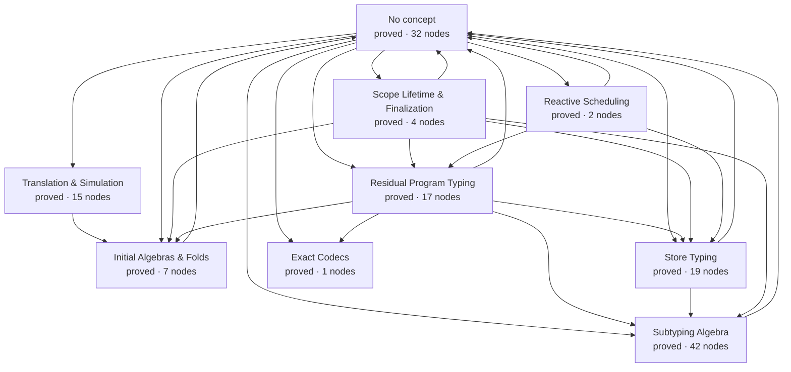

| Node | Status | Rests on | Nearest nodes |
| --- | --- | --- | --- |
| `check_sound` | proved | — | — |
| `check_complete` | proved | — | — |
| `admitSig_ok_iff` | proved | — | — |
| `meaning_typed_app` | proved | — | `check_restrict`, `meaning_typed` |
| `run_typed_app` | proved | — | `check_restrict`, `meaning_typed`, `run_eq_meaning` |
| `meaningB_typed_app` | proved | — | `check_restrict`, `hasTyIn_iff`, `hom_eq_cata_ty`, `fits_memberIn`, `order_refl`, `fits_mono`, `memberIn_mono`, `deferredMake_extension`, `refMake_extension`, `syncRow_typed`, `evalTerm_progress`, `check_sound`, `check_complete`, `normalize_idem`, `fits_subN`, `subN_refl`, `fits_normalize`, `optionTy_upper`, `errOf_payload`, `isPayload_of_hasTy_record`, `order_trans` |
| `reachable_typed_admitted` | proved | — | `reachable_typed`, `lawfulSig_of_admitted` |
| `checkModule_complete` | proved | — | `checkModule_eq_check`, `check_complete` |
| `checkModule_sound` | proved | — | `check_sound` |
| `invoke_hasTy` | proved | — | — |
| `check_restrict` | proved | — | `cata_eff_congr_on`, `hom_eq_cata_eff` |
| `meaning_typed` | proved | — | `hasTyIn_iff`, `hom_eq_cata_ty`, `fits_memberIn`, `order_refl`, `fits_mono`, `memberIn_mono`, `deferredMake_extension`, `refMake_extension`, `syncRow_typed`, `evalTerm_progress`, `check_sound`, `check_complete`, `normalize_idem`, `fits_subN`, `subN_refl`, `fits_normalize`, `optionTy_upper`, `errOf_payload`, `isPayload_of_hasTy_record`, `order_trans` |
| `run_eq_meaning` | proved | — | `at_snoc`, `localRunC_mono`, `localRunC_waits`, `localRunC_agree`, `ReachesQ.refl`, `contextStep_fallback`, `ReachesQ.trans`, `not_withFiber`, `ReachesQ.step`, `localRunC_of_localRun`, `of_loopedRows` |
| `hasTyIn_iff` | proved | — | — |
| `hom_eq_cata_ty` | proved | — | — |
| `fits_memberIn` | proved | — | — |
| `order_refl` | proved | — | — |
| `fits_mono` | proved | — | — |
| `memberIn_mono` | proved | — | `hom_eq_cata_ty` |
| `deferredMake_extension` | proved | — | — |
| `refMake_extension` | proved | — | — |
| `syncRow_typed` | proved | — | `fits_normalize`, `subN_trans`, `solve_lookup_of_mem`, `fits_subN`, `termMaps_of_typed`, `matchB_sound`, `hom_eq_cata_ty`, `errOf_payload`, `isPayload_of_hasTy_record`, `normalize_idem`, `subN_refl` |
| `evalTerm_progress` | proved | — | `_mutual` |
| `normalize_idem` | proved | — | — |
| `fits_subN` | proved | — | `subN_trans`, `fits_normalize` |
| `subN_refl` | proved | — | — |
| `fits_normalize` | proved | — | `subN_trans`, `normalize_idem` |
| `optionTy_upper` | proved | — | `option_eliminator`, `normalize_idem`, `subN_trans`, `subN_refl`, `Eliminator.lift_upper` |
| `errOf_payload` | proved | — | — |
| `isPayload_of_hasTy_record` | proved | — | `handles_of_payloadFieldTy` |
| `order_trans` | proved | — | — |
| `reachable_typed` | proved | — | `decision_preserves`, `load_typed`, `order_trans`, `order_refl` |
| `lawfulSig_of_admitted` | proved | — | `admitSig_ok_iff` |
| `checkModule_eq_check` | proved | — | — |
| `cata_eff_congr_on` | proved | — | — |
| `hom_eq_cata_eff` | proved | — | — |
| `at_snoc` | proved | — | `at_append` |
| `localRunC_mono` | proved | — | — |
| `localRunC_waits` | proved | — | — |
| `localRunC_agree` | proved | — | `localRunC_mono` |
| `ReachesQ.refl` | proved | — | `ReachesC.refl` |
| `contextStep_fallback` | proved | — | — |
| `ReachesQ.trans` | proved | — | `ReachesC.trans` |
| `not_withFiber` | proved | — | — |
| `ReachesQ.step` | proved | — | `ReachesC.step` |
| `localRunC_of_localRun` | proved | — | `contextStep_fallback`, `not_withFiber` |
| `of_loopedRows` | proved | — | — |
| `subN_trans` | proved | — | — |
| `solve_lookup_of_mem` | proved | — | — |
| `termMaps_of_typed` | proved | — | `evalTerm_progress`, `fits_mono` |
| `matchB_sound` | proved | — | `solve_lookup_of_mem` |
| `_mutual` | proved | — | `fits_subN`, `list_eliminator`, `normalize_idem`, `subN_trans`, `subN_refl`, `subN_list_iff`, `joinAll_keeps`, `mapM_answer`, `fits_iff_membersIn`, `listOf_upper`, `fits_normalize`, `fits_unfold`, `causeInputError_upper`, `matchArgsB_sound` |
| `option_eliminator` | proved | — | `subN_option_iff`, `normalize_idem`, `subN_trans`, `subN_refl` |
| `Eliminator.lift_upper` | proved | — | `subN_refl`, `UnionRule.lift_upper` |
| `handles_of_payloadFieldTy` | proved | — | — |
| `decision_preserves` | proved | — | `fits_subN`, `satisfies_empty`, `order_refl`, `fits_mono`, `order_trans`, `mono`, `subN_trans`, `configTyped_frame`, `memberIn_mono`, `hasTyIn_iff`, `hom_eq_cata_ty`, `wake_preserves`, `close_typed`, `seq_typed`, `registrationDone_preserves`, `launch_preserves`, `subN_never`, `guardBind_typed`, `deliver_preserves`, `loop_preserves`, `driveState_lift` |
| `load_typed` | proved | — | `denotesTyped`, `checkModule_eq_check`, `check_complete`, `checkModule_sound`, `satisfies_empty` |
| `at_append` | proved | — | — |
| `ReachesC.refl` | proved | — | — |
| `ReachesC.trans` | proved | — | — |
| `ReachesC.step` | proved | — | `contextStep_fallback`, `contextStep` |
| `list_eliminator` | proved | — | `subN_list_iff`, `normalize_idem`, `subN_trans`, `subN_refl` |
| `subN_list_iff` | proved | — | — |
| `joinAll_keeps` | proved | — | `foldl_keeps` |
| `mapM_answer` | proved | — | `mapM_cons_eq_some` |
| `fits_iff_membersIn` | proved | — | `fits_unfold`, `fits_normalize` |
| `listOf_upper` | proved | — | `list_eliminator`, `normalize_idem`, `subN_trans`, `subN_refl`, `extendAll_upper` |
| `fits_unfold` | proved | — | — |
| `causeInputError_upper` | proved | — | `cause_upper`, `cause_mono`, `normalize_idem`, `subN_trans`, `subN_refl`, `UnionRule.lift_upper`, `subN_causeOf_causeUpper`, `subN_exitOf_causeUpper`, `extendAll_eq_some_iff` |
| `matchArgsB_sound` | proved | — | — |
| `subN_option_iff` | proved | — | — |
| `UnionRule.lift_upper` | proved | — | `le_joinAll`, `subN_trans`, `mapM_answer` |
| `satisfies_empty` | proved | — | — |
| `mono` | proved | — | `order_trans` |
| `configTyped_frame` | proved | — | `satisfies_empty`, `fits_mono`, `order_trans`, `mono`, `order_refl`, `memberIn_mono`, `hasTyIn_iff`, `hom_eq_cata_ty` |
| `wake_preserves` | proved | — | `order_refl`, `configTyped_frame`, `fits_mono`, `completionStrong_await`, `memberIn_mono`, `hasTyIn_iff`, `hom_eq_cata_ty` |
| `close_typed` | proved | — | — |
| `seq_typed` | proved | — | `subN_refl`, `fits_subN`, `guardBind_typed` |
| `registrationDone_preserves` | proved | — | `order_refl`, `fits_mono`, `order_trans`, `mono`, `satisfies_empty`, `close_typed`, `fits_subN` |
| `launch_preserves` | proved | — | `subN_refl`, `fits_subN`, `order_refl`, `fits_mono`, `satisfies_empty`, `order_trans`, `mono`, `satisfies_weaken` |
| `subN_never` | proved | — | — |
| `guardBind_typed` | proved | — | — |
| `deliver_preserves` | proved | — | `order_refl`, `satisfies_empty`, `fits_mono`, `order_trans`, `mono`, `satisfies_weaken`, `settle_callback`, `fits_memberIn`, `hasTyIn_iff`, `hom_eq_cata_ty`, `memberIn_mono`, `completionStrong_await`, `memoBuild_extension`, `deferredMake_extension`, `refMake_extension`, `subN_never`, `fits_subN`, `scopeParams_child`, `at_child`, `denotesTyped`, `evalTerm_progress`, `normalize_idem`, `subN_refl`, `scopeParams_below`, `subN_trans`, `fits_normalize`, `fiberTy_upper`, `solve_lookup_of_mem`, `matchB_sound`, `syncRow_typed`, `withParams_of_none`, `errOf_payload`, `isPayload_of_hasTy_record`, `at_append`, `foreignFinalizer_ambient`, `fits_scope_inv`, `seq_typed`, `closeSeqProtocol`, `configTyped_frame`, `close_typed`, `clause_scoped`, `clause_closeScope`, `scopeParams_ref`, `scopeParams_layer_below`, `satisfies_union`, `withParams_serviceTy`, `guardBind_typed`, `countdown_parks_positional` |
| `loop_preserves` | proved | — | `order_refl`, `satisfies_empty`, `fits_mono`, `order_trans`, `mono`, `satisfies_weaken`, `settle_callback`, `fits_memberIn`, `hasTyIn_iff`, `hom_eq_cata_ty`, `memberIn_mono`, `completionStrong_await`, `memoBuild_extension`, `deferredMake_extension`, `refMake_extension`, `subN_never`, `fits_subN`, `scopeParams_child`, `at_child`, `denotesTyped`, `evalTerm_progress`, `normalize_idem`, `subN_refl`, `scopeParams_below`, `subN_trans`, `fits_normalize`, `fiberTy_upper`, `solve_lookup_of_mem`, `matchB_sound`, `syncRow_typed`, `withParams_of_none`, `errOf_payload`, `isPayload_of_hasTy_record`, `at_append`, `foreignFinalizer_ambient`, `fits_scope_inv`, `seq_typed`, `closeSeqProtocol`, `configTyped_frame`, `close_typed`, `clause_scoped`, `clause_closeScope`, `scopeParams_ref`, `scopeParams_layer_below`, `satisfies_union`, `withParams_serviceTy`, `guardBind_typed`, `countdown_parks_positional` |
| `driveState_lift` | proved | — | — |
| `denotesTyped` | proved | — | `provideLayerArm`, `at_child`, `subN_refl`, `fits_subN`, `fits_normalize`, `fiberTy_upper`, `scopeParams_child`, `solve_lookup_of_mem`, `hom_eq_cata_ty`, `subN_trans`, `matchB_sound`, `syncRow_typed`, `withParams_of_none`, `evalTerm_progress`, `normalize_idem`, `errOf_payload`, `isPayload_of_hasTy_record`, `satisfies_weaken`, `subN_never`, `fits_mono`, `order_trans`, `invoke_arm`, `fits_iff_membersIn`, `option_eliminator`, `subN_option_iff`, `joinAll_keeps`, `mapM_answer`, `optionTy_upper`, `list_eliminator`, `subN_list_iff`, `listOf_upper`, `fits_unfold`, `causeInputError_upper`, `matchArgsB_sound`, `withParams_serviceTy`, `scopeParams_below`, `exitOf_upper`, `fits_scope_inv`, `param_arm`, `call_arm` |
| `contextStep` | proved | — | — |
| `foldl_keeps` | proved | — | — |
| `mapM_cons_eq_some` | proved | — | — |
| `extendAll_upper` | proved | — | `extendAll_adjoint` |
| `cause_upper` | proved | — | `subN_causeOf_causeUpper`, `subN_exitOf_causeUpper` |
| `cause_mono` | proved | — | `subN_exitOf_iff`, `subN_causeOf_causeUpper`, `subN_trans`, `subN_causeOf_iff` |
| `subN_causeOf_causeUpper` | proved | — | — |
| `subN_exitOf_causeUpper` | proved | — | `subN_trans`, `subN_refl`, `subN_exitOf_iff` |
| `extendAll_eq_some_iff` | proved | — | — |
| `le_joinAll` | proved | — | `joinAll_keeps` |
| `completionStrong_await` | proved | — | `subN_trans` |
| `satisfies_weaken` | proved | — | — |
| `settle_callback` | proved | — | `fits_subN`, `fits_mono`, `subN_never`, `subN_refl`, `order_refl`, `scopeParams_child`, `at_child`, `order_trans`, `fits_scope_inv`, `seq_typed`, `closeOrder_eq`, `mono`, `satisfies_empty`, `configTyped_frame`, `memberIn_mono`, `hasTyIn_iff`, `hom_eq_cata_ty` |
| `memoBuild_extension` | proved | — | — |
| `scopeParams_child` | proved | — | — |
| `at_child` | proved | — | `at_snoc` |
| `scopeParams_below` | proved | — | — |
| `fiberTy_upper` | proved | — | `fiber_eliminator`, `normalize_idem`, `subN_trans`, `subN_refl`, `extendAll_upper` |
| `withParams_of_none` | proved | — | — |
| `foreignFinalizer_ambient` | proved | — | `subN_never`, `fits_subN`, `fits_mono`, `order_refl`, `scopeParams_child`, `at_child`, `order_trans` |
| `fits_scope_inv` | proved | — | — |
| `closeSeqProtocol` | proved | — | `order_trans`, `fits_mono` |
| `clause_scoped` | proved | — | `fits_mono`, `order_trans`, `mono`, `order_refl`, `satisfies_empty`, `denotesTyped`, `configTyped_frame`, `memberIn_mono`, `hasTyIn_iff`, `hom_eq_cata_ty` |
| `clause_closeScope` | proved | — | `fits_mono`, `order_trans`, `mono`, `subN_never`, `fits_subN`, `order_refl`, `scopeParams_child`, `at_child`, `fits_scope_inv`, `seq_typed`, `closeOrder_eq`, `satisfies_empty`, `configTyped_frame`, `memberIn_mono`, `hasTyIn_iff`, `hom_eq_cata_ty` |
| `scopeParams_ref` | proved | — | — |
| `scopeParams_layer_below` | proved | — | — |
| `satisfies_union` | proved | — | — |
| `withParams_serviceTy` | proved | — | — |
| `countdown_parks_positional` | proved | — | `order_refl`, `fits_mono`, `order_trans`, `mono`, `satisfies_empty`, `fits_subN`, `close_typed` |
| `provideLayerArm` | proved | — | `fits_subN`, `subN_refl`, `fits_normalize`, `fiberTy_upper`, `scopeParams_child`, `at_child`, `solve_lookup_of_mem`, `hom_eq_cata_ty`, `subN_trans`, `matchB_sound`, `syncRow_typed`, `withParams_of_none`, `evalTerm_progress`, `normalize_idem`, `errOf_payload`, `isPayload_of_hasTy_record`, `satisfies_weaken`, `subN_never`, `fits_mono`, `order_trans`, `fits_scope_inv` |
| `invoke_arm` | proved | — | `normalize_idem`, `fits_mono`, `fits_subN`, `order_trans`, `at_child`, `scopeParams_below`, `evalTerm_progress`, `scopeParams_body`, `withParams_defOf` |
| `exitOf_upper` | proved | — | `exit_eliminator`, `normalize_idem`, `subN_trans`, `subN_refl`, `extendAll_upper` |
| `param_arm` | proved | — | `normalize_idem`, `fits_mono`, `fits_subN`, `order_trans`, `evalTerm_progress`, `scopeParams_decl`, `withParams_param` |
| `call_arm` | proved | — | `fits_mono`, `fits_subN`, `normalize_idem`, `order_trans`, `evalTerm_progress`, `scopeParams_body`, `withParams_of_none` |
| `extendAll_adjoint` | proved | — | `adjoint`, `extendAll_eq_some_iff` |
| `subN_exitOf_iff` | proved | — | — |
| `subN_causeOf_iff` | proved | — | — |
| `closeOrder_eq` | proved | — | — |
| `fiber_eliminator` | proved | — | `subN_fiberOf_iff`, `normalize_idem`, `subN_trans`, `subN_refl` |
| `scopeParams_body` | proved | — | — |
| `withParams_defOf` | proved | — | — |
| `exit_eliminator` | proved | — | `subN_exitOf_iff`, `normalize_idem`, `subN_trans`, `subN_refl` |
| `scopeParams_decl` | proved | — | — |
| `withParams_param` | proved | — | — |
| `adjoint` | proved | — | `Eliminator.lift_least`, `subN_trans`, `mapM_total`, `Eliminator.lift_upper` |
| `subN_fiberOf_iff` | proved | — | — |
| `Eliminator.lift_least` | proved | — | `UnionRule.lift_least` |
| `mapM_total` | proved | — | `mapM_cons_eq_some` |
| `UnionRule.lift_least` | proved | — | `subN_trans`, `mapM_source`, `joinAll_le` |
| `mapM_source` | proved | — | `mapM_cons_eq_some` |
| `joinAll_le` | proved | — | `joinAll_all` |
| `joinAll_all` | proved | — | `foldl_all` |
| `foldl_all` | proved | — | — |

### R2: Extension is conservative: C1–C8 over DI-47's relation on Σ\_app

- Open, not triaged: C2 for host rows outside the fragment StraightRows: operational; on the fragment it is meaningUnder_append (decisions row 313)
- Open, not triaged: C4 for TypedProg (the generic judgment is proved both ways)
- Open, not triaged: C5: the world projection with its back condition (its red controls are proved)
- Open, not triaged: C7: conditional on decisions row 115
- Open, not triaged: C8: per form

R2 by concept: each concept its nodes are placed at, by tag or by module. An arrow goes where a node's proof reaches a node of another concept.

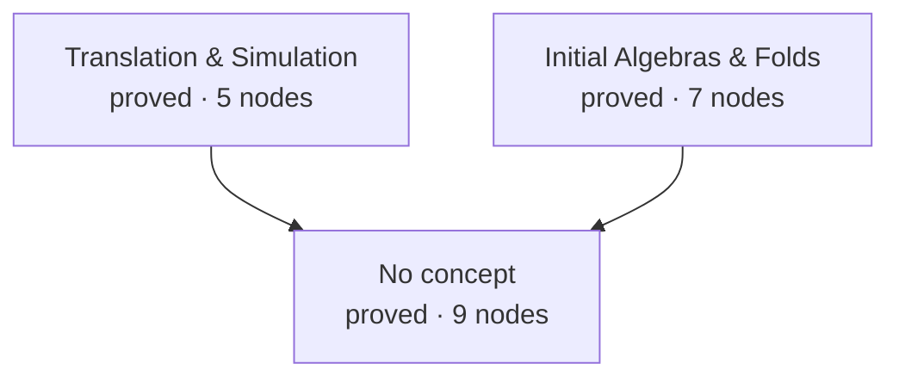

| Node | Status | Rests on | Nearest nodes |
| --- | --- | --- | --- |
| `check_ext` | proved | — | `check_sound`, `check_complete` |
| `check_restrict` | proved | — | `cata_eff_congr_on`, `hom_eq_cata_eff` |
| `lawful_append` | proved | — | — |
| `meaningUnder_append` | proved | — | — |
| `denoteBlockB_straight` | proved | — | `denoteRowsB_straight`, `denoteBlockB_loopedDataRows` |
| `denoteRowsB_looped` | proved | — | `denoteRows_straight` |
| `denoteRowsB_straight` | proved | — | — |
| `checkModule_conservative` | proved | — | `defs_conservative` |
| `checkModule_eq_check` | proved | — | — |
| `defs_conservative` | proved | — | `cata_eff_congr_on`, `hom_eq_cata_eff` |
| `moduleHasTy_ext` | proved | — | — |
| `typeOfProgram_ext` | proved | — | `checkModule_sound`, `moduleHasTy_ext`, `checkModule_complete` |
| `check_sound` | proved | — | — |
| `check_complete` | proved | — | — |
| `cata_eff_congr_on` | proved | — | — |
| `hom_eq_cata_eff` | proved | — | — |
| `denoteBlockB_loopedDataRows` | proved | — | `cata_blockAlgB_loopedDataRows` |
| `denoteRows_straight` | proved | — | — |
| `checkModule_sound` | proved | — | `check_sound` |
| `checkModule_complete` | proved | — | `checkModule_eq_check`, `check_complete` |
| `cata_blockAlgB_loopedDataRows` | proved | — | — |

### R3: Data: the type language closed under records and variants as Ty growth

- Open, not triaged: variants: the tag select over records landed (decisions row 195 (d)); catchTag's residual, the caught tag subtracted from the error column, waits on decisions row 130
- Open, after other work (the wiring slice of recursive types (decisions row 400)): recursive types (decisions rows 124 and 400): the foundation is landed beside the core and its seven claims are proved (Effect4.Laws.Program.TyDecls: membership under a table decided, conservative on the empty table, the order sound, invariant under normalization, inhabitance its emptiness test, one fixed point on a guarded table); a declared name with no recursion abbreviates its expansion (tydecls-expansion), and a derived Modeled type is named, its reference meaning its code (modeled-name, decisions row 402); the application's table is SigApp.types, admitted by the signature's located refusal (admitSig_ok_iff: each declaration's local checks, no name with two bodies, guarded; decisions rows 401 (2) and 402 (5)); open: the table in the world, Fits and its callers reading it, the TypeScript and Schema faces printing names, and parameters (regular recursion)
- Open, not triaged: error payloads: the carrier (decisions row 120, part E1) and the face (part E2: one Data.TaggedError class per tag, printed and read back) landed; int and number fields since the aliases Int and Num read back (decisions row 399 (2)); open: catchTag's residual over records (decisions row 130), a field typed by another class (refused by name), a record update of a class instance (it answers a structural object), and a host row answering a payload (R6, parked)
- Open, waits on a ruling (decisions row 108: the owner places the numbers slice; row 121 is ruled): int inhabited inside row 108's profile: ruled 2026-10-02 (decisions row 121); carried since decisions row 317, which removes the admission's int scan; the JSON wires since row 316; the computing rows (plus, minus, and lt and eq at int) since row 319; the Lean judgment and OCaml profile bound landed in row 321, and the TypeScript prelude refusal landed in row 322; the host truth record and comparison of an outside-profile result remain open (slice 7)
- Open, not triaged: the Schema image of app, and the JSON images of app, null, undefined and bytes: unlowered or refused by name (decisions rows 121, 158, 160, 161); null, undefined, number and bytes have their Schema image (the types audit, docs/research/2026-10-15-type-roundtrip-audit/README.md §6.1)
- Open, after other work (a program that compares records (decisions row 126)): equality at records: eq stays refused at records until a program compares them (decisions row 126)

The open part of R3: its planned goals and the theorems proved modulo them. An arrow goes from a node to a node its proof reaches first.

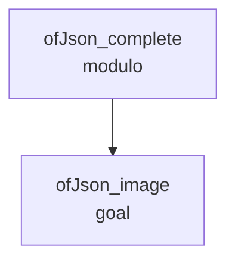

R3 by concept: each concept its nodes are placed at, by tag or by module. An arrow goes where a node's proof reaches a node of another concept.

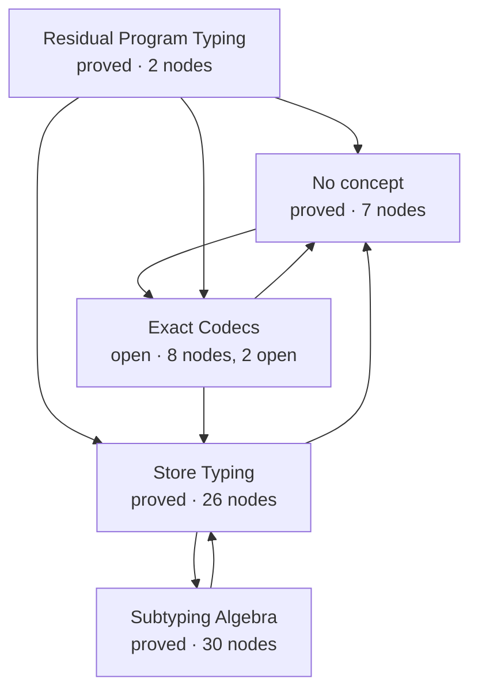

| Node | Status | Rests on | Nearest nodes |
| --- | --- | --- | --- |
| `checkInput_eq_none_iff` | proved | — | — |
| `fits_normalize` | proved | — | `subN_trans`, `normalize_idem` |
| `fits_subN` | proved | — | `subN_trans`, `fits_normalize` |
| `inhabited_iff_fits` | proved | — | `subN_refl` |
| `hom_eq_cata_ty` | proved | — | — |
| `decode_iff` | proved | — | — |
| `ofSchema_exact` | proved | — | — |
| `readTerm_printTerm` | proved | — | — |
| `type_metadata_exact` | proved | — | — |
| `errOf_valOfErr` | proved | — | `errOf_payload` |
| `admitModule_classDecls` | proved | — | `checkInput_eq_none_iff` |
| `closed_armsIn` | proved | — | `closed_tagArmsIn`, `option_closed`, `liftIn_closed`, `closed_arms` |
| `closed_checkIn` | proved | — | — |
| `closed_fieldTypeIn` | proved | — | `closed_fieldOf`, `liftIn_closed` |
| `closed_membersIn` | proved | — | — |
| `closed_setTypeIn` | proved | — | `closed_setOf`, `liftIn_closed` |
| `closed_tagArmsIn` | proved | — | `closed_membersIn` |
| `fieldAdmitsIn_sound` | proved | — | `memberIn_sub`, `memberIn_normalize` |
| `liftIn_closed` | proved | — | `closed_membersIn`, `mapM_source`, `closed_join`, `joinAll_all` |
| `tagArmsIn_partition` | proved | — | `memberIn_iff_membersIn` |
| `fits_iff_membersIn` | proved | — | `fits_unfold`, `fits_normalize` |
| `fits_memberIn` | proved | — | — |
| `fits_unfold` | proved | — | — |
| `liftIn_transfer` | proved | — | `joinAll_keeps`, `mapM_answer`, `memberIn_iff_membersIn` |
| `cata_declAlg_normalize` | proved | — | `hom_eq_cata_ty` |
| `errOf_ne_boom_of_supported` | proved | — | `hom_eq_cata_ty`, `errOf_payload`, `isPayload_of_hasTy_record` |
| `errOf_payload` | proved | — | — |
| `exists_memberIn_fresh` | proved | — | `memberIn_mono` |
| `exists_memberIn_of_inhabited` | proved | — | `exists_memberIn_fresh` |
| `fixedPoint_agree` | proved | — | — |
| `guarded_fixedPoint_unique` | proved | — | `fixedPoint_agree` |
| `hasTyIn_iff` | proved | — | — |
| `inhabited_iff_memberIn` | proved | — | `exists_memberIn_of_inhabited` |
| `isPayload_of_hasTy_record` | proved | — | `handles_of_payloadFieldTy` |
| `memberIn_iff_expand` | proved | — | `hom_eq_cata_ty` |
| `memberIn_iff_expansions` | proved | — | `memberIn_iff_expand` |
| `memberIn_iff_membersIn` | proved | — | `hasTyIn_iff`, `memberIn_normalize` |
| `memberIn_mono` | proved | — | `hom_eq_cata_ty` |
| `memberIn_normalize` | proved | — | `cata_declAlg_normalize` |
| `memberIn_sub` | proved | — | — |
| `memberIn_unfold_iff` | proved | — | — |
| `tyDecls_conservative` | proved | — | `hom_eq_cata_ty`, `hasTyIn_iff` |
| `wiring_readers_conservative` | proved | — | — |
| `ofJson_complete` | modulo | `ofJson_image` | `ofJson_image` |
| `ofJson_image` | goal | `ofJson_image` | — |
| `frame_laws` | proved | — | — |
| `member` | proved | — | — |
| `codec_roundtrip` | proved | — | `decode_encode`, `member`, `hom_eq_cata_ty`, `normalize_idem` |
| `memberIn_ref` | proved | — | `memberIn_iff_expansions` |
| `subN_trans` | proved | — | — |
| `normalize_idem` | proved | — | — |
| `subN_refl` | proved | — | — |
| `option_closed` | proved | — | — |
| `closed_arms` | proved | — | `closed_tagArms`, `closed_diffTag`, `closed_payloadTy`, `closed_optionTy` |
| `closed_fieldOf` | proved | — | — |
| `closed_setOf` | proved | — | — |
| `mapM_source` | proved | — | `mapM_cons_eq_some` |
| `closed_join` | proved | — | — |
| `joinAll_all` | proved | — | `foldl_all` |
| `joinAll_keeps` | proved | — | `foldl_keeps` |
| `mapM_answer` | proved | — | `mapM_cons_eq_some` |
| `handles_of_payloadFieldTy` | proved | — | — |
| `decode_encode` | proved | — | — |
| `closed_tagArms` | proved | — | — |
| `closed_diffTag` | proved | — | — |
| `closed_payloadTy` | proved | — | `closed_payloadOf` |
| `closed_optionTy` | proved | — | `option_closed`, `lift_closed` |
| `mapM_cons_eq_some` | proved | — | — |
| `foldl_all` | proved | — | — |
| `foldl_keeps` | proved | — | — |
| `closed_payloadOf` | proved | — | — |
| `lift_closed` | proved | — | `closed_join`, `lift_all` |
| `lift_all` | proved | — | `mapM_source`, `joinAll_all` |

### R4: State: the world types every cell at any type, with rows as templates

- Open, worded as a proposed claim: pool-profile-preserved (proposed claim; store-typing): along a run of the public operations the cell stays a member of its type and its state stays in the first profile; the model's half is profile_closed on six transitions; the cell's half is the seven typing statements of the cell and of the steps with step_keeps_cell, and each attempt statement of the operations gives the membership of the reply and of the stored value from the membership of the cell before the step; the operations are typed at every scope (use_types, make_types, close_answers), and make's type requires the scope; no statement says that a client writes the cell by the operations alone, none keeps the table injective along a run, and no goal states the run-level claim (decisions rows 267 to 269, 276)
- Open, not triaged: the faces of Ref\<A\> and Deferred\<A, E\>, the type arguments' part: landed in the state plan's T5 for a binder term and for Deferred.make: a read-modify-write row's binder term is printed as a function of the cell's current value and read back (part A: printPerform, readPerform); Deferred.make\<A, E\>() is printed from the operation's own type arguments and read back at every instance whose types are readable (part B: Signature.typeArgsOf and withTypeArgs, printCall, readCall, LawfulTypeArgs; Classes.readTyChecked on Classes.ReadableTy), a bare Deferred.make() is refused by its spelling and never typed at a default, the native row declares no type argument of its own, and an operation's type arguments are program annotations (ScopedOp.typeArgs: raw formation, the integer scan and the module's class table read them; decisions row 212); read_print and read_exact keep their statements; open: Ref.make\<A\>, which needs an appended constructor (decisions rows 210 and 212); a type argument outside the readable types (a handle type, unknown, a class name: printed where it has a printed form, and refused at reading; int and number: read at nat); a list fold's stated accumulator type, which is printed and not read; and the instance's row in the other estates: the TypeScript profile and the OCaml metadata list Deferred.make once, at the face's instance, so a consumer that needs an instance's answer column derives it from the operation
- Open, not triaged: the target half of handle-identity-laws (decisions row 229): the identity correspondence in each target's relation, in both directions: two handles have equal keys exactly when their host objects are one object; no goal states it, and the laws over Fits and the world's order are handle_identity_laws
- Open, worded as a proposed claim: semaphore-accounting-preserved (proposed claim; store-typing): along a run of the public operations the cell stays a member of its type and its state stays in the first profile; the model's half is profile_closed; the cell's half is the six typing statements of the steps with step_keeps_cell, and each attempt statement of the operations gives the membership of the reply and of the stored value from the membership of the cell before the step; no statement gives that first membership from the handles that the table names, and no goal states the run-level claim (decisions rows 260, 261, 265, 276)
- Open, worded as a proposed claim: atomic-attempt-isolation (proposed claim; store-typing and reactive-scheduling): an admitted atomic body's ordered dynamic reads and writes, the exact state that a failure or a retry restores, and no step of another fiber between its first access and its commit (decisions rows 80, 223; waits on the body profile's grammar and on row 226's budget or suspension)
- Open, not triaged: the second half of scoped-body-substitution-boundary (residual-program-typing): for a later constructor that does bind a scope, the code after the scope runs only after it, and substitution neither captures it nor copies it into a child body (decisions rows 225, 227); no goal states it: the mask adds no scoped constructor, and its restore node's half is scoped_body_substitution_boundary

R4 by concept: each concept its nodes are placed at, by tag or by module. An arrow goes where a node's proof reaches a node of another concept.

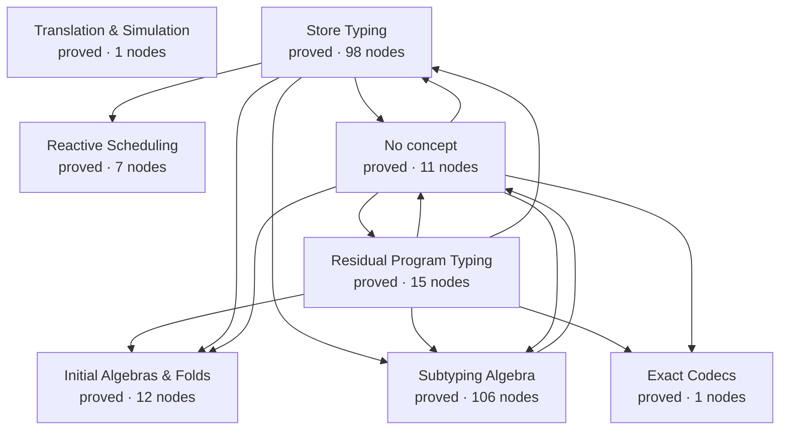

| Node | Status | Rests on | Nearest nodes |
| --- | --- | --- | --- |
| `order_refl` | proved | — | — |
| `order_trans` | proved | — | — |
| `refMake_extension` | proved | — | — |
| `deferredMake_extension` | proved | — | — |
| `memoBuild_extension` | proved | — | — |
| `fold_typed_atomic_update` | proved | — | `readTerm_printTerm`, `order_refl`, `termMaps_of_typed`, `fits_subN`, `list_eliminator`, `normalize_idem`, `subN_trans`, `subN_refl`, `subN_list_iff`, `joinAll_keeps`, `mapM_answer`, `fits_iff_membersIn`, `listOf_upper`, `fits_normalize`, `fits_unfold`, `causeInputError_upper`, `matchArgsB_sound`, `evalTerm_progress` |
| `handle_identity_laws` | proved | — | `fits_mono` |
| `saved_mask_image_membership` | proved | — | — |
| `scoped_body_substitution_boundary` | proved | — | `denotesTyped`, `scopeParams_child`, `at_child`, `fits_subN`, `evalTerm_progress`, `at_snoc` |
| `awaitStep_types` | proved | — | `typed` |
| `Latch.Model.closeStep_types` | proved | — | `typed` |
| `flushStep_types` | proved | — | `typed` |
| `initialStep_types` | proved | — | `typed` |
| `isOpenStep_types` | proved | — | `typed` |
| `wakeStep_types` | proved | — | `typed` |
| `Latch.Model.withdrawStep_types` | proved | — | `typed` |
| `image_agrees` | proved | — | — |
| `afterExit_first` | proved | — | `raceCompleteFirst_accepts` |
| `typed` | proved | — | `candsList_nil`, `cands_var`, `candsList_cons`, `types_ascribe`, `normalize_idem`, `subN_refl`, `matchArgsB_list_var_nat`, `matchArgsB_append`, `matchArgsB_cons_nil`, `lift_member`, `matchArgsB_one_var`, `matchArgsB_two_vars`, `join_eq_right_of_subN`, `matchArgsB_ite` |
| `ascribe_untyped` | proved | — | — |
| `step_keeps_cell` | proved | — | `order_refl`, `termMaps_of_typed` |
| `types_ascribe` | proved | — | `lift_member`, `normalize_idem` |
| `available_types` | proved | — | `typed` |
| `PartitionedSemaphore.initial_types` | proved | — | `typed` |
| `reserve_types` | proved | — | `typed` |
| `tryTake_types` | proved | — | `typed` |
| `Pool.Model.closeStep_types` | proved | — | `typed` |
| `drainStep_types` | proved | — | `typed` |
| `Model.initial_types` | proved | — | `matchArgsB_cons_nil`, `matchArgsB_append` |
| `leaseStep_types` | proved | — | `typed` |
| `lease_enrols_iff` | proved | — | — |
| `Pool.Model.profile_closed` | proved | — | — |
| `returnStep_types` | proved | — | `typed` |
| `selectStep_types` | proved | — | `typed` |
| `Pool.Model.withdrawStep_types` | proved | — | `typed` |
| `close_answers` | proved | — | `Pool.Model.withdrawStep_types`, `check_complete`, `check_sound`, `drainStep_types`, `matchB_modify_use`, `matchB_refOf_var`, `waitRetryAt_answers`, `subN_refl`, `lift_member`, `normalize_idem`, `matchArgsB_two_vars`, `matchArgsB_list_var_nat`, `optionTy_option`, `selectStep_types`, `Pool.Model.closeStep_types` |
| `Pool.make_types` | proved | — | `normalize_idem`, `check_complete`, `check_sound`, `close_answers`, `Model.initial_types`, `matchB_one_var` |
| `use_types` | proved | — | `check_complete`, `check_sound`, `subN_refl`, `lift_member`, `normalize_idem`, `matchArgsB_two_vars`, `matchArgsB_list_var_nat`, `optionTy_option`, `selectStep_types`, `matchB_modify_use`, `matchB_refOf_var`, `returnStep_types`, `Pool.Model.withdrawStep_types`, `leaseStep_types`, `waitRetryAt_answers`, `protectedBy_has` |
| `ascribe_scoped` | proved | — | — |
| `args` | proved | — | `noApp_args` |
| `head` | proved | — | — |
| `above_args` | proved | — | `mem_zip_map_right`, `instance_shape` |
| `above_prod` | proved | — | — |
| `admits_normalize` | proved | — | `normalize_idem` |
| `below_args` | proved | — | — |
| `candsFields_eq` | proved | — | — |
| `candsItems_eq` | proved | — | — |
| `candsList_below` | proved | — | `cands_below` |
| `candsList_cons` | proved | — | — |
| `candsList_nil` | proved | — | — |
| `cands_args` | proved | — | `candsItems_eq`, `candsFields_eq`, `comp_inv`, `comp_co` |
| `cands_below` | proved | — | `args`, `comp_ne_contra`, `cands_args`, `below_args`, `cands_union_right`, `cands_mem_members`, `head`, `cands_var` |
| `cands_mem_members` | proved | — | `cands_union_right` |
| `cands_union_right` | proved | — | — |
| `cands_var` | proved | — | — |
| `comp_co` | proved | — | — |
| `comp_inv` | proved | — | — |
| `comp_ne_contra` | proved | — | `comp_inv`, `comp_co` |
| `covers` | proved | — | `above_args`, `above_prod`, `prod_or_not`, `recovers`, `cands_args`, `args`, `below_args`, `cands_union_right`, `head`, `cands_var` |
| `instance_shape` | proved | — | — |
| `instantiate_solve` | proved | — | `lookup_added` |
| `joinCands_least` | proved | — | `subN_join_least`, `subN_never` |
| `joinCands_upper` | proved | — | `normalize_idem`, `subN_trans`, `subN_refl` |
| `join_eq_left_of_subN` | proved | — | `join_eq_right_of_subN` |
| `join_eq_right_of_subN` | proved | — | `normalize_idem`, `subN_refl`, `subN_join_least` |
| `lookup_added` | proved | — | `lowers_cons` |
| `lowers_cons` | proved | — | — |
| `matchArgsB_append` | proved | — | `candsList_nil`, `cands_var`, `candsList_cons` |
| `matchArgsB_complete` | proved | — | `covers`, `candsList_below`, `solve_between` |
| `matchArgsB_cons_nil` | proved | — | `candsList_nil`, `cands_var`, `candsList_cons` |
| `matchArgsB_ite` | proved | — | `normalize_idem`, `candsList_nil`, `cands_var`, `candsList_cons` |
| `matchArgsB_least` | proved | — | `candsList_below`, `solve_between` |
| `matchArgsB_list_var_nat` | proved | — | `candsList_nil`, `cands_var`, `candsList_cons` |
| `matchArgsB_one_var` | proved | — | `cands_var`, `candsList_nil`, `candsList_cons` |
| `matchArgsB_sound` | proved | — | — |
| `matchArgsB_two_vars` | proved | — | `candsList_nil`, `cands_var`, `candsList_cons` |
| `matchArgsN_complete` | proved | — | `admits_normalize`, `matchArgsB_complete` |
| `matchArgsN_least` | proved | — | `admits_normalize`, `matchArgsB_least` |
| `matchB_cell_fixed` | proved | — | `matchB_sound` |
| `matchB_complete` | proved | — | `covers`, `cands_below`, `solve_between` |
| `matchB_least` | proved | — | `cands_below`, `solve_between` |
| `matchB_modify_use` | proved | — | `cands_var` |
| `matchB_one_var` | proved | — | `cands_var` |
| `matchB_refOf_var` | proved | — | `cands_var`, `comp_inv` |
| `matchB_sound` | proved | — | `solve_lookup_of_mem` |
| `matchN_congr` | proved | — | — |
| `mem_lowers` | proved | — | — |
| `mem_varsOf_args` | proved | — | — |
| `mem_zip_map_right` | proved | — | — |
| `mem_zip_self_map` | proved | — | — |
| `noAppFields_eq_all` | proved | — | — |
| `noAppItems_eq_all` | proved | — | — |
| `noApp_args` | proved | — | `noAppItems_eq_all`, `noAppFields_eq_all` |
| `prod_left_cands` | proved | — | `head`, `args`, `cands_var`, `cands_mem_members`, `prod_member_left` |
| `prod_member_left` | proved | — | — |
| `prod_member_right` | proved | — | — |
| `prod_or_not` | proved | — | — |
| `prod_right_cands` | proved | — | `head`, `args`, `cands_var`, `cands_mem_members`, `prod_member_right` |
| `recovers` | proved | — | `mem_zip_self_map`, `cands_args`, `instance_shape`, `mem_varsOf_args`, `prod_right_cands`, `prod_left_cands`, `args`, `prod_or_not`, `head`, `cands_var` |
| `solve_between` | proved | — | `joinCands_upper`, `solve_lookup_of_mem`, `mem_lowers`, `joinCands_least`, `instantiate_solve` |
| `solve_lookup_of_mem` | proved | — | — |
| `subN_join_least` | proved | — | `normalize_idem` |
| `subN_never` | proved | — | — |
| `templateOK_of` | proved | — | — |
| `loop_sync_op` | proved | — | `native_sync_op`, `iteration_below_budget`, `loop_of_iteration` |
| `native_sync_answer` | proved | — | `native_sync_op` |
| `native_sync_op` | proved | — | — |
| `perform_scoped_iff` | proved | — | — |
| `heap_sites_keep` | proved | — | `at_snoc`, `mem_addresses_iff`, `evaluatePrim_producer`, `closeOrder_eq`, `driveState_lift` |
| `withParams_defOf` | proved | — | — |
| `withParams_of_none` | proved | — | — |
| `withParams_param` | proved | — | — |
| `withParams_serviceTy` | proved | — | — |
| `admitted_heap_history` | proved | — | `evaluatePrim_producer`, `closeOrder_eq`, `at_snoc`, `mem_addresses_iff`, `driveState_lift` |
| `mono` | proved | — | `order_trans` |
| `invoke_arm` | proved | — | `normalize_idem`, `fits_mono`, `fits_subN`, `order_trans`, `at_child`, `scopeParams_below`, `evalTerm_progress`, `scopeParams_body`, `withParams_defOf` |
| `param_arm` | proved | — | `normalize_idem`, `fits_mono`, `fits_subN`, `order_trans`, `evalTerm_progress`, `scopeParams_decl`, `withParams_param` |
| `scopeParams_ref` | proved | — | — |
| `syncRow_typed` | proved | — | `fits_normalize`, `subN_trans`, `solve_lookup_of_mem`, `fits_subN`, `termMaps_of_typed`, `matchB_sound`, `hom_eq_cata_ty`, `errOf_payload`, `isPayload_of_hasTy_record`, `normalize_idem`, `subN_refl` |
| `termMaps_of_typed` | proved | — | `evalTerm_progress`, `fits_mono` |
| `scopeParams_below` | proved | — | — |
| `scopeParams_body` | proved | — | — |
| `scopeParams_child` | proved | — | — |
| `scopeParams_decl` | proved | — | — |
| `scopeParams_layer_below` | proved | — | — |
| `PubSub.initial_types` | proved | — | `typed` |
| `PubSub.poll_types` | proved | — | `typed` |
| `slide_types` | proved | — | `typed` |
| `subscribe_types` | proved | — | `typed` |
| `tryPublish_types` | proved | — | `typed` |
| `unsubscribe_types` | proved | — | `typed` |
| `ascribe_formed_for_steps` | proved | — | — |
| `empty_typed` | proved | — | — |
| `message_nodes_for_steps` | proved | — | — |
| `offerStep_typed` | proved | — | `offerStep_types` |
| `offerStep_types` | proved | — | `offer_nodes_for_steps`, `message_nodes_for_steps`, `ascribe_formed_for_steps`, `typed` |
| `offer_nodes_for_steps` | proved | — | `message_nodes_for_steps` |
| `pollStep_typed` | proved | — | `pollStep_types` |
| `pollStep_types` | proved | — | `offer_nodes_for_steps`, `message_nodes_for_steps`, `ascribe_formed_for_steps`, `typed` |
| `sizeStep_typed` | proved | — | `typed` |
| `takeStep_typed` | proved | — | `Queue.Model.takeStep_types` |
| `Queue.Model.takeStep_types` | proved | — | `offer_nodes_for_steps`, `message_nodes_for_steps`, `ascribe_formed_for_steps`, `typed` |
| `withdrawOffer_typed` | proved | — | `withdrawOffer_types` |
| `withdrawOffer_types` | proved | — | `typed` |
| `withdrawTake_typed` | proved | — | `withdrawTake_types` |
| `withdrawTake_types` | proved | — | `typed` |
| `bounded_types` | proved | — | `empty_typed`, `offer_nodes_for_steps`, `message_nodes_for_steps`, `matchB_one_var`, `check_complete`, `check_sound` |
| `offer_types` | proved | — | `withdrawOffer_types`, `check_complete`, `check_sound`, `optionTy_option`, `lift_member`, `normalize_idem`, `subN_refl`, `matchArgsB_two_vars`, `matchArgsB_list_var_nat`, `offerStep_types`, `matchB_modify_use`, `matchB_refOf_var`, `rowTy_instantiated_formed`, `offer_nodes_for_steps`, `message_nodes_for_steps` |
| `Queue.poll_types` | proved | — | `check_complete`, `check_sound`, `lift_member`, `normalize_idem`, `subN_refl`, `matchArgsB_two_vars`, `matchArgsB_list_var_nat`, `optionTy_option`, `pollStep_types`, `offer_nodes_for_steps`, `message_nodes_for_steps`, `matchB_modify_use`, `matchB_refOf_var` |
| `size_types` | proved | — | `lift_member`, `normalize_idem`, `check_complete`, `check_sound`, `offer_nodes_for_steps`, `message_nodes_for_steps`, `matchB_refOf_var` |
| `Queue.take_types` | proved | — | `withdrawTake_types`, `check_complete`, `check_sound`, `optionTy_option`, `lift_member`, `normalize_idem`, `subN_refl`, `matchArgsB_two_vars`, `matchArgsB_list_var_nat`, `Queue.Model.takeStep_types`, `offer_nodes_for_steps`, `message_nodes_for_steps`, `matchB_modify_use`, `matchB_refOf_var`, `waitRetryAt_answers` |
| `modify_callback_answers` | proved | — | `typed`, `check_complete`, `check_sound`, `matchB_modify_use`, `matchB_refOf_var` |
| `empty_types` | proved | — | — |
| `Semaphore.Model.profile_closed` | proved | — | — |
| `releaseStep_types` | proved | — | `typed` |
| `takeIfAvailableStep_types` | proved | — | `typed` |
| `Semaphore.Model.takeStep_types` | proved | — | `typed` |
| `visitStep_types` | proved | — | `typed` |
| `Semaphore.Model.withdrawStep_types` | proved | — | `typed` |
| `Semaphore.make_types` | proved | — | `empty_types`, `matchB_one_var`, `check_complete`, `check_sound` |
| `release_types` | proved | — | `check_complete`, `check_sound`, `normalize_idem`, `subN_refl`, `lift_member`, `matchArgsB_two_vars`, `optionTy_option`, `visitStep_types`, `matchB_modify_use`, `matchB_refOf_var`, `matchArgsB_one_var`, `releaseStep_types` |
| `takeIfAvailable_types` | proved | — | `takeIfAvailableStep_types`, `check_complete`, `check_sound`, `matchB_modify_use`, `matchB_refOf_var` |
| `Semaphore.take_types` | proved | — | `Semaphore.Model.withdrawStep_types`, `check_complete`, `check_sound`, `Semaphore.Model.takeStep_types`, `matchB_modify_use`, `matchB_refOf_var`, `waitRetryAt_answers` |
| `withPermitsIfAvailable_types` | proved | — | `release_types`, `check_sound`, `check_complete`, `normalize_idem`, `matchArgsB_one_var`, `takeIfAvailable_types`, `protectedBy_has`, `sub_antisymm_canonical` |
| `withPermits_types` | proved | — | `release_types`, `Semaphore.Model.withdrawStep_types`, `check_complete`, `check_sound`, `Semaphore.Model.takeStep_types`, `matchB_modify_use`, `matchB_refOf_var`, `waitRetryAt_answers`, `protectedBy_has` |
| `fromDefinitions_declarations` | proved | — | — |
| `arrayBatch_answers` | proved | — | `modify_callback_answers` |
| `raceCompleteFirst_accepts` | proved | — | — |
| `raceCompleteFirst_keeps` | proved | — | — |
| `get_answers` | proved | — | `lift_member`, `normalize_idem`, `matchB_refOf_var`, `check_complete`, `check_sound` |
| `make_answers` | proved | — | `check_complete`, `check_sound`, `Semaphore.make_types`, `matchB_one_var` |
| `modify_answers` | proved | — | `lift_member`, `normalize_idem`, `modify_callback_answers`, `withPermits_types` |
| `readTerm_printTerm` | proved | — | — |
| `fits_subN` | proved | — | `subN_trans`, `fits_normalize` |
| `list_eliminator` | proved | — | `subN_list_iff`, `normalize_idem`, `subN_trans`, `subN_refl` |
| `normalize_idem` | proved | — | — |
| `subN_trans` | proved | — | — |
| `subN_refl` | proved | — | — |
| `subN_list_iff` | proved | — | — |
| `joinAll_keeps` | proved | — | `foldl_keeps` |
| `mapM_answer` | proved | — | `mapM_cons_eq_some` |
| `fits_iff_membersIn` | proved | — | `fits_unfold`, `fits_normalize` |
| `listOf_upper` | proved | — | `list_eliminator`, `normalize_idem`, `subN_trans`, `subN_refl`, `extendAll_upper` |
| `fits_normalize` | proved | — | `subN_trans`, `normalize_idem` |
| `fits_unfold` | proved | — | — |
| `causeInputError_upper` | proved | — | `cause_upper`, `cause_mono`, `normalize_idem`, `subN_trans`, `subN_refl`, `UnionRule.lift_upper`, `subN_causeOf_causeUpper`, `subN_exitOf_causeUpper`, `extendAll_eq_some_iff` |
| `evalTerm_progress` | proved | — | `_mutual` |
| `fits_mono` | proved | — | — |
| `denotesTyped` | proved | — | `provideLayerArm`, `at_child`, `subN_refl`, `fits_subN`, `fits_normalize`, `fiberTy_upper`, `scopeParams_child`, `solve_lookup_of_mem`, `hom_eq_cata_ty`, `subN_trans`, `matchB_sound`, `syncRow_typed`, `withParams_of_none`, `evalTerm_progress`, `normalize_idem`, `errOf_payload`, `isPayload_of_hasTy_record`, `satisfies_weaken`, `subN_never`, `fits_mono`, `order_trans`, `invoke_arm`, `fits_iff_membersIn`, `option_eliminator`, `subN_option_iff`, `joinAll_keeps`, `mapM_answer`, `optionTy_upper`, `list_eliminator`, `subN_list_iff`, `listOf_upper`, `fits_unfold`, `causeInputError_upper`, `matchArgsB_sound`, `withParams_serviceTy`, `scopeParams_below`, `exitOf_upper`, `fits_scope_inv`, `param_arm`, `call_arm` |
| `at_child` | proved | — | `at_snoc` |
| `at_snoc` | proved | — | `at_append` |
| `lift_member` | proved | — | — |
| `check_complete` | proved | — | — |
| `check_sound` | proved | — | — |
| `waitRetryAt_answers` | proved | — | `check_complete`, `check_sound`, `optionTy_option`, `normalize_idem`, `matchArgsB_one_var` |
| `optionTy_option` | proved | — | `lift_member` |
| `protectedBy_has` | proved | — | `normalize_idem`, `check_sound`, `check_complete` |
| `iteration_below_budget` | proved | — | — |
| `loop_of_iteration` | proved | — | — |
| `mem_addresses_iff` | proved | — | `yieldAt_addressYield`, `mem_foldList_iff`, `addresses_eq_foldList` |
| `evaluatePrim_producer` | proved | — | — |
| `closeOrder_eq` | proved | — | — |
| `driveState_lift` | proved | — | — |
| `hom_eq_cata_ty` | proved | — | — |
| `errOf_payload` | proved | — | — |
| `isPayload_of_hasTy_record` | proved | — | `handles_of_payloadFieldTy` |
| `rowTy_instantiated_formed` | proved | — | — |
| `sub_antisymm_canonical` | proved | — | — |
| `foldl_keeps` | proved | — | — |
| `mapM_cons_eq_some` | proved | — | — |
| `extendAll_upper` | proved | — | `extendAll_adjoint` |
| `cause_upper` | proved | — | `subN_causeOf_causeUpper`, `subN_exitOf_causeUpper` |
| `cause_mono` | proved | — | `subN_exitOf_iff`, `subN_causeOf_causeUpper`, `subN_trans`, `subN_causeOf_iff` |
| `UnionRule.lift_upper` | proved | — | `le_joinAll`, `subN_trans`, `mapM_answer` |
| `subN_causeOf_causeUpper` | proved | — | — |
| `subN_exitOf_causeUpper` | proved | — | `subN_trans`, `subN_refl`, `subN_exitOf_iff` |
| `extendAll_eq_some_iff` | proved | — | — |
| `_mutual` | proved | — | `fits_subN`, `list_eliminator`, `normalize_idem`, `subN_trans`, `subN_refl`, `subN_list_iff`, `joinAll_keeps`, `mapM_answer`, `fits_iff_membersIn`, `listOf_upper`, `fits_normalize`, `fits_unfold`, `causeInputError_upper`, `matchArgsB_sound` |
| `provideLayerArm` | proved | — | `fits_subN`, `subN_refl`, `fits_normalize`, `fiberTy_upper`, `scopeParams_child`, `at_child`, `solve_lookup_of_mem`, `hom_eq_cata_ty`, `subN_trans`, `matchB_sound`, `syncRow_typed`, `withParams_of_none`, `evalTerm_progress`, `normalize_idem`, `errOf_payload`, `isPayload_of_hasTy_record`, `satisfies_weaken`, `subN_never`, `fits_mono`, `order_trans`, `fits_scope_inv` |
| `fiberTy_upper` | proved | — | `fiber_eliminator`, `normalize_idem`, `subN_trans`, `subN_refl`, `extendAll_upper` |
| `satisfies_weaken` | proved | — | — |
| `option_eliminator` | proved | — | `subN_option_iff`, `normalize_idem`, `subN_trans`, `subN_refl` |
| `subN_option_iff` | proved | — | — |
| `optionTy_upper` | proved | — | `option_eliminator`, `normalize_idem`, `subN_trans`, `subN_refl`, `Eliminator.lift_upper` |
| `exitOf_upper` | proved | — | `exit_eliminator`, `normalize_idem`, `subN_trans`, `subN_refl`, `extendAll_upper` |
| `fits_scope_inv` | proved | — | — |
| `call_arm` | proved | — | `fits_mono`, `fits_subN`, `normalize_idem`, `order_trans`, `evalTerm_progress`, `scopeParams_body`, `withParams_of_none` |
| `at_append` | proved | — | — |
| `yieldAt_addressYield` | proved | — | — |
| `mem_foldList_iff` | proved | — | `exists_at_of_mem_foldList` |
| `addresses_eq_foldList` | proved | — | — |
| `handles_of_payloadFieldTy` | proved | — | — |
| `extendAll_adjoint` | proved | — | `adjoint`, `extendAll_eq_some_iff` |
| `subN_exitOf_iff` | proved | — | — |
| `subN_causeOf_iff` | proved | — | — |
| `le_joinAll` | proved | — | `joinAll_keeps` |
| `fiber_eliminator` | proved | — | `subN_fiberOf_iff`, `normalize_idem`, `subN_trans`, `subN_refl` |
| `Eliminator.lift_upper` | proved | — | `subN_refl`, `UnionRule.lift_upper` |
| `exit_eliminator` | proved | — | `subN_exitOf_iff`, `normalize_idem`, `subN_trans`, `subN_refl` |
| `exists_at_of_mem_foldList` | proved | — | `sizeOf_child_lt`, `foldList_cases` |
| `adjoint` | proved | — | `Eliminator.lift_least`, `subN_trans`, `mapM_total`, `Eliminator.lift_upper` |
| `subN_fiberOf_iff` | proved | — | — |
| `sizeOf_child_lt` | proved | — | — |
| `foldList_cases` | proved | — | — |
| `Eliminator.lift_least` | proved | — | `UnionRule.lift_least` |
| `mapM_total` | proved | — | `mapM_cons_eq_some` |
| `UnionRule.lift_least` | proved | — | `subN_trans`, `mapM_source`, `joinAll_le` |
| `mapM_source` | proved | — | `mapM_cons_eq_some` |
| `joinAll_le` | proved | — | `joinAll_all` |
| `joinAll_all` | proved | — | `foldl_all` |
| `foldl_all` | proved | — | — |

### R5: Services: the service table, layers and provision

- Open, not triaged: lower_refines_build: the machine's build of a layer refines \`build\` (decisions row 147)
- Open, not triaged: reference keys, Config, minted keys, and context validation at any runtime bridge (system map §8, R5)

R5 by concept: each concept its nodes are placed at, by tag or by module. An arrow goes where a node's proof reaches a node of another concept.

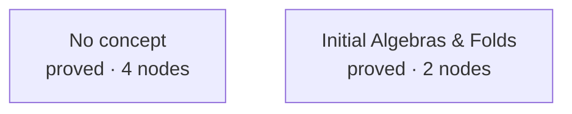

| Node | Status | Rests on | Nearest nodes |
| --- | --- | --- | --- |
| `build_total` | proved | — | `satisfies_union`, `satisfies_weaken`, `satisfies_empty` |
| `expanded_refs_nil_of_wf` | proved | — | — |
| `typeOfProgram_expandRefs` | proved | — | `expanded_refs_nil_of_wf` |
| `satisfies_union` | proved | — | — |
| `satisfies_weaken` | proved | — | — |
| `satisfies_empty` | proved | — | — |

### R6: The host: a lawful HostSpec, receipt and application, DI-57's table-aware reference

- Open, waits on a ruling (decisions row 97: the handle declarations, parked by the owner on 2026-09-30): admit_sound's value half: executable admission implies the ghost AnswerOk on success values (waits on decisions row 97's handle declarations)
- Open, needs a definition (the host as a relation between the machine's calls and its answers (\`HostSpec\`), in place of a predicate on tapes): H related to the machine: M6's premise is a predicate on tapes (decisions row 95), not a host relation
- Open, waits on a ruling (decisions rows 98 to 100: the typed replay route, when the guarantee is claimed, host resources): receipt and application on the keyed lifecycle, and their converse (host-boundary §4.5; decisions rows 98–100, parked by the owner, 2026-09-30)
- Open, not triaged: a world extension meeting C5, a retirement edge, per-row cancellation, one root (DI-58, DI-65)
- Open, after other work (the table-aware reference and the reply correspondence above; decisions row 99 says when it is claimed): the public typed guarantee for programs using host services (decisions row 99)
- Open, worded as a proposed claim: expansion-keeps-call (proposed claim; host-session-protocol): the expansion of a program's layer references keeps a call at its address, so the instance that the session reads on the expanded program is the checker's answer at the call that ran; origin_addresses_call proves the address on the program itself, and a finite evaluation reads the instance (Test/Api/TypedReplies.lean) (decisions row 323)
- Open, worded as a proposed claim: replay-at-call-instance (proposed claim; host-session-protocol): the checked replay of a tape (replayCheckedFrom, Api.replay) and the OCaml engine still admit a reply at the row's own columns alone, so a tape that a session recorded with an answer admitted at its call's instance is refused there (decisions row 323)

The open part of R6: its planned goals and the theorems proved modulo them. An arrow goes from a node to a node its proof reaches first.

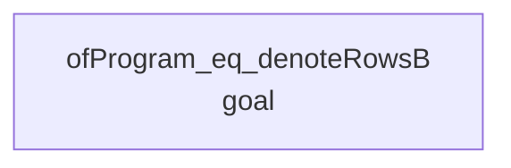

R6 by concept: each concept its nodes are placed at, by tag or by module. An arrow goes where a node's proof reaches a node of another concept.

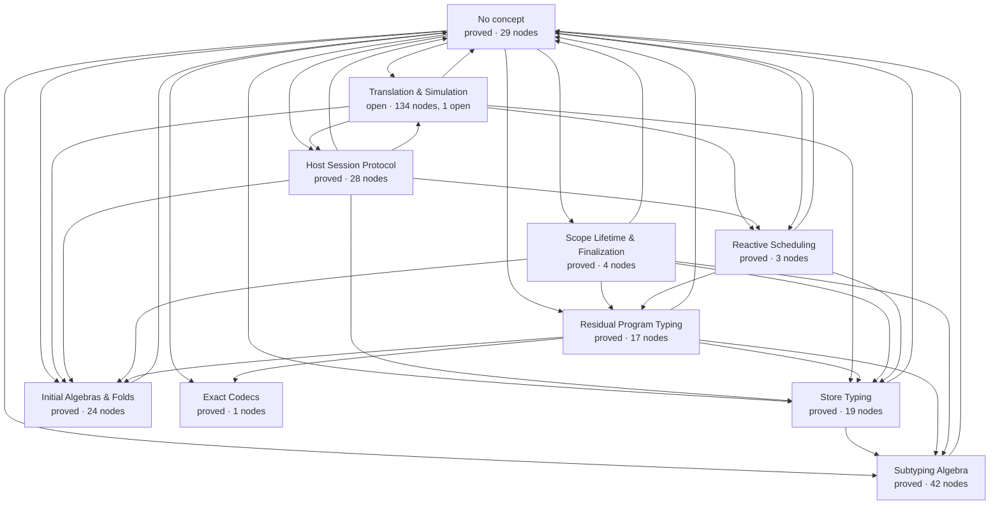

| Node | Status | Rests on | Nearest nodes |
| --- | --- | --- | --- |
| `reachable_typed` | proved | — | `decision_preserves`, `load_typed`, `order_trans`, `order_refl` |
| `preflight_success_prepared_fits` | proved | — | `instance_prepared_success`, `hasTyIn_iff`, `hom_eq_cata_ty` |
| `preflight_failure_noShapeDefect` | proved | — | — |
| `instance_prepared_success` | proved | — | — |
| `origin_addresses_call` | proved | — | `at_snoc`, `funded_replays` |
| `reached_callInstance` | proved | — | `lookup_programCalls` |
| `Run.session_eq_ref` | proved | — | `run_eq_ref_table`, `Run.journal_replays`, `funded_replays` |
| `denoteRows_eq_session_host` | proved | — | `contextStep_fallback`, `localRunC_mono`, `localRunC_agree`, `localRunC_waits`, `terminal`, `denoteRowsB_straight`, `localRunC_compileB`, `PlainHooks.of_loopedRows`, `answer`, `join`, `Leads.trans`, `seg_settles_receipt`, `Leads.refl`, `load_evaluate_receipt`, `flush_Myield_receipt`, `funded_replays` |
| `runWith_denotes` | proved | — | `denoteRows_eq_session_host`, `allows_answer`, `observe_awaitingAsync_iff`, `tapeFrom_append` |
| `h8_loopedRows` | proved | — | `hostRunB_stable`, `localRunC_to_rowsB`, `contextStep_fallback`, `localRunC_mono`, `localRunC_agree`, `localRunC_compileB`, `localRunC_waits`, `terminal`, `PlainHooks.of_loopedRows`, `answer`, `join`, `Leads.trans`, `seg_settles_receipt`, `Leads.refl`, `load_evaluate_receipt`, `flush_Myield_receipt`, `funded_replays` |
| `denoteRowsB_eq_session_host` | proved | — | `hostRunB_stable`, `localRunC_to_rowsB`, `PlainHooks.of_loopedRows`, `answer`, `join`, `Leads.trans`, `seg_settles_receipt`, `Leads.refl`, `load_evaluate_receipt`, `flush_Myield_receipt`, `funded_replays` |
| `runWith_denotesB` | proved | — | `denoteRowsB_eq_session_host`, `allows_answer`, `observe_awaitingAsync_iff`, `tapeFrom_append` |
| `replay_at_call_instance` | proved | — | `preflight_failure_noShapeDefect`, `preflight_success_prepared_fits`, `reached_callInstance`, `reached`, `Live.journal_replays` |
| `ofSketch_error_iff` | proved | — | `checkInput_eq_none_iff` |
| `Live.session_eq_ref` | proved | — | `Run.session_eq_ref` |
| `view_funded` | proved | — | `Live.journal_replays` |
| `not_withFiber` | proved | — | — |
| `ContextFreeCode.toPlain` | proved | — | — |
| `ContextFreeFrame.toPlain` | proved | — | `ContextFreeCode.toPlain` |
| `ContextFreeHooks.of_loopedRows` | proved | — | — |
| `ContextFreeHooks.toPlain` | proved | — | `ContextFreeCode.toPlain` |
| `prepend` | proved | — | `ReachesQ.trans` |
| `Leads.refl` | proved | — | `RunJoinC.refl` |
| `Leads.trans` | proved | — | `terminal`, `RunJoinC.trans` |
| `of_blockRows` | proved | — | `block_context_noScoped`, `block_context_action` |
| `PlainHooks.of_loopedRows` | proved | — | `ContextFreeHooks.of_loopedRows`, `ContextFreeHooks.toPlain` |
| `answer` | proved | — | — |
| `contextSame` | proved | — | — |
| `ReachesC.contextStep` | proved | — | — |
| `join` | proved | — | — |
| `ReachesC.refl` | proved | — | — |
| `same` | proved | — | `contextStep_fallback`, `contextSame` |
| `ReachesC.step` | proved | — | `contextStep_fallback`, `ReachesC.contextStep` |
| `ReachesC.trans` | proved | — | — |
| `ReachesQ.contextStep` | proved | — | `ReachesC.contextStep` |
| `ReachesQ.refl` | proved | — | `ReachesC.refl` |
| `ReachesQ.step` | proved | — | `ReachesC.step` |
| `ReachesQ.trans` | proved | — | `ReachesC.trans` |
| `RunJoinC.refl` | proved | — | — |
| `terminal` | proved | — | `localRunC_mono` |
| `RunJoinC.trans` | proved | — | — |
| `argSitesAt_body` | proved | — | `at_append` |
| `block_context_action` | proved | — | — |
| `block_context_noScoped` | proved | — | — |
| `compilesBO_bind` | proved | — | `ReachesC.trans`, `same`, `at_snoc`, `ReachesC.step`, `ReachesC.refl` |
| `compilesBO_catchCause` | proved | — | `ReachesC.trans`, `at_snoc`, `same`, `ReachesC.step`, `ReachesC.refl` |
| `compilesBO_catchIf` | proved | — | `ReachesC.trans`, `at_snoc`, `same`, `ReachesC.step`, `ReachesC.refl` |
| `compilesBO_exit` | proved | — | `ReachesC.refl`, `denoteRowsB_straight`, `ReachesC.trans`, `ReachesC.step`, `at_snoc` |
| `compilesBO_iterate` | proved | — | `same`, `ReachesC.trans`, `ReachesC.step`, `at_snoc`, `ReachesC.refl` |
| `compilesBO_matchCause` | proved | — | `ReachesC.trans`, `at_snoc`, `ReachesC.step`, `ReachesC.refl` |
| `compilesBO_onExit` | proved | — | `ReachesC.trans`, `same`, `ReachesC.refl`, `at_snoc`, `ReachesC.step` |
| `compilesBO_select` | proved | — | `at_snoc`, `ReachesC.trans`, `ReachesC.step`, `ReachesC.refl` |
| `compilesBO_suspend` | proved | — | `ReachesC.step`, `ReachesC.trans`, `at_snoc`, `ReachesC.refl` |
| `compilesBlk` | proved | — | `ReachesC.trans`, `denoteBlockB_invoke`, `argSitesAt_body`, `defBodyPath_body`, `ReachesC.step`, `ReachesC.refl`, `denoteBlockB_call`, `bodiesOf_blockRows`, `compilesBlk_provideContext`, `compilesBlk_provideService`, `compilesBlk_service`, `compilesBlk_context`, `same`, `at_snoc`, `denoteBlockB_of_asExit`, `denoteBlockB_param`, `compilesBO_onExit`, `compilesBO_matchCause`, `compilesBO_catchIf`, `compilesBO_catchCause`, `compilesBO_select`, `compilesBO_bind`, `compilesBO_iterate`, `compilesBO_exit`, `compilesBO_suspend`, `denoteRowsB_straight`, `denoteRows_straight`, `answer`, `denoteBlockB_loopedDataRows` |
| `compilesBlk_context` | proved | — | `ReachesC.contextStep`, `denoteBlockB_context`, `ReachesC.refl` |
| `compilesBlk_provideContext` | proved | — | `denoteBlockB_of_asExit`, `contextBracket_leave`, `ReachesC.trans`, `contextBracket_enter`, `at_snoc`, `denoteBlockB_provideContext`, `ReachesC.refl` |
| `compilesBlk_provideService` | proved | — | `contextBracket_leave`, `ReachesC.trans`, `contextBracket_enter`, `at_snoc`, `denoteBlockB_provideService`, `ReachesC.refl` |
| `compilesBlk_root` | proved | — | `compilesBlk`, `ReachesC.refl` |
| `compilesBlk_service` | proved | — | `ReachesC.trans`, `ReachesC.contextStep`, `ReachesC.step`, `denoteBlockB_service`, `ReachesC.refl` |
| `contextBracket_enter` | proved | — | `ReachesQ.trans`, `ReachesQ.contextStep`, `ReachesQ.step` |
| `contextBracket_leave` | proved | — | `ReachesQ.trans`, `ReachesQ.step`, `ReachesQ.contextStep`, `same` |
| `contextStep_fallback` | proved | — | — |
| `contextStep_finished_stores` | proved | — | — |
| `contextStep_plain` | proved | — | `contextStep_fallback` |
| `contextStep_quiet` | proved | — | — |
| `contextStep_stores` | proved | — | — |
| `contextStep_yieldWrapper` | proved | — | — |
| `context_receipt_finish` | proved | — | `context_run_finish`, `drive_receipt_result`, `drive_finish_M_context` |
| `context_run_finish` | proved | — | — |
| `defBodyPath_body` | proved | — | — |
| `drive_deliver_finish_context` | proved | — | `evaluateNative_plain_context`, `evaluatePrim_contextStep` |
| `drive_deliver_running_context` | proved | — | `evaluateNative_plain_context`, `evaluatePrim_contextStep` |
| `drive_finish_M_context` | proved | — | — |
| `drive_loop_call_context` | proved | — | `iteration_M_context` |
| `drive_loop_finish_context` | proved | — | `iteration_M_context`, `evaluateNative_plain_context`, `evaluatePrim_contextStep` |
| `drive_loop_running_context` | proved | — | `iteration_M_context`, `evaluateNative_plain_context`, `evaluatePrim_contextStep` |
| `drive_loop_sync_op_context` | proved | — | `iteration_M_context` |
| `drive_loop_sync_op_none_context` | proved | — | `iteration_M_context` |
| `drive_loop_sync_pure_context` | proved | — | `iteration_M_context` |
| `drive_loop_yield_context` | proved | — | — |
| `drive_receipt_prefix` | proved | — | `drive_receipt_stable` |
| `drive_receipt_result` | proved | — | `drive_receipt_stable` |
| `drive_receipt_stable` | proved | — | — |
| `drive_seg_receipt` | proved | — | `drive_loop_yield_context`, `ReachesQ.refl`, `drive_receipt_result`, `drive_loop_call_context`, `drive_loop_sync_op_context`, `drive_loop_sync_op_none_context`, `ReachesQ.step`, `drive_loop_sync_pure_context`, `context_receipt_finish`, `drive_deliver_finish_context`, `drive_loop_finish_context`, `contextStep_finished_stores`, `drive_deliver_running_context`, `drive_loop_running_context`, `ReachesQ.contextStep`, `contextStep_plain`, `contextStep_stores`, `prepend`, `drive_receipt_prefix` |
| `evaluateNative_plain_context` | proved | — | — |
| `evaluatePrim_contextStep` | proved | — | `contextStep_fallback` |
| `fire_Myield_answer_context` | proved | — | — |
| `flushAll_Mexit_context` | proved | — | — |
| `flush_Myield_receipt` | proved | — | `Leads.trans`, `contextStep_yieldWrapper`, `ReachesQ.contextStep`, `seg_settles_receipt`, `fire_Myield_answer_context` |
| `hostRunBlockB_exits` | proved | — | `hostRunBlockB_stable`, `localRunC_to_blockB` |
| `iteration_M_context` | proved | — | — |
| `load_evaluate_receipt` | proved | — | `seg_settles_receipt` |
| `localRunC_agree` | proved | — | `localRunC_mono` |
| `localRunC_compileB` | proved | — | `localRunC_compileBO` |
| `localRunC_compileBO` | proved | — | `compilesBO_onExit`, `compilesBO_matchCause`, `compilesBO_catchIf`, `compilesBO_catchCause`, `compilesBO_select`, `compilesBO_bind`, `compilesBO_iterate`, `compilesBO_exit`, `compilesBO_suspend`, `ReachesC.refl`, `denoteRowsB_straight`, `denoteRows_straight`, `answer`, `ReachesC.step` |
| `localRunC_mono` | proved | — | — |
| `localRunC_to_blockB` | proved | — | `localRunC_waits`, `localRunC_agree`, `contextStep_fallback`, `localRunC_mono`, `compilesBlk_root` |
| `localRunC_to_rowsB` | proved | — | `contextStep_fallback`, `localRunC_agree`, `localRunC_waits`, `localRunC_mono`, `localRunC_compileB` |
| `localRunC_waits` | proved | — | — |
| `localWaitC_to_rowsB` | proved | — | `localRunC_agree`, `contextStep_fallback`, `localRunC_mono`, `localRunC_compileBO`, `localRunC_waits`, `terminal` |
| `seg_settles_receipt` | proved | — | `join`, `drive_seg_receipt` |
| `bodyAt` | proved | — | — |
| `bodiesOf_blockRows` | proved | — | — |
| `cata_blockAlgB_loopedDataRows` | proved | — | — |
| `denoteBlockB_context` | proved | — | — |
| `denoteBlockB_exit` | proved | — | — |
| `denoteBlockB_loopedDataRows` | proved | — | `cata_blockAlgB_loopedDataRows` |
| `denoteBlockB_of_asExit` | proved | — | `denoteBlockB_exit`, `denoteBlockB_loopedDataRows` |
| `denoteBlockB_param` | proved | — | — |
| `denoteBlockB_provideContext` | proved | — | — |
| `denoteBlockB_provideService` | proved | — | — |
| `denoteBlockB_service` | proved | — | — |
| `hostRunB_stable` | proved | — | — |
| `observeRows_project` | proved | — | — |
| `partAt_at` | proved | — | `bodyAt_at` |
| `partAt_of_hasTy` | proved | — | — |
| `hostRunB_iff` | proved | — | — |
| `bodyAt_at` | proved | — | — |
| `run_eq_ref_table` | proved | — | `at_snoc` |
| `checkModule_programCallAt` | proved | — | `checkModule_sound`, `moduleHasTy_programCallAt` |
| `effChain_bind_succeed` | proved | — | — |
| `external_error_members` | proved | — | — |
| `handles_of_payloadFieldTy` | proved | — | — |
| `hasTy_callAt` | proved | — | `checkRow_rowBindings`, `focusAt_typed`, `hasTy_focusAt` |
| `lookup_programCalls` | proved | — | `mem_addresses_iff`, `programCallAt_rowTy` |
| `moduleHasTy_programCallAt` | proved | — | `partAt_of_hasTy`, `hasTy_callAt`, `bodyAt` |
| `programCallAt_rowTy` | proved | — | `partAt_at`, `callAt_rowTy` |
| `noWithFiber` | proved | — | — |
| `bound_in_tree` | proved | — | `denoteRowsB_straight`, `localWaitC_to_rowsB`, `request_leads`, `driveState_lift`, `evaluatePrim_producer`, `reached` |
| `request_leads` | proved | — | `join`, `reached_history`, `normalize_idem`, `checkRow_rowBindings`, `bodyAt_sig`, `programCallAt_rowTy`, `lookup_programCalls`, `answer`, `ReachesC.trans`, `noWithFiber`, `ReachesC.step`, `driveState_lift`, `ReachesC.refl`, `mem_addresses_iff` |
| `ofProgram_eq_denoteRowsB` | goal | `ofProgram_eq_denoteRowsB` | — |
| `agrees_hostRun` | proved | — | `denoteRows_eq_session_host` |
| `agrees_hostRun_blocks` | proved | — | `h9_blocks` |
| `applied_selects` | proved | — | — |
| `conforms_sat` | proved | — | `denoteRows_eq_session_host` |
| `conforms_sat_blocks` | proved | — | `h9_blocks` |
| `control_retires` | proved | — | — |
| `denoteRows_eq_session` | proved | — | `contextStep_fallback`, `localRunC_mono`, `localRunC_agree`, `localRunC_waits`, `terminal`, `denoteRowsB_straight`, `localRunC_compileB`, `PlainHooks.of_loopedRows`, `answer`, `join`, `Leads.trans`, `seg_settles_receipt`, `Leads.refl`, `load_evaluate_receipt`, `flush_Myield_receipt`, `funded_replays` |
| `effEquiv_runWith` | proved | — | `runWith_finishes` |
| `ending_of_tape` | proved | — | `funded_replays` |
| `h9_blocks` | proved | — | `hostRunBlockB_exits`, `of_blockRows`, `answer`, `join`, `Leads.trans`, `seg_settles_receipt`, `Leads.refl`, `load_evaluate_receipt`, `flush_Myield_receipt`, `funded_replays` |
| `request_performed` | proved | — | `mem_addresses_iff`, `origin_addresses_call` |
| `runWith_finishes` | proved | — | `runWith_denotesB` |
| `runWith_guarded_denotes` | proved | — | `memberIn_mono`, `hasTyIn_iff`, `hom_eq_cata_ty`, `runWith_denotes` |
| `runWith_guarded_denotesB` | proved | — | `memberIn_mono`, `hasTyIn_iff`, `hom_eq_cata_ty`, `runWith_denotesB` |
| `runWith_host_denotes` | proved | — | `runWith_guarded_denotes` |
| `runWith_host_denotesB` | proved | — | `runWith_guarded_denotesB` |
| `runWith_layer_denotes` | proved | — | `runWith_host_denotes` |
| `sessionSystem_finished` | proved | — | `denoteRows_eq_session_host` |
| `sessionSystem_finishes` | proved | — | `denoteRows_eq_session_host` |
| `session_keys_once` | proved | — | `driveState_lift`, `evaluatePrim_producer`, `reached` |
| `receipt_inert` | proved | — | — |
| `decision_preserves` | proved | — | `fits_subN`, `satisfies_empty`, `order_refl`, `fits_mono`, `order_trans`, `mono`, `subN_trans`, `configTyped_frame`, `memberIn_mono`, `hasTyIn_iff`, `hom_eq_cata_ty`, `wake_preserves`, `close_typed`, `seq_typed`, `registrationDone_preserves`, `launch_preserves`, `subN_never`, `guardBind_typed`, `deliver_preserves`, `loop_preserves`, `driveState_lift` |
| `load_typed` | proved | — | `denotesTyped`, `checkModule_eq_check`, `check_complete`, `checkModule_sound`, `satisfies_empty` |
| `order_trans` | proved | — | — |
| `order_refl` | proved | — | — |
| `hasTyIn_iff` | proved | — | — |
| `hom_eq_cata_ty` | proved | — | — |
| `at_snoc` | proved | — | `at_append` |
| `funded_replays` | proved | — | `Run.journal_replays`, `tape_replays` |
| `Run.journal_replays` | proved | — | — |
| `denoteRowsB_straight` | proved | — | — |
| `allows_answer` | proved | — | — |
| `observe_awaitingAsync_iff` | proved | — | — |
| `tapeFrom_append` | proved | — | — |
| `reached` | proved | — | — |
| `Live.journal_replays` | proved | — | `Run.journal_replays` |
| `checkInput_eq_none_iff` | proved | — | — |
| `at_append` | proved | — | — |
| `denoteBlockB_invoke` | proved | — | `cata_blockAlgB_effs` |
| `denoteBlockB_call` | proved | — | — |
| `denoteRows_straight` | proved | — | — |
| `hostRunBlockB_stable` | proved | — | `denoteBlockB_approx` |
| `checkModule_sound` | proved | — | `check_sound` |
| `checkRow_rowBindings` | proved | — | — |
| `focusAt_typed` | proved | — | `check_sound`, `focusAt_eq_some` |
| `hasTy_focusAt` | proved | — | `check_complete`, `check_sound`, `focusAt_eq_some`, `replace_envAt` |
| `mem_addresses_iff` | proved | — | `yieldAt_addressYield`, `mem_foldList_iff`, `addresses_eq_foldList` |
| `callAt_rowTy` | proved | — | `check_sound`, `focusAt_eq_some` |
| `driveState_lift` | proved | — | — |
| `evaluatePrim_producer` | proved | — | — |
| `reached_history` | proved | — | — |
| `normalize_idem` | proved | — | — |
| `bodyAt_sig` | proved | — | — |
| `memberIn_mono` | proved | — | `hom_eq_cata_ty` |
| `fits_subN` | proved | — | `subN_trans`, `fits_normalize` |
| `satisfies_empty` | proved | — | — |
| `fits_mono` | proved | — | — |
| `mono` | proved | — | `order_trans` |
| `subN_trans` | proved | — | — |
| `configTyped_frame` | proved | — | `satisfies_empty`, `fits_mono`, `order_trans`, `mono`, `order_refl`, `memberIn_mono`, `hasTyIn_iff`, `hom_eq_cata_ty` |
| `wake_preserves` | proved | — | `order_refl`, `configTyped_frame`, `fits_mono`, `completionStrong_await`, `memberIn_mono`, `hasTyIn_iff`, `hom_eq_cata_ty` |
| `close_typed` | proved | — | — |
| `seq_typed` | proved | — | `subN_refl`, `fits_subN`, `guardBind_typed` |
| `registrationDone_preserves` | proved | — | `order_refl`, `fits_mono`, `order_trans`, `mono`, `satisfies_empty`, `close_typed`, `fits_subN` |
| `launch_preserves` | proved | — | `subN_refl`, `fits_subN`, `order_refl`, `fits_mono`, `satisfies_empty`, `order_trans`, `mono`, `satisfies_weaken` |
| `subN_never` | proved | — | — |
| `guardBind_typed` | proved | — | — |
| `deliver_preserves` | proved | — | `order_refl`, `satisfies_empty`, `fits_mono`, `order_trans`, `mono`, `satisfies_weaken`, `settle_callback`, `fits_memberIn`, `hasTyIn_iff`, `hom_eq_cata_ty`, `memberIn_mono`, `completionStrong_await`, `memoBuild_extension`, `deferredMake_extension`, `refMake_extension`, `subN_never`, `fits_subN`, `scopeParams_child`, `at_child`, `denotesTyped`, `evalTerm_progress`, `normalize_idem`, `subN_refl`, `scopeParams_below`, `subN_trans`, `fits_normalize`, `fiberTy_upper`, `solve_lookup_of_mem`, `matchB_sound`, `syncRow_typed`, `withParams_of_none`, `errOf_payload`, `isPayload_of_hasTy_record`, `at_append`, `foreignFinalizer_ambient`, `fits_scope_inv`, `seq_typed`, `closeSeqProtocol`, `configTyped_frame`, `close_typed`, `clause_scoped`, `clause_closeScope`, `scopeParams_ref`, `scopeParams_layer_below`, `satisfies_union`, `withParams_serviceTy`, `guardBind_typed`, `countdown_parks_positional` |
| `loop_preserves` | proved | — | `order_refl`, `satisfies_empty`, `fits_mono`, `order_trans`, `mono`, `satisfies_weaken`, `settle_callback`, `fits_memberIn`, `hasTyIn_iff`, `hom_eq_cata_ty`, `memberIn_mono`, `completionStrong_await`, `memoBuild_extension`, `deferredMake_extension`, `refMake_extension`, `subN_never`, `fits_subN`, `scopeParams_child`, `at_child`, `denotesTyped`, `evalTerm_progress`, `normalize_idem`, `subN_refl`, `scopeParams_below`, `subN_trans`, `fits_normalize`, `fiberTy_upper`, `solve_lookup_of_mem`, `matchB_sound`, `syncRow_typed`, `withParams_of_none`, `errOf_payload`, `isPayload_of_hasTy_record`, `at_append`, `foreignFinalizer_ambient`, `fits_scope_inv`, `seq_typed`, `closeSeqProtocol`, `configTyped_frame`, `close_typed`, `clause_scoped`, `clause_closeScope`, `scopeParams_ref`, `scopeParams_layer_below`, `satisfies_union`, `withParams_serviceTy`, `guardBind_typed`, `countdown_parks_positional` |
| `denotesTyped` | proved | — | `provideLayerArm`, `at_child`, `subN_refl`, `fits_subN`, `fits_normalize`, `fiberTy_upper`, `scopeParams_child`, `solve_lookup_of_mem`, `hom_eq_cata_ty`, `subN_trans`, `matchB_sound`, `syncRow_typed`, `withParams_of_none`, `evalTerm_progress`, `normalize_idem`, `errOf_payload`, `isPayload_of_hasTy_record`, `satisfies_weaken`, `subN_never`, `fits_mono`, `order_trans`, `invoke_arm`, `fits_iff_membersIn`, `option_eliminator`, `subN_option_iff`, `joinAll_keeps`, `mapM_answer`, `optionTy_upper`, `list_eliminator`, `subN_list_iff`, `listOf_upper`, `fits_unfold`, `causeInputError_upper`, `matchArgsB_sound`, `withParams_serviceTy`, `scopeParams_below`, `exitOf_upper`, `fits_scope_inv`, `param_arm`, `call_arm` |
| `checkModule_eq_check` | proved | — | — |
| `check_complete` | proved | — | — |
| `tape_replays` | proved | — | — |
| `cata_blockAlgB_effs` | proved | — | — |
| `denoteBlockB_approx` | proved | — | `cata_blockAlgB_approx` |
| `check_sound` | proved | — | — |
| `focusAt_eq_some` | proved | — | — |
| `replace_envAt` | proved | — | `child_step` |
| `yieldAt_addressYield` | proved | — | — |
| `mem_foldList_iff` | proved | — | `exists_at_of_mem_foldList` |
| `addresses_eq_foldList` | proved | — | — |
| `fits_normalize` | proved | — | `subN_trans`, `normalize_idem` |
| `completionStrong_await` | proved | — | `subN_trans` |
| `subN_refl` | proved | — | — |
| `satisfies_weaken` | proved | — | — |
| `settle_callback` | proved | — | `fits_subN`, `fits_mono`, `subN_never`, `subN_refl`, `order_refl`, `scopeParams_child`, `at_child`, `order_trans`, `fits_scope_inv`, `seq_typed`, `closeOrder_eq`, `mono`, `satisfies_empty`, `configTyped_frame`, `memberIn_mono`, `hasTyIn_iff`, `hom_eq_cata_ty` |
| `fits_memberIn` | proved | — | — |
| `memoBuild_extension` | proved | — | — |
| `deferredMake_extension` | proved | — | — |
| `refMake_extension` | proved | — | — |
| `scopeParams_child` | proved | — | — |
| `at_child` | proved | — | `at_snoc` |
| `evalTerm_progress` | proved | — | `_mutual` |
| `scopeParams_below` | proved | — | — |
| `fiberTy_upper` | proved | — | `fiber_eliminator`, `normalize_idem`, `subN_trans`, `subN_refl`, `extendAll_upper` |
| `solve_lookup_of_mem` | proved | — | — |
| `matchB_sound` | proved | — | `solve_lookup_of_mem` |
| `syncRow_typed` | proved | — | `fits_normalize`, `subN_trans`, `solve_lookup_of_mem`, `fits_subN`, `termMaps_of_typed`, `matchB_sound`, `hom_eq_cata_ty`, `errOf_payload`, `isPayload_of_hasTy_record`, `normalize_idem`, `subN_refl` |
| `withParams_of_none` | proved | — | — |
| `errOf_payload` | proved | — | — |
| `isPayload_of_hasTy_record` | proved | — | `handles_of_payloadFieldTy` |
| `foreignFinalizer_ambient` | proved | — | `subN_never`, `fits_subN`, `fits_mono`, `order_refl`, `scopeParams_child`, `at_child`, `order_trans` |
| `fits_scope_inv` | proved | — | — |
| `closeSeqProtocol` | proved | — | `order_trans`, `fits_mono` |
| `clause_scoped` | proved | — | `fits_mono`, `order_trans`, `mono`, `order_refl`, `satisfies_empty`, `denotesTyped`, `configTyped_frame`, `memberIn_mono`, `hasTyIn_iff`, `hom_eq_cata_ty` |
| `clause_closeScope` | proved | — | `fits_mono`, `order_trans`, `mono`, `subN_never`, `fits_subN`, `order_refl`, `scopeParams_child`, `at_child`, `fits_scope_inv`, `seq_typed`, `closeOrder_eq`, `satisfies_empty`, `configTyped_frame`, `memberIn_mono`, `hasTyIn_iff`, `hom_eq_cata_ty` |
| `scopeParams_ref` | proved | — | — |
| `scopeParams_layer_below` | proved | — | — |
| `satisfies_union` | proved | — | — |
| `withParams_serviceTy` | proved | — | — |
| `countdown_parks_positional` | proved | — | `order_refl`, `fits_mono`, `order_trans`, `mono`, `satisfies_empty`, `fits_subN`, `close_typed` |
| `provideLayerArm` | proved | — | `fits_subN`, `subN_refl`, `fits_normalize`, `fiberTy_upper`, `scopeParams_child`, `at_child`, `solve_lookup_of_mem`, `hom_eq_cata_ty`, `subN_trans`, `matchB_sound`, `syncRow_typed`, `withParams_of_none`, `evalTerm_progress`, `normalize_idem`, `errOf_payload`, `isPayload_of_hasTy_record`, `satisfies_weaken`, `subN_never`, `fits_mono`, `order_trans`, `fits_scope_inv` |
| `invoke_arm` | proved | — | `normalize_idem`, `fits_mono`, `fits_subN`, `order_trans`, `at_child`, `scopeParams_below`, `evalTerm_progress`, `scopeParams_body`, `withParams_defOf` |
| `fits_iff_membersIn` | proved | — | `fits_unfold`, `fits_normalize` |
| `option_eliminator` | proved | — | `subN_option_iff`, `normalize_idem`, `subN_trans`, `subN_refl` |
| `subN_option_iff` | proved | — | — |
| `joinAll_keeps` | proved | — | `foldl_keeps` |
| `mapM_answer` | proved | — | `mapM_cons_eq_some` |
| `optionTy_upper` | proved | — | `option_eliminator`, `normalize_idem`, `subN_trans`, `subN_refl`, `Eliminator.lift_upper` |
| `list_eliminator` | proved | — | `subN_list_iff`, `normalize_idem`, `subN_trans`, `subN_refl` |
| `subN_list_iff` | proved | — | — |
| `listOf_upper` | proved | — | `list_eliminator`, `normalize_idem`, `subN_trans`, `subN_refl`, `extendAll_upper` |
| `fits_unfold` | proved | — | — |
| `causeInputError_upper` | proved | — | `cause_upper`, `cause_mono`, `normalize_idem`, `subN_trans`, `subN_refl`, `UnionRule.lift_upper`, `subN_causeOf_causeUpper`, `subN_exitOf_causeUpper`, `extendAll_eq_some_iff` |
| `matchArgsB_sound` | proved | — | — |
| `exitOf_upper` | proved | — | `exit_eliminator`, `normalize_idem`, `subN_trans`, `subN_refl`, `extendAll_upper` |
| `param_arm` | proved | — | `normalize_idem`, `fits_mono`, `fits_subN`, `order_trans`, `evalTerm_progress`, `scopeParams_decl`, `withParams_param` |
| `call_arm` | proved | — | `fits_mono`, `fits_subN`, `normalize_idem`, `order_trans`, `evalTerm_progress`, `scopeParams_body`, `withParams_of_none` |
| `cata_blockAlgB_approx` | proved | — | `params_approx_lookup` |
| `child_step` | proved | — | `layersHasTy_cons`, `at_layers_nil`, `at_stmts_nil`, `effTy_map_of_hasTy` |
| `exists_at_of_mem_foldList` | proved | — | `sizeOf_child_lt`, `foldList_cases` |
| `closeOrder_eq` | proved | — | — |
| `_mutual` | proved | — | `fits_subN`, `list_eliminator`, `normalize_idem`, `subN_trans`, `subN_refl`, `subN_list_iff`, `joinAll_keeps`, `mapM_answer`, `fits_iff_membersIn`, `listOf_upper`, `fits_normalize`, `fits_unfold`, `causeInputError_upper`, `matchArgsB_sound` |
| `fiber_eliminator` | proved | — | `subN_fiberOf_iff`, `normalize_idem`, `subN_trans`, `subN_refl` |
| `extendAll_upper` | proved | — | `extendAll_adjoint` |
| `termMaps_of_typed` | proved | — | `evalTerm_progress`, `fits_mono` |
| `scopeParams_body` | proved | — | — |
| `withParams_defOf` | proved | — | — |
| `foldl_keeps` | proved | — | — |
| `mapM_cons_eq_some` | proved | — | — |
| `Eliminator.lift_upper` | proved | — | `subN_refl`, `UnionRule.lift_upper` |
| `cause_upper` | proved | — | `subN_causeOf_causeUpper`, `subN_exitOf_causeUpper` |
| `cause_mono` | proved | — | `subN_exitOf_iff`, `subN_causeOf_causeUpper`, `subN_trans`, `subN_causeOf_iff` |
| `UnionRule.lift_upper` | proved | — | `le_joinAll`, `subN_trans`, `mapM_answer` |
| `subN_causeOf_causeUpper` | proved | — | — |
| `subN_exitOf_causeUpper` | proved | — | `subN_trans`, `subN_refl`, `subN_exitOf_iff` |
| `extendAll_eq_some_iff` | proved | — | — |
| `exit_eliminator` | proved | — | `subN_exitOf_iff`, `normalize_idem`, `subN_trans`, `subN_refl` |
| `scopeParams_decl` | proved | — | — |
| `withParams_param` | proved | — | — |
| `params_approx_lookup` | proved | — | — |
| `layersHasTy_cons` | proved | — | — |
| `at_layers_nil` | proved | — | — |
| `at_stmts_nil` | proved | — | — |
| `effTy_map_of_hasTy` | proved | — | `check_complete`, `check_sound` |
| `sizeOf_child_lt` | proved | — | — |
| `foldList_cases` | proved | — | — |
| `subN_fiberOf_iff` | proved | — | — |
| `extendAll_adjoint` | proved | — | `adjoint`, `extendAll_eq_some_iff` |
| `subN_exitOf_iff` | proved | — | — |
| `subN_causeOf_iff` | proved | — | — |
| `le_joinAll` | proved | — | `joinAll_keeps` |
| `adjoint` | proved | — | `Eliminator.lift_least`, `subN_trans`, `mapM_total`, `Eliminator.lift_upper` |
| `Eliminator.lift_least` | proved | — | `UnionRule.lift_least` |
| `mapM_total` | proved | — | `mapM_cons_eq_some` |
| `UnionRule.lift_least` | proved | — | `subN_trans`, `mapM_source`, `joinAll_le` |
| `mapM_source` | proved | — | `mapM_cons_eq_some` |
| `joinAll_le` | proved | — | `joinAll_all` |
| `joinAll_all` | proved | — | `foldl_all` |
| `foldl_all` | proved | — | — |

### R7: Retained behaviour: a resolved code entry is typed at its reference's type

- Open, waits on a ruling (decisions row 82: typed behaviour values): resolve_typed: a resolved code entry is typed at its reference's type, with capture layout fixed at resolution and identity by allocation or structure (decisions row 82, open)
- Open, waits on a ruling (decisions row 82: typed behaviour values): code-valued services with a capture law, R5's through R7 (decisions row 82)
- Open, not triaged: the reserved contract of a retained behaviour: its entry, captures, invocation context and lifetime, designed now for the planned Cache, Pool and callback modules; the value form and its evaluator wait for the first of them (decisions row 234)
- Open, worded as a proposed claim: posted-body-entry-typed (proposed claim; residual-program-typing): a checked Eff body supplied at a posting site, with its resolved entry, typed lexical environment and selected service policy, stays typed under world extension (decisions rows 82, 225)

### R8: Runs and faces as named connections: equal to the reference inside a profile, refused outside it

- Open, waits on a ruling (decisions row 28: what verified lowering means): typed lowering open: what verified lowering means (decisions row 28); the OCaml engine is outside M7 until it is ruled
- Open, waits on a ruling (decisions row 108: the owner places the numbers slice): numbers open (decisions row 108): each face equal to the reference inside its bounded profile and refusing outside it, intermediates included (DI-56)
- Open, not triaged: K2 holds on the readable domain; since the state plan's T5, part B, a loop's stated cursor type and an operation's type arguments read back through one checked type reader (Classes.readTyChecked, DI-91's fallback (a) in a checked form), and the domain excludes a stated type outside the readable types (Classes.ReadableTy: a collision such as int, a spelling with no reading such as a handle type) and every list fold that states its accumulator's type, which is printed and not read
- Open, after other work (the fiber identity carrier of DI-81, ruled and not landed): one identity bijection across faces: the fiber identity carrier is ruled, not landed (DI-81)
- Open, not triaged: the TypeScript face against rc.112: finite checks only, by the truth harness and by the keyed lane's runs of the scenarios' scripts on their printed modules (DI-49; decisions row 254); the truth harness compares each entry's exit with the same entry's, the fork run's and the sync run's apart; two Semaphore programs settle on two exits under their two entries, and the two faces give one exit on each; three Pool programs settle on two exits too, and their sync runs are pinned apart from the allocation order on the Lean face (lateSightsSync, harness/truth/Truth.lean) (Test/contracts/faces.contract.md, the amendments of 2026-10-06; decisions row 279)
- Open, not triaged: the profile as data, named by each face's law (decisions row 79, R79.5)

R8 by concept: each concept its nodes are placed at, by tag or by module. An arrow goes where a node's proof reaches a node of another concept.

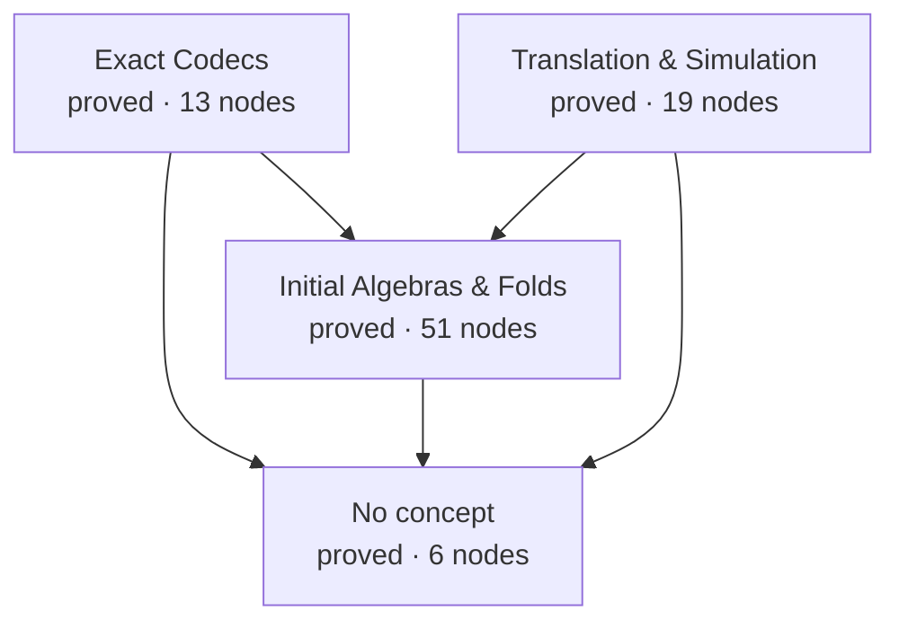

| Node | Status | Rests on | Nearest nodes |
| --- | --- | --- | --- |
| `read_print` | proved | — | `readTerm_printTerm` |
| `read_exact` | proved | — | — |
| `run_eq_meaning` | proved | — | `at_snoc`, `localRunC_mono`, `localRunC_waits`, `localRunC_agree`, `ReachesQ.refl`, `contextStep_fallback`, `ReachesQ.trans`, `not_withFiber`, `ReachesQ.step`, `localRunC_of_localRun`, `of_loopedRows` |
| `loopAgreement` | proved | — | `localRunC_mono`, `localRunC_waits`, `localRunC_agree`, `ReachesQ.refl`, `contextStep_fallback`, `ReachesQ.trans`, `not_withFiber`, `ReachesQ.step`, `localRunC_of_localRun`, `of_loopedRows`, `at_snoc` |
| `run_eq_ref` | proved | — | `at_snoc` |
| `mask_rows_table_premises` | proved | — | `read_exact`, `read_print` |
| `printTyped_eq_print` | proved | — | `printTypedAt_none`, `focusAtTable_annotate` |
| `printTypedAt_none` | proved | — | `hom_eq_cata_eff` |
| `eraseJoinArgs_printTyped` | proved | — | `eraseJoinArgs_printTypedSitesAt`, `eraseJoinArgs_printTypedAt` |
| `eraseJoinArgs_printTypedAt` | proved | — | `readTerm_printTerm` |
| `eraseJoinArgs_printTypedSitesAt` | proved | — | `envAt_append`, `annotate_eq_table`, `at_child`, `readTerm_printTerm`, `envAt_child` |
| `readTyped_exact` | proved | — | `read_exact` |
| `readTyped_printTyped` | proved | — | `eraseJoinArgs_printTyped`, `read_print` |
| `readTyped_printTypedAt` | proved | — | `eraseJoinArgs_printTypedAt`, `read_print` |
| `localRunC_of_localRun` | proved | — | `contextStep_fallback`, `not_withFiber` |
| `focusAtTable_annotate` | proved | — | `check_sound`, `check_complete`, `mem_addresses_iff`, `annotate_eq_table` |
| `readModule_printModule_defs` | proved | — | `replaceAt_spec` |
| `funded_replays` | proved | — | `journal_replays`, `tape_replays` |
| `tape_replays` | proved | — | — |
| `readTerm_printTerm` | proved | — | — |
| `at_snoc` | proved | — | `at_append` |
| `localRunC_mono` | proved | — | — |
| `localRunC_waits` | proved | — | — |
| `localRunC_agree` | proved | — | `localRunC_mono` |
| `ReachesQ.refl` | proved | — | `ReachesC.refl` |
| `contextStep_fallback` | proved | — | — |
| `ReachesQ.trans` | proved | — | `ReachesC.trans` |
| `not_withFiber` | proved | — | — |
| `ReachesQ.step` | proved | — | `ReachesC.step` |
| `of_loopedRows` | proved | — | — |
| `hom_eq_cata_eff` | proved | — | — |
| `envAt_append` | proved | — | — |
| `annotate_eq_table` | proved | — | `check_eq`, `table_eq_tableAt` |
| `at_child` | proved | — | `at_snoc` |
| `envAt_child` | proved | — | `envAt_append` |
| `check_sound` | proved | — | — |
| `check_complete` | proved | — | — |
| `mem_addresses_iff` | proved | — | `yieldAt_addressYield`, `mem_foldList_iff`, `addresses_eq_foldList` |
| `replaceAt_spec` | proved | — | — |
| `journal_replays` | proved | — | — |
| `at_append` | proved | — | — |
| `ReachesC.refl` | proved | — | — |
| `ReachesC.trans` | proved | — | — |
| `ReachesC.step` | proved | — | `contextStep_fallback`, `contextStep` |
| `check_eq` | proved | — | `tableAt_eq_cons`, `tableAt_none`, `checkStmt_step_binds`, `effTy_of_check`, `termTy_of_term?` |
| `table_eq_tableAt` | proved | — | — |
| `yieldAt_addressYield` | proved | — | — |
| `mem_foldList_iff` | proved | — | `exists_at_of_mem_foldList` |
| `addresses_eq_foldList` | proved | — | — |
| `contextStep` | proved | — | — |
| `tableAt_eq_cons` | proved | — | `tableEntryAt_nil`, `childAddresses_map_tableEntryAt`, `addresses_eq_cons` |
| `tableAt_none` | proved | — | — |
| `checkStmt_step_binds` | proved | — | — |
| `effTy_of_check` | proved | — | `check_sound`, `check_complete` |
| `termTy_of_term?` | proved | — | — |
| `exists_at_of_mem_foldList` | proved | — | `sizeOf_child_lt`, `foldList_cases` |
| `tableEntryAt_nil` | proved | — | — |
| `childAddresses_map_tableEntryAt` | proved | — | — |
| `addresses_eq_cons` | proved | — | `foldMapAt_stmt_paths_cons`, `foldMapAt_layers_paths_cons`, `foldMapAt_effs_paths_cons`, `foldMapAt_layer_paths_cons`, `foldMapAt_action_paths_cons`, `foldMapAt_stmts_paths_cons`, `foldMapAt_eff_paths_cons` |
| `sizeOf_child_lt` | proved | — | — |
| `foldList_cases` | proved | — | — |
| `foldMapAt_stmt_paths_cons` | proved | — | `foldMapAt_stmt_paths_shift` |
| `foldMapAt_layers_paths_cons` | proved | — | `foldMapAt_layers_paths_shift` |
| `foldMapAt_effs_paths_cons` | proved | — | `foldMapAt_effs_paths_shift` |
| `foldMapAt_layer_paths_cons` | proved | — | `foldMapAt_layer_paths_shift` |
| `foldMapAt_action_paths_cons` | proved | — | `foldMapAt_action_paths_shift` |
| `foldMapAt_stmts_paths_cons` | proved | — | `foldMapAt_stmts_paths_shift` |
| `foldMapAt_eff_paths_cons` | proved | — | `foldMapAt_eff_paths_shift` |
| `foldMapAt_stmt_paths_shift` | proved | — | `foldMapAt_stmt_hom`, `foldMapAt_stmt_base` |
| `foldMapAt_layers_paths_shift` | proved | — | `foldMapAt_layers_hom`, `foldMapAt_layers_base` |
| `foldMapAt_effs_paths_shift` | proved | — | `foldMapAt_effs_hom`, `foldMapAt_effs_base` |
| `foldMapAt_layer_paths_shift` | proved | — | `foldMapAt_layer_hom`, `foldMapAt_layer_base` |
| `foldMapAt_action_paths_shift` | proved | — | `foldMapAt_action_hom`, `foldMapAt_action_base` |
| `foldMapAt_stmts_paths_shift` | proved | — | `foldMapAt_stmts_hom`, `foldMapAt_stmts_base` |
| `foldMapAt_eff_paths_shift` | proved | — | `foldMapAt_eff_hom`, `foldMapAt_eff_base` |
| `foldMapAt_stmt_hom` | proved | — | — |
| `foldMapAt_stmt_base` | proved | — | — |
| `foldMapAt_layers_hom` | proved | — | — |
| `foldMapAt_layers_base` | proved | — | — |
| `foldMapAt_effs_hom` | proved | — | — |
| `foldMapAt_effs_base` | proved | — | — |
| `foldMapAt_layer_hom` | proved | — | — |
| `foldMapAt_layer_base` | proved | — | — |
| `foldMapAt_action_hom` | proved | — | — |
| `foldMapAt_action_base` | proved | — | — |
| `foldMapAt_stmts_hom` | proved | — | — |
| `foldMapAt_stmts_base` | proved | — | — |
| `foldMapAt_eff_hom` | proved | — | — |
| `foldMapAt_eff_base` | proved | — | — |

### R9: Never goes wrong: M7a–c on M7Fragment (the empty host table, answer-free tapes)

- Open, waits on a ruling (decisions row 117: the frame contract, designed first): part two: a saved frame transports missingService across a change in the requirement row (decisions row 117)

R9 by concept: each concept its nodes are placed at, by tag or by module. An arrow goes where a node's proof reaches a node of another concept.

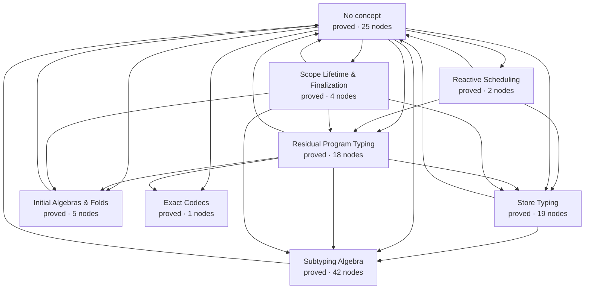

| Node | Status | Rests on | Nearest nodes |
| --- | --- | --- | --- |
| `m7_proved` | proved | — | `decision_preserves`, `loadsTyped`, `m7_of_ledger` |
| `m7_admitted` | proved | — | `m7_proved`, `lawfulSig_of_admitted` |
| `countdown_parks_positional` | proved | — | `order_refl`, `fits_mono`, `order_trans`, `mono`, `satisfies_empty`, `fits_subN`, `close_typed` |
| `evalTerm_progress` | proved | — | `_mutual` |
| `_mutual` | proved | — | `fits_subN`, `list_eliminator`, `normalize_idem`, `subN_trans`, `subN_refl`, `subN_list_iff`, `joinAll_keeps`, `mapM_answer`, `fits_iff_membersIn`, `listOf_upper`, `fits_normalize`, `fits_unfold`, `causeInputError_upper`, `matchArgsB_sound` |
| `decision_preserves` | proved | — | `fits_subN`, `satisfies_empty`, `order_refl`, `fits_mono`, `order_trans`, `mono`, `subN_trans`, `configTyped_frame`, `memberIn_mono`, `hasTyIn_iff`, `hom_eq_cata_ty`, `wake_preserves`, `close_typed`, `seq_typed`, `registrationDone_preserves`, `launch_preserves`, `subN_never`, `guardBind_typed`, `deliver_preserves`, `loop_preserves`, `driveState_lift` |
| `loadsTyped` | proved | — | `denotesTyped`, `checkModule_eq_check`, `check_complete`, `checkModule_sound`, `satisfies_empty` |
| `m7_of_ledger` | proved | — | `at_snoc`, `order_trans`, `order_refl` |
| `lawfulSig_of_admitted` | proved | — | `admitSig_ok_iff` |
| `order_refl` | proved | — | — |
| `fits_mono` | proved | — | — |
| `order_trans` | proved | — | — |
| `mono` | proved | — | `order_trans` |
| `satisfies_empty` | proved | — | — |
| `fits_subN` | proved | — | `subN_trans`, `fits_normalize` |
| `close_typed` | proved | — | — |
| `list_eliminator` | proved | — | `subN_list_iff`, `normalize_idem`, `subN_trans`, `subN_refl` |
| `normalize_idem` | proved | — | — |
| `subN_trans` | proved | — | — |
| `subN_refl` | proved | — | — |
| `subN_list_iff` | proved | — | — |
| `joinAll_keeps` | proved | — | `foldl_keeps` |
| `mapM_answer` | proved | — | `mapM_cons_eq_some` |
| `fits_iff_membersIn` | proved | — | `fits_unfold`, `fits_normalize` |
| `listOf_upper` | proved | — | `list_eliminator`, `normalize_idem`, `subN_trans`, `subN_refl`, `extendAll_upper` |
| `fits_normalize` | proved | — | `subN_trans`, `normalize_idem` |
| `fits_unfold` | proved | — | — |
| `causeInputError_upper` | proved | — | `cause_upper`, `cause_mono`, `normalize_idem`, `subN_trans`, `subN_refl`, `UnionRule.lift_upper`, `subN_causeOf_causeUpper`, `subN_exitOf_causeUpper`, `extendAll_eq_some_iff` |
| `matchArgsB_sound` | proved | — | — |
| `configTyped_frame` | proved | — | `satisfies_empty`, `fits_mono`, `order_trans`, `mono`, `order_refl`, `memberIn_mono`, `hasTyIn_iff`, `hom_eq_cata_ty` |
| `memberIn_mono` | proved | — | `hom_eq_cata_ty` |
| `hasTyIn_iff` | proved | — | — |
| `hom_eq_cata_ty` | proved | — | — |
| `wake_preserves` | proved | — | `order_refl`, `configTyped_frame`, `fits_mono`, `completionStrong_await`, `memberIn_mono`, `hasTyIn_iff`, `hom_eq_cata_ty` |
| `seq_typed` | proved | — | `subN_refl`, `fits_subN`, `guardBind_typed` |
| `registrationDone_preserves` | proved | — | `order_refl`, `fits_mono`, `order_trans`, `mono`, `satisfies_empty`, `close_typed`, `fits_subN` |
| `launch_preserves` | proved | — | `subN_refl`, `fits_subN`, `order_refl`, `fits_mono`, `satisfies_empty`, `order_trans`, `mono`, `satisfies_weaken` |
| `subN_never` | proved | — | — |
| `guardBind_typed` | proved | — | — |
| `deliver_preserves` | proved | — | `order_refl`, `satisfies_empty`, `fits_mono`, `order_trans`, `mono`, `satisfies_weaken`, `settle_callback`, `fits_memberIn`, `hasTyIn_iff`, `hom_eq_cata_ty`, `memberIn_mono`, `completionStrong_await`, `memoBuild_extension`, `deferredMake_extension`, `refMake_extension`, `subN_never`, `fits_subN`, `scopeParams_child`, `at_child`, `denotesTyped`, `evalTerm_progress`, `normalize_idem`, `subN_refl`, `scopeParams_below`, `subN_trans`, `fits_normalize`, `fiberTy_upper`, `solve_lookup_of_mem`, `matchB_sound`, `syncRow_typed`, `withParams_of_none`, `errOf_payload`, `isPayload_of_hasTy_record`, `at_append`, `foreignFinalizer_ambient`, `fits_scope_inv`, `seq_typed`, `closeSeqProtocol`, `configTyped_frame`, `close_typed`, `clause_scoped`, `clause_closeScope`, `scopeParams_ref`, `scopeParams_layer_below`, `satisfies_union`, `withParams_serviceTy`, `guardBind_typed`, `countdown_parks_positional` |
| `loop_preserves` | proved | — | `order_refl`, `satisfies_empty`, `fits_mono`, `order_trans`, `mono`, `satisfies_weaken`, `settle_callback`, `fits_memberIn`, `hasTyIn_iff`, `hom_eq_cata_ty`, `memberIn_mono`, `completionStrong_await`, `memoBuild_extension`, `deferredMake_extension`, `refMake_extension`, `subN_never`, `fits_subN`, `scopeParams_child`, `at_child`, `denotesTyped`, `evalTerm_progress`, `normalize_idem`, `subN_refl`, `scopeParams_below`, `subN_trans`, `fits_normalize`, `fiberTy_upper`, `solve_lookup_of_mem`, `matchB_sound`, `syncRow_typed`, `withParams_of_none`, `errOf_payload`, `isPayload_of_hasTy_record`, `at_append`, `foreignFinalizer_ambient`, `fits_scope_inv`, `seq_typed`, `closeSeqProtocol`, `configTyped_frame`, `close_typed`, `clause_scoped`, `clause_closeScope`, `scopeParams_ref`, `scopeParams_layer_below`, `satisfies_union`, `withParams_serviceTy`, `guardBind_typed`, `countdown_parks_positional` |
| `driveState_lift` | proved | — | — |
| `denotesTyped` | proved | — | `provideLayerArm`, `at_child`, `subN_refl`, `fits_subN`, `fits_normalize`, `fiberTy_upper`, `scopeParams_child`, `solve_lookup_of_mem`, `hom_eq_cata_ty`, `subN_trans`, `matchB_sound`, `syncRow_typed`, `withParams_of_none`, `evalTerm_progress`, `normalize_idem`, `errOf_payload`, `isPayload_of_hasTy_record`, `satisfies_weaken`, `subN_never`, `fits_mono`, `order_trans`, `invoke_arm`, `fits_iff_membersIn`, `option_eliminator`, `subN_option_iff`, `joinAll_keeps`, `mapM_answer`, `optionTy_upper`, `list_eliminator`, `subN_list_iff`, `listOf_upper`, `fits_unfold`, `causeInputError_upper`, `matchArgsB_sound`, `withParams_serviceTy`, `scopeParams_below`, `exitOf_upper`, `fits_scope_inv`, `param_arm`, `call_arm` |
| `checkModule_eq_check` | proved | — | — |
| `check_complete` | proved | — | — |
| `checkModule_sound` | proved | — | `check_sound` |
| `at_snoc` | proved | — | `at_append` |
| `admitSig_ok_iff` | proved | — | — |
| `foldl_keeps` | proved | — | — |
| `mapM_cons_eq_some` | proved | — | — |
| `extendAll_upper` | proved | — | `extendAll_adjoint` |
| `cause_upper` | proved | — | `subN_causeOf_causeUpper`, `subN_exitOf_causeUpper` |
| `cause_mono` | proved | — | `subN_exitOf_iff`, `subN_causeOf_causeUpper`, `subN_trans`, `subN_causeOf_iff` |
| `UnionRule.lift_upper` | proved | — | `le_joinAll`, `subN_trans`, `mapM_answer` |
| `subN_causeOf_causeUpper` | proved | — | — |
| `subN_exitOf_causeUpper` | proved | — | `subN_trans`, `subN_refl`, `subN_exitOf_iff` |
| `extendAll_eq_some_iff` | proved | — | — |
| `completionStrong_await` | proved | — | `subN_trans` |
| `satisfies_weaken` | proved | — | — |
| `settle_callback` | proved | — | `fits_subN`, `fits_mono`, `subN_never`, `subN_refl`, `order_refl`, `scopeParams_child`, `at_child`, `order_trans`, `fits_scope_inv`, `seq_typed`, `closeOrder_eq`, `mono`, `satisfies_empty`, `configTyped_frame`, `memberIn_mono`, `hasTyIn_iff`, `hom_eq_cata_ty` |
| `fits_memberIn` | proved | — | — |
| `memoBuild_extension` | proved | — | — |
| `deferredMake_extension` | proved | — | — |
| `refMake_extension` | proved | — | — |
| `scopeParams_child` | proved | — | — |
| `at_child` | proved | — | `at_snoc` |
| `scopeParams_below` | proved | — | — |
| `fiberTy_upper` | proved | — | `fiber_eliminator`, `normalize_idem`, `subN_trans`, `subN_refl`, `extendAll_upper` |
| `solve_lookup_of_mem` | proved | — | — |
| `matchB_sound` | proved | — | `solve_lookup_of_mem` |
| `syncRow_typed` | proved | — | `fits_normalize`, `subN_trans`, `solve_lookup_of_mem`, `fits_subN`, `termMaps_of_typed`, `matchB_sound`, `hom_eq_cata_ty`, `errOf_payload`, `isPayload_of_hasTy_record`, `normalize_idem`, `subN_refl` |
| `withParams_of_none` | proved | — | — |
| `errOf_payload` | proved | — | — |
| `isPayload_of_hasTy_record` | proved | — | `handles_of_payloadFieldTy` |
| `at_append` | proved | — | — |
| `foreignFinalizer_ambient` | proved | — | `subN_never`, `fits_subN`, `fits_mono`, `order_refl`, `scopeParams_child`, `at_child`, `order_trans` |
| `fits_scope_inv` | proved | — | — |
| `closeSeqProtocol` | proved | — | `order_trans`, `fits_mono` |
| `clause_scoped` | proved | — | `fits_mono`, `order_trans`, `mono`, `order_refl`, `satisfies_empty`, `denotesTyped`, `configTyped_frame`, `memberIn_mono`, `hasTyIn_iff`, `hom_eq_cata_ty` |
| `clause_closeScope` | proved | — | `fits_mono`, `order_trans`, `mono`, `subN_never`, `fits_subN`, `order_refl`, `scopeParams_child`, `at_child`, `fits_scope_inv`, `seq_typed`, `closeOrder_eq`, `satisfies_empty`, `configTyped_frame`, `memberIn_mono`, `hasTyIn_iff`, `hom_eq_cata_ty` |
| `scopeParams_ref` | proved | — | — |
| `scopeParams_layer_below` | proved | — | — |
| `satisfies_union` | proved | — | — |
| `withParams_serviceTy` | proved | — | — |
| `provideLayerArm` | proved | — | `fits_subN`, `subN_refl`, `fits_normalize`, `fiberTy_upper`, `scopeParams_child`, `at_child`, `solve_lookup_of_mem`, `hom_eq_cata_ty`, `subN_trans`, `matchB_sound`, `syncRow_typed`, `withParams_of_none`, `evalTerm_progress`, `normalize_idem`, `errOf_payload`, `isPayload_of_hasTy_record`, `satisfies_weaken`, `subN_never`, `fits_mono`, `order_trans`, `fits_scope_inv` |
| `invoke_arm` | proved | — | `normalize_idem`, `fits_mono`, `fits_subN`, `order_trans`, `at_child`, `scopeParams_below`, `evalTerm_progress`, `scopeParams_body`, `withParams_defOf` |
| `option_eliminator` | proved | — | `subN_option_iff`, `normalize_idem`, `subN_trans`, `subN_refl` |
| `subN_option_iff` | proved | — | — |
| `optionTy_upper` | proved | — | `option_eliminator`, `normalize_idem`, `subN_trans`, `subN_refl`, `Eliminator.lift_upper` |
| `exitOf_upper` | proved | — | `exit_eliminator`, `normalize_idem`, `subN_trans`, `subN_refl`, `extendAll_upper` |
| `param_arm` | proved | — | `normalize_idem`, `fits_mono`, `fits_subN`, `order_trans`, `evalTerm_progress`, `scopeParams_decl`, `withParams_param` |
| `call_arm` | proved | — | `fits_mono`, `fits_subN`, `normalize_idem`, `order_trans`, `evalTerm_progress`, `scopeParams_body`, `withParams_of_none` |
| `check_sound` | proved | — | — |
| `extendAll_adjoint` | proved | — | `adjoint`, `extendAll_eq_some_iff` |
| `subN_exitOf_iff` | proved | — | — |
| `subN_causeOf_iff` | proved | — | — |
| `le_joinAll` | proved | — | `joinAll_keeps` |
| `closeOrder_eq` | proved | — | — |
| `fiber_eliminator` | proved | — | `subN_fiberOf_iff`, `normalize_idem`, `subN_trans`, `subN_refl` |
| `termMaps_of_typed` | proved | — | `evalTerm_progress`, `fits_mono` |
| `handles_of_payloadFieldTy` | proved | — | — |
| `scopeParams_body` | proved | — | — |
| `withParams_defOf` | proved | — | — |
| `Eliminator.lift_upper` | proved | — | `subN_refl`, `UnionRule.lift_upper` |
| `exit_eliminator` | proved | — | `subN_exitOf_iff`, `normalize_idem`, `subN_trans`, `subN_refl` |
| `scopeParams_decl` | proved | — | — |
| `withParams_param` | proved | — | — |
| `adjoint` | proved | — | `Eliminator.lift_least`, `subN_trans`, `mapM_total`, `Eliminator.lift_upper` |
| `subN_fiberOf_iff` | proved | — | — |
| `Eliminator.lift_least` | proved | — | `UnionRule.lift_least` |
| `mapM_total` | proved | — | `mapM_cons_eq_some` |
| `UnionRule.lift_least` | proved | — | `subN_trans`, `mapM_source`, `joinAll_le` |
| `mapM_source` | proved | — | `mapM_cons_eq_some` |
| `joinAll_le` | proved | — | `joinAll_all` |
| `joinAll_all` | proved | — | `foldl_all` |
| `foldl_all` | proved | — | — |

### R10: Library code inherits theorems: a composed module's law is Agrees profile module expansion

- Open, worded as a proposed claim: pool-expansion-agrees (proposed claim; translation-simulation): Pool's expansion agrees with the first profile's public observation, under its premises on the callers, interruption, the close and the work budget; its parts on one atomic step are pool_steps_agree and the eleven attempt statements of the operations, each on every model state (lease_attempt, withdraw_attempt, return_attempt, select_attempt, close_attempt, drain_attempt, make_makes, and four at the names that the operation mints; the lease, the withdrawal and the closer's step take an injective table); the operations, the wake, the close and the refusal at a closed pool are library programs (src/Effect4/Library/Pool/Ops.lean); the wrapper's run for the borrower and for the closer, the wake across helpers and the protected lease's run are not stated; finite controls: ten cases on the Lean machine, on the generated engine and on rc.112, one schedule each (Test/Program/PoolPublic.lean) (decisions rows 79, 226, 267 to 269, 276, 279)
- Open, not triaged: a composed module's law, Agrees profile module expansion (decisions row 79, R79.5; DI-89)
- Open, not triaged: no form has a behaviour law (DI-89)
- Open, not triaged: the agreement half of mask-printed-form-profile (translation-simulation, serving R10 and R11): the compiled derived form against the named release's printed form, equal observation on a named observation under compatible decisions; the three operations more than the native mask are measured on the machine and on the target, not proved, and the cuts at the two checkpoints on the pin rest on Codex's runs; the expansion, the typing, the readability and the two checkpoints on the machine are mask_printed_form_profile (decisions rows 245, 246); no goal states the agreement
- Open, not triaged: none of DI-89's named forms exists: retry, catchTag, forEach, all, Schedule over iterate, the option and result eliminators
- Open, waits on a ruling (the model probe's D9, not ruled (DI-89)): per form: reader admission, a readable expansion (C8) and a stable identity (DI-89; the model probe's D9, unruled)
- Open, not triaged: DI-39's six rows not landed
- Open, not triaged: a composite's contract by a stuttering route (post-Phase C §11.4)
- Open, worded as a proposed claim: queue-expansion-agrees (proposed claim; translation-simulation): the Queue's expansion agrees with its application-signature clients on the Queue's profile, which defines the public requests, commits, replies, interruptions and terminations before it hides a private cell or a helper identity (decisions rows 79, 219 to 222, 230); its first application on one program is two planned goals, held_within_fed and fed_accounted (Test/Dogfood/Scenario/QueueWorkers.lean), with finite controls on the Lean machine, three engine runs and 25 host runs; no law of a whole run
- Open, worded as a proposed claim: semaphore-expansion-agrees (proposed claim; translation-simulation): Semaphore's expansion agrees with the first profile's public observation; it keeps the selected identities and the permit commits, with its premises on the wake's policy, the admitted callers, interruption and the work budget; its parts on one atomic step are semaphore-steps-agree and the nine attempt statements of the operations, each on every model state; the operations, the walk and the protected form are library programs (src/Effect4/Library/Semaphore/Ops.lean); the wrapper's run, the walk across visits and the protected form's run are not stated (decisions rows 79, 226, 259 to 261, 276)
- Open, worded as a proposed claim: partitioned-semaphore-expansion-agrees (proposed claim; translation-simulation): latest's finite natural-count profile observes registration, partial reservation, ordered partition selection, cancellation settlement, inline client execution and the final reply under admitted client tapes; partitioned-semaphore-bookkeeping proves only four scalar source readings, including explicit premises for reservation; the waiter model, contextual identity correspondence, delivery and protected acquisition connection remain unstated; no whole-run or progress claim (decisions rows 330, 331, 333 and 335)
- Open, worded as a proposed claim: stream-array-run-agrees (proposed claim; translation-simulation): the array source's public pulls return its initial finite sequence once and then End, under the admitted caller and observation profile; stream-array-step-agreement proves the allocated cell's batch transition; whole pulls, repeated opens, finalization and the signed Done/End correspondence remain open (decisions rows 331 and 335)
- Open, worded as a proposed claim: synchronized-ref-expansion-agrees (proposed claim; translation-simulation): pure callback modification observes Ref's reply and stored value under Semaphore's protected permit protocol; make_answers, get_answers and modify_answers prove typing under their stated premises; protected acquisition, cancellation, cleanup and composed run agreement remain open; effectful callbacks stay outside this slice (decisions rows 330, 331 and 335)
- Open, worded as a proposed claim: pubsub-single-expansion-agrees (proposed claim; translation-simulation): the capacity-one, replay-zero profile observes natural messages and live logical subscriptions; pubsub-single-steps-agree proves six source readings under fresh subscription and scope premises; contextual source-object correspondence, exact numeric host admission, waiting, delivery, cancellation, lifetime and backpressure execution remain open (decisions rows 330, 331 and 335)
- Open, worded as a proposed claim: posted-wake-profile-agrees (proposed claim; translation-simulation): one producer's posted delivery, with its dispatch owner, priority, receiver and token, capture time, coalescing and cancellation, agrees with its module expansion; the Queue's producer is first (decisions rows 81, 220, 225; DB-13)
- Open, worded as a proposed claim: atomic-attempt-agreement (proposed claim; translation-simulation): the restricted transaction profile against the named release, with flat nesting, immutable payloads and explicit retry; then tx-choice-rollback-union for the retry-only alternative (decisions rows 80, 84, 223, 224)
- Open, not triaged: fair composition of tickets that are enrolled apart is outside the first profile: the opposing-ticket cycle stays a refused case until an enrolment protocol resolves it (decisions row 223)

R10 by concept: each concept its nodes are placed at, by tag or by module. An arrow goes where a node's proof reaches a node of another concept.

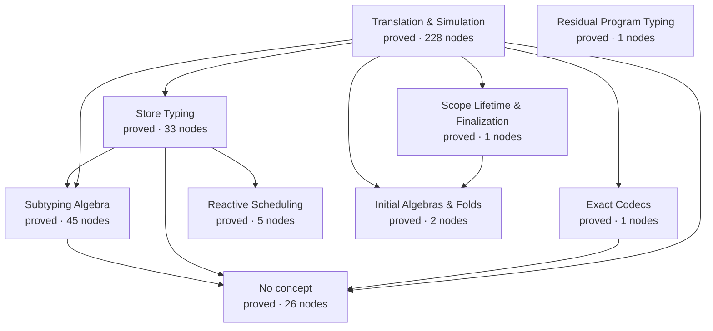

| Node | Status | Rests on | Nearest nodes |
| --- | --- | --- | --- |
| `andThenEffect_typed` | proved | — | `check_sound`, `check_complete` |
| `andThenContinuation_typed` | proved | — | `check_sound`, `check_complete` |
| `andThenThunk_typed` | proved | — | `andThenEffect_typed` |
| `as_typed` | proved | — | `check_sound`, `check_complete` |
| `asVoid_typed` | proved | — | `as_typed` |
| `tapContinuation_typed` | proved | — | `normalize_idem`, `check_sound`, `check_complete` |
| `tapEffect_typed` | proved | — | `normalize_idem`, `check_sound`, `check_complete` |
| `ensuring_typed` | proved | — | `check_sound`, `check_complete` |
| `void_typed` | proved | — | `check_complete`, `check_sound` |
| `die_typed` | proved | — | `check_complete`, `check_sound` |
| `yieldKey_typed` | proved | — | `check_complete`, `check_sound` |
| `matchCause_typed` | proved | — | `check_sound`, `check_complete` |
| `matchCauseEffect_typed` | proved | — | `check_sound`, `check_complete` |
| `yieldNow_typed` | proved | — | `check_complete`, `check_sound` |
| `forkChildDefault_typed` | proved | — | `check_sound`, `check_complete` |
| `forkDetachDefault_typed` | proved | — | `check_sound`, `check_complete` |
| `forkInDefault_typed` | proved | — | `check_sound`, `check_complete` |
| `forkScopedDefault_typed` | proved | — | `check_sound`, `check_complete` |
| `releaseOne_typed` | proved | — | `check_sound`, `check_complete` |
| `mask_printed_form_profile` | proved | — | `saved_mask_restoration`, `read_print`, `check_sound`, `check_complete` |
| `build_retains` | proved | — | `finishBuild_retains`, `checkInput_eq_none_iff` |
| `elaborateModule_no_declarations` | proved | — | — |
| `elaboration_eq_getD` | proved | — | — |
| `finishBuild_retains` | proved | — | `checkInput_eq_none_iff` |
| `mapDoneEffectOf_protocol` | proved | — | `matchAnswer_meaning` |
| `mapEffectOf_protocol` | proved | — | `matchAnswer_meaning` |
| `awaitStep_agrees` | proved | — | `sound` |
| `Latch.Model.closeStep_agrees` | proved | — | `sound` |
| `flushStep_agrees` | proved | — | `sound` |
| `initialStep_agrees` | proved | — | `sound` |
| `isOpenStep_agrees` | proved | — | `sound` |
| `latch_registration_agrees` | proved | — | `Latch.Model.withdrawStep_agrees`, `awaitStep_agrees`, `initialStep_agrees` |
| `latch_steps_agree` | proved | — | `Latch.Model.closeStep_agrees`, `flushStep_agrees`, `wakeStep_agrees`, `isOpenStep_agrees` |
| `wakeStep_agrees` | proved | — | `sound` |
| `Latch.Model.withdrawStep_agrees` | proved | — | `sound` |
| `frame` | proved | — | — |
| `sound` | proved | — | `reads_ascribe` |
| `cell_read` | proved | — | — |
| `reads_ascribe` | proved | — | — |
| `step_updates` | proved | — | — |
| `available_eval` | proved | — | — |
| `available_reads` | proved | — | `available_eval`, `sound` |
| `bookkeeping_agrees` | proved | — | `reserve_reads`, `tryTake_reads`, `available_reads`, `PartitionedSemaphore.Model.initial_reads` |
| `PartitionedSemaphore.Model.initial_eval` | proved | — | — |
| `PartitionedSemaphore.Model.initial_reads` | proved | — | `PartitionedSemaphore.Model.initial_eval`, `sound` |
| `reserve_eval` | proved | — | — |
| `reserve_reads` | proved | — | `reserve_eval`, `sound` |
| `tryTake_eval` | proved | — | — |
| `tryTake_reads` | proved | — | `tryTake_eval`, `sound` |
| `Pool.Model.closeStep_agrees` | proved | — | `sound` |
| `drainStep_agrees` | proved | — | `sound` |
| `leaseStep_agrees` | proved | — | `sound` |
| `pool_steps_agree` | proved | — | `drainStep_agrees`, `Pool.Model.closeStep_agrees`, `Pool.Model.withdrawStep_agrees`, `selectStep_agrees`, `returnStep_agrees`, `leaseStep_agrees` |
| `returnStep_agrees` | proved | — | `sound` |
| `selectStep_agrees` | proved | — | `sound` |
| `Pool.Model.withdrawStep_agrees` | proved | — | `sound` |
| `close_attempt` | proved | — | `step_keeps_cell`, `closeStep_types`, `step_updates`, `Pool.Model.closeStep_agrees` |
| `drain_attempt` | proved | — | `step_keeps_cell`, `drainStep_types`, `step_updates`, `drainStep_agrees` |
| `drain_attempt_minted` | proved | — | `drain_attempt` |
| `lease_attempt` | proved | — | `step_keeps_cell`, `leaseStep_types`, `step_updates`, `leaseStep_agrees` |
| `lease_attempt_minted` | proved | — | `lease_attempt` |
| `Pool.make_makes` | proved | — | — |
| `return_attempt` | proved | — | `step_keeps_cell`, `returnStep_types`, `step_updates`, `returnStep_agrees` |
| `return_attempt_minted` | proved | — | `lift_member`, `normalize_idem`, `return_attempt` |
| `select_attempt` | proved | — | `step_keeps_cell`, `selectStep_types`, `step_updates`, `selectStep_agrees` |
| `withdraw_attempt` | proved | — | `step_keeps_cell`, `Pool.Model.withdrawStep_types`, `step_updates`, `Pool.Model.withdrawStep_agrees` |
| `withdraw_attempt_minted` | proved | — | `withdraw_attempt` |
| `hostRunBlockB_stable` | proved | — | `denoteBlockB_approx` |
| `call_unfolds_at_limitB` | proved | — | `denoteBlockB_call` |
| `cata_blockAlgB_approx` | proved | — | `params_approx_lookup` |
| `cata_blockAlgB_effs` | proved | — | — |
| `cata_blockAlgB_effs_approx` | proved | — | `params_approx_lookup` |
| `denoteBlockB_approx` | proved | — | `cata_blockAlgB_approx` |
| `denoteBlockB_bind` | proved | — | — |
| `denoteBlockB_call` | proved | — | — |
| `denoteBlockB_invoke` | proved | — | `cata_blockAlgB_effs` |
| `hostRunBlockB_bind` | proved | — | `denoteBlockB_bind` |
| `invoke_unfolds_at_limitB` | proved | — | `denoteBlockB_invoke` |
| `params_approx_lookup` | proved | — | — |
| `runRowsH_map_some` | proved | — | — |
| `tagHit_record` | proved | — | — |
| `modify_loop` | proved | — | `loop_sync_op` |
| `sub_instantiate_polarity` | proved | — | — |
| `semiring_laws` | proved | — | — |
| `PubSub.Model.initial_eval` | proved | — | — |
| `PubSub.Model.initial_reads` | proved | — | `PubSub.Model.initial_eval`, `sound` |
| `poll_eval` | proved | — | — |
| `poll_reads` | proved | — | `poll_eval`, `sound` |
| `single_steps_agree` | proved | — | `slide_reads`, `unsubscribe_reads`, `poll_reads`, `tryPublish_reads`, `subscribe_reads`, `PubSub.Model.initial_reads` |
| `slide_eval` | proved | — | — |
| `slide_reads` | proved | — | `slide_eval`, `sound` |
| `subscribe_eval` | proved | — | — |
| `subscribe_reads` | proved | — | `subscribe_eval`, `sound` |
| `tryPublish_eval` | proved | — | — |
| `tryPublish_reads` | proved | — | `tryPublish_eval`, `sound` |
| `unsubscribe_eval` | proved | — | — |
| `unsubscribe_reads` | proved | — | `unsubscribe_eval`, `sound` |
| `catchDone_meaning` | proved | — | — |
| `matchAnswer_meaning` | proved | — | — |
| `matchEffect_meaning` | proved | — | — |
| `matchEffect_protocol` | proved | — | `matchEffect_meaning`, `matchAnswer_meaning` |
| `offer_loop` | proved | — | `offer_jobs`, `modify_loop`, `offer_attempt` |
| `take_loop` | proved | — | `take_jobs`, `modify_loop`, `Queue.take_attempt` |
| `acceptLoop_length_le` | proved | — | — |
| `first_profile_closed` | proved | — | — |
| `flatMap_split` | proved | — | — |
| `offerStep_agrees` | proved | — | `sound` |
| `offer_jobs` | proved | — | — |
| `pollStep_agrees` | proved | — | `sound` |
| `poll_jobs` | proved | — | `stateJobs_afterAccept` |
| `positive_suspend_step_capacity` | proved | — | `acceptLoop_length_le` |
| `queue_steps_agree` | proved | — | `withdrawOffer_agrees`, `withdrawTake_agrees`, `sizeStep_agrees`, `pollStep_agrees`, `offerStep_agrees`, `Queue.Model.takeStep_agrees` |
| `sizeStep_agrees` | proved | — | `sound` |
| `stateJobs_afterAccept` | proved | — | — |
| `Queue.Model.takeStep_agrees` | proved | — | `sound` |
| `take_jobs` | proved | — | `stateJobs_afterAccept` |
| `withdrawOffer_agrees` | proved | — | `sound` |
| `withdrawOffer_jobs` | proved | — | `flatMap_split` |
| `withdrawTake_agrees` | proved | — | `sound` |
| `withdrawTake_jobs` | proved | — | — |
| `bounded_makes` | proved | — | — |
| `offer_attempt` | proved | — | `step_keeps_cell`, `offerStep_types`, `step_updates`, `offerStep_agrees` |
| `offer_attempt_minted` | proved | — | `offer_attempt` |
| `offer_withdrawal` | proved | — | `step_keeps_cell`, `withdrawOffer_types`, `step_updates`, `withdrawOffer_agrees` |
| `offer_withdrawal_minted` | proved | — | `offer_withdrawal` |
| `poll_attempt` | proved | — | `step_keeps_cell`, `pollStep_types`, `step_updates`, `pollStep_agrees` |
| `size_read` | proved | — | `sizeStep_agrees`, `cell_read` |
| `Queue.take_attempt` | proved | — | `step_keeps_cell`, `Queue.Model.takeStep_types`, `step_updates`, `Queue.Model.takeStep_agrees` |
| `Queue.take_attempt_minted` | proved | — | `Queue.take_attempt` |
| `Queue.take_withdrawal` | proved | — | `step_keeps_cell`, `withdrawTake_types`, `step_updates`, `withdrawTake_agrees` |
| `Queue.take_withdrawal_minted` | proved | — | `Queue.take_withdrawal` |
| `cache_agrees` | proved | — | `get_session`, `invalidate_agrees`, `Cache.get_agrees`, `Cache.make_agrees` |
| `denoteBlockB_getBody` | proved | — | `denoteBlockB_straight` |
| `Cache.get_agrees` | proved | — | `get_hit`, `holding_self`, `get_miss` |
| `get_hit` | proved | — | `hostRun_bind_straight`, `ref_steps_agree` |
| `get_miss` | proved | — | `hostRun_bind_call`, `hostRun_bind_straight`, `ref_steps_agree` |
| `get_session` | proved | — | `Cache.get_agrees`, `hostRun_bind_straight`, `denoteRows_eq_session`, `ref_steps_agree` |
| `holding_self` | proved | — | `refPoke_peek` |
| `hostRunBlockB_call_invalidate` | proved | — | `denoteBlockB_straight`, `denoteBlockB_call` |
| `hostRunBlockB_invoke_get` | proved | — | `denoteBlockB_getBody`, `denoteBlockB_invoke` |
| `hostRun_bind_call` | proved | — | — |
| `hostRun_bind_straight` | proved | — | `denoteRows_straight` |
| `invalidate_agrees` | proved | — | `denoteRows_straight`, `ref_steps_agree` |
| `invalidate_get` | proved | — | `get_miss`, `invalidate_run` |
| `invalidate_run` | proved | — | `denoteRows_straight`, `ref_steps_agree` |
| `Cache.make_agrees` | proved | — | `denoteRows_straight`, `ref_steps_agree` |
| `refPoke_peek` | proved | — | — |
| `decode_modifySome` | proved | — | — |
| `decode_option` | proved | — | — |
| `encode_getD` | proved | — | — |
| `getAndSet_agrees` | proved | — | `kernel_agrees` |
| `getAndUpdateSome_agrees` | proved | — | `decode_option`, `kernel_agrees` |
| `getAndUpdate_agrees` | proved | — | `kernel_agrees` |
| `Ref.get_agrees` | proved | — | `kernel_agrees` |
| `kernel_agrees` | proved | — | — |
| `Ref.make_agrees` | proved | — | — |
| `modifySome_agrees` | proved | — | `encode_getD`, `decode_modifySome`, `kernel_agrees` |
| `modify_agrees` | proved | — | `kernel_agrees` |
| `modify_callback_agrees` | proved | — | `modify_agrees`, `sound` |
| `ref_steps_agree` | proved | — | `modifySome_agrees`, `modify_agrees`, `updateSomeAndGet_agrees`, `getAndUpdateSome_agrees`, `updateSome_agrees`, `updateAndGet_agrees`, `getAndUpdate_agrees`, `update_agrees`, `setAndGet_agrees`, `getAndSet_agrees`, `set_agrees`, `Ref.get_agrees`, `Ref.make_agrees` |
| `setAndGet_agrees` | proved | — | `kernel_agrees` |
| `set_agrees` | proved | — | `kernel_agrees` |
| `updateAndGet_agrees` | proved | — | `kernel_agrees` |
| `updateSomeAndGet_agrees` | proved | — | `encode_getD`, `decode_option`, `kernel_agrees` |
| `updateSome_agrees` | proved | — | `decode_option`, `kernel_agrees` |
| `update_agrees` | proved | — | `kernel_agrees` |
| `releaseStep_agrees` | proved | — | `sound` |
| `semaphore_steps_agree` | proved | — | `Semaphore.Model.withdrawStep_agrees`, `visitStep_agrees`, `releaseStep_agrees`, `takeIfAvailableStep_agrees`, `Semaphore.Model.takeStep_agrees` |
| `takeIfAvailableStep_agrees` | proved | — | `sound` |
| `Semaphore.Model.takeStep_agrees` | proved | — | `sound` |
| `visitStep_agrees` | proved | — | `sound` |
| `Semaphore.Model.withdrawStep_agrees` | proved | — | `sound` |
| `Semaphore.make_makes` | proved | — | — |
| `release_attempt` | proved | — | `step_keeps_cell`, `releaseStep_types`, `step_updates`, `releaseStep_agrees` |
| `takeIfAvailable_attempt` | proved | — | `step_keeps_cell`, `takeIfAvailableStep_types`, `step_updates`, `takeIfAvailableStep_agrees` |
| `Semaphore.take_attempt` | proved | — | `step_keeps_cell`, `Semaphore.Model.takeStep_types`, `step_updates`, `Semaphore.Model.takeStep_agrees` |
| `Semaphore.take_attempt_minted` | proved | — | `Semaphore.take_attempt` |
| `Semaphore.take_withdrawal` | proved | — | `step_keeps_cell`, `Semaphore.Model.withdrawStep_types`, `step_updates`, `Semaphore.Model.withdrawStep_agrees` |
| `Semaphore.take_withdrawal_minted` | proved | — | `Semaphore.take_withdrawal` |
| `visit_attempt` | proved | — | `step_keeps_cell`, `visitStep_types`, `step_updates`, `visitStep_agrees` |
| `visit_attempt_minted` | proved | — | `visit_attempt` |
| `arrayStep_agrees` | proved | — | `modify_callback_agrees` |
| `check_sound` | proved | — | — |
| `check_complete` | proved | — | — |
| `normalize_idem` | proved | — | — |
| `saved_mask_restoration` | proved | — | `at_snoc` |
| `read_print` | proved | — | `readTerm_printTerm` |
| `checkInput_eq_none_iff` | proved | — | — |
| `step_keeps_cell` | proved | — | `order_refl`, `termMaps_of_typed` |
| `closeStep_types` | proved | — | `typed` |
| `drainStep_types` | proved | — | `typed` |
| `leaseStep_types` | proved | — | `typed` |
| `returnStep_types` | proved | — | `typed` |
| `lift_member` | proved | — | — |
| `selectStep_types` | proved | — | `typed` |
| `Pool.Model.withdrawStep_types` | proved | — | `typed` |
| `loop_sync_op` | proved | — | `native_sync_op`, `iteration_below_budget`, `loop_of_iteration` |
| `offerStep_types` | proved | — | `offer_nodes_for_steps`, `message_nodes_for_steps`, `ascribe_formed_for_steps`, `typed` |
| `withdrawOffer_types` | proved | — | `typed` |
| `pollStep_types` | proved | — | `offer_nodes_for_steps`, `message_nodes_for_steps`, `ascribe_formed_for_steps`, `typed` |
| `Queue.Model.takeStep_types` | proved | — | `offer_nodes_for_steps`, `message_nodes_for_steps`, `ascribe_formed_for_steps`, `typed` |
| `withdrawTake_types` | proved | — | `typed` |
| `denoteBlockB_straight` | proved | — | `denoteRowsB_straight`, `denoteBlockB_loopedDataRows` |
| `denoteRows_eq_session` | proved | — | `contextStep_fallback`, `localRunC_mono`, `localRunC_agree`, `localRunC_waits`, `terminal`, `denoteRowsB_straight`, `localRunC_compileB`, `PlainHooks.of_loopedRows`, `answer`, `join`, `Leads.trans`, `seg_settles_receipt`, `Leads.refl`, `load_evaluate_receipt`, `flush_Myield_receipt`, `funded_replays` |
| `denoteRows_straight` | proved | — | — |
| `releaseStep_types` | proved | — | `typed` |
| `takeIfAvailableStep_types` | proved | — | `typed` |
| `Semaphore.Model.takeStep_types` | proved | — | `typed` |
| `Semaphore.Model.withdrawStep_types` | proved | — | `typed` |
| `visitStep_types` | proved | — | `typed` |
| `at_snoc` | proved | — | `at_append` |
| `readTerm_printTerm` | proved | — | — |
| `order_refl` | proved | — | — |
| `termMaps_of_typed` | proved | — | `evalTerm_progress`, `fits_mono` |
| `typed` | proved | — | `candsList_nil`, `cands_var`, `candsList_cons`, `types_ascribe`, `normalize_idem`, `subN_refl`, `matchArgsB_list_var_nat`, `matchArgsB_append`, `matchArgsB_cons_nil`, `lift_member`, `matchArgsB_one_var`, `matchArgsB_two_vars`, `join_eq_right_of_subN`, `matchArgsB_ite` |
| `native_sync_op` | proved | — | — |
| `iteration_below_budget` | proved | — | — |
| `loop_of_iteration` | proved | — | — |
| `offer_nodes_for_steps` | proved | — | `message_nodes_for_steps` |
| `message_nodes_for_steps` | proved | — | — |
| `ascribe_formed_for_steps` | proved | — | — |
| `denoteRowsB_straight` | proved | — | — |
| `denoteBlockB_loopedDataRows` | proved | — | `cata_blockAlgB_loopedDataRows` |
| `contextStep_fallback` | proved | — | — |
| `localRunC_mono` | proved | — | — |
| `localRunC_agree` | proved | — | `localRunC_mono` |
| `localRunC_waits` | proved | — | — |
| `terminal` | proved | — | `localRunC_mono` |
| `localRunC_compileB` | proved | — | `localRunC_compileBO` |
| `PlainHooks.of_loopedRows` | proved | — | `ContextFreeHooks.of_loopedRows`, `ContextFreeHooks.toPlain` |
| `answer` | proved | — | — |
| `join` | proved | — | — |
| `Leads.trans` | proved | — | `terminal`, `RunJoinC.trans` |
| `seg_settles_receipt` | proved | — | `join`, `drive_seg_receipt` |
| `Leads.refl` | proved | — | `RunJoinC.refl` |
| `load_evaluate_receipt` | proved | — | `seg_settles_receipt` |
| `flush_Myield_receipt` | proved | — | `Leads.trans`, `contextStep_yieldWrapper`, `ReachesQ.contextStep`, `seg_settles_receipt`, `fire_Myield_answer_context` |
| `funded_replays` | proved | — | `journal_replays`, `tape_replays` |
| `at_append` | proved | — | — |
| `evalTerm_progress` | proved | — | `_mutual` |
| `fits_mono` | proved | — | — |
| `candsList_nil` | proved | — | — |
| `cands_var` | proved | — | — |
| `candsList_cons` | proved | — | — |
| `types_ascribe` | proved | — | `lift_member`, `normalize_idem` |
| `subN_refl` | proved | — | — |
| `matchArgsB_list_var_nat` | proved | — | `candsList_nil`, `cands_var`, `candsList_cons` |
| `matchArgsB_append` | proved | — | `candsList_nil`, `cands_var`, `candsList_cons` |
| `matchArgsB_cons_nil` | proved | — | `candsList_nil`, `cands_var`, `candsList_cons` |
| `matchArgsB_one_var` | proved | — | `cands_var`, `candsList_nil`, `candsList_cons` |
| `matchArgsB_two_vars` | proved | — | `candsList_nil`, `cands_var`, `candsList_cons` |
| `join_eq_right_of_subN` | proved | — | `normalize_idem`, `subN_refl`, `subN_join_least` |
| `matchArgsB_ite` | proved | — | `normalize_idem`, `candsList_nil`, `cands_var`, `candsList_cons` |
| `cata_blockAlgB_loopedDataRows` | proved | — | — |
| `localRunC_compileBO` | proved | — | `compilesBO_onExit`, `compilesBO_matchCause`, `compilesBO_catchIf`, `compilesBO_catchCause`, `compilesBO_select`, `compilesBO_bind`, `compilesBO_iterate`, `compilesBO_exit`, `compilesBO_suspend`, `ReachesC.refl`, `denoteRowsB_straight`, `denoteRows_straight`, `answer`, `ReachesC.step` |
| `ContextFreeHooks.of_loopedRows` | proved | — | — |
| `ContextFreeHooks.toPlain` | proved | — | `ContextFreeCode.toPlain` |
| `RunJoinC.trans` | proved | — | — |
| `drive_seg_receipt` | proved | — | `drive_loop_yield_context`, `ReachesQ.refl`, `drive_receipt_result`, `drive_loop_call_context`, `drive_loop_sync_op_context`, `drive_loop_sync_op_none_context`, `ReachesQ.step`, `drive_loop_sync_pure_context`, `context_receipt_finish`, `drive_deliver_finish_context`, `drive_loop_finish_context`, `contextStep_finished_stores`, `drive_deliver_running_context`, `drive_loop_running_context`, `ReachesQ.contextStep`, `contextStep_plain`, `contextStep_stores`, `prepend`, `drive_receipt_prefix` |
| `RunJoinC.refl` | proved | — | — |
| `contextStep_yieldWrapper` | proved | — | — |
| `ReachesQ.contextStep` | proved | — | `ReachesC.contextStep` |
| `fire_Myield_answer_context` | proved | — | — |
| `journal_replays` | proved | — | — |
| `tape_replays` | proved | — | — |
| `_mutual` | proved | — | `fits_subN`, `list_eliminator`, `normalize_idem`, `subN_trans`, `subN_refl`, `subN_list_iff`, `joinAll_keeps`, `mapM_answer`, `fits_iff_membersIn`, `listOf_upper`, `fits_normalize`, `fits_unfold`, `causeInputError_upper`, `matchArgsB_sound` |
| `subN_join_least` | proved | — | `normalize_idem` |
| `compilesBO_onExit` | proved | — | `ReachesC.trans`, `same`, `ReachesC.refl`, `at_snoc`, `ReachesC.step` |
| `compilesBO_matchCause` | proved | — | `ReachesC.trans`, `at_snoc`, `ReachesC.step`, `ReachesC.refl` |
| `compilesBO_catchIf` | proved | — | `ReachesC.trans`, `at_snoc`, `same`, `ReachesC.step`, `ReachesC.refl` |
| `compilesBO_catchCause` | proved | — | `ReachesC.trans`, `at_snoc`, `same`, `ReachesC.step`, `ReachesC.refl` |
| `compilesBO_select` | proved | — | `at_snoc`, `ReachesC.trans`, `ReachesC.step`, `ReachesC.refl` |
| `compilesBO_bind` | proved | — | `ReachesC.trans`, `same`, `at_snoc`, `ReachesC.step`, `ReachesC.refl` |
| `compilesBO_iterate` | proved | — | `same`, `ReachesC.trans`, `ReachesC.step`, `at_snoc`, `ReachesC.refl` |
| `compilesBO_exit` | proved | — | `ReachesC.refl`, `denoteRowsB_straight`, `ReachesC.trans`, `ReachesC.step`, `at_snoc` |
| `compilesBO_suspend` | proved | — | `ReachesC.step`, `ReachesC.trans`, `at_snoc`, `ReachesC.refl` |
| `ReachesC.refl` | proved | — | — |
| `ReachesC.step` | proved | — | `contextStep_fallback`, `ReachesC.contextStep` |
| `ContextFreeCode.toPlain` | proved | — | — |
| `drive_loop_yield_context` | proved | — | — |
| `ReachesQ.refl` | proved | — | `ReachesC.refl` |
| `drive_receipt_result` | proved | — | `drive_receipt_stable` |
| `drive_loop_call_context` | proved | — | `iteration_M_context` |
| `drive_loop_sync_op_context` | proved | — | `iteration_M_context` |
| `drive_loop_sync_op_none_context` | proved | — | `iteration_M_context` |
| `ReachesQ.step` | proved | — | `ReachesC.step` |
| `drive_loop_sync_pure_context` | proved | — | `iteration_M_context` |
| `context_receipt_finish` | proved | — | `context_run_finish`, `drive_receipt_result`, `drive_finish_M_context` |
| `drive_deliver_finish_context` | proved | — | `evaluateNative_plain_context`, `evaluatePrim_contextStep` |
| `drive_loop_finish_context` | proved | — | `iteration_M_context`, `evaluateNative_plain_context`, `evaluatePrim_contextStep` |
| `contextStep_finished_stores` | proved | — | — |
| `drive_deliver_running_context` | proved | — | `evaluateNative_plain_context`, `evaluatePrim_contextStep` |
| `drive_loop_running_context` | proved | — | `iteration_M_context`, `evaluateNative_plain_context`, `evaluatePrim_contextStep` |
| `contextStep_plain` | proved | — | `contextStep_fallback` |
| `contextStep_stores` | proved | — | — |
| `prepend` | proved | — | `ReachesQ.trans` |
| `drive_receipt_prefix` | proved | — | `drive_receipt_stable` |
| `ReachesC.contextStep` | proved | — | — |
| `fits_subN` | proved | — | `subN_trans`, `fits_normalize` |
| `list_eliminator` | proved | — | `subN_list_iff`, `normalize_idem`, `subN_trans`, `subN_refl` |
| `subN_trans` | proved | — | — |
| `subN_list_iff` | proved | — | — |
| `joinAll_keeps` | proved | — | `foldl_keeps` |
| `mapM_answer` | proved | — | `mapM_cons_eq_some` |
| `fits_iff_membersIn` | proved | — | `fits_unfold`, `fits_normalize` |
| `listOf_upper` | proved | — | `list_eliminator`, `normalize_idem`, `subN_trans`, `subN_refl`, `extendAll_upper` |
| `fits_normalize` | proved | — | `subN_trans`, `normalize_idem` |
| `fits_unfold` | proved | — | — |
| `causeInputError_upper` | proved | — | `cause_upper`, `cause_mono`, `normalize_idem`, `subN_trans`, `subN_refl`, `UnionRule.lift_upper`, `subN_causeOf_causeUpper`, `subN_exitOf_causeUpper`, `extendAll_eq_some_iff` |
| `matchArgsB_sound` | proved | — | — |
| `ReachesC.trans` | proved | — | — |
| `same` | proved | — | `contextStep_fallback`, `contextSame` |
| `drive_receipt_stable` | proved | — | — |
| `iteration_M_context` | proved | — | — |
| `context_run_finish` | proved | — | — |
| `drive_finish_M_context` | proved | — | — |
| `evaluateNative_plain_context` | proved | — | — |
| `evaluatePrim_contextStep` | proved | — | `contextStep_fallback` |
| `ReachesQ.trans` | proved | — | `ReachesC.trans` |
| `foldl_keeps` | proved | — | — |
| `mapM_cons_eq_some` | proved | — | — |
| `extendAll_upper` | proved | — | `extendAll_adjoint` |
| `cause_upper` | proved | — | `subN_causeOf_causeUpper`, `subN_exitOf_causeUpper` |
| `cause_mono` | proved | — | `subN_exitOf_iff`, `subN_causeOf_causeUpper`, `subN_trans`, `subN_causeOf_iff` |
| `UnionRule.lift_upper` | proved | — | `le_joinAll`, `subN_trans`, `mapM_answer` |
| `subN_causeOf_causeUpper` | proved | — | — |
| `subN_exitOf_causeUpper` | proved | — | `subN_trans`, `subN_refl`, `subN_exitOf_iff` |
| `extendAll_eq_some_iff` | proved | — | — |
| `contextSame` | proved | — | — |
| `extendAll_adjoint` | proved | — | `adjoint`, `extendAll_eq_some_iff` |
| `subN_exitOf_iff` | proved | — | — |
| `subN_causeOf_iff` | proved | — | — |
| `le_joinAll` | proved | — | `joinAll_keeps` |
| `adjoint` | proved | — | `Eliminator.lift_least`, `subN_trans`, `mapM_total`, `Eliminator.lift_upper` |
| `Eliminator.lift_least` | proved | — | `UnionRule.lift_least` |
| `mapM_total` | proved | — | `mapM_cons_eq_some` |
| `Eliminator.lift_upper` | proved | — | `subN_refl`, `UnionRule.lift_upper` |
| `UnionRule.lift_least` | proved | — | `subN_trans`, `mapM_source`, `joinAll_le` |
| `mapM_source` | proved | — | `mapM_cons_eq_some` |
| `joinAll_le` | proved | — | `joinAll_all` |
| `joinAll_all` | proved | — | `foldl_all` |
| `foldl_all` | proved | — | — |

### R11: Resources are released: at most once per registration, exactly once in close order

- Open, worded as a proposed claim: pool-lease-return and pool-close-waits (proposed claims; scope-lifetime-finalization): a committed lease returns its item at most once, and exactly once where its exit ended; a lease that is refused at a closing pool commits nothing; the close ends only after every lease returned, and each item is then finalized once; the model's facts are giveBack_front, giveBack_once, close_refuses and drain_waits; the forms are stated, scoped and typed: use is the protected form over the lease's loop and the return, and the close is the wrapper over the closer's step, registered by make after the acquisitions (use_types, close_answers, make_types); their steps are return_attempt, close_attempt and drain_attempt; no goal states a clause, and each waits for the carrying fact of a region and for a finalizer's law of a run; finite controls: a lease in its own mask is lost under an interruption, a wait inside a mask of the form's making cannot be interrupted, the stand-in for the mask fails under a masked caller, and a close that does not wait finalizes an item that a borrower still holds (Test/Program/PoolTraces.lean, traces 4, 5 and 8; Test/Program/PoolPublic.lean, PP7) (decisions rows 222, 267, 268, 276, 279)
- Open, not triaged: the whole run open: release at most once per registration, counted by identity (DB-07); its planned goals are three, one program each: Workers.releases_once, cleans_once and QueueWorkers.releases_once
- Open, not triaged: the whole run open: exactly once in close order over closed scopes and structured regions, with a completed-cleanup receipt (DB-07, DI-65)
- Open, not triaged: state retained at a frontier, open scopes closed only by an explicit abandon (the owner's ruling of 2026-09-07)
- Open, waits on a ruling (the model probe's D8, not ruled (DB-07)): a scope a finished run leaves open is an observation, as in rc.112 (the model probe's D8, unruled per DB-07)
- Open, not triaged: the carrying fact of a region (scope-lifetime-finalization, serving saved-mask-region-bracket): the stack shape above ++ below is kept along the fiber machine's evaluator arms and commands while the fiber is inside the region, until the command that ends it; the bracket takes the shape as a premise at the later cut; its statement elaborates and a finite probe on eight runs finds no counterexample (docs/research/2026-10-06-seat-BRACKET-carry.lean.txt); the frame machine's own step keeps the shape (step_under); no goal states it
- Open, worded as a proposed claim: semaphore-protected-permit (proposed claim; scope-lifetime-finalization): across every prefix of a run a committed activation of Semaphore's protected form releases at most once; an activation whose exit has completed through its cleanup has released exactly once, with enough work for the cleanup or a retained frontier; while the cleanup has not completed, the release obligation stays in the observation, and a frontier is no completed exit; the form is one mask over the take's loop, the hook and the body at the restore site (protectedBy), scoped and typed (protectedBy_has, withPermits_types); no goal states a clause, and each waits for the carrying fact of a region; finite controls: a take in its own mask loses its permit under an interruption, a wait inside a mask of the form's making cannot be interrupted, and the stand-in for the mask fails under a masked caller (Test/Program/SemaphoreTraces.lean, traces 4, 5 and 8); Pool's lease is the second user (decisions rows 222, 259, 276)
- Open, worded as a proposed claim: waiting-request-obligation-preserved (proposed claim; reactive-scheduling, serving R10 to R12): a selected request's notification stays in store debt, queued commands, dispatcher work or the receiver's accepted continuation until it is discharged; when cancellation wins and withdraws the request before consumption, the operation consumes nothing; a completed commit stays committed, even when the caller is interrupted before its continuation; an interruption that is only requested, and stays pending under a mask, withdraws nothing; an old token is inert after rearming (decisions rows 221, 222); the Queue model's half of its first clause is proved on the first profile (queue-first-step-invariant), and the wrapper's run stays open

The open part of R11: its planned goals and the theorems proved modulo them. An arrow goes from a node to a node its proof reaches first.

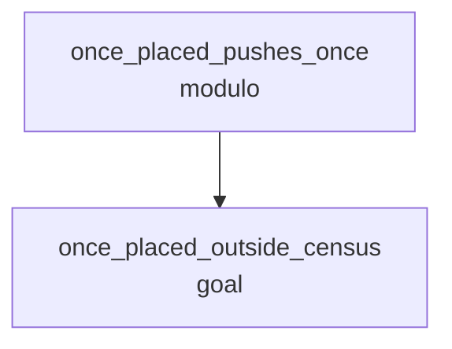

R11 by concept: each concept its nodes are placed at, by tag or by module. An arrow goes where a node's proof reaches a node of another concept.

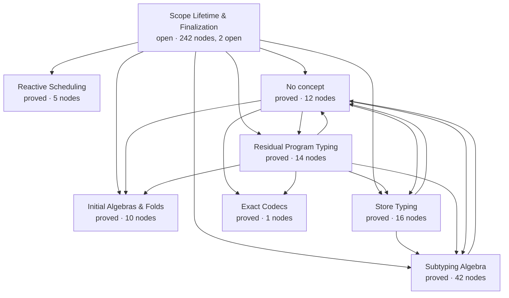

| Node | Status | Rests on | Nearest nodes |
| --- | --- | --- | --- |
| `runState_complete` | proved | — | — |
| `runState_restore` | proved | — | `runState_complete` |
| `runState_prefix` | proved | — | — |
| `close_twice` | proved | — | `close_idempotent` |
| `close_reentrant_add` | proved | — | — |
| `closeOrder_eq` | proved | — | — |
| `saved_mask_restoration` | proved | — | `at_snoc` |
| `replace_sum` | proved | — | — |
| `replace_sum_le_omitted` | proved | — | `replace_sum` |
| `finalizerOr_debit` | proved | — | `step_debit`, `getCont_le` |
| `getCont_le` | proved | — | — |
| `step_debit` | proved | — | `getCont_le` |
| `getCont_spec` | proved | — | — |
| `StackLedger.funded_reachable` | proved | — | `replace_sum`, `driveState_lift` |
| `saved_mask_chain_runs` | proved | — | `driveState_lift` |
| `saved_mask_pop_discipline` | proved | — | — |
| `saved_mask_region_bracket` | proved | — | — |
| `close_refuses` | proved | — | — |
| `drain_waits` | proved | — | — |
| `giveBack_front` | proved | — | — |
| `giveBack_once` | proved | — | `giveBack_front` |
| `census_pushes_once` | proved | — | `replace_sum`, `closeOrder_eq`, `at_snoc`, `mem_addresses_iff`, `evaluatePrim_producer`, `driveState_lift`, `getCont_spec`, `replace_sum_le_omitted` |
| `FinalizerRun.funded_reachable` | proved | — | `evaluatePrim_producer`, `getCont_le`, `step_debit`, `finalizerOr_debit`, `replace_sum`, `driveState_lift` |
| `once_placed_direct_pushes_once` | proved | — | `census_pushes_once` |
| `once_placed_outside_census` | goal | `once_placed_outside_census` | — |
| `once_placed_pushes_once` | modulo | `once_placed_outside_census` | `once_placed_outside_census`, `census_pushes_once` |
| `starts_le_pushes` | proved | — | `FinalizerRun.funded_reachable` |
| `evaluateNative_maskChain` | proved | — | `evaluatePrim_producer` |
| `evaluateNative_under` | proved | — | `evaluatePrim_under` |
| `evaluatePrim_producer` | proved | — | — |
| `evaluatePrim_under` | proved | — | — |
| `iteration_currentOpCount` | proved | — | `evaluatePrim_producer` |
| `iteration_under` | proved | — | `evaluateNative_under` |
| `Local.history_funded` | proved | — | `replace_sum`, `closeOrder_eq`, `at_snoc`, `mem_addresses_iff`, `evaluatePrim_producer`, `driveState_lift` |
| `LocalOn.history_funded` | proved | — | `replace_sum`, `driveState_lift`, `at_snoc`, `mem_addresses_iff` |
| `AdministrativeKept.non_evaluator` | proved | — | `noAdd_empty`, `interrupt`, `noAdd_cons`, `terminal` |
| `AdministrativeQueue.non_evaluator` | proved | — | — |
| `armE` | proved | — | `cancel`, `exit_credits`, `stack_credits_bounded`, `interp_contE` |
| `failure_stack_eq` | proved | — | — |
| `getCont_cause` | proved | — | `popFrom_cause`, `failure_stack_eq` |
| `popFrom_cause` | proved | — | `failure_stack_le`, `stack_credits_bounded` |
| `resumeCause` | proved | — | `armE`, `failure_stack_eq`, `getCont_cause` |
| `CommandClosure.command` | proved | — | `deliver`, `loop`, `AdministrativeQueue.non_evaluator`, `AdministrativeKept.non_evaluator`, `update_credits`, `emit_credits`, `failure_fiber_le`, `replace_sum`, `link`, `noAdd_full`, `exit_credits`, `resume_command`, `noAdd_empty`, `mem_addresses_iff` |
| `joined` | proved | — | `evaluatePrim_producer`, `closeOrder_eq`, `at_snoc`, `mem_addresses_iff`, `CommandClosure.command` |
| `read` | proved | — | — |
| `after_add_code_credits` | proved | — | `fin_program_credits` |
| `async_route_credits` | proved | — | — |
| `close_program_credits` | proved | — | `fin_program_credits` |
| `compile_credits` | proved | — | `source_op_credits`, `async_route_credits` |
| `emit_credits` | proved | — | — |
| `fin_program_credits` | proved | — | — |
| `load_credits` | proved | — | `compile_credits` |
| `load_funded` | proved | — | `load_credits` |
| `prog_of_credits` | proved | — | `fin_program_credits` |
| `registration_template` | proved | — | — |
| `response_credits_bounded` | proved | — | — |
| `source_op_credits` | proved | — | — |
| `stack_before_action` | proved | — | — |
| `stack_before_iterator` | proved | — | — |
| `stack_before_push` | proved | — | — |
| `stack_before_suspend` | proved | — | — |
| `stack_credits_bounded` | proved | — | `response_credits_bounded` |
| `update_credits` | proved | — | `replace_sum` |
| `add_memo_credits` | proved | — | — |
| `bind_service_credits` | proved | — | — |
| `build_scope_credits` | proved | — | — |
| `combine_credits` | proved | — | — |
| `constant_push_credits` | proved | — | `constant_stack_credits` |
| `constant_stack_credits` | proved | — | — |
| `constant_start` | proved | — | — |
| `contA_credits` | proved | — | `bind_service_credits`, `service_lookup_credits`, `merge_context_credits`, `combine_credits`, `provide_then_credits`, `layer_resolve_credits`, `layer_construction_credits`, `registration_template`, `layer_inner_credits`, `add_memo_credits`, `build_scope_credits`, `update_body_credits`, `provide_body_credits`, `provide_layer_credits`, `fin_program_credits`, `store_contA_credits`, `exit_credits`, `resolve_credits` |
| `contE_credits` | proved | — | `store_contE_credits`, `exit_credits`, `resolve_credits` |
| `context_credits` | proved | — | — |
| `exit_credits` | proved | — | — |
| `failure_fiber_le` | proved | — | `failure_stack_le` |
| `failure_stack_le` | proved | — | — |
| `forced_yield_iteration` | proved | — | `constant_start` |
| `forced_yield_loop_funded` | proved | — | `emit_credits`, `update_credits`, `forced_yield_iteration`, `loop_of_iteration` |
| `layer_compile_credits` | proved | — | — |
| `layer_construction_credits` | proved | — | — |
| `layer_inner_credits` | proved | — | `layer_compile_credits`, `layer_resolve_credits` |
| `layer_resolve_credits` | proved | — | `layer_with_credits` |
| `layer_with_credits` | proved | — | `layer_compile_credits`, `layer_zero_credits` |
| `layer_zero_credits` | proved | — | `layer_compile_credits` |
| `loop_top_credits` | proved | — | `failure_stack_le` |
| `merge_context_credits` | proved | — | — |
| `provide_body_credits` | proved | — | `exit_credits` |
| `provide_layer_credits` | proved | — | — |
| `provide_then_credits` | proved | — | — |
| `region_credits` | proved | — | `layer_resolve_credits`, `resolve_credits` |
| `resolve_credits` | proved | — | `compile_credits` |
| `service_lookup_credits` | proved | — | — |
| `store_contA_credits` | proved | — | `prog_of_credits`, `store_exit_credits` |
| `store_contE_credits` | proved | — | `store_exit_credits` |
| `store_exit_credits` | proved | — | — |
| `suspend_credits` | proved | — | `prog_of_credits`, `compile_credits`, `resolve_credits` |
| `update_body_credits` | proved | — | — |
| `yield_wrapper_credits` | proved | — | `constant_stack_credits` |
| `history` | proved | — | `decision`, `at_snoc`, `mem_addresses_iff`, `RuntimeShape.load`, `Execution.load` |
| `Execution.load` | proved | — | `load_funded` |
| `outer_custody` | proved | — | `ready_update`, `ready_emit`, `failure_fiber_le` |
| `ready_emit` | proved | — | `emit_credits` |
| `ready_update` | proved | — | `update_credits` |
| `armA_counts` | proved | — | — |
| `armE_counts` | proved | — | — |
| `finalizerEvents_no_push` | proved | — | — |
| `frame_failure_le` | proved | — | `failure_stack_le` |
| `getCont_no_push` | proved | — | `popFrom_no_push` |
| `interp_loopEnter` | proved | — | `loopNext_credits` |
| `interp_suspend` | proved | — | `suspend_credits` |
| `joinPushed_no_push` | proved | — | `passPushed_no_push`, `noPush_append` |
| `noPush_append` | proved | — | — |
| `noPush_counts` | proved | — | — |
| `passEvents_no_push` | proved | — | — |
| `passPushed_no_push` | proved | — | `passEvents_no_push` |
| `popFrom_no_push` | proved | — | `joinPushed_no_push`, `noPush_append`, `passEvents_no_push` |
| `push_onSuccess` | proved | — | `stack_before_push` |
| `registrations_append` | proved | — | — |
| `resumeCause_counts` | proved | — | `armE_counts`, `registrations_append`, `starts_append`, `finalizerEvents_no_push`, `getCont_no_push`, `noPush_counts` |
| `resumeValue_counts` | proved | — | `armA_counts`, `registrations_append`, `starts_append`, `finalizerEvents_no_push`, `getCont_no_push`, `noPush_counts` |
| `stack_full` | proved | — | — |
| `starts_append` | proved | — | — |
| `FrameDebit.step` | proved | — | `interp_loopEnter`, `stack_full`, `constant_stack_credits`, `push_onSuccess`, `stack_before_iterator`, `armA_counts`, `armA`, `frame_failure_le`, `withFiber_suspend_le`, `stack_before_action`, `stack_credits_bounded`, `stack_before_suspend`, `interp_suspend`, `sync_stack_le`, `resumeCause_counts`, `resumeCause`, `resumeValue_counts`, `resumeValue` |
| `sync_stack_le` | proved | — | `response_credits_bounded` |
| `withFiber_suspend_le` | proved | — | — |
| `FrameSequencing.step` | proved | — | `constant_push_kept`, `noAdd_cons`, `noAdd_append`, `armA_noAdd`, `interrupt`, `resumeCause_kept`, `resumeValue_kept`, `opaque_noAdd` |
| `decision` | proved | — | `driveState_lift`, `interrupt`, `ready_update`, `ready_emit`, `failure_fiber_le`, `closeOrder_eq`, `at_snoc`, `mem_addresses_iff`, `evaluatePrim_producer`, `joined`, `AdministrativeKept.non_evaluator`, `update_credits`, `emit_credits`, `replace_sum`, `link`, `noAdd_full`, `exit_credits`, `resume_command`, `noAdd_empty`, `fold_lift` |
| `fold_lift` | proved | — | `ready_emit`, `ready_update`, `joined`, `closeOrder_eq`, `at_snoc`, `mem_addresses_iff`, `evaluatePrim_producer`, `driveState_lift` |
| `deliver` | proved | — | `noAdd_empty`, `interrupt`, `NativeMachineShape.native`, `replace_sum`, `failure_fiber_le`, `mem_addresses_iff`, `NativeScopeDebit.native`, `evaluatePrim_producer`, `native_returned_template` |
| `loop` | proved | — | `noAdd_empty`, `interrupt`, `NativeMachineShape.iteration`, `replace_sum`, `failure_fiber_le`, `mem_addresses_iff`, `NativeIterationDebit.iteration`, `evaluatePrim_producer`, `iteration_returned_template` |
| `sync_op` | proved | — | `after_add_exit_credit`, `add_open`, `replace_sum`, `after_add_unit_credit`, `syncOp`, `noAdd_full` |
| `NativeIterationDebit.iteration` | proved | — | `yield_wrapper_credits`, `forced_wrapper`, `NativeScopeDebit.native`, `loop_top_credits`, `loop_top_source`, `loop_top` |
| `NativeMachineShape.iteration` | proved | — | `noAdd_empty`, `interrupt` |
| `NativeMachineShape.native` | proved | — | `noAdd_empty`, `interrupt` |
| `primitive` | proved | — | `noAdd_full`, `async_noAdd`, `stable_full`, `yield_stable`, `layer_resolve_credits`, `prog_of_credits`, `region_credits`, `resolve_credits`, `compile_credits`, `at_snoc`, `mem_addresses_iff`, `close`, `link`, `opaque_noAdd`, `resumeCause_counts`, `resumeValue_counts`, `FrameDebit.step`, `syncOp`, `sync_op`, `sync_stack_le`, `failure_stack_le`, `getCont_cause`, `getCont_no_push`, `noPush_counts`, `fin_program_credits`, `getCont_value`, `exit_pop_noAdd` |
| `NativeScopeDebit.native` | proved | — | `fin_program_credits`, `close_scope`, `replace_sum`, `noAdd_full`, `exit_credits`, `failure_stack_le`, `getCont_cause`, `getCont_value`, `exit_pop_noAdd`, `getCont_no_push`, `noPush_counts`, `resolve_credits`, `opaque_noAdd`, `primitive` |
| `action_noAdd` | proved | — | `noAdd_mask`, `noAdd_asyncFinalizer` |
| `action_not_finished` | proved | — | — |
| `action_returned` | proved | — | `action_not_finished`, `action_noAdd`, `returned_clean` |
| `countdown_noAdd` | proved | — | `action_noAdd` |
| `exit_pop_noAdd` | proved | — | `getCont_cause_kept`, `getCont_value_finalizer` |
| `finalizer_returned_template` | proved | — | `step_frame_template`, `returned_clean`, `exit_pop_noAdd` |
| `frame_step_template` | proved | — | `FrameSequencing.step` |
| `iteration_returned_template` | proved | — | `forced_wrapper`, `native_returned_template`, `loop_top` |
| `loop_top` | proved | — | `interrupt` |
| `loop_top_source` | proved | — | — |
| `native_returned_template` | proved | — | `scoped_exit_returned`, `primitive_returned_template`, `returned_clean`, `opaque_noAdd` |
| `primitive_returned_template` | proved | — | `async_noAdd`, `stable_value`, `yield_stable`, `action_returned`, `countdown_noAdd`, `noAdd_asyncFinalizer`, `returned_clean`, `value_response`, `finalizer_returned_template`, `opaque_noAdd`, `step_frame_template` |
| `returned_clean` | proved | — | — |
| `scoped_exit_returned` | proved | — | `returned_clean`, `exit_pop_noAdd` |
| `step_frame_template` | proved | — | `noAdd_empty`, `returned_clean`, `frame_step_template` |
| `armA` | proved | — | `iterator_future`, `interp_iter`, `interp_loopResume`, `exit_credits`, `after_add_code_credits`, `stack_credits_bounded`, `interp_contA` |
| `getCont_value` | proved | — | `failure_stack_le`, `value_cap` |
| `resumeValue` | proved | — | `armA`, `getCont_value` |
| `value_cap` | proved | — | `stack_credits_bounded`, `response_credits_bounded` |
| `answerOf_clean` | proved | — | — |
| `armA_noAdd` | proved | — | — |
| `armE_noAdd` | proved | — | `noAdd_empty` |
| `constant_push_kept` | proved | — | `forced_unwrap`, `forced_push`, `noAdd_cons`, `opaque_noAdd` |
| `ensure_noAdd` | proved | — | — |
| `forced_unwrap` | proved | — | — |
| `getCont_cause_kept` | proved | — | `popFrom_cause_kept` |
| `getCont_noAdd` | proved | — | `noAdd_empty`, `popFrom_noAdd` |
| `getCont_value_finalizer` | proved | — | `popFrom_value_finalizer` |
| `noAdd_append` | proved | — | — |
| `noAdd_cons` | proved | — | — |
| `noAdd_tail` | proved | — | — |
| `passPushed_noAdd` | proved | — | `answerOf_clean`, `ensure_noAdd`, `noAdd_tail` |
| `popFrom_cause_kept` | proved | — | `noAdd_empty`, `popFrom_noAdd` |
| `popFrom_noAdd` | proved | — | `noAdd_append`, `answerOf_clean`, `passPushed_noAdd`, `ensure_noAdd`, `noAdd_tail` |
| `popFrom_value_finalizer` | proved | — | `noAdd_empty`, `popFrom_noAdd` |
| `resumeCause_clean` | proved | — | `noAdd_append`, `armE_noAdd`, `getCont_noAdd` |
| `resumeCause_kept` | proved | — | `noAdd_append`, `armE_noAdd`, `getCont_cause_kept` |
| `resumeValue_clean` | proved | — | `noAdd_append`, `armA_noAdd`, `getCont_noAdd` |
| `resumeValue_kept` | proved | — | `interrupt`, `resumeValue_kept_clear` |
| `resumeValue_kept_clear` | proved | — | `resumeValue_clean` |
| `cancel` | proved | — | `store_cancel` |
| `closeSeq_credits` | proved | — | `fin_program_credits` |
| `interp_contA` | proved | — | `contA_credits` |
| `interp_contE` | proved | — | `contE_credits` |
| `interp_iter` | proved | — | `closeSeq_credits`, `runStmts_credits` |
| `interp_loopResume` | proved | — | `loopResume_credits` |
| `iterator_future` | proved | — | — |
| `loopFinish_credits` | proved | — | — |
| `loopNext_credits` | proved | — | `loopFinish_credits`, `resolve_credits` |
| `loopResume_credits` | proved | — | `loopNext_credits` |
| `runStmts_credits` | proved | — | `yieldOf_credits` |
| `store_cancel` | proved | — | — |
| `yieldOf_credits` | proved | — | `compile_credits` |
| `terminal` | proved | — | `mem_addresses_iff`, `stable_refGet`, `stable_cause`, `stable_value` |
| `RuntimeShape.load` | proved | — | `noAdd_empty` |
| `close` | proved | — | `close_program_credits`, `close_scope`, `replace_sum` |
| `link` | proved | — | `replace_sum`, `add_open` |
| `syncOp` | proved | — | `replace_sum`, `after_add_exit_credit`, `add_open`, `after_add_unit_credit` |
| `acquired_registration` | proved | — | — |
| `async_noAdd` | proved | — | `opaque_noAdd` |
| `async_producer` | proved | — | `noAdd_asyncFinalizer`, `async_noAdd` |
| `forced_push` | proved | — | — |
| `forced_wrapper` | proved | — | — |
| `interrupt` | proved | — | — |
| `Sequencing.load` | proved | — | `noAdd_empty` |
| `noAdd_asyncFinalizer` | proved | — | — |
| `noAdd_empty` | proved | — | — |
| `noAdd_full` | proved | — | — |
| `noAdd_mask` | proved | — | — |
| `opaque_noAdd` | proved | — | — |
| `raw_yield_excluded` | proved | — | — |
| `registration_step` | proved | — | `opaque_noAdd` |
| `resume_command` | proved | — | `emit_credits`, `resume_frame_debit`, `update_credits` |
| `resume_frame_debit` | proved | — | `stable_full` |
| `saved_resume` | proved | — | — |
| `stable_cause` | proved | — | — |
| `stable_full` | proved | — | `noAdd_full` |
| `stable_refGet` | proved | — | — |
| `stable_value` | proved | — | — |
| `value_response` | proved | — | — |
| `yield_producer` | proved | — | `stable_value`, `yield_stable` |
| `yield_response_full` | proved | — | `noAdd_full` |
| `yield_stable` | proved | — | — |
| `add_open` | proved | — | — |
| `after_add_exit` | proved | — | `after_add_exit_credit` |
| `after_add_exit_credit` | proved | — | — |
| `after_add_unit` | proved | — | `after_add_unit_credit` |
| `after_add_unit_credit` | proved | — | — |
| `close_chain_transfer` | proved | — | `close_scope` |
| `close_scope` | proved | — | `closeOrder_eq` |
| `close_seq_command` | proved | — | `close_seq_start` |
| `close_seq_start` | proved | — | — |
| `foreign_suspension` | proved | — | — |
| `release_loop_debit` | proved | — | `release_start_debit`, `release_start`, `iteration_below_budget`, `loop_of_iteration` |
| `release_start` | proved | — | — |
| `release_start_count` | proved | — | `release_start` |
| `release_start_debit` | proved | — | `release_start_registered`, `release_start_count` |
| `release_start_registered` | proved | — | `release_start` |
| `scope_add_closed` | proved | — | `after_add_exit_credit`, `native_sync_op` |
| `scope_add_open` | proved | — | `add_open`, `after_add_unit_credit`, `native_sync_op` |
| `StackRegion.command` | proved | — | `evaluateNative_under`, `evaluatePrim_producer`, `iteration_under` |
| `compiled_region_bracket_of_prefix` | proved | — | `compiled_region_bracket`, `stepped_live`, `drive` |
| `drive` | proved | — | `StackRegion.command`, `evaluatePrim_producer`, `guarded_driveStep_liveTransports` |
| `settle_callback` | proved | — | `fits_subN`, `fits_mono`, `subN_never`, `subN_refl`, `order_refl`, `scopeParams_child`, `at_child`, `order_trans`, `fits_scope_inv`, `seq_typed`, `closeOrder_eq`, `mono`, `satisfies_empty`, `configTyped_frame`, `memberIn_mono`, `hasTyIn_iff`, `hom_eq_cata_ty` |
| `clause_closeScope` | proved | — | `fits_mono`, `order_trans`, `mono`, `subN_never`, `fits_subN`, `order_refl`, `scopeParams_child`, `at_child`, `fits_scope_inv`, `seq_typed`, `closeOrder_eq`, `satisfies_empty`, `configTyped_frame`, `memberIn_mono`, `hasTyIn_iff`, `hom_eq_cata_ty` |
| `clause_scoped` | proved | — | `fits_mono`, `order_trans`, `mono`, `order_refl`, `satisfies_empty`, `denotesTyped`, `configTyped_frame`, `memberIn_mono`, `hasTyIn_iff`, `hom_eq_cata_ty` |
| `foreignFinalizer_ambient` | proved | — | `subN_never`, `fits_subN`, `fits_mono`, `order_refl`, `scopeParams_child`, `at_child`, `order_trans` |
| `compiled_mask_chain_runs` | proved | — | `evaluateNative_maskChain`, `evaluatePrim_producer`, `driveState_lift` |
| `compiled_region_bracket` | proved | — | `stepped_live` |
| `guarded_driveStep_liveTransports` | proved | — | `evaluatePrim_producer` |
| `stepped_live` | proved | — | — |
| `close_idempotent` | proved | — | — |
| `at_snoc` | proved | — | `at_append` |
| `driveState_lift` | proved | — | — |
| `mem_addresses_iff` | proved | — | `yieldAt_addressYield`, `mem_foldList_iff`, `addresses_eq_foldList` |
| `loop_of_iteration` | proved | — | — |
| `iteration_below_budget` | proved | — | — |
| `native_sync_op` | proved | — | — |
| `fits_subN` | proved | — | `subN_trans`, `fits_normalize` |
| `fits_mono` | proved | — | — |
| `subN_never` | proved | — | — |
| `subN_refl` | proved | — | — |
| `order_refl` | proved | — | — |
| `scopeParams_child` | proved | — | — |
| `at_child` | proved | — | `at_snoc` |
| `order_trans` | proved | — | — |
| `fits_scope_inv` | proved | — | — |
| `seq_typed` | proved | — | `subN_refl`, `fits_subN`, `guardBind_typed` |
| `mono` | proved | — | `order_trans` |
| `satisfies_empty` | proved | — | — |
| `configTyped_frame` | proved | — | `satisfies_empty`, `fits_mono`, `order_trans`, `mono`, `order_refl`, `memberIn_mono`, `hasTyIn_iff`, `hom_eq_cata_ty` |
| `memberIn_mono` | proved | — | `hom_eq_cata_ty` |
| `hasTyIn_iff` | proved | — | — |
| `hom_eq_cata_ty` | proved | — | — |
| `denotesTyped` | proved | — | `provideLayerArm`, `at_child`, `subN_refl`, `fits_subN`, `fits_normalize`, `fiberTy_upper`, `scopeParams_child`, `solve_lookup_of_mem`, `hom_eq_cata_ty`, `subN_trans`, `matchB_sound`, `syncRow_typed`, `withParams_of_none`, `evalTerm_progress`, `normalize_idem`, `errOf_payload`, `isPayload_of_hasTy_record`, `satisfies_weaken`, `subN_never`, `fits_mono`, `order_trans`, `invoke_arm`, `fits_iff_membersIn`, `option_eliminator`, `subN_option_iff`, `joinAll_keeps`, `mapM_answer`, `optionTy_upper`, `list_eliminator`, `subN_list_iff`, `listOf_upper`, `fits_unfold`, `causeInputError_upper`, `matchArgsB_sound`, `withParams_serviceTy`, `scopeParams_below`, `exitOf_upper`, `fits_scope_inv`, `param_arm`, `call_arm` |
| `at_append` | proved | — | — |
| `yieldAt_addressYield` | proved | — | — |
| `mem_foldList_iff` | proved | — | `exists_at_of_mem_foldList` |
| `addresses_eq_foldList` | proved | — | — |
| `subN_trans` | proved | — | — |
| `fits_normalize` | proved | — | `subN_trans`, `normalize_idem` |
| `guardBind_typed` | proved | — | — |
| `provideLayerArm` | proved | — | `fits_subN`, `subN_refl`, `fits_normalize`, `fiberTy_upper`, `scopeParams_child`, `at_child`, `solve_lookup_of_mem`, `hom_eq_cata_ty`, `subN_trans`, `matchB_sound`, `syncRow_typed`, `withParams_of_none`, `evalTerm_progress`, `normalize_idem`, `errOf_payload`, `isPayload_of_hasTy_record`, `satisfies_weaken`, `subN_never`, `fits_mono`, `order_trans`, `fits_scope_inv` |
| `fiberTy_upper` | proved | — | `fiber_eliminator`, `normalize_idem`, `subN_trans`, `subN_refl`, `extendAll_upper` |
| `solve_lookup_of_mem` | proved | — | — |
| `matchB_sound` | proved | — | `solve_lookup_of_mem` |
| `syncRow_typed` | proved | — | `fits_normalize`, `subN_trans`, `solve_lookup_of_mem`, `fits_subN`, `termMaps_of_typed`, `matchB_sound`, `hom_eq_cata_ty`, `errOf_payload`, `isPayload_of_hasTy_record`, `normalize_idem`, `subN_refl` |
| `withParams_of_none` | proved | — | — |
| `evalTerm_progress` | proved | — | `_mutual` |
| `normalize_idem` | proved | — | — |
| `errOf_payload` | proved | — | — |
| `isPayload_of_hasTy_record` | proved | — | `handles_of_payloadFieldTy` |
| `satisfies_weaken` | proved | — | — |
| `invoke_arm` | proved | — | `normalize_idem`, `fits_mono`, `fits_subN`, `order_trans`, `at_child`, `scopeParams_below`, `evalTerm_progress`, `scopeParams_body`, `withParams_defOf` |
| `fits_iff_membersIn` | proved | — | `fits_unfold`, `fits_normalize` |
| `option_eliminator` | proved | — | `subN_option_iff`, `normalize_idem`, `subN_trans`, `subN_refl` |
| `subN_option_iff` | proved | — | — |
| `joinAll_keeps` | proved | — | `foldl_keeps` |
| `mapM_answer` | proved | — | `mapM_cons_eq_some` |
| `optionTy_upper` | proved | — | `option_eliminator`, `normalize_idem`, `subN_trans`, `subN_refl`, `Eliminator.lift_upper` |
| `list_eliminator` | proved | — | `subN_list_iff`, `normalize_idem`, `subN_trans`, `subN_refl` |
| `subN_list_iff` | proved | — | — |
| `listOf_upper` | proved | — | `list_eliminator`, `normalize_idem`, `subN_trans`, `subN_refl`, `extendAll_upper` |
| `fits_unfold` | proved | — | — |
| `causeInputError_upper` | proved | — | `cause_upper`, `cause_mono`, `normalize_idem`, `subN_trans`, `subN_refl`, `UnionRule.lift_upper`, `subN_causeOf_causeUpper`, `subN_exitOf_causeUpper`, `extendAll_eq_some_iff` |
| `matchArgsB_sound` | proved | — | — |
| `withParams_serviceTy` | proved | — | — |
| `scopeParams_below` | proved | — | — |
| `exitOf_upper` | proved | — | `exit_eliminator`, `normalize_idem`, `subN_trans`, `subN_refl`, `extendAll_upper` |
| `param_arm` | proved | — | `normalize_idem`, `fits_mono`, `fits_subN`, `order_trans`, `evalTerm_progress`, `scopeParams_decl`, `withParams_param` |
| `call_arm` | proved | — | `fits_mono`, `fits_subN`, `normalize_idem`, `order_trans`, `evalTerm_progress`, `scopeParams_body`, `withParams_of_none` |
| `exists_at_of_mem_foldList` | proved | — | `sizeOf_child_lt`, `foldList_cases` |
| `fiber_eliminator` | proved | — | `subN_fiberOf_iff`, `normalize_idem`, `subN_trans`, `subN_refl` |
| `extendAll_upper` | proved | — | `extendAll_adjoint` |
| `termMaps_of_typed` | proved | — | `evalTerm_progress`, `fits_mono` |
| `_mutual` | proved | — | `fits_subN`, `list_eliminator`, `normalize_idem`, `subN_trans`, `subN_refl`, `subN_list_iff`, `joinAll_keeps`, `mapM_answer`, `fits_iff_membersIn`, `listOf_upper`, `fits_normalize`, `fits_unfold`, `causeInputError_upper`, `matchArgsB_sound` |
| `handles_of_payloadFieldTy` | proved | — | — |
| `scopeParams_body` | proved | — | — |
| `withParams_defOf` | proved | — | — |
| `foldl_keeps` | proved | — | — |
| `mapM_cons_eq_some` | proved | — | — |
| `Eliminator.lift_upper` | proved | — | `subN_refl`, `UnionRule.lift_upper` |
| `cause_upper` | proved | — | `subN_causeOf_causeUpper`, `subN_exitOf_causeUpper` |
| `cause_mono` | proved | — | `subN_exitOf_iff`, `subN_causeOf_causeUpper`, `subN_trans`, `subN_causeOf_iff` |
| `UnionRule.lift_upper` | proved | — | `le_joinAll`, `subN_trans`, `mapM_answer` |
| `subN_causeOf_causeUpper` | proved | — | — |
| `subN_exitOf_causeUpper` | proved | — | `subN_trans`, `subN_refl`, `subN_exitOf_iff` |
| `extendAll_eq_some_iff` | proved | — | — |
| `exit_eliminator` | proved | — | `subN_exitOf_iff`, `normalize_idem`, `subN_trans`, `subN_refl` |
| `scopeParams_decl` | proved | — | — |
| `withParams_param` | proved | — | — |
| `sizeOf_child_lt` | proved | — | — |
| `foldList_cases` | proved | — | — |
| `subN_fiberOf_iff` | proved | — | — |
| `extendAll_adjoint` | proved | — | `adjoint`, `extendAll_eq_some_iff` |
| `subN_exitOf_iff` | proved | — | — |
| `subN_causeOf_iff` | proved | — | — |
| `le_joinAll` | proved | — | `joinAll_keeps` |
| `adjoint` | proved | — | `Eliminator.lift_least`, `subN_trans`, `mapM_total`, `Eliminator.lift_upper` |
| `Eliminator.lift_least` | proved | — | `UnionRule.lift_least` |
| `mapM_total` | proved | — | `mapM_cons_eq_some` |
| `UnionRule.lift_least` | proved | — | `subN_trans`, `mapM_source`, `joinAll_le` |
| `mapM_source` | proved | — | `mapM_cons_eq_some` |
| `joinAll_le` | proved | — | `joinAll_all` |
| `joinAll_all` | proved | — | `foldl_all` |
| `foldl_all` | proved | — | — |

### R12: Frontiers name what they await

- Open, worded as a proposed claim: pool-wake-selection (proposed claim; reactive-scheduling): the helper selects the first count waiters of the state that it finds, and it notifies exactly those, in order; the model's fact is select_takes_first, and one selection is one store step (select_attempt); the helper is a library program, one selection step and then each selected hint in order; the selection is by count, so the law takes the withdrawal as a premise: every entry of the waiters belongs to a request that still waits; finite controls: a selection at the post serves a waiter that left, and with no withdrawal the wake is lost (Test/Program/PoolPublic.lean, PP4; Test/Program/PoolTraces.lean, trace 2) (decisions rows 221, 267)
- Open, waits on a ruling (a ruling on infinite tapes): R12-c: liveness on infinite tapes under FairTape (waits on a ruling on infinite tapes)
- Open, not triaged: stability over the allowed internal decisions, with a named progress observation (not stated)
- Open, not triaged: divergence by compatible prefixes (DB-03; not stated)
- Open, worded as a proposed claim: driver-continuation-split and driver-suspension-keeps-typed (proposed claims; reactive-scheduling, extending drivestate-lift): a retained driver suspension keeps the commands, the remaining dispatcher tasks, the enclosing flush or clock phase and any atomic owner, and continuing it with budgets n and k equals one run with n + k; until then an owned operation runs under a proved embedded budget (decisions rows 84, 226); a finite control: at a reply application the command loop's leftover commands are not kept, and one run then stands at rest with no exit of the root (the run dropped of Test/Dogfood/Scenario/QueueWorkers.lean; one script at seven budgets)
- Open, worded as a proposed claim: embedded-budget-sufficient (proposed claim; reactive-scheduling, serving R10 and R12): the embedded budget of an owned operation covers its registration, its cleanup and its selected delivery, so no cut falls inside the operation; a cut inside is excluded and is no resumption (decisions rows 84, 226); no theorem states a sufficient budget; a finite control measures the least fuel of one helper's task at eight lengths of the receiver's continuation, and at one unit less the remaining work is lost and five later flushes do not end the root (Test/Program/QueueTraces.lean, Test/Program/SemaphoreTraces.lean and Test/Program/PoolTraces.lean, trace 7 of each; Pool's measures seven lengths); no bound is claimed; at a run the premise has one name, funded (src/Effect4/Run/Tape.lean), and funded_replays says what it gives; a journal's verdicts do not decide it
- Open, worded as a proposed claim: wait-registration-no-gap (proposed claim; reactive-scheduling): the decision to wait and the registration are one transition, so each eligible waiter is retrying or owns a notification (decisions rows 221, 223; finite controls in docs/research/2026-10-05-claude-lead/tx-probes/TxModel.lean); the Queue model's half is proved on the first profile (queue-first-step-invariant, queue-first-run-flags), and the wrapper's run stays open; an instance at rest on one program is the planned goal queue_settled (Test/Dogfood/Scenario/QueueWorkers.lean)
- Open, worded as a proposed claim: posted-task-decision-preserves (proposed claim; reactive-scheduling): a posted task keeps the typed state, with its execution identity, its owner, its receiver's token and a stale delivery (decisions row 225)
- Open, not triaged: posted-wake-debt-progress and a module's request progress: separate claims under named fairness, body-progress and budget premises; dispatcher service (flush_fair) does not give them (decisions rows 220, 225, 230)

The open part of R12: its planned goals and the theorems proved modulo them. An arrow goes from a node to a node its proof reaches first.

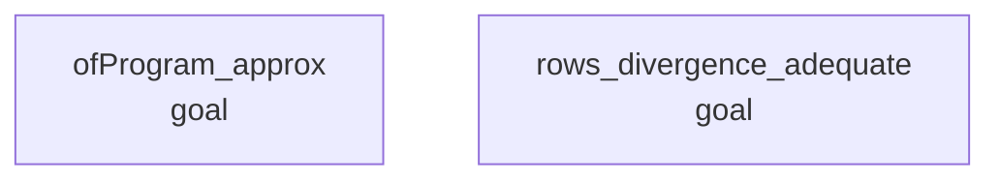

R12 by concept: each concept its nodes are placed at, by tag or by module. An arrow goes where a node's proof reaches a node of another concept.

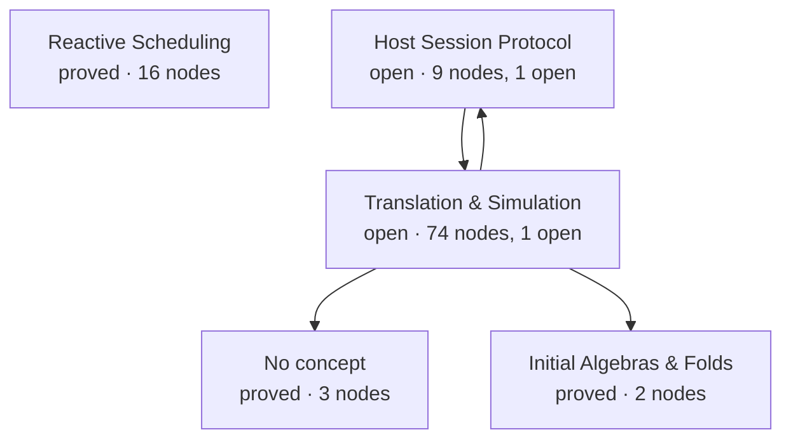

| Node | Status | Rests on | Nearest nodes |
| --- | --- | --- | --- |
| `fairTape_unarmed` | proved | — | — |
| `frontier_empty_iff_deadlocked` | proved | — | — |
| `rows_loop_frontier` | proved | — | `localWaitC_to_rowsB`, `PlainHooks.of_loopedRows`, `answer`, `join`, `Leads.trans`, `seg_settles_receipt`, `Leads.refl`, `load_evaluate_receipt`, `flush_Myield_receipt`, `funded_replays` |
| `rows_loop_frontier_host` | proved | — | `localWaitC_to_rowsB`, `PlainHooks.of_loopedRows`, `answer`, `join`, `Leads.trans`, `seg_settles_receipt`, `Leads.refl`, `load_evaluate_receipt`, `flush_Myield_receipt`, `funded_replays` |
| `driveState_loop` | proved | — | `loop_of_iteration` |
| `iteration_below_budget` | proved | — | — |
| `loop_of_iteration` | proved | — | — |
| `bounded` | proved | — | — |
| `complete_unique` | proved | — | — |
| `select_takes_first` | proved | — | — |
| `first_run_flags` | proved | — | `first_run_inv` |
| `first_run_inv` | proved | — | `first_step_inv` |
| `first_step_inv` | proved | — | `positive_suspend_step_capacity`, `first_profile_closed` |
| `ofProgram_approx` | goal | `ofProgram_approx` | — |
| `frontier_of_diverges` | proved | — | `frontier_waits` |
| `frontier_waits` | proved | — | `observeRows_project`, `rows_loop_frontier_host` |
| `rows_divergence_adequate` | goal | `rows_divergence_adequate` | — |
| `runWith_exit_of_diverges` | proved | — | `runWith_finishes` |
| `visit_selects_earliest` | proved | — | — |
| `visit_stops_iff` | proved | — | — |
| `localWaitC_to_rowsB` | proved | — | `localRunC_agree`, `contextStep_fallback`, `localRunC_mono`, `localRunC_compileBO`, `localRunC_waits`, `terminal` |
| `PlainHooks.of_loopedRows` | proved | — | `ContextFreeHooks.of_loopedRows`, `ContextFreeHooks.toPlain` |
| `answer` | proved | — | — |
| `join` | proved | — | — |
| `Leads.trans` | proved | — | `terminal`, `RunJoinC.trans` |
| `seg_settles_receipt` | proved | — | `join`, `drive_seg_receipt` |
| `Leads.refl` | proved | — | `RunJoinC.refl` |
| `load_evaluate_receipt` | proved | — | `seg_settles_receipt` |
| `flush_Myield_receipt` | proved | — | `Leads.trans`, `contextStep_yieldWrapper`, `ReachesQ.contextStep`, `seg_settles_receipt`, `fire_Myield_answer_context` |
| `funded_replays` | proved | — | `journal_replays`, `tape_replays` |
| `positive_suspend_step_capacity` | proved | — | `acceptLoop_length_le` |
| `first_profile_closed` | proved | — | — |
| `observeRows_project` | proved | — | — |
| `runWith_finishes` | proved | — | `runWith_denotesB` |
| `localRunC_agree` | proved | — | `localRunC_mono` |
| `contextStep_fallback` | proved | — | — |
| `localRunC_mono` | proved | — | — |
| `localRunC_compileBO` | proved | — | `compilesBO_onExit`, `compilesBO_matchCause`, `compilesBO_catchIf`, `compilesBO_catchCause`, `compilesBO_select`, `compilesBO_bind`, `compilesBO_iterate`, `compilesBO_exit`, `compilesBO_suspend`, `ReachesC.refl`, `denoteRowsB_straight`, `denoteRows_straight`, `answer`, `ReachesC.step` |
| `localRunC_waits` | proved | — | — |
| `terminal` | proved | — | `localRunC_mono` |
| `ContextFreeHooks.of_loopedRows` | proved | — | — |
| `ContextFreeHooks.toPlain` | proved | — | `ContextFreeCode.toPlain` |
| `RunJoinC.trans` | proved | — | — |
| `drive_seg_receipt` | proved | — | `drive_loop_yield_context`, `ReachesQ.refl`, `drive_receipt_result`, `drive_loop_call_context`, `drive_loop_sync_op_context`, `drive_loop_sync_op_none_context`, `ReachesQ.step`, `drive_loop_sync_pure_context`, `context_receipt_finish`, `drive_deliver_finish_context`, `drive_loop_finish_context`, `contextStep_finished_stores`, `drive_deliver_running_context`, `drive_loop_running_context`, `ReachesQ.contextStep`, `contextStep_plain`, `contextStep_stores`, `prepend`, `drive_receipt_prefix` |
| `RunJoinC.refl` | proved | — | — |
| `contextStep_yieldWrapper` | proved | — | — |
| `ReachesQ.contextStep` | proved | — | `ReachesC.contextStep` |
| `fire_Myield_answer_context` | proved | — | — |
| `journal_replays` | proved | — | — |
| `tape_replays` | proved | — | — |
| `acceptLoop_length_le` | proved | — | — |
| `runWith_denotesB` | proved | — | `denoteRowsB_eq_session_host`, `allows_answer`, `observe_awaitingAsync_iff`, `tapeFrom_append` |
| `compilesBO_onExit` | proved | — | `ReachesC.trans`, `same`, `ReachesC.refl`, `at_snoc`, `ReachesC.step` |
| `compilesBO_matchCause` | proved | — | `ReachesC.trans`, `at_snoc`, `ReachesC.step`, `ReachesC.refl` |
| `compilesBO_catchIf` | proved | — | `ReachesC.trans`, `at_snoc`, `same`, `ReachesC.step`, `ReachesC.refl` |
| `compilesBO_catchCause` | proved | — | `ReachesC.trans`, `at_snoc`, `same`, `ReachesC.step`, `ReachesC.refl` |
| `compilesBO_select` | proved | — | `at_snoc`, `ReachesC.trans`, `ReachesC.step`, `ReachesC.refl` |
| `compilesBO_bind` | proved | — | `ReachesC.trans`, `same`, `at_snoc`, `ReachesC.step`, `ReachesC.refl` |
| `compilesBO_iterate` | proved | — | `same`, `ReachesC.trans`, `ReachesC.step`, `at_snoc`, `ReachesC.refl` |
| `compilesBO_exit` | proved | — | `ReachesC.refl`, `denoteRowsB_straight`, `ReachesC.trans`, `ReachesC.step`, `at_snoc` |
| `compilesBO_suspend` | proved | — | `ReachesC.step`, `ReachesC.trans`, `at_snoc`, `ReachesC.refl` |
| `ReachesC.refl` | proved | — | — |
| `denoteRowsB_straight` | proved | — | — |
| `denoteRows_straight` | proved | — | — |
| `ReachesC.step` | proved | — | `contextStep_fallback`, `ReachesC.contextStep` |
| `ContextFreeCode.toPlain` | proved | — | — |
| `drive_loop_yield_context` | proved | — | — |
| `ReachesQ.refl` | proved | — | `ReachesC.refl` |
| `drive_receipt_result` | proved | — | `drive_receipt_stable` |
| `drive_loop_call_context` | proved | — | `iteration_M_context` |
| `drive_loop_sync_op_context` | proved | — | `iteration_M_context` |
| `drive_loop_sync_op_none_context` | proved | — | `iteration_M_context` |
| `ReachesQ.step` | proved | — | `ReachesC.step` |
| `drive_loop_sync_pure_context` | proved | — | `iteration_M_context` |
| `context_receipt_finish` | proved | — | `context_run_finish`, `drive_receipt_result`, `drive_finish_M_context` |
| `drive_deliver_finish_context` | proved | — | `evaluateNative_plain_context`, `evaluatePrim_contextStep` |
| `drive_loop_finish_context` | proved | — | `iteration_M_context`, `evaluateNative_plain_context`, `evaluatePrim_contextStep` |
| `contextStep_finished_stores` | proved | — | — |
| `drive_deliver_running_context` | proved | — | `evaluateNative_plain_context`, `evaluatePrim_contextStep` |
| `drive_loop_running_context` | proved | — | `iteration_M_context`, `evaluateNative_plain_context`, `evaluatePrim_contextStep` |
| `contextStep_plain` | proved | — | `contextStep_fallback` |
| `contextStep_stores` | proved | — | — |
| `prepend` | proved | — | `ReachesQ.trans` |
| `drive_receipt_prefix` | proved | — | `drive_receipt_stable` |
| `ReachesC.contextStep` | proved | — | — |
| `denoteRowsB_eq_session_host` | proved | — | `hostRunB_stable`, `localRunC_to_rowsB`, `PlainHooks.of_loopedRows`, `answer`, `join`, `Leads.trans`, `seg_settles_receipt`, `Leads.refl`, `load_evaluate_receipt`, `flush_Myield_receipt`, `funded_replays` |
| `allows_answer` | proved | — | — |
| `observe_awaitingAsync_iff` | proved | — | — |
| `tapeFrom_append` | proved | — | — |
| `ReachesC.trans` | proved | — | — |
| `same` | proved | — | `contextStep_fallback`, `contextSame` |
| `at_snoc` | proved | — | `at_append` |
| `drive_receipt_stable` | proved | — | — |
| `iteration_M_context` | proved | — | — |
| `context_run_finish` | proved | — | — |
| `drive_finish_M_context` | proved | — | — |
| `evaluateNative_plain_context` | proved | — | — |
| `evaluatePrim_contextStep` | proved | — | `contextStep_fallback` |
| `ReachesQ.trans` | proved | — | `ReachesC.trans` |
| `hostRunB_stable` | proved | — | — |
| `localRunC_to_rowsB` | proved | — | `contextStep_fallback`, `localRunC_agree`, `localRunC_waits`, `localRunC_mono`, `localRunC_compileB` |
| `contextSame` | proved | — | — |
| `at_append` | proved | — | — |
| `localRunC_compileB` | proved | — | `localRunC_compileBO` |

### R13: A run's inputs are data: equal recorded inputs give equal replay observations

- Open, after other work (Config, route B: designed and not implemented (decisions rows 51 and 83)): load inputs, the environment snapshot and the seed: designed (the 2026-09-10 Config route B), not implemented (decisions rows 51, 83)
- Open, after other work (Config, route B: it restates the typed load when Config lands): supplied values fit the admitted load requirements: restates M5 (loadsTyped, the retired ledger's typedState_load) when Config lands
- Open, not triaged: the service half of the signature as a recorded input: Built carries the row table only (decisions row 21)
- Open, worded as a proposed claim: clock-unit-compatibility (proposed claim; translation-simulation): exact nanoseconds inside, with every recorded millisecond input kept in meaning by an explicit conversion; public nanosecond readings wait for the target's bigint contract (decisions rows 83, 231)

R13 by concept: each concept its nodes are placed at, by tag or by module. An arrow goes where a node's proof reaches a node of another concept.

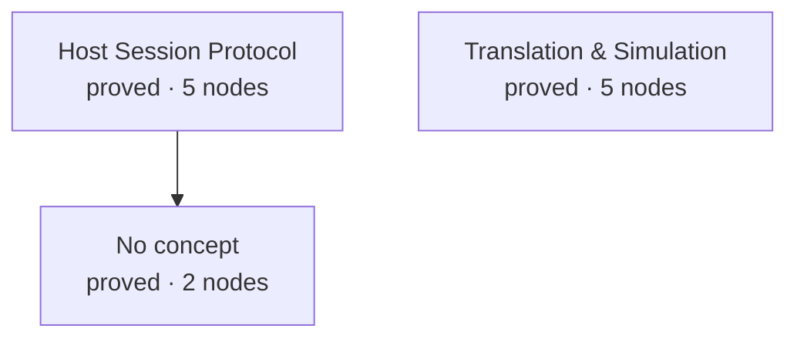

| Node | Status | Rests on | Nearest nodes |
| --- | --- | --- | --- |
| `Run.journal_replays` | proved | — | — |
| `Live.journal_replays` | proved | — | `Run.journal_replays` |
| `restore_save` | proved | — | `Live.journal_replays`, `checkInput_eq_none_iff` |
| `reached` | proved | — | — |
| `reached_history` | proved | — | — |
| `tapeFrom_append` | proved | — | — |
| `tapeFrom_cut` | proved | — | — |
| `tapeFrom_cut_replays` | proved | — | `tape_replays`, `tapeFrom_cut` |
| `tapeFrom_position_replays` | proved | — | `tape_replays` |
| `replays` | proved | — | `Run.journal_replays` |
| `checkInput_eq_none_iff` | proved | — | — |
| `tape_replays` | proved | — | — |

### R14: A sketch checks and explains its types: holes and the gap, graduality, the focus, minimal type slices and total marking

- Open, needs a definition (the map of positions of a stored sketch): sketch-renumbering (proposed claim; initial-algebras-folds): a stored sketch is pinned to the row count of its application; when the application gains a row before the hole table, a map of positions renames the program's operations, each operation keeps its row, and the sketch keeps its type; no theorem states it, and Eff has no map on its operations today; a stale hole is not refused as such, since it reads the row that now stands at its position (two red controls, Test/Program/SketchControls.lean); at the authoring surface a hole is its row's spelling, and no position is stale; the consumer is an author who adds a host row while a sketch is open (docs/research/2026-10-06-seat-SKETCH-receipt.md, open obligation 1; decisions row 291)
- Open, needs a definition (the admission of a sketch with its hole table, with a located refusal): sketch-admission (proposed claim; residual-program-typing): a located refusal for a sketch with its hole table: signature admission at the extended application, raw formation of each hole row, and closed columns; Sketch.check is the checker's answer and admits no sketch to a later stage; the checker types a hole whose declared answer repeats a record field, which raw formation refuses; the consumer is the first tool that stores a sketch (the receipt, open obligation 2); since the variable rule, strict formation of a hole row's raw column gives its closed column too (Formation.closed_of_formed)
- Open, worded as a proposed claim: column-graduality (proposed claim; context-requirements): under a hole row that declares the answer alone, omitting more gives the same answer, a smaller error and a smaller requirement, where each omitted address has no closed edge above it or its node's error is never; a closed edge is a place where a child's error enters a value type: the body of catchCause, catchIf, matchCause, onExit or exit, and the program of a fork; it is the one fact that a slice view of the error or of the requirement column owes (docs/research/2026-10-06-seat-LATTICE-receipt.md, section 7); read upward it is the completion of a type slice; with three declared columns an omission keeps the whole type where the focus's columns are closed, formed and in normal form (Sketch.check_omit); elsewhere the hole row is read in normal form, and an omission can change the type of the whole or be refused (the controls on a pair and on mapFromEntries, Test/Program/ReplaceControls.lean); a filling has no such premise; a finite census holds it at 4833 single omissions and 1033 whole masks of 201 programs, with none refused, and outside the premise 4 of 49 omissions are refused (docs/research/2026-10-06-seat-CENSUS-receipt.md, section 5.3); no goal states it; slice COLUMN
- Open, worded as a proposed claim: marking-agrees (proposed claim; initial-algebras-folds): a checker that marks each local failure answers on every program, its first mark is the located refusal of explain, it has no mark exactly where the program is admitted, and a marked program is admitted modulo its holes when each mark is read as a hole; the first three clauses are proved for the list of refusals of the address table (the claim address-table), which is slow; open: a mark after a refused sibling, where the table's entry is not reached, and the fourth clause; the natural form of the pass is the checker over a monad, which rewrites the 65 fields of the checker's algebra and each proof that unfolds one, so it gets its own design; the one pass that answers every address is landed (annotate, the claim annotate-table), with the table as its specification; a marking pass is that traversal with a mark where it refuses (docs/research/2026-10-06-seat-TRACE-receipt.md, the section on the printer; decisions rows 302, 324); slice PASS
- Open, needs a definition (the expected type that an analysing rule passes to a part, as a function): expected-type-slice (proposed claim; subtyping-algebra): each analysing rule of the checker has a minimal slice of its context that still expects the queried type: the row's declaration, the declared field, the cursor type; not stated
- Open, worded as a proposed claim: checker-monotone (proposed claim; subtyping-algebra): with every eliminator and every test by equality reading a union member by member and total at never, and with no loop that binds one parameter at two covariant places, a typed term stays typed at a smaller type under a pointwise smaller environment, and a program stays admitted at a smaller type when a child is replaced by a program of a smaller type; false today at the tests by equality and at a loop with no cursor annotation (seat GAP's probes); the term guard and the guards of the converted rules are gone (slice UNGUARD, slice P2b); the match by bounds is landed, so the clauses on schemes and rows are gone, and its share at a template is proved (Bounds.matchArgsB_monotone; decisions row 303); the list rule, the exit rule, the option rule and the cause rule are converted (decisions row 304); it is the law of filling a hole at a smaller type and of the answer-only column slices, and the guarantee for an omission does not need it; its union groundwork is proved (union-rule-lift): each converted rule owes the three facts of UnionRule.Eliminator, a rule that reads two heads owes four member facts of an upper map, and the record rules owe UnionRule.Below; the fiber rule is converted (union-rule-extend), and a converted rule's full fallback is monotone at every smaller type (Eliminator.extendAll_mono); the TypeScript printer writes the type arguments at a join (typed-print-connector); at a row it needs the row's answer to read each parameter at co or bi (row-answer-polarity, by instantiate-respects-polarity), which every built-in row and atom scheme meets except Ref.make and Ref.set, whose answer reads the parameter invariantly, so the environment half fails there at nat below number (Test/Program/RowPolarity.lean, E4-POL-CE-001, decisions row 342); open: the proof over the whole checker (candidate N, decisions rows 282, 285, 292, 293, 298)
- Open, needs a definition (the gap as a leaf of \`Ty\` (slice GAPLEAF)): gap-conservative, gap-necessary, gap-graduality and gap-exact-off-cells (proposed claims; subtyping-algebra, with R2 and R3 for the appended leaf): with one gap per hole, the gap check on a program with no gap is the checker; a program with holes that some hole table admits passes the gap check; an omission passes the gap check at a gap type that has the original's type as an instance; off invariant positions a program that passes the gap check is admitted by some hole table; at a cell the content converts by the rule with bounds, since the member-by-member rule accepts pairs with no witness; tested on finite models and not compiled (the study, sections 5.2, 5.5 and 5.6); the leaf Ty.gap is stage 6 of the study's plan, and the coordinator tells the owner before the append lands (decisions rows 282, 288); they replace the part gradual-checker
- Open, needs a definition (a data hole that waits at a frontier and takes a reply): fill-by-term (proposed claim; translation-simulation): a reply of a term's value at a hole's frontier and the filled program have one observation; a data hole waits at a frontier as a host row does today, and a handler for a hole's operation waits for a consumer; designed and not compiled (the study, section 7)

The open part of R14: its planned goals and the theorems proved modulo them. An arrow goes from a node to a node its proof reaches first.

```mermaid
flowchart TB
  n0["explain_replays<br/>goal"]
  n1["commit_one_keepExact<br/>goal"]
  n2["commit_single_sound<br/>goal"]
  n3["commit_sound<br/>goal"]
  n4["revert_program<br/>goal"]
  n5["step_coherent<br/>goal"]
  n6["add_wf<br/>goal"]
  n7["publish_eq_materialize<br/>goal"]
  n8["SourceSession.feed_coherent<br/>goal"]
  n9["feed_draft<br/>goal"]
  n10["feed_keepExact<br/>goal"]
  n11["SourceSession.feed_keeps<br/>goal"]
  n12["feed_root<br/>goal"]
  n13["SourceSession.feed_undo<br/>goal"]
  n14["SourceSession.open_coherent<br/>modulo"]
  n15["ask_value<br/>modulo"]
  n16["combine_deps<br/>goal"]
  n17["SourceSession.reached_view<br/>modulo"]
  n18["coherent<br/>goal"]
  n19["replay_drafts_view<br/>goal"]
  n20["kept_eq_certified<br/>goal"]
  n14 --> n15
  n15 --> n16
  n17 --> n18
```

R14 by concept: each concept its nodes are placed at, by tag or by module. An arrow goes where a node's proof reaches a node of another concept.

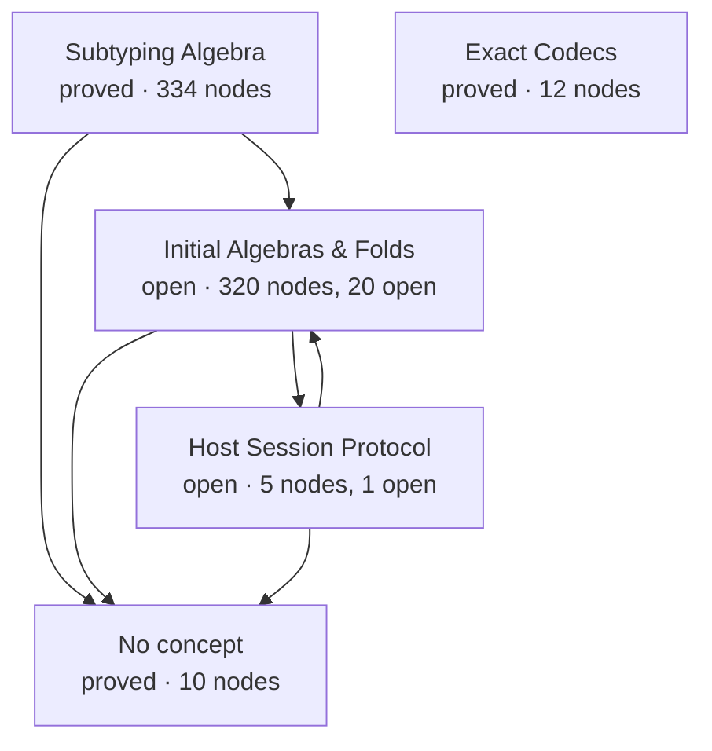

| Node | Status | Rests on | Nearest nodes |
| --- | --- | --- | --- |
| `lattice_minimal` | proved | — | `valid_max`, `minimal_refine`, `descend_minimal`, `descend_le`, `exists_minimal_below` |
| `holes_conservative` | proved | — | `withHoles_extends`, `Program.check_restrict` |
| `sketch_weakening` | proved | — | `sketch_reads_its_holes`, `sketch_more_holes` |
| `hole_hasTy` | proved | — | `normalize_idem`, `withHoles_rowOf` |
| `NodeHasTy.replace` | proved | — | `replace_envAt` |
| `replace_envAt` | proved | — | `child_step` |
| `check_closed` | proved | — | `annotationsClosed_of_formed`, `check_sound`, `hasTy_closed` |
| `Program.refusals_nil_iff` | proved | — | `check_sound`, `refusals_of_hasTy`, `Program.refusals_head` |
| `hasTy_extSlotEnv` | proved | — | `check_complete`, `check_sound` |
| `callAt_rowTy` | proved | — | `check_sound`, `focusAt_eq_some` |
| `Program.annotate_eq_table` | proved | — | `check_eq`, `table_eq_tableAt` |
| `Sketch.annotate_eq_table` | proved | — | `checkLayers_eq`, `check_eq`, `bodies_eq`, `addresses_eq_cons`, `eq_defs_of_isBlock`, `partAt_plain`, `ne_defs_of_isBlock`, `checkModule_eq_check`, `Program.annotate_eq_table`, `annotateModule_plain` |
| `table_fill` | proved | — | `annotateModule_fill`, `Sketch.annotate_eq_table`, `sigAt_part`, `check_fill_kept`, `fillAt_some` |
| `EditSession.reached_view` | proved | — | `EditSession.view_type`, `reached_coherent`, `EditSession.view_refusals`, `run_keeps` |
| `check_filled_module` | proved | — | `withHoles_extends`, `checkModule_restrict` |
| `max_assoc` | proved | — | `max_le` |
| `max_comm` | proved | — | `max_le` |
| `max_idem` | proved | — | `max_le` |
| `max_le` | proved | — | — |
| `max_mono` | proved | — | `max_le` |
| `closed` | proved | — | `admitSig_ok_iff`, `typeOfProgram_closed_app` |
| `checkAction_eq` | proved | — | `tableAt_eq_cons`, `tableAt_none`, `checkStmt_step_binds`, `effTy_of_check`, `termTy_of_term?` |
| `checkEffs_eq` | proved | — | `tableAt_eq_cons`, `tableAt_none`, `checkStmt_step_binds`, `effTy_of_check`, `termTy_of_term?` |
| `checkLayer_eq` | proved | — | `tableAt_eq_cons`, `tableAt_none`, `checkStmt_step_binds`, `effTy_of_check`, `termTy_of_term?` |
| `checkLayers_eq` | proved | — | `tableAt_eq_cons`, `tableAt_none`, `checkStmt_step_binds`, `effTy_of_check`, `termTy_of_term?` |
| `checkStmt_eq` | proved | — | `tableAt_eq_cons`, `tableAt_none`, `checkStmt_step_binds`, `effTy_of_check`, `termTy_of_term?` |
| `checkStmts_eq` | proved | — | `tableAt_eq_cons`, `tableAt_none`, `checkStmt_step_binds`, `effTy_of_check`, `termTy_of_term?` |
| `check_alg_agreeOn` | proved | — | — |
| `check_eq` | proved | — | `tableAt_eq_cons`, `tableAt_none`, `checkStmt_step_binds`, `effTy_of_check`, `termTy_of_term?` |
| `Annotate.check_restrict` | proved | — | `cata_eff_congr_on`, `hom_eq_cata_eff` |
| `bodyAt_typed` | proved | — | — |
| `BodiesHasTy.replace` | proved | — | `hasTy_replace_focusAt`, `Program.focusAt_typed`, `replaceAt_eff` |
| `matchArgsB_monotone` | proved | — | `matchArgsB_least`, `matchArgsB_complete`, `matchArgsB_sound` |
| `ask_value` | modulo | `combine_deps` | `combine_deps`, `eq_uncached` |
| `combine_deps` | goal | `combine_deps` | — |
| `explain_replays` | goal | `explain_replays` | — |
| `run_module` | proved | — | — |
| `run_part` | proved | — | — |
| `checkAction_rebase` | proved | — | — |
| `checkEffs_rebase` | proved | — | — |
| `checkLayer_rebase` | proved | — | — |
| `checkLayers_rebase` | proved | — | — |
| `checkStmt_rebase` | proved | — | — |
| `checkStmt_step_binds` | proved | — | — |
| `checkStmts_rebase` | proved | — | — |
| `check_rebase` | proved | — | — |
| `append` | proved | — | — |
| `nil` | proved | — | — |
| `push` | proved | — | `append` |
| `closed_arms` | proved | — | `closed_tagArms`, `closed_diffTag`, `closed_payloadTy`, `closed_optionTy` |
| `coherent` | goal | `coherent` | — |
| `commit_one_keepExact` | goal | `commit_one_keepExact` | `eq_uncached` |
| `commit_single_sound` | goal | `commit_single_sound` | `eq_uncached` |
| `commit_sound` | goal | `commit_sound` | `eq_uncached` |
| `revert_program` | goal | `revert_program` | `eq_uncached` |
| `step_coherent` | goal | `step_coherent` | `eq_uncached` |
| `step_refuses` | proved | — | `eq_uncached` |
| `step_replay` | proved | — | — |
| `EditSession.Coherent.ext` | proved | — | — |
| `EditSession.feed_coherent` | proved | — | `table_omit`, `table_fill`, `effTy_of_check`, `check_sound`, `check_eq`, `typedAt_table`, `typedAt_table_nil`, `Sketch.annotate_eq_table` |
| `feed_edit` | proved | — | `feed_omit_sketch`, `EditSession.feed_keeps` |
| `EditSession.feed_keeps` | proved | — | — |
| `feed_omit_sketch` | proved | — | — |
| `feed_repaint` | proved | — | `mem_splice`, `feed_spliced`, `feed_shown` |
| `feed_shown` | proved | — | `check_eq` |
| `feed_spliced` | proved | — | — |
| `EditSession.feed_undo` | proved | — | `EditSession.feed_coherent`, `EditSession.Coherent.ext`, `replaceAt_spec`, `fillAt_of_replaceAt`, `EditSession.feed_keeps`, `fillAt_some` |
| `EditSession.open_coherent` | proved | — | `Sketch.annotate_eq_table` |
| `reached_coherent` | proved | — | `EditSession.open_coherent`, `run_coherent` |
| `run_coherent` | proved | — | `EditSession.feed_coherent` |
| `run_keeps` | proved | — | `EditSession.feed_keeps` |
| `EditSession.view_refusals` | proved | — | — |
| `EditSession.view_type` | proved | — | `typedAt_table_nil` |
| `addresses_expandRefs` | proved | — | `not_belowRef_of_mem`, `addresses_rounds_filter`, `belowSite_refSites_iff` |
| `addresses_rounds_filter` | proved | — | `addresses_expandRound_filter`, `belowRef_of_expandRound` |
| `eq_defs_of_isBlock` | proved | — | — |
| `mem_addresses_expandRefs` | proved | — | `addresses_expandRefs` |
| `ne_defs_of_isBlock` | proved | — | — |
| `partAt_plain` | proved | — | — |
| `partAt_resig` | proved | — | `bodyAt_resig` |
| `scopeOf_append` | proved | — | — |
| `add_wf` | goal | `add_wf` | `eq_uncached` |
| `publish_eq_materialize` | goal | `publish_eq_materialize` | `eq_uncached` |
| `actionAll_onRef` | proved | — | — |
| `allTypes_append` | proved | — | — |
| `allTypes_nil` | proved | — | — |
| `allTypes_singleton` | proved | — | — |
| `allTypes_zipIdx_map` | proved | — | — |
| `annotationsAll_expandRefs` | proved | — | `effAll_onRef`, `layerAll_of_layerAt`, `programAnnotations_all` |
| `annotationsClosed_of_formed` | proved | — | `annotations_closed`, `programAnnotations_all` |
| `annotations_closed` | proved | — | `closed_of_formed` |
| `argsAnnotations_all` | proved | — | `allTypes_append`, `allTypes_nil` |
| `argumentAnnotations_all` | proved | — | `declAnnotations_all`, `forall_mem_some`, `allTypes_singleton`, `forall_mem_none`, `allTypes_zipIdx_map`, `optionTerm_all`, `allTypes_append`, `causeAnnotations_all`, `termAnnotations_all`, `allTypes_nil` |
| `causeAnnotations_all` | proved | — | `allTypes_append`, `optionTerm_all`, `termAnnotations_all` |
| `closed_of_formed` | proved | — | `formed_sites_iff`, `closed_of_nodes` |
| `closed_of_nodes` | proved | — | `mem_nodes_item`, `mem_nodes_field` |
| `declAnnotations_all` | proved | — | — |
| `effAll_onRef` | proved | — | — |
| `effsAll_onRef` | proved | — | — |
| `forall_mem_none` | proved | — | — |
| `forall_mem_some` | proved | — | — |
| `formed_sites_iff` | proved | — | — |
| `inputFormed_program` | proved | — | — |
| `inputFormed_services` | proved | — | — |
| `layerAll_of_layerAt` | proved | — | `nodeAnnotations_all`, `allTypes_append`, `foldMapAt_layer_fuse` |
| `layerAll_onRef` | proved | — | — |
| `layersAll_onRef` | proved | — | — |
| `mem_nodes_field` | proved | — | — |
| `mem_nodes_item` | proved | — | — |
| `nodeAnnotations_all` | proved | — | `argumentAnnotations_all`, `argsAnnotations_all` |
| `optionTerm_all` | proved | — | `forall_mem_some`, `termAnnotations_all`, `forall_mem_none`, `allTypes_nil` |
| `programAnnotations_all` | proved | — | `nodeAnnotations_all`, `allTypes_append`, `foldMapAt_eff_fuse` |
| `services_closed` | proved | — | `closed_of_formed` |
| `stmtAll_onRef` | proved | — | — |
| `stmtsAll_onRef` | proved | — | — |
| `termAnnotations_all` | proved | — | `allTypes_singleton`, `allTypes_nil`, `allTypes_append`, `foldMapAt_term_fuse` |
| `closed_genAnswer` | proved | — | `closed_join` |
| `closed_joinAnswerT` | proved | — | `closed_join` |
| `closed_merge` | proved | — | `closed_join`, `closed_joinAnswerT` |
| `closed_seq` | proved | — | `closed_join`, `closed_joinAnswerT` |
| `isBlock` | proved | — | — |
| `all_of_dropWhile_nil` | proved | — | — |
| `all_of_takeWhile_length` | proved | — | — |
| `dropWhile_eq_nil_of_all` | proved | — | — |
| `filter_eq_nil_of_all_false` | proved | — | — |
| `cause_cases_of_below` | proved | — | — |
| `cause_closed` | proved | — | — |
| `cause_least` | proved | — | `cause_cases_of_below` |
| `cause_monotone` | proved | — | `cause_reads`, `cause_least`, `cause_upper`, `normalize_idem`, `subN_trans`, `subN_refl`, `below_of_upper` |
| `cause_reads` | proved | — | `cause_cases_of_below` |
| `cause_upper` | proved | — | `subN_causeOf_causeUpper`, `subN_exitOf_causeUpper` |
| `exit_closed` | proved | — | — |
| `exit_eliminator` | proved | — | `subN_exitOf_iff`, `normalize_idem`, `subN_trans`, `subN_refl` |
| `exit_one` | proved | — | — |
| `fiber_closed` | proved | — | — |
| `fiber_eliminator` | proved | — | `subN_fiberOf_iff`, `normalize_idem`, `subN_trans`, `subN_refl` |
| `fiber_one` | proved | — | — |
| `list_closed` | proved | — | — |
| `list_eliminator` | proved | — | `subN_list_iff`, `normalize_idem`, `subN_trans`, `subN_refl` |
| `list_one` | proved | — | — |
| `option_closed` | proved | — | — |
| `option_eliminator` | proved | — | `subN_option_iff`, `normalize_idem`, `subN_trans`, `subN_refl` |
| `CustomScheme.closed_apply` | proved | — | `closed_causeInputError`, `closed_projectProduct` |
| `Scheme.closed_apply` | proved | — | `CustomScheme.closed_apply`, `closedSubst_matchArgsB`, `closed_instantiate`, `closed_monoApply` |
| `closed_monoApply` | proved | — | — |
| `closed_projectProduct` | proved | — | `closed_join` |
| `closed_typeOf` | proved | — | `spec_answersClosed`, `Scheme.closed_apply` |
| `spec_answersClosed` | proved | — | — |
| `addresses_eq_cons` | proved | — | `foldMapAt_stmt_paths_cons`, `foldMapAt_layers_paths_cons`, `foldMapAt_effs_paths_cons`, `foldMapAt_layer_paths_cons`, `foldMapAt_action_paths_cons`, `foldMapAt_stmts_paths_cons`, `foldMapAt_eff_paths_cons` |
| `addresses_expandRound_filter` | proved | — | `eq_of_refTarget?`, `child_ref`, `belowRef_ref`, `mem_childAddresses`, `filter_eq_nil_of_all_false`, `belowRef_cons`, `sizeOf_child_lt`, `child_expandRound`, `addresses_eq_cons`, `ne_ref_of_refTarget?` |
| `addresses_root` | proved | — | `mem_childAddresses`, `addresses_eq_cons` |
| `at_append` | proved | — | — |
| `at_child` | proved | — | `at_snoc` |
| `at_layers_nil` | proved | — | — |
| `at_mapRefs` | proved | — | `child_mapRefs` |
| `at_replaceAt_above` | proved | — | `replaceAt_spec`, `replaceAt_append` |
| `at_replaceAt_below` | proved | — | `replaceAt_spec`, `at_append` |
| `at_snoc` | proved | — | `at_append` |
| `at_stmts_nil` | proved | — | — |
| `belowRef_cons` | proved | — | — |
| `belowRef_of_expandRound` | proved | — | `properPrefix_eq_true_iff`, `ref_expandRound` |
| `belowRef_ref` | proved | — | — |
| `childEnv_replace_kept` | proved | — | `stmtsHead_replace_kept`, `check_complete`, `check_sound`, `replace_envAt`, `child_step` |
| `child_add_three` | proved | — | — |
| `child_expandRound` | proved | — | — |
| `child_mapRefs` | proved | — | — |
| `child_ref` | proved | — | — |
| `envAt_append` | proved | — | — |
| `envAt_child` | proved | — | `envAt_append` |
| `eq_of_refTarget?` | proved | — | — |
| `exists_at_of_mem_foldList` | proved | — | `sizeOf_child_lt`, `foldList_cases` |
| `foldList_cases` | proved | — | — |
| `layerAt_mapRefs` | proved | — | `at_mapRefs` |
| `mem_childAddresses` | proved | — | — |
| `mem_foldList_iff` | proved | — | `exists_at_of_mem_foldList` |
| `ne_ref_of_refTarget?` | proved | — | — |
| `not_belowRef_nil` | proved | — | `properPrefix_eq_true_iff` |
| `not_belowRef_of_mem` | proved | — | `at_append`, `child_ref`, `mem_addresses_iff`, `properPrefix_eq_true_iff` |
| `refTarget?_expandRound` | proved | — | — |
| `ref_expandRound` | proved | — | `child_expandRound`, `ne_ref_of_refTarget?`, `eq_of_refTarget?`, `refTarget?_expandRound` |
| `replaceAt_append` | proved | — | `replaceAt_spec` |
| `replaceAt_cons_isBlock` | proved | — | `setChild_isBlock` |
| `replaceAt_defs_body` | proved | — | — |
| `replaceAt_defs_main` | proved | — | — |
| `replaceAt_eff` | proved | — | `replaceAt_spec` |
| `replaceAt_effs_head` | proved | — | — |
| `replaceAt_effs_tail` | proved | — | — |
| `setChild_isBlock` | proved | — | — |
| `sizeOf_child_lt` | proved | — | — |
| `stmtsHead_replace_kept` | proved | — | `check_complete`, `check_sound`, `replace_envAt`, `child_step` |
| `child_step` | proved | — | `layersHasTy_cons`, `at_layers_nil`, `at_stmts_nil`, `effTy_map_of_hasTy` |
| `bodyAt_resig` | proved | — | — |
| `bodyAt_sig` | proved | — | — |
| `lt_append_left` | proved | — | — |
| `prefix_cases` | proved | — | — |
| `properPrefix_append_left` | proved | — | — |
| `properPrefix_eq_true_iff` | proved | — | — |
| `rebase_append` | proved | — | — |
| `closed_check` | proved | — | — |
| `closed_fieldOf` | proved | — | — |
| `closed_fieldType` | proved | — | `closed_fieldOf`, `lift_closed` |
| `closed_setOf` | proved | — | — |
| `closed_setType` | proved | — | `closed_setOf`, `lift_closed` |
| `closed_tagArms` | proved | — | — |
| `withHoles_extends` | proved | — | — |
| `withHoles_nil` | proved | — | — |
| `withHoles_rowOf` | proved | — | — |
| `withHoles_withHoles` | proved | — | — |
| `extends_withDefs` | proved | — | — |
| `check_fill` | proved | — | `check_fill_focusAt`, `Program.focusAt_typed`, `sigAt_part`, `checkModule_eq_check`, `check_sound`, `check_complete`, `sigAt_nil`, `Sketch.focusAt_nil`, `Sketch.check_focusAt` |
| `check_fill_focusAt` | proved | — | `sigAt_part`, `checkModule_replace_programFocusAt`, `partAt_resig`, `check_complete`, `checkModule_eq_check`, `fillAt_of_replaceAt`, `sigAt_nil`, `check_sound`, `Sketch.focusAt_nil`, `withHoles_extends`, `withHoles_withHoles` |
| `check_fill_kept` | proved | — | `fillAt_of_replaceAt`, `check_complete`, `check_fill_focusAt` |
| `check_filled` | proved | — | `holes_conservative`, `checkModule_eq_check` |
| `Sketch.check_focusAt` | proved | — | `checkModule_programFocusAt`, `Sketch.focusAt_nil` |
| `check_more_holes` | proved | — | `withHoles_extends`, `checkModule_ext`, `withHoles_withHoles` |
| `check_omit` | proved | — | `sigAt_extends`, `check_complete`, `hole_hasTy`, `check_fill` |
| `check_omit_focusAt` | proved | — | `sigAt_extends`, `check_complete`, `check_fill_focusAt`, `hole_hasTy` |
| `check_program` | proved | — | `withHoles_nil` |
| `decode_encode` | proved | — | — |
| `decode_exact` | proved | — | — |
| `expand_table_filter` | proved | — | `addresses_expandRefs`, `tableEntry_path` |
| `fillAt_of_replaceAt` | proved | — | — |
| `fillAt_some` | proved | — | — |
| `focusAt_at` | proved | — | `Program.focusAt_typed`, `partAt_at` |
| `focusAt_more_holes` | proved | — | `focusAt_at`, `table_more_holes`, `typedAt_table`, `typedAt_table_of_focusAt`, `check_more_holes`, `Sketch.focusAt_nil` |
| `Sketch.focusAt_nil` | proved | — | — |
| `hole_hasTy_focus` | proved | — | `sigAt_extends`, `hole_hasTy` |
| `mem_sourceTable` | proved | — | `sourceEntry_path` |
| `Sketch.refusals_head` | proved | — | `refusals_of_check`, `Sketch.table_head` |
| `Sketch.refusals_nil_iff` | proved | — | `refusals_of_check`, `Sketch.refusals_head` |
| `refusals_of_check` | proved | — | `table_result_refusal_none` |
| `sigAt_extends` | proved | — | `extends_withDefs`, `bodyAt_sig` |
| `sigAt_nil` | proved | — | — |
| `sigAt_part` | proved | — | — |
| `sourceAnnotate_eq_sourceTable` | proved | — | `addresses_root`, `expand_table_filter`, `Sketch.annotate_eq_table` |
| `sourceCheck_ok` | proved | — | — |
| `sourceCheck_toOption` | proved | — | — |
| `sourceEntry_path` | proved | — | `tableEntry_path` |
| `sourceRefusals_head` | proved | — | `sourceRefusals_of_ok`, `sourceTable_head` |
| `sourceRefusals_nil_iff` | proved | — | `sourceRefusals_of_ok`, `sourceRefusals_head` |
| `sourceRefusals_of_ok` | proved | — | `sourceTable_result_refusal_none` |
| `sourceTable_find` | proved | — | `mem_addresses_expandRefs`, `tableEntry_path`, `sourceEntry_path`, `find?_map_at` |
| `sourceTable_focus` | proved | — | `sourceTable_typedAt`, `typedAt_table`, `mem_sourceTable` |
| `sourceTable_head` | proved | — | `addresses_eff_head` |
| `sourceTable_result_refusal_none` | proved | — | `mem_addresses_expandRefs`, `table_result_refusal_none`, `sourceCheck_ok` |
| `sourceTable_typedAt` | proved | — | `sourceTable_find` |
| `tableEntry_path` | proved | — | — |
| `Sketch.table_head` | proved | — | `addresses_eff_head` |
| `table_more_holes` | proved | — | `annotateModule_restrict`, `check_more_holes`, `withHoles_extends`, `withHoles_withHoles`, `checkModule_sound`, `moduleHasTy_sigProgram`, `Sketch.annotate_eq_table` |
| `table_omit` | proved | — | `tableAt_perform`, `check_complete`, `table_more_holes`, `table_fill`, `hole_hasTy_focus`, `focusAt_more_holes`, `check_more_holes` |
| `table_result_refusal_none` | proved | — | `check_sound`, `check_complete`, `focusAt_eq_some`, `hasTy_focusAt`, `checkModule_sound`, `moduleHasTy_partAt_typed` |
| `SourceSession.Coherent.ext` | proved | — | — |
| `SourceSession.feed_coherent` | goal | `SourceSession.feed_coherent` | — |
| `feed_draft` | goal | `feed_draft` | — |
| `feed_keepExact` | goal | `feed_keepExact` | — |
| `SourceSession.feed_keeps` | goal | `SourceSession.feed_keeps` | — |
| `feed_root` | goal | `feed_root` | — |
| `SourceSession.feed_undo` | goal | `SourceSession.feed_undo` | — |
| `SourceSession.focusAt_typed` | proved | — | `table_eq`, `sourceTable_focus` |
| `SourceSession.open_coherent` | modulo | `combine_deps` | `sourceAnnotate_eq_sourceTable`, `ask_value` |
| `SourceSession.reached_view` | modulo | `coherent` | `coherent`, `view_eq` |
| `replay_drafts_view` | goal | `replay_drafts_view` | — |
| `table_eq` | proved | — | — |
| `view_eq` | proved | — | `SourceSession.view_type`, `SourceSession.view_refusals`, `table_eq` |
| `SourceSession.view_refusals` | proved | — | `table_eq` |
| `SourceSession.view_type` | proved | — | `sourceTable_head`, `table_eq` |
| `bodies_eq` | proved | — | `check_eq`, `bodyEntry_tail`, `bodyEntry_head`, `bodyEntry_nil`, `addresses_eq_cons` |
| `bodies_mem_under` | proved | — | `under_self`, `bodies_eq`, `mem_addresses_iff`, `bodyAt_at` |
| `bodies_restrict` | proved | — | `Annotate.check_restrict` |
| `bodies_splice` | proved | — | `splice_append_out_left`, `tableAt_path`, `replaceAt_effs_tail`, `splice_three`, `under_sibling_false`, `bodies_under`, `under_self`, `tableAt_mem_path`, `under_prefix_false`, `check_eq`, `check_sound`, `tableAt_splice`, `focusAt_eq_some`, `replaceAt_effs_head` |
| `bodies_under` | proved | — | `check_eq`, `tableAt_path` |
| `bodyEntry_head` | proved | — | — |
| `bodyEntry_nil` | proved | — | — |
| `bodyEntry_nodecl` | proved | — | — |
| `bodyEntry_tail` | proved | — | — |
| `find?_map_at` | proved | — | — |
| `mem_splice` | proved | — | — |
| `moduleLayers_restrict` | proved | — | `check_alg_agreeOn` |
| `splice_all_under` | proved | — | `dropWhile_eq_nil_of_all` |
| `splice_append_out_left` | proved | — | — |
| `splice_append_out_right` | proved | — | `all_of_dropWhile_nil`, `all_of_takeWhile_length` |
| `splice_three` | proved | — | `splice_append_out_right`, `splice_append_out_left` |
| `typedAt_table` | proved | — | `effTy_of_check`, `focusAt_eq_some` |
| `typedAt_table_nil` | proved | — | `Sketch.table_head` |
| `typedAt_table_of_focusAt` | proved | — | `check_sound`, `check_complete`, `focusAt_eq_some`, `tableEntry_path`, `mem_addresses_iff`, `focusAt_at` |
| `under_append` | proved | — | — |
| `under_prefix_false` | proved | — | — |
| `under_self` | proved | — | `under_append` |
| `under_sibling_false` | proved | — | — |
| `closed_project` | proved | — | `closed_join` |
| `closed_typeAt` | proved | — | `closed_project` |
| `closedSubst_matchArgsB` | proved | — | `closed_joinCands`, `closed_cands` |
| `closed_cands` | proved | — | — |
| `closed_diffTag` | proved | — | — |
| `closed_instantiate` | proved | — | `mem_of_lookup` |
| `closed_joinCands` | proved | — | `closed_join` |
| `closed_payloadOf` | proved | — | — |
| `closed_payloadTy` | proved | — | `closed_payloadOf` |
| `mem_of_lookup` | proved | — | — |
| `subN_causeOf_iff` | proved | — | — |
| `subN_exitOf_iff` | proved | — | — |
| `subN_fiberOf_iff` | proved | — | — |
| `subN_list_iff` | proved | — | — |
| `subN_option_iff` | proved | — | — |
| `adjoint` | proved | — | `Eliminator.lift_least`, `subN_trans`, `mapM_total`, `Eliminator.lift_upper` |
| `adjoint_le` | proved | — | `adjoint`, `normalize_idem`, `subN_trans`, `subN_refl` |
| `extendAll_adjoint` | proved | — | `adjoint`, `extendAll_eq_some_iff` |
| `extendAll_bot` | proved | — | `extendAll_agrees`, `extendAll_never` |
| `extendAll_isSome_iff` | proved | — | `extendAll_agrees`, `extendAll_eq_some_iff`, `adjoint`, `extendAll_upper` |
| `extendAll_laws` | proved | — | `extendAll_of_extend`, `extendAll_adjoint`, `extendAll_upper`, `extendAll_bot`, `extendAll_refused`, `extendAll_agrees` |
| `extendAll_least` | proved | — | `extendAll_adjoint` |
| `extendAll_lift` | proved | — | `Eliminator.lift_least`, `Eliminator.lift_upper`, `extendAll_least`, `extendAll_upper`, `adjoint` |
| `extendAll_mono` | proved | — | `extendAll_least`, `extendAll_isSome_iff`, `extendAll_upper`, `subN_trans` |
| `extendAll_upper` | proved | — | `extendAll_adjoint` |
| `extend_adjoint` | proved | — | `liftOne_some`, `adjoint`, `extend_eq_some_iff` |
| `extend_bot` | proved | — | `extend_agrees`, `extend_never` |
| `extend_isSome_iff` | proved | — | `extend_refused`, `extend_agrees`, `extend_eq_some_iff`, `liftOne_isSome_iff` |
| `extend_laws` | proved | — | `extend_two`, `extend_adjoint`, `extend_upper`, `extend_bot`, `extend_refused`, `extend_agrees` |
| `extend_least` | proved | — | `extend_adjoint` |
| `extend_liftOne` | proved | — | `extend_upper`, `Eliminator.lift_least`, `liftOne_some`, `Eliminator.lift_upper`, `extend_least`, `liftOne_isSome_iff`, `extend_isSome_iff`, `liftOne_answers`, `extend_eq_some_iff` |
| `extend_mono` | proved | — | `extend_least`, `extend_isSome_iff`, `extend_upper`, `subN_trans` |
| `extend_upper` | proved | — | `extend_adjoint` |
| `liftOne_answers` | proved | — | `Eliminator.lift_least`, `Eliminator.lift_upper`, `subN_refl`, `adjoint`, `liftOne_eq_some_iff` |
| `liftOne_isSome_iff` | proved | — | `liftOne_eq_some_iff`, `adjoint` |
| `liftOne_mono` | proved | — | `liftOne_eq_some_iff`, `liftOne_some`, `Eliminator.lift_mono` |
| `Eliminator.lift_least` | proved | — | `UnionRule.lift_least` |
| `Eliminator.lift_mono` | proved | — | `monotone`, `UnionRule.lift_mono` |
| `Eliminator.lift_upper` | proved | — | `subN_refl`, `UnionRule.lift_upper` |
| `monotone` | proved | — | `subN_refl`, `below_of_upper` |
| `lift_sound` | proved | — | `lift_transfer` |
| `below_of_upper` | proved | — | `subN_trans` |
| `closed_join` | proved | — | — |
| `extendAll_agrees` | proved | — | `extendAll_eq_some_iff` |
| `extendAll_closed` | proved | — | `lift_closed`, `extendAll_eq_some_iff` |
| `extendAll_closed_pair` | proved | — | `lift_closed_pair`, `extendAll_eq_some_iff` |
| `extendAll_eq_some_iff` | proved | — | — |
| `extendAll_never` | proved | — | `lift_never`, `extendAll_refused` |
| `extendAll_of_extend` | proved | — | `liftOne_some`, `extendAll_eq_some_iff`, `extendAll_agrees`, `extend_eq_some_iff` |
| `extendAll_refused` | proved | — | — |
| `extend_agrees` | proved | — | `extend_eq_some_iff` |
| `extend_closed` | proved | — | `liftOne_some`, `lift_closed`, `extend_eq_some_iff` |
| `extend_closed_pair` | proved | — | `liftOne_some`, `lift_closed_pair`, `extend_eq_some_iff` |
| `extend_eq_some_iff` | proved | — | — |
| `extend_never` | proved | — | `liftOne_never`, `extend_refused` |
| `extend_refused` | proved | — | — |
| `extend_two` | proved | — | `liftOne_two`, `extend_refused` |
| `foldl_all` | proved | — | — |
| `foldl_join_normalize` | proved | — | `normalize_idem` |
| `foldl_join_pair` | proved | — | — |
| `foldl_join_pair_start` | proved | — | `foldl_join_start`, `foldl_join_pair` |
| `foldl_join_start` | proved | — | `join_normalize_right`, `normalize_idem` |
| `foldl_keeps` | proved | — | — |
| `joinAll_all` | proved | — | `foldl_all` |
| `joinAll_keeps` | proved | — | `foldl_keeps` |
| `joinAll_le` | proved | — | `joinAll_all` |
| `joinAll_normalize` | proved | — | `foldl_join_normalize` |
| `join_normalize_right` | proved | — | `normalize_idem` |
| `le_joinAll` | proved | — | `joinAll_keeps` |
| `liftOne_congr` | proved | — | `lift_congr` |
| `liftOne_eq` | proved | — | — |
| `liftOne_eq_some_iff` | proved | — | — |
| `liftOne_member` | proved | — | `lift_member`, `liftOne_eq` |
| `liftOne_never` | proved | — | — |
| `liftOne_some` | proved | — | `liftOne_eq_some_iff` |
| `liftOne_two` | proved | — | — |
| `lift_all` | proved | — | `mapM_source`, `joinAll_all` |
| `lift_closed` | proved | — | `closed_join`, `lift_all` |
| `lift_closed_pair` | proved | — | `closed_join`, `lift_all` |
| `lift_congr` | proved | — | — |
| `lift_laws` | proved | — | `lift_transfer`, `UnionRule.lift_mono`, `lift_congr`, `lift_member`, `lift_never` |
| `UnionRule.lift_least` | proved | — | `subN_trans`, `mapM_source`, `joinAll_le` |
| `lift_member` | proved | — | — |
| `UnionRule.lift_mono` | proved | — | `joinAll_le`, `le_joinAll`, `mapM_answer`, `mapM_total` |
| `lift_never` | proved | — | — |
| `lift_transfer` | proved | — | `joinAll_keeps`, `mapM_answer` |
| `lift_union` | proved | — | `mapM_source`, `joinAll_le`, `le_joinAll`, `mapM_answer`, `mapM_total`, `members_union` |
| `lift_union_eq` | proved | — | `joinAll_normalize`, `normalize_idem`, `subN_equiv_iff`, `lift_union_eq_of`, `subN_trans`, `subN_refl` |
| `lift_union_eq_of` | proved | — | `lift_union` |
| `lift_union_eq_of_antisymm` | proved | — | `lift_union_eq_of` |
| `lift_union_eq_pair` | proved | — | `joinAll_normalize`, `normalize_idem`, `foldl_join_pair`, `subN_equiv_iff`, `lift_union_eq_of`, `subN_trans`, `subN_refl` |
| `lift_unique` | proved | — | `normalize_idem`, `lift_congr`, `foldl_join_start`, `mapM_cons_eq_some`, `normal_ofMembers` |
| `lift_unique_pair` | proved | — | `normalize_idem`, `lift_congr`, `foldl_join_pair_start`, `mapM_cons_eq_some`, `normal_ofMembers` |
| `UnionRule.lift_upper` | proved | — | `le_joinAll`, `subN_trans`, `mapM_answer` |
| `mapM_answer` | proved | — | `mapM_cons_eq_some` |
| `mapM_cons_eq_some` | proved | — | — |
| `mapM_source` | proved | — | `mapM_cons_eq_some` |
| `mapM_total` | proved | — | `mapM_cons_eq_some` |
| `members_union` | proved | — | — |
| `normal_ofMembers` | proved | — | — |
| `prod_antisymm` | proved | — | — |
| `subN_iff_le` | proved | — | — |
| `actionHasTy_closed` | proved | — | `closed_join`, `nil`, `closed_fiberTy`, `closed_listOf`, `termTy_closed`, `closed_joinAnswer`, `closed_merge`, `closed_seq`, `push`, `closed_getD`, `append`, `closed_armsIn`, `closed_catchIfError`, `closed_genAnswer`, `closed_rowTy`, `causeTy_closed` |
| `actionHasTy_replace` | proved | — | `NodeHasTy.replace` |
| `actionHasTy_sigProgram` | proved | — | `sigOkKey_of_serviceTy` |
| `addresses_eff_head` | proved | — | — |
| `addresses_eq_foldList` | proved | — | — |
| `annotateModule_fill` | proved | — | `annotateModule_fill_layers`, `annotateModule_fill_main`, `annotateModule_fill_body`, `eq_defs_of_isBlock`, `annotateModule_fill_plain`, `partAt_plain` |
| `annotateModule_fill_body` | proved | — | `splice_three`, `checkLayers_eq`, `tableAt_path`, `under_sibling_false`, `check_eq`, `bodies_mem_under`, `focusAt_eq_some`, `bodies_splice`, `checkModule_sound`, `moduleHasTy_partAt_typed`, `replaceAt_defs_body` |
| `annotateModule_fill_layers` | proved | — | `splice_append_out_left`, `check_eq`, `tableAt_path`, `under_sibling_false`, `bodies_under`, `checkLayers_eq`, `check_sound`, `tableAt_splice`, `focusAt_eq_some`, `checkModule_sound` |
| `annotateModule_fill_main` | proved | — | `splice_three`, `checkLayers_eq`, `tableAt_path`, `under_self`, `tableAt_mem_path`, `under_sibling_false`, `bodies_under`, `check_eq`, `check_sound`, `tableAt_splice`, `focusAt_eq_some`, `checkModule_sound`, `moduleHasTy_partAt_typed`, `replaceAt_defs_main` |
| `annotateModule_fill_plain` | proved | — | `ne_defs_of_isBlock`, `checkModule_eq_check`, `check_sound`, `table_splice`, `Program.annotate_eq_table`, `annotateModule_plain`, `replaceAt_cons_isBlock`, `isBlock` |
| `annotateModule_plain` | proved | — | — |
| `annotateModule_restrict` | proved | — | `moduleLayers_restrict`, `bodies_restrict`, `Annotate.check_restrict` |
| `argTy_closed` | proved | — | `closed_typeAt`, `closed_setTypeIn`, `closed_fieldTypeIn`, `closed_of_formed`, `closed_checkIn`, `closed_litArgTy` |
| `argsTy_closed` | proved | — | `closed_typeAt`, `closed_setTypeIn`, `closed_fieldTypeIn`, `closed_of_formed`, `closed_checkIn`, `closed_litArgTy` |
| `at_of_mem_refSites` | proved | — | `exists_at_of_mem_foldList` |
| `belowSite_refSites_iff` | proved | — | `at_of_mem_refSites` |
| `bodiesHasTy_sigProgram` | proved | — | `hasTy_sigProgram` |
| `causeInputError_causeOf` | proved | — | `extendAll_agrees` |
| `causeInputError_exitOf` | proved | — | `extendAll_agrees` |
| `causeInputError_upper` | proved | — | `cause_upper`, `cause_mono`, `normalize_idem`, `subN_trans`, `subN_refl`, `UnionRule.lift_upper`, `subN_causeOf_causeUpper`, `subN_exitOf_causeUpper`, `extendAll_eq_some_iff` |
| `causeTy_closed` | proved | — | `closed_join`, `termTy_closed` |
| `cause_mono` | proved | — | `subN_exitOf_iff`, `subN_causeOf_causeUpper`, `subN_trans`, `subN_causeOf_iff` |
| `checkBodies_restrict` | proved | — | `Program.check_restrict` |
| `checkModule_ext` | proved | — | `checkModule_sound`, `moduleHasTy_ext`, `checkModule_complete` |
| `checkModule_programFocusAt` | proved | — | `checkModule_sound`, `moduleHasTy_programFocusAt` |
| `checkModule_replace_programFocusAt` | proved | — | `checkModule_complete`, `check_sound`, `checkModule_sound`, `moduleHasTy_replace_programFocusAt` |
| `checkModule_restrict` | proved | — | `checkBodies_restrict`, `Program.check_restrict` |
| `checkRow_rowBindings` | proved | — | — |
| `Program.check_focusAt` | proved | — | `check_sound`, `hasTy_focusAt` |
| `check_replace` | proved | — | `replaceAt_eff`, `check_complete`, `check_sound`, `hasTy_replace` |
| `check_replace_focusAt` | proved | — | `check_sound`, `hasTy_replace_focusAt`, `check_complete`, `Program.focusAt_typed`, `replaceAt_eff` |
| `childAddresses_map_tableEntryAt` | proved | — | — |
| `closedSig_app` | proved | — | `services_closed`, `closed_serviceTy`, `closed_nativeAtomTy` |
| `closedSig_native` | proved | — | `closed_nativeServiceTy`, `closed_nativeAtomTy` |
| `closed_catchIfError` | proved | — | `closed_join` |
| `closed_causeInputError` | proved | — | `cause_closed`, `extendAll_closed` |
| `closed_exitOf` | proved | — | `exit_closed`, `extendAll_closed_pair` |
| `closed_fiberTy` | proved | — | `fiber_closed`, `extendAll_closed_pair` |
| `closed_getD` | proved | — | — |
| `closed_joinAnswer` | proved | — | `closed_join` |
| `closed_listOf` | proved | — | `list_closed`, `extendAll_closed` |
| `closed_litArgTy` | proved | — | — |
| `closed_nativeAtomTy` | proved | — | `closed_typeOf` |
| `closed_nativeServiceTy` | proved | — | — |
| `closed_optionTy` | proved | — | `option_closed`, `lift_closed` |
| `closed_rowTy` | proved | — | `closed_of_formed` |
| `closed_serviceTy` | proved | — | — |
| `effTy_map_of_hasTy` | proved | — | `check_complete`, `check_sound` |
| `effTy_of_check` | proved | — | `check_sound`, `check_complete` |
| `effsHasTy_closed` | proved | — | `closed_join`, `nil`, `closed_fiberTy`, `closed_listOf`, `termTy_closed`, `closed_joinAnswer`, `closed_merge`, `closed_seq`, `push`, `closed_getD`, `append`, `closed_armsIn`, `closed_catchIfError`, `closed_genAnswer`, `closed_rowTy`, `causeTy_closed` |
| `effsHasTy_replace` | proved | — | `NodeHasTy.replace` |
| `effsHasTy_sigProgram` | proved | — | `sigOkKey_of_serviceTy` |
| `exitOf_exitOf` | proved | — | `extendAll_agrees` |
| `exitOf_upper` | proved | — | `exit_eliminator`, `normalize_idem`, `subN_trans`, `subN_refl`, `extendAll_upper` |
| `fiberTy_fiberOf` | proved | — | `extendAll_agrees` |
| `fiberTy_upper` | proved | — | `fiber_eliminator`, `normalize_idem`, `subN_trans`, `subN_refl`, `extendAll_upper` |
| `focusAt_eq_some` | proved | — | — |
| `Program.focusAt_nil` | proved | — | — |
| `Program.focusAt_typed` | proved | — | `check_sound`, `focusAt_eq_some` |
| `foldMapAt_action_base` | proved | — | — |
| `foldMapAt_action_fuse` | proved | — | — |
| `foldMapAt_action_hom` | proved | — | — |
| `foldMapAt_action_paths_cons` | proved | — | `foldMapAt_action_paths_shift` |
| `foldMapAt_action_paths_shift` | proved | — | `foldMapAt_action_hom`, `foldMapAt_action_base` |
| `foldMapAt_eff_base` | proved | — | — |
| `foldMapAt_eff_fuse` | proved | — | — |
| `foldMapAt_eff_hom` | proved | — | — |
| `foldMapAt_eff_paths_cons` | proved | — | `foldMapAt_eff_paths_shift` |
| `foldMapAt_eff_paths_shift` | proved | — | `foldMapAt_eff_hom`, `foldMapAt_eff_base` |
| `foldMapAt_effs_base` | proved | — | — |
| `foldMapAt_effs_fuse` | proved | — | — |
| `foldMapAt_effs_hom` | proved | — | — |
| `foldMapAt_effs_paths_cons` | proved | — | `foldMapAt_effs_paths_shift` |
| `foldMapAt_effs_paths_shift` | proved | — | `foldMapAt_effs_hom`, `foldMapAt_effs_base` |
| `foldMapAt_layer_base` | proved | — | — |
| `foldMapAt_layer_fuse` | proved | — | — |
| `foldMapAt_layer_hom` | proved | — | — |
| `foldMapAt_layer_paths_cons` | proved | — | `foldMapAt_layer_paths_shift` |
| `foldMapAt_layer_paths_shift` | proved | — | `foldMapAt_layer_hom`, `foldMapAt_layer_base` |
| `foldMapAt_layers_base` | proved | — | — |
| `foldMapAt_layers_fuse` | proved | — | — |
| `foldMapAt_layers_hom` | proved | — | — |
| `foldMapAt_layers_paths_cons` | proved | — | `foldMapAt_layers_paths_shift` |
| `foldMapAt_layers_paths_shift` | proved | — | `foldMapAt_layers_hom`, `foldMapAt_layers_base` |
| `foldMapAt_stmt_base` | proved | — | — |
| `foldMapAt_stmt_fuse` | proved | — | — |
| `foldMapAt_stmt_hom` | proved | — | — |
| `foldMapAt_stmt_paths_cons` | proved | — | `foldMapAt_stmt_paths_shift` |
| `foldMapAt_stmt_paths_shift` | proved | — | `foldMapAt_stmt_hom`, `foldMapAt_stmt_base` |
| `foldMapAt_stmts_base` | proved | — | — |
| `foldMapAt_stmts_fuse` | proved | — | — |
| `foldMapAt_stmts_hom` | proved | — | — |
| `foldMapAt_stmts_paths_cons` | proved | — | `foldMapAt_stmts_paths_shift` |
| `foldMapAt_stmts_paths_shift` | proved | — | `foldMapAt_stmts_hom`, `foldMapAt_stmts_base` |
| `foldMapAt_term_fuse` | proved | — | — |
| `foldMapAt_terms_fuse` | proved | — | — |
| `hasTy_closed` | proved | — | `closed_join`, `nil`, `closed_fiberTy`, `closed_listOf`, `termTy_closed`, `closed_joinAnswer`, `closed_merge`, `closed_seq`, `push`, `closed_getD`, `append`, `closed_armsIn`, `closed_catchIfError`, `closed_genAnswer`, `closed_rowTy`, `causeTy_closed` |
| `hasTy_focusAt` | proved | — | `check_complete`, `check_sound`, `focusAt_eq_some`, `replace_envAt` |
| `hasTy_replace` | proved | — | `NodeHasTy.replace` |
| `hasTy_replace_focusAt` | proved | — | `check_complete`, `check_sound`, `replace_envAt`, `focusAt_eq_some` |
| `hasTy_sigProgram` | proved | — | `sigOkKey_of_serviceTy` |
| `kept_eq_certified` | goal | `kept_eq_certified` | — |
| `layerHasTy_closed` | proved | — | `closed_join`, `nil`, `closed_fiberTy`, `closed_listOf`, `termTy_closed`, `closed_joinAnswer`, `closed_merge`, `closed_seq`, `push`, `closed_getD`, `append`, `closed_armsIn`, `closed_catchIfError`, `closed_genAnswer`, `closed_rowTy`, `causeTy_closed` |
| `layerHasTy_replace` | proved | — | `NodeHasTy.replace` |
| `layerHasTy_sigProgram` | proved | — | `sigOkKey_of_serviceTy` |
| `layersHasTy_closed` | proved | — | `closed_join`, `nil`, `closed_fiberTy`, `closed_listOf`, `termTy_closed`, `closed_joinAnswer`, `closed_merge`, `closed_seq`, `push`, `closed_getD`, `append`, `closed_armsIn`, `closed_catchIfError`, `closed_genAnswer`, `closed_rowTy`, `causeTy_closed` |
| `layersHasTy_cons` | proved | — | — |
| `layersHasTy_replace` | proved | — | `NodeHasTy.replace` |
| `layersHasTy_sigProgram` | proved | — | `sigOkKey_of_serviceTy` |
| `listOf_list` | proved | — | `extendAll_agrees` |
| `listOf_upper` | proved | — | `list_eliminator`, `normalize_idem`, `subN_trans`, `subN_refl`, `extendAll_upper` |
| `mem_addresses_iff` | proved | — | `yieldAt_addressYield`, `mem_foldList_iff`, `addresses_eq_foldList` |
| `moduleHasTy_partAt_typed` | proved | — | `partAt_of_hasTy`, `bodyAt_typed` |
| `moduleHasTy_programFocusAt` | proved | — | `partAt_of_hasTy`, `hasTy_focusAt`, `bodyAt` |
| `moduleHasTy_replace_programFocusAt` | proved | — | `partAt_of_hasTy`, `hasTy_replace_focusAt`, `Program.focusAt_typed`, `replaceAt_eff`, `BodiesHasTy.replace` |
| `moduleHasTy_sigProgram` | proved | — | `layerHasTy_sigProgram`, `hasTy_sigProgram`, `bodiesHasTy_sigProgram` |
| `nodeAnswer_replace_kept` | proved | — | `check_complete`, `check_sound`, `replace_envAt` |
| `optionTy_eq_normal` | proved | — | `liftOne_eq` |
| `optionTy_option` | proved | — | `lift_member` |
| `optionTy_upper` | proved | — | `option_eliminator`, `normalize_idem`, `subN_trans`, `subN_refl`, `Eliminator.lift_upper` |
| `references_move` | proved | — | `at_replaceAt_above`, `replaceAt_spec`, `properPrefix_append_left`, `lt_append_left`, `rebase_append`, `layerAt_mapRefs`, `prefix_cases`, `at_of_mem_refSites`, `at_append`, `at_mapRefs`, `at_replaceAt_below`, `replaceAt_cons_isBlock` |
| `Program.refusals_head` | proved | — | `Program.table_head`, `check_sound`, `refusals_of_hasTy` |
| `refusals_of_hasTy` | proved | — | `table_result_refusal_none_of_hasTy` |
| `sigOkKey_of_serviceTy` | proved | — | — |
| `sketch_more_holes` | proved | — | `withHoles_extends`, `check_ext`, `withHoles_withHoles` |
| `sketch_reads_its_holes` | proved | — | `withHoles_extends`, `Program.check_restrict`, `withHoles_withHoles` |
| `stmtsHasTy_closed` | proved | — | `closed_join`, `nil`, `closed_fiberTy`, `closed_listOf`, `termTy_closed`, `closed_joinAnswer`, `closed_merge`, `closed_seq`, `push`, `closed_getD`, `append`, `closed_armsIn`, `closed_catchIfError`, `closed_genAnswer`, `closed_rowTy`, `causeTy_closed` |
| `stmtsHasTy_replace` | proved | — | `NodeHasTy.replace` |
| `stmtsHasTy_sigProgram` | proved | — | `sigOkKey_of_serviceTy` |
| `subN_causeOf_causeUpper` | proved | — | — |
| `subN_exitOf_causeUpper` | proved | — | `subN_trans`, `subN_refl`, `subN_exitOf_iff` |
| `tableAt_eq_cons` | proved | — | `tableEntryAt_nil`, `childAddresses_map_tableEntryAt`, `addresses_eq_cons` |
| `tableAt_mem_path` | proved | — | `mem_addresses_iff` |
| `tableAt_none` | proved | — | — |
| `tableAt_path` | proved | — | — |
| `tableAt_perform` | proved | — | `tableAt_eq_cons` |
| `tableAt_rebase` | proved | — | `check_rebase` |
| `tableAt_splice` | proved | — | `child_add_three`, `splice_three`, `tableAt_eq_cons`, `under_prefix_false`, `tableAt_mem_path`, `under_sibling_false`, `nodeAnswer_replace_kept`, `childEnv_replace_kept`, `child_step`, `under_append`, `tableAt_path`, `splice_all_under` |
| `tableEntryAt_nil` | proved | — | — |
| `table_eq_tableAt` | proved | — | — |
| `Program.table_head` | proved | — | `addresses_eff_head` |
| `table_result_refusal_none_of_hasTy` | proved | — | `check_sound`, `check_complete`, `focusAt_eq_some`, `hasTy_focusAt` |
| `table_splice` | proved | — | `check_sound`, `tableAt_splice`, `table_eq_tableAt`, `focusAt_eq_some` |
| `termTy_closed` | proved | — | `argTy_closed` |
| `termTy_of_term?` | proved | — | — |
| `typeOfProgram_closed` | proved | — | `nil`, `hasTy_closed`, `checkModule_sound`, `annotationsClosed_of_formed`, `annotationsAll_expandRefs` |
| `typeOfProgram_closed_app` | proved | — | `inputFormed_program`, `inputFormed_services`, `closedSig_app`, `typeOfProgram_closed` |
| `yieldAt_addressYield` | proved | — | — |
| `drop_le` | proved | — | — |
| `drop_le_of_subset` | proved | — | — |
| `exists_mem_subslices` | proved | — | `filter_mem_sublists` |
| `failed_rest` | proved | — | — |
| `failed_snoc` | proved | — | — |
| `filter_mem_sublists` | proved | — | — |
| `firstDrop_append` | proved | — | — |
| `firstDrop_length` | proved | — | — |
| `instIsPreorder` | proved | — | — |
| `instLawfulOrderInf` | proved | — | — |
| `instLawfulOrderSup` | proved | — | — |
| `le_drop` | proved | — | — |
| `le_of_mem_subslices` | proved | — | `sublists_subset` |
| `not_mem_drop` | proved | — | — |
| `omitted_anti` | proved | — | — |
| `omitted_full` | proved | — | — |
| `omitted_subset` | proved | — | — |
| `restart_append` | proved | — | `failed_snoc`, `failed_rest`, `restart_of_some`, `firstDrop_append`, `restart_of_none`, `firstDrop_length` |
| `restart_eq_sweep` | proved | — | `restart_append` |
| `restart_of_none` | proved | — | `firstDrop_length` |
| `restart_of_some` | proved | — | `firstDrop_length` |
| `sublists_subset` | proved | — | — |
| `sweepAsked_length` | proved | — | — |
| `sweepFreeAsked_sublist` | proved | — | `drop_le_of_subset` |
| `sweepFree_congr` | proved | — | — |
| `sweepFree_eq_sweep` | proved | — | `drop_le_of_subset` |
| `sweep_congr` | proved | — | — |
| `sweep_kept_needed` | proved | — | `sweep_sublist`, `drop_le_of_subset` |
| `sweep_sublist` | proved | — | — |
| `sweep_valid` | proved | — | — |
| `keeps_above` | proved | — | `needs` |
| `needs` | proved | — | `minimal_iff_drop` |
| `of_same_sites` | proved | — | `instIsPreorder`, `valid_up` |
| `contribution_le` | proved | — | — |
| `contribution_lub` | proved | — | `minimals_sound`, `minimals_complete` |
| `contribution_valid` | proved | — | `descend_minimal`, `descend_le`, `instIsPreorder`, `contribution_lub`, `descend_valid`, `valid_up` |
| `decide_valid_up` | proved | — | `valid_up` |
| `descendTree_asks` | proved | — | `sweepFree_congr`, `parentOmitted_sound`, `decide_valid_up`, `sweepFreeAsked_sublist` |
| `descendTree_eq_descend` | proved | — | `parentOmitted_sound`, `decide_valid_up`, `sweepFree_eq_sweep` |
| `descendTree_minimal` | proved | — | `descendTree_eq_descend`, `descend_minimal` |
| `descend_asks` | proved | — | `sweep_congr`, `sweepAsked_length` |
| `descend_eq_restart` | proved | — | `decide_valid_up`, `restart_eq_sweep`, `firstDrop_length` |
| `descend_le` | proved | — | `descend_sublist` |
| `descend_minimal` | proved | — | `decide_valid_up`, `sweep_kept_needed`, `descend_valid`, `minimal_iff_drop` |
| `descend_sublist` | proved | — | `sweep_sublist` |
| `descend_valid` | proved | — | `sweep_valid` |
| `exists_minimal_below` | proved | — | `descend_minimal`, `descend_le` |
| `isMinimal_iff` | proved | — | `minimal_iff_drop` |
| `minimal_iff_drop` | proved | — | `le_drop`, `valid_up`, `drop_le`, `not_mem_drop` |
| `minimal_refine` | proved | — | `valid_refine`, `exists_minimal_below` |
| `minimals_complete` | proved | — | `of_same_sites`, `isMinimal_iff`, `exists_mem_subslices` |
| `minimals_sound` | proved | — | `isMinimal_iff`, `le_of_mem_subslices` |
| `ofOmitted_full` | proved | — | `omitted_full` |
| `parentOmitted_sound` | proved | — | — |
| `valid_max` | proved | — | `instLawfulOrderSup`, `instIsPreorder`, `valid_up` |
| `valid_refine` | proved | — | — |
| `valid_up` | proved | — | — |
| `ofJsonAnyOrder_exact` | proved | — | `ofJson_exact` |
| `ofJson_exact` | proved | — | `read_exact` |
| `read_exact` | proved | — | `readIn_exact` |
| `canonicalHex?_exact` | proved | — | — |
| `natOfBinary64_exact` | proved | — | — |
| `natOfBinary64_finite` | proved | — | — |
| `readFields_exact` | proved | — | `tagOfName_exact`, `canonicalHex?_exact`, `natOfBinary64_exact` |
| `readIn_exact` | proved | — | `tagOfName_exact`, `canonicalHex?_exact`, `natOfBinary64_exact` |
| `readList_exact` | proved | — | `tagOfName_exact`, `canonicalHex?_exact`, `natOfBinary64_exact` |
| `tagOfName_exact` | proved | — | — |
| `except_error_bind` | proved | — | — |
| `except_ok_bind` | proved | — | — |
| `except_pure` | proved | — | — |
| `Program.check_restrict` | proved | — | `cata_eff_congr_on`, `hom_eq_cata_eff` |
| `normalize_idem` | proved | — | — |
| `check_sound` | proved | — | — |
| `check_complete` | proved | — | — |
| `checkModule_eq_check` | proved | — | — |
| `admitSig_ok_iff` | proved | — | — |
| `cata_eff_congr_on` | proved | — | — |
| `hom_eq_cata_eff` | proved | — | — |
| `matchArgsB_least` | proved | — | `candsList_below`, `solve_between` |
| `matchArgsB_complete` | proved | — | `covers`, `candsList_below`, `solve_between` |
| `matchArgsB_sound` | proved | — | — |
| `eq_uncached` | proved | — | — |
| `replaceAt_spec` | proved | — | — |
| `subN_trans` | proved | — | — |
| `subN_refl` | proved | — | — |
| `partAt_at` | proved | — | `bodyAt_at` |
| `checkModule_sound` | proved | — | `check_sound` |
| `bodyAt_at` | proved | — | — |
| `subN_equiv_iff` | proved | — | `sub_antisymm_canonical`, `normalize_idem` |
| `closed_armsIn` | proved | — | `closed_tagArmsIn`, `option_closed`, `liftIn_closed`, `closed_arms` |
| `closed_setTypeIn` | proved | — | `closed_setOf`, `liftIn_closed` |
| `closed_fieldTypeIn` | proved | — | `closed_fieldOf`, `liftIn_closed` |
| `closed_checkIn` | proved | — | — |
| `moduleHasTy_ext` | proved | — | — |
| `checkModule_complete` | proved | — | `checkModule_eq_check`, `check_complete` |
| `partAt_of_hasTy` | proved | — | — |
| `bodyAt` | proved | — | — |
| `check_ext` | proved | — | `check_sound`, `check_complete` |
| `candsList_below` | proved | — | `cands_below` |
| `solve_between` | proved | — | `joinCands_upper`, `solve_lookup_of_mem`, `mem_lowers`, `joinCands_least`, `instantiate_solve` |
| `covers` | proved | — | `above_args`, `above_prod`, `prod_or_not`, `recovers`, `cands_args`, `args`, `below_args`, `cands_union_right`, `head`, `cands_var` |
| `sub_antisymm_canonical` | proved | — | — |
| `closed_tagArmsIn` | proved | — | `closed_membersIn` |
| `liftIn_closed` | proved | — | `closed_membersIn`, `mapM_source`, `closed_join`, `joinAll_all` |
| `cands_below` | proved | — | `args`, `comp_ne_contra`, `cands_args`, `below_args`, `cands_union_right`, `cands_mem_members`, `head`, `cands_var` |
| `joinCands_upper` | proved | — | `normalize_idem`, `subN_trans`, `subN_refl` |
| `solve_lookup_of_mem` | proved | — | — |
| `mem_lowers` | proved | — | — |
| `joinCands_least` | proved | — | `subN_join_least`, `subN_never` |
| `instantiate_solve` | proved | — | `lookup_added` |
| `above_args` | proved | — | `mem_zip_map_right`, `instance_shape` |
| `above_prod` | proved | — | — |
| `prod_or_not` | proved | — | — |
| `recovers` | proved | — | `mem_zip_self_map`, `cands_args`, `instance_shape`, `mem_varsOf_args`, `prod_right_cands`, `prod_left_cands`, `args`, `prod_or_not`, `head`, `cands_var` |
| `cands_args` | proved | — | `candsItems_eq`, `candsFields_eq`, `comp_inv`, `comp_co` |
| `args` | proved | — | `noApp_args` |
| `below_args` | proved | — | — |
| `cands_union_right` | proved | — | — |
| `head` | proved | — | — |
| `cands_var` | proved | — | — |
| `closed_membersIn` | proved | — | — |
| `comp_ne_contra` | proved | — | `comp_inv`, `comp_co` |
| `cands_mem_members` | proved | — | `cands_union_right` |
| `subN_join_least` | proved | — | `normalize_idem` |
| `subN_never` | proved | — | — |
| `lookup_added` | proved | — | `lowers_cons` |
| `mem_zip_map_right` | proved | — | — |
| `instance_shape` | proved | — | — |
| `mem_zip_self_map` | proved | — | — |
| `mem_varsOf_args` | proved | — | — |
| `prod_right_cands` | proved | — | `head`, `args`, `cands_var`, `cands_mem_members`, `prod_member_right` |
| `prod_left_cands` | proved | — | `head`, `args`, `cands_var`, `cands_mem_members`, `prod_member_left` |
| `candsItems_eq` | proved | — | — |
| `candsFields_eq` | proved | — | — |
| `comp_inv` | proved | — | — |
| `comp_co` | proved | — | — |
| `noApp_args` | proved | — | `noAppItems_eq_all`, `noAppFields_eq_all` |
| `lowers_cons` | proved | — | — |
| `prod_member_right` | proved | — | — |
| `prod_member_left` | proved | — | — |
| `noAppItems_eq_all` | proved | — | — |
| `noAppFields_eq_all` | proved | — | — |

## Acceptance programs

The rc.112 probe programs as acceptance tests (decisions row 206; `Test/Dogfood/README.md`). Each row is the `stage` its battery declares, which a guard ties to the battery's own measurement, and the requirements it `waitsOn`. A slice that moves a program edits both.

| Program | Admitted | Answer | Printed | Read back | Refused parts | Waits on |
| --- | --- | --- | --- | --- | --- | --- |
| `P1HttpCache` | yes | differs | yes | yes | a Quote record in the key-value cache (typing: requestNotSubtype) | `R3`, `R6`, `R7`, `R10` |
| `P2HandlerLayers` | yes | rc112 | yes | yes | AppConfig as a string service (serviceCarrier: signature none); CurrentUser as a record service (serviceCarrier: signature none); a number in a template string (typing: term) | `R3`, `R5`, `R7`, `R10`, `R13` |
| `P3WorkerQueue` | yes | differs | yes | yes | the log's append at Ref\<never\[\]\> (typing: resultNotSubtype) | `R3`, `R4`, `R10`, `R11` |
| `P4RateLimiter` | yes | rc112 | yes | yes | — | `R10` |
| `P5LedgerService` | no | notRun | no | no | — | `R3`, `R4`, `R6`, `R7`, `R10` |

The programs each requirement keeps waiting:

- `R3`: `P1HttpCache`, `P2HandlerLayers`, `P3WorkerQueue`, `P5LedgerService`
- `R4`: `P3WorkerQueue`, `P5LedgerService`
- `R5`: `P2HandlerLayers`
- `R6`: `P1HttpCache`, `P5LedgerService`
- `R7`: `P1HttpCache`, `P2HandlerLayers`, `P5LedgerService`
- `R10`: `P1HttpCache`, `P2HandlerLayers`, `P3WorkerQueue`, `P4RateLimiter`, `P5LedgerService`
- `R11`: `P3WorkerQueue`
- `R13`: `P2HandlerLayers`

