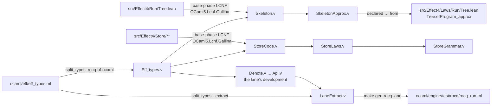

# The Rocq workspace

This directory holds the Rocq proofs that a declared fact of the Lean tree cites
(`declared … from`, `tools/ProofGraph/Declared.lean`). The owner ruled on 2026-10-16 that hard
proofs live in Rocq and Lean declares them. A proof here is about Lean's own code. Its
definitions are printed from Lean's compiler IR, never copied by hand.

Two rules hold the workspace:

* a declared fact cites a theorem in this directory, and nowhere else;
* a definition a proof reads is generated (`make gen-rocq`), marked, and regenerable.

One development is the exception: the comparison lane's (`Denote.v` to `Api.v`, and
`LaneExtract.v`). It is a hand transcription of Lean's call tree, from the study of 2026-10-16.
It moved here so that the lane's generated runner has its producer in the tree (decisions row
431). No declared fact cites it. The lane compares its extraction with Lean's tree lowered by
LCNF, a finite check (decisions row 411 (3)). The study's other developments, the vessel and to-do studies,
stay in `git:98a29895b800556365a2edc9924f3ed12787b820:docs/research/2026-10-16-itrees`. They are history, not authority.

## Map

| File | What it is | Made by |
| --- | --- | --- |
| `Eff_types.v` | the program types, as `ocaml/eff/eff_types.ml` spells Lean's: `eff`, `term`, `val_`, `exit_`, `row` and the rest | GENERATED: `make gen-rocq` (rocq-of-ocaml over `tools/split_types.ml`'s components) |
| `Skeleton.v` | `Effect4.Run.Tree`'s control skeleton: `tree`, `bind`, `loop`, `whileRounds`, `level`, `statements`, `unfolded`, `ofProgram`, as the functor `Skeleton (E : Eval)`; the evaluator `Tree.Eval` is the module type `Eval` | GENERATED: `make gen-rocq` (`src/OCaml5/Tools/GallinaGen.lean`, printer `OCaml5.Lcnf.Gallina`) |
| `SkeletonApprox.v` | `Approx.ofProgram_approx`: a larger budget only extends the tree, for every program and every evaluator | by hand |
| `Assumptions.v` | the assumptions of each theorem above, over a module declared at `Eval` | by hand |
| `StoreCode.v` | `Effect4.Store`'s code: the value and node codecs, the find, the put and its admission, `Word.apply`, `Word.wf` and `verify`, as the functor `Code (E : Prim)`; the hash, the byte codecs of numbers and strings, the float test, `Node.decode`, the zero digest and the equality deciders are `Prim`'s parameters | GENERATED: `make gen-rocq` (`OCaml5.Lcnf.Gallina`, `storeSpec`) |
| `StoreLaws.v` | the store's laws over `Code`: the hash injective on a sound store's residents, domain separation, the put as a growing map from digest to bytes, a built store ranked by insertion order, `verify` sound | by hand |
| `StoreGrammar.v` | one byte language: the value codec is prefix-free, so values and nodes have one parse each, and a conflict in a sound store is a collision of bytes; the codec laws are a premise | by hand |
| `StoreAssumptions.v` | the assumptions of each store theorem, over a module declared at `Prim` and its laws | by hand |
| `tools/split_types.ml` | the program types' modules (`Ty.t`, `module rec Eff …`) flattened to one type group in the Rocq names (`ty`, `Eff_succeed`), then printed as its components, so rocq-of-ocaml takes it; with `--extract`, the inverse as Rocq extraction directives (`E4.Eff_types.eff` is `Eff_types.Eff.t`), the lane's `EffExtract.v` | by hand |
| `Denote.v`, `Run.v`, `Judgments.v` | the comparison lane's development: an interaction-tree meaning of a fragment of `Eff`, a transcription of `denoteRows` with definitions and loops; its hosts and frontier; its trace, divergence and equivalence judgments | by hand (moved from the study of 2026-10-16) |
| `Budget.v`, `BudgetDefs.v`, `Api.v` | the lane's budgeted tree: `denoteB`, then `denoteBD` with definitions by budgeted unfolding, monotone and below the meaning (`denoteD_approx`, `adequacyD`, `denoteBD_same`); the run under a host, `run_at`, and the writing surface | by hand (moved from the study of 2026-10-16) |
| `LaneExtract.v` | the lane's producer: `Api.run_at` under a cells function and a row function, extracted with Lean's evaluator realized by `ocaml/engine/test/rocq/lane_eval.ml`, at the program types of `EffExtract.v` | by hand; its output `ocaml/engine/test/rocq/rocq_run.ml` and `.mli` is GENERATED by `make gen-rocq-lane` |
| `_RocqProject` | the load path (`-Q . E4`) and the files, in order | by hand |



## The printer's rules

`OCaml5.Lcnf.Gallina` prints the base phase, which keeps a `Nat` match as `zero`/`succ` and
local functions in place. Rocq's guard checker reads both. Each constant has one printing rule,
or the printer refuses it by name:

* a declaration of the spec prints as itself;
* a constructor prints by its Rocq name;
* a constant of `Effect4.Run.Tree.Eval` prints as one parameter of `Eval`;
* a constant the store's spec names prints as one parameter of `Prim`;
* a library constant prints by its row of the spec's `prims`. The row is the Rocq function that
  agrees with it on Lean's values (`List.appendTR` is `app`, `Nat.decLt` is `Z.ltb`).

A `Decidable` prints as `bool`, and a proof field or a proof binder is erased, as the compiler
erases it. A `UInt8` or a `UInt64` prints as `int`, like a natural: the store compares them and never
computes with them. Take a function on `List T` that is recursive with a function on `T`, as
`Val.encodeList` is with `Val.encode`. It prints as a local `fix` inside the function on `T`.
Rocq refuses the mutual form over a nested type. The store's closure walk is not printed: specialization makes
its nested `foldl` a mutual recursion on two different arguments, which the guard checker refuses.

A budget counter prints as Rocq `nat`, and every other natural as `int` (Z). Z is exact for a
natural only where no Nat operation reads it. So the printer refuses, by name, a natural printed
as `int` that meets one. The header of `Skeleton.v` lists the counters chosen.

## Commands

Regenerate the two generated files (the opam switch `rocq`, Rocq 9.0.1 with rocq-of-ocaml):

```bash
make gen-rocq
```

Regenerate the comparison lane's runner after `make gen-rocq`. It compiles the lane's development
and `LaneExtract.v` in a scratch folder and writes `ocaml/engine/test/rocq/rocq_run.ml` and
`.mli`. A stale `Eff_types.v` fails the compile. `make check-ocaml` builds and runs the lane:

```bash
make gen-rocq-lane
```

Compile the workspace. Run it when `Effect4.Run.Tree` or the printer changes, and record the
result in the landing's receipt. No gate runs it:

```bash
cd rocq && for f in Eff_types Skeleton SkeletonApprox Assumptions StoreCode StoreLaws StoreGrammar StoreAssumptions; do opam exec --switch=rocq -- rocq compile -Q . E4 $f.v || break; done
```

`Assumptions.v` prints the assumptions of `Approx.ofProgram_approx`. They are the 25 parameters of
`Eval` (23 operations and 2 types), and nothing else. `StoreAssumptions.v` prints those of the
store's theorems: parameters of `Prim` and the three equality laws of `PrimLaws`, and nothing
else.

`git:98a29895b800556365a2edc9924f3ed12787b820:docs/research/2026-10-16-itrees/reproduce.sh` (step 12) compiles a copy of this workspace. It
checks that `Eff_types.v` is its own pipeline's, and that a mutated skeleton fails the proof.
